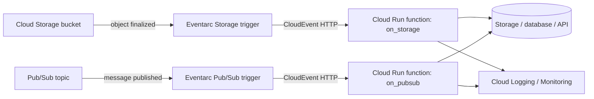

# Triggering functions from Cloud Storage and Pub/Sub

> **Chapter:** Cloud Run functions and Eventarc  
> **Module:** CLOUD_PROVIDERS_GCP  
> **Module scope:** Explore Google Cloud from project organization, IAM, and VPC to Compute Engine, GKE, Cloud Run, storage services, and databases. Through deployment scenarios, learners select services, protect resources, automate releases, and monitor reliability alongside cost.

A system often needs to process a file **after upload completes**, or process an order when a **new message** arrives without forcing the sender to wait for the result. An **event-driven** architecture fits both: **Cloud Storage** emits object events; **Pub/Sub** emits message events; **Eventarc** routes them to **Cloud Run functions** deployed from source code.

This lesson uses **two Python functions** receiving CloudEvents: one reacting to `google.cloud.storage.object.v1.finalized` and one reacting to `google.cloud.pubsub.topic.v1.messagePublished`. The focus is on payloads, IAM identities, deploying Eventarc triggers, retries, idempotency, and end-to-end verification. All Cloud operations in these examples are intended only for an authorized **sandbox project**.

## Learning objectives

After this lesson, you will be able to:

1. Explain the **event source → Eventarc trigger → Cloud Run function** flow and CloudEvent structure.
2. Choose the right Cloud Storage/Pub/Sub event type, distinguishing Pub/Sub **Eventarc CloudEvents** from **HTTP push**.
3. Write Python handlers with **Functions Framework** and deploy via `gcloud run deploy --source --function`.
4. Configure the trigger SA, `roles/eventarc.eventReceiver`, `roles/run.invoker`, and the Cloud Storage service agent.
5. Design deduplication, retries, dead-letter handling, security/cost controls, and troubleshooting.
6. Trigger via file upload/message publish, inspect Cloud Logging, and safely clean up lab resources.

## 1. Event flow model



| Component | Role |
|---|---|
| **Cloud Storage bucket** | Stores objects and emits events for supported changes |
| **Pub/Sub topic** | Receives messages published by producers and delivers to subscribers/triggers |
| **Eventarc Standard trigger** | Filters event type + source (bucket/topic) and routes to the destination |
| **Cloud Run function** | CloudEvent handler function, built into an image and run as a Cloud Run service |
| **Trigger service account** | Identity Eventarc uses to **invoke** the authenticated destination |
| **Runtime service account** | Identity the **function code** uses when calling Google Cloud APIs |

**The trigger is not the function itself.** With the current Google Cloud CLI, perform two explicit steps: **deploy the function first → create the Eventarc trigger afterward**. The Console may allow selecting a trigger during function creation.

### 1.1. Cloud Run functions vs. legacy Cloud Functions

Cloud Run functions is currently deployed with:

```bash
gcloud run deploy FUNCTION_NAME \
  --source . \
  --function ENTRY_POINT \
  --base-image python314 \
  --region REGION
```

Functions Framework and buildpacks convert the source into a container image, push it to **Artifact Registry**, and deploy a Cloud Run service. Some older projects still use `gcloud functions deploy --gen2`/Cloud Functions v2 API and `cloudfunctions.net` endpoints; this lesson standardizes on the **Cloud Run CLI** to avoid mixing management models.

## 2. CloudEvents: standard metadata, different payloads

A CloudEvent carries `id`, `source`, `type`, optionally `subject`/`time`, and `data` containing a provider-specific payload.

| Attribute | Purpose |
|---|---|
| `id` | Event ID for tracing and deduplication support |
| `source` | Event-emitting source |
| `type` | Event type; a required filter condition in Eventarc |
| `subject` | Specific subject if sent |
| `data` | Storage object metadata **or** Pub/Sub message envelope |

### 2.1. Cloud Storage object finalized

```text
type = google.cloud.storage.object.v1.finalized
```

This event typically fires when an **object is successfully created** or **overwritten to create a new generation**. Abbreviated payload:

```json
{
  "bucket": "events-sample-bucket",
  "name": "incoming/report.csv",
  "generation": "1730000000000000",
  "size": "1240",
  "contentType": "text/csv"
}
```

The key `(bucket, name, generation)` distinguishes two overwrites of the same name. If you only use `name`, you may miss a valid file version. Other events such as `google.cloud.storage.object.v1.deleted`, `archived`, and `metadataUpdated` have **separate types** and are not automatically handled by a `finalized` trigger.

### 2.2. Pub/Sub messagePublished

```text
type = google.cloud.pubsub.topic.v1.messagePublished
```

Illustrative payload:

```json
{
  "message": {
    "messageId": "4815162342",
    "data": "SGVsbG8gR0NQ",
    "attributes": {"source": "checkout"},
    "publishTime": "2026-11-19T02:00:00Z"
  },
  "subscription": "projects/demo/subscriptions/eventarc-managed-sub"
}
```

`message.data` contains **base64**; in this example, it decodes to `Hello GCP`. This is encoding, **not encryption**. Never log raw payloads if they contain user info, tokens, or sensitive data.

### 2.3. Eventarc vs. direct Pub/Sub push

| Trigger method | Format received by handler | When to consider |
|---|---|---|
| **Pub/Sub direct push** | HTTP push envelope (`message`/`subscription` in JSON request) | Pub/Sub-only flow, wanting direct subscription management; Google Cloud often recommends it for simpler setup |
| **Eventarc Pub/Sub trigger** | **CloudEvent** with `cloud_event.data["message"]` | Wanting to unify the Eventarc model across Storage and other sources |

The Python example in this lesson uses `@functions_framework.cloud_event`, **not** `request.get_json()["message"]` like an HTTP push handler. Choosing the wrong parser causes format errors even when the event is delivered successfully.

## 3. At-least-once, retries, and idempotency

Never assume your code is invoked **exactly once**. Eventarc/Pub/Sub may redeliver events, time out after downstream processing already succeeded, or send multiple events for different versions.

| Source | Reference idempotency key | Notes |
|---|---|---|
| Storage `finalized` | `bucket + object name + generation` | Two different generations represent two distinct tasks |
| Pub/Sub `messagePublished` | `topic + messageId` or `source + event.id` | A single message may be redelivered |
| Business domain | `orderId + action` | Different messages can still map to the same side effect to deduplicate |

**Persist processing markers in a durable store**, not in function global variables:

```text
1. Read event and validate schema/type.
2. Compute deduplication key.
3. Record processing state via an atomic operation (transaction/unique key).
4. If already completed, return success without repeating side effects.
5. If new, finish the work or persist to a durable job/queue.
6. Mark done; on retryable failure, do not return a fake success.
```

If the process crashes at step 4, a record left in `processing` needs a lease/timeout or safe retry mechanism. You can use Firestore transactions, Cloud SQL unique constraints, downstream API idempotency keys, or the outbox/inbox pattern.

**Retries are not always infinite:** check the Eventarc/transport retry configuration, dead-letter topic, backoff, and product limits. Do not infer from a 500 error that a message is guaranteed to be redelivered. Events may **arrive out of business order**, so use generation/version checks.

**Do not return and process in the background:** Cloud Run considers the invocation finished when the handler returns; background threads may be killed or starved of CPU depending on configuration. Finish mandatory side effects before returning success, or enqueue into a checkpointed queue/job.

## 4. IAM: separating roles to avoid over-permissioning

| Identity | Permission scope to consider |
|---|---|
| **Deployer/CI** | Permissions to deploy Cloud Run, create triggers, create source buckets/topics, `iam.serviceAccounts.actAs` on SAs |
| **Cloud Build identity** | Permissions to build, store source/logs, and push to Artifact Registry |
| **Eventarc trigger SA** | `roles/eventarc.eventReceiver` for direct events; `roles/run.invoker` **on each destination** |
| **Cloud Run runtime SA** | Permissions to call services per business logic (Storage Object Viewer, Secret Manager accessor, etc.) |
| **Google-managed agents** | Eventarc agent, Pub/Sub agent, and Cloud Storage service agent performing platform tasks |

Cloud Storage **direct events** typically require the Cloud Storage **service agent** to hold `roles/pubsub.publisher` to forward events to the Pub/Sub transport. On some older projects, the Pub/Sub service agent needs additional token-creation permissions. **Do not guess service agent addresses**, and do not grant `roles/editor` to fix IAM errors.

```text
Eventarc trigger SA -- Cloud Run Invoker --> Cloud Run function
Cloud Run runtime SA -- business logic --> Bucket / Database / Secret
Cloud Storage service agent -- Pub/Sub Publisher --> Eventarc transport
```

Function ingress and IAM are **two separate layers**. This lab uses a Cloud Run endpoint with `--ingress=all` and `--no-allow-unauthenticated`: HTTP traffic can reach the endpoint, yet callers must still hold Invoker permission. Production environments should evaluate internal ingress and Eventarc support conditions before restricting further.

## 5. Preparing the project and event sources

> **Warning:** Cloud Run, Cloud Build, Artifact Registry, Pub/Sub, Storage, Eventarc, and Cloud Logging may incur charges. Use only a **sandbox project with Billing enabled, budgets, and appropriate IAM**. Never run create/delete commands on shared projects or buckets.

### 5.1. Lab values and read-only inventory

Run in Cloud Shell/Bash or a machine with `gcloud`, not inside the learning materials repository:

```bash
PROJECT_ID="my-event-functions-lab"
REGION="asia-southeast1"
BUCKET="$PROJECT_ID-functions-events-lab"
TOPIC="orders-lab"
FUNCTION_GCS="storage-events-lab"
FUNCTION_PUBSUB="pubsub-events-lab"
TRIGGER_GCS="storage-finalized-lab"
TRIGGER_PUBSUB="pubsub-published-lab"
TRIGGER_SA_NAME="eventarc-trigger-lab"
RUNTIME_SA_NAME="event-functions-runtime-lab"
TRIGGER_SA="$TRIGGER_SA_NAME@$PROJECT_ID.iam.gserviceaccount.com"
RUNTIME_SA="$RUNTIME_SA_NAME@$PROJECT_ID.iam.gserviceaccount.com"

gcloud auth list --filter="status:ACTIVE"
gcloud projects describe "$PROJECT_ID" \
  --format="table(projectId,name,lifecycleState)"
gcloud run services list --project="$PROJECT_ID" --region="$REGION"
gcloud eventarc triggers list --project="$PROJECT_ID" --location="$REGION"
gcloud pubsub topics list --project="$PROJECT_ID"
gcloud storage buckets list --project="$PROJECT_ID"
gcloud iam service-accounts list --project="$PROJECT_ID"
```

Bucket names are **globally unique**: if already taken, choose another sandbox name and substitute the variable consistently. Do not overwrite existing services/triggers/topics. Storage direct triggers require the bucket and trigger to be in the **same project and compatible location**; the lab uses a **regional** bucket and trigger both in `asia-southeast1`.

### 5.2. Enabling APIs when authorized

```bash
# Project-mutating action; run only when approved by the project owner.
gcloud services enable \
  run.googleapis.com \
  eventarc.googleapis.com \
  cloudbuild.googleapis.com \
  artifactregistry.googleapis.com \
  pubsub.googleapis.com \
  storage.googleapis.com \
  iam.googleapis.com \
  --project="$PROJECT_ID"
```

### 5.3. Creating the lab bucket and Pub/Sub topic

```bash
gcloud storage buckets create "gs://$BUCKET" \
  --project="$PROJECT_ID" \
  --location="$REGION" \
  --uniform-bucket-level-access

gcloud pubsub topics create "$TOPIC" \
  --project="$PROJECT_ID"

gcloud storage buckets describe "gs://$BUCKET" \
  --format="yaml(name,location,storageClass)"
gcloud pubsub topics describe "$TOPIC" --project="$PROJECT_ID"
```

For multi-region/dual-region buckets, check **Eventarc locations** rather than picking an arbitrary region. Do not pick a production bucket for testing if it already has notification configurations/triggers and quota limits.

## 6. Two CloudEvent functions in Python

Create a separate code directory in Cloud Shell (e.g., `functions-lab/`) with two files. **Do not modify other files in the learning materials repository.** The two entry points are deployed as **two independent Cloud Run services** so payloads are never mixed up.

**`requirements.txt`**

```text
functions-framework==3.*
```

**`main.py`**

```python
import base64
import binascii
import hashlib
import logging

import functions_framework


@functions_framework.cloud_event
def on_storage(cloud_event):
    """Log metadata for finalized objects; do not download/write files in the lab."""
    if cloud_event["type"] != "google.cloud.storage.object.v1.finalized":
        logging.warning("Unexpected event type: %s", cloud_event["type"])
        return

    data = cloud_event.data or {}
    bucket = data.get("bucket")
    name = data.get("name")
    generation = data.get("generation")
    if not all((bucket, name, generation)):
        raise ValueError("Missing Storage object identity")

    key = f"{bucket}/{name}#{generation}"
    logging.info("storage_finalized event_id=%s key=%s", cloud_event["id"], key)
    # Production: atomic dedupe, read exact generation if needed,
    # checkpoint, and finish work before returning success.


@functions_framework.cloud_event
def on_pubsub(cloud_event):
    """Parse an Eventarc CloudEvent from Pub/Sub, not an HTTP push JSON."""
    if cloud_event["type"] != "google.cloud.pubsub.topic.v1.messagePublished":
        logging.warning("Unexpected event type: %s", cloud_event["type"])
        return

    data = cloud_event.data or {}
    message = data.get("message") or {}
    message_id = message.get("messageId")
    if not message_id:
        raise ValueError("Missing messageId")

    encoded = message.get("data") or ""
    try:
        payload = base64.b64decode(encoded, validate=True)
    except (ValueError, binascii.Error) as exc:
        raise ValueError("Invalid base64 message data") from exc

    digest = hashlib.sha256(payload).hexdigest()[:16]
    logging.info(
        "pubsub_received event_id=%s message_id=%s bytes=%d digest16=%s",
        cloud_event["id"], message_id, len(payload), digest
    )
    # Do not log raw payload as it may contain sensitive data.
    # Production: atomic dedupe by topic/message_id + safe side effects.
```

`on_storage` uses `bucket/name/generation`; `on_pubsub` decodes base64 and logs **byte length + digest prefix** instead of the message body. Neither function emits new events, making the lab loop-safe. Object paths in logs can also be sensitive and should be masked in production.

### 6.1. Local handler testing (optional)

```bash
# Run inside the learner's functions-lab/ directory.
python -m pip install -r requirements.txt

# Terminal A
functions-framework --target=on_pubsub --signature-type=cloudevent --port=8080
```

Terminal B: send a **binary-mode HTTP CloudEvent** with full headers:

```bash
curl -i -X POST http://127.0.0.1:8080/ \
  -H "Content-Type: application/json" \
  -H "ce-specversion: 1.0" \
  -H "ce-id: lab-test-001" \
  -H "ce-source: //pubsub.googleapis.com/projects/demo/topics/orders-lab" \
  -H "ce-type: google.cloud.pubsub.topic.v1.messagePublished" \
  -d '{"message":{"messageId":"demo-1","data":"SGVsbG8gR0NQ"}}'
```

Expected: HTTP success and a log containing `message_id=demo-1`, `bytes=9`. Local testing **does not verify IAM/Eventarc**; end-to-end testing after deployment is still required.

## 7. Deploying Cloud Run functions from source

### 7.1. Creating dedicated identities

```bash
# Create only if SAs do not already exist and the lab project permits it.
gcloud iam service-accounts create "$TRIGGER_SA_NAME" \
  --project="$PROJECT_ID" \
  --display-name="Eventarc trigger lab"

gcloud iam service-accounts create "$RUNTIME_SA_NAME" \
  --project="$PROJECT_ID" \
  --display-name="Cloud Run function runtime lab"
```

### 7.2. Deploying both entry points

```bash
# In the functions-lab/ directory containing main.py and requirements.txt.
gcloud run deploy "$FUNCTION_GCS" \
  --source . --function on_storage --base-image python314 \
  --region="$REGION" --project="$PROJECT_ID" \
  --service-account="$RUNTIME_SA" \
  --ingress=all --no-allow-unauthenticated --max-instances=2

gcloud run deploy "$FUNCTION_PUBSUB" \
  --source . --function on_pubsub --base-image python314 \
  --region="$REGION" --project="$PROJECT_ID" \
  --service-account="$RUNTIME_SA" \
  --ingress=all --no-allow-unauthenticated --max-instances=2

gcloud run services list --project="$PROJECT_ID" --region="$REGION"
```

`python314` is a current base-image example in Google Cloud docs; if unsupported in your environment, choose a **runtime verified for your region/policy**. Source deployment uses Cloud Build/Artifact Registry and may create a `cloud-run-source-deploy` repository; **do not delete a shared repository** during cleanup.

If deployment fails with `PERMISSION_DENIED`, check deployer `actAs` on the runtime SA, Cloud Build identity/permissions, Artifact Registry, and organization policies. **Never grant Editor/Owner** to an SA as a quick fix. At this stage both services may be Ready yet **have no triggers**.

## 8. Granting IAM for Eventarc and Cloud Run

### 8.1. Trigger SA receives events and invokes both services

```bash
# Permission to receive events in the lab project (requires appropriate IAM admin role).
gcloud projects add-iam-policy-binding "$PROJECT_ID" \
  --member="serviceAccount:$TRIGGER_SA" \
  --role="roles/eventarc.eventReceiver"

# Grant Invoker only on the two exact targets, not project-wide.
gcloud run services add-iam-policy-binding "$FUNCTION_GCS" \
  --project="$PROJECT_ID" --region="$REGION" \
  --member="serviceAccount:$TRIGGER_SA" \
  --role="roles/run.invoker"

gcloud run services add-iam-policy-binding "$FUNCTION_PUBSUB" \
  --project="$PROJECT_ID" --region="$REGION" \
  --member="serviceAccount:$TRIGGER_SA" \
  --role="roles/run.invoker"
```

### 8.2. Allowing the Cloud Storage service agent to publish events

```bash
STORAGE_AGENT="$(gcloud storage service-agent --project="$PROJECT_ID")"
printf 'Storage service agent: %s\n' "$STORAGE_AGENT"

gcloud projects add-iam-policy-binding "$PROJECT_ID" \
  --member="serviceAccount:$STORAGE_AGENT" \
  --role="roles/pubsub.publisher"
```

**This is a service agent permission, not the runtime SA's bucket read permission.** If the handler later needs to download files, grant `roles/storage.objectViewer` on the **specific bucket** to the runtime SA; the lab only logs, so this is unnecessary.

Some older projects may require configuring the Pub/Sub service agent to mint tokens; the Eventarc service agent may also need time after enabling the API. Only modify IAM after reading the actual error and consulting documentation, rather than granting broad permissions to agents.

## 9. Creating the Cloud Storage `object.finalized` trigger

Once the service is ready and IAM is granted, create a trigger filtering **one specific bucket and one event type**:

```bash
gcloud eventarc triggers create "$TRIGGER_GCS" \
  --project="$PROJECT_ID" --location="$REGION" \
  --destination-run-service="$FUNCTION_GCS" \
  --destination-run-region="$REGION" \
  --event-filters="type=google.cloud.storage.object.v1.finalized" \
  --event-filters="bucket=$BUCKET" \
  --service-account="$TRIGGER_SA"

gcloud eventarc triggers describe "$TRIGGER_GCS" \
  --project="$PROJECT_ID" --location="$REGION"
```

**Notes:**

- The bucket and direct Eventarc trigger must be in the **same project** and **compatible locations**; the lab uses the same `asia-southeast1` region.
- The `bucket` filter must be the exact bucket name. Do not treat regular filters like arbitrary regex/glob patterns; to ignore a `tmp/` prefix, the handler can check the object name in code.
- An ACTIVE trigger does not mean events are delivered instantaneously; provisioning can take a few minutes.
- Direct Cloud Storage events use Pub/Sub transport; buckets have a limit on notification configurations, so do not create excessive triggers on shared buckets.

## 10. Creating a Pub/Sub trigger for an **existing topic**

`--transport-topic` is a crucial flag: it forces Eventarc to listen to the **exact `orders-lab` topic**. If omitted, Eventarc may create a new transport topic, and publishing to the old lab topic will not be observed by the new trigger.

```bash
gcloud eventarc triggers create "$TRIGGER_PUBSUB" \
  --project="$PROJECT_ID" --location="$REGION" \
  --destination-run-service="$FUNCTION_PUBSUB" \
  --destination-run-region="$REGION" \
  --event-filters="type=google.cloud.pubsub.topic.v1.messagePublished" \
  --transport-topic="projects/$PROJECT_ID/topics/$TOPIC" \
  --service-account="$TRIGGER_SA"

gcloud eventarc triggers describe "$TRIGGER_PUBSUB" \
  --project="$PROJECT_ID" --location="$REGION" \
  --format="yaml(name,eventFilters,transport,destination,conditions)"
```

Eventarc manages the corresponding transport subscription. Do not delete this subscription while the trigger is active. Retries/dead-letter handling follow the **Eventarc/PubSub delivery policy** for that trigger type; do not manually edit the managed subscription without a runbook.

### 10.1. Console workflow

In **Cloud Run**, open the function in the right project/region and select **Triggers → Add trigger → Eventarc** (button labels may vary). Choose **Cloud Storage** with finalized event + specific bucket, or **Pub/Sub** with message published + specific topic. Select the trigger SA, verify IAM, create the trigger, and inspect **Trigger details/conditions**. Console configuration does not waive region or service agent requirements.

## 11. Test triggering and end-to-end verification

### 11.1. Uploading a file to trigger the Storage function

```bash
# Non-sensitive test file; never use a production bucket.
printf 'event-lab: test upload\n' > event-sample.txt
gcloud storage cp event-sample.txt \
  "gs://$BUCKET/event-sample.txt"

gcloud run services logs read "$FUNCTION_GCS" \
  --project="$PROJECT_ID" --region="$REGION" --limit=50
```

**Expected:** a `storage_finalized` log with `event_id` and key `BUCKET/event-sample.txt#GENERATION`. Overwriting the same name again produces a new event with a **different generation**, not a duplicate of the same event.

### 11.2. Publishing a message to trigger the Pub/Sub function

```bash
gcloud pubsub topics publish "$TOPIC" \
  --project="$PROJECT_ID" \
  --message="Hello GCP"

gcloud run services logs read "$FUNCTION_PUBSUB" \
  --project="$PROJECT_ID" --region="$REGION" --limit=50
```

**Expected:** a `pubsub_received` log with `message_id` and `bytes=9`; the handler does not log the message contents. If nothing appears yet, check trigger conditions, request logs, IAM permissions, and log propagation time before re-sending.

### 11.3. Inspect both layers, not just ACTIVE status

| Layer | Evidence |
|---|---|
| **Eventarc trigger** | Event type, bucket/topic, location, destination, service account, conditions |
| **Cloud Run function** | Revision Ready, request actually reaches handler, event ID/message ID logged, no runtime errors |

A trigger can be **ACTIVE yet fail delivery with 403** because the trigger SA lacks Invoker or ingress blocks it. Consider the lab verified only when **upload/publish → function receives event** is observed.

## 12. Ordered troubleshooting

| Symptom | Common causes | Check / resolution |
|---|---|---|
| Storage trigger fails to create | Bucket in different project/location or notification quota | Verify bucket region, Eventarc location, and quotas |
| Trigger ACTIVE but function receives nothing | Wrong filter, deployment not ready, trigger still provisioning | `triggers describe`, conditions, event type/bucket/topic |
| Cloud Run returns `401/403` | Trigger SA lacks Invoker or blocked by ingress | Check trigger identity, service IAM, and ingress; do not enable anonymous access |
| Event Receiver error | Trigger SA lacks role for direct events | Grant `roles/eventarc.eventReceiver` at right project/policy scope |
| Storage direct event publish failure | Cloud Storage service agent lacks Pub/Sub Publisher | `gcloud storage service-agent` and IAM |
| Published to right Pub/Sub topic but no event | Trigger points to a different transport topic | Compare `transport.pubsub.topic` with published topic |
| Python handler key/type error | Confused CloudEvent with HTTP push JSON | Inspect `ce-type`/`cloud_event.data`; do not use the wrong parser |
| Pub/Sub payload looks garbled | `message.data` is base64-encoded | Decode and validate encoding before processing |
| Storage event received twice | Retry/redelivery or new generation uploaded | Deduplicate by `bucket/name/generation` |
| Reading file sees a different version | File was overwritten after the event | Read the exact generation/use preconditions when needed |
| Function timeout/OOM | Large file, slow downstream, or high concurrency | Streaming, queue/job, retries, and resource limits |
| Logs not visible | Wrong project/region/service, filter, or log delay | Check both Eventarc and Cloud Run request/application logs |
| Unusual cost spike | Event storm, retry loop, high invocations, and logging | Cap load, set cost alerts, handle poison events |

**Isolate errors by layer:** no event delivery → source/trigger/transport; delivery returns 403 → identity/ingress; reached handler with 5xx → code, data, or dependencies. Never grant Editor to every SA as a blanket workaround.

## 13. Safe production design

### 13.1. Loop-free file processing

```text
Upload to bucket/incoming/
    -> Eventarc finalized
    -> Function validates bucket + name + generation
         -> atomic dedupe
         -> writes job/queue or performs short processing
    -> Worker/Cloud Run job reads exact object generation
         -> processes
         -> writes output to bucket/processed or database
```

If a function writes output into the **same bucket** while still listening to all `finalized` events, the output file itself can **trigger another event**, causing a loop. Separate source/output buckets or filter prefixes with controlled logic. Never trust an uploaded file just because it came from a bucket: validate file type, size, permissions, contents, and security requirements before processing.

### 13.2. Safe order processing via Pub/Sub

Messages typically only need to carry `orderId` and minimal metadata, without placing full customer details in the payload. Handler:

1. Validate event type, message ID, schema, and source.
2. Use a business key to prevent charging payments or sending emails twice.
3. Commit a transaction or enqueue work into a durable system.
4. Return success **only after state is committed**.
5. Separate transient errors (retry per policy) from poison/corrupted messages (quarantine/DLQ + deliberate handling).

Do not rely on global ordering across multiple messages. For order-sensitive workflows, implement version/sequence checks at the business layer.

### 13.3. SLOs, alerts, and cost

| What to observe | Goal |
|---|---|
| Eventarc trigger conditions/delivery errors | Detect routing or IAM misconfigurations |
| Cloud Run request count, error rate, duration, instance count | Detect timeouts, crashes, saturation |
| Pub/Sub backlog/undelivered messages if transport/subscription is monitored | Detect congestion |
| Processed count and duplicate-suppressed count | Measure real business outcomes |
| Retry/DLQ volume | Detect poison messages and downstream failures |
| Billing for Run/Build/Registry/Storage/PubSub/Eventarc/Logging | Track spend from event rates, retries, logs, data transfer |

**Budgets only alert; they do not stop spending automatically.** Under heavy load, control max instances, concurrency, quotas, retry policies, and circuit breakers. For sensitive data, never log payloads, secrets, or tokens; grant the runtime SA access only to required resources.

## 14. Exercises with answers

### Exercise 1 — Choosing events

An application needs to process CSVs after successful upload and process orders when messages are published. Select the appropriate event types and payload keys.

**Answer:** Storage `google.cloud.storage.object.v1.finalized` with `bucket/name/generation`; Pub/Sub `google.cloud.pubsub.topic.v1.messagePublished` with `data.message.messageId` and `data.message.data` (base64).

### Exercise 2 — Handling duplicates and overwrites

Two uploads of `incoming/a.csv` create generations `100` and `101`. The event for generation 100 is redelivered. How many data versions need to be processed?

**Answer:** **Two** versions (100 and 101); the redelivery of generation 100 must be recognized as a duplicate. Use a transaction/unique key combining bucket, name, and generation.

### Exercise 3 — Trigger ACTIVE yet 403

The runtime SA has `storage.objectViewer`; the trigger still reports 403. Why?

**Answer:** the runtime SA's data read permissions are **different** from the trigger SA's permission to invoke Cloud Run. Verify `roles/run.invoker` on the destination for the **trigger SA**, plus ingress and source settings.

### Exercise 4 — Wrong Pub/Sub topic

The trigger created its own transport topic, while the application publishes to `orders-lab`. Why doesn't the function run?

**Answer:** the two topics are independent. Specify the existing topic with `--transport-topic=projects/PROJECT_ID/topics/orders-lab` when creating the trigger; inspect `transport.pubsub.topic`.

### Exercise 5 — Retry after calling a payment API

The function successfully charged a payment but timed out before returning 2xx. On retry, the payment is called again. Propose a design and two metrics.

**Hint:** use an idempotency key supported by the payment API along with a durable checkpoint; track **duplicate-suppressed count**, **retry/DLQ volume**, and transaction status. Never let the handler return success before knowing the processing outcome.

## 15. Scoped cleanup of lab resources

Delete only the **dedicated triggers, Cloud Run functions, topic, bucket, and SAs** created in this lesson. If a resource existed beforehand, **do not delete it**; only revert changes per owner guidance. Delete **Eventarc triggers first** to stop new event flow into functions.

### 15.1. Inventory

```bash
printf 'Project=%s Region=%s Bucket=%s Topic=%s\n' \
  "$PROJECT_ID" "$REGION" "$BUCKET" "$TOPIC"
gcloud eventarc triggers list --project="$PROJECT_ID" --location="$REGION"
gcloud run services list --project="$PROJECT_ID" --region="$REGION"
gcloud pubsub topics describe "$TOPIC" --project="$PROJECT_ID"
gcloud storage buckets describe "gs://$BUCKET"
```

### 15.2. Deleting lab triggers and functions

```bash
gcloud eventarc triggers delete "$TRIGGER_GCS" \
  --project="$PROJECT_ID" --location="$REGION"
gcloud eventarc triggers delete "$TRIGGER_PUBSUB" \
  --project="$PROJECT_ID" --location="$REGION"

gcloud run services delete "$FUNCTION_GCS" \
  --project="$PROJECT_ID" --region="$REGION"
gcloud run services delete "$FUNCTION_PUBSUB" \
  --project="$PROJECT_ID" --region="$REGION"
```

Wait for trigger deletion to finish and verify the Eventarc transport subscription is no longer active before deleting the topic. Do not delete other subscriptions simply because they have similar names.

### 15.3. Deleting test files and lab-only bucket/topic

```bash
gcloud storage ls "gs://$BUCKET/"

# Delete only the sample file from this lesson.
gcloud storage rm "gs://$BUCKET/event-sample.txt"

# The bucket must be truly empty, with no retention/versioned objects to keep.
gcloud storage buckets delete "gs://$BUCKET"

# Delete only the topic created for this lesson.
gcloud pubsub topics delete "$TOPIC" --project="$PROJECT_ID"
```

Do not use recursive deletion to bypass errors when a bucket has many files or active retention. If files have multiple generations/versioning, inventory each version per permissions and policy rather than assuming one file-delete command removes all versions.

### 15.4. Reverting IAM/SAs and checking billing

```bash
# Only if this binding was created by the lab and no other resource shares it.
gcloud projects remove-iam-policy-binding "$PROJECT_ID" \
  --member="serviceAccount:$TRIGGER_SA" \
  --role="roles/eventarc.eventReceiver"

# Delete the two lab-only SAs only when no dependencies remain.
gcloud iam service-accounts delete "$TRIGGER_SA" \
  --project="$PROJECT_ID"
gcloud iam service-accounts delete "$RUNTIME_SA" \
  --project="$PROJECT_ID"
```

The **Cloud Storage service agent's `roles/pubsub.publisher`** permission may be needed by other triggers. Revoke that binding **only when certain no other consumers remain**; never delete Google-managed service agents. The Artifact Registry repository `cloud-run-source-deploy` may be shared by other applications, so do not delete the entire repository. Check Cloud Billing/Logging after cleanup; cost reports may update with a delay.

## 16. Deployment checklist

| Item | Criterion |
|---|---|
| **Source** | Correct bucket/topic/project, region, and event type |
| **Parser** | CloudEvent handler, matching payload, Pub/Sub base64 decoded |
| **Build** | Entry point, Functions Framework, appropriate base image/runtime |
| **IAM** | Trigger SA eventReceiver + Invoker, Storage service agent Publisher, least-privilege runtime SA |
| **Ingress** | Not public anonymous; Eventarc has a valid path to the function |
| **Idempotency** | Storage includes generation, Pub/Sub message ID/topic, atomic checkpoint |
| **Errors** | Retry policy, backoff, DLQ, and poison messages verified |
| **Observability** | Event ID, request logs, errors, and metrics; no sensitive payload logging |
| **Cost** | Budgets, instance limits, monitoring for event storms and retries |
| **Cleanup** | Delete only lab resources; verify shared IAM and repositories |

## Takeaway

**Both Cloud Storage `object.finalized` and Pub/Sub `messagePublished` can trigger Cloud Run functions via Eventarc, yet their payloads differ.** Deploy source first, grant IAM to the right identities, and then create triggers. For safety, design handlers to tolerate duplicate deliveries/retries, checkpoint side effects, and verify the full **source → trigger → function logs** flow rather than checking only trigger ACTIVE status.

## Official reference documentation

- [Cloud Run — Cloud Run functions overview](https://cloud.google.com/run/docs/functions/overview)
- [Cloud Run — Write functions](https://cloud.google.com/run/docs/write-functions)
- [Cloud Run — Deploy functions](https://cloud.google.com/run/docs/deploy-functions)
- [Cloud Run — Function triggers](https://cloud.google.com/run/docs/function-triggers)
- [Cloud Run — Trigger functions from Cloud Storage using Eventarc](https://cloud.google.com/run/docs/tutorials/trigger-functions-storage)
- [Cloud Run — Trigger functions from Pub/Sub using Eventarc](https://cloud.google.com/run/docs/tutorials/pubsub-eventdriven)
- [Cloud Run — Storage triggers](https://cloud.google.com/run/docs/triggering/storage-triggers)
- [Cloud Run — Pub/Sub triggers](https://cloud.google.com/run/docs/triggering/pubsub-triggers)
- [Eventarc Standard — Existing-topic Pub/Sub trigger](https://cloud.google.com/eventarc/standard/docs/run/create-trigger-pub-sub-gcloud)
- [Eventarc Standard — Retry events](https://cloud.google.com/eventarc/standard/docs/retry-events)
