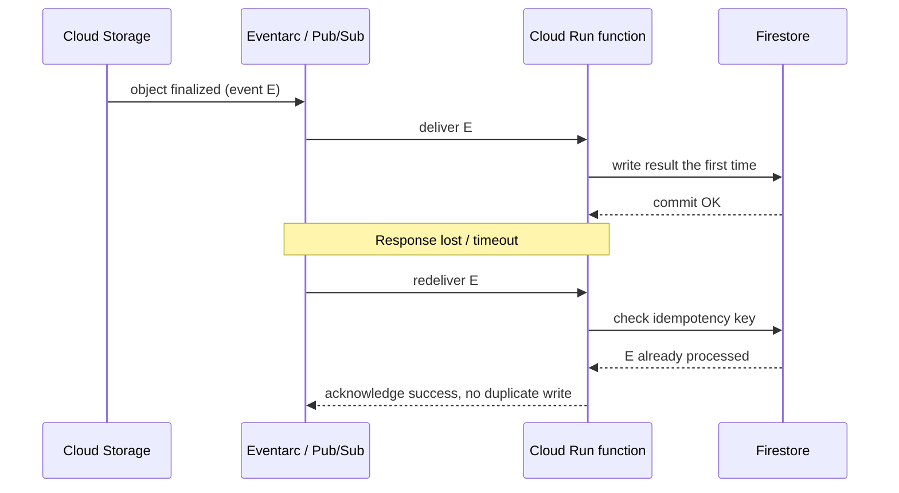
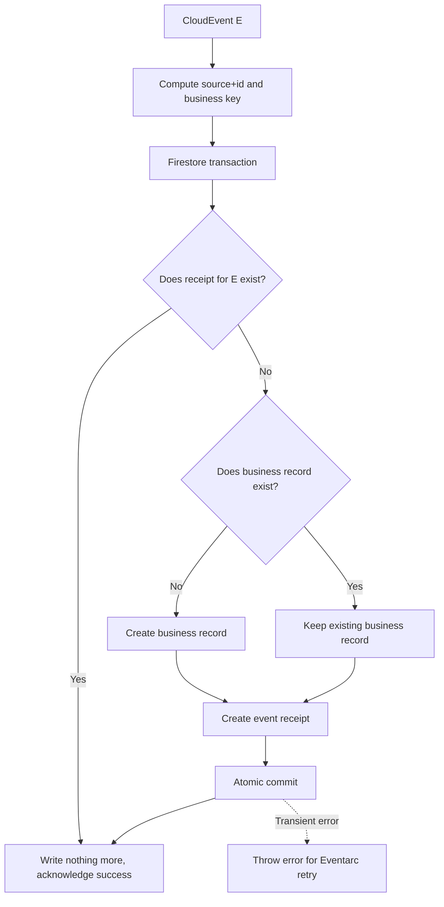
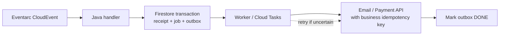

# Retries, duplicate delivery, and designing idempotent functions

Suppose a Java application uses **Cloud Run functions** to create an image-processing record whenever Cloud Storage receives a new file. The function writes data to Firestore, yet the success response fails to reach Eventarc. The event is redelivered. If the function creates a second record or sends two emails for the same image, the system produces incorrect results even though both executions "succeeded." In an **event-driven** architecture, duplicate delivery is a normal scenario to design for upfront, not a rare edge case.

This lesson belongs to the **Cloud Run functions and Eventarc** chapter of the **CLOUD_PROVIDERS_GCP** module. Spanning project/IAM foundations, VPC, Compute Engine, GKE, Cloud Run, storage, databases, monitoring, and cost, the lesson focuses on three topics: **retries on failure**, **duplicate delivery**, and **Java handler idempotency**. The hands-on example uses Eventarc Standard, Cloud Storage finalized events, and Firestore. For Eventarc Advanced or other triggers/transports, verify their specific retry policies.

> Projects, buckets, functions, service account addresses, and numbers in this lesson are illustrative. Deploying, updating subscriptions, generating logs, or injecting failures may incur charges and affect data. Run only in an authorized environment. Never write sensitive payloads or tokens to logs.

## Objectives

After this lesson, you will be able to:

1. Explain **at-least-once delivery**, retries, acknowledgments, duplicates, and the limits of "exactly once."
2. Inspect Eventarc Standard retry policies, distinguishing **single delivery** from **retry on failure**.
3. Choose an **idempotency key** from `CloudEvent.source + CloudEvent.id`, or from a business identifier (e.g., bucket/name/generation).
4. Use a **Firestore transaction** to prevent duplicate writes under concurrent invocations.
5. Classify transient vs. permanent errors, avoid infinite retry loops, and combine dead-letter topics with controlled replay.
6. Explain why **recording state before/after external side effects** does not by itself guarantee sending an email or charging a payment only once.
7. Write, deploy, test, and monitor a retry-safe Java Cloud Run function.

## 1. Why can an event arrive multiple times?

**Eventarc Standard** uses **at-least-once** event delivery: when a destination fails to acknowledge success, the underlying **Pub/Sub** transport layer can redeliver. Even when the application processed the event successfully, a lost response/ack or a deadline expiration can cause the system to deliver the event again.



Three commonly confused concepts:

| Concept | Meaning | Does not mean |
| --- | --- | --- |
| **Delivery attempt** | One attempt by infrastructure to send an event to the destination | Each attempt must be a new event |
| **Duplicate event** | The same event identifier delivered again | The source system created a different object |
| **Idempotent handler** | Calling repeatedly with the same event causes no extra unwanted business effects | The handler only ever runs once |

**Delivery order is not guaranteed by default.** Two updates to the same object can generate two distinct events that arrive out of emission order. Never treat "the event that just arrived" as proof that it holds the latest version of the data.

### Does "Pub/Sub exactly-once" solve this?

Pub/Sub supports **exactly-once delivery for properly configured pull subscriptions**, **not for push subscriptions**. Eventarc Standard delivers events to Cloud Run destinations via push; therefore **do not rely on Pub/Sub exactly-once to skip deduplication checks**. Even when a pipeline has a single-delivery mechanism, delivered once does not mean **external side effects** (emails, payments, other databases) execute only once.

## 2. Eventarc retry and acknowledgment policies

An Eventarc trigger uses Pub/Sub transport; some default characteristics when **retries are enabled**:

| Parameter | Default per Eventarc Standard docs | Key takeaway |
| --- | --- | --- |
| Delivery | At-least-once | Can redeliver |
| Minimum backoff | **10 seconds** | Increases on repeated failure |
| Maximum backoff | **600 seconds** | Not a fixed interval for every attempt |
| Transport message retention | **24 hours** | Expired events may be dropped if no DLQ is configured |
| Subscription ack deadline on creation | **10 seconds** per Cloud Run trigger docs | Long-running functions may get redelivered; can consider up to 600 seconds |

**Critically important:** retries can be **disabled on the trigger** for Cloud Run services/functions:

- Creating a trigger in the **Cloud Run Console**: default configuration may be **single delivery, no retries**, unless **Enable retry on failure** is turned on.
- Creating a trigger via **gcloud, Terraform, or the Eventarc Console**: usually **enables retries** by default.
- With the CLI, `--max-retry-attempts=1` configures **one delivery attempt** (no retries); omitting this flag when creating a trigger uses default retries.

Therefore, never write "Eventarc always retries" or "Cloud Run functions never retry." **Inspect the actual trigger and subscription configuration** before relying on that behavior. In production, it is generally best to enable retries **after the handler is idempotent and a channel exists for persistent failures**.

### When is delivery considered successful?

When Eventarc pushes a CloudEvent to Cloud Run over HTTP, a **success response** acknowledges that delivery; an error response, timeout, or missed ack deadline can trigger retries per configuration. Cloud Run functions abstracts the HTTP layer: when a Java handler finishes without throwing an exception, the runtime can return success; exceptions/timeouts result in failure.

- **Do not return success before committing mandatory data.**
- **Do not swallow transient exceptions** and return success: the event may be treated as processed.
- For **permanent errors** (corrupted payload, rejected by business rule), maintain a quarantine/DLQ/audit policy instead of retrying pointlessly.
- Do not assume HTTP **4xx always stops retries**: behavior depends on acknowledgment success vs. failure, not just "4xx is a client error."

## 3. Identifying duplicates: event keys and business keys

Eventarc uses **CloudEvents** with metadata such as:

```json
{
  "specversion": "1.0",
  "type": "google.cloud.storage.object.v1.finalized",
  "source": "//storage.googleapis.com/projects/_/buckets/retail-uploads",
  "id": "123456789012345",
  "subject": "objects/inbox/photo.jpg",
  "data": {
    "bucket": "retail-uploads",
    "name": "inbox/photo.jpg",
    "generation": "1740000000000000"
  }
}
```

This is an **example event rendered as JSON**; Eventarc delivers to HTTP destinations using the CloudEvents binary binding, where metadata typically sits in `ce-id`, `ce-source`, `ce-type` headers and data sits in the body. In Java Functions Framework, `CloudEvent` already exposes these properties.

| What to deduplicate | Suggested key | Reason |
| --- | --- | --- |
| **Same CloudEvent redelivered** | `source + id` | Per CloudEvents, this pair identifies the event |
| **Same Storage object version** | `bucket + name + generation` | Each object generation needs business processing only once |
| **Same Pub/Sub message** | Topic/source + message ID | Retrying the same message must not repeat the logic |
| **Same payment command** | Business-generated `orderId + paymentOperationId` | A request published twice may have two distinct event IDs |

**Never use only `filename` or `timestamp` as a key**: files can be overwritten across generations, timestamps can collide, and messages with identical contents can represent two valid operations. When storing as a Firestore document ID, you can SHA-256 hash the full key; avoid placing PII or sensitive paths directly in document IDs.

### Two levels of idempotency

1. **Delivery-level dedup:** the same `source + id` arrives again → ignore.
2. **Business-level dedup:** even if two events have different IDs, if they represent **the same business operation**, execute only once.

For example, if a user resubmits "charge order A" and the system publishes two Pub/Sub messages with different IDs, event-level dedup is **not enough**. You need a business-issued idempotency key honored by downstream systems.

## 4. Designing safe processing state

**Mistake 1 — non-atomic check-then-write:**

```text
IF eventId not yet in database:
    send email
    INSERT eventId
```

Two parallel invocations can both see "not present" and both send the email. Also, if the process crashes after sending the email but before INSERT, the retry will send it again.

**Mistake 2 — marking DONE before doing the work:**

```text
INSERT eventId = DONE
call payment API
```

If it crashes right after INSERT, the retry sees DONE and skips even though payment was never collected.

### Safe pattern for a single datastore

If **all required mutations belong to the same Firestore transaction**, we can check the key and write state in **one atomic commit**:



**Atomicity covers only data inside the Firestore transaction.** Firestore can **re-run the transaction callback** on contention, so never send emails, call HTTP APIs, publish messages, or charge cards **inside the callback**. For external side effects, use a **transactional outbox + worker** and an idempotency key on the receiving system.

### Suggested data model

| Firestore collection | Document ID | Contents |
| --- | --- | --- |
| `event_receipts` | SHA-256(`source + id`) | `businessKey`, `receivedAt` |
| `object_jobs` | SHA-256(`bucket + name + generation`) | `bucket`, `name`, `generation`, `status=PENDING` |

All documents are created within one transaction. If the event is redelivered, the receipt already exists. If a **second event** represents the same object generation with a different event ID, the business record already exists, so no second job is created. Retain receipts **at least as long as possible replay/redelivery windows** plus operational headroom; deleting receipts too early can cause old work to re-run.

## 5. Java 21 example: preventing duplicate writes with a Firestore transaction

This lab uses **`google.cloud.storage.object.v1.finalized`** events, Cloud Run functions Java 21, and Firestore Native mode. The handler's job is to **record a PENDING job at most once per generation**, without sending emails or processing images yet; a downstream worker will pick up the job in a controlled manner.

**Prerequisites:** the project has the required APIs enabled, a Firestore database, a Cloud Storage bucket, and a runtime service account with appropriate Firestore IAM permissions (e.g., `roles/datastore.user` at an approved scope). **Java server clients bypass Firestore Security Rules**; do not assume IAM automatically restricts access to a single collection. Collection/document-level business authorization must be enforced in application code and data architecture. Use **Application Default Credentials (ADC)** via the attached service account, not a JSON key.

### 5.1 Maven dependencies

```xml
<!-- Relevant excerpt for the Java 21 application's pom.xml. -->
<dependencyManagement>
  <dependencies>
    <dependency>
      <groupId>com.google.cloud</groupId>
      <artifactId>libraries-bom</artifactId>
      <version>26.90.0</version>
      <type>pom</type>
      <scope>import</scope>
    </dependency>
  </dependencies>
</dependencyManagement>

<dependencies>
  <dependency>
    <groupId>com.google.cloud.functions</groupId>
    <artifactId>functions-framework-api</artifactId>
    <version>1.1.0</version>
    <scope>provided</scope>
  </dependency>
  <dependency>
    <groupId>com.google.cloud</groupId>
    <artifactId>google-cloud-firestore</artifactId>
  </dependency>
  <dependency>
    <groupId>com.google.cloud</groupId>
    <artifactId>google-cloudevent-types</artifactId>
    <version>0.14.0</version>
  </dependency>
</dependencies>
```

This is a **Maven snippet to integrate into a valid `pom.xml`**, omitting `groupId`, `artifactId`, compiler plugin, and the rest of the build config. Pin the BOM and test when upgrading versions; real projects require unit/integration tests, build reproducibility, and dependency scanning.

### 5.2 Java handler

File `src/main/java/functions/IdempotentStorageHandler.java`:

```java
package functions;

import com.google.cloud.firestore.DocumentReference;
import com.google.cloud.firestore.DocumentSnapshot;
import com.google.cloud.firestore.FieldValue;
import com.google.cloud.firestore.Firestore;
import com.google.cloud.firestore.FirestoreOptions;
import com.google.cloud.functions.CloudEventsFunction;
import com.google.events.cloud.storage.v1.StorageObjectData;
import com.google.protobuf.util.JsonFormat;
import io.cloudevents.CloudEvent;
import java.nio.charset.StandardCharsets;
import java.security.MessageDigest;
import java.security.NoSuchAlgorithmException;
import java.util.HexFormat;
import java.util.Map;
import java.util.logging.Logger;

public final class IdempotentStorageHandler implements CloudEventsFunction {
  private static final Logger LOG =
      Logger.getLogger(IdempotentStorageHandler.class.getName());
  private static final Firestore DB =
      FirestoreOptions.getDefaultInstance().getService();

  @Override
  public void accept(CloudEvent event) throws Exception {
    // Handle only the designed event type; treat others as validly ignored.
    if (!"google.cloud.storage.object.v1.finalized".equals(event.getType())) {
      return;
    }
    if (event.getSource() == null || event.getId() == null
        || event.getData() == null) {
      throw new IllegalArgumentException("Missing required CloudEvent fields");
    }

    StorageObjectData.Builder builder = StorageObjectData.newBuilder();
    JsonFormat.parser().ignoringUnknownFields().merge(
        new String(event.getData().toBytes(), StandardCharsets.UTF_8),
        builder);
    StorageObjectData object = builder.build();

    String bucket = object.getBucket();
    String name = object.getName();
    String generation = Long.toString(object.getGeneration());
    if (bucket.isBlank() || name.isBlank() || object.getGeneration() <= 0) {
      throw new IllegalArgumentException("Invalid storage event data");
    }

    String receiptKey = sha256(event.getSource() + "\n" + event.getId());
    String businessKey = sha256(bucket + "\n" + name + "\n" + generation);

    DocumentReference receipt =
        DB.collection("event_receipts").document(receiptKey);
    DocumentReference job =
        DB.collection("object_jobs").document(businessKey);

    boolean firstDelivery = DB.runTransaction(tx -> {
      // Firestore requires reading all documents BEFORE writing.
      DocumentSnapshot existingReceipt = tx.get(receipt).get();
      DocumentSnapshot existingJob = tx.get(job).get();
      if (existingReceipt.exists()) {
        return false;
      }
      if (!existingJob.exists()) {
        tx.create(job, Map.of(
            "bucket", bucket,
            "objectName", name,
            "generation", generation,
            "status", "PENDING",
            "createdAt", FieldValue.serverTimestamp()));
      }
      tx.create(receipt, Map.of(
          "businessKey", businessKey,
          "receivedAt", FieldValue.serverTimestamp()));
      return true;
    }).get();

    // Do not log object name/payload if it may contain sensitive info.
    LOG.info("eventReceipt=" + receiptKey
        + " acceptedNewDelivery=" + firstDelivery);
    // Return normally ONLY after the transaction has committed successfully.
  }

  private static String sha256(String value) {
    try {
      byte[] digest = MessageDigest.getInstance("SHA-256")
          .digest(value.getBytes(StandardCharsets.UTF_8));
      return HexFormat.of().formatHex(digest);
    } catch (NoSuchAlgorithmException e) {
      throw new IllegalStateException(e);
    }
  }
}
```

**Why does this withstand concurrency?** `tx.get` and `tx.create` are managed inside a Firestore transaction; if two invocations simultaneously see no receipt, only one commit wins while the other retries or fails, never creating two receipts with the same ID. If the transaction fails past internal retry limits, the exception propagates out of the handler; **Eventarc retries** occur only if the trigger has retries enabled and the event has not expired past retention.

**Important limitation:** this example only guarantees creating the **Firestore job record at most once per business key**. It does not prove the image-processing worker runs only once; nor does it download object data immediately (which could be overwritten or deleted before processing). The worker must read the **exact object generation** or handle missing objects, with leases/retries and idempotent downstream design.

## 6. Deploying the function and configuring Eventarc retries

### 6.1 Preparation and verification

```bash
PROJECT_ID="retail-dev-01"
REGION="asia-southeast1"
FUNCTION="ingest-storage-event"
TRIGGER="storage-finalized-trigger"
BUCKET="retail-dev-upload-unique"
RUNTIME_SA="sa-ingest@retail-dev-01.iam.gserviceaccount.com"
TRIGGER_SA="sa-eventarc@retail-dev-01.iam.gserviceaccount.com"

gcloud auth list
gcloud config get-value project
gcloud eventarc triggers list --project="$PROJECT_ID" --location="$REGION"
```

The bucket, Firestore database, and both service accounts must **exist**. Grant least privilege: the runtime SA gets only required Firestore permissions; the **trigger SA gets `roles/eventarc.eventReceiver` and target invocation `roles/run.invoker`** at the appropriate scope. The Cloud Storage service agent/Pub/Sub transport may require publish permissions and service-agent IAM per setup docs; avoid default SAs with broad Editor permissions.

### 6.2 Deploying from the directory containing `pom.xml`

```bash
# MUTATING resources; use a lab project.
gcloud run deploy "$FUNCTION" \
  --project="$PROJECT_ID" \
  --region="$REGION" \
  --source=. \
  --function=functions.IdempotentStorageHandler \
  --base-image=java21 \
  --service-account="$RUNTIME_SA" \
  --no-allow-unauthenticated
```

This deploys the **Cloud Run function** as a Cloud Run service, **without creating an Eventarc trigger yet**. Do not use `--allow-unauthenticated` just to fix event delivery errors; grant invoker permission properly to the trigger identity.

### 6.3 Creating the Eventarc trigger — enabling CLI default retries

```bash
# INFRASTRUCTURE CHANGE: receive GCS finalized events for the specified bucket.
gcloud eventarc triggers create "$TRIGGER" \
  --project="$PROJECT_ID" \
  --location="$REGION" \
  --destination-run-service="$FUNCTION" \
  --destination-run-region="$REGION" \
  --event-filters="type=google.cloud.storage.object.v1.finalized" \
  --event-filters="bucket=$BUCKET" \
  --service-account="$TRIGGER_SA"
```

In this CLI example, **`--max-retry-attempts=1` is omitted**, so standard retry behavior is used. The trigger may take a few minutes after creation to start receiving events; do not declare it "broken" the instant the create command returns. The source bucket and trigger region must support the chosen location.

To test **single delivery, no retries** in a lab, you can create another trigger or update an existing trigger with `--max-retry-attempts=1`:

```bash
# LAB ONLY; may cause failed events not to be redelivered.
gcloud eventarc triggers update "$TRIGGER" \
  --project="$PROJECT_ID" --location="$REGION" \
  --max-retry-attempts=1

# Restore default retry behavior once the handler is safe.
gcloud eventarc triggers update "$TRIGGER" \
  --project="$PROJECT_ID" --location="$REGION" \
  --clear-max-retry-attempts
```

These two commands represent **two opposing configuration states**, not steps meant to be run back-to-back in routine operation. In real deployments, changing retry policy must be reviewed because it affects failure handling and potential event loss.

### 6.4 Inspecting the trigger and subscription

```bash
gcloud eventarc triggers describe "$TRIGGER" \
  --project="$PROJECT_ID" --location="$REGION"

# Inspect only the Eventarc-managed subscription; do not delete it by mistake.
SUBSCRIPTION="$(gcloud eventarc triggers describe "$TRIGGER" \
  --project="$PROJECT_ID" --location="$REGION" \
  --format='value(transport.pubsub.subscription)')"
echo "$SUBSCRIPTION"
gcloud pubsub subscriptions describe "$SUBSCRIPTION" --project="$PROJECT_ID"
```

**Never manually recreate an Eventarc subscription** to "fix" a handler bug. Adjusting retention, retry backoff, dead-letter settings, or ack deadline belongs to the **trigger's attached subscription**, and requires understanding side effects and IAM/service agents. Example approved backoff adjustment:

```bash
# MODIFIES retry policy of the subscription currently used by Eventarc.
gcloud pubsub subscriptions update "$SUBSCRIPTION" \
  --project="$PROJECT_ID" \
  --min-retry-delay=10s \
  --max-retry-delay=600s
```

For long-running functions, the subscription's `ackDeadlineSeconds` may be too short and cause duplicate deliveries; documentation suggests considering up to **600 seconds**. Set an ack deadline matching reality rather than treating it as a way to eliminate all duplicates:

```bash
# ONLY AFTER VERIFYING function timeout and subscription policy.
gcloud pubsub subscriptions update "$SUBSCRIPTION" \
  --project="$PROJECT_ID" \
  --ack-deadline=600
```

## 7. Classifying errors and avoiding retry storms

| Scenario | Should it retry? | How to handle |
| --- | --- | --- |
| Firestore temporarily unavailable / `UNAVAILABLE` | **Yes** | Throw exception; backoff and monitor |
| Quota / `RESOURCE_EXHAUSTED` | Bounded | Backoff, reduce concurrency/throughput, fix capacity |
| Cloud Run instance timeout/restart | Yes, if handler is idempotent | Tune duration, ack deadline, downstream timeouts |
| Payload missing required fields | Cannot self-heal | Quarantine/DLQ, alert; do not silently ack if data needs attention |
| IAM `PERMISSION_DENIED` from misconfiguration | Retries will not fix IAM | Fix permissions, DLQ before retention expires |
| Business rule rejects malicious file | No | Record audited REJECTED status, acknowledge success |
| External payment API times out | Unclear whether transaction succeeded | Query status via idempotency key; never blindly re-charge |

A **poison message** is a permanently failing event that causes the handler to fail repeatedly. If you only retry until retention expires, it may be **dropped**. Configure a **dead-letter topic (DLQ)** on the Eventarc-attached Pub/Sub subscription to retain unprocessable events after the configured attempt count; design a dedicated DLQ consumer and replay process. DLQs also have retention, IAM, cost, and practical limits—they do not store forever by default.

### Circuit breakers and backoff in code

Eventarc/Pub/Sub has **delivery-level backoff**, while HTTP/DB clients may have **client-level retries**. If both retry aggressively at the same time, downstream request volume grows exponentially. Set:

- Timeouts and retry budgets on every downstream call.
- Exponential backoff with jitter, strictly for transient errors.
- Concurrency/max instances aligned with database/API limits.
- Dead-letter + alerts after exceeding attempts; never infinite loops.
- Idempotency keys across every retry layer.

## 8. Transactional outbox for external side effects

Suppose you want to send an email after image processing completes:

1. The handler receives the Eventarc event and, inside a **Firestore transaction**, creates both `object_jobs` and an `outbox` record carrying the business key.
2. A worker reads the outbox and **claims** items using a lease/transaction to prevent two workers from processing simultaneously.
3. The worker sends the email using an **idempotency key** if supported by the provider; otherwise, use a reconciliation strategy and accept/minimize potential duplicates.
4. Mark the outbox `SENT` only after verifying provider acceptance and business outcome; drive retries from state.
5. If the worker crashes after the provider sends successfully but before saving `SENT`, the provider may receive the request again — **only provider-side idempotency** or an equivalent business mechanism can strictly prevent duplicate sends.



Cloud Tasks supports retries and task naming to reduce certain duplicate-enqueue cases, yet **it does not automatically make an external API exactly-once**. For payments, pass the same idempotency key to the payment provider and reconcile against a ledger. For output files, use Cloud Storage **generation preconditions** to avoid overwriting an already created file.

## 9. Duplicate testing and failure injection

Do not test only a single "happy path" run. Use the matrix below with identical `source/id`, identical object generation, or post-error retries to prove correctness:

| Test | Action | Expected |
| --- | --- | --- |
| T1 | Deliver event E for the first time | One `event_receipts` and one `object_jobs` |
| T2 | Redeliver the **exact** event E | No additional business job |
| T3 | Two concurrent invocations of E | At most one job after Firestore transaction |
| T4 | New event with different ID, same bucket/name/generation | New receipt, **no** second job created |
| T5 | Same object name, **different generation** | Valid new job created |
| T6 | Firestore unavailable before commit | Handler fails; if retries enabled, retries later; no partial commit |
| T7 | Firestore commits, response lost | Retry sees receipt, writes nothing more |
| T8 | Payload missing `bucket` or `generation` | Controlled failure, alert/DLQ; no garbage job created |
| T9 | Worker sends email successfully then crashes | Retries with idempotency key, preventing provider duplicate |
| T10 | Event unprocessable until retention expires | Routed to DLQ/investigated/replayed; never silently lost |

### Emitting a real event in the lab

```bash
# May incur charges; bucket is already watched by the trigger.
printf 'hello idempotency\n' > sample.txt
gcloud storage cp sample.txt "gs://$BUCKET/inbox/sample.txt"

# Read Cloud Run logs and created Firestore documents.
gcloud run services logs read "$FUNCTION" \
  --project="$PROJECT_ID" --region="$REGION" --limit=30
```

If you re-upload the same object name, Cloud Storage creates a **new generation** — that is **not** a duplicate of the same event. To test retrying the exact same `source/id`, use **Functions Framework / a local test harness** with the same CloudEvent or simulate delivery via test code in an authorized lab environment. Never spoof requests against production services.

### Assertions to automate

```text
assert(receiptsCount(source,id) == 1)
assert(jobsCount(bucket,name,generation) == 1)
assert(secondDeliveryDoesNotMutateJob())
assert(newGenerationCreatesNewJob())
assert(failedCommitDoesNotAckWhenRetriesEnabled())
```

These are **pseudocode assertions**, not a directly runnable test suite. For integration tests, use an isolated project/Firestore database, dedicated test identifiers, and clean up according to permissions.

## 10. Monitoring, security, and cost

| Signal | Where to view | How to use |
| --- | --- | --- |
| Delivery failures/retries | Eventarc trigger, Pub/Sub subscription metrics | Alert on abnormal retry spikes |
| Push responses `2xx`/`4xx`/`5xx` | `subscription/push_request_count` by response code | Distinguish handler failures from acks |
| Oldest unacked message age | Pub/Sub Monitoring | Detect backlog and retention expiration risk |
| DLQ message count | Pub/Sub dead-letter subscription | Investigate poison messages and replay |
| Function exceptions/timeouts | Cloud Run logs/metrics | Classify transient vs. permanent errors |
| Receipt vs. business job counts | Firestore/application metrics | Track duplicate suppression effectiveness |
| Outbox pending/failed age | Application dashboard | Detect stalled external side effects |
| Cloud Run instances/concurrency | Cloud Monitoring | Control pressure on Firestore/downstream |

**Structured logs** should record `eventId`, `source` or a hash, `businessKey` hash, `acceptedNewDelivery` status, retry/failure class, and trace ID. Avoid logging payloads, object paths containing PII, auth headers, or document contents. Permissions to administer triggers, edit Pub/Sub subscriptions, read DLQs, and write Firestore must follow **least privilege**, separating the runtime SA from the trigger invocation SA.

### Cost of retries

A prolonged outage can generate:

- Eventarc/Pub/Sub deliveries and message/DLQ storage.
- Cloud Run invocations, CPU/RAM, and cold starts.
- Firestore reads/transactions, log ingestion, and Monitoring.
- External API charges for retried calls.

**Illustrative example:** 10,000 events/day with 2% redelivered once → at least roughly **200 extra deliveries/day** assuming all other events deliver once. Do not extrapolate exact monetary cost without knowing region, execution duration, retention, and actual retry rates. Use Cloud Billing budgets/alerts and retry-rate dashboards.

## 11. Case study: invoice created twice

An e-commerce app uses Pub/Sub to emit `InvoiceRequested(orderId)` when an order is paid. A Cloud Run function generates a PDF and sends an email. When the email provider times out, the handler throws an exception and Eventarc redelivers. If every event delivery creates a new invoice and sends an email, the customer can receive two invoices.

**Fix design:**

1. Use **`invoiceId = orderId`** (or a stable business ID) to create the invoice row via a conditional transaction; do not rely solely on the Pub/Sub event ID.
2. Store the PDF under a controlled object name/digest; write with `ifGenerationMatch=0` when requiring "create only if new."
3. Write an outbox record `send-invoice/{invoiceId}` inside the same transaction as the invoice state.
4. Have the worker send the email with a stable idempotency key if the provider supports one.
5. Monitor DLQ, backoff, and stalled outbox items; during replay, still use **the same `invoiceId`**.

**Lesson:** message-layer idempotency is not enough; you must define the **business boundary** of "once." If an email provider does not support idempotency, build detection/reconciliation mechanisms and accept the limitation that a handler alone cannot guarantee exactly-once external side effects.

## 12. Self-check exercises

### Exercise 1 — Choosing an event key

Two deliveries share the same `source` and `id`. Should they create two Firestore jobs?

<details>
<summary>Answer</summary>

No. Under CloudEvents this is a duplicate delivery, so the receipt key `source + id` must block duplicate processing.
</details>

### Exercise 2 — Two different IDs

A user clicks "Pay" twice and the system publishes two messages with different IDs for the same `orderId`. Is event-level dedup enough?

<details>
<summary>Answer</summary>

No. You need a business idempotency key such as `orderId + paymentOperationId`, propagated end-to-end to the payment system.
</details>

### Exercise 3 — Crash before writing receipt

The handler calls the email API successfully and then crashes before saving the receipt. On retry, what can happen?

<details>
<summary>Answer</summary>

The email may be sent a second time. Saving a receipt after a side effect does not guarantee exactly-once; use an outbox and provider-side idempotency.
</details>

### Exercise 4 — Transaction callback

Why shouldn't you place `sendPayment()` inside a Firestore `runTransaction` callback?

<details>
<summary>Answer</summary>

Firestore may re-execute the callback multiple times on contention; the payment API sits outside the transaction and is not rolled back with Firestore.
</details>

### Exercise 5 — Default retry policy

How does creating an Eventarc trigger in the Cloud Run Console differ from `gcloud` regarding default retries?

<details>
<summary>Answer</summary>

The Cloud Run Console may default to a **single delivery attempt**; gcloud/Eventarc Console/Terraform typically enable retries unless `--max-retry-attempts=1` is specified. Always inspect the actual trigger and subscription.
</details>

### Exercise 6 — Retry forever?

A handler receives a payload missing `bucket` and always throws an error. Is simply enabling 24-hour retries a good solution?

<details>
<summary>Answer</summary>

No. This may be a poison event requiring quarantine/DLQ, alerting, and fixing the upstream source; retrying indefinitely increases costs and risks dropping the message once retention expires.
</details>

### Exercise 7 — Object generation

File `inbox/a.jpg` is uploaded, then overwritten, creating a new generation. Should the second event be skipped just because the filename is identical?

<details>
<summary>Answer</summary>

No. Different `bucket + name + generation` values mean two distinct object versions. Business rules determine whether to process both or only the latest.
</details>

### Exercise 8 — Pub/Sub exactly-once

Can an Eventarc Standard architecture pushing events to a Cloud Run function enable Pub/Sub exactly-once on the push subscription to remove dedup code?

<details>
<summary>Answer</summary>

No. Pub/Sub exactly-once delivery only supports pull subscriptions. Push delivery and external side effects still require an idempotent handler and appropriate business safeguards.
</details>

## 13. Production checklist

- [ ] Verified the **retry enabled/disabled** configuration of the specific Eventarc trigger and Pub/Sub subscription.
- [ ] Handler returns success **only after committing** all mandatory state.
- [ ] Receipt key uses `source+id` alongside a stable business key, never a timestamp/filename alone.
- [ ] Duplicates are prevented via **atomic create/transaction**, never non-atomic check-then-write.
- [ ] No external API calls inside Firestore transaction callbacks.
- [ ] External side effects use **outbox + downstream idempotency/reconciliation**.
- [ ] Transient vs. permanent failures are classified, with backoff/timeouts/retry budgets.
- [ ] DLQ, retention, least-privilege IAM, alerts, and non-duplicating replay procedures are in place.
- [ ] Checked that ack deadline suits processing duration without relying on longer deadlines to skip idempotency.
- [ ] Tested concurrent duplicates, lost ack after commit, poison events, version changes, and stale replays.
- [ ] Monitored push response codes, retry counts, backlog age, DLQ, Cloud Run errors, and Firestore contention.
- [ ] Logs contain no PII/tokens; budgets cover retry traffic/DB/logs.
- [ ] Runbook exists for toggling retries, rolling back deployments, cleaning test artifacts, and auditing trigger changes.

## Official reference documentation

- [Eventarc Standard — Retry events](https://cloud.google.com/eventarc/docs/retry-events): at-least-once, backoff, retention, DLQ, and idempotency.
- [Configure event-driven function retries](https://cloud.google.com/run/docs/tips/function-retries): retries on trigger/subscription, not just in code.
- [Create triggers with Eventarc](https://cloud.google.com/run/docs/triggering/trigger-with-events): Cloud Run functions, retry defaults, and ack deadlines.
- [Eventarc CloudEvents event format](https://cloud.google.com/eventarc/docs/event-format): metadata `id`, `source`, HTTP transport.
- [CloudEvents JSON event format](https://cloud.google.com/eventarc/docs/cloudevents-json): Cloud Storage finalized payloads.
- [Cloud Run functions best practices](https://cloud.google.com/run/docs/tips/functions-best-practices): idempotency, errors, and background activity.
- [Write Cloud Run functions](https://cloud.google.com/run/docs/write-functions): Java Functions Framework and `CloudEventsFunction`.
- [Cloud Storage CloudEvent Java sample](https://cloud.google.com/functions/docs/samples/functions-cloudevent-storage): decoding `StorageObjectData`.
- [Firestore transactions](https://cloud.google.com/firestore/docs/manage-data/transactions): atomic writes and transaction retries.
- [Pub/Sub exactly-once delivery](https://cloud.google.com/pubsub/docs/exactly-once-delivery): pull subscription limits.
- [Google Cloud Java libraries BOM](https://cloud.google.com/java/docs/bom): dependency compatibility.
- [Eventarc troubleshooting](https://cloud.google.com/eventarc/standard/docs/run/troubleshoot): retry spikes, Pub/Sub metrics, and target errors.
- [Cloud Run pricing](https://cloud.google.com/run/pricing) and [Pub/Sub pricing](https://cloud.google.com/pubsub/pricing): estimating event operations costs.
