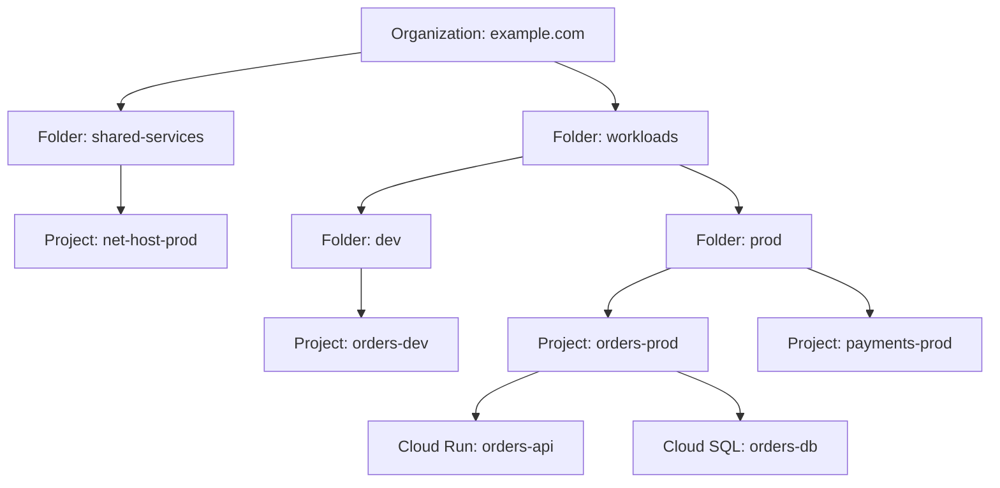

# Resource hierarchy and configuration inheritance in Google Cloud

In Google Cloud, the **resource hierarchy** determines which management unit resources belong to, who can administer them, and which policies affect them. It is the foundation for designing multi-project environments: managing IAM, protecting data, standardizing deployments, and controlling the operational scope of teams.

This lesson belongs to the **Resource Hierarchy and Locations** chapter of module `CLOUD_PROVIDERS_GCP`. Across your Google Cloud journey—from projects, IAM, and VPC to Compute Engine, GKE, Cloud Run, storage, databases, automated releases, and cost monitoring—understanding the hierarchy helps you decide **where to place resources, at which level to grant permissions, and which rules propagate downward**.

## 1. Learning Objectives

After this lesson, you will be able to:

- Distinguish **Organization**, **Folder**, **Project**, and service resources; read the parent–child relationships among them.
- Explain how **IAM allow policies**, **IAM deny policies**, **Organization Policies**, and **tags** affect downstream resources.
- Distinguish what **is inherited** from configurations that must be **set up separately**, such as VPC, billing, APIs, and deployment locations.
- Choose the appropriate level to apply policies for `dev`, `staging`, and `prod` environments and check effective permissions when troubleshooting access issues.

## 2. What makes up the resource hierarchy?

A common visualization is:



| Level | Role | Key points to remember |
| --- | --- | --- |
| **Organization** | Top-level governance tier for an entity using Google Cloud. | Usually tied to an enterprise domain via Google Workspace or Cloud Identity. Not every personal account has an Organization. |
| **Folder** | Groups child folders and projects by department, product, or environment. | An **optional** tier. Can be nested across multiple levels to delegate permissions and apply policies to groups of projects. |
| **Project** | Fundamental scope for creating and managing most Google Cloud resources. | Each project has a unique `project ID` and `project number`; has its own IAM policy, enabled APIs, associated quotas, and billing link. |
| **Service resource** | A resource managed by a service, such as a VM, bucket, GKE cluster, or Cloud Run service. | Belongs to a single project; depending on the service, may also have sub-structures and its own regional/zonal scope. |

In this tree, each **folder** or **project** has one direct parent at a time. A project can sit inside an Organization or a Folder; a Folder can sit inside an Organization or another Folder. A project cannot simultaneously belong to two folders. Service resources belong to a specific project and are never placed directly into a folder.

Identifiers that are easy to confuse:

- **Organization ID** and **Folder ID** are typically numeric and used to reference governance nodes.
- **Project ID** is a unique string, such as `orders-prod-123`; **project number** is a number assigned by Google Cloud. Project display names can collide, whereas project IDs cannot.
- Names of VMs, buckets, or Cloud Run services follow each service's own naming scope; they do not replace the project ID.

**Core takeaway:** the hierarchy expresses **ownership and governance relationships**. It does not automatically create network connectivity between projects and does not indicate which region or zone resources reside in.

## 3. What does configuration inheritance mean?

Suppose a policy is attached to Folder `prod`, which contains two projects `orders-prod` and `payments-prod`. For **policy types that support inheritance**, both projects are affected by that policy. When a third project is created inside Folder `prod`, the new project also falls under the corresponding policy scope.

```text
Organization
└── Folder: workloads
    └── Folder: prod   ← policy placed here
        ├── Project: orders-prod   ← within scope of effect
        └── Project: payments-prod ← within scope of effect

Folder: dev and projects in other branches are outside this scope.
```

However, **not every setting is inherited**. Each mechanism has its own rules for where policies attach, how they are evaluated, and whether overrides or exceptions are possible. You cannot assume that a configuration value on the Organization is always copied verbatim down to every project.

| Mechanism | Propagates downward? | Key distinctions |
| --- | --- | --- |
| **IAM allow policy** | **Yes.** Permissions granted at a parent node can apply to child resources subject to binding scope and conditions. | Bindings at a project **add** permissions; they generally do not remove permissions granted by a parent. |
| **IAM deny policy** | **Yes.** Deny rules at a parent node can block permissions on child resources. | A matching deny rule generally blocks a permission even if the principal has a corresponding allow binding, unless configured exceptions apply. |
| **Organization Policy** | **Yes**, according to each constraint's rules. | This is a **configuration/behavior constraint**, not an IAM permission grant. How parent–child policies combine depends on the constraint type and inheritance settings. |
| **Resource Manager tags** | **Inheritable** along the hierarchy; effective tags can be used in compatible policy conditions. | Tags differ from **labels**; inspect effective tags and behavior when a child node has a tag with the same key. |
| **Labels** | **Not automatically inherited.** | To give projects/resources consistent labels, set them via resource creation workflows or automation tools. |
| **VPC, subnet, firewall, enabled APIs, billing link** | **Not automatically created or inherited via Folders.** | Shared VPC and resource-sharing models require explicit configuration. |
| **Region, zone, quota, budgets** | **Cannot be inferred from the hierarchy alone.** | Location is determined by resource type and deployment configuration; quotas and cost controls have their own scopes. |

The sections below explain the three mechanisms that most often govern runtime behavior: **IAM allow**, **IAM deny**, and **Organization Policy**.

## 4. IAM allow inheritance: permissions can come from ancestors

IAM (Identity and Access Management) answers the question: **which principal** (user, group, service account, etc.) can perform **which permissions** on **which resource scope**. An allow policy contains bindings between principals and IAM roles, sometimes accompanied by an IAM Condition.

Permission design example:

| Binding attachment point | Principal | Illustrative role | Expected effect |
| --- | --- | --- | --- |
| Organization `example.com` | `group:cloud-inventory@example.com` | `roles/browser` | Can browse metadata of organization resources within the role's scope; does not equate to reading all application data. |
| Folder `prod` | `group:prod-readers@example.com` | `roles/viewer` | Has view permissions on resources supported by the role in `orders-prod`, `payments-prod`, and other child projects of `prod`. |
| Project `orders-prod` | `group:orders-release@example.com` | `roles/run.developer` | Has permissions to develop/manage Cloud Run resources allowed by the role in `orders-prod`; does not automatically gain the same access in `payments-prod`. |

When evaluating a request against `orders-prod`, Google Cloud considers applicable allow bindings from **Organization → ancestor Folders → Project → target resource**, depending on which levels support policies for that resource. For example, a member of `prod-readers@example.com` still has permissions from the binding at Folder `prod` even though that binding does not appear in the IAM policy **directly attached** to the project.

### 4.1 Permissions from a parent do not vanish when a project sets its own

Suppose Folder `prod` grants `roles/viewer` to group A. Project `orders-prod` additionally grants `roles/run.developer` to group B. These are **two permission sources that can both affect** the project. If you want group A to stop reading this project, removing bindings only at the project level will not resolve the permission granted from the Folder.

This leads to two design principles:

1. **Grant permissions at the lowest level that meets the need.** Deployment permissions specific to the `orders` application should usually be placed at project `orders-prod` rather than across all production projects.
2. **Only grant permissions at the Folder/Organization level when you truly want the entire branch to inherit them.** A broad binding at a high level has wide blast radius, including for projects added later.

### 4.2 Having a role does not guarantee access will not be denied

IAM allow is not the sole factor determining access. The outcome also depends on:

- **IAM Conditions:** a binding takes effect only when its condition is satisfied, such as time limits or supported resource attributes.
- **IAM deny policies:** an applicable deny rule can block a permission even when a corresponding allow exists.
- **Principal Access Boundary** (if configured): can restrict the set of resources a principal is allowed to access.
- **Organization Policy or service constraints:** a resource creation request may be invalid even if IAM grants the principal permission to call the API.

In practice, `roles/run.developer` alone does not guarantee someone can deploy a Cloud Run service using a specific service account; that operation typically also requires the `iam.serviceAccounts.actAs` permission (commonly via `roles/iam.serviceAccountUser` on the appropriate service account).

## 5. IAM deny: restricting permissions from parent levels

In a multi-team environment, you sometimes need to guard an action even if someone accidentally grants an overly broad role. **IAM deny policies** block permissions supported by IAM Deny based on principal, permission, and corresponding conditions/exceptions.

Policy idea example: at the Organization level, deny a sensitive permission for a certain set of principals while configuring exceptions where genuinely needed. The deny rule applies down to child projects and can take effect even if a project grants `roles/editor` or another role containing that permission.

Do not confuse **IAM deny** with "having no allow". If no matching allow exists, the operation is already unauthorized; deny is an **explicit denial rule** that can block a permission granted by another binding. Nor does deny replace Organization Policy, because the two mechanisms enforce different categories of rules.

## 6. Organization Policy: constraining how resources are configured

The **Organization Policy Service** allows administrators to set **constraints** to control behavior across resources and services. Policies can be placed at the Organization, Folder, or Project level, forming an **effective policy** on the target resource according to the constraint's rules.

Two illustrative examples:

| Constraint | Meaning when properly configured | Scenario |
| --- | --- | --- |
| `constraints/gcp.resourceLocations` | Restricts allowed locations for **resource types/services that support the constraint**. | The enterprise only permits creating covered resources in approved locations. |
| `constraints/iam.disableServiceAccountKeyCreation` | Restricts creation of user-managed service account keys. | Reduces the risk of long-lived keys being stored or leaked outside the system. |

Suppose the Organization enforces a resource location constraint, while Folder `prod` has separate policies for production. When creating a Cloud SQL instance in `orders-prod`, you must check the **effective organization policy at the project and Cloud SQL's constraint support**. Having IAM permission to create an instance does not mean every region or configuration is permitted.

**Inheritance note:** list constraints and boolean constraints have distinct evaluation rules; whether a child policy appends to, replaces, or merges with a parent policy depends on the constraint type and specific settings. Do not assume from a single policy that a project can unilaterally relax rules set at the Organization. Always verify the **effective policy**, approved exceptions, and the constraint documentation.

### 6.1 When to use IAM vs. Organization Policy?

- Question **“Who is allowed to create a VM?”**: start with IAM permissions/roles and applicable deny rules.
- Question **“Is the VM allowed to have an external IP?”**: check Organization Policy or the corresponding service security control.
- Question **“Who is allowed to change the external IP rule?”**: return to IAM to check permissions for managing Organization Policies.

Good administrators typically use **IAM to delegate operational actions** and **Organization Policy to set configuration guardrails**. These two layers complement each other.

## 7. Tags, labels, and choosing policy scope

Resource Manager **Tags** are centrally managed key/value pairs that can be attached to nodes in the resource hierarchy. Eligible tags can be inherited down to child resources and referenced in policies that support conditions. For example, `environment=prod` attached to Folder `prod` consistently represents the environment context across that branch.

**Labels** are metadata used for search, grouping, reporting, or cost analysis depending on the service. A label `cost-center=commerce` on a project or VM **does not automatically propagate** to other resources merely because they share an ancestor. When consistent labels are needed, set them in Terraform, deployment templates, or resource-creation pipelines.

Do not base access decisions on folder names or labels assuming IAM interprets them automatically as rules. Permissions only take effect through corresponding bindings/policies; tags only affect a policy if that mechanism actually supports tags and is configured to use them.

## 8. Resource hierarchy differs from geographic location

Folders and Projects represent **organizational placement**; regions and zones represent **operational placement of resources**.

For example, the same `orders-prod` project can contain:

| Resource | Illustrative location | Meaning |
| --- | --- | --- |
| Compute Engine VM | Zone `asia-southeast1-a` | A VM is a zonal resource in a specific zone. |
| Cloud Run service | Region `asia-southeast1` | The service is deployed per Cloud Run region. |
| Cloud Storage bucket | Location chosen at bucket creation | A bucket can have regional, dual-region, or multi-region scope depending on supported configuration. |
| Project-level IAM policy | Not a zone-selectable object | Governance policies take effect via the resource hierarchy, not by sharing a region. |

Having a project under Folder `prod` **does not automatically** make services run in the same region; nor does it mean that project can only deploy to one region. If an enterprise has data residency requirements, configure and verify location constraints, per-service region choices, data replication behavior, and the practical limits of each service.

Similarly, two projects in the same Folder **do not automatically share a VPC**. Shared VPC requires a host project/service project model and appropriate connectivity and permission configuration; VPC networks, subnets, and firewalls do not appear in child projects simply because a parent folder contains a networking project.

## 9. Reference design for a multi-environment enterprise

Suppose a company deploys a retail system with `orders` and `payments` applications. It can be structured as:

```text
Organization: example.com
├── Folder: shared-services
│   └── Project: net-host-prod
└── Folder: workloads
    ├── Folder: dev
    │   ├── Project: orders-dev
    │   └── Project: payments-dev
    └── Folder: prod
        ├── Project: orders-prod
        └── Project: payments-prod
```

Suggested governance rules:

1. **Organization:** identity governance, shared security monitoring, and baseline constraints that must apply broadly. Avoid granting high-privilege roles to large groups.
2. **Folder `workloads`:** set permissions or guardrails shared across applications. No need to repeat the same binding on every project if you genuinely want the entire branch to inherit it.
3. **Folder `prod`:** place stricter control requirements and teams authorized to monitor production. Detailed conditions still depend on each policy mechanism.
4. **Project `orders-prod`:** grant deployment permissions only to the `orders` release team, enable required APIs, and manage service accounts, VPC bindings, quotas, and application resources.
5. **Project `payments-prod`:** grant deployment permissions independently from `orders-prod`; sharing a Folder does not give the two teams cross-access.

### 9.1 Two illustrative incidents

**Incident A — An employee can still view resources after removing their role at the project level.** The `prod-readers` group has `roles/viewer` on Folder `prod`. An administrator removes a binding on `orders-prod`, yet members of the group can still view resources. The cause is the **ancestor allow binding** still applying. Resolution: inspect the full ancestor path and update the binding at the proper level according to the agreed access-control policy.

**Incident B — User has permission to create resources, but the API reports a policy violation.** The deployment team has an appropriate IAM role on the project, but the request tries to create a resource in a location disallowed by Organization Policy for that service. The cause is that **being allowed by IAM** does not mean **the configuration is valid under organization policy**. Resolution: inspect the effective constraint, select an allowed location, or follow the appropriate exception approval process.

## 10. Hands-on reading the hierarchy and tracing permissions

The following commands are **read-only** and do not create or modify resources. Replace `PROJECT_ID`, `ORG_ID`, and `FOLDER_ID` with actual values; sign in to `gcloud` with an account authorized to view the corresponding metadata/policies. Some commands may report insufficient permissions even when the resource exists.

```bash
# Which parent does the project belong to?
gcloud projects describe PROJECT_ID --format="yaml(projectId,projectNumber,parent)"

# View the list of project ancestors
gcloud projects get-ancestors PROJECT_ID

# Direct child folders under an Organization
gcloud resource-manager folders list --organization=ORG_ID

# View IAM allow policies attached DIRECTLY at each level
gcloud organizations get-iam-policy ORG_ID
gcloud resource-manager folders get-iam-policy FOLDER_ID
gcloud projects get-iam-policy PROJECT_ID

# Example: view effective organization policy on a project
gcloud org-policies describe gcp.resourceLocations --project=PROJECT_ID --effective
```

**How to read the output:**

1. Trace the path **Organization → Folders → Project → resource**.
2. For access-permission questions, examine **IAM allow bindings at each ancestor**, conditions, IAM deny policies, Principal Access Boundary (if any), and the target resource's policy.
3. For blocked action/configuration questions, inspect the **effective Organization Policy** and verify whether the constraint applies to the service, resource type, and location being targeted.
4. Cross-check **service-specific settings**: service account, network, enabled APIs, quotas, billing, and location.

`gcloud projects get-iam-policy` returns the policy attached directly at the **project**, not a consolidated list of all bindings inherited from folders/organization. Therefore, a binding missing from project output **is not enough** to prove a principal lacks permission. Similarly, `gcloud org-policies describe ... --effective` shows the requested constraint policy at that scope, not every policy across Google Cloud.

### Mini exercise

Given the scenario:

- Folder `prod` contains two projects `orders-prod` and `payments-prod`.
- Group `readers` is assigned `roles/viewer` at Folder `prod`.
- Group `release-orders` is assigned `roles/run.developer` only at `orders-prod`.
- The Organization has a location constraint for supported services.

Answer:

1. Does group `readers` receive view access in both projects?
2. Can group `release-orders` automatically manage Cloud Run in `payments-prod`?
3. Can someone with a role allowing resource creation in `orders-prod` bypass the Organization's location constraint?
4. If a Cloud Run workload is moved from `asia-southeast1` to another region, does the Folder/Project tree change automatically?

**Answers and explanations:** (1) Yes, within the permissions supported by `roles/viewer` and provided other policies do not block it; Folder-level bindings apply down to both projects. (2) No, project-level bindings do not transfer to sibling projects. (3) That cannot be assumed; IAM and organization policies are evaluated under separate rules. (4) No; deployment location and position in the governance tree are two separate axes.

## 11. Takeaways for production projects

- **Organization → Folder → Project → Resource** is the governance axis. Folders are optional; Projects are where most service resources are managed.
- **IAM allow** can be inherited from parent levels; adding or removing bindings at a project does not remove bindings from a Folder or Organization.
- **IAM deny, Principal Access Boundary, and Organization Policy** can cause a request to fail despite an allow binding; identify the exact control layer involved.
- **Effective Organization Policy** depends on the constraint and inheritance rules; do not guess from a single policy alone.
- **Labels, VPCs, APIs, billing, quotas, and locations** follow their own mechanisms; do not treat them as configurations automatically copied by Folders.
- Designing the right scope from the start makes Cloud Run/GKE releases, Compute Engine operational permissions, data protection, and cost observability easier to govern as project count grows.

### Additional Google Cloud documentation

- [Resource hierarchy](https://cloud.google.com/resource-manager/docs/cloud-platform-resource-hierarchy)
- [Access control for resource hierarchy](https://cloud.google.com/iam/docs/resource-hierarchy-access-control)
- [Organization Policy Service](https://cloud.google.com/resource-manager/docs/organization-policy/overview)
- [Tags overview](https://cloud.google.com/resource-manager/docs/tags/tags-overview)
