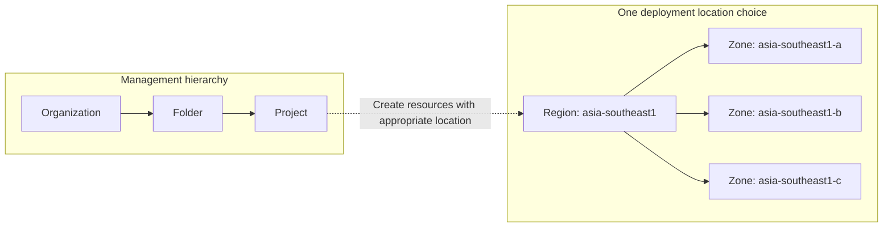
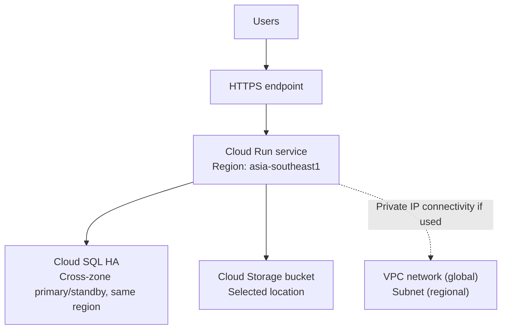

# Region, zone, and GCP resource scope

When deploying applications on Google Cloud, you choose a **project** to determine who owns and manages the resources, and you choose a **region** or **zone** to determine where the resources run or where data is stored. These two choices directly impact latency, fault tolerance, data transfer costs, and regional data residency requirements.

This lesson belongs to the `CLOUD_PROVIDERS_GCP` module, where learners progress from project organization, IAM, and VPCs to Compute Engine, GKE, Cloud Run, storage, databases, automated releases, and reliability and cost monitoring. Understanding resource location and scope is essential for connecting those services into a workable architecture.

## 1. Learning Objectives

After this lesson, you will be able to:

1. Distinguish the **resource hierarchy** (organization, folder, project) from **resource location** (region, zone).
2. Explain global, regional, zonal, multi-region, and dual-region scopes in the context of GCP.
3. Identify the typical scope of VMs, disks, VPCs, subnets, GKE, Cloud Run, Cloud SQL, Cloud Storage, and BigQuery.
4. Select regions and distribute across zones based on latency, availability, data requirements, and cost.
5. Recognize the limits of multi-zone deployments during a region-wide outage, and plan cross-region recovery accordingly.
6. Read resource names, `gcloud` commands, and error messages to diagnose deployment location issues.

## 2. Two independent dimensions: administrative authority and physical location

In Google Cloud's resource hierarchy, an **organization** can contain **folders**, folders can contain folders or **projects**, and a project is the common management boundary for most resources. IAM lets you attach permissions at the appropriate levels; policies can be inherited down to child resources.

**Regions and zones are not child levels under a project in the organization → folder → project tree.** They are location or scope attributes used when creating and managing each type of resource. The same project can contain a VM in Singapore, a bucket in Europe, and a service in the United States, provided organization policies and service availability allow it.



You must distinguish two questions:

- **Who is allowed to manage this resource?** Answered by project, folder, organization, IAM, and governance policies.
- **Where does the resource run or where does the data reside?** Answered by the region, zone, or location provided by the service.

Choosing a region does not create an IAM boundary; granting permissions on a project does not choose a region. Organization policies, such as resource location constraints, can restrict location choices for **services that support those constraints**.

## 3. What are regions and zones?

### 3.1. Region: geographic area

A **Region** is a geographic area where Google Cloud infrastructure is deployed, typically comprising multiple zones. Some examples:

| Region | Illustrative area | Example zones |
| --- | --- | --- |
| `asia-southeast1` | Singapore | `asia-southeast1-a`, `asia-southeast1-b`, `asia-southeast1-c` |
| `asia-east1` | Taiwan | `asia-east1-a`, `asia-east1-b`, `asia-east1-c` |
| `us-central1` | Iowa, USA | `us-central1-a`, `us-central1-b`, `us-central1-c` |
| `europe-west1` | Belgium | `europe-west1-b`, `europe-west1-c`, `europe-west1-d` |

The values in the table illustrate the naming pattern; **the list of regions/zones and supported services can change**. Always consult the live catalog for each service before designing or deploying.

Region is a primary starting point when evaluating user latency, database proximity, data residency requirements, service availability, and pricing. Placing two services in the same region generally favors lower latency and connectivity cost compared to placing them in distant regions, though specific connectivity mechanisms and pricing tables must still be verified.

### 3.2. Zone: fault domain within a region

A **Zone** is an isolated deployment area within the same region, designed to reduce the likelihood that a localized infrastructure failure affects all zones simultaneously. Zones within a region are connected by high-speed, low-latency networking.

For example, the name `asia-southeast1-b` consists of:

- `asia-southeast1`: the region name.
- `b`: the zone identifier within that region.

Do not interpret the letters `a`, `b`, `c` as rankings of performance, price, or safety. Each region has its own set of supported zones; never assume all regions have the same number of zones or the same zone suffixes.

**Separating zones reduces single-zone outage risk, but does not eliminate correlated failures.** Multiple zones still share the geographic footprint of the same region; therefore, multiple regions are required if the system must survive a region-wide outage.

### 3.3. Global, regional, zonal, and data location types

| Concept | Meaning | Typical examples | Key points to remember |
| --- | --- | --- | --- |
| **Global** | The resource is defined at the service's global scope and does not require choosing a single zone or region | VPC network, certain load balancers, global IP addresses | Global is a **management/routing scope**, not a guarantee that every component or piece of data is replicated worldwide |
| **Regional** | Bound to a single region | VPC subnet, Cloud Run service, regional managed instance group | Can span multiple zones within the same region, depending on service and configuration |
| **Zonal** | Bound to a single zone | Compute Engine VM, zonal Persistent Disk | A zone outage can make the resource unavailable |
| **Multi-region** | A geographic group of regions defined by the service | Certain Cloud Storage and BigQuery locations | Replication behavior, durability, latency, and redundancy **depend on the individual service** |
| **Dual-region** | A data location using two supported regions | Cloud Storage dual-region bucket | Does not automatically replace redundancy design at the application tier |
| **Cross-region** | Interaction or replication between two regions | Applications in two regions, cross-region database replicas | Must account for network latency, data transfer fees, and replication lag |

The term **location** in the UI or API can represent a region, zone, multi-region, or another location type defined by the service. Always read the documentation **for the exact product** rather than inferring solely from the word `location`.

## 4. Scopes of common GCP resources

Not all Google Cloud products follow the same location rules. The table below is a design starting point; exact scopes can vary by product variant and configuration.

| Resource or service | Typical scope | Deployment implications |
| --- | --- | --- |
| **Organization, folder, project, IAM policy** | Logical/governance scope, not tied to a single zone | One project manages resources across multiple locations; IAM applies at the resource hierarchy level |
| **VPC network** | Global within a project | A VPC network can contain subnets in multiple regions |
| **VPC subnet** | Regional | A subnet can serve resources in different zones **within the same region**; it cannot be used to create VMs in another region |
| **Compute Engine VM** | Zonal | Creating/looking up a VM usually requires specifying a zone |
| **Standard Persistent Disk** | Zonal | Disk is bound to a zone; VM and disk must have compatible locations |
| **Regional Persistent Disk** | Regional, replicated between two zones in a region | Improves zone-failure tolerance, but requires proper failover/cutover procedures |
| **Managed instance group (MIG)** | Zonal or regional depending on type | A regional MIG can distribute VMs across multiple zones |
| **GKE Standard cluster** | Zonal or regional depending on configuration | A regional cluster distributes its control plane across a region; nodes still run in specific zones |
| **Cloud Run service** | Regional | Select a region for the service; tolerating a full region outage usually requires deploying in another region with appropriate routing |
| **Cloud SQL instance** | Region selected, with a zone placement for the primary; HA has a standby in another zone in the region | In-region HA handles certain zone failures; it is not automatically cross-region DR |
| **Cloud Storage bucket** | Regional, dual-region, or multi-region depending on location | Object storage placement and redundancy follow the chosen location; bucket names are globally unique |
| **BigQuery dataset** | Regional or multi-regional location | Jobs and related data must satisfy BigQuery's location rules |
| **Artifact Registry repository** | Supported region or multi-region | Should be placed near build/deploy locations to limit latency and data transfer |
| **Cloud Load Balancing** | Both global and regional types exist | Must select the right product/load balancer; not every load balancer is global |

### 4.1. The VPC – subnet – VM relationship

This is one of the most frequently confused relationships:

- A **VPC network** has global scope within a project, so one VPC can have subnets across multiple regions.
- A **Subnet** has regional scope: for example, `app-subnet` in `asia-southeast1` can serve VMs in `asia-southeast1-a` and `asia-southeast1-b`.
- A **VM** has zonal scope: a VM in `asia-east1-a` cannot directly use a subnet located in `asia-southeast1`.
- A global VPC helps organize and route networking across regions according to its rules. It **does not automatically replicate** disks, databases, or application state across regions.

Resource paths in Compute Engine reflect these scopes:

```text
projects/PROJECT_ID/global/networks/app-vpc
projects/PROJECT_ID/regions/asia-southeast1/subnetworks/app-subnet
projects/PROJECT_ID/zones/asia-southeast1-a/instances/app-vm
```

The segments `global`, `regions/REGION`, or `zones/ZONE` are strong indicators of **that API's** scope. Do not apply a single Compute Engine path pattern to every Google Cloud API.

### 4.2. The VM – disk relationship and migration limits

A VM in zone `asia-southeast1-a` normally uses a boot disk in the same zone. When you only have a zonal disk, moving the VM to zone `asia-southeast1-b` is not as simple as changing the zone name in a config: you must choose a data copy/restore mechanism, recreate resources appropriately, and verify consistency.

A Regional Persistent Disk can maintain synchronous replicas in two zones within a region under supported configurations. However, **having a replicated disk does not mean the application automatically fails over to another VM**: you still need to provision a replacement instance, attach/recover the disk, route traffic, and test the procedure.

### 4.3. GKE, Cloud Run, and managed services

With GKE, separate **control plane location** from **node location where workloads run**. A regional Standard cluster provides higher availability for the control plane within a region; node pool configuration, replica counts, and pod distribution rules determine the application's actual fault tolerance.

With Cloud Run, users choose a **region** rather than picking zones for individual instances. Google Cloud manages the underlying infrastructure running the service in that region; using Cloud Run does not by itself protect against a region-wide outage. When cross-region resilience is required, you must deploy across multiple regions, handle state/data, and configure routing.

With Cloud SQL, HA configurations place a standby in a different zone within the **same region**. Cross-region replicas serve a different purpose and have their own replication/failover characteristics; you must design for them, monitor replica lag, and test recovery.

### 4.4. Data: bucket and dataset locations

Cloud Storage offers multiple location options. A **regional** bucket is not the same as a **dual-region** or **multi-region** bucket; the difference lies in where objects are stored and the redundancy provided by the product. Having a globally unique bucket name does not mean the bucket's data is stored everywhere around the world.

BigQuery also assigns a location to datasets. A dataset in location `US` (multi-region) must not be assumed to be identical to a dataset in a specific US region. Queries, copy operations, and related services must satisfy the corresponding location rules. In particular, **a storage system's multi-region option does not automatically turn an entire application into an active-active multi-region architecture**.

## 5. Zone failure vs. region failure: how do they differ?

These two outage types require two different architectural levels.

| Scenario | Single-zone deployment | Multi-zone within one region | Multi-region deployment |
| --- | --- | --- | --- |
| A single VM fails | Likely disruption until the VM/instance is replaced | Can keep serving if healthy instances, load balancing, and self-healing are properly configured | Can continue if distributed and routed properly |
| A zone suffers an outage | High risk of disruption | Can maintain service if all critical tiers have cross-zone redundancy | Can continue if healthy regions/zones remain and dependencies still operate |
| An entire region suffers an outage | Nowhere else to run | Still at risk of disruption because all zones are in the same region | Can switch to another region if resources, data, routing, and failover procedures are prepared |

End-to-end availability depends on the **weakest link**. Two API replicas across two zones backed by a single-zone database still share a single point of failure. Likewise, having a database replica without a mechanism to shift traffic still leaves users unable to reach the application.

### Three typical design levels

**Level A – single zone, for labs and test environments:** one VM, one zonal disk, one zone. Simple configuration, poor fault tolerance. Suitable when downtime and rebuilding resources are acceptable.

**Level B – multi-zone within one region, for in-region HA:** spread VMs via a regional MIG or nodes/pods across multiple zones, placing an access layer in front of healthy instances; choose a data solution that tolerates zone failures. Every layer needs health checks, spare capacity, and recovery procedures.

**Level C – multi-region, for region-wide DR:** stand up the application in a secondary region, select cross-region data replication, configure traffic failover routing, synchronize required configurations/secrets, and practice failover drills. Active-passive or active-active models should be chosen based on write characteristics and latency/cost tolerance.

Two metrics guide DR design:

- **RTO (Recovery Time Objective):** the maximum downtime the business can tolerate after an incident.
- **RPO (Recovery Point Objective):** the maximum amount of data loss acceptable, measured as the time window prior to the incident.

Asynchronous replication across regions can introduce lag, so RPO cannot be assumed to be zero. Data replication, configuration copies, and failover procedures must all be validated through drills rather than inferred from product names.

## 6. Criteria for choosing a region and zone

A practical selection process should evaluate in order:

1. **Legal and data constraints.** Identify which data types must reside where, who may access them, where logs/backups are stored, and which organization policies apply to which products. Never infer data residency guarantees solely from the application's region.
2. **Service support.** Verify whether the required Compute Engine machine types, GPUs, GKE, Cloud Run, Cloud SQL engines/tiers, AI services, or specific features are available in the target region/zone.
3. **Latency to users and between tiers.** Place the app close to users while considering app–database, app–object storage, and dependent APIs. Do not optimize browser latency by placing the database in a region too far from the application.
4. **Fault tolerance goals.** Use multiple zones at minimum for tiers requiring in-region HA; add a second region when region-wide fault tolerance is required. Check every tier and data flow.
5. **Cost and quotas.** Compare regional pricing, cross-region egress, storage/replication, load balancing, quotas, and headroom for traffic spikes.
6. **Operability.** Assess ease of automation, observability, backup, recovery, and operations team expertise.

There is no single "best" region for all systems. An application serving users primarily in Vietnam **may** consider `asia-southeast1` as a latency candidate, but the final decision should rely on actual measurements, service availability catalogs, cost, and compliance requirements.

### Location dependencies to verify

| If you choose... | Also verify... |
| --- | --- |
| A VM in zone A | The subnet is in the same region; machine type, accelerators, and disk capacity are supported in zone A |
| A regional MIG spanning multiple zones | Template, active zones, target distribution, minimum instance count, and actual distribution |
| A GKE regional cluster | Which zones node pools run in; whether workloads have enough replicas, anti-affinity/topology spread, and appropriate PDBs |
| Cloud Run in region A | Database, Artifact Registry, secrets, VPC egress, and dependencies are reachable with acceptable latency |
| Cloud SQL HA | HA configuration, primary/secondary zones, backup mechanism, and region-wide DR strategy if needed |
| Cloud Storage dual/multi-region | Supported locations, pricing, replication characteristics, and published RPO/RTO for the specific feature |
| A BigQuery dataset in a location | Locations of jobs, other datasets, external data sources, and data transfer costs |

**Quotas and provisioning capacity** do not always share the same scope as resources. Some quotas are per-project, per-region, or service-defined. Even when quota is available, a zone can temporarily lack capacity for a specific machine type at provisioning time.

## 7. Real-world scenario: web application serving users in Vietnam

Suppose a team deploys a booking system with an API on Cloud Run, transactional data in Cloud SQL, and images stored in Cloud Storage. The team wants to optimize user experience and avoid downtime if a single zone experiences an outage.

**Controlled initial design:**

- Choose a region that meets latency, data placement, and service support requirements for both Cloud Run and Cloud SQL; suppose `asia-southeast1` is approved after verification.
- Deploy the Cloud Run service in `asia-southeast1`. If private IP connectivity to the database is required, design an appropriate VPC access path.
- Choose Cloud SQL HA in the same region, with cross-zone primary/standby as supported by the product. Enable backups, monitoring, and test data recovery.
- Place the Cloud Storage bucket in a location matching data policy; if choosing a regional location, explicitly assess whether objects need cross-region redundancy.
- Monitor health checks, application errors, query latency, quotas, and data transfer costs.



This design resists certain in-region infrastructure failures thanks to managed services and database HA. However, it **does not guarantee resilience against a full region outage**. If business requirements increase, the team needs an additional DR design: deploy the API in a standby region, plan cross-region database replicas/recovery, synchronize object data as needed, configure traffic failover, and measure RTO/RPO through drills.

Another example: if the app runs on Compute Engine, Cloud Run can be replaced with a **regional MIG** distributed across at least two zones behind an appropriate load balancer. Stateful components still require dedicated HA/DR plans.

## 8. Viewing resource locations with gcloud

The following commands illustrate **read-only** operations. You need Google Cloud CLI installed, signed in, the proper project selected, and permission to view resources. Names `demo-vm`, `demo-api`, and `BUCKET_NAME` are placeholders; replace them with existing resources before running.

### 8.1. Viewing regions and zones

```bash
# List Compute Engine regions
gcloud compute regions list

# View only the Singapore region
gcloud compute regions list --filter="name=asia-southeast1"

# View zones whose names start with asia-southeast1-
gcloud compute zones list --filter="name~^asia-southeast1-"
```

These commands describe regions/zones for Compute Engine. **Do not assume every GCP service is available there.** To deploy GKE, Cloud Run, or databases, check the supported locations list for that specific service.

### 8.2. Identifying the scope of specific resources

```bash
# VM: requires zone
gcloud compute instances describe demo-vm \
  --zone=asia-southeast1-a

# Subnet: inspect the list and returned region
gcloud compute networks subnets list

# Cloud Run: requires region
gcloud run services describe demo-api \
  --region=asia-southeast1

# Cloud Storage: inspect the bucket's declared location
gcloud storage buckets describe gs://BUCKET_NAME
```

The trailing `\` in Bash examples indicates line continuation; in PowerShell or CMD, write the command on one line or use that shell's line-continuation syntax. When describing resources, look at fields such as `zone`, `region`, `location`, or `locationType` **when provided by the service**.

### 8.3. Interpreting common location errors

- **Resource not found:** you may be looking up the right VM name with the wrong `--zone` or wrong project.
- **Subnetwork is in a different region:** the VM or resource references a subnet in another region; select a subnet in the same region or change the deployment location.
- **Machine type/feature unavailable in zone:** check another zone in the same region or another region that supports the machine type/feature.
- **Location constraint violated:** an organization constraint blocks creating that resource type in that location; inspect the applicable policy and pick an allowed location.
- **Quota exceeded / insufficient capacity:** identify the service quota and its scope, and check capacity and alternatives.

Do not resolve errors simply by moving data or infrastructure to another region without first checking data requirements, network paths, and impact on dependent systems.

## 9. Misconceptions that cause design bugs

| Misconception | Accurate understanding |
| --- | --- |
| “The project belongs to the Singapore region.” | A project is a management scope; individual resources inside it can have different locations. |
| “VPC is global so subnets are global too.” | VPCs are global, while subnets are regional. |
| “Three VMs in the same zone provide HA.” | Multiple VMs in one zone still share zone-outage risk. |
| “With regional GKE, pods spread across zones automatically.” | You must verify node pool configuration, pod replica count, and workload spread policies. |
| “Cloud Run is regional so it always survives a region-wide outage.” | A managed regional service is still exposed if the entire region goes down. |
| “A regional disk makes the application fail over automatically.” | Disk replication and application startup/traffic rerouting are two separate tasks. |
| “A multi-region bucket makes the whole system multi-region.” | It only describes the storage service's data placement/redundancy strategy. |
| “Bucket names are global so data lives in every region.” | Name uniqueness does not dictate where data is stored. |
| “Putting app and database in two regions is always safer.” | You must evaluate synchronization, consistency, latency, network egress, and failover procedures. |
| “Choosing zone b is always better than zone a.” | Zone suffixes do not indicate quality or pricing tiers. |

## 10. Practice exercises and guided answers

**Exercise 1 – reading API paths.** Given three resources:

```text
projects/p1/global/networks/prod-vpc
projects/p1/regions/asia-southeast1/subnetworks/prod-subnet
projects/p1/zones/asia-southeast1-b/instances/api-01
```

Identify the scope of each resource and check whether the VM can use the subnet above.

*Guided answer:* The VPC is global, the subnet is regional in `asia-southeast1`, and the VM is zonal in `asia-southeast1-b`. The VM can use that subnet from a **location** standpoint because the VM's zone belongs to the same region; other networking configurations, permissions, and limits must still be met.

**Exercise 2 – single-zone failure.** A team has two application VMs in `asia-southeast1-a` and a single-zone database also in that zone. If the zone goes down, can the service be expected to keep serving?

*Guided answer:* No. Both VMs and the database share a zonal single point of failure. You need to distribute the application tier across multiple zones and design HA for the database, then verify health checks, traffic routing, and failover.

**Exercise 3 – region-wide failure.** A regional GKE cluster and Cloud SQL HA are both deployed in `asia-southeast1`. Does the system have enough resilience for a full region outage?

*Guided answer:* Not yet. The components are better protected against zone failures, but they remain in the same region. Achieving DR requires an additional standby region, a data strategy, and failover testing.

**Exercise 4 – deciding data location.** The application team deploys Cloud Run in `asia-southeast1` but wants to store transactions in location `EU` to satisfy an unverified data requirement. What should be asked and checked before deploying?

*Guided answer:* Clarify data residency/processing requirements, database product suitability, Singapore–Europe network paths, query latency, egress fees, backups and logs, location policies, and whether application components can be split by location. Do not decide based on region codes alone.

## 11. Pre-deploy checklist

- [ ] Clearly identify the **project** owning the resources and related IAM permissions/organization policies.
- [ ] Classify each component as **global, regional, zonal**, or a specific data location.
- [ ] Confirm that the region/zone supports the required services, machine types, versions, and features.
- [ ] Check all dependency pairs: VM–subnet, VM–disk, app–database, GKE–node pool, service–artifact.
- [ ] Document shared failure domains for resources in the same zone and the same region.
- [ ] Compare the design against RTO/RPO and prepare backups, replication, and failover where needed.
- [ ] Estimate latency and network charges across regions, zones, and services.
- [ ] Ensure error observability, health checks, and recovery drills are in place before going to production.

## 12. Reference documentation for implementation

The following official pages help verify **current** location lists and behavior for each service:

- [Google Cloud locations](https://cloud.google.com/about/locations): list of infrastructure locations and services.
- [Compute Engine regions and zones](https://cloud.google.com/compute/docs/regions-zones): region/zone concepts and Compute Engine scope.
- [VPC networks](https://cloud.google.com/vpc/docs/vpc): VPC network and subnet scopes.
- [Cloud Storage bucket locations](https://cloud.google.com/storage/docs/locations): regional, dual-region, and multi-region options.
- [GKE regional clusters](https://cloud.google.com/kubernetes-engine/docs/concepts/regional-clusters): control plane placement and regional cluster design.

When encountering an unfamiliar resource name or location, identify the **service**, **API scope**, and **deployment location** first, and only then evaluate **fault tolerance, latency, compliance, and cost**. This four-step reading method avoids most region/zone configuration mistakes in real-world GCP systems.
