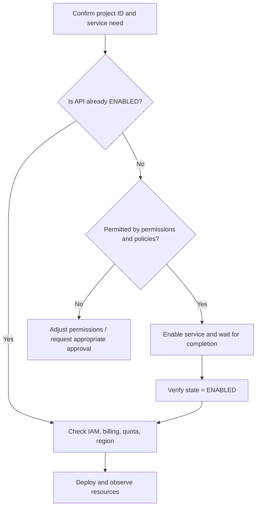

# Service Usage and enabling APIs in a project

When getting started with Google Cloud, having a created project **does not mean every service is ready to accept requests**. Before creating resources for several services, an administrator or deployment pipeline must **enable the corresponding API for the project**. For example, to deploy Cloud Run, the project needs the **Cloud Run Admin API** (`run.googleapis.com`) enabled; to use Google Kubernetes Engine (GKE), it needs the **Kubernetes Engine API** (`container.googleapis.com`) enabled.

Google Cloud provides **Service Usage** to inspect and manage the state of enabled APIs/services in each project. This is a foundational step in project organization, IAM setup, deploying Compute Engine, VPC, GKE, Cloud Run, storage, and databases, as well as automating CI/CD. This lesson explains how to enable APIs in a controlled manner, verify status, and troubleshoot common errors.

## Learning Objectives

After this lesson, you will be able to:

1. Explain what `Service Usage` manages and why APIs must be enabled per **project**.
2. Distinguish **enabling an API**, **granting IAM permissions**, **authentication**, **linking a billing account**, and **creating resources**.
3. Look up exact service names, check status, and enable APIs via the Google Cloud console and `gcloud`.
4. Prepare least-privilege permissions for administrators, service accounts, and deployment pipelines.
5. Diagnose errors caused by disabled APIs, missing permissions, organization policies, billing, or quotas.
6. Manage the required set of APIs via infrastructure configuration, avoiding unintended drift between development and production.

## 1. What is Service Usage?

The **Service Usage API** (`serviceusage.googleapis.com`) is the interface for managing Google Cloud services/APIs that a **consumer project** can use. One of its primary functions is viewing and changing service states:

- **`ENABLED`:** The service is enabled for the project. Requests must still pass authentication, IAM, quota, billing, and service-specific rules.
- **`DISABLED`:** The service has not been enabled or has been disabled in the project. Operations requiring that API may be rejected.

Google Cloud typically shows an **Enable API** button on the project's API Library page, or provides the `gcloud services enable` command. Both serve to enable a **service for the project acting as the consumer**.

For example, a team has two projects:

```text
Organization: company.example
└── Folder: Retail
    ├── Project: retail-app-dev-01
    │   ├── run.googleapis.com              ENABLED
    │   ├── artifactregistry.googleapis.com ENABLED
    │   └── container.googleapis.com        DISABLED
    └── Project: retail-app-prod-01
        ├── run.googleapis.com              ENABLED
        ├── artifactregistry.googleapis.com ENABLED
        └── container.googleapis.com        ENABLED
```

These values are examples and **do not reflect the real state** of projects with those names. Enabling the Kubernetes Engine API in production **does not automatically enable it in development**. Each project maintains its own list of enabled APIs, even when two projects share the same folder or organization.

### How does enabling an API differ from using an API?

| Action | Question answered | Example |
| --- | --- | --- |
| **Enable API** | Is this project allowed to use the service yet? | Enable `run.googleapis.com` |
| **Authentication** | Who is sending the request? | User signed into `gcloud`; workload using a service account |
| **IAM Authorization** | Is that identity allowed to perform this action on the resource? | Grant appropriate role to deploy Cloud Run |
| **Billing** | How are billable resources paid for? | Project linked to an active billing account |
| **Quota** | Is usage still within limits? | API request rate or resource limits |
| **Create resource** | Does the service, VM, or database exist yet? | Deploy a Cloud Run service after enabling the API |

**Enabling an API does not grant IAM permissions**, does not automatically create a VM/GKE cluster/Cloud SQL instance, and does not prove an account can call every API method. Conversely, even when an account has the right IAM role, commands can still fail if the API is not enabled.

## 2. Project, API name, and consuming identity

When reading documentation or error messages, separate three names:

1. **Project ID**, such as `retail-app-dev-01`, identifies the project using the service. The project number is system-assigned and often appears in error messages or Service Usage resource identifiers.
2. **Product name**, such as **Cloud Run** or **Compute Engine**, commonly seen in the UI and documentation.
3. **API/service name**, such as `run.googleapis.com` or `compute.googleapis.com`, is the name passed to enablement commands.

Common APIs encountered while learning Google Cloud:

| Need | Commonly needed API/service | Meaning |
| --- | --- | --- |
| Manage enabling/disabling services | `serviceusage.googleapis.com` | Service Usage API |
| Create VMs, manage VPCs and many Compute Engine network resources | `compute.googleapis.com` | Compute Engine API |
| Create and manage GKE clusters | `container.googleapis.com` | Kubernetes Engine API |
| Manage Cloud Run services | `run.googleapis.com` | Cloud Run Admin API |
| Store and manage container images in Artifact Registry | `artifactregistry.googleapis.com` | Artifact Registry API |
| Build containers with Cloud Build | `cloudbuild.googleapis.com` | Cloud Build API |
| Manage Cloud SQL instances via API | `sqladmin.googleapis.com` | Cloud SQL Admin API |
| Manage Cloud Storage via JSON API | `storage.googleapis.com` | Cloud Storage API |

This is a **reference mapping table**, not a mandatory API list for every system. A specific action may pull in dependent services or require additional APIs. Some products can prompt for or automatically enable related APIs when configured through the console.

**Note:** The name `run.googleapis.com` is used to manage enabling the Cloud Run Admin API; it is **not the public HTTP URL of a Cloud Run application** once deployed. Application URLs are assigned per service or via custom domains.

## 3. Prerequisites before enabling an API

Before opening the API Library or running `gcloud services enable`, verify:

**Right project:** Pick the project matching `dev`, `stg`, or `prod`. Read the project ID in the console or pass `--project` explicitly in the CLI. Do not rely solely on project name because display names can collide.

**Right identity and permissions:** The executing identity needs the `serviceusage.services.enable` permission on the project. The predefined IAM role **Service Usage Admin** (`roles/serviceusage.serviceUsageAdmin`) provides permissions to manage service states. Grant permissions at the appropriate project scope following least privilege.

**Organization policy:** Organization Policy or governance restrictions can prohibit a specific service, resource type, or usage pattern. Having an IAM role does not override these policies.

**Billing and quota:** Enabling an API alone generally **does not incur resource usage charges**, but subsequent operations may require the project to be linked to an active billing account and have sufficient quota. Exact prerequisites depend on the service.

**Dependent APIs:** For example, deploying Cloud Run from a container image in Artifact Registry requires managing Cloud Run and Artifact Registry; building from source may additionally require Cloud Build. Do not enable an overly broad set of APIs just because they are available.

### Permissions related to Service Usage

| Task | Permissions or roles to consider | Notes |
| --- | --- | --- |
| View enabled APIs | `serviceusage.services.list`, `serviceusage.services.get` | Can grant an appropriate read-only role |
| Enable APIs | `serviceusage.services.enable` | `roles/serviceusage.serviceUsageAdmin` is the commonly used predefined role |
| Disable APIs | `serviceusage.services.disable` | Mutating operation that affects active workloads |
| Deploy Cloud Run | Cloud Run permissions and permissions related to service accounts and images | Service Usage Admin **does not automatically grant** deployment rights |
| Call business APIs | Permissions for the corresponding API/service | May also involve OAuth scopes, quota project, or service policies |

Administrators can separate the **API enabler role** from the **application deployer role**. A CI/CD pipeline does not necessarily need permissions to enable/disable APIs if projects are prepared by an infrastructure governance pipeline.

## 4. Enabling APIs via the Google Cloud console

Suppose you want to enable the Cloud Run Admin API in the development project:

1. Open the [Google Cloud console](https://console.cloud.google.com/) and **select the target project**. Confirm the project ID, not only the display name.
2. Go to **APIs & Services → Library**.
3. Search for **Cloud Run Admin API** or `run.googleapis.com` and open its API page.
4. Click **Enable** if the API is not yet enabled. If the UI displays **Manage**, the API may already be enabled; open the management page to verify details.
5. Open **APIs & Services → Enabled APIs & services** to verify the enabled list.

UI paths and labels may vary across console versions. If the Enable button is missing or denied, check the selected project, IAM permissions, and organization policies.

**Safe practice:** Record the project ID, API/service name, and intended purpose in change requests. For production, enable only APIs genuinely needed by the approved architecture.

## 5. Enabling and checking via Google Cloud CLI

Assume `gcloud` is installed and an identity is signed in. The commands below use **Bash**; replace the example project ID with an authorized project.

### Step 1: Verify project and identity

```bash
PROJECT_ID="retail-app-dev-01"

# Check which account gcloud is currently using.
gcloud auth list

# Check default project; do not assume it is the target project.
gcloud config get-value project

# Verify the ID, number, and display name of the target project.
gcloud projects describe "$PROJECT_ID" \
  --format="table(projectId,projectNumber,name)"
```

Passing `--project="$PROJECT_ID"` in subsequent commands sets the scope explicitly, even if your local default configuration selects another project.

### Step 2: List available and enabled APIs

```bash
# APIs/services currently enabled for the project.
gcloud services list \
  --enabled \
  --project="$PROJECT_ID"

# Print service names to save or compare against a required list.
gcloud services list \
  --enabled \
  --project="$PROJECT_ID" \
  --format="value(config.name)"

# View services available to enable for the project.
gcloud services list \
  --available \
  --project="$PROJECT_ID"

# Inspect details of a specific API.
gcloud services describe run.googleapis.com \
  --project="$PROJECT_ID"
```

The `--available` output is a **list of candidate services**, not a guarantee that all of them are enabled or usable without additional prerequisites.

### Step 3: Enable only the required APIs

Scenario: the team wants to deploy a container image from Artifact Registry to Cloud Run.

```bash
gcloud services enable \
  run.googleapis.com \
  artifactregistry.googleapis.com \
  --project="$PROJECT_ID"
```

If the application is **built from source code using Cloud Build**, you may also need to enable:

```bash
gcloud services enable cloudbuild.googleapis.com \
  --project="$PROJECT_ID"
```

A single `gcloud services enable` command accepts **multiple API names**, while modifying only the specified project. A brief wait may be required for the enabled state to propagate across related systems; do not immediately treat a transient error as a permanent configuration failure.

### Step 4: Confirm status after enabling

```bash
# Check the specific state of both configured services.
gcloud services describe run.googleapis.com \
  --project="$PROJECT_ID" \
  --format="yaml(config.name,state)"

gcloud services describe artifactregistry.googleapis.com \
  --project="$PROJECT_ID" \
  --format="yaml(config.name,state)"
```

The expected state is `ENABLED`. However, this state only proves the API is enabled; subsequent deployment still depends on IAM, images, region, quotas, billing, and application configuration.

### When to use the Service Usage API directly?

The console and `gcloud` suit routine administrative tasks. For admin portals or project-vending systems, you can call the **Service Usage REST API** to list services, retrieve status, and submit API enablement requests.

Service Usage resource paths follow the pattern:

```text
projects/PROJECT_NUMBER/services/SERVICE_NAME

# Illustrative example:
projects/123456789012/services/run.googleapis.com
```

Service Usage's enable method can return a **long-running operation**; integration tooling should poll for completion and re-check the service rather than assuming request submission means everything is immediately ready. Calling the REST API requires a valid token and appropriate service management permissions.

## 6. Automation in Infrastructure as Code

To provision multiple projects consistently, a team can declare required APIs as part of Terraform. Minimal example using the Google provider:

```hcl
variable "project_id" {
  type = string
}

resource "google_project_service" "cloud_run" {
  project            = var.project_id
  service            = "run.googleapis.com"
  disable_on_destroy = false
}

resource "google_project_service" "artifact_registry" {
  project            = var.project_id
  service            = "artifactregistry.googleapis.com"
  disable_on_destroy = false
}
```

In this example, `disable_on_destroy = false` is chosen so that if the Terraform resource is removed from config or destroyed, Terraform **does not automatically disable an API that workloads depend on**. Production configs also need a configured provider, an authorized identity, and a change-review process.

If the entire project lifecycle is managed with IaC, you can follow a standardized sequence:

```text
Create project and link billing (when needed)
    ↓
Apply IAM / organization policies
    ↓
Enable approved API list
    ↓
Create VPC, Artifact Registry, and application resources
    ↓
Deploy workloads
    ↓
Verify logging, quotas, reliability, and costs
```

Separating project and API preparation from application release reduces the permissions needed by the deployment pipeline. Additionally, keeping the API list under version control helps detect unintended manual changes.

## 7. API lifecycle: enabling, using, and disabling

Service preparation can be viewed as a flow:



An API may be enabled by an administrator, by deployment tooling, or by a product configuration workflow. Regardless of how it is enabled, keep the managed API list consistent for auditability.

**Disabling an API** is not equivalent to “removing a button from the console.” It is a change that can prevent active clients and workloads from calling the API; in some cases it may also be blocked by dependent services. Existing resources and associated data behave differently when an API is disabled. Before disabling, check whether resources still use the service, dependency relationships, data retention policies, recovery plans, and production impact.

In real projects, **never disable an API solely because no recent calls are visible**: a scheduled job or disaster recovery workflow may run only occasionally.

## 8. How Service Usage relates to IAM, billing, and quotas

### IAM: enabling an API grants users no resource permissions

For example, someone with `roles/serviceusage.serviceUsageAdmin` can enable the Cloud Run Admin API yet **may not** have permission to deploy a Cloud Run service. Deploying typically requires the corresponding Cloud Run permissions, permission to use the runtime service account, and image access permissions if required. Likewise, enabling the Compute Engine API does not grant permission to create VMs.

Conversely, a deployment service account with service permissions may still be rejected if the project has not enabled the API. Check **both API state and IAM** before modifying roles.

### Billing: enabling a service is not a bill

Seeing `ENABLED` in Service Usage neither proves an active billing account is attached nor means the infrastructure is completely free. Costs depend on resource types, consumption, configuration, and pricing policies. When building on Cloud Run, GKE, Compute Engine, or Cloud SQL, verify the right project and billing account, set budgets/alerts if needed, and monitor costs at the project level.

### Quota: limits before scaling

An enabled API can still reject calls due to exceeded quotas or resource limits per project, region, service, or method. Quotas are not IAM permissions and cannot be solved simply by re-enabling the API.

In operations, inspect the specific service's quota table, adjust traffic/batching/backoff appropriately, and submit a quota increase request where supported. Never blindly retry a quota error indefinitely.

### Service agents: service-managed identities

Some Google Cloud services create **service agents** or Google-managed service accounts when enabled or used. They may carry the project number in their email or identifier and hold roles for internal operations. Creation timing, naming, and roles vary by service; never guess and manually create or remove their IAM bindings without reading the service documentation.

## 9. Troubleshooting when enabling or using APIs

| Symptom | Causes to check | Resolution |
| --- | --- | --- |
| `API has not been used ... or it is disabled`; `SERVICE_DISABLED` | API not enabled for **the project named in the error** | Verify project ID/number, run `gcloud services describe`, enable the right API if authorized |
| `PERMISSION_DENIED` on `gcloud services enable` | Identity lacks `serviceusage.services.enable` | Check `gcloud auth list`; grant Service Usage management role at the proper scope |
| API `ENABLED` yet deploy still returns 403 | Missing API or target resource permissions; possibly wrong service account | Read the rejected method/resource details and related IAM bindings |
| Cannot enable despite having IAM permissions | Organization policy, service unavailability, or other constraint | Inspect effective policies and exact error message |
| `BILLING_DISABLED`, prompt to enable billing | Project lacks an active billing account for billable actions | Check billing status and billing management permissions |
| `RESOURCE_EXHAUSTED` or `QUOTA_EXCEEDED` | API/resource limit reached | Check quotas by service, project, and region; reduce load or request quota increase |
| Enabled yet system immediately reports still disabled | State propagating or tool targeting a different project | Re-read state; confirm project/region and retest in a controlled way |
| Console shows API enabled while CLI does not | Console and CLI have different projects selected | Compare actual project IDs and pass `--project` explicitly |

A quick, **non-mutating** diagnostic sequence:

```bash
PROJECT_ID="retail-app-dev-01"
API_NAME="run.googleapis.com"

# 1. Check active identity and default project.
gcloud auth list
gcloud config get-value project

# 2. Check project ID and project number of the target project.
gcloud projects describe "$PROJECT_ID" \
  --format="table(projectId,projectNumber,name)"

# 3. Check the service.
gcloud services describe "$API_NAME" \
  --project="$PROJECT_ID" \
  --format="yaml(config.name,state)"
```

If diagnostic commands also fail, record the **error code**, referenced project, API name, active identity, and timestamp. A 403 message can represent multiple causes, so never automatically assume every 403 means missing IAM.

## 10. Real-world scenario: deploying Cloud Run from CI/CD

A team builds a retail application with:

- Development project: `retail-app-dev-01`.
- Production project: `retail-app-prod-01`.
- A pipeline that builds container images and releases to Cloud Run.
- Requirements for separating dev/prod permissions and monitoring reliability and costs.

On the first dev deployment, the pipeline reports it cannot call the Cloud Run Admin API. The team should proceed in order:

**Step 1 — Identify the target.** Read the project ID from pipeline config and check the project number in the error message. Never enable APIs in production when an error occurs in dev.

**Step 2 — Declare minimal APIs.** For releasing from pre-built images, `run.googleapis.com` and `artifactregistry.googleapis.com` are typically needed. If the pipeline uses Cloud Build, add `cloudbuild.googleapis.com` to the corresponding config. Check current deployment documentation for other dependencies.

**Step 3 — Prepare permissions.** The infrastructure provisioning pipeline holds appropriate API-enabling permissions; the application deployment pipeline holds Cloud Run permissions, permission to use the service account, and required image access. Do not grant Service Usage Admin more broadly than needed.

**Step 4 — Enable and verify.** Run `gcloud services enable` with `--project=retail-app-dev-01` and confirm `state: ENABLED`. Only then proceed to create Artifact Registry repositories or deploy Cloud Run.

**Step 5 — Validate application state.** Inspect revisions, endpoints, logs, 4xx/5xx errors, latency, quotas, and resource consumption. An `ENABLED` API is only an entry prerequisite, not a criterion for declaring a release successful.

**Step 6 — Maintain environment control.** When promoting to production, use the approved API list and specify the production project ID explicitly. Record configuration in IaC, enforce change reviews, and monitor costs per project.

Minimal example sequence inside a pipeline:

```text
[1] Select dev/prod project and authenticate identity
       ↓
[2] Check APIs, IAM, billing, and policies
       ↓
[3] Enable approved APIs (infrastructure pipeline)
       ↓
[4] Build/push image; deploy Cloud Run (application pipeline)
       ↓
[5] Health checks, logging, metrics, cost review
```

## 11. Self-check questions

**Question 1.** Does enabling `compute.googleapis.com` automatically grant the signed-in account permission to create VMs?

<details>
<summary>Answer</summary>

No. API enablement state and IAM permissions are two independent requirements. The identity must also hold appropriate Compute Engine permissions, and the project must satisfy billing/quota/policy conditions.
</details>

**Question 2.** Two projects `retail-app-dev-01` and `retail-app-prod-01` share the same folder. When `run.googleapis.com` is enabled in dev, is the API automatically enabled in production?

<details>
<summary>Answer</summary>

No. Service state is managed per consumer project. It must be enabled and verified separately in production if that environment needs the API.
</details>

**Question 3.** A deployment command fails with a 403 error. Why can you not immediately conclude that the API is disabled?

<details>
<summary>Answer</summary>

A 403 can also be caused by IAM, policies, or other conditions. Read the full error message, check the project ID/number, API state, and executing identity before choosing a fix.
</details>

**Question 4.** When Terraform removes a `google_project_service` resource from state, why do many teams choose `disable_on_destroy = false`?

<details>
<summary>Answer</summary>

To avoid accidentally disabling an API that active workloads depend on when changing Terraform management lifecycle. Disabling an API should go through an impact assessment and dedicated procedure.
</details>

**Question 5.** A pipeline deploys Cloud Run from an existing image in Artifact Registry. Is enabling only `run.googleapis.com` guaranteed to suffice for all steps?

<details>
<summary>Answer</summary>

That cannot be assumed. You must consider Artifact Registry API, IAM permissions for the image and service account, region, billing, quotas, and deployment-specific dependencies. If building from source via Cloud Build, the Cloud Build API may also be needed.
</details>

## 12. Checklist for applying to a new project

- [ ] Confirm **project ID and project number**, environment, and owner.
- [ ] Identify the list of APIs required for the architecture (compute/network, container/serverless, storage/database, build/deploy).
- [ ] Check Service Usage roles, deployment IAM permissions, organization policies, and billing requirements.
- [ ] Enable APIs via console, `gcloud`, or IaC on the **right project**.
- [ ] Re-read `ENABLED` state and verify service dependencies.
- [ ] Deploy resources with least privilege; verify application behavior, logs, metrics, and quotas.
- [ ] Record the API list and project in configuration source; review changes for production.
- [ ] Monitor actual costs; evaluate carefully before disabling any API with dependent workloads.

## Official References

- [Service Usage — Overview](https://cloud.google.com/service-usage/docs/overview): concepts of managing APIs and services per project.
- [Service Usage — Enabling and disabling services](https://cloud.google.com/service-usage/docs/enable-disable): enable/disable states and lifecycle.
- [Service Usage — Access control](https://cloud.google.com/service-usage/docs/access-control): IAM permissions and roles.
- [Google Cloud CLI — gcloud services](https://cloud.google.com/sdk/gcloud/reference/services): listing, describing, and enabling APIs.
- [Service Usage REST API](https://cloud.google.com/service-usage/docs/reference/rest): resource names, methods, and long-running operations.
- [Google Cloud — Quotas and system limits](https://cloud.google.com/docs/quotas): quota types and how to monitor them.
- [Cloud Billing documentation](https://cloud.google.com/billing/docs): managing billing accounts, projects, and costs.
- [Cloud Run documentation](https://cloud.google.com/run/docs): Cloud Run deployment workflow and service prerequisites.
