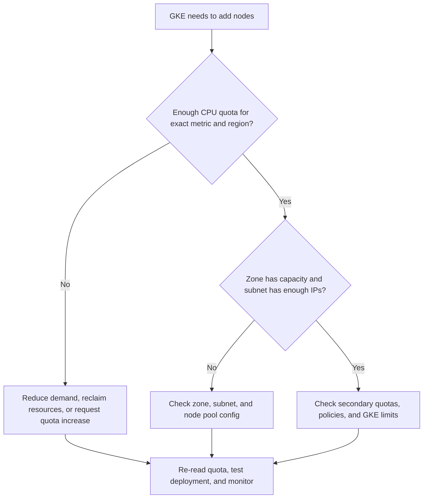

# Quotas, system limits, and quota increase requests on Google Cloud

When deploying systems on Google Cloud, having permission to create resources and sufficient budget still does not guarantee you can create more VMs, scale out GKE nodes, or make unlimited API calls. Google Cloud services use **quotas** and **system limits** to protect the platform, allocate serving capacity, and control resource consumption.

In the **Resource Hierarchy and Locations** chapter of module `CLOUD_PROVIDERS_GCP`, this lesson helps you understand quotas in the context of managing **Organization, Folder, Project, IAM, VPC** and deploying Compute Engine, GKE, Cloud Run, storage, and databases. From there, you can choose suitable services, safeguard resources, automate releases, and monitor reliability alongside costs. Actual quota values depend on the service, project, location, and time; hypothetical numbers in this lesson only illustrate how calculations work.

## 1. Learning Objectives

After this lesson, you will be able to:

- Distinguish **quotas**, **system limits**, actual **capacity**, and operator-configured thresholds.
- Identify which **service, project, region/zone, resource type, or time window** a quota applies to.
- Read `usage` and `limit`, analyze limit-exceeded errors, and estimate headroom for deployments.
- Prepare and execute a **quota increase request** for adjustable metrics.
- Design monitoring, alerting, and quota-handling plans for Compute Engine, GKE, Cloud Run, Cloud Storage, and Cloud SQL.

## 2. How do quotas, system limits, and capacity differ?

| Concept | Meaning | Adjustable? | Example |
| --- | --- | --- | --- |
| **Quota** | Consumption threshold or operation rate granted to a consumer within a defined scope. | **Can** request increases for eligible quotas; outcome requires approval or meeting criteria. | Number of vCPUs of a machine family in a region, number of API requests over a time window. |
| **System limit** | Fixed limit imposed by a service's support capabilities or design. | **Normally cannot** be raised via a quota request. | Maximum size of an object or structural limit published by the service. |
| **Capacity / availability** | Underlying infrastructure resources currently available at the deployment location and time. | Increasing quota **does not guarantee** capacity. | A project has GPU quota, yet the target zone is temporarily out of matching GPUs. |
| **User-configured limit** | Proactive ceiling to throttle an application within service bounds. | Config can be changed if quota, policies, and service limits allow. | Cloud Run `max instances` or concurrency, GKE node pool size. |

There are also **policy limits**. IAM controls *who can do what*; Organization Policy can prohibit a configuration or deployment location. A VM creation command may fail due to missing permissions, policy violations, exhausted quota, insufficient capacity, or hitting a system limit. These are distinct root causes requiring distinct remedies.

**Example:** A project has spare vCPU quota and an account has permission to create VMs. VM creation can still fail if the requested machine type is unavailable in that zone or the configuration violates an organization policy.

## 3. Two common quota types

### 3.1. Allocation quota: total allocated resources

**Allocation quotas** limit the quantity of resources used or allocated concurrently. These quotas can generally be viewed in terms of:

- **Usage:** amount currently consumed.
- **Limit:** current maximum allocated for the metric at the corresponding scope.
- **Headroom:** remaining margin before reaching the limit.

For an additive metric, you can estimate:

```text
headroom         = limit - usage
projected usage  = current usage + additional resources
deployment valid if projected usage ≤ limit
```

For example, a regional CPU quota has `limit = 24 vCPU` and `usage = 12 vCPU`. A node pool wants to add 5 VMs, each with 4 vCPUs:

```text
Additional need  = 5 × 4      = 20 vCPU
New usage        = 12 + 20    = 32 vCPU
Shortfall        = 32 - 24    =  8 vCPU
```

If all VMs consume this exact quota metric, the team needs at least **32 vCPU** of quota and should budget extra headroom for rolling updates or burst scaling. These are **hypothetical numbers**, not Google Cloud's default CPU quota.

In practice, a single request may be subject to multiple quotas simultaneously. Having spare CPU quota does not guarantee sufficient GPU, persistent disk, IP address, or other quotas.

### 3.2. Rate quota: API and operation frequency

**Rate quotas** limit the rate of API calls or operations over a time window, such as requests/minute. A fast synchronous job can exceed a rate quota even if it ends up creating very few resources.

Suppose a hypothetical API allows `600 requests/minute`. A job sending 1,000 requests in 10 seconds risks being blocked during the service's measurement window. Common mitigations are **reducing concurrency, adding queues, batching, rate limiting, and retrying with exponential backoff plus jitter**; you can also consider requesting a quota increase if supported and genuinely needed.

Some services also impose limits on concurrent operations or separate thresholds per command type. Not every restriction described with the word "limit" is an increasable quota.

## 4. How do quotas relate to the resource hierarchy and locations?

A Google Cloud governance tree typically looks like:

```text
Organization
└── Folder: workloads
    ├── Folder: dev
    │   └── Project: orders-dev
    └── Folder: prod
        ├── Project: orders-prod
        └── Project: payments-prod
```

**Quotas are not automatically inherited via Folders like IAM allow permissions.** Each metric has its own scope defined by the service. Projects in the same Folder do not automatically share a quota pool, and a project with spare quota cannot automatically lend its surplus to another project.

| Common scope | Interpretation | Notes |
| --- | --- | --- |
| **Per project** | Usage is counted within one project. | Multiple apps in the same project may share consumption of that metric. |
| **Per project + region** | Each region has separate usage/limits for the metric. | Raising quota in `asia-southeast1` does not automatically raise it in `us-central1`. |
| **Per project + zone/location** | Applies only within the zone or location specified by the metric. | Actual capacity also often varies by zone. |
| **Per resource type** | Specific CPU family, GPU type, API method, or dimension. | Always inspect the exact metric being hit. |
| **Other consumer scopes** | Some services set limits per user, organization, billing account, or special scopes. | Do not assume all quotas are strictly independent across projects. |

Suppose `orders-prod` has 16 vCPUs of spare quota in `asia-southeast1`, while `payments-prod` has exhausted its own CPU quota. Belonging to the same `prod` Folder **does not grant shared access to that quota**. Quota sharing or centralized quota management is possible only if the service provides such a mechanism and it is explicitly configured.

### 4.1. Region and zone are two separate axes to check

- **Regional quota:** resource limits per region, such as quota for a vCPU type in `asia-southeast1`.
- **Zonal capacity:** availability to provision machine types/GPUs in `asia-southeast1-a`, `asia-southeast1-b`, or another zone.
- **Organization Policy:** can restrict locations for resource types supported by the constraint.
- **Data and cost:** switching regions can affect latency, data residency, cross-region data flows, and pricing.

Therefore, having regional quota **does not guarantee** you can create a VM in a specific zone. Expanding to another region must be vetted for technical, compliance, and cost impact.

### 4.2. Five questions before calculating quotas

1. **Which service, which metric?** CPU, GPU, buckets, IPs, API requests, or instances?
2. **Which consumer?** Which Project ID, or another scope specified by the metric?
3. **Which location?** Global, region, or zone?
4. **What are the unit and window?** vCPUs, requests/minute, instance count, GiB?
5. **Is it adjustable?** If not, it may be a system limit or special cap requiring a redesign.

## 5. Common quotas and limits across services

### 5.1. Compute Engine

Items commonly checked when planning VM creation:

- **vCPU quota by region and machine family/type:** an aggregate CPU quota does not necessarily substitute for the specific machine family's quota.
- **GPUs by type and region:** having GPU quota does not mean the target zone currently has GPUs in stock.
- **Persistent disks and IP addresses:** accompanying resources have their own quotas or limits.
- **Compute Engine API operation rate:** bulk VM create/delete scripts can hit rate limits.

When requesting a quota increase for VMs or GPUs, identify the exact metric name, project, and region. If the error is **resource availability** in a zone, increasing quota will not resolve it.

### 5.2. Google Kubernetes Engine (GKE)

GKE is governed by **GKE service limits** and underlying resources such as Compute Engine VMs/CPUs/GPUs, disks, and IP addresses. Scenarios:

- Cluster autoscaler cannot add nodes because vCPU quota is exhausted.
- Node pool cannot add nodes because the zone lacks capacity or the subnet lacks IPs for nodes/Pods.
- Cluster hits node, Pod, cluster, or control-plane operation limits for the supported configuration.
- Orchestration tooling sends too many requests and gets throttled.

**Example:** GKE needs 10 more nodes, but scaling fails. Read autoscaler events, Compute Engine quotas in the region, zonal capacity, subnet IP availability, node pool limits, and the specific GKE error. Do not blindly request a GKE quota increase if the error shows the Compute Engine CPU quota was hit.

### 5.3. Cloud Run

Cloud Run has quotas/limits at the service, project, and region levels, and deployers can also configure **max instances**, **concurrency**, **CPU**, and **memory** per service/revision.

Distinguish two causes:

- The service sets a low `max instances`: this is a workload **configuration limit**.
- Cloud Run quota or another resource limit hit its ceiling: raising `max instances` may not resolve it.

In a hypothetical example where a revision sets max 20 instances and concurrency 50 per instance, theoretical concurrency is `20 × 50 = 1,000` concurrent requests in flight. This is **not** a guarantee of 1,000 requests/second; throughput still depends on request processing time, CPU, autoscaling, databases, and service limits.

If Cloud Run scales out instances while Cloud SQL runs out of connections, the system can bottleneck at the database before hitting Cloud Run quotas. Capacity planning must cover the full dependency chain.

### 5.4. Cloud Storage

Cloud Storage enforces control-plane operation quotas, performance limits, and **system limits** on buckets/objects. You cannot increase the maximum size of a single object through a quota request if it is a fixed system limit.

When creating buckets in bulk or sending massive metadata request volumes, check quotas for the **exact operation type** and request-throttling behavior. Proper key/object naming and load pacing matter more than looking solely at total storage capacity.

### 5.5. Cloud SQL and databases

Cloud SQL has service quotas and system limits, as well as **connection limits**, CPU, memory, storage, and throughput limits of the database engine/instance.

A Cloud Run app scaling out to many instances can spike Cloud SQL connections sharply even with plenty of Cloud SQL instance quota left. Use connection pooling, connection limits, query optimization, and appropriate database sizing. For large datasets, also factor in backups, HA, region, and cost.

## 6. Viewing quotas in Google Cloud Console and via CLI

In the **Google Cloud Console**, select the right project, open **IAM & Admin → Quotas & System Limits**, and filter by service, metric, and dimension/location. Menu names or paths may vary across UI versions. Service documentation confirms which quotas are adjustable and which limits are fixed.

| Field | How to read it |
| --- | --- |
| **Service / Quota metric** | Exact limit name; do not confuse CPU, GPU, API call counts, or similarly named quotas. |
| **Limit** | Currently allocated threshold, not necessarily the service's maximum supported value. |
| **Usage** | Current consumption in the measured unit and window; monitoring metrics may lag slightly. |
| **Region / location / dimensions** | Exact quota scope; critical when using multiple regions or resource types. |
| **Adjustability** | Can the metric be increased, does it require review, and under what conditions? |
| **Peak trend** | Does it approach or exceed the limit during peak hours, batch jobs, scaling, or rolling updates? |

Some **read-only** `gcloud` commands for inspecting Compute Engine quotas:

```bash
# Compute Engine quotas at the project level
gcloud compute project-info describe \
  --project=PROJECT_ID \
  --format="yaml(quotas)"

# Compute Engine quotas in an example region
gcloud compute regions describe asia-southeast1 \
  --project=PROJECT_ID \
  --format="yaml(quotas)"
```

Replace `PROJECT_ID` with the actual project ID and ensure the account has read permissions. The commands above **do not** aggregate quotas for Cloud Run, GKE, Storage, or Cloud SQL. For those services, check Cloud Quotas, the service UI, and Cloud Monitoring where quota metrics are supported.

**Key point:** quotas can be raised or lowered due to administrative changes or account conditions. Check live values before a major release rather than relying on defaults read from outdated docs.

## 7. Reading errors to identify root causes

Quota errors can appear with messages like `RESOURCE_EXHAUSTED`, `quotaExceeded`, `rateLimitExceeded`, HTTP `429`, or occasionally HTTP `403` depending on the API. However, **status code alone is not enough** to conclude a quota error: 429 can also result from throttling or transient overload.

Investigation steps:

1. Record **service**, **project**, operation, timestamp, **metric/limit**, and **location** from error details if available.
2. Distinguish creating more resources (**allocation**) from sending requests too fast (**rate**).
3. Check usage/limit for the exact metric and dependent quotas.
4. If quota has headroom, investigate zonal capacity, system limits, IAM, Organization Policy, subnet/IPs, and application configuration limits.
5. Choose the remediation, observe the system, and update runbooks.

| Signal | Common cause | Appropriate response |
| --- | --- | --- |
| Allocation usage near limit | Insufficient quota for new resources. | Reclaim unused resources, reduce demand, request quota increase. |
| API returns 429 during batch | Rate quota, throttling, or transient overload. | Rate-limit, queue, retry with **exponential backoff + jitter**, honor `Retry-After` if present. |
| VM/GPU fails to create despite spare quota | Capacity shortage or other config constraint. | Check VM/GPU type, zone, policies, and allowed region/zone alternatives. |
| Has IAM role yet request fails | Organization Policy, deny, quota, or service error. | Read error details, inspect effective policies and exact scope. |
| Cloud Run stops scaling instances | `max instances`, quota, autoscaling, or backend bottleneck. | Inspect service config, metrics, quotas, database, and associated limits. |

Never **retry indefinitely** when an allocation quota is exhausted or a fixed system limit is hit, because identical requests will keep failing until the underlying cause changes. For rate errors, use backoff with jitter and a retry cap to avoid worsening overload.

## 8. Quota increase request workflow

Only **adjustable** quotas can be increased through the quota management workflow. Requests may be approved quickly, require further review, or be denied; new limits do not always take effect immediately. **Raising a quota does not automatically provision more VMs or GPUs**, nor does it guarantee zonal capacity.

### Step 1 — Prepare demand numbers

Document:

- **Project ID**, service, quota metric/dimension, and region/zone.
- **Current limit**, **current usage**, recent peak usage.
- **Proposed new limit**, explaining the math from VM/node/instance/request scale and growth rate.
- Headroom needed for **rolling updates, failover, autoscaling, and batch jobs**.
- Target timeframe, technical rationale, and impact if not increased.

If a deployment consumes multiple resource types, check related quota metrics too so raising one limit does not leave you blocked by another.

### Step 2 — Check limit type

Open **Quotas & System Limits** or service documentation to confirm whether the metric is adjustable. If it is a fixed **system limit**, consider redesigning the architecture, sharding workloads, changing usage patterns, or choosing an alternative service.

### Step 3 — Submit the request in Console

Filter to the exact **service → metric → dimension/location** and use **Edit Quotas / Request increase** where offered. Enter the requested limit and required justification. The submitting account needs **appropriate IAM permissions for quota management**; view-only permissions are usually insufficient to submit changes.

Depending on the metric, Google Cloud may require review, billing account details, usage history, or business justification. Never assume changing Folders, adding projects, or switching billing accounts will automatically raise quotas.

### Step 4 — Track outcome and re-verify

Monitor request status, responses, and effective time. Once approved, **re-read the limit for the exact metric, project, and region**. Schedule deployments only after verifying capacity and related quotas as well.

### Step 5 — Update operations

Update capacity diagrams, alerts, runbooks, scaling plans, and **cost forecasts**. Higher quotas enable higher resource consumption, so keep IAM and cost controls aligned.

## 9. Practice scenario: scaling GKE ahead of peak load

The ordering system's operations team prepares to grow a node pool:

| Parameter | Hypothetical value |
| --- | --- |
| Project | `orders-prod` |
| Region | `asia-southeast1` |
| Metric | CPU for the machine family used by the node pool, scoped per region |
| Current usage | 12 vCPU |
| Current limit | 24 vCPU |
| Plan | Add 5 nodes × 4 vCPU = 20 vCPU |
| Projected usage | 32 vCPU |

The team needs at least **8 vCPU** more quota to reach 32 vCPU. Because rolling updates may temporarily create new nodes before deleting old ones, the team considers requesting **40 vCPU** after checking projected load. These numbers are examples only; real quotas must be based on the exact metric, machine type, and usage.



Before scaling, operations must confirm the CPU quota increase is active, disk/IP/GPU quotas are sufficient, the zone has capacity, the subnet has available addresses, and organization policies permit the setup. After scaling, verify node readiness, Pod scheduling, performance, and cost.

### Contrast: CI/CD hitting rate quota

A release pipeline sends thousands of resource-control requests in a short burst even though few final machines are created. This may be a **rate quota**. First steps are reducing concurrency, batching, queuing, and retrying properly. Requesting a quota increase makes sense only if the metric supports it and release demand has been clearly measured.

## 10. Preventive design and monitoring

### 10.1. Plan capacity before release

Capacity planning should flow from **expected load** to **required resources**, then map to **specific quota metrics**:

1. Estimate average load, peaks, growth, batch jobs, and failover needs.
2. Translate into CPUs, GPUs, nodes, disks, IPs, Cloud Run instances, database connections, and API requests.
3. Identify the exact service, project, region/zone, resource type, and quota unit/window.
4. Add headroom for rolling updates and autoscaling; check system limits as well.

**Example:** If an application currently uses 20 vCPUs and a rolling update temporarily spins up new instances before removing old ones, a quota limit of exactly 20 vCPUs may fail even though normal traffic has not grown.

### 10.2. Monitor usage and alert early

In **Cloud Monitoring**, use quota usage/limit metrics where supported by the service, and add dashboards and alerts for quota errors, latency, autoscalers, and backend health.

A **reference** operational convention for allocation quotas is:

- Usage at **70%**: review growth rate and upcoming release plans.
- Usage at **85%**: prioritize evaluating a quota increase request or optimizing resources.
- Approaching or hitting limit: follow runbooks and check service impact.

These are **not** mandatory Google Cloud thresholds; workloads with steep traffic spikes or strict availability targets need earlier alerts. For rate quotas, measure **peak request bursts in the appropriate time window**: low averages can still mask spikes causing rejections.

### 10.3. Quotas and cost control

Quotas restrict consumption of certain resources or operations, whereas **Cloud Billing budgets** track/alert on spend and support budget governance. Budgets normally **do not impose a hard spend cap**; nor do quotas **equal a cost ceiling**, since significant charges can accrue before a quota is reached. Whenever quotas increase, review resource-creation permissions, billing alerts, and cost forecasts.

### 10.4. Runbook when approaching quota exhaustion

1. Collect project, metric, location, unit, usage/limit, and error code.
2. Cross-check against peaks, autoscaling, batch jobs, failover, and upcoming deployment schedules.
3. Clean up resources definitely no longer used or safely throttle bursts.
4. Check metric adjustability; prepare a data-backed increase request.
5. Confirm the new quota has taken effect, then check secondary quotas and capacity.
6. Observe post-deployment: performance, errors, quotas, and costs.

## 11. Self-check exercises

**Question 1.** Folder `prod` contains `orders-prod` and `payments-prod`. `orders-prod` has 16 vCPUs of spare quota in `asia-southeast1`, while `payments-prod` has exhausted its CPU quota. Can the payments team automatically use orders' surplus?

**Question 2.** Regional GPU quota has headroom, yet GPU VMs fail to create in the chosen zone. What causes should be investigated before requesting another quota increase?

**Question 3.** A pipeline calls an API too rapidly over 30 seconds and encounters many HTTP 429 errors. Name the first three remediation actions.

**Question 4.** A Cloud Run service sets `max instances = 5`, while project quota allows much more. Will merely submitting a quota increase request lift the current limit?

**Question 5.** A CPU quota increase request has been approved. Is GKE guaranteed to scale out nodes successfully in the target zone?

**Answers and explanations:**

1. **No.** Per-project/per-metric quotas are not automatically shared across projects in the same Folder.
2. Check **zonal capacity**, GPU model, machine configuration, and location/policy constraints; quota and capacity are two separate conditions.
3. **Limit request rate/concurrency**, add queuing or batching, and retry with **exponential backoff plus jitter** while respecting any returned wait time.
4. **No.** Inspect the service's `max instances` setting, actual quotas, autoscaling behavior, and backend limits.
5. **No.** Scaling can still be blocked by lack of capacity, IP addresses, disk quota, other quotas, or GKE policies/configurations.

## 12. Key takeaways

- **Quotas** are tied to a metric/scope and can be adjusted where supported; **system limits** are technical limits generally not raised on request.
- A single deployment is subject to **multiple quotas** at once. Always check the exact **project, service, region/zone, resource type, and unit**.
- Sharing a Folder does not mean sharing a quota pool; the **resource hierarchy** governs resource administration, whereas quotas have their own scopes.
- **Quota does not equal capacity**: having GPU/VM quota does not guarantee the zone has physical inventory.
- For **allocation quotas**, plan headroom; for **rate quotas**, throttle requests and apply proper backoff.
- Submit quota increase requests with **usage, peak, and projected demand metrics**, then verify the new quota is active.
- Track quotas alongside IAM, Organization Policy, autoscaling, database operations, and costs to avoid misdiagnosis.

### Google Cloud references

- [Quotas and system limits](https://cloud.google.com/docs/quotas/overview)
- [View and manage quotas](https://cloud.google.com/docs/quotas/view-manage)
- [Compute Engine resource usage quotas](https://cloud.google.com/compute/resource-usage)
- [Cloud Run quotas and limits](https://cloud.google.com/run/quotas)
- [Google Kubernetes Engine quotas and limits](https://cloud.google.com/kubernetes-engine/quotas)
