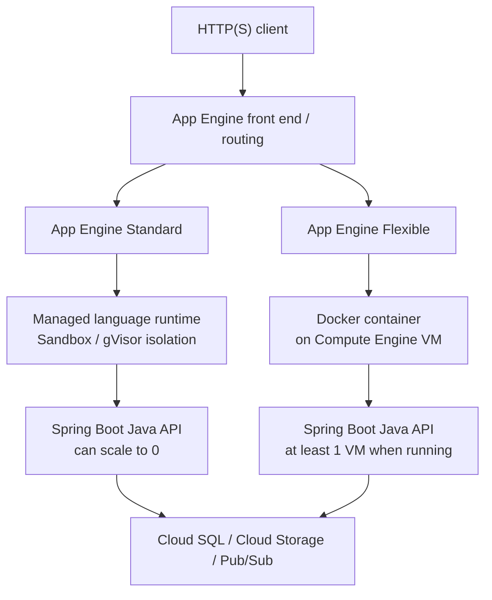
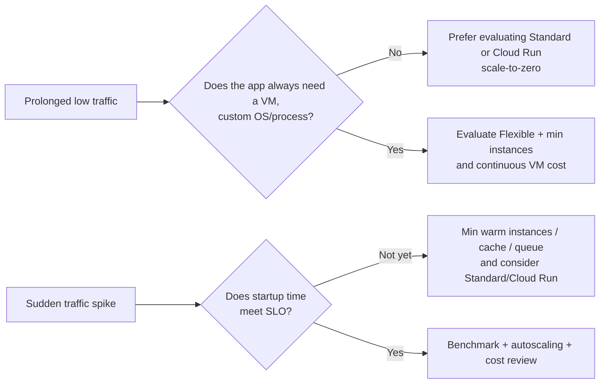
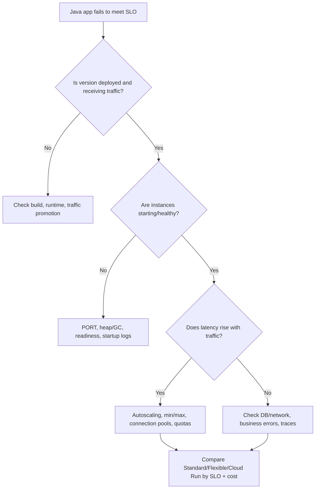

# Choosing App Engine Standard vs. Flexible

## 1. Problem statement: deploying Java on App Engine to fit real needs

A development team has two **Java/Spring Boot** applications. A product lookup API receives few requests at night but spikes occasionally during promotions; the team wants to minimize operations and idle costs. A legacy document-processing application requires native tools, large memory, private network connectivity, and runs multiple background tasks. Both can be deployed on **Google App Engine**, but choosing the wrong environment leads to cold starts, runtime limitations, or an unsuitable bill.

App Engine is a **Platform as a Service (PaaS)** offering: developers supply application code and deployment configuration, while Google Cloud provides the runtime infrastructure, load balancing, versioning, and scaling mechanisms. There are two environments—**Standard** and **Flexible**; they share the **application → service → version → instance** model, but differ in runtime, VMs, scaling, startup time, system customization, and billing.

This lesson belongs to the **App Engine** chapter of the **CLOUD_PROVIDERS_GCP** module, focusing on service selection, resource protection, release automation, and controlling reliability/cost for Java workloads. The content moves from a comparison table to a Spring Boot example using two interchangeable `app.yaml` files, followed by practice in selection, testing, and resource cleanup.

**After this lesson you can:**

1. Distinguish the architecture, sandbox, runtime, networking, filesystem, and scaling of both environments.
2. Explain why **Standard can scale to zero**, whereas **Flexible must keep at least one instance**.
3. Read and build `app.yaml` for **Java 21** on both Standard and Flexible.
4. Deploy/observe a Java service, manage versions/traffic, and handle cold starts and health checks.
5. Estimate the impact of uptime, reserved resources, networking, and supporting services on cost.
6. Choose **Cloud Run** instead of App Engine when new product requirements fit better.

> **Lab warning:** An App Engine application is bound to **a region that cannot be changed** after creation, and **each Google Cloud project contains only one App Engine application**. Do not run `gcloud app create` in a production project for testing. Flexible uses always-running VMs and **has no separate free tier**, even with zero requests.

## 2. Nature of the two environments



**Standard:** the application runs in a **sandbox** with a language runtime provided by App Engine. The system can spin up instances quickly, handle short-lived traffic, and scale down to **0 instances** when idle depending on scaling type/configuration. Modifying the runtime/OS is restricted; the environment suits stateless web applications.

**Flexible:** the application runs in a **Docker container on Compute Engine VMs**, offering greater ability to customize runtimes, native libraries, background processes, SSH debugging, and CPU/RAM resources. VM creation starts more slowly and a service keeps **at least one instance**, making it suited for steady load or applications needing greater runtime environment control.

**Both** support service/version deployments, Cloud Logging/Monitoring, calling Cloud APIs, HTTPS, IAM, and connecting to other services per configuration. However, Flexible is not bare metal, does not allow modifying Google Cloud infrastructure outside the container by default, and its VMs remain subject to App Engine's maintenance lifecycle.

## 3. Comparison table for decision-making

| Criterion | **Standard** | **Flexible** |
| --- | --- | --- |
| Execution platform | Managed runtime, sandbox | Docker container on Compute Engine VM |
| Languages | Runtimes supported by App Engine | Supported runtimes or **custom runtime/Dockerfile** |
| Current Java | `java17`, `java21`, `java25` per support schedule | `runtime: java` and `runtime_config` for compatible Java version/OS; custom when needed |
| Instance startup | Typically **a few seconds**, depends on Java app | Typically **several minutes** due to VM/container |
| Scaling | **Automatic**, **Basic**, **Manual** | **Automatic**, **Manual** |
| Scale to 0 | **Yes** with suitable configuration | **No**: minimum at least 1 VM for an active service |
| Request timeout | Depends on runtime and scaling type | Up to **60 minutes** |
| Local disk | Mainly `/tmp`, ephemeral | Writable temporary VM/container filesystem |
| Background threads/processes | Threads have **restrictions**; unsuitable for standalone background processes | Allows background processes/threads within resource limits |
| SSH into instance | No | Capable of SSH/debugging with permissions |
| OS/runtime customization | Cannot change base runtime via Dockerfile | Customizable via Dockerfile and VM config |
| WebSockets | No | Yes |
| Networking | Calls Google Cloud APIs, **Direct VPC egress/Serverless VPC Access** per support | VMs have VPC/Compute Engine network connectivity |
| Primary billing model | **Instance-hours** by instance class, with conditional free quota | **vCPU, RAM, persistent disk**, and related resources; no free tier |
| Best-fit workloads | Stateless web/APIs with variable traffic | Native dependencies, custom images, long-lived processes, or steady traffic |

**Do not choose Flexible merely because a project uses Spring Boot**: Standard's modern Java runtimes support executable JARs, Spring Boot, and many popular libraries. Conversely, having a native library **does not automatically** rule out Standard; verify whether it runs in the sandbox and whether OS/runtime customization is actually required.

For new products, Google Cloud documentation currently **recommends evaluating Cloud Run as the modern default choice** before choosing App Engine, especially when standalone containers and flexible management are needed. Comparing Standard/Flexible remains important for existing App Engine applications or where specific operational requirements apply.

## 4. Java runtime, sandbox, and filesystem

### 4.1. A Java runtime is not a permanent choice

App Engine Standard declares versions with `runtime: java21` or `runtime: java25`. Flexible uses `runtime: java`, `env: flex`, and sets compatible `runtime_config.runtime_version` and `operating_system`. Per the late-2026 support schedule, Java **17, 21, and 25** are current branches on both; Java 25 is GA. **Legacy Java 8/11** have separate end-of-support/deprecation policies, so do not create new services depending on those runtimes.

When upgrading versions, check: **Servlet `javax.*` → `jakarta.*`**, Spring Boot compatibility, TLS/crypto providers, Java agents, native libraries, and **App Engine bundled services**. Apps using legacy APIs or older WAR packaging models may need conversion to executable JARs and dependency replacements rather than just changing a single `runtime` line.

### 4.2. The filesystem is not durable storage

- **Standard:** writes temporary files to `/tmp` under runtime limits; data is not shared across instances and is not guaranteed across restarts.
- **Flexible:** has a writable filesystem inside the VM/container, but it remains **ephemeral** when instances are recreated, deployed, or undergo VM maintenance.
- **Both:** uploaded files, invoices, images, and durable documents should be stored in **Cloud Storage**; transactional data in **Cloud SQL/Firestore**; secrets in **Secret Manager**.

A Spring Boot app writing orders to `/tmp/orders.json` will lose data when instances change regardless of whether it runs on Standard or Flexible. Supporting a writable disk in Flexible **does not turn it into a durable database**.

### 4.3. Networking and dependencies

Standard can call Google Cloud APIs and use supported **VPC egress** paths, including Direct VPC egress in compatible environments/versions; it is incorrect to say Standard “cannot access private resources”. Flexible offers more VM/VPC-level network configuration options. In both, accessing **private Cloud SQL, Redis, or internal APIs** still requires routes, firewalls, connection/auth, quotas, IAM, and latency testing.

## 5. Scaling, cold starts, and processing time

### 5.1. Standard has three scaling types

| Type | Mechanism | When to use |
| --- | --- | --- |
| **Automatic** | Scales instances up/down based on request latency/CPU/throughput and config | REST/APIs with fluctuating traffic |
| **Basic** | Starts an instance when a request arrives, shuts down when idle | Infrequent traffic; consider startup time |
| **Manual** | Keeps a specified number of instances | Must always keep instances serving or special operational needs |

With automatic scaling and low traffic, Standard can **scale to zero**. Minimum instances greater than 0 or manual scaling keep instances running and **incur idle charges**. For new Standard applications since **March 2025**, the default automatic scaling `max_instances` is **20**; declare explicit limits when budget/quotas matter.

### 5.2. Flexible has automatic or manual scaling

Flexible uses VM infrastructure; automatic scaling has parameters such as `min_num_instances`, `max_num_instances`, `cool_down_period_sec`, and CPU target. **Minimum is at least 1**, often defaulting to **2** to reduce latency; when scaling, account for VM creation time. Each active version can continue consuming instances and incurring charges even without receiving traffic.



**Java cold starts** include JVM initialization, class loading, Spring context startup, data connections, and JIT. Standard starting faster at the **infrastructure** level does not mean a Spring Boot API starts instantaneously. Flexible is usually slower, so keep spare capacity when spikes require strict SLAs.

**Timeout:** Flexible has a maximum request timeout of **60 minutes**; Standard depends on runtime and scaling type, so do not apply “60 minutes” universally. Long-running tasks should move to **Cloud Tasks/Pub/Sub + workers**, **Cloud Run jobs**, or an appropriate batch system rather than holding an HTTP request open for a long time.

## 6. Designing a shared Java Spring Boot app for both environments

A **Java 21** application exposes `GET /` and `GET /healthz` for comparison without database dependencies. It listens on the `PORT` environment variable and does not use persistent disk. This is a self-contained example so learners can deploy to **one environment at a time**.

### 6.1. Directory structure

```text
appengine-choice-lab/
├── pom.xml
└── src/main/
    ├── java/dev/example/choice/ChoiceApplication.java
    ├── resources/application.properties
    └── appengine/app.yaml  # Use Standard OR Flexible variant
```

### 6.2. Maven `pom.xml`

```xml
<?xml version="1.0" encoding="UTF-8"?>
<project xmlns="http://maven.apache.org/POM/4.0.0"
         xmlns:xsi="http://www.w3.org/2001/XMLSchema-instance"
         xsi:schemaLocation="http://maven.apache.org/POM/4.0.0 https://maven.apache.org/xsd/maven-4.0.0.xsd">
  <modelVersion>4.0.0</modelVersion>
  <parent>
    <groupId>org.springframework.boot</groupId>
    <artifactId>spring-boot-starter-parent</artifactId>
    <version>3.5.5</version>
    <relativePath/>
  </parent>
  <groupId>dev.example</groupId>
  <artifactId>appengine-choice-lab</artifactId>
  <version>0.0.1-SNAPSHOT</version>
  <properties>
    <java.version>21</java.version>
  </properties>
  <dependencies>
    <dependency>
      <groupId>org.springframework.boot</groupId>
      <artifactId>spring-boot-starter-web</artifactId>
    </dependency>
  </dependencies>
  <build>
    <plugins>
      <plugin>
        <groupId>org.springframework.boot</groupId>
        <artifactId>spring-boot-maven-plugin</artifactId>
      </plugin>
      <plugin>
        <groupId>com.google.cloud.tools</groupId>
        <artifactId>appengine-maven-plugin</artifactId>
        <version>2.8.7</version>
      </plugin>
    </plugins>
  </build>
</project>
```

Dependency versions are only to ensure the example works with Java 21; before production, update to **supported and security-verified versions**. App Engine runtimes accept an **executable JAR** and do not supply a built-in Spring Boot framework for the app.

### 6.3. `ChoiceApplication.java`

```java
package dev.example.choice;

import java.time.Instant;
import java.util.Map;
import org.springframework.boot.SpringApplication;
import org.springframework.boot.autoconfigure.SpringBootApplication;
import org.springframework.web.bind.annotation.GetMapping;
import org.springframework.web.bind.annotation.RestController;

@SpringBootApplication
@RestController
public class ChoiceApplication {
    public static void main(String[] args) {
        SpringApplication.run(ChoiceApplication.class, args);
    }

    @GetMapping("/")
    public Map<String, String> hello() {
        return Map.of(
            "service", "appengine-choice",
            "status", "ok",
            "at", Instant.now().toString());
    }

    @GetMapping("/healthz")
    public Map<String, String> health() {
        return Map.of("status", "ok");
    }
}
```

### 6.4. `application.properties`

```properties
# Port provided by App Engine, 8080 for local runs.
server.port=${PORT:8080}
server.address=0.0.0.0
```

**Must bind the right port:** App Engine provides the `PORT` variable; do not hard-code `localhost` or a permanently fixed port. In modern Java Standard runtimes, the runtime may use a port other than 8080 to take full advantage of the proxy; using `PORT` is the proper approach.

### 6.5. Test on a development machine

```bash
java -version
mvn -q clean package
java -jar target/appengine-choice-lab-0.0.1-SNAPSHOT.jar

# In another terminal:
curl -i http://localhost:8080/
curl -i http://localhost:8080/healthz
```

Expect both to return HTTP 200, with `/` containing a UTC timestamp. This code is a minimal web app for comparing both runtimes, not an actual lesson deployment in Google Cloud.

## 7. `app.yaml` for App Engine Standard

Place the following content in `src/main/appengine/app.yaml` when choosing **Standard**:

```yaml
runtime: java21
service: default
instance_class: F4_1G

automatic_scaling:
  min_instances: 0
  max_instances: 3
  target_cpu_utilization: 0.65
```

| Line | Effect |
| --- | --- |
| `runtime: java21` | Selects the managed Java 21 runtime |
| `instance_class: F4_1G` | CPU/RAM class sufficient for testing Spring Boot; not the cheapest option |
| `min_instances: 0` | Can scale down to 0 when idle, accepting cold starts |
| `max_instances: 3` | Sets an autoscaling/expected cost cap; actual idle instances may temporarily exceed the cap in certain cases |
| `target_cpu_utilization: 0.65` | Target CPU signal; not a latency SLA |

No `env: standard` is needed; Standard is the default when declaring `runtime: java21`. This file **does not have** a `resources.cpu/memory_gb/disk_size_gb` section like Flexible; Standard resources are selected via **instance class**.

**Important:** this is an **automatic scaling** policy. If switched to `manual_scaling`, keeping a fixed instance count prevents the application from scaling to 0 as in the initial lab.

## 8. `app.yaml` for App Engine Flexible

If you want to test Flexible, **replace the entire** `src/main/appengine/app.yaml` with this version in an **approved lab project**:

```yaml
runtime: java
env: flex
service: default

runtime_config:
  operating_system: "ubuntu22"
  runtime_version: "21"

resources:
  cpu: 1
  memory_gb: 2.3
  disk_size_gb: 10

automatic_scaling:
  min_num_instances: 1
  max_num_instances: 2
  cool_down_period_sec: 120
  cpu_utilization:
    target_utilization: 0.6

liveness_check:
  path: "/healthz"
  check_interval_sec: 30
  timeout_sec: 4
  failure_threshold: 4

readiness_check:
  path: "/healthz"
  check_interval_sec: 5
  timeout_sec: 4
  failure_threshold: 2
  app_start_timeout_sec: 300
```

**Differences you must not overlook:**

- `runtime: java` + `env: flex` is Flexible's syntax; **do not** write `runtime: java21` as in Standard.
- `runtime_config` pins **Java 21 + Ubuntu 22**, preventing silent runtime changes from newer defaults. OS/runtime versions must be compatible per the support schedule.
- `resources` allocates 1 vCPU, 2.3 GB RAM for the app, and 10 GB disk per Flexible constraints; **still billed** when there is no traffic.
- `min_num_instances: 1` is the minimum level; Flexible typically defaults to 2 if unconfigured. `max_num_instances` depends on quotas and does not replace downstream protection.
- Repeated `liveness_check` failures can cause the instance to **restart**; `readiness_check` failures prevent the instance from **receiving requests**. Do not make health endpoints perform heavy DB checks to avoid cascading restart loops.
- `cool_down_period_sec` is the period during which CPU metrics from a starting instance are ignored in autoscaling calculations, **not a lock against all scale-out events**.

Flexible can use a **custom runtime with a Dockerfile**, though no Dockerfile is needed when choosing an App Engine-supported Java runtime. When software requires special binaries/OS packages, evaluate custom runtimes and image patching responsibilities before choosing.

## 9. Deployment, observation, traffic, and rollback

### 9.1. Pre-deployment prerequisites

1. Use a **test project** with Billing, quotas, and a supported App Engine region. Run `gcloud app describe` to check if the application already exists and its region.
2. If no App Engine application exists yet, `gcloud app create` will require choosing a region that **cannot be changed afterward**. Do not run this on a project used for other systems.
3. Enable the right **App Engine Admin API**, **Cloud Build**, and dependent services as guided; the deployer needs minimum IAM such as `roles/appengine.deployer`, build permissions, and `iam.serviceAccounts.actAs` when using a runtime service account.
4. Review `app.yaml` carefully: **deploy only one of the two variants**, and do not run a Flexible lab on a project running Standard production. With Spring Boot, test `GET /healthz` locally first.

```bash
gcloud config set project PROJECT_ID
gcloud app describe

# ONLY use on a LAB project without an existing App Engine app,
# after verifying location and obtaining approval to create:
# gcloud app create
```

### 9.2. Deploy via Maven plugin

Once `pom.xml` and `src/main/appengine/app.yaml` for your chosen environment are ready:

```bash
# In the lab Maven project directory, do not run inside the lesson repo:
mvn clean package
mvn appengine:deploy -Dapp.deploy.projectId=PROJECT_ID

# For subsequent version deployments, avoid immediately shifting traffic:
# mvn appengine:deploy -Dapp.deploy.projectId=PROJECT_ID -Dapp.deploy.promote=false

gcloud app services list
gcloud app versions list --service=default
gcloud app browse --service=default
```

The Maven plugin packages the executable JAR and builds the proper staging directory. The `-Dapp.deploy.projectId` flag ensures the right project is targeted when `pom.xml` does not specify a project ID. You can also use `gcloud app deploy` with staged artifacts/configs or **Maven buildpacks from source** per your workflow; **do not assume** running `gcloud app deploy` from an arbitrary directory will find the right `src/main/appengine/app.yaml`.

**Do not enable automatic deployment to production traffic without smoke testing.** In App Engine, deploying a new version can change traffic ratios unless `--no-promote` or an equivalent pipeline control is configured. Always verify which version/service is serving users.

### 9.3. Read-only inspection commands

```bash
gcloud app services list
gcloud app versions list --service=default
gcloud app instances list --service=default
gcloud app logs tail --service=default
```

Monitor request rate, 4xx/5xx, p95 latency, instance count, Java heap/GC, startup logs, Cloud SQL connections, and VM health specifically for Flexible. A `GET /healthz` returning 200 **does not prove** the application meets SLOs or that the database can handle real traffic.

### 9.4. Traffic distribution and rollback

App Engine organizes **application → services → versions**. You can deploy a new version for testing before shifting traffic and use traffic splitting/canary; illustrative command syntax:

```bash
# Check version names before taking action:
gcloud app versions list --service=default

# ONLY after confirming the target version and obtaining approval:
gcloud app services set-traffic default \
  --splits NEW_VERSION=0.10,OLD_VERSION=0.90
```

If errors occur, shift traffic back to a stable version through an approved change. **Code rollback does not revert transactions or corrupted data already written**; you need forward/backward-compatible schema migrations, idempotency, and backups.

Flexible may keep VMs running for multiple active versions, increasing costs during a canary; after rollout, check **which versions still have instances and are incurring charges**.

## 10. Security and reliability for Java

| Concern | Proper practice |
| --- | --- |
| **Deploy IAM** | Separate permissions for deployer, build identity, and runtime service account; never default to Owner |
| **Secrets** | Secret Manager; avoid committing passwords in `app.yaml` or Git |
| **HTTPS / auth** | Use HTTPS; enforce authentication/authorization in the app or Identity-Aware Proxy as required |
| **Networking** | Open only required egress paths to Cloud SQL/Redis; configure firewalls and VPC per environment |
| **Data** | Cloud Storage/Cloud SQL/Firestore; do not use the instance filesystem as primary state |
| **Scaling** | Cap HikariCP pools, max instances, and concurrency according to downstream capacity |
| **Background execution** | Standard restricts background processes; offload long tasks to Cloud Tasks/Pub/Sub/Cloud Run jobs |
| **Health** | In Flexible, separate readiness and liveness to avoid restarts on brief dependency glitches |
| **Incident response** | Retain the previous version, logs/metrics, and maintain rollback/canary procedures plus RTO/RPO |

**A Flexible-specific point:** VMs in this environment have a lifecycle managed by App Engine, including periodic maintenance and restarts. Do not store sessions or critical files on the VM. If an application requires deep VM lifecycle control, Kubernetes scheduling, or privileged node agents, evaluate **Compute Engine/GKE** instead of forcing Flexible to fit.

## 11. Cost: why do min instances determine the bill?

**Standard** bills by **instance class and instance-hours** (plus supporting services) and offers a **free quota** under applicable conditions. With automatic scaling/min=0, low-traffic apps can avoid keeping instances running. **Flexible** bills by **VM vCPU, memory, and persistent disk** plus related charges, with **at least one active instance running**, no dedicated free tier, and longer VM startup times.

**Hypothetical arithmetic example, not Google Cloud pricing:**

```text
Standard:
  2 instances × 3 serving hours/day = 6 instance-hours/day.
  If there are no requests and min_instances=0, it can scale down to 0.

Flexible:
  1 minimum VM × 24 hours/day = 24 VM-hours/day
  + vCPU/RAM/disk/egress billed per actual pricing rates.
  If min_num_instances=2 => at least roughly 48 VM-hours/day.
```

This is an example of **resource provisioning time**, not a claim of a direct 1:1 price ratio between a Standard instance and a Flexible VM. Actual cost ratios also depend on region, instance class, vCPU/RAM/disk, request patterns, concurrency, logging, Cloud SQL, network egress, discounts, and deployment/health check duration. Consult [App Engine pricing](https://cloud.google.com/appengine/pricing) and Cloud Billing Reports; **budget alerts do not automatically stop billing**.

**Choose by total cost of ownership:** Flexible can be cost-effective when an application needs a complex runtime or continuous load; Standard is usually better for short-lived web workloads with frequent idle periods and no OS customization needs. For new projects, compare **Cloud Run** (serverless containers with flexible scaling) before finalizing.

## 12. Troubleshooting by symptom

| Symptom | Likely cause | Inspection steps |
| --- | --- | --- |
| Java builds fine but deploy fails | `app.yaml` wrong runtime/env, build service account, or staging | App Engine deploy logs, Cloud Build, CLI project |
| `404` after deploy | Wrong service/version/URL or traffic not promoted | `services list`, `versions list`, traffic splits |
| `502`/`503` or unhealthy instance | App not listening on `PORT`, init error, OOM, failed health check | Java logs, port config, heap, Flexible readiness/liveness |
| Standard cold start causes high p95 latency | Min instances 0, slow Spring context startup | Startup time, warmup, min instances, and cost |
| High Flexible bill with zero traffic | At least one VM running; old versions still active | Instance count, versions/traffic, Billing |
| Cannot install binary/library | Sandbox/runtime restrictions or missing image packages | Runtime support, custom image on Flexible |
| File writes succeed but disappear after restart | Local filesystem is ephemeral | Cloud Storage/Cloud SQL; do not use local disk for state |
| Cannot reach private Cloud SQL | Missing egress/VPC/firewall/IAM setup | Routes, VPC connector/Direct VPC, DB auth |
| Slow responses despite low CPU | Cloud SQL/pool or slow downstream | HikariCP, latency tracing, connection limits |
| Legacy Java app fails to redeploy | Runtime end-of-support/deprecation | Upgrade Java, `javax`/`jakarta`, legacy bundled services |



## 13. Scoped lab cleanup

Deleting or stopping **versions no longer serving** in the lab project is the cleanup step, not deleting the entire Google Cloud project. Do not delete a default version serving production traffic or disks/databases belonging to other workloads.

```bash
# Inspect versions and traffic before deciding:
gcloud app versions list --service=default
gcloud app services list

# ONLY for a LAB version that has stopped receiving traffic,
# and after confirming there are no consumers:
# gcloud app versions delete OLD_LAB_VERSION --service=default
```

If you ran Flexible, check **active versions/VMs** so they do not continue accruing idle charges. **An App Engine application does not have a simple standalone delete to redo its region**; disabling the app can stop serving, while other services' resources, data, and costs still need management. Before deleting a lab project, confirm there are no shared resources, data to retain, or other owners.

## 14. Exercises and self-assessment checklist

### Exercise A — Choose an environment by workload

An API has **2 peak hours/day**, very little traffic at night, and uses plain Spring Boot and Cloud SQL. Choose Standard, Flexible, or Cloud Run; analyze **cold starts, idle cost, and network/DB capacity**. Repeat for a Java application with background processes, native libraries, and steady 24/7 traffic.

### Exercise B — Read and compare `app.yaml`

From the two examples in sections 7–8, identify: runtime declaration, instance class vs. vCPU/RAM, `max_instances` vs. `max_num_instances`, target CPU, health checks, and scale-to-zero capability. Explain why **you cannot reuse the Standard file unmodified to deploy Flexible**.

### Exercise C — Local Spring Boot and safe deployment

Create a Java 21 Maven project, run `mvn clean package`, and test `/healthz` locally. In a **test project with an App Engine application in the right region**, pick **one** `app.yaml` file, run `mvn appengine:deploy`, inspect logs/versions, and write a rollback plan. Skip live deployment if you lack Billing/permissions.

### Exercise D — Cost, availability, and data safety

Compare Standard `min_instances=0,max_instances=3` and Flexible `min_num_instances=1,max_num_instances=2`. Calculate **rough instance-hours/VM-hours** for a day with zero traffic, then explain why you cannot directly infer exact dollar amounts from those two figures. If the Java app writes invoices to local disk, analyze the risk in both.

### Exercise E — Deployment incident

After deploying Flexible, `/healthz` returns 503 and the VM restarts repeatedly. Write a runbook to inspect **startup, the PORT variable, readiness/liveness, memory, and Cloud Build logs**; propose how to prevent restart loops. If the same app on Standard suffered cold starts, how would your measurement and remediation differ?

### Checklist

- [ ] I understand Standard is a managed sandbox and Flexible runs containers on Compute Engine VMs.
- [ ] I can explain Standard scaling (automatic/basic/manual) and Flexible scaling (automatic/manual).
- [ ] I know **Standard can scale to 0**, while Flexible has **min >=1 VM** and no free tier.
- [ ] I know Standard `runtime: java21` differs from Flexible `runtime: java` + `env: flex`.
- [ ] I know Java 17/21/25 support and check deprecation schedules before every runtime upgrade.
- [ ] I can configure `PORT`, Spring Boot JARs, runtime identity, `app.yaml`, and health checks.
- [ ] I do not store state on local disk and size Cloud SQL connection pools for the instance count.
- [ ] I can manage App Engine services/versions, traffic splits, and rollbacks.
- [ ] I know a project's App Engine location cannot be changed after creation.
- [ ] I can compare costs with Cloud Run and plan cleanup of active versions.

**Conclusion:** choose **Standard** when prioritizing managed runtimes, fast scaling, and avoiding compute charges during low traffic; choose **Flexible** when needing custom containers/VMs, background processes, or specialized libraries while accepting slower startup and always-on costs. With either choice, a Java workload is only sustainable when **stateless, properly configured with IAM/VPC, protected by health checks/rollbacks, and measured against SLOs and actual budgets**. For new projects, **evaluate Cloud Run** as a potentially better fit instead of defaulting to App Engine.

## 15. Official references

- [App Engine: Choose an environment](https://cloud.google.com/appengine/docs/the-appengine-environments)
- [App Engine Java overview](https://cloud.google.com/appengine/docs/java)
- [App Engine Standard overview](https://cloud.google.com/appengine/docs/standard/overview)
- [App Engine Flexible overview](https://cloud.google.com/appengine/docs/flexible/overview)
- [App Engine Standard Java runtime](https://cloud.google.com/appengine/docs/standard/java-gen2/runtime)
- [App Engine Flexible Java runtime](https://cloud.google.com/appengine/docs/flexible/java/runtime)
- [Standard Java app.yaml configuration](https://cloud.google.com/appengine/docs/standard/java-gen2/configuring-your-app-with-app-yaml)
- [Standard app.yaml reference/scaling](https://cloud.google.com/appengine/docs/standard/reference/app-yaml)
- [Flexible app.yaml reference/resources/health checks](https://cloud.google.com/appengine/docs/flexible/reference/app-yaml)
- [Runtime support schedule — Standard](https://cloud.google.com/appengine/docs/standard/lifecycle/support-schedule)
- [Runtime support schedule — Flexible](https://cloud.google.com/appengine/docs/flexible/lifecycle/support-schedule)
- [Set up App Engine application and region](https://cloud.google.com/appengine/docs/standard/managing-projects-apps-billing)
- [Java Maven deployment](https://cloud.google.com/appengine/docs/standard/java-gen2/using-maven)
- [App Engine pricing](https://cloud.google.com/appengine/pricing)
