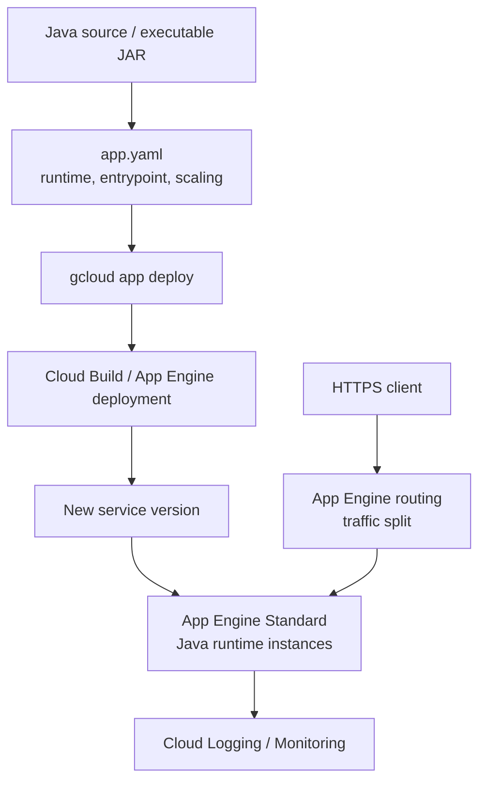

# Java runtime and app.yaml configuration

When deploying a Java application to **Google App Engine**, simply having a JAR file that runs on a developer's machine is not enough. App Engine also needs to know the **Java version**, **startup command**, **HTTP port**, **service/version**, **routing rules**, and **how to autoscale**. For App Engine Standard, most of those choices live in **`app.yaml`**.

This lesson belongs to the **App Engine** chapter of the `CLOUD_PROVIDERS_GCP` module, connecting concepts of projects, IAM, Compute Engine, Cloud Run, storage, databases, automated deployment, and cost monitoring. We will configure a **minimal Java 21 HTTP service**, deploy a test version using `gcloud app deploy --no-promote`, verify the outcome, and learn how to upgrade/roll back without accidentally altering production traffic.

## 1. Learning Objectives

After this lesson, you will be able to:

1. Distinguish **App Engine Standard Java** from Flexible and legacy Java runtimes.
2. Choose `runtime: java21` or a supported runtime; understand the impact of upgrading major versions.
3. Explain the keys `runtime`, `service`, `entrypoint`, `instance_class`, `automatic_scaling`, `env_variables`, and `handlers`.
4. Build an executable JAR listening on the appropriate address, reading the **`PORT` provided by the platform**.
5. Deploy a separate **service version**; inspect logs, test the version URL, and shift traffic only upon approval.
6. Avoid YAML errors, JARs missing Main-Class, slow startups, wrong ports, excessive instances, and missing IAM permissions.
7. Plan the use of Secret Manager, service accounts, Cloud Logging, rollbacks, and cleanup of unnecessary versions.

**Scope:** this lesson focuses on **App Engine Standard, second-generation Java**. Examples use a lab project with an existing App Engine application; do not create a new project, re-choose a region, or modify a production service. The goal of being **self-contained, technically accurate, and concise** is achieved using one continuous example rather than repeating multiple sample projects.

## 2. At what layer does App Engine Java operate?

App Engine is a **PaaS** platform: you deploy source/artifacts, while the platform operates instances, routing, and scaling per your configuration. An App Engine application can have multiple **services**; each service in turn can have multiple **versions** for rollouts and traffic splitting.



| Concept | Meaning | Example |
| --- | --- | --- |
| **App Engine application** | Project-level resource with a location chosen at creation | One application in the lab project |
| **Service** | Independently deployed application component | `default` or `catalog-api` |
| **Version** | A deployment of a service with its own config/runtime | `java21-lab-v1` |
| **Instance** | Execution unit running a service version | Can autoscale out/in |
| **`app.yaml`** | Deployment descriptor for a service version | Runtime, scaling, routing |
| **Entrypoint** | Command that launches the HTTP-serving process | `java -jar app.jar` |

A **new version** does not automatically mean users receive it: traffic is routed according to the service's configuration. Conversely, a deployment **without `--no-promote`** may immediately receive traffic depending on CLI defaults. Always verify scope before running write commands.

### 2.1. Standard or Flexible?

| Criterion | Standard Java | Flexible |
| --- | --- | --- |
| Runtime | `java17`, `java21`, `java25`, and versions permitted by the support schedule | Different runtime/container model and configuration |
| Configuration file | Standard `app.yaml` | Flexible-specific `app.yaml` with `env: flex` |
| Scaling | Standard automatic, basic, manual | Automatic/manual with **different key names** |
| Infrastructure | Platform controls runtime and instance lifecycle | Higher level of environment/VM customization |
| Examples in this lesson | **Yes** | No |

**Do not copy Flexible settings** such as `automatic_scaling.min_num_instances` or `cpu_utilization.target_utilization` into Standard: field names may differ even when conveying similar autoscaling concepts.

## 3. Choosing a Java runtime and understanding the support lifecycle

Modern App Engine Standard Java runtimes use **`javaMAJOR`** names in `app.yaml`.

| Runtime ID | Status per Google Cloud support schedule | When to choose |
| --- | --- | --- |
| **`java25`** | Latest supported Java at the time of writing (2026) | New projects already tested with Java 25 and compatible frameworks |
| **`java21`** | Widely used LTS, actively supported | Main example in this lesson for broad modern framework compatibility |
| **`java17`** | Supported, with an earlier end-of-support date | Apps with dependency constraints |
| **`java11` / `java8`** | Older runtimes past support/deprecation milestones; deployment restrictions apply | Require an upgrade plan; do not choose for new projects |

Consult the **[Runtime support schedule](https://cloud.google.com/appengine/docs/standard/lifecycle/support-schedule)** before locking in a version: under the current schedule, Java 17 is supported through **10/2027**, Java 21 through **09/2031**, and Java 25 through **10/2031**; dates are subject to Google Cloud announcements. `java25` reached GA in late 2025, and Java 8 was deprecated for new deployments starting early 2026.

### 3.1. How are runtimes upgraded?

`runtime: java21` selects **major version 21**. The platform may apply Java 21 **patch releases** and base runtime updates, but **will not automatically jump from major 21 to 25** just because Java 25 is newer.

Before changing major versions:

- Confirm frameworks, SDKs, dependencies, and bytecode compatibility.
- Check `javax.servlet.*` versus `jakarta.servlet.*` if legacy bundled services remain integrated.
- Verify JVM flags, native/JNI libraries, and memory usage.
- Stand up a **new version** in staging, run smoke/integration/load tests, and only then shift traffic.

**First-generation Java 8** and `appengine-web.xml` have distinct historical mechanisms. Do not copy Java 8 settings (or WARs depending on legacy bundled services) verbatim into Java 21/25 `app.yaml` files. For apps using legacy APIs, read migration/compatibility guides first.

## 4. app.yaml is the configuration for each service version

A minimal `app.yaml` file can contain just:

```yaml
runtime: java21
```

App Engine can infer other values, such as the default service, automatic scaling, and **instance class F1**. To control deployment behavior explicitly, declare:

```yaml
runtime: java21
service: default
entrypoint: java -jar app.jar
instance_class: F2

env_variables:
  APP_ENV: "lab"
  GREETING: "Hello App Engine"

automatic_scaling:
  min_instances: 0
  max_instances: 2
  target_cpu_utilization: 0.65
  max_concurrent_requests: 20

handlers:
  - url: /.*
    secure: always
    script: auto
```

This is an **App Engine Standard template**. `service: default` is suitable for a new lab App Engine application; if the project already has a `default` service serving production, **do not deploy into it**. You can use `service: java-lab` **after** the application already has a default service and you are authorized to create a new service.

| Key | Explanation | Common pitfalls |
| --- | --- | --- |
| `runtime` | Managed Java major version | Write `java21`, not `21` or `java-21` |
| `service` | Target service | First service must be `default`; avoid overwriting shared services |
| `entrypoint` | Command executed when an instance starts | JAR must exist in the deploy bundle; process must listen on `PORT` |
| `instance_class` | Instance resource tier | F1 is default; F2 has different cost and memory |
| `env_variables` | **Runtime** environment variables | Do not include secrets; do not override system variables |
| `automatic_scaling` | Load-based scaling limits and thresholds | Do not use Flexible syntax or treat max as a billing ceiling |
| `handlers` | URL routing, static/dynamic handling, and HTTPS enforcement | **Handler order matters**; put wildcards last |

**YAML is strictly indentation-sensitive:** use spaces, never tabs. Omitting quotes around strings like `"true"`, `"01"`, or values containing `:` can cause the parser to misinterpret types. Validate the file after every edit.

## 5. Entrypoint and the PORT port

On App Engine Standard Java, the runtime can locate an executable **uber JAR** and start it automatically. However, when multiple artifacts or custom commands exist, declare `entrypoint` to avoid ambiguity:

```yaml
runtime: java21
entrypoint: java -jar app.jar
```

Per the runtime contract, the application must start an **HTTP server** listening on the port supplied by the platform via the **`PORT`** variable. App Engine dynamically assigns this variable, so **never set `PORT` inside `env_variables`**; only use a fallback like `8080` for local development.

Java example:

```java
String portValue = System.getenv().getOrDefault("PORT", "8080");
int port = Integer.parseInt(portValue);
HttpServer server = HttpServer.create(
    new InetSocketAddress("0.0.0.0", port), 0);
server.start();
```

If the app binds `127.0.0.1:8080`, the platform's internal routing proxy may not reach the process. If the command runs and exits immediately, the version will have no server to receive requests.

### 5.1. JARs, Maven, and buildpacks

- **Executable JAR:** includes `Main-Class` in `META-INF/MANIFEST.MF` or uses a framework that builds a bootable JAR.
- **Custom entrypoint:** the referenced JAR file must reside in the **root of the deploy directory alongside `app.yaml`** in this example.
- **Maven source project:** GKE/Cloud Run do not apply here; App Engine supports building from source with buildpacks, e.g., `gcloud app deploy pom.xml` when the project and plugins/configs are valid.
- **Maven App Engine plugin:** typically places `app.yaml` at `src/main/appengine/app.yaml`, and the plugin assembles a staging directory containing artifacts.
- **Not all WARs run directly:** for Jakarta/Spring Boot, prefer executable JARs; legacy bundled-services WARs follow a separate compatibility process.

In production, tune JVM sizing to the instance class and measure heap/native memory and GC. Do not blindly copy a huge `-Xmx` into F1/F2: actual memory must leave room for JVM overhead, HTTP threads, and native buffers.

## 6. Scaling modes and instance classes

| Scaling mode | How it works | Typical instance classes |
| --- | --- | --- |
| **Automatic** | Platform adjusts instance count by CPU/latency/throughput and limits | `F1`, `F2`, `F4`, `F4_1G` |
| **Basic** | Starts on incoming request, shuts down after idle period | `B1`, `B2`, `B4`, `B4_1G`, `B8` |
| **Manual** | Maintains a fixed configured number of instances | Compatible `B*` classes |

Choose **only one scaling mode** in the file. The primary example uses `automatic_scaling` to avoid holding fixed instances without load; **min_instances=0** can result in longer cold starts.

### 6.1. Automatic scaling

```yaml
instance_class: F2
automatic_scaling:
  min_instances: 0
  max_instances: 2
  target_cpu_utilization: 0.65
  max_concurrent_requests: 20
```

- `min_instances: 0`: suitable for occasional labs; does not guarantee zero charges.
- `max_instances: 2`: sets a small scaling target ceiling, though platform behavior can briefly exceed limits in some situations and other charges still apply.
- `target_cpu_utilization`: CPU utilization target used by the scheduler to calculate capacity.
- `max_concurrent_requests`: concurrent requests per instance before the scheduler scales out. On F2 and above, higher values than default can be tested, but always measure p95/p99 and heap.

**Trade-off:** fewer instances reduce cost but can increase latency/queueing, cold starts, or errors during traffic spikes. Never pick `max_instances=2` for production if peak load and throughput have not been tested.

### 6.2. Basic and manual scaling

Two **alternative** examples—do not put them into the same file:

```yaml
# Example only for a service needing basic scaling.
instance_class: B2
basic_scaling:
  max_instances: 2
  idle_timeout: 10m
```

```yaml
# Example only for a service needing manual scaling.
instance_class: B2
manual_scaling:
  instances: 2
```

With manual scaling, instances run continuously so costs accrue even with zero requests. With basic scaling, prepare for cold starts and idle shutdowns. `B` classes differ from `F` classes in resources and pricing; do not compare them by numeric suffix alone.

## 7. HTTP routing, static assets, and HTTPS

`handlers` is an **ordered** list of URL handlers. A pattern with static assets:

```yaml
handlers:
  - url: /assets
    static_dir: assets
    secure: always

  - url: /.*
    script: auto
    secure: always
```

Requests to `/assets/...` are served by App Engine from the `assets` directory (when included in the deploy package); other URLs go to the Java app. Placing `/.*` first would “swallow” requests intended for the static handler.

Key points to remember:

- `script: auto` forwards dynamic requests to the runtime HTTP server.
- `secure: always` enforces HTTPS on matching routes; HTTP redirect behavior can be configured per policy.
- Static files use caching; hashed CSS/JS filenames can use long TTLs, whereas sensitive HTML/config files require care.
- If `handlers` is omitted, App Engine applies sensible defaults for simple apps; a manual wildcard is not always necessary.
- Do not treat `secure: always` as **authorization**. The application must still perform authentication/authorization, or use IAP/appropriate protection; HTTPS only protects transport.

An `app.yaml` can include other fields such as `default_expiration`, `inbound_services`, or network/VPC settings. Only add them when the workload genuinely requires them to keep configuration readable.

## 8. Environment variables, IAM, and secrets

Example:

```yaml
env_variables:
  APP_ENV: "staging"
  FEATURE_FLAG: "false"
  DB_HOST: "db.internal"
```

Environment variables configure the **runtime** of a service version. Variables starting with `GAE` are reserved by the platform; `PORT` is also a system variable you must not declare manually. Each newly deployed version can have different `env_variables` values from previous versions.

**Never place secrets** such as passwords, API keys, or private keys in `app.yaml` and commit them to Git. Use **Secret Manager** and Google Cloud client libraries to fetch secrets when needed, grant `roles/secretmanager.secretAccessor` on the exact secret to the runtime service account, and handle errors/rotation.

For an app to call Cloud Storage/Cloud SQL or other APIs:

1. Identify the version's runtime service account (default or custom).
2. Grant **least-privilege** permissions on the respective bucket/DB/secret.
3. Prefer Application Default Credentials in the runtime environment rather than downloading JSON keys.
4. Monitor Audit Logs and tighten overly broad roles, especially in older projects where the default SA received Editor.
5. Ensure proper networking/VPC connectivity; correct IAM permissions alone do not make a private database reachable.

`gcloud app deploy --service-account=SA_EMAIL` allows choosing a per-version runtime identity if the account and IAM policies permit it. The deployer needs deployment permissions plus `iam.serviceAccounts.actAs`. Never grant project-wide Editor just to bypass a deployment error.

## 9. Lab: preparing an App Engine project and Java 21

This lab runs on a **dedicated project with billing**, an existing App Engine application, and an authorized default service for testing. **The App Engine location is chosen at application creation and cannot be changed afterward**; do not run application creation without project owner approval. Creating an application is an infrastructure decision, not something “instantly cleaned up” after a lab.

### 9.1. Inspect the project and application (read-only)

```bash
PROJECT_ID="YOUR_LAB_PROJECT_ID"
SERVICE="default"
VERSION="java21-lab-v1"

gcloud --version
gcloud auth list
java -version
javac -version
jar --version

gcloud projects describe "$PROJECT_ID" \
  --format="yaml(projectId,lifecycleState)"

gcloud app describe \
  --project="$PROJECT_ID"

gcloud app services list \
  --project="$PROJECT_ID"

gcloud app versions list \
  --project="$PROJECT_ID" \
  --service="$SERVICE"
```

If `gcloud app describe` reports that **no application exists**, stop the deployment steps and coordinate with an administrator to choose an appropriate location considering region, data residency, cost, and policy. If the `default` service already serves another application, switch to **another lab project** or an approved dedicated lab service; never modify a production service.

### 9.2. Permission and API requirements

- Cloud SDK is authenticated and targeting the right project.
- Java **JDK 21** with `javac` and `jar` installed on the lab machine.
- The deployer has permissions to create App Engine versions, run Cloud Build, and use staging resources.
- The actual Cloud Build service account has the permissions required for deployment; default build SAs may vary across projects.
- Artifact Registry/Cloud Build/App Engine APIs are enabled per organizational setup.
- Budgets/alerts are configured; deploying/building versions can incur costs.

Do not run `gcloud services enable` on a production project on your own. When IAM errors occur, read the actual principal and missing permission, and coordinate with an admin to grant them at the proper scope.

## 10. Writing a minimal Java HTTP service

To keep the example **self-contained** without Maven/Spring Boot dependencies, we use `jdk.httpserver.HttpServer` built into the JDK. Inside a **new lab directory on your local machine** (not the lesson repository), create:

```text
java-appengine-lab/
  app.yaml
  src/
    App.java
  build/
    classes/        # generated by javac
  app.jar            # generated by jar
```

### 10.1. File `src/App.java`

```java
import com.sun.net.httpserver.HttpExchange;
import com.sun.net.httpserver.HttpServer;
import java.io.IOException;
import java.net.InetSocketAddress;
import java.nio.charset.StandardCharsets;
import java.util.concurrent.Executors;

public final class App {
    public static void main(String[] args) throws IOException {
        String rawPort = System.getenv().getOrDefault("PORT", "8080");
        int port = Integer.parseInt(rawPort);

        HttpServer server = HttpServer.create(
            new InetSocketAddress("0.0.0.0", port), 0);
        server.createContext("/healthz",
            exchange -> respond(exchange, 200, "ok"));
        server.createContext("/",
            exchange -> {
                String environment =
                    System.getenv().getOrDefault("APP_ENV", "local");
                String body = "App Engine Java 21; env=" + environment;
                respond(exchange, 200, body);
            });
        server.setExecutor(Executors.newFixedThreadPool(4));

        Runtime.getRuntime().addShutdownHook(
            new Thread(() -> server.stop(0)));
        server.start();
        System.out.println("Listening on port " + port);
    }

    private static void respond(
        HttpExchange exchange, int status, String value)
        throws IOException {
        byte[] body = value.getBytes(StandardCharsets.UTF_8);
        exchange.getResponseHeaders().set(
            "Content-Type", "text/plain; charset=utf-8");
        exchange.getResponseHeaders().set(
            "Cache-Control", "no-store");
        exchange.sendResponseHeaders(status, body.length);
        try (var stream = exchange.getResponseBody()) {
            stream.write(body);
        }
    }
}
```

This is a **lab application**, not a production HTTP server: it lacks authentication, structured logs, graceful shutdown deadlines, and a database. It is sufficient to demonstrate that `app.yaml` launches a Java executable JAR and routes traffic to the server on `PORT`. For real applications, use Spring Boot, Micronaut, Quarkus, or another vetted framework.

### 10.2. Compile and package the JAR

From the root of the lab directory:

```bash
mkdir -p build/classes

javac --release 21 \
  -d build/classes \
  src/App.java

jar --create \
  --file app.jar \
  --main-class App \
  -C build/classes .

# Inspect Main-Class and JAR contents.
jar --list --file app.jar
unzip -p app.jar META-INF/MANIFEST.MF
```

`--main-class App` writes the manifest Main-Class; because there are no external libraries, the JAR is self-contained with the example's code. For projects with dependencies, produce an executable fat/uber JAR or package with an appropriate classpath.

### 10.3. Run locally and test

First terminal:

```bash
APP_ENV=local java -jar app.jar
```

Second terminal:

```bash
curl -i http://127.0.0.1:8080/
curl -i http://127.0.0.1:8080/healthz
```

Expect `HTTP 200`, with responses `App Engine Java 21; env=local` and `ok`. If port 8080 is already in use, run `PORT=18080 APP_ENV=local java -jar app.jar` and update the curl URLs accordingly.

**Do not deploy** if `java -jar app.jar` fails to start, has a broken manifest, or the HTTP server is not listening.

## 11. Creating app.yaml and analyzing each choice

In the root of the lab directory, place `app.yaml` next to `app.jar`:

```yaml
runtime: java21
service: default
entrypoint: java -jar app.jar
instance_class: F2

automatic_scaling:
  min_instances: 0
  max_instances: 2
  target_cpu_utilization: 0.65
  max_concurrent_requests: 20

env_variables:
  APP_ENV: "appengine-lab"

handlers:
  - url: /.*
    secure: always
    script: auto
```

**Why these choices?** `java21` matches a JAR compiled with `--release 21`. `entrypoint` points directly to `app.jar` in the deploy root. `F2` provides more headroom than F1 for a JVM in a lab, though costs must still be monitored. `max_instances=2` curbs unexpected scaling. `APP_ENV` is non-sensitive configuration. The handler enforces HTTPS and forwards dynamic requests to Java.

Pre-deploy self-check:

1. `app.yaml` and `app.jar` are in the **same deploy directory**.
2. The JAR contains `Main-Class: App`.
3. `runtime` matches the JDK build target; do not use `java8` or deprecated runtimes.
4. No `PORT`, `GAE_SERVICE`, or system keys are declared in `env_variables`.
5. No secrets, passwords, or private keys appear in YAML.
6. `service`/`VERSION` targets the right **lab project**, without colliding with another team's version.
7. Check upload ignore rules (`.gcloudignore` if present) to ensure `app.jar` is included in the upload.

## 12. Deploying an App Engine version without shifting traffic

### 12.1. Controlled deployment

From the root containing `app.yaml` and `app.jar`, after verifying project permissions:

```bash
gcloud app deploy app.yaml \
  --project="$PROJECT_ID" \
  --version="$VERSION" \
  --no-promote
```

This is a **write operation on Google Cloud**, uses Cloud Build/deployment infrastructure, and can incur costs. `--no-promote` instructs the command **not to automatically shift all traffic** to the new version. If the service does not yet have a serving version, initial routing may behave differently than when a live version exists; **always verify actual traffic after deployment** rather than assuming from flags.

**Specifically:** on auto-scaled App Engine Standard, do not assume `--stop-previous-version` immediately stops older versions. Managing versions and traffic is a separate step.

### 12.2. Read back service, version, and URL

```bash
gcloud app services list \
  --project="$PROJECT_ID"

gcloud app versions list \
  --project="$PROJECT_ID" \
  --service="$SERVICE"

gcloud app versions describe "$VERSION" \
  --project="$PROJECT_ID" \
  --service="$SERVICE"

# Print the version URL for verification when the environment permits.
gcloud app browse \
  --project="$PROJECT_ID" \
  --service="$SERVICE" \
  --version="$VERSION" \
  --no-launch-browser
```

Verify **version, Java runtime, scaling settings, status, and traffic allocation** in the output. When a service already carries live traffic, the app's default URL will **not** point to the lab version because you used `--no-promote`. Avoid assuming “deployment failed” just because the default URL still serves the old version.

**Lesson on URL structure:** App Engine generates URLs incorporating version/service/project/region IDs; do not manually assemble URLs assuming the region ID equals the full region name. Use the actual `browse`/Console output to obtain the URL.

## 13. Testing, shifting traffic, and rollback

### 13.1. Smoke-test the new version

When the version URL is reachable:

```bash
# Replace with the real URL obtained from App Engine / Cloud Console.
VERSION_URL="https://YOUR_REAL_VERSION_URL"

curl -fsS "$VERSION_URL/"
curl -fsS "$VERSION_URL/healthz"
```

Verify the responses `App Engine Java 21; env=appengine-lab` and `ok`. If the version URL is protected by IAP/auth policy, use the authentication method provided by your administrator—**do not disable security** just to run curl.

Record response times, logs, startup latency, error rates, and instance counts during testing. Real applications also require integration tests against Cloud SQL/Cloud Storage with proper credentials.

### 13.2. Shift traffic after approval

Only if the **service belongs to the lab**, the version passed testing, and the responsible owner agrees, shift traffic:

```bash
# USER-IMPACTING: sends 100% traffic to the lab version.
gcloud app services set-traffic "$SERVICE" \
  --project="$PROJECT_ID" \
  --splits="$VERSION=1"
```

In production, prefer incremental percentage splits (canary) using real version names, monitor errors/p95/p99, and ramp traffic gradually. Ensure enough capacity for both versions while running concurrently.

**Rollback:** shift traffic back to a **recorded known-good version name**; do not rebuild old source and assume the artifact is identical.

```bash
# IMPACTING: replace KNOWN_GOOD_VERSION with the retained version.
KNOWN_GOOD_VERSION="YOUR_VERIFIED_PREVIOUS_VERSION"

gcloud app services set-traffic "$SERVICE" \
  --project="$PROJECT_ID" \
  --splits="$KNOWN_GOOD_VERSION=1"
```

Never run a rollback command while `KNOWN_GOOD_VERSION` is still a placeholder or if that version has been deleted. **Traffic rollback does not roll back database migrations**; plan schema compatibility and data rollback separately.

## 14. Logs, metrics, and troubleshooting

### 14.1. View logs

```bash
gcloud app logs tail \
  --project="$PROJECT_ID" \
  --service="$SERVICE"
```

Or use Cloud Logging filtered by App Engine service/version. Monitor **HTTP 5xx, p95/p99 latency, instance count, startup time, CPU/memory, and cost**. For startup failures, inspect build logs and application logs separately; do not assume a successful deploy means a healthy service.

### 14.2. Common errors

| Symptom | Possible cause | Resolution |
| --- | --- | --- |
| `runtime: java21` rejected | Outdated CLI/API, project policy, or unsupported runtime | Check runtime schedule, update SDK, review policy |
| `Could not find or load main class` | JAR missing Main-Class/classpath or wrong entrypoint | `jar --list`, manifest, test locally |
| Service returns no HTTP response | Server not bound to `PORT` or bound to loopback | Read `PORT` env var, bind `0.0.0.0` |
| Deploy does not see `app.jar` | File outside root or excluded from upload | Check deploy directory, `.gcloudignore` |
| Deploy build fails | Build service account lacks permissions, Java compile error | Cloud Build logs, IAM, `javac --release` |
| Invalid scaling config | Mixed Standard/Flexible keys, bad YAML indentation | Cross-check App Engine Standard `app.yaml` reference |
| Zero instances when idle | Automatic scaling min=0 | Normal cold-start behavior; adjust if SLO requires |
| High cost despite few requests | min instances, F2 class, lingering old versions, builds/logging | App Engine instances/versions, Billing |
| Default URL still serves old version | `--no-promote` or traffic split | `versions list`, service traffic configuration |
| Version URL returns 403 | IAP/auth/identity/routing | Review policies instead of opening publicly without controls |
| Deploying a new `service` fails | No `default` service exists yet in the App Engine app | Deploy the default service first |
| Java 8/11 code fails on Java 25 | Servlet namespace, legacy APIs, flags, or dependencies | Migration guide, test JDK/framework |
| One version works, another fails | Different env vars, service account, or instance class | Compare per-version config and logs |
| Cannot read Cloud Storage | Runtime SA lacks IAM or wrong network/config | Inspect principal and bucket permissions |

### 14.3. Ordered diagnostic checklist

1. Confirm the right project, App Engine app, service, and version.
2. Check whether the Cloud Build/deploy operation succeeded.
3. Verify `runtime`, `entrypoint`, the JAR file, and `PORT`.
4. Read version status and startup logs; test the HTTP endpoint.
5. Inspect IAM, secrets, networking, and external services.
6. Check scaling/instance class/quotas, p95/p99, and 5xx rates.
7. If a rollout fails: stop increasing traffic and shift back to a verified good version.

## 15. Security, lifecycle, and cost

### 15.1. Security defaults do not replace application security

- Use `secure: always` for URL handlers, while still enforcing **authentication/authorization** at the app layer or IAP depending on architecture.
- Never embed credentials in `app.yaml` or JARs.
- Grant service accounts only necessary IAM roles; separate deployer and runtime identities.
- Patch dependencies, JDK, and JVM flags; test new versions before promoting.
- Audit deployment permissions, traffic changes, and secret access.
- Do not store critical business data on an instance's local filesystem; use Cloud Storage/Cloud SQL/Firestore appropriately.

### 15.2. Costs to monitor

| Component | Cost drivers |
| --- | --- |
| Instance class | F2/F4 have different CPU/RAM and unit rates than F1 |
| Autoscaling | min_instances, concurrency, load, and cold starts |
| Parallel versions | Versions receiving no traffic may still hold resources depending on scaling mode |
| Build/deploy | Cloud Build, staging artifacts, and operations |
| Network | Egress, VPC connector/Direct VPC, Cloud SQL |
| Logging/Monitoring | Ingestion, retention, and dashboards |
| Data | Cloud Storage, Firestore/Datastore, Cloud SQL outside App Engine charges |

**Budget alerts do not automatically block spending.** `max_instances` only partially bounds scaling behavior; review Billing by SKU/location and verify remaining resources after lab cleanup.

## 16. Practice exercises

### Exercise 1 — runtime

A new project declares `runtime: java11` because its source compiles with JDK 11. Should it keep that setting?

**Answer:** Do not use a runtime past its support schedule for new deployments. Evaluate migrating source/dependencies to **Java 21 or 25**, update `app.yaml`, build, and test. Compiler target and runtime must be compatible.

### Exercise 2 — unresponsive application

`app.jar` runs locally at `127.0.0.1:8080`, but when deployed to App Engine, requests time out.

**Answer:** The server must read `PORT` and bind to the appropriate address (typically `0.0.0.0`); inspect logs/entrypoint/JAR before changing instance classes.

### Exercise 3 — scaling syntax

An engineer copies from App Engine Flexible:

```yaml
automatic_scaling:
  min_num_instances: 1
  max_num_instances: 4
```

**Answer:** Invalid **Standard** syntax. Use `min_instances`/`max_instances` per Standard documentation, then evaluate the cost of min instances and peak capacity.

### Exercise 4 — no-promote

The team runs `gcloud app deploy app.yaml --no-promote`, yet the default URL still returns the old release.

**Answer:** That matches the intent of not promoting. Inspect the version-specific URL and traffic allocation; shift traffic only after testing and approval.

### Exercise 5 — env_variables and secrets

A developer wants to put `PAYMENT_API_KEY: "secret-value"` in `app.yaml` to simplify deployment.

**Answer:** Do not do this. Use Secret Manager and a runtime identity with restricted IAM; never commit secrets in config or source code.

### Exercise 6 — static handler

`handlers` puts wildcard `/.*` before `/assets`; CSS is not served by the App Engine static handler as expected.

**Answer:** Handlers are evaluated in order. Place `/assets` before the wildcard; verify the directory is included in the upload.

### Exercise 7 — choosing scaling

An application rarely receives requests, tolerates cold starts, and aims to minimize baseline cost. Should it use min=0 or manual 2 instances?

**Answer:** In this case, consider **automatic scaling, min_instances=0**. Manual 2 instances retain resources and charges even while idle; base the final decision on the latency SLO.

### Exercise 8 — rollback

After shifting 100% of traffic to a new version, 500 errors spike. Can this be fixed by changing the running version's `runtime` from Java 21 back to Java 17?

**Answer:** Do not edit the runtime of an already deployed version as an in-place hotfix. Shift traffic back to a tested **known-good version**, investigate the root cause, build and deploy a **new version** with a supported runtime, and test before rolling out.

## 17. Checklist and controlled lab cleanup

**Before deploying**

- [ ] Lab project has an existing App Engine application and approved location.
- [ ] Selected Standard `java21`/`java25` per runtime schedule and framework compatibility.
- [ ] `app.yaml` is valid YAML, service is explicit, and entrypoint points to an executable JAR.
- [ ] App reads `PORT`, binds the right interface, and passed local smoke tests.
- [ ] `automatic_scaling`/`instance_class` are compatible and cap lab costs.
- [ ] No secrets in env_variables; runtime SA follows least-privilege IAM.
- [ ] Using `--no-promote` and a new version ID when testing prior to live traffic.
- [ ] Known-good version, backups, and rollback plan are in place.

**After deploying**

- [ ] Version exists with healthy status; version URL returns HTTP 200.
- [ ] Service traffic and versions inspected; no unintended promotion occurred.
- [ ] Cloud Logging/Monitoring show no startup, 5xx, or memory errors.
- [ ] P95/P99 and costs align with SLO/budget.
- [ ] Release record captures runtime, JAR version, app.yaml revision, service, and version ID.

**Lab cleanup:** delete only the **version created by the lab** after verifying it **receives no traffic** and is not needed for rollback:

```bash
# Read-only check before cleanup.
gcloud app versions list \
  --project="$PROJECT_ID" --service="$SERVICE"

# IMPACTING: only for a LAB version receiving zero traffic,
# after confirming no resources/applications depend on it.
gcloud app versions delete "$VERSION" \
  --project="$PROJECT_ID" --service="$SERVICE"
```

**Do not delete a `default` service receiving traffic, do not delete the App Engine application/project**, and do not delete shared staging buckets or artifacts. An App Engine application is not a resource you can freely delete or relocate after a lab. Check Cloud Build logs, artifacts, and Billing because deleting a version does not eliminate all associated charges.

## 18. Official Google Cloud documentation

- [App Engine Standard Java runtime](https://cloud.google.com/appengine/docs/standard/java-gen2/runtime): choosing a Java major version, executable JARs, `entrypoint`, and `PORT`.
- [Java runtime support schedule](https://cloud.google.com/appengine/docs/standard/lifecycle/support-schedule): Java 17/21/25 and support lifecycles.
- [Defining Java runtime settings](https://cloud.google.com/appengine/docs/standard/java-gen2/configuring-your-app-with-app-yaml): `app.yaml` placement and usage.
- [App Engine Standard app.yaml reference](https://cloud.google.com/appengine/docs/standard/reference/app-yaml): runtime, handlers, scaling, env, and instance classes.
- [Manage App Engine instances](https://cloud.google.com/appengine/docs/standard/how-instances-are-managed): automatic/basic/manual scaling.
- [Java web service quickstart](https://cloud.google.com/appengine/docs/standard/java-gen2/building-app/writing-web-service): app layout, Maven/Java HTTP service.
- [Migrate Java runtime](https://cloud.google.com/appengine/docs/standard/java-gen2/upgrade-java-runtime): upgrading Java major versions and legacy compatibility.
- [gcloud app deploy](https://cloud.google.com/sdk/gcloud/reference/app/deploy): `--version`, `--no-promote`, `--service-account`.
- [Traffic splitting](https://cloud.google.com/appengine/docs/standard/splitting-traffic): managing rollouts/canaries and rollbacks.
- [Cloud Logging on App Engine](https://cloud.google.com/appengine/docs/standard/writing-application-logs): diagnosing services/versions.
- [App Engine pricing](https://cloud.google.com/appengine/pricing): instance classes, instance hours, and cost components.

**Conclusion:** on App Engine Standard, `runtime` selects the Java platform, `entrypoint` starts the HTTP server on the right `PORT`, and `app.yaml` controls service, scaling, env, and routing. Good practice does not stop at `gcloud app deploy`: **test the isolated version, monitor logs/SLOs, and promote only after approval**, while preserving a rollback path and controlling IAM and costs.
