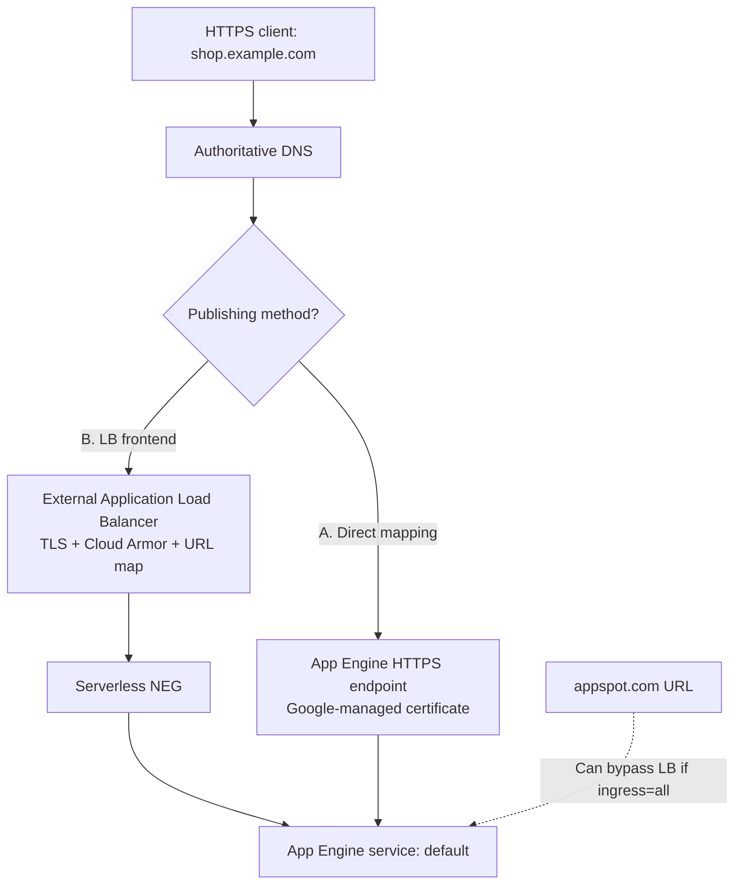
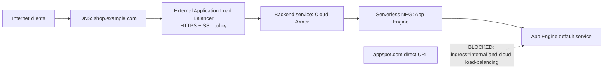

# Custom domains, HTTPS, and securing App Engine applications

The Orders application runs on Google App Engine at a default URL like `https://PROJECT_ID.REGION_ID.r.appspot.com`. The business wants customers to visit `https://shop.example.com` with HTTPS encryption, restricted admin pages, and malicious traffic blocked. **Changing a domain name does not make an application secure**: DNS may point incorrectly, certificates may not be ready, or the `appspot.com` URL may still allow bypassing protections placed on a Load Balancer.

This lesson belongs to the **App Engine** chapter, module `CLOUD_PROVIDERS_GCP`. It connects project/IAM governance, VPC, Load Balancing, Cloud Armor, Cloud Logging, and cost. We examine two approaches: **direct domain mapping to App Engine** for simple applications, or an **external Application Load Balancer + serverless NEG** when WAF, a dedicated frontend IP, and richer routing rules are needed.

> Examples use `example.com`, project `orders-lab`, and service `default`, all illustrative. Commands creating mappings, modifying DNS, or changing ingress/firewalls/TLS **can disrupt live services**; run them only on projects and domains you are explicitly authorized to administer.

## 1. Objectives

After this lesson, you will be able to:

1. Explain App Engine default hostnames, custom domain mappings, DNS, and service routing.
2. Verify domain ownership, create mappings, and configure A/AAAA/CNAME records from Google-returned values.
3. Verify Google-managed SSL, TLS 1.2+, HTTP→HTTPS redirects, HSTS, and wildcard limitations.
4. Distinguish App Engine **ingress settings**, **App Engine firewalls**, Cloud Armor, and Identity-Aware Proxy (IAP).
5. Choose between direct domains or an HTTPS Load Balancer with a serverless NEG without leaving bypass paths exposed.
6. Test DNS/TLS, monitor errors, and plan cutovers/rollbacks, IAM, retention, and costs.

## 2. Two architectures for publishing applications



| Option | Pros | When insufficient |
| --- | --- | --- |
| **A. Direct App Engine custom domain** | Simple setup; DNS records from App Engine; automatically provisions and renews managed SSL by default | Need Cloud Armor WAF, dedicated IP, or advanced SSL policy/URL map features |
| **B. External Application Load Balancer + serverless NEG** | Dedicated frontend IP, certs/SSL policies on LB, Cloud Armor, URL routing, and multi-service integration | More resources/configuration and cost; must block bypass paths to App Engine |

With option B, **map DNS/domains to the load balancer and manage certificates on the load balancer**, rather than configuring two parallel sets of domain mappings/certificates as if both served one frontend. Google recommends this pattern when using serverless NEGs. Each App Engine app belongs to **one region chosen at creation**, so an LB does not automatically turn that single app into a multi-region system. <https://cloud.google.com/appengine/docs/standard/securing-custom-domains-with-ssl>

### 2.1. The default path does not vanish automatically

App Engine exposes a default `appspot.com` URL (exact format depends on app age and service/version). Adding a custom mapping adds a public hostname; it **does not disable the default hostname, restrict ingress, or enable IAP**. Subdomains matching service/version names can also affect routing under App Engine rules, so review `dispatch.yaml`, services, and domain mappings before opening wildcards.

## 3. Direct domain mapping: from ownership to DNS

### 3.1. Prerequisites

- The App Engine application exists with a serving service/revision; the domain is managed by your organization.
- The operator holds **App Engine Admin** (e.g., `roles/appengine.appAdmin`) or a custom role with domain-mapping permissions, plus DNS management rights for the target zone.
- Domain ownership is confirmed via **Search Console/Google verification**; verify the root domain `example.com` even if mapping only `www.example.com`.
- Have a plan recording TTLs, old DNS records, and rollback windows prior to cutover.

**DNS permissions and Google Cloud IAM are separate.** Someone with `roles/dns.admin` on a Cloud DNS zone may lack permission to create App Engine mappings; an App Engine Admin may lack access to edit DNS at an external registrar.

### 3.2. Steps in the Google Cloud Console

1. Open **App Engine → Settings → Custom Domains → Add a custom domain** in the right project.
2. Select a verified domain or complete **Verify a new domain** via Search Console as guided.
3. Choose hostnames to publish, e.g., `www.example.com` and optionally `example.com`; confirm the mapping.
4. Record the exact **DNS resource records** returned by App Engine.
5. Add the records at your DNS provider and wait for propagation; then verify **SSL security = Google-managed** and test HTTPS.

Never guess Google IPs or copy records from another project. App Engine custom domain mappings use a **shared IP pool**; if you need a dedicated frontend IP for your domain, use a Load Balancer.

### 3.3. gcloud commands (only for authorized domains)

```bash
PROJECT_ID="orders-lab"
DOMAIN="www.example.com"

# READ-ONLY: inspect project and current mappings.
gcloud app describe --project="$PROJECT_ID"
gcloud app domain-mappings list --project="$PROJECT_ID"

# MODIFY: create mapping with Google-managed SSL certificate.
# Requires domain ownership already verified.
gcloud app domain-mappings create "$DOMAIN" \
  --certificate-management=AUTOMATIC \
  --project="$PROJECT_ID"

# READ-ONLY: view resourceRecords, sslSettings, and mapping ID.
gcloud app domain-mappings describe "$DOMAIN" \
  --project="$PROJECT_ID" \
  --format="yaml(id,resourceRecords,sslSettings)"
```

If a domain is already mapped, never recreate it blindly via scripts; verify the project/hostname and existing mapping status. For a domain already mapped to another app, plan ownership transfer and DNS/certificate impact first.

## 4. Updating DNS with the right record types

App Engine returns `resourceRecords` containing `type` and `rrdata`; the DNS admin must enter **the exact returned values** at the provider.

| Hostname | Common type | How to configure |
| --- | --- | --- |
| `example.com` (apex/root) | `A` and/or `AAAA` | Create the exact records App Engine provides for the zone apex |
| `www.example.com` | `CNAME` | Point to the **rrdata DNS name** supplied by Google; never copy sample IPs |
| DNS verification | `TXT` or provider-specific verification | Retain required records for ownership and certificates |

At registrars, the root record may be entered as `@`; in **Cloud DNS**, use the zone's full root name rather than defaulting to `@`. Per DNS rules, a CNAME cannot coexist with A/AAAA/MX/TXT records on the **same hostname**; resolve conflicts before cutover.

### 4.1. Checking propagation (read-only)

```bash
# These commands do not alter DNS; require dig/curl installed.
dig +short CNAME www.example.com
dig +short A example.com
dig +short AAAA example.com
dig +short TXT example.com

# Test the hostname once the certificate is active.
curl --head --show-error https://www.example.com/
```

If using a third-party proxy/CDN, check DNS proxy settings, CAA records, HTTPS redirects, and domain validation behavior. Some CDNs block validation/certificate requests, preventing Google-managed SSL from issuing or renewing. **Working DNS records do not mean TLS is ready yet**; caching/TTLs can cause different resolvers to see stale values for hours.

### 4.2. Mapping is not a redirect between apex and www

Mapping both `example.com` and `www.example.com` **does not enforce a canonical hostname**. If SEO or sessions require one primary hostname, add controlled 301/308 redirects in the app or LB, preserving Host, path, and query without redirect loops. For requests carrying cookies/sessions, configure `Secure`/`HttpOnly`/`SameSite` and cookie domain scopes carefully.

## 5. HTTPS and certificate management

### 5.1. Default Google-managed SSL

With direct App Engine domain mapping, Google provisions, renews, and revokes certificates when mappings are deleted; the CA may be Google Trust Services or Let's Encrypt. Once the domain is verified and DNS resolves properly, certificates usually appear within minutes, though DNS propagation can take up to roughly **24 hours**. Check **App Engine → Settings → Custom Domains** or Admin API management status.

| Mode | Who manages cert/key | When to choose |
| --- | --- | --- |
| Google-managed (direct App Engine) | Google provisions/renews automatically | Specific hostnames without needing wildcard managed SSL |
| Self-managed (direct App Engine) | Team purchases/generates, uploads, and renews properly formatted RSA certs/keys | Special cert needs, SANs/wildcards, and team accepts rotation overhead |
| Google-managed on external LB | Certificate Manager/LB frontend | Architectures using Cloud Armor, SSL policies, dedicated frontend IPs |

**Important limitation:** App Engine can map wildcard subdomains, yet **managed SSL certificates do not support wildcard mappings**. If `*.example.com` is needed via direct App Engine, evaluate self-managed wildcard certificates or an appropriate LB frontend. Never leak private keys into Git, CI logs, or public artifacts.

### 5.2. Inspecting certificates and TLS handshakes

```bash
# READ-ONLY: inspect details of the provisioned cert.
openssl s_client \
  -connect www.example.com:443 \
  -servername www.example.com \
  -verify_return_error </dev/null

# Read HTTP headers only. Expected result is valid HTTPS.
curl -I https://www.example.com/
curl -I http://www.example.com/
```

Verify that `SAN` includes the hostname, the trust chain is valid, expiration is future, and TLS versions match policy. `curl -I http://...` should return the designed redirect code (typically 301/302) and **must never serve sensitive data over HTTP**. Never run `curl -k` and declare TLS valid.

### 5.3. TLS 1.2+ and SSL policies

Newer App Engine apps allow only TLS 1.2 and above by default; TLS 1.1 and earlier are deprecated. You can enforce a minimum for the application via:

```bash
# CHANGES APP TLS POLICY; test client compatibility first.
gcloud app update \
  --project=orders-lab \
  --ssl-policy=TLS_VERSION_1_2
```

On direct custom domains, some legacy TLS clients may **complete the handshake yet receive HTTP 400**; therefore testing only an SSL handshake does not prove legacy requests are accepted. If strict cipher-suite control or handshake-level rejection is needed, use an external Application Load Balancer with an appropriate **SSL policy**.

### 5.4. HTTP → HTTPS redirects and HSTS

With App Engine **standard** and a supported runtime/handler, example `app.yaml` snippet (Python 3.13):

```yaml
runtime: python313

handlers:
- url: /.*
  secure: always
  redirect_http_response_code: 301
  script: auto
```

This is a **handler configuration snippet**, not a complete app; deploy a matching Python app and dependencies. With Flexible or other frameworks, verify redirect mechanisms in the app or LB—**never copy standard config blindly**. `secure: always` redirects HTTP requests to HTTPS, but does not automatically add HSTS.

Once you have verified all required hostnames serve valid HTTPS, you can return HTTP response headers:

```http
Strict-Transport-Security: max-age=15552000
X-Content-Type-Options: nosniff
Referrer-Policy: strict-origin-when-cross-origin
```

`max-age=15552000` corresponds to roughly 180 days. Add `includeSubDomains` only if **every subdomain** has working HTTPS; long HSTS lifetimes or misconfigured preloading can lock out subdomains. CSP, Secure/HttpOnly/SameSite cookies, CSRF, and CORS must be designed per business requirements, not ignored just because TLS is enabled.

## 6. Defense-in-depth application protection

| Layer | Controls | Does not replace |
| --- | --- | --- |
| Domain ownership and DNS | Verified ownership, registrar/DNS governance, removing stale records | IAM protecting in-app data |
| TLS and HTTPS redirect | Encryption, valid certificates, HSTS | User authentication |
| **App Engine ingress setting** | Who can connect from Internet, VPC, or external LB | Endpoint authorization |
| **App Engine firewall** | Allow/deny requests to the app by IP/CIDR | WAF against SQLi/XSS, Identity-Aware Proxy |
| **Cloud Armor** | WAF, rate limiting, and threat protection on LB backends | App Engine ingress controls and IAM |
| **Identity-Aware Proxy (IAP)** | Verifies authorized users/groups for web apps | Business permissions inside Orders |
| Application | Authentication, authorization, CSRF, input validation, secrets | Firewalls and certificate renewal |
| Operations | Logging, Monitoring, auditing, backups, and release rollback | Runtime security controls |

Define a single **approved entry path** and lock down alternative paths. Avoid securing `shop.example.com` while leaving `appspot.com` or fallback hostnames under weaker policies.

## 7. Ingress settings: blocking bypasses around App Engine

App Engine provides **per-service ingress settings** applying to both the default `appspot.com` hostname and custom domains:

| `--ingress` value | Accepted sources | Usage |
| --- | --- | --- |
| `all` (default) | Direct access from the Internet and other sources | Public direct custom domains; **unsuitable when enforcing LB/WAF** |
| `internal-only` | Google Cloud/VPC sources deemed internal per App Engine rules | Internal services, not publicly exposed |
| `internal-and-cloud-load-balancing` | Internal sources and external Application Load Balancer | Forces Internet clients through LB (and Cloud Armor) |

**Do not confuse private ingress with an app's own private IP.** App Engine still uses product-style URLs; ingress governs which request origins are accepted. With Shared VPC, “internal” classification depends on whether the app lives in the host or service project; do not assume every subnet in the organization counts as internal.

### 7.1. Inspect and modify commands

```bash
PROJECT_ID="orders-lab"
SERVICE="default"

# READ-ONLY: inspect before modifying policy.
gcloud app services describe "$SERVICE" \
  --project="$PROJECT_ID"

# MODIFY - RUN ONLY AFTER LB IS WORKING:
# Blocks Internet clients from hitting appspot.com and direct custom mappings directly.
gcloud app services update "$SERVICE" \
  --ingress=internal-and-cloud-load-balancing \
  --project="$PROJECT_ID"

# READ-ONLY: verify the update took effect.
gcloud app services describe "$SERVICE" \
  --project="$PROJECT_ID"
```

**Safe order:** build/verify external LB first → confirm DNS/HTTPS/Cloud Armor → change ingress → **verify the primary LB URL still succeeds while direct `appspot.com` from the Internet is blocked**. If using **direct App Engine domain mapping**, setting `internal-and-cloud-load-balancing` will cut off visitors accessing the custom domain directly. Use it only when traffic genuinely enters via the LB.

## 8. App Engine firewall: IP-based allow/deny

The App Engine firewall applies to **ingress requests** across the whole application, including custom domains, default URLs, and traffic from an LB. It is **different from VPC firewalls** (Compute Engine firewall rules), which are not a direct way to restrict HTTP traffic to App Engine endpoints.

- Rules have **priorities**, with lower numbers evaluated first; the `default` rule is evaluated last. IPs/CIDRs are affected only if they match a rule.
- By default `default=allow`. You can switch to deny-by-default, but must review clients, Cloud Tasks, Scheduler, and internal callers first.
- Certain internal App Engine Standard requests have exceptions; for example, Cloud Tasks requests may require explicit allow rules per docs under default deny.
- Updating firewall rules **does not purge cached responses** in browsers/CDNs; private content still needs proper cache headers.

### 8.1. Blocking a sample IP range

```bash
# READ-ONLY:
gcloud app firewall-rules list --project=orders-lab

# MODIFY: CIDR 203.0.113.0/24 is a documentation range,
# NOT a real-world malicious IP block.
gcloud app firewall-rules create 1000 \
  --project=orders-lab \
  --source-range=203.0.113.0/24 \
  --action=DENY \
  --description="Demo blocked range - sandbox only"

# READ-ONLY: check results and priority order.
gcloud app firewall-rules list --project=orders-lab
```

**High-risk** example (perform only after adding proper allow rules and testing from multiple sources):

```bash
# CAN BLOCK ALL ACCESS UNINTENTIONALLY:
# NEVER run in production without a runbook and rollback plan.
gcloud app firewall-rules update default \
  --project=orders-lab \
  --action=DENY
```

When App Engine sits behind an external LB with `ingress=internal-and-cloud-load-balancing`, documentation recommends **keeping the default App Engine firewall = allow and enforcing Cloud Armor on the LB**. Do not blindly apply a deny-by-default App Engine firewall in a serverless NEG architecture, as it can block legitimate requests arriving from the LB or internal services.

## 9. When Cloud Armor is needed: Load Balancer and serverless NEG

Cloud Armor **is not a toggle directly on an App Engine custom domain mapping**. To enforce frontend WAF/rate limiting, design:



Create a **serverless NEG** in the same project and region as the App Engine application; it references the app, service, or version, or uses a URL mask for multiple services. Example command (**does not yet create the full load balancer**):

```bash
# MODIFIES / INCURS COST when combined with LB.
# Replace APP_ENGINE_REGION with the actual region of the App Engine app.
gcloud compute network-endpoint-groups create orders-ae-neg \
  --project=orders-lab \
  --region=APP_ENGINE_REGION \
  --network-endpoint-type=serverless \
  --app-engine-service=default
```

Next, the platform team configures a global external Application Load Balancer: static frontend IP + certificate, URL map, backend service pointing to the serverless NEG, Cloud Armor security policy, and logging. Finally, **point DNS to the LB IP** and set App Engine ingress to `internal-and-cloud-load-balancing`.

**Limitations to understand:**

1. Serverless NEGs for App Engine **do not support health checks** like VM/GKE backends. Monitor using request metrics, synthetic probes, and errors; do not attach health check rules expecting them to take effect.
2. Serverless NEG and App Engine backend must share the same project/region per support rules; App Engine has only one region per project, **so it does not natively gain multi-region load balancing**.
3. The App Engine firewall is evaluated after requests pass through the serverless NEG; ingress controls remain essential to stop default URLs from bypassing WAF.
4. When using IAP on the LB, check identity policies and OAuth clients and keep **only one IAP policy per request path**; do not enable IAP simultaneously on both App Engine and the backend service.
5. LB, static IP, SSL policies, Certificate Manager, Cloud Armor, request processing, and logs incur separate charges.

In some scenarios **internal VPC traffic can still reach App Engine** under `ingress=internal-and-cloud-load-balancing` without traversing the external LB/WAF. Therefore never omit in-app authorization on the assumption that “every request already passed through Cloud Armor”.

## 10. IAP, IAM, and business authentication

**Identity-Aware Proxy (IAP)** protects web apps with Google-identity authentication/authorization, e.g., an operations portal restricted to staff. IAP can be configured directly on App Engine or on the external LB backend depending on architecture; **choose one IAP enforcement point per request path**.

- IAP users need `roles/iap.httpsResourceAccessor` on the appropriate resource.
- Configure the OAuth consent screen/client for your organization; external projects or external users may require a **custom OAuth client**.
- IAM permissions to deploy/administer App Engine **do not grant access through IAP**, even for Project Owners.
- IAP verifies who may enter the app; **the application must still check order-read permissions, admin roles, and tenant ownership**.

For public websites, keep the storefront outside IAP while protecting `admin.example.com` behind a dedicated service or frontend with strong authentication. Never leave another URL exposing the same admin endpoint unprotected. When enabling IAP on an external LB, check Cloud CDN compatibility; do not enable conflicting features on the same backend.

### 10.1. IAM principles

| Principal | Task-based permissions | Scope |
| --- | --- | --- |
| Platform operator | Administer App Engine domain mappings/ingress | `roles/appengine.appAdmin` or narrow custom role |
| DNS operator | Edit zones/records at DNS provider | Authorized zones only |
| Security operator | App Engine firewall / LB Cloud Armor rules | Separate duties and review changes before enforcing |
| Certificate owner | Create/maintain TLS certs for self-managed/LB | Never expose private keys in CI logs/repositories |
| IAP users | Access protected services | `roles/iap.httpsResourceAccessor` with conditions where appropriate |
| Runtime service account | Call Cloud SQL, Secret Manager, and required APIs | Least privilege; never default to Owner/Editor |

Never grant **App Engine Admin** as a default role to all developers. Separate duties for deploying, DNS edits, ingress changes, IAP/firewall updates, and SSL policy approvals; enable Cloud Audit Logs and monitor security changes.

## 11. End-to-end testing before launch

Test from **the external Internet**, **inside the VPC**, and an unauthorized principal. `curl` checks are only technical smoke tests; production apps must also verify login sessions, cookies, and business workflows.

| Step | What to verify | Evidence |
| --- | --- | --- |
| Domain ownership | Search Console verifies the right root domain | Mapping succeeds; domain not hijacked |
| DNS | A/AAAA/CNAME match `resourceRecords` or LB IP | `dig` across multiple resolvers, proper TTL and zone |
| TLS | SAN matches host, trusted chain, active cert | `openssl s_client`, `curl -I https://...` |
| HTTP redirect | HTTP redirects to HTTPS without loops | `curl -I http://...`, status/Location |
| Direct App Engine (Option A) | Custom domain HTTPS works | Smoke-test application routes |
| LB + NEG (Option B) | Domain works via LB; Cloud Armor enforces | LB request logs, controlled rule test |
| Anti-bypass (B) | Direct Internet calls to `appspot.com` blocked | External test, ingress verified |
| Auth | Authorized IAP/app users enter; unauthorized denied | Smoke tests with/without credentials |
| Caching and data | No private data cached on CDN/proxy/browser | `Cache-Control: private, no-store` where appropriate |
| Observability | HTTP errors, latency, cert/SSL alerts, and audits | Cloud Logging/Monitoring/Security dashboards |

Read-only access check examples **without modifying configuration**:

```bash
# Check redirects and headers.
curl --head --show-error http://www.example.com/
curl --head --show-error https://www.example.com/

# Use the real DNS/LB IP if testing prior to cutover.
# --resolve still validates hostname/SNI properly for HTTPS.
curl --head --show-error \
  --resolve www.example.com:443:FRONTEND_IP \
  https://www.example.com/
```

**Never use `--insecure` / `-k`** to bypass TLS validation during acceptance testing. If the app uses sessions, a HEAD request (`curl -I`) may behave differently from GET; include valid GET/POST checks and inspect their status codes.

## 12. Migrating a domain from direct App Engine to a Load Balancer

This is a frontend change affecting DNS and certificates. Plan carefully to avoid “switching DNS first and then discovering the LB lacks a certificate”:

1. **Inventory:** record current DNS, App Engine mappings/cert statuses, service ingress, firewall rules, IAM/IAP, cookie domains, and endpoints to preserve.
2. **Prepare the LB:** create the serverless NEG in the right project/region, backend, HTTPS frontend with suitable certificate/SSL policy, and initial Cloud Armor rules (optionally in preview mode as required).
3. **Test LB before DNS:** use a test hostname or `curl --resolve` against the LB IP to verify WAF/IAP, redirects, backend routing, request logs, and authentication.
4. **Cut over DNS:** lower TTLs ahead of time per plan, update A/AAAA/CNAME to point to the LB per docs; watch cert provisioning and errors.
5. **Close bypasses:** set ingress on all relevant App Engine services to `internal-and-cloud-load-balancing`; confirm `appspot.com` is blocked from the Internet while the LB domain works normally.
6. **Monitor:** watch HTTP 4xx/5xx, request volume, latency, redirects, TLS warnings, login success, Cloud Armor false positives, and costs.
7. **Cleanup:** after the rollback window, remove unused mappings/certs/DNS records without deleting active certs/IPs. Keep ownership docs and IaC updated.

**Disruption risk:** LB Google-managed certificates may require DNS pointing to the LB before provisioning completes; issuance time may be non-zero. If zero-downtime migration is required, evaluate **DNS-authorized certificates**, imported certificates, or migrating a less critical hostname first per LB features, and rehearse the exact procedure before cutover.

### 12.1. Rollback must restore the entire access path

If the new LB returns errors:

- Restore DNS to previously saved records, accounting for caching/TTLs.
- If reverting to **direct App Engine mapping**, restore ingress `all` **only if** the business accepts direct public exposure and alternative protections are active; never open publicly without controls.
- Ensure the direct App Engine certificate/mapping still exists and works; if deleted, instant rollback cannot be assumed.
- If errors stem only from Cloud Armor/WAF, roll back the security policy through a safe workflow instead of changing site-wide DNS.
- Check session cookies, redirect chains, and caches affecting users; record exact recovery timestamps.

Rollback **is not merely reverting DNS**: ingress, certificates, IAP, and firewalls must align with the chosen traffic path.

## 13. Monitoring, reliability, and cost

**Cloud Monitoring** and **Cloud Logging** should track request counts, p95/p99 latency, 4xx/5xx, instance utilization, errors, and deployment events. With an LB, add LB request logs, certificate status, Cloud Armor policy decisions, TLS errors, and backend response codes.

| Risk | Signals to watch | Action |
| --- | --- | --- |
| Cert error/renewal failure | Managed SSL status, expiry, HTTPS synthetic checks | Check ownership/DNS/CAA/CDN proxy and cert scope |
| Wrong DNS/partial cutover | Request share by IP/frontend, resolver answers, 404/502 | Inspect RRSets, TTLs, domain mappings, or URL maps |
| HTTP not redirecting | Synthetic HTTP→HTTPS tests, HSTS headers | Fix handler/LB redirects and caching behavior |
| Cloud Armor false positives | Allowed/denied request trends, app success ratio | Tune WAF rule with approval; never disable entire WAF |
| Default URL bypass | Synthetic probes to `appspot.com` from Internet | Fix service ingress; audit all service/version paths |
| Abnormal traffic | Request rate, bot/error spikes, IP ranges | Evidence-based rate limits, WAF, or firewall rules |
| Cost increase | App Engine instances, LB/frontends, Armor, Logs, CDN/egress | Review Cloud Billing by SKU/project and retention policies |

Direct domain mapping is simpler with fewer frontend line items. Adding a Load Balancer + Cloud Armor introduces charges for **forwarding rules, data processing, IPs, certificate management, Cloud Armor, logging, and egress**, on top of App Engine instance costs. Within App Engine itself, Standard vs. Flexible, autoscaling, idle instances, and version counts also shape budgets.

Never delete all error logs just to cut costs. Use deliberate log sampling, avoid logging tokens/PII, set policy-compliant retention, and retain audit trails of DNS/SSL/firewall/ingress changes.

## 14. Case study: Public Orders website, private admin

A team has an App Engine `default` service serving the website and an `admin` service for staff. Requirements:

- Shoppers visit `https://shop.example.com` over HTTPS protected by WAF/rate limiting.
- Staff visit `https://admin.example.com` after signing in and passing role checks.
- No entry into admin via `admin-dot-PROJECT_ID.REGION_ID.r.appspot.com` bypassing access controls.
- Runbooks exist for expiring SSL or a failed DNS cutover.

### 14.1. Proposed design

| Component | Design | Verification |
| --- | --- | --- |
| Public website | Global external Application Load Balancer, serverless NEG pointing to `default`, Cloud Armor | HTTPS, WAF decisions, synthetic GETs, private content auth |
| Admin | IAP protecting admin service/route per chosen architecture, plus business RBAC | Users lacking roles denied across **every URL** |
| Default hostname | App Engine `ingress=internal-and-cloud-load-balancing` for LB-published services | Internet cannot reach around the LB |
| Certificate | Cert managed on LB (when using LB), SNI/SAN per hostname | Auto-renewal, TLS 1.2+, and expiry alerts |
| DNS | Public A/AAAA or CNAME matching provisioned addresses/targets | `dig` + `curl --resolve`, TTL rollback plan |
| Audit | Cloud Logging, Cloud Audit Logs, Cloud Armor logs | Named owners and alerts on config changes |

With IAP, if both `default` and `admin` traverse the same LB, configure the OAuth client carefully and keep **one IAP policy per request path**. If policy separation is awkward, use separate frontends/backends/services and evaluate session/cookie risks. A hostname like `admin.example.com` does not make the admin service private; **ingress, IAP, and app auth provide the enforcement**.

### 14.2. Hypothetical incident: site runs yet protections are bypassed

Normal users hitting `shop.example.com` get blocked by Cloud Armor rate-limiting rules, yet still reach the same page via `PROJECT_ID.REGION_ID.r.appspot.com`. Root cause: the frontend LB is protected, while App Engine still has `ingress=all`.

Remediation: (1) confirm the frontend LB/proxy is working; (2) switch the target service's ingress to `internal-and-cloud-load-balancing`; (3) verify the default URL is denied from the Internet while LB traffic keeps working; (4) check other App Engine services, logging, and IAP policies; (5) update policies/IaC to prevent recurrence.

**Never try to fix bypasses by deleting DNS for `appspot.com`**: that hostname is managed by Google, and request acceptance is governed by the application's ingress policy.

## 15. Quick diagnostic table

| Symptom | Common possibilities | First checks |
| --- | --- | --- |
| `gcloud app domain-mappings create` rejected | Unverified domain, missing IAM, mapping conflict | Search Console, App Engine Admin role, mapping list |
| DNS resolvers return conflicting values | TTL/cache, record in wrong zone, invalid root CNAME | `dig` authoritative resolvers and `resourceRecords` |
| `ERR_CERT_COMMON_NAME_INVALID` | SAN mismatch, cert inactive, DNS pointing to wrong frontend | SSL status, SNI hostname, cert SAN, and rrdata |
| Managed cert `FAILED_RETRYING_NOT_VISIBLE` | Domain/DNS record not visible yet or CDN blocks validation | DNS/CAA, Cloudflare proxy/redirects, and cert status |
| Wildcard mapping works on HTTP but fails HTTPS | Managed SSL does not support wildcards | Use explicit hostnames, self-managed cert, or LB |
| HTTP still returns `200` | Handler missing `secure: always` or LB redirect not enabled | `curl -I http://...`, app.yaml/routing |
| External domain returns `403` after ingress change | Switched to LB-only while DNS still points directly to App Engine | Check traffic diagram, ingress, and LB readiness |
| Internet can still reach `appspot.com` | Service ingress remains `all` | `gcloud app services describe` for each service |
| App Engine firewall blocks legitimate traffic | Default deny or wrong source/priority | Rules list, client source, exceptions, and rollback |
| LB/WAF fails to stop default URL traffic | LB bypassed due to misconfigured ingress | Ingress setting, synthetic default-host probe |
| IAP returns `403` | User missing role, wrong OAuth/IAP policy | IAP access policy, identity, and resource scope |
| IAP returns `502` after enabling | Missing/invalid OAuth client configuration | IAP OAuth client, organization membership |
| TLS test appears to support TLS 1.1 | Tested handshake only on custom domain | Send HTTP request post-handshake; check App Engine min TLS policy |
| 502 from LB despite healthy app logs | Bad NEG/backend service/URL map, or app fails only on LB path | LB request logs, NEG region/project, target service |

## 16. Practice exercises

### Exercise A — Choose an architecture

A public landing page needs HTTPS without special WAF rules; an Orders API needs Cloud Armor rate limiting and a dedicated static IP. Choose **direct domain mapping** or **LB + serverless NEG** for each system. Detail differences in certificates, DNS, ingress, and billing items.

### Exercise B — Mapping and DNS

Assume the team owns `example.com` and wants to publish `www.example.com`. List the steps to verify ownership, create the mapping with `gcloud`, inspect `resourceRecords`, configure CNAME, and validate HTTPS. Why should you never copy A records from another project?

### Exercise C — Wildcards and certificates

The team wants to map `*.example.com` with automatic HTTPS across all subdomains. Explain the limitation of **App Engine managed SSL**, the choice between self-managed wildcards or an LB frontend, and certificate renewal management. Should HSTS `includeSubDomains` be enabled right away?

### Exercise D — HTTP, TLS, and HSTS

Design tests for `http://shop.example.com` and `https://shop.example.com`. Use `curl`/`openssl` to verify redirects, SANs, and TLS 1.2+. Distinguish `secure: always` from HSTS; explain why testing a TLS 1.1 handshake on a custom domain can be misleading.

### Exercise E — Firewalls and ingress

An app has a public direct domain and an `appspot.com` URL. The team switches ingress to `internal-and-cloud-load-balancing` before creating an LB. What happens to Internet users? Write recovery steps, then outline a safe LB rollout. When should an App Engine default-deny firewall be considered?

### Exercise F — Protecting admin with IAP

`admin.example.com` is staff-only. List OAuth/IAP/IAM setup steps, valid vs. invalid test accounts, default URL checks, and API-level authorization. Why doesn't Project Owner automatically grant access through IAP?

### Exercise G — Closing bypasses and rollback

Cloud Armor blocks 1,000 suspicious requests/minute on `shop.example.com`, yet users still reach the app via `appspot.com`. Write an ordered remediation runbook **without causing a site-wide outage**; add an alert to detect if ingress reverts to `all`. If DNS must roll back to direct mapping, what other settings must be verified?

### Self-check questions

1. Does custom domain mapping automatically remove the `appspot.com` URL?
2. Why must a domain be verified before App Engine issues a managed certificate?
3. Why must you never hard-code sample IPs from tutorials into production DNS?
4. Does managed SSL support wildcard domain mappings on App Engine?
5. Does a valid TLS certificate mean an admin endpoint is authenticated?
6. How do `secure: always`, HSTS, and SSL policies differ?
7. How do `all`, `internal-only`, and `internal-and-cloud-load-balancing` ingress differ?
8. Is the App Engine firewall the same as Compute Engine VPC firewalls?
9. Why are ingress controls still needed even when Cloud Armor is enabled on an LB?
10. Does IAP replace role-based authorization inside the Orders application?

## 17. Checklist and official documentation

- [ ] Domain owner, DNS editor, App Engine admin, and change approver identified.
- [ ] Clear choice between **direct mapping or LB frontend**; no overlapping DNS/cert configs.
- [ ] Domain verified, A/AAAA/CNAME match real returned values, SSL certificate active.
- [ ] HTTPS, HTTP redirects, HSTS/cookies/cipher policies tested.
- [ ] Per-service ingress matches architecture with no unintended bypass paths.
- [ ] Firewalls, Cloud Armor, IAP, and business authorization tested with valid and invalid principals.
- [ ] Metrics/logs/alerts, DNS rollback records, and old cert/IP retirement plans prepared.
- [ ] Owners and quotas/billing recorded; re-tested after every ingress/TLS/DNS change.

Google Cloud documentation:

- [Mapping custom domains — App Engine](https://cloud.google.com/appengine/docs/standard/mapping-custom-domains)
- [Securing custom domains with SSL](https://cloud.google.com/appengine/docs/standard/securing-custom-domains-with-ssl)
- [gcloud app domain-mappings](https://cloud.google.com/sdk/gcloud/reference/app/domain-mappings)
- [App Engine standard app.yaml reference](https://cloud.google.com/appengine/docs/standard/reference/app-yaml)
- [Minimum TLS for App Engine](https://cloud.google.com/appengine/docs/standard/secure-minimum-tls)
- [Ingress settings](https://cloud.google.com/appengine/docs/standard/ingress-settings)
- [Understanding App Engine firewalls](https://cloud.google.com/appengine/docs/standard/understanding-firewalls)
- [Creating App Engine firewall rules](https://cloud.google.com/appengine/docs/standard/creating-firewalls)
- [Enable IAP for App Engine](https://cloud.google.com/iap/docs/enabling-app-engine)
- [Serverless NEGs overview](https://cloud.google.com/load-balancing/docs/negs/serverless-neg-concepts)
- [Global external Application Load Balancer with serverless backend](https://cloud.google.com/load-balancing/docs/https/setup-global-ext-https-serverless)
- [App Engine pricing](https://cloud.google.com/appengine/pricing)

**Key takeaway:** Domain verification → accurate DNS records → HTTPS certificates/redirects → appropriate ingress → firewall/WAF/IAP and app authorization → testing from both Internet and VPC → monitoring and rollback. With a Load Balancer, **protecting the frontend while forgetting the App Engine default URL is an architectural flaw**; always test for bypass paths before launch.
