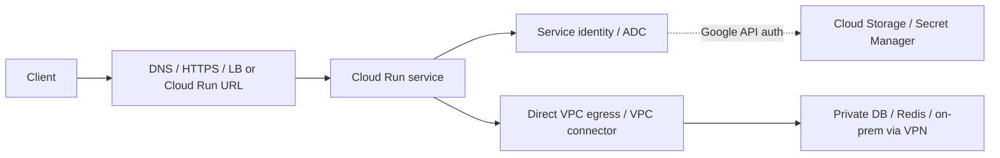
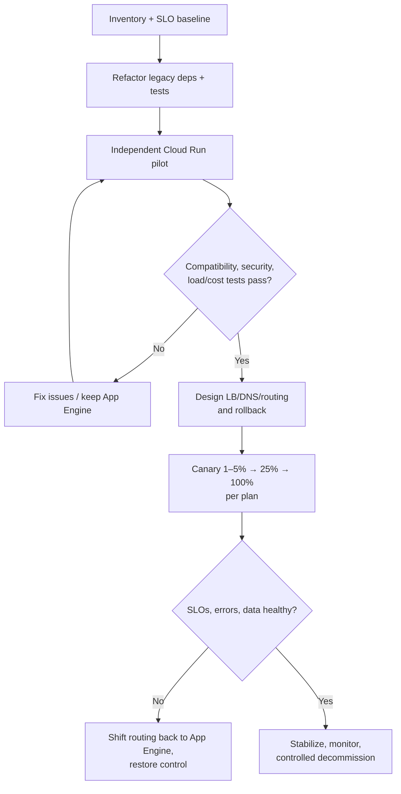

# Evaluating migration from App Engine to Cloud Run

An application running steadily on **App Engine** does not necessarily need to migrate immediately to **Cloud Run**. However, if the development team wants full control over container packaging, CPU/memory/concurrency tuning, unified CI/CD across services, or reduced reliance on older runtimes and legacy APIs, Cloud Run is a modernization target worth evaluating. Making the right call is not just “redeploying source code”: you must examine **runtime, dependent services, HTTP contract, security, networking, data, rollback capability, and total cost**.

This lesson belongs to the **App Engine** chapter of the `CLOUD_PROVIDERS_GCP` module. Learners apply knowledge of projects/IAM, VPC, Compute Engine, Cloud Run, storage, and databases to select services, protect resources, automate releases, monitor reliability, and control costs. The goal is to produce an **actionable decision assessment** and a safe pilot migration plan, without assuming every application should move.

> **Scope:** App Engine **standard** and **flexible** have different architectures. The `gcloud beta app migrate-to-run` tool in Google Cloud guides is currently in **Preview/Pre-GA**; verify compatibility conditions and real-world availability. Specifically, migration paths for **standard second-generation apps without legacy bundled services** do not apply verbatim to **first-generation apps or apps still calling bundled APIs**. Infrastructure-changing commands must be approved before execution.

## 1. Learning Objectives

After this lesson, you will be able to:

1. Compare App Engine standard/flexible with Cloud Run across **deployment model, runtime, scaling, networking, and billing**.
2. Classify applications as **relatively straightforward to migrate, requiring refactoring first, or better kept on App Engine for now**.
3. Inventory `app.yaml`, services/versions, handlers, dependencies, IAM, cron, queues, data, and domains.
4. Identify replacements for **legacy bundled services**, along with differences in containers, filesystems, HTTP ports, and request lifecycles.
5. Run compatibility checks using Preview tooling when eligible and deploy a **parallel Cloud Run pilot**.
6. Build a plan for **shadow testing, canarying, cutover, and rollback** with quantitative criteria.
7. Estimate risks and costs based on real load rather than comparing single-instance unit prices.

## 2. Comparing the two platforms before deciding

| Criterion | App Engine standard | App Engine flexible | Cloud Run services |
| --- | --- | --- | --- |
| Deployment | Source and `app.yaml` config per supported runtime. | Apps/containers on service-managed Compute Engine infrastructure. | Container image or source build via buildpacks; each release creates a revision. |
| Runtime | Standard environment constraints and traits; first-gen and second-gen differ. | More flexible environment tied to VMs and containers. | Container contract: process listens on `PORT` at `0.0.0.0`, suitable image. |
| Release unit | **Service / version / instance**. | **Service / version / instance**. | **Service / revision / instance**. |
| Scaling | Per App Engine scaling configuration. | Per flex automatic/manual scaling mechanisms. | Autoscales by requests, concurrency, CPU, and min/max parameters; supported scaling modes available. |
| Resources | Instance classes and environment-specific settings. | VM capacity/configuration per flexible environment. | CPU/memory/concurrency and billing settings per service/revision. |
| Background work | Depends on environment and lifecycle, Task Queues/cron, or external services. | Processes allowed inside flex environment, still subject to lifecycle management. | Choose queues/Cloud Run jobs/workers by task type; do not assume CPU after HTTP response. |
| Legacy App Engine bundled APIs | Supported depending on runtime/features. | No full 1:1 equivalent across all APIs. | **Does not support App Engine legacy bundled services**. |
| Networking | App Engine VPC/connector/firewall/URL mechanisms. | VM/VPC networking and flexible infrastructure. | Dedicated ingress and Direct VPC egress/Serverless VPC Access per configuration. |
| HTTP access | App Engine URLs and routing/dispatch rules, default access per config. | Similar under the App Engine model. | `run.app` URL, IAM invoker, and ingress policies; migration tool may create a private service. |
| Observability/cost | Logs, instances/instance-hours, and App Engine SKUs. | Corresponding VM/resource billing and supporting services. | vCPU-seconds, GiB-seconds, request charges per billing mode, networking, and supporting services. |

**Neither option wins every criterion.** A low-churn App Engine service on a supported runtime with steady SLOs and reasonable total spend may stay as is. Conversely, apps needing container portability, diverse frameworks, or splitting workloads into HTTP services and jobs can benefit from Cloud Run.

### 2.1. Three decision scenarios

- **A — Modern second-generation standard app without bundled APIs:** strong pilot candidate. You can test the Preview migration tool and compare results against a manual Cloud Run deployment.
- **B — Java 8/Python 2 app or using legacy Memcache/Task Queue/Users APIs:** **refactor dependencies and runtime first** rather than treating platform migration as a single step. Legacy first-generation runtimes have reached deprecation stages; verify support schedules and current deployability.
- **C — Flex app with a compatible Dockerfile/HTTP server and externalized data:** can be piloted fairly directly, though VM/networking, process lifecycles, resources, domains, and cron/queue differences must still be checked.

## 3. Pre-migration inventory

Do not start by deleting `app.yaml`. First build an inventory for **each App Engine service/version**, identifying what moves as-is and what must be replaced.

| Item | What to gather | Decision question |
| --- | --- | --- |
| **Runtime** | Language/version, standard vs. flex, dependencies, custom libraries. | Is the runtime supported by Cloud Run images/buildpacks? |
| **Services/versions** | Service names, traffic-serving versions, traffic splits, cron/dispatch. | How many Cloud Run services/revisions are needed? |
| **HTTP contract** | Routes, methods, request timeouts, uploads, streaming, WebSockets, auth. | Can the container conform to the Cloud Run contract? |
| **Scaling** | App Engine instance class, min/max, basic/automatic/manual scaling, peak traffic. | How should Cloud Run concurrency and capacity be chosen? |
| **State** | Temp files, RAM caches, sessions, cookies, data in DB/Storage. | Does any data depend on a single App Engine instance? |
| **Legacy APIs** | Datastore/NDB, Memcache, Task Queues, Blobstore, Users, Mail, Images… | Which Client Libraries/services replace them? |
| **Networking** | VPC connectors, Cloud SQL private IP, egress, firewalls, DNS, IP allowlists. | Can Cloud Run reach VPC dependencies? |
| **Identity** | App Engine SA, custom SAs, invoker/auth, secrets, and auditing. | What permissions do the Cloud Run runtime SA and callers need? |
| **Operations** | Cron, task backlogs, logs, monitoring alerts, CI/CD, on-call. | Should schedules/jobs/alerts move before or after cutover? |
| **Cost** | Billing by SKU, instance usage, networking, Cloud SQL, log volume. | Does total cost rise or fall under real load after moving? |

### 3.1. Commands to collect current state (read-only)

```bash
PROJECT_ID="shop-dev"
SERVICE="default"

gcloud app describe --project="$PROJECT_ID"
gcloud app services list --project="$PROJECT_ID"
gcloud app versions list \
  --project="$PROJECT_ID" \
  --service="$SERVICE"

# Once Cloud Run read permissions are available, inspect target resources.
gcloud run services list --project="$PROJECT_ID"
```

These commands **do not modify App Engine**. Supplement them with `app.yaml`, deployment configs, Git/CI definitions, and application owners; never infer from a service listing alone that cron, task queues, and data are ready to migrate.

### 3.2. Example `app.yaml` assessment

```yaml
runtime: java17
service: orders-api
instance_class: F2
automatic_scaling:
  min_instances: 1
  max_instances: 10
  target_cpu_utilization: 0.65
env_variables:
  FEATURE_FLAG: "true"
```

This is an illustrative **App Engine standard** config; valid properties depend on runtime and environment. When moving to Cloud Run:

- `service` maps to a Cloud Run **service** of the chosen name, while **versions** become **revisions** and traffic splitting uses Cloud Run's mechanisms.
- `instance_class` does **not** translate mechanically into fixed CPU/memory. Benchmark RSS, CPU utilization, concurrency, and latency.
- `automatic_scaling` requires re-evaluating `min/max`, request concurrency, CPU signals, and downstream limits.
- `env_variables` can carry over, **except secrets**, which belong in Secret Manager; never copy plaintext credentials.
- `app.yaml` is not a required deployment format for Cloud Run; you can use gcloud flags, service YAML, Terraform, or GitOps.

## 4. Application differences that can break migration

### 4.1. Cloud Run container contract

A Cloud Run service requires an ingress container to:

1. Start up and **listen on `0.0.0.0`** on the port passed via the `PORT` environment variable (commonly defaulting to 8080).
2. Return a response before the configured **request timeout**; handle timeouts and close requests intentionally.
3. Tolerate **cold starts, scale-outs, and instance replacements**; never rely on stable instance IPs/hostnames.
4. Treat the writable filesystem as **ephemeral**, backed by instance memory and lost when the instance stops.
5. Handle SIGTERM/graceful shutdown; never assume a background thread runs indefinitely after sending the HTTP response.

A small Spring Boot example may set `server.port=8080`, while real deployments must ensure binding/port align with Cloud Run's `PORT`. For apps choosing ports dynamically, read `PORT` in code/startup scripts; **never bind to `127.0.0.1`**.

Example Dockerfile for a prebuilt executable JAR:

```dockerfile
FROM eclipse-temurin:21-jre
WORKDIR /app
COPY target/app.jar /app/app.jar
USER 10001
EXPOSE 8080
ENTRYPOINT ["java", "-jar", "/app/app.jar"]
```

The Dockerfile is a **packaging template**, not an automatic App Engine converter. The app must listen on port 8080 and build a compatible JAR. In production, pin base images by digest, scan for vulnerabilities, and restrict container privileges.

### 4.2. Filesystem, sessions, and state

Some App Engine apps rely on temporary filesystems, RAM caches, sticky sessions, or user-uploaded files. After migration, never treat container directories as durable storage:

| State | Recommended handling |
| --- | --- |
| Uploads, images, long-lived reports | **Cloud Storage**; enforce object IAM, retention, and generations. |
| Cross-instance sessions | Signed session tokens or a proper session store; avoid RAM inside a single instance. |
| Shared cache | **Memorystore** or a properly designed cache/data store; account for networking/cost. |
| Transactional data | **Cloud SQL/Firestore** per workload; independent backups and migrations. |
| Per-request temporary files | Permitted within memory/disk limits; clean up and monitor memory. |
| Post-response long-running work | **Cloud Tasks, Pub/Sub, Cloud Run jobs**, or an appropriate worker model. |

### 4.3. Legacy bundled services: a common blocker

Older App Engine standard apps may call **legacy bundled services**, which Cloud Run **does not natively support**. They must be replaced in application code:

| App Engine capability | Common replacement | Notes |
| --- | --- | --- |
| **Datastore/NDB** | Cloud Client Libraries for Firestore in Datastore mode/Datastore; language-appropriate NDB migration. | Check transactions, indexes, namespaces, entity semantics, and client behavior. |
| **Task Queue push** | **Cloud Tasks** HTTP target → Cloud Run. | IAM OIDC, retries, queue rate limits, idempotency. |
| **Task Queue pull** | **Pub/Sub** or a redesigned queue/worker. | ACK deadlines, delivery semantics, concurrency, and ordering. |
| **Memcache** | Memorystore or an appropriate app cache. | Semantics and pricing are not identical; design invalidation carefully. |
| **Blobstore** | Cloud Storage via Client Libraries. | URLs, signed access, object metadata, and lifecycle. |
| **URL Fetch** | Standard HTTP client libraries. | Proxies/egress, DNS, timeouts, certificates, and retries. |
| **Users/Mail/Images/Search** | Identity Platform/OIDC, SMTP/API providers, image processing, appropriate search services. | No 1:1 mapping for every feature; analyze specific functionality. |
| **App Identity** | Runtime service account + Application Default Credentials, OIDC where fitting. | Narrow IAM roles; avoid long-lived JSON keys. |

**Recommended order:** replace legacy APIs → verify data/app still works on App Engine (if feasible) → test on Cloud Run. Changing runtime, database, framework, and routing simultaneously introduces too many variables, complicating rollbacks and root-cause analysis.

### 4.4. Cron, background tasks, and dispatch

- **`cron.yaml`:** evaluate **Cloud Scheduler** sending HTTP requests with **OIDC authentication** to Cloud Run or triggering appropriate workflows/jobs.
- **`queue.yaml` / Task Queues:** migrate to Cloud Tasks/Pub/Sub matching push/pull semantics while preserving retries/backoff, deduplication, and dead-letter handling.
- **`dispatch.yaml`:** translate into Application Load Balancer routes, API gateways, or suitable service/domain structures; never copy paths mechanically.
- **Warmup/custom error pages/static handlers:** redesign for Cloud Run container lifecycles, app routing, CDN/Cloud Storage, or Load Balancers.

Identify **who the new callers are** and which principals hold `roles/run.invoker`. Replacing cron with Cloud Scheduler must never mean opening every internal endpoint to public access for convenience.

## 5. Networking, IAM, and user-facing layer after migration

### 5.1. Accessing private resources

App Engine and Cloud Run can call many Google Cloud services through Client Libraries without extra VPC connectors. However, when calling **private-IP Cloud SQL, Redis/Memorystore, VPC services, or on-premises systems**, configure **Direct VPC egress** or a **Serverless VPC Access connector** matching capabilities and topology:



Inspect routing, firewalls, egress modes, DNS, private ranges, connection pools, and **VPC egress/NAT/network costs**. Never route all traffic through a VPC connector by default if unneeded; never configure Cloud SQL private endpoints with parameters valid only on App Engine.

### 5.2. Separating identities and permissions

| Principal | Permissions needed | Avoid |
| --- | --- | --- |
| **Build/deploy principal** | Build images and deploy Cloud Run in the target project/service. | Broad Owner roles for CI. |
| **Cloud Run runtime service account** | Only the Cloud SQL/Storage/Secret Manager/Tasks access genuinely needed. | Default project-wide edit permissions. |
| **Callers** (users, Scheduler, Tasks, Eventarc) | Invoker rights or app authentication per purpose. | Opening publicly just to “fix 403s”. |
| **Network/platform admin** | VPC routes, egress, LB, DNS, TLS, and firewalls. | Changing firewalls without verifying traffic paths. |

The App Engine default service account and Cloud Run runtime service account **are not identical by default**. During migration, verify the actual ADC principal, DB/API IAM, Secret Manager bindings, and **Cloud Audit Logs** before cutover.

### 5.3. URLs, custom domains, cookies, and authentication

An endpoint at `*.appspot.com` does not automatically become `*.run.app` with identical behavior. Check:

1. **Custom domains/DNS** and TLS certificates; domain mapping may opt for an LB architecture depending on use case.
2. **HTTPS redirects, Host headers, `X-Forwarded-*` headers**, CORS/CSRF, and app-generated absolute URLs.
3. **Cookie domains/paths, `SameSite`, `Secure` flags**, and login callback/OAuth redirect URIs.
4. **App Engine routing** by service/version/path compared with Cloud Run services/revisions and backend routing.
5. **Session affinity** if enabled, without treating sticky routing as durable session storage.
6. **Public/private ingress** alongside IAM invoker/IAP/app authentication under the new design.

Newly deployed Cloud Run services may **require authentication** by default; seeing `403` in a browser does not necessarily mean deployment failed. Check IAM/ingress and test using the proxy or an authorized caller's identity token.

## 6. Performance and cost evaluation

### 6.1. Data-driven sizing

You cannot swap `instance_class: F2` for `cpu=1, memory=512Mi` and claim equivalence. Gather the application's **load profile**:

- Hourly request rate, p50/p95/p99 latency, payload sizes, and 4xx/5xx rates.
- Peak CPU/memory, cold starts/warmup, and connection durations.
- I/O-bound vs. CPU-bound mix, thread counts, and sustainable concurrency.
- Connection pools, Cloud SQL quotas, outbound requests, and API rate limits.
- Availability SLOs, RTO/RPO, and startup latency targets.

Cloud Run exposes **per-instance CPU/memory, concurrency, min/max instances, and CPU allocation/billing settings**. Setting `concurrency=1` can be simple yet spawns many instances and DB connections; setting concurrency too high can inflate p99 latency and memory.

### 6.2. Estimating total cost, not just compute unit prices

| Category | Current App Engine | Cloud Run after migration |
| --- | --- | --- |
| Compute | Instance class/hours or VM resources by environment. | vCPU-seconds, GiB-seconds, request charges, and min-instance idle per billing mode. |
| Build/artifacts | Current build workflow. | Cloud Build/buildpacks, Artifact Registry image storage. |
| Networking | Egress, connectors, private connectivity. | Egress, Direct VPC/connectors, NAT, and cross-region traffic if any. |
| Edge | Current custom domains/HTTPS/routing. | Cloud Load Balancing/CDN/IAP/Cloud Armor if included in architecture. |
| Background | Cron/Task Queues and quotas. | Cloud Scheduler/Tasks/Pub/Sub/jobs. |
| Data | Datastore/Cloud SQL/Storage/Memcache. | Cloud SQL/Firestore/Storage/Memorystore and migration overhead. |
| Observability | Current Logging/Monitoring. | Cloud Run logs/metrics, traces, and retention. |

**Directional calculation example:** an API serves 50,000 requests/day averaging 200 ms each; if **one instance were busy sequentially with non-overlapping requests**, total serving time would be `50,000 × 0.2 = 10,000 seconds/day`. Actual billing, however, also depends on **concurrently overlapping requests on instances**, startup/shutdown, min idle instances, CPU/memory, region, and billing mode. Never multiply “request count × duration” as a Cloud Run bill estimate when concurrency differs from 1.

Benchmark side-by-side on the same dataset and traffic profile, comparing `$/1,000 requests` alongside **p95 latency, error rates, and cold starts**. Lowering cost at the expense of higher errors or weaker security means the migration has not succeeded.

## 7. Migration assessment and pilot workflow

### 7.1. Phase 0 — Define acceptance criteria

Example for `orders-api`:

| Criterion | Illustrative acceptance gate |
| --- | --- |
| Functionality | 100% of core API flows and related batch/cron jobs verified. |
| SLOs | HTTP 5xx does not rise meaningfully; p95 latency stays within agreed bounds. |
| Data | DB reconciliation is consistent; no duplicate side effects created. |
| Security | No unintended public endpoints; least-privilege runtime IAM. |
| Cost | Projected/measured total cost stays within approved budget. |
| Rollback | Team can route traffic back to App Engine on failure with zero data loss. |

Specific thresholds must be **agreed upon by the product owner and SRE/ops per existing SLOs**. Simply “running on Cloud Run” is not a sufficient cutover gate.

### 7.2. Phase 1 — Compatibility check without deploying

If the app falls within **Migration Hub/CLI Preview** support, inside the directory containing `app.yaml`:

```bash
# CHECK ONLY: may require current gcloud beta components.
gcloud beta app migrate-to-run --dry-run
```

The tool can flag **unsupported configs** such as first-generation runtimes, `app_engine_apis: true`, basic scaling, warmup handlers, or resource values outside Cloud Run limits. **Dry-run does not replace application testing**, and reporting compatibility does not mean every dependency or data path has been migrated.

To inspect generated manifests before deploying, Preview supports `--export-only`. Exporting creates Cloud Run config files in your workspace; review them thoroughly before applying and **never assume auto-generated YAML is production-ready**.

### 7.3. Phase 2 — Choose one of two pilot paths

**Track A: use Migration Hub/CLI Preview when compatible**

- For **second-generation standard apps without bundled services**, the tool can build and deploy a separate Cloud Run service from `app.yaml`/source, or per guides reuse an image from an existing version.
- For flexible apps, the Preview tool offers conversion from config/source when suitable.
- **The original App Engine service keeps serving live traffic**, while the new Cloud Run service is tested independently. Traffic never shifts automatically merely because a new Cloud Run service exists.

```bash
# IMPACTING: builds and deploys a Cloud Run copy from selected configuration.
# Run only after preflight checks and execution approval.
gcloud beta app migrate-to-run
```

**Track B: manual migration when refactoring or tighter control is needed**

1. Remove legacy dependencies/update runtime and add tests.
2. Build a container image or deploy from source on Cloud Run.
3. Configure ingress, service identity, environment variables/secrets, CPU/memory/concurrency, and egress.
4. Deploy an **independent Cloud Run service** without touching the original App Engine routing.

```bash
PROJECT_ID="shop-dev"
REGION="asia-southeast1"
NEW_SERVICE="orders-api-pilot"
RUNTIME_SA="orders-run@$PROJECT_ID.iam.gserviceaccount.com"

# MODIFIES INFRASTRUCTURE: creates/deploys Cloud Run service from converted source.
# Runtime SA, APIs, Cloud Build, and IAM must be prepared beforehand.
gcloud run deploy "$NEW_SERVICE" \
  --project="$PROJECT_ID" \
  --region="$REGION" \
  --source . \
  --service-account="$RUNTIME_SA" \
  --no-allow-unauthenticated
```

This example does not automatically create VPC egress, DB connectors, or secrets. If the app needs a private DB/Redis, configure and verify them against the real Cloud SQL/network setup first. **Choosing source deployment does not remove the need to build and test the Docker container contract.**

### 7.4. Phase 3 — Independent testing

After deploying:

```bash
# Read-only status checks:
gcloud run services describe "$NEW_SERVICE" \
  --project="$PROJECT_ID" --region="$REGION"

gcloud run revisions list \
  --project="$PROJECT_ID" --region="$REGION" \
  --service="$NEW_SERVICE"

# Authenticated proxy to test a private service from an authorized machine:
gcloud run services proxy "$NEW_SERVICE" \
  --project="$PROJECT_ID" --region="$REGION"
```

In another terminal, run `curl -i http://127.0.0.1:8080/health` against your app's **actual** health endpoint. The proxy keeps running until stopped with Ctrl+C. If `/health` does not exist, use a route defined in your service rather than treating HTTP 404 as a Cloud Run fault.

Minimum test coverage:

1. API contracts, auth, headers, cookies, CORS, file uploads, and redirects.
2. Cloud SQL/Firestore/Storage/Secret Manager access under the exact **runtime SA**.
3. Cron/task queues with idempotency; avoid running two producers creating duplicate side effects.
4. Load tests covering cold starts, p95/p99 latency, retries, and 429/5xx responses.
5. Logs, traces, monitoring/alerts, quotas, VPC egress, and billing.

**Shadow traffic:** if replaying live requests for comparison, sanitize personal data and **prevent side effects on production DBs**. Replay sanitized logs into an isolated environment; never blindly mirror order-creation or payment requests.

### 7.5. Phase 4 — Phased cutover



**Distinguish two kinds of traffic splits:**

- **Cloud Run revision split** distributes traffic only **across revisions of the same Cloud Run service**. For example, `gcloud run services update-traffic` manages later Cloud Run rollouts/rollbacks.
- **App Engine → Cloud Run split** shifts traffic **between two platforms**. This requires an appropriate frontend/routing layer—such as an **Application Load Balancer with serverless NEGs** for the respective backends where supported, or a DNS cutover plan. **You cannot** use Cloud Run's `update-traffic` alone to shift 5% of requests directly from App Engine to Cloud Run.

When using DNS cutovers, account for TTLs, client caching, certificates, cookies, and clients continuing to hit the old target temporarily. For stateful or side-effecting services, track when **two traffic streams run concurrently** and verify whether both apps reading/writing the database simultaneously is safe.

### 7.6. Phase 5 — Rollback, stabilization, and retiring the old platform

An executable rollback plan must specify:

- **Who** is authorized to change DNS/LB/routing and who approves rollback.
- **Trigger signals:** 5xx, p95 latency, business transactions, DB errors, anomalous cost/traffic.
- **Steps to shift traffic back to App Engine** and observation duration.
- **Data compatibility:** do DB migrations/schemas remain compatible with the old App Engine version?
- **Queue/cron ownership:** jobs/events must neither duplicate nor get dropped during reversal.
- **Timeline to retain / shut down old App Engine services and versions**, after completing retention/backups and verifying billing.

Do not delete the App Engine application, services/versions, or data stores immediately after 100% of traffic reaches Cloud Run. Maintain a sufficient stabilization window, preserve rollback access, and confirm old resources are no longer called by cron, task queues, or external clients.

## 8. Three decision case studies

### Case A — Simple Spring Boot HTTP API

**Current state:** Second-generation App Engine standard Java using Cloud SQL via Client Libraries, single service, no bundled APIs, variable load.

**Assessment:** **strong pilot candidate**. Verify Spring Boot listens on `PORT`, concurrency/connection pools, Cloud SQL identity/egress, scaling, cost, and auth. Deploy a private standalone Cloud Run service, load-test, and only then cut over the domain.

### Case B — Legacy Python using NDB and Task Queue

**Current state:** First-generation Python using NDB, dispatching background jobs via Task Queue push, and using the Users API.

**Assessment:** **not ready for lift-and-shift**. Separate out migrating the runtime and bundled dependencies (Datastore client, Cloud Tasks, OIDC/Identity Platform), preserve idempotency, and verify data schemas and queue replay before piloting Cloud Run. Migrating the HTTP frontend while forgetting Task Queues risks losing business workflows.

### Case C — App Engine flexible doing long image processing

**Current state:** Flex container processing large files over several minutes and writing multi-GB temporary files under potential high load.

**Assessment:** evaluate **request timeouts, in-memory filesystem limits, CPU, instance concurrency, and cost**, not just the HTTP path. Consider splitting the API into a Cloud Run service that accepts jobs while running long processing in **Cloud Run jobs/Cloud Tasks** backed by Cloud Storage; never assume a temporary filesystem outlives an instance.

## 9. Common evaluation pitfalls

| Red flag | Why it is dangerous | Adjustment |
| --- | --- | --- |
| “`app.yaml` is compatible so the app will definitely run right” | Still excludes IAM, DB, networking, sessions, background jobs. | Run integration/load/security tests. |
| “Keep the App Engine instance class equal to CPU/memory” | The two environments use different resource models. | Benchmark and size Cloud Run independently. |
| “Once Cloud Run deploys, App Engine traffic has moved” | The two backends are independent; routing has not changed. | Design frontend/cutover separately. |
| “Set `--allow-unauthenticated` to fix 403s” | May expose sensitive endpoints publicly. | Configure proper caller IAM/OIDC and ingress policies. |
| “Cloud Run has a new URL so OAuth/cookies will just work” | Callbacks, domains, and session policies differ. | Test auth/redirects/cookies end-to-end. |
| “Work spawned after HTTP 200 will surely finish” | Instances can scale down or have CPU throttled. | Use queues/jobs with retries and idempotency. |
| “Migrate in a day and delete App Engine immediately” | Loses rollback path while old cron/queues/clients remain. | Enforce a stabilization window and decommission checklist. |
| “Cloud Run is definitely cheaper due to scale-to-zero” | Min instances, compute, egress, logging, LB, and DB all cost money. | Compare total bills under real traffic and equal SLOs. |

## 10. Applied exercises (with answers)

**Exercise 1 — Should we migrate right now?** An App Engine service runs steadily on a supported runtime, changes rarely, has no container requirements, and has acceptable costs. Is migration mandatory?

*Answer:* **Not mandatory** merely because Cloud Run is newer. Weigh runtime lifespan, roadmap, operational skills, total cost, and risk; you can keep it running while preparing a pilot.

**Exercise 2 — Legacy blocker.** An app still uses App Engine Task Queue push and legacy Memcache. Is running `gcloud beta app migrate-to-run` enough?

*Answer:* **No.** Cloud Run does not support bundled APIs; migrate push queues to Cloud Tasks (including IAM/retries/idempotency), evaluate Memorystore or another cache, update code, and test before deploying.

**Exercise 3 — App unreachable after deploy.** A new Cloud Run service returns `403` in a browser. Does that prove the app crashed?

*Answer:* No. Cloud Run may require authentication. Check ingress/IAM, test with `gcloud run services proxy` or an identity token from a caller with `roles/run.invoker`, and inspect logs/health checks to separate 403s from app errors.

**Exercise 4 — Traffic split.** Operations wants to shift 10% of requests from App Engine to Cloud Run. Can `gcloud run services update-traffic` do that?

*Answer:* Not directly. That command splits traffic **between Cloud Run revisions** of one service; splitting traffic **between two platforms** requires supported LB/routing/DNS planning plus checking cookies, state, and rollback.

**Exercise 5 — Cloud SQL connections.** App Engine used 10 instances × pool size 10. On Cloud Run, the team sets max 100 instances × pool size 20. What is the risk?

*Answer:* Theoretically up to **2,000 connections**, exceeding DB capacity. Cap max instances/pools, measure actual concurrency, and enforce connection management and scaling guardrails aligned with DB resources.

**Exercise 6 — Ephemeral data.** An app writes reports to `/tmp` and returns a URL for users to download tomorrow. What fails on Cloud Run?

*Answer:* Container filesystems are **not durable across instance lifecycles**. Store reports in Cloud Storage, return controlled URLs/identifiers, and apply proper IAM, signed URLs, and retention.

**Exercise 7 — Rollback.** At a 25% canary, the team finds a DB schema change broke the old App Engine version's reads. Can they simply switch DNS back to App Engine?

*Answer:* Not safely. **Code/traffic rollback does not roll back schemas or data.** Use expand-and-contract migrations, backward compatibility, backups, and a data plan before cutover.

**Exercise 8 — Preview tooling.** A first-generation Java 8 App Engine standard app has `app_engine_apis: true`. How should dry-run output be interpreted?

*Answer:* This is a **blocker requiring runtime upgrades and bundled API replacements**. Preview migration tooling is not a “one-command” path in that case; plan runtime and dependency migration first.

## 11. Decision and migration checklist

- [ ] Clear application owner, SLOs, baseline metrics, and business goals exist.
- [ ] Standard/flexible classification, runtime generation, and bundled API dependencies documented.
- [ ] Inventory of services/versions/traffic, `app.yaml`, cron/queues, static handlers, and custom domains complete.
- [ ] Data systems, sessions, temp files, background tasks, and durable storage replacements defined.
- [ ] Container contract verified: `PORT`, `0.0.0.0`, timeouts, graceful shutdown, cold starts.
- [ ] Runtime SA, caller IAM, auth callbacks, ingress policy, and secrets redesigned.
- [ ] VPC egress, private DB/Redis, DNS, network costs, and connection pools tested.
- [ ] Compatibility dry-run executed when supported; results not treated as full QA.
- [ ] Cloud Run pilot deployed **in parallel** without altering production App Engine routing.
- [ ] Contract/integration/load/security tests and idempotency meet acceptance thresholds.
- [ ] Costs estimated across compute, requests, builds, registry, LB, egress, DB, cron/queues, and logs.
- [ ] App Engine → Cloud Run cutover plan includes LB/DNS/traffic strategy and rollback.
- [ ] Tested both traffic rollback **and** schema/data/queue compatibility.
- [ ] Decommission App Engine only after stabilization, verifying no lingering cron/clients and reconciling billing.

## 12. Summary

**Moving from App Engine to Cloud Run is an architectural decision, not merely changing a deploy command.** A safe roadmap follows an ordered sequence:

1. **Assess current state:** environment, runtime, bundled APIs, services, state, networking, IAM, and cost.
2. **Clear blockers:** upgrade runtimes, replace legacy APIs, and make the app satisfy the container contract.
3. **Run a parallel pilot:** use Preview tooling if eligible or a controlled container/source deployment.
4. **Test quantitatively:** functionality, auth, DB, cron, latency, errors, cost, and recovery.
5. **Cut over with rollback:** design LB/DNS spanning both platforms; avoid duplicate side effects and preserve data compatibility.
6. **Stabilize before retiring App Engine:** confirm zero remaining dependencies and monitor post-migration total cost.

Success means **the service meets SLOs, security, and operational requirements at an acceptable total cost**, not just seeing a `run.app` URL return HTTP 200.

### Google Cloud reference documentation

- [App Engine and Cloud Run — comparison](https://cloud.google.com/appengine/migration-center/run/compare-gae-with-run)
- [Migrating from App Engine to Cloud Run](https://cloud.google.com/run/docs/migrate/from-app-engine-to-cloud-run)
- [Standard environment → Cloud Run (Preview)](https://cloud.google.com/appengine/migration-center/run/migrate-app-engine-standard-to-run)
- [Flexible environment → Cloud Run (Preview)](https://cloud.google.com/appengine/migration-center/run/migrate-app-engine-flexible-to-run)
- [Migrate off legacy bundled services](https://cloud.google.com/appengine/migration-center/standard/services/migrating-services)
- [Migrate to second-generation runtimes](https://cloud.google.com/appengine/migration-center/standard/migrate-to-second-gen/overview)
- [Cloud Run container runtime contract](https://cloud.google.com/run/docs/container-contract)
- [Cloud Run revisions, rollouts and traffic migration](https://cloud.google.com/run/docs/rollouts-rollbacks-traffic-migration)
- [Cloud Run service IAM and authentication](https://cloud.google.com/run/docs/authenticating/overview)
- [Cloud Run pricing](https://cloud.google.com/run/pricing)
