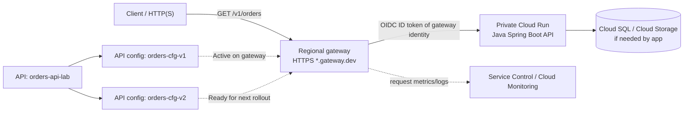
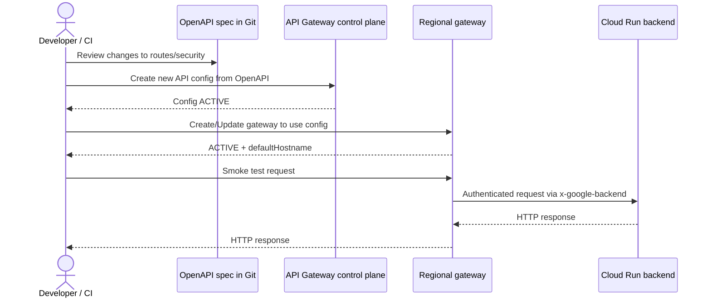
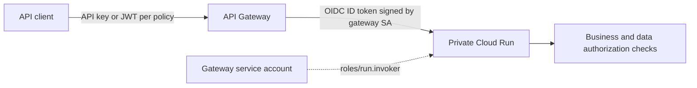
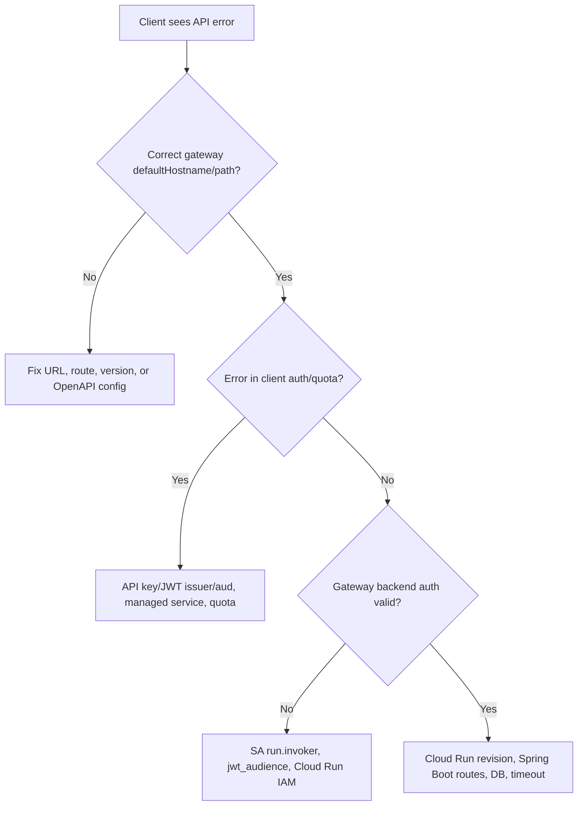

# API Gateway Configs, Deployments, and Backends

## 1. Problem Statement and Objectives

A **Spring Boot** development team runs an order management API on **Cloud Run**. Instead of exposing the backend URL directly to every customer, the team needs a stable entry point that defines published paths, authenticates clients, limits traffic, and monitors errors. When releasing a new version of `/v1/orders`, the team wants to update the API configuration **without accidentally exposing the backend publicly** or disrupting in-flight requests.

**Google Cloud API Gateway** is a managed gateway service sitting between clients and backends to accept HTTPS, apply supported API configurations, and route requests to Cloud Run, Cloud Run functions, App Engine, or supported HTTP/gRPC backends. In the **API Gateway and Apigee** chapter of the **CLOUD_PROVIDERS_GCP** module, this lesson dives into **API → API config → Gateway deployment → Backend**, along with configuration updates, IAM, and rollback workflows.

**Learning outcomes:**

1. Distinguish between **API**, **OpenAPI definition**, **API config**, **gateway**, and **backend**.
2. Explain why a **new config ID** must be created when modifying routes, security, or backends.
3. Write an OpenAPI 2.0 spec using `x-google-backend` to route to a private Java Cloud Run service.
4. Create, describe, update, and roll back a gateway with `gcloud` without accidentally modifying or deleting an active config.
5. Understand the two security layers **client → gateway** and **gateway → backend**, and the difference between API keys, JWTs, and IAM Invoker.
6. Observe 4xx/5xx errors, latency, quotas, costs, diagnose routing issues, and clean up lab resources.

> **Safety boundary:** The illustrative commands create a Cloud Run service, gateway, API config, and Artifact Registry build artifacts, which may incur charges. The lab uses a **private backend and mock data**, but **the gateway has a public HTTPS endpoint by default** unless client authentication is configured. Never put real data into this lab or enable it on a production project.

## 2. Architecture and Resources



| Component | Scope | Responsibility |
| --- | --- | --- |
| **API** | Logical resource within the project | Groups configs for an API; associates with a managed service |
| **OpenAPI definition** | YAML/JSON file managed by the team in Git | Declares routes, HTTP methods, security, and backend mappings |
| **API config** | Resource under the **API**, typically at `locations/global` | Compiled configuration generated from the definition, largely **immutable** |
| **Gateway** | Resource in a **supported region** | Deploys **one API config** and exposes an HTTPS hostname |
| **Backend** | Cloud Run, functions, App Engine, gRPC/HTTP service | Executes business logic; must still authenticate and protect its own data |
| **Gateway service account** | IAM identity attached to the API config | Granted permission to invoke private backends; does not represent end users |

**An API can have multiple configs, and a config can be deployed by multiple gateways.** A gateway points to only one config at a time. Gateways in other regions **do not automatically update simultaneously** when you update one gateway.

### 2.1. Common Misconceptions

- **An API config is not a backend deployment:** editing OpenAPI does not update the Java container; deploying new Java code does not automatically update gateway routes.
- **A gateway is not a VPC firewall:** a Cloud Run backend can be kept private with IAM, but that does not make the gateway require client JWTs automatically.
- **API Gateway is not Apigee:** API Gateway fits a managed gateway for relatively straightforward needs; **Apigee** is for more complex API governance such as products, developer portals, rich policies, and deep analytics.
- **A gateway does not replicate the backend:** multiple gateways do not replicate Cloud SQL or Java application state.

## 3. How Is an API Config Created and Deployed?



### 3.1. API Configs Are Largely Immutable

Once `orders-cfg-v1` is created, you **cannot edit its OpenAPI content, paths, backends, or security** in place. API Gateway only allows updating certain metadata such as **display name and labels**. To change behavior:

1. Edit OpenAPI in Git, review/diff.
2. Create **`orders-cfg-v2`** under the **same API**.
3. Wait for the config to reach `ACTIVE`.
4. Update the gateway to point to the new config.
5. Smoke test, monitor, and **switch back to config v1** if rollback is needed.

This is why **config IDs must be versioned** and you should retain a last-known-good config for recovery. Do not delete a config currently referenced by a gateway.

### 3.2. Deployment Is Not Instantaneous System-Wide

API Gateway supports updating without stopping the gateway, but **during the transition window, some requests may still follow the old config**. When an API is served across multiple regions/gateways, you must **update each gateway individually**; there is no global transaction switching all of them at the exact same instant.

A good practice is to keep the backend compatible with **both v1 and v2** during rollout, deploy the backend first if needed, then switch the config, and finally clean up old routes/versions during a change window.

## 4. OpenAPI Defines Routes and Backends

API Gateway documentation currently supports **OpenAPI 2.0, 3.0.x, and 3.1.x**, in addition to supported gRPC configurations. This lesson uses **OpenAPI 2.0** to illustrate common `x-google-backend` and `gcloud` syntax. If migrating to OpenAPI 3.x, backends are declared using **`x-google-api-management.backends`** and referenced differently; **do not copy OpenAPI 2.0 extensions verbatim**.

### 4.1. Core Structure

```yaml
swagger: "2.0"
info:
  title: orders-api-lab
  version: "1.0.0"
schemes:
  - https
produces:
  - application/json
x-google-backend:
  address: https://CLOUD_RUN_SERVICE_URL
  jwt_audience: https://CLOUD_RUN_SERVICE_URL
  path_translation: APPEND_PATH_TO_ADDRESS
paths:
  /v1/orders:
    get:
      operationId: listOrders
      summary: Sample order list
      parameters:
        - name: limit
          in: query
          required: false
          type: integer
      responses:
        "200":
          description: Order list
          schema:
            type: object
  /v1/healthz:
    get:
      operationId: health
      responses:
        "200":
          description: Backend ready
```

Replace **both** `https://CLOUD_RUN_SERVICE_URL` placeholders with the **actual root URL of Cloud Run**, for example `https://orders-backend-lab-abc123-uc.a.run.app`; **do not duplicate `https://`** if pasting a URL that already includes the scheme. `host` is **optional** in API Gateway; if declared, use the **gateway hostname**, **not** the Cloud Run backend hostname.

- `paths` and `operationId` describe the exposed API.
- `x-google-backend.address` identifies the backend receiving requests; changing it **requires a new config**.
- `path_translation: APPEND_PATH_TO_ADDRESS` preserves the path, so `/v1/orders` forwards to `BACKEND_URL/v1/orders`.
- `jwt_audience` is the audience of the **gateway → Cloud Run ID token**, not the `aud` claim in the client's JWT.

**An OpenAPI schema does not replace Spring Boot business validation:** data types and `required` fields in the spec **do not guarantee the gateway validates every request field**. The backend must still validate body/query inputs, authorize callers, and protect against SQL injection, deserialization bugs, and rate abuse.

### 4.2. `path_translation` Is a Common Source of 404 Errors

| `x-google-backend` Location | Default | Effect |
| --- | --- | --- |
| **Top-level OpenAPI** | `APPEND_PATH_TO_ADDRESS` | Appends the request path to the backend base URL |
| **Operation-level** | `CONSTANT_ADDRESS` | Calls a fixed URL; path parameters may become query parameters |

For example, if `address` is `https://service.run.app` and the request is `/v1/orders/123`, `APPEND_PATH_TO_ADDRESS` calls `https://service.run.app/v1/orders/123`. If `CONSTANT_ADDRESS` is used, the backend receives the **fixed address** and corresponding path parameters may be converted into query parameters. **Declare it explicitly** to avoid silently changing URLs when moving extensions from top-level to operation-level.

### 4.3. Routing to Multiple Backends

You can declare `x-google-backend` per operation so `/v1/orders` goes to Cloud Run **orders** and `/v1/payments` goes to Cloud Run **payments**. In that case, verify **each backend address, audience, timeout, and IAM binding**; the service account attached to the config should only have permission to invoke the backends it actually needs.

## 5. Two Authentication Directions Must Remain Separate



| Hop | Mechanism | What Does It Protect? |
| --- | --- | --- |
| **Client → Gateway** | API key, JWT issuer/JWKS/audience, policy quotas | Which clients can call endpoints and consume quota |
| **Gateway → Backend** | Gateway service account + **OIDC ID token**, Cloud Run IAM Invoker | Backend accepts only IAM-authorized callers |
| **Inside Java backend** | Spring Security, business logic, input validation | Customers can only view/modify their own data |

**An API key is not strong user authentication for sensitive APIs.** Keys primarily identify a project/application for quota/billing and risk exposure if embedded in client/browser code or URLs. For user data, require **JWT/OIDC** with verified signature, issuer, audience, and claims, followed by **authorization** in the backend.

When API Gateway sets the `Authorization` header to an ID token for backend authentication, the client's original token may be forwarded in `X-Forwarded-Authorization`. **Do not blindly trust this header** if the backend has direct access paths or does not verify its source; use appropriate identity/authorization mechanisms and verify current header configuration.

### 5.1. API Key Declaration Example (Not Enabled in the Basic Lab)

Add to **OpenAPI 2.0** before creating a **new config**:

```yaml
securityDefinitions:
  api_key:
    type: apiKey
    name: key
    in: query
security:
  - api_key: []
```

Afterward, you must **enable the API's managed service**, create an API key in an authorized project, and **configure API/application restrictions**. When clients call, they send `?key=API_KEY` over HTTPS; **never put keys in Git, logs, or public documentation**. An API key can be combined with JWT where supported, but do not use an **API key alone** for APIs handling sensitive data.

## 6. Lab: Deploying a Private Java Cloud Run Backend

This lab uses **region `us-central1`** because it is one of the API Gateway supported regions in current documentation. **Cloud Run and the Gateway do not have to be in the same region**, but using the same region simplifies the lesson and reduces potential cross-region egress. If your organization requires data residency elsewhere, **check supported gateway regions first** rather than moving production resources into the example region.

### 6.1. Sample Spring Boot Application

Create a Maven project **separately in your lab environment**:

```text
orders-gateway-lab/
├── pom.xml
└── src/main/java/dev/example/gateway/OrdersApplication.java
```

File `pom.xml`:

```xml
<?xml version="1.0" encoding="UTF-8"?>
<project xmlns="http://maven.apache.org/POM/4.0.0"
         xmlns:xsi="http://www.w3.org/2001/XMLSchema-instance"
         xsi:schemaLocation="http://maven.apache.org/POM/4.0.0 https://maven.apache.org/xsd/maven-4.0.0.xsd">
  <modelVersion>4.0.0</modelVersion>
  <parent>
    <groupId>org.springframework.boot</groupId>
    <artifactId>spring-boot-starter-parent</artifactId>
    <version>3.5.5</version>
    <relativePath/>
  </parent>
  <groupId>dev.example</groupId>
  <artifactId>orders-gateway-lab</artifactId>
  <version>1.0.0</version>
  <properties>
    <java.version>21</java.version>
  </properties>
  <dependencies>
    <dependency>
      <groupId>org.springframework.boot</groupId>
      <artifactId>spring-boot-starter-web</artifactId>
    </dependency>
  </dependencies>
  <build>
    <plugins>
      <plugin>
        <groupId>org.springframework.boot</groupId>
        <artifactId>spring-boot-maven-plugin</artifactId>
      </plugin>
    </plugins>
  </build>
</project>
```

File `OrdersApplication.java`:

```java
package dev.example.gateway;

import java.util.List;
import java.util.Map;
import org.springframework.boot.SpringApplication;
import org.springframework.boot.autoconfigure.SpringBootApplication;
import org.springframework.web.bind.annotation.GetMapping;
import org.springframework.web.bind.annotation.RequestParam;
import org.springframework.web.bind.annotation.RestController;

@SpringBootApplication
@RestController
public class OrdersApplication {
    public static void main(String[] args) {
        SpringApplication.run(OrdersApplication.class, args);
    }

    @GetMapping("/v1/orders")
    public Map<String, Object> orders(
            @RequestParam(defaultValue = "10") int limit) {
        int safeLimit = Math.min(Math.max(limit, 1), 2);
        var samples = List.of(
                Map.of("id", "lab-001", "status", "PAID"),
                Map.of("id", "lab-002", "status", "CREATED"));
        return Map.of("items", samples.subList(0, safeLimit));
    }

    @GetMapping("/v1/healthz")
    public Map<String, String> health() {
        return Map.of("status", "ok");
    }
}
```

Run locally with JDK 21 and Maven:

```bash
mvn -q clean package
java -jar target/orders-gateway-lab-1.0.0.jar

# Another terminal:
curl -i "http://localhost:8080/v1/orders?limit=1"
curl -i http://localhost:8080/v1/healthz
```

This is mock data with **no business authentication**. Production APIs require Spring Security, JWT authorization, rate control, and database/transactions as needed. Never promote the lab backend into production merely because an API Gateway sits in front of it.

### 6.2. Deploy the Private Backend

You need a test Google Cloud project with Billing enabled, IAM permissions to deploy Cloud Run from source, and permissions to build/push images. Create a **separate runtime service account** without granting business data permissions for this JSON demo. From the Maven project directory:

```bash
gcloud config set project PROJECT_ID
gcloud services enable run.googleapis.com \
  cloudbuild.googleapis.com artifactregistry.googleapis.com \
  apigateway.googleapis.com servicemanagement.googleapis.com \
  servicecontrol.googleapis.com

gcloud iam service-accounts create orders-backend-runtime-lab \
  --display-name="Java lab Cloud Run runtime"

gcloud run deploy orders-backend-lab \
  --source . \
  --region us-central1 \
  --service-account="orders-backend-runtime-lab@PROJECT_ID.iam.gserviceaccount.com" \
  --max-instances=2 \
  --concurrency=10 \
  --no-allow-unauthenticated

# Read the actual URL; do not construct the hostname manually:
gcloud run services describe orders-backend-lab \
  --region us-central1 \
  --format="value(status.url)"
```

The deployer needs **`iam.serviceAccounts.actAs`** on the runtime service account; the build identity needs permission to create/push artifacts per policy. `--max-instances=2` caps the expected scale of the lab backend, though it is not a hard budget limit. The Cloud Run backend must **require IAM authentication**. To verify, direct unauthenticated requests to the backend are rejected:

```bash
curl -i https://ACTUAL_CLOUD_RUN_URL/v1/orders
```

Replace `https://ACTUAL_CLOUD_RUN_URL` with the returned URL without duplicating `https://`. Commands that create cloud resources **were not executed while authoring this lesson**.

## 7. Lab: Creating the API Config and Gateway

### 7.1. Create the Gateway Service Account and Grant Backend Access

This service account is used by **the gateway to call Cloud Run**, not as Java's runtime service account:

```bash
gcloud iam service-accounts create gateway-invoker-lab \
  --display-name="API Gateway backend invoker"

gcloud run services add-iam-policy-binding orders-backend-lab \
  --region us-central1 \
  --member="serviceAccount:gateway-invoker-lab@PROJECT_ID.iam.gserviceaccount.com" \
  --role="roles/run.invoker"
```

The operator creating the API config needs API Gateway resource management permissions and **`iam.serviceAccounts.actAs`** (typically via `roles/iam.serviceAccountUser`) on this service account. Grant only scoped roles and avoid Project Owner. If IAM fails, fix permissions **before making Cloud Run public**.

### 7.2. Save the OpenAPI Spec and Create Config v1

Save the YAML from section 4 into `openapi2.yaml`, replacing `CLOUD_RUN_SERVICE_URL` with the actual backend URL (both `address` and `jwt_audience`). Then:

```bash
gcloud api-gateway api-configs create orders-cfg-v1 \
  --api=orders-api-lab \
  --openapi-spec=openapi2.yaml \
  --backend-auth-service-account="gateway-invoker-lab@PROJECT_ID.iam.gserviceaccount.com" \
  --project=PROJECT_ID

gcloud api-gateway api-configs describe orders-cfg-v1 \
  --api=orders-api-lab \
  --project=PROJECT_ID

gcloud api-gateway api-configs list \
  --api=orders-api-lab --project=PROJECT_ID
```

If the API `orders-api-lab` does not exist yet, creating the config **may create the corresponding API**. Config creation is asynchronous and can take several minutes; wait for `state: ACTIVE` before using it. **Do not create multiple API configs concurrently under the same API** while an earlier config is still in progress.

### 7.3. Enable the API's Managed Service

Once the API exists, inspect the `managedService` field, for example:

```bash
gcloud api-gateway apis describe orders-api-lab \
  --project=PROJECT_ID

# Replace with the managedService value read from above:
gcloud services enable MANAGED_SERVICE_NAME \
  --project=PROJECT_ID
```

This step is essential for using **Service Control, API keys, quotas, and API management** for that API. The managed service name **is not simply always equal to `API_ID`**; read it from metadata instead of guessing or copying a sample name from another project.

### 7.4. Create the Regional Gateway and Retrieve the Hostname

```bash
gcloud api-gateway gateways create orders-gw-lab \
  --api=orders-api-lab \
  --api-config=orders-cfg-v1 \
  --location=us-central1 \
  --project=PROJECT_ID

gcloud api-gateway gateways describe orders-gw-lab \
  --location=us-central1 \
  --project=PROJECT_ID
```

When `state: ACTIVE`, the gateway exposes `defaultHostname`, typically formatted like:

```text
orders-gw-lab-HASH.uc.gateway.dev
```

Do not hard-code the hostname or infer it from the project name, as it is assigned by Google Cloud. The URL to call is `https://DEFAULT_HOSTNAME/v1/orders`.

### 7.5. Test Both Paths

```bash
# Replace DEFAULT_HOSTNAME with defaultHostname from gateway describe:
curl -i "https://DEFAULT_HOSTNAME/v1/orders?limit=1"
curl -i "https://DEFAULT_HOSTNAME/v1/healthz"

# The backend must still reject direct requests without a token:
curl -i "https://ACTUAL_CLOUD_RUN_URL/v1/orders"
```

Expected results: **gateway → backend** returns the demo order JSON; **direct unauthenticated call → backend** is rejected. Because the lab OpenAPI **does not yet include a client authentication policy**, anyone who knows the gateway URL can send valid requests and incur charges. **Do not put sensitive data in the lab, limit test duration, and clean up resources immediately when finished.**

## 8. Updating Configs and Rollback

Suppose you need to add `GET /v1/orders/{id}` or change the backend revision:

1. Update the Spring Boot backend, deploy the new revision, and verify the new route directly using authorized access.
2. Create a new OpenAPI file `openapi2-v2.yaml` containing both existing routes and the new route. If switching to a Cloud Run revision tag URL, set **`jwt_audience` to the service root URL**, not the tag-specific URL.
3. Create API config **`orders-cfg-v2`**; do not overwrite v1.
4. Update the gateway to v2, monitoring status and request errors.
5. If errors occur, update the gateway back to **`orders-cfg-v1`**; keep both backend behaviors compatible during the transition window.

```bash
gcloud api-gateway api-configs create orders-cfg-v2 \
  --api=orders-api-lab \
  --openapi-spec=openapi2-v2.yaml \
  --backend-auth-service-account="gateway-invoker-lab@PROJECT_ID.iam.gserviceaccount.com" \
  --project=PROJECT_ID

# After config v2 reaches ACTIVE:
gcloud api-gateway gateways update orders-gw-lab \
  --api=orders-api-lab \
  --api-config=orders-cfg-v2 \
  --location=us-central1 \
  --project=PROJECT_ID

gcloud api-gateway gateways describe orders-gw-lab \
  --location=us-central1 --project=PROJECT_ID

# Roll back if needed:
gcloud api-gateway gateways update orders-gw-lab \
  --api=orders-api-lab \
  --api-config=orders-cfg-v1 \
  --location=us-central1 \
  --project=PROJECT_ID
```

**The new config must actually exist**: `openapi2-v2.yaml` is only an illustrative filename for the extension exercise and is not present in the basic lab. Do not run the v2 commands before preparing a valid file. **Gateway update is not a 10%/90% percentage traffic-splitting canary**; if progressive delivery is required, consider separate gateways, load balancing, or an appropriate backend rollout strategy.

**Quotas in API Gateway apply at the API level** per Service Management configuration, rather than being completely isolated per config. Renaming or removing a quota metric between active configs can cause errors on gateways still running an older config. Maintain compatibility and verify quota definitions before multi-region rollouts.

## 9. Backends: Cloud Run, Functions, App Engine, and gRPC

| Backend | Configuration Path | Notes |
| --- | --- | --- |
| **Cloud Run service** | `x-google-backend.address` pointing to `https://...run.app` | Private backend IAM + gateway SA `run.invoker`, correct audience |
| **Cloud Run functions** | Supported function/service URL | Verify generation/API and appropriate invoke permissions |
| **App Engine** | `https://PROJECT_ID.appspot.com` or valid service URL | If protected by IAP, grant IAP permissions and choose the right audience/backend mode |
| **gRPC** | Supported service definition/config and gRPC backend | Differs from REST OpenAPI; check protocol, deadline, metadata |
| **Multiple HTTP backends** | Per-operation extensions | Each backend's IAM, networking, and timeouts must be verified separately |

### 9.1. Backend URL and ID Token

If `address` is a **tagged Cloud Run URL** such as `https://blue---SERVICE_HOSTNAME/...`, `jwt_audience` should be set to the **root URL of the Cloud Run service** per documentation—do not assume the tag-specific URL works as the audience. A mismatched audience is a frequent cause of 401/403 errors even when the service account already has `run.invoker`.

### 9.2. Deadline, Request Path, and Networking

`x-google-backend` supports options such as `deadline`, `protocol`, `disable_auth`, and `path_translation` depending on the OpenAPI version. **Do not set `disable_auth: true`** when the backend requires an IAM token; it disables automatic backend token generation by the gateway. HTTP(S) backends must have **connectivity supported for that backend type**—do not assume a private VPC IP is directly reachable by API Gateway simply because it is in the same project.

The gateway has product limits on request/response sizes and timeouts; the Java application still needs timeouts, retries with backoff/idempotency, and circuit breakers matching its SLOs. **Increasing `deadline` will not fix** an overloaded Cloud SQL instance or a hung Java process.

## 10. How API Gateway Differs from Apigee and Cloud Load Balancing

| Criterion | API Gateway | Apigee | Cloud Load Balancing |
| --- | --- | --- | --- |
| Purpose | Publish/manage APIs via OpenAPI/gRPC and IAM/JWT/key/quota | **Full API management** for partners/enterprises: policies, products, developer portal, analytics | Distribute HTTP(S)/TCP traffic, health checks, and backend balancing |
| Management unit | APIs, configs, regional gateways | API proxies, environments, products, developer apps | Forwarding rules, proxies, URL maps, backend services |
| Choose when | Small-to-medium Java APIs needing a managed gateway | Enterprise needs policy mediation, many partners, advanced governance | Routing/HA, CDN/WAF/LB primary; API-product management not required |

API Gateway does not replace **Cloud Armor**, backend IAM, Cloud SQL HA, or business authorization. When you need custom domains, multi-region load balancing, or specific edge protections, review supported **load balancing for API Gateway** patterns instead of assuming a single regional gateway satisfies global HA requirements.

## 11. IAM, CI/CD, and Change Control

A production Java pipeline should separate roles:

- **API/backend developer:** edits Spring Boot code and OpenAPI in Git; does not hold direct permissions to delete production gateways.
- **Build/deployer:** builds/tests and deploys Cloud Run using a least-privilege service account.
- **API config operator:** creates new configs; needs API Gateway/Service Management permissions and `iam.serviceAccounts.actAs` on the gateway SA.
- **Gateway SA:** holds only `roles/run.invoker` on the specific Cloud Run backends it must call.
- **Client identity:** JWT/OIDC or restricted API keys per policy; never use an API key to authenticate sensitive principals.
- **Auditor:** reads logs, configs, gateway updates, and IAM changes without modify permissions.

Record the **OpenAPI source, config ID, gateway ID/region, backend URL/revision, service account, and change ticket** in the release record. Using **Terraform/IaC** to manage APIs, configs, and gateways in the same pipeline is recommended, keeping in mind that **changing OpenAPI may create a new config**; review the IaC plan carefully before replacing or deleting live resources.

**Safe rollout sequence:** test new backend → create new config → verify ACTIVE → update gateway → smoke test → observe error rate/latency → keep rollback ready. For multiple gateways/regions, roll out in waves rather than all at once.

## 12. Monitoring, Errors, and Runbook

### 12.1. Observability Commands

```bash
gcloud api-gateway apis list --project=PROJECT_ID
gcloud api-gateway api-configs list \
  --api=orders-api-lab --project=PROJECT_ID
gcloud api-gateway gateways list --project=PROJECT_ID
gcloud api-gateway gateways describe orders-gw-lab \
  --location=us-central1 --project=PROJECT_ID

gcloud run services describe orders-backend-lab \
  --region=us-central1 --project=PROJECT_ID
gcloud run services logs read orders-backend-lab \
  --region=us-central1 --project=PROJECT_ID --limit=50
```

In **Cloud Monitoring/Logs Explorer**, inspect API Gateway request counts/statuses, latency, and quota errors alongside Cloud Run backend request logs, revision errors, instance counts, CPU/memory, and Java GC/HikariCP metrics if available. Monitor **p95/p99 latency and 5xx rates** end to end, not just whether the gateway reports `ACTIVE`.

| Symptom | Likely Failing Layer | What to Check |
| --- | --- | --- |
| `api-configs create` fails | OpenAPI validation, IAM/actAs, API/service enablement | Spec syntax, `x-google-backend`, service account, Cloud services |
| Gateway stays `CREATING` for a long time | Config not yet `ACTIVE` or propagation | Resource describe/operations; avoid repeatedly creating duplicates |
| HTTP 404 through Gateway | Wrong `paths`, `path_translation`, or backend URL | Compare gateway URL against Spring Boot mappings |
| HTTP 401/403 at gateway | Missing API key/JWT, wrong issuer, audience, or quota policy | Check client security policy in OpenAPI |
| HTTP 403 from backend | Gateway SA missing `run.invoker`, wrong audience, backend IAM | Cloud Run IAM, `jwt_audience`, `address` |
| HTTP 502/503 | Backend failure, cold start, unavailable, networking | Cloud Run revision/health logs, runtime exceptions |
| HTTP 504 | Gateway or downstream deadline/timeout | `deadline`, Cloud Run timeout, DB/network traces |
| Config v2 has new routes but gateway serves old ones | Gateway not updated or still propagating | `gateway describe.apiConfig`, rollout timing |
| Quota errors after v2 rollout | Quota metrics changed at API level while old gateway is still active | Compare v1/v2 quotas/limits |
| Clients bypass gateway to call backend | Backend accidentally allows unauthenticated or overly broad IAM | Cloud Run IAM/ingress, direct URL behavior |
| Bill does not drop | Gateways/backends/build images/logs still exist | Resources, Billing SKUs, cleanup |



**Diagnose using logs and actual state**—never open Cloud Run publicly or grant Owner just to bypass a 403. If a new config is suspected, roll the gateway back to the previously verified config; **do not delete config v2 before completing the investigation**.

## 13. Cost, Quotas, and Safe Cleanup

Costs may include **API Gateway API calls**, Cloud Run CPU/RAM/requests, Cloud Build/Artifact Registry storage, Cloud Logging, and **network egress**. API keys/quotas help identify and cap certain usage patterns, but **they are not a hard cap on total spend**. Set Billing budgets and alerts; note that alerts do not automatically stop incoming requests.

**Hypothetical** quantitative example, not Google Cloud unit pricing:

```text
500,000 requests/day × 30 days = 15,000,000 gateway calls/month.
Backend handles 95% of requests successfully, meaning:
14,250,000 successful responses and 750,000 unsuccessful requests.

Cost does not depend only on successful responses: failed requests can still
consume gateway/backend resources depending on error type and pricing rules.
```

**Clean up in dependency order.** The commands below are strictly for the lab IDs, **not real projects**. If config v2 was deployed, verify which config the gateway references and delete all lab configs **after deleting the gateway**:

```bash
# 1. Delete the lab gateway (stops the endpoint and gateway traffic).
gcloud api-gateway gateways delete orders-gw-lab \
  --location=us-central1 --project=PROJECT_ID

# 2. Delete configs no longer referenced by any gateway.
gcloud api-gateway api-configs delete orders-cfg-v1 \
  --api=orders-api-lab --project=PROJECT_ID

# 3. Only after all configs of the API have been deleted.
gcloud api-gateway apis delete orders-api-lab --project=PROJECT_ID

# 4. Delete the Cloud Run lab backend once no consumers remain.
gcloud run services delete orders-backend-lab \
  --region=us-central1 --project=PROJECT_ID
```

If `orders-cfg-v2` was created, delete it separately **after the gateway is deleted**. Check **lab service accounts, IAM bindings, Cloud Build artifacts, Artifact Registry images, API keys**, and other self-created resources before deleting; **never delete shared service accounts**. Deleting a Cloud Run service **does not automatically delete all build images**. After cleanup, verify Billing/metrics since charges can appear with a delay.

## 14. Practice Exercises

### Exercise A — API Config Immutability

`orders-cfg-v1` routes `/v1/orders` to Java backend A. The team edits OpenAPI to add `/v1/payments` and switch the backend to B. Describe the **sequence for creating the config, IAM, updating the gateway, smoke testing, and rollback**, explaining why v1 cannot be edited directly.

### Exercise B — Path Translation

A client calls `GET /v1/orders/123`; the backend has handler `@GetMapping("/v1/orders/{id}")`. Compare the behavior when `x-google-backend` is placed at top-level with `APPEND_PATH_TO_ADDRESS` versus operation-level with default `CONSTANT_ADDRESS`. Fix the OpenAPI spec so the backend receives the expected path.

### Exercise C — Two Security Layers

The gateway endpoint returns HTTP 200, while calling the Cloud Run URL directly returns 403. Explain **why this can be the correct configuration**. Then assume the gateway uses an API key for customer data: what is still missing to protect data and authorize order access?

### Exercise D — Java Lab + Config v2

In a test project, deploy the sample Spring Boot API privately, create a gateway SA with `run.invoker`, upload OpenAPI 2.0 `orders-cfg-v1`, create the gateway, and call it via `defaultHostname`. Extend with `/v1/orders/{id}`, create `orders-cfg-v2`, update/roll back, and verify HTTP responses; **do not use real data**.

### Exercise E — Reliability and FinOps

Three gateways in different regions deploy the same API config. The backend in one region fails; design how to monitor 5xx errors, handle routing/failover, distribute deployment updates, and manage Cloud SQL data. Calculate monthly calls at 500,000 requests/day and propose ways to control quotas, logs/egress, and cost.

### Checklist

- [ ] I can distinguish between API, OpenAPI definition, API config, regional gateway, and backend.
- [ ] I know an API config cannot have its routes/security edited in place; a new config ID is required.
- [ ] I know API Gateway currently supports OpenAPI 2.0 and 3.x, with different backend extension syntax.
- [ ] I configure `x-google-backend`, `path_translation`, and `jwt_audience` accurately.
- [ ] I separate client API key/JWT from gateway SA → Cloud Run IAM.
- [ ] I can deploy a private Java backend and test via the real gateway hostname.
- [ ] I use `ACTIVE` and `gateway describe.apiConfig` to track rollouts.
- [ ] I understand updates are not globally atomic and multiple gateways must be updated individually.
- [ ] I have a rollback config, backend version, release inventory, and quota compatibility plan.
- [ ] I manage least-privilege IAM, SLOs, logs, quotas, and billing.
- [ ] I clean up gateway → config → API → backend in order and strictly within lab scope.

**Conclusion:** API Gateway provides an **API publishing and governance** layer decoupled from Java backend code. The proper workflow is **versioned OpenAPI configs, regional gateway deployments, IAM-protected backends, front-door client authentication, and verified updates/rollbacks**. When multiple APIs/partners or policies grow complex, evaluate **Apigee**; when the primary goal is load balancing, CDN, or WAF, evaluate **Cloud Load Balancing** alongside the required security layers.

## 15. Google Cloud Reference Documentation

- [API Gateway deployment model](https://cloud.google.com/api-gateway/docs/deployment-model)
- [OpenAPI overview — 2.0 and 3.x](https://cloud.google.com/api-gateway/docs/openapi-overview)
- [OpenAPI 2.0 extensions — x-google-backend](https://cloud.google.com/api-gateway/docs/oasv2-extensions)
- [Pass data and configure backend path translation](https://cloud.google.com/api-gateway/docs/passing-data)
- [Create an API config](https://cloud.google.com/api-gateway/docs/creating-api-config)
- [Deploy/update a gateway](https://cloud.google.com/api-gateway/docs/deploying-api)
- [Getting started: API Gateway + Cloud Run](https://cloud.google.com/api-gateway/docs/get-started-cloud-run)
- [Configure environment and service account](https://cloud.google.com/api-gateway/docs/configure-dev-env)
- [Secure backend services with IAM](https://cloud.google.com/api-gateway/docs/securing-backend-services)
- [Use API keys](https://cloud.google.com/api-gateway/docs/authenticate-api-keys)
- [JWT authentication](https://cloud.google.com/api-gateway/docs/authenticating-users-jwt)
- [Monitor/troubleshoot API Gateway](https://cloud.google.com/api-gateway/docs/troubleshoot)
- [API Gateway release notes](https://cloud.google.com/api-gateway/docs/release-notes)
- [API Gateway pricing](https://cloud.google.com/api-gateway/pricing)
