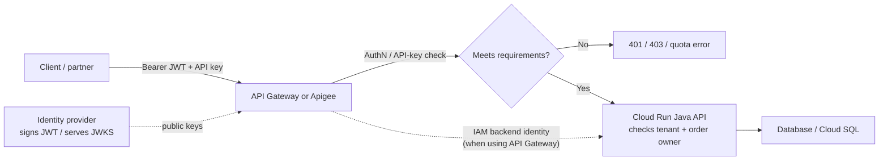

# JWT Authentication and API Key Controls

A Java application deployed on Cloud Run exposes an orders API for websites and partners. Users must **log in** before viewing orders; each partner application needs to be **identified, rate-limited, and revocable**. Exposing the API directly to the Internet and checking a hardcoded `apiKey` string in code does not satisfy both requirements. **API Gateway** or **Apigee** provides the entry-point enforcement layer: verifying JWTs, checking API keys, and routing to the backend; the application must still enforce per-order authorization.

This lesson belongs to the **API Gateway and Apigee** chapter of the **CLOUD_PROVIDERS_GCP** module. It connects knowledge of project organization, IAM, VPCs, Cloud Run, data services, security, automated releases, and cost tracking to API protection design. The goal is to understand both credential types, configure them properly on Google Cloud, and know which checks **must not be delegated solely to the gateway**.

> Project names, domains, APIs, issuers, client IDs, and keys in this lesson are **hypothetical or placeholders**. Never copy real tokens or keys into source code, shell commands saved in history, screenshots, or logs. Creating API configs, modifying IAM, rotating keys, and deploying gateways may incur charges or disrupt traffic; only run these on authorized environments.

## Learning Objectives

After this lesson, you can:

1. Distinguish between **JWT access/ID tokens**, **API keys**, **IAM service accounts**, and end-user permissions.
2. Inspect JWT components: signature, `iss`, `aud`, `exp`, `nbf`, `iat`, `sub`, `kid`; understand the role of **JWKS** and rotation.
3. Configure API Gateway to require **both JWT and API key simultaneously** using OpenAPI, distinguishing **AND/OR** in `security`.
4. Create, scope, monitor, rotate, and revoke Google Cloud API keys without treating keys as user identity proof.
5. Explain the difference between a **client JWT** and the **ID token used by API Gateway to call a Cloud Run backend**.
6. Use **Apigee VerifyJWT** and **VerifyAPIKey**, connecting developer apps, API products, quotas, and additional authorization policies.
7. Test cases for missing/invalid/expired credentials, wrong audience, cross-tenant access, and key compromise; build a response runbook.

## 1. JWTs and API Keys Solve Two Different Problems

| Component | Question It Answers | Form | What It Cannot Replace |
| --- | --- | --- | --- |
| **JWT** issued by IdP | "Who is the user/service principal, which API is the token for, and is it still valid?" | `Authorization: Bearer JWT` | Permission to view a **specific order** |
| **API key** in API Gateway | "Which application/project is consuming the API for identification, quota, and tracking?" | `x-api-key` header or `key` query param | User identity authentication |
| **API key** in Apigee | "Has the developer app subscribed to this API product and is the key still approved?" | Header, query param, or variable chosen by policy | User login, JWT |
| **IAM service account** of Gateway | "Does the Gateway have permission to invoke the private backend?" | Google-signed ID token for the backend | Client permissions over data |
| **Backend authorization** | "Is this principal allowed to view `orderId=123`?" | Java app logic/DB/ACL | Cannot be inferred from a key or JWT signature alone |

**Distinguish the two products:** Google Cloud API Gateway uses **API Keys under APIs & Services → Credentials**, typically identifying a **consumer project**. Apigee uses a **consumer key bound to a developer app and API product**. They are not two names for the same key store.



**Defense in depth:** the gateway rejects invalid tokens; the backend **never** relies solely on `x-api-key` or `sub` to conclude a user can read another tenant's data. For browsers/client apps that cannot keep long-lived secrets, an API key can be copied; you need JWT/authorization, rate limiting, and other anti-abuse controls.

## 2. Understanding JWTs Before Configuring the Gateway

A JWS-signed JWT typically has three dot-separated parts:

```text
BASE64URL(header).BASE64URL(payload).BASE64URL(signature)
```

Illustrative payload:

```json
{
  "iss": "https://accounts.google.com",
  "sub": "user-opaque-id",
  "aud": "CLIENT_ID.apps.googleusercontent.com",
  "iat": 1795000000,
  "exp": 1795003600
}
```

Timestamps, client ID, and subject are illustrative only. **Base64URL is representation encoding, not encryption**: anyone receiving the token can read the payload. Never put passwords, private keys, or unnecessary PII inside a JWT.

The example above models a **Google ID token**; do not assume an ID token always carries `scope` like an OAuth access token. Permissions such as `orders.read` must be granted and checked through a real authorization mechanism.

### Fields to Verify

| Field | Verification |
| --- | --- |
| Header `alg` | Allow only trusted algorithms such as **RS256**; never accept `none` or silently switch RS256 to HS256 |
| Header `kid` | Select the matching public key from **JWKS**; never use `kid` to fetch keys from an arbitrary client-supplied URL |
| `iss` | Match the allowed **issuer**, including trailing-slash details if required by the provider |
| `aud` | Token is intended for the **expected API/client ID**; do not accept tokens minted for another application |
| `exp`, `nbf`, `iat` | Reject expired or not-yet-valid tokens; synchronize clocks and use reasonable clock skew |
| `sub` | Authenticated principal; combine with issuer as a durable identifier instead of mutable emails |
| `scope` / `roles` / tenant | Enforce per business policy; a valid signature **does not automatically mean** these claims are authorized |

**JWKS** (JSON Web Key Set) publishes public keys and `kid` values so the gateway can verify signatures. When an Identity Provider rotates keys, maintain an **overlap window between old and new keys** and monitor 401 errors: API Gateway caches JWKS for roughly **5 minutes**; Apigee, when fetching JWKS from a URL, also caches it for roughly **300 seconds** per documentation. Removing old keys too early can cause unexpired JWTs to be rejected.

### Do Not Confuse ID Tokens and Access Tokens

- An **ID token** proves an authentication event, typically with an OAuth client ID as audience; use it as a bearer JWT for an API only when the IdP/gateway model explicitly defines the audience and trust boundary.
- An **Access token** represents delegated permission to call a resource server; it may be a JWT or an opaque token. Do not assume every OAuth access token is a self-verifiable JWT via JWKS.
- The **Google-signed ID token** used by API Gateway to call a **private Cloud Run backend** serves a different purpose from the JWT sent by the **client to the gateway**.

If the application needs revocation checks, immediately updated permission claims, or opaque access tokens, use the IdP's corresponding mechanism (introspection/authorization server/application logic), not just static JWT signature verification.

## 3. API Gateway: Requiring JWT + API Key with OpenAPI

API Gateway supports verifying JWTs signed by a trusted IdP alongside API key validation. The following example uses **OpenAPI 2.0** to clearly demonstrate **AND** across two security schemes.

Assumptions:

```text
Project: retail-dev-01
API ID: orders-api
Gateway ID: orders-gw
Region: asia-southeast1
Backend: https://orders-api-EXAMPLE.run.app
JWT issuer: https://accounts.google.com
JWT audience: CLIENT_ID.apps.googleusercontent.com
Client API key: each application uses its own key
```

### 3.1 Sample OpenAPI Spec

Save the content to `openapi-orders.yaml` in a **project-managed working directory**; replace the backend URL, audience, and IDs with real values before deploying:

```yaml
swagger: "2.0"
info:
  title: "Orders API Dev"
  version: "1.0.0"
schemes:
  - https
produces:
  - application/json

securityDefinitions:
  google_jwt:
    type: oauth2
    authorizationUrl: ""
    flow: implicit
    x-google-issuer: "https://accounts.google.com"
    x-google-jwks_uri: "https://www.googleapis.com/oauth2/v3/certs"
    x-google-audiences: "CLIENT_ID.apps.googleusercontent.com"
  consumer_key:
    type: apiKey
    name: x-api-key
    in: header

# SAME security element => JWT AND API key.
security:
  - google_jwt: []
    consumer_key: []

paths:
  /v1/orders/{orderId}:
    get:
      operationId: getOrder
      parameters:
        - name: orderId
          in: path
          required: true
          type: string
      x-google-backend:
        address: "https://orders-api-EXAMPLE.run.app"
        path_translation: APPEND_PATH_TO_ADDRESS
      responses:
        "200":
          description: "Order returned if backend authorizes caller"
          schema:
            type: object
        "401":
          description: "Missing or invalid authentication"
        "403":
          description: "Caller is not authorized"
```

**How to read `security`:**

```yaml
# AND: same object -> both must pass.
security:
  - google_jwt: []
    consumer_key: []

# OR: two separate objects -> either suffices in OAS syntax.
# DO NOT use the pattern below for APIs holding sensitive data.
# API Gateway also does NOT support OR with an API key as might be expected.
# security:
#   - google_jwt: []
#   - consumer_key: []
```

Per API Gateway's OpenAPI limitations, **JWT AND API key** is supported; **JWT OR API key** is not supported in the manner shown above. Also, **OAuth scopes declared in OpenAPI are not enforced by API Gateway as business authorization**. If you must restrict `orders.read`, the Java backend or another authorization layer must actually check it.

If `security` is declared at both API level and operation level, **the operation-level setting overrides the API level**. Before releasing, audit every endpoint: an accidental `security: []` or missing security scheme can open a vulnerability. The `paths`/`responses` section of OpenAPI primarily describes the contract; API Gateway does not turn it into full business-data validation.

### 3.2 OpenAPI 3.x Uses Different Field Names

If your project uses OpenAPI 3.x, JWTs are defined under `components.securitySchemes` with `x-google-auth`, for example:

```yaml
components:
  securitySchemes:
    google_jwt:
      type: oauth2
      flows:
        implicit:
          authorizationUrl: ""
          scopes: {}
      x-google-auth:
        issuer: "https://accounts.google.com"
        jwksUri: "https://www.googleapis.com/oauth2/v3/certs"
        audiences:
          - "CLIENT_ID.apps.googleusercontent.com"
        jwtLocations:
          - header: Authorization
            valuePrefix: "Bearer "
    consumer_key:
      type: apiKey
      name: x-api-key
      in: header
security:
  - google_jwt: []
    consumer_key: []
```

This is only the **security snippet** to place inside a complete OpenAPI 3.x document. API Gateway 3.x also uses `x-google-api-management.backends` and corresponding `x-google-backend` references; do not mix OpenAPI 2.0 backend syntax with OpenAPI 3.x. Consult official documentation and confirm `gcloud api-gateway api-configs create` accepts the spec before routing traffic.

## 4. Deploying the API Config and Protecting the Cloud Run Backend

### 4.1 Prepare Identity

For API Gateway to call a private Cloud Run backend, configure a **gateway backend service account** and grant `roles/run.invoker` on the **exact Cloud Run service**. Example (run by an administrator with appropriate IAM permissions):

```bash
PROJECT_ID="retail-dev-01"
REGION="asia-southeast1"
BACKEND_SERVICE="orders-api"
BACKEND_SA="sa-orders-gateway@retail-dev-01.iam.gserviceaccount.com"

# Check context before making changes:
gcloud auth list
gcloud config get-value project

# IAM CHANGE: run only when the SA/service exists and is approved.
gcloud run services add-iam-policy-binding "$BACKEND_SERVICE" \
  --project="$PROJECT_ID" --region="$REGION" \
  --member="serviceAccount:$BACKEND_SA" \
  --role="roles/run.invoker"
```

Never grant `allUsers` as Invoker just to make a 403 go away. The deployer needs permission to create API configs/gateways and act as the service account, but those administrative permissions **must never be passed to clients**.

### 4.2 Create a New API Config (Do Not Overwrite the Old Config)

```bash
API_ID="orders-api"
CONFIG_ID="orders-auth-v2"
GATEWAY_ID="orders-gw"

# MODIFIES Google Cloud API Gateway and may incur charges.
gcloud api-gateway api-configs create "$CONFIG_ID" \
  --api="$API_ID" \
  --openapi-spec="openapi-orders.yaml" \
  --backend-auth-service-account="$BACKEND_SA" \
  --project="$PROJECT_ID"

# Deploy the new config to the existing gateway.
gcloud api-gateway gateways update "$GATEWAY_ID" \
  --api="$API_ID" \
  --api-config="$CONFIG_ID" \
  --location="$REGION" \
  --project="$PROJECT_ID"
```

The API/Gateway must **already exist** (`api-configs create` does not create the gateway, and ensure the API exists or is created per workflow). For rollback, retain the previous config and switch the gateway back after verification. For production, use IaC and change approvals; never upload YAML files containing secrets.

### 4.3 Inspect Status and Managed Service

```bash
# Read-only.
gcloud api-gateway apis describe "$API_ID" \
  --project="$PROJECT_ID"
gcloud api-gateway api-configs describe "$CONFIG_ID" \
  --api="$API_ID" --project="$PROJECT_ID"
gcloud api-gateway gateways describe "$GATEWAY_ID" \
  --location="$REGION" --project="$PROJECT_ID"
```

Verify the `API config` attached to the gateway, hostname/region, backend URL, JWT issuer/audience/JWKS, and the API's **managed service name**. If the Java backend is deployed as a private Cloud Run service, the Gateway must be authorized via IAM to call it; verifying the **caller's JWT** and IAM access to the **backend** are **two separate steps**.

### Header Forwarded to the Backend

With `x-google-backend` and backend auth, API Gateway can **replace the original `Authorization` header** with a Google-signed ID token to authenticate to Cloud Run. The verified user authentication result is sent in the **`X-Apigateway-Api-Userinfo`** header, containing the base64url-encoded JWT payload. The backend must not confuse the Cloud Run invocation ID token with the original client JWT.

**Never blindly trust a header arriving from the open Internet**: trust those claims only after blocking direct backend access via proper IAM/gateway trust boundaries, and still enforce data-level permissions. The userinfo header is a **payload**, not independent cryptographic proof for a public backend to accept from arbitrary callers.

## 5. Controlling API Keys on Google Cloud API Gateway

API Gateway keys are created under **APIs & Services → Credentials** in the API-consuming project. Keys help identify the **consumer project** and support quotas, tracking, and billing per the service model. **A key cannot replace user authentication** for invoice/order APIs.

### 5.1 Key Lifecycle

1. **Create separate keys per app/environment**: e.g., partner A staging and partner A production use two distinct keys.
2. **Enable the managed service API** in the consumer project. Obtain the name from the API's `Managed Service` property, typically ending in `.apigateway.<project>.cloud.goog`; it is **not** the gateway hostname.
3. **API restrictions:** restrict the key strictly to the managed service API. Production API keys should never be left unrestricted.
4. **Application restrictions:** restrict by website/referrer, server IP, or Android/iOS app matching the real client type. Do not treat a referrer as proof of user identity.
5. **Storage:** backends use Secret Manager or a controlled secret store; browser/mobile clients have no place to store permanent secrets.
6. **Rotation:** issue new key → update consumer → observe traffic → revoke/delete old key → confirm no valid requests still use the old key.
7. **Leak response:** restrict/revoke immediately, investigate usage/quota/billing, and review JWT policies—do not merely rename an environment variable.

If the consumer project differs from the API owner project, administrators must grant permission to use/enable the managed service in the right place; do not assume a key from any project is automatically accepted by the Gateway.

### 5.2 API Key in the Request

With the `consumer_key` config above:

```http
GET /v1/orders/123 HTTP/1.1
Host: GATEWAY_HOST
Authorization: Bearer CLIENT_JWT
x-api-key: CONSUMER_API_KEY
```

**Prefer headers** over query strings because `?key=...` easily leaks into browser history, reverse proxy logs, and analytics. Even in a header, a key can leak in logs, crash reports, or client bundles; enforce **HTTPS/TLS**, log redaction, and rotation.

### 5.3 A Key Is Not a User Identity

A partner may share **one API key** across many employees. If `GET /orders/123` relies only on the key, the backend cannot tell which individual made the request. A safer design:

- The key identifies the **application/project** for quota/usage.
- The JWT identifies the **user/service principal**.
- The backend maps `(issuer, subject)` to a user and tenant and checks whether that user is allowed to read `orderId=123`.

If you need per-user quotas, do not assume API Gateway automatically enforces accurate per-`sub` quotas; you may need application-level rules or an appropriate API management platform.

## 6. Apigee: VerifyJWT and VerifyAPIKey

**Apigee** focuses on API governance and publishing via proxies, API products, developer apps, analytics, and policy chains. For a request carrying both a JWT and a key, you can attach **both policies** to the `ProxyEndpoint` request flow.

### 6.1 VerifyJWT

Example `VJWT-Orders` policy verifying a Google-signed ID token with the expected audience:

```xml
<VerifyJWT name="VJWT-Orders" continueOnError="false" enabled="true">
  <Algorithm>RS256</Algorithm>
  <PublicKey>
    <JWKS uri="https://www.googleapis.com/oauth2/v3/certs"/>
  </PublicKey>
  <Issuer>https://accounts.google.com</Issuer>
  <Audience>CLIENT_ID.apps.googleusercontent.com</Audience>
</VerifyJWT>
```

Do not set `<Source>` when the client sends `Authorization: Bearer ...`, because VerifyJWT reads this header and strips the `Bearer` prefix by default. Apigee verifies the signature, expiration/not-before per policy, and configured issuer/audience, then populates validated claims into **flow variables** for downstream steps.

**Note:** Only choose `RS256` when the IdP actually signs JWTs with RS256 and matching `kid` in JWKS. For other issuers, update issuer/JWKS/audience from the provider's metadata; never let the client specify the JWKS URI or accepted algorithm.

### 6.2 VerifyAPIKey

For an **Apigee developer app** issued a key and assigned an API product:

```xml
<VerifyAPIKey name="VAK-Orders" continueOnError="false" enabled="true">
  <APIKey ref="request.header.x-apikey"/>
</VerifyAPIKey>
```

The client sends `x-apikey: APIGEE_CONSUMER_KEY` (note this is the header name **in this Apigee example**, distinct from `x-api-key` in the API Gateway spec in section 3). The policy checks that the key is valid/unrevoked and the app is approved for the **corresponding API product**, including its published resources.

Apigee populates flow variables for the app/developer after successful verification, such as under the `verifyapikey.VAK-Orders` prefix. **Do not treat these variables/claims as data-level `ownerId` authorization.** If you must check `tenantId`, resource paths, and scopes/roles, enforce separate authorization policies/logic after verification.

### 6.3 Attaching Policies to the Request Flow

Snippet inside `ProxyEndpoint`:

```xml
<PreFlow name="PreFlow">
  <Request>
    <Step>
      <Name>VAK-Orders</Name>
    </Step>
    <Step>
      <Name>VJWT-Orders</Name>
    </Step>
  </Request>
  <Response/>
</PreFlow>
```

**This is a snippet inside a proxy bundle, not a complete ProxyEndpoint XML.** Both policies must exist and be attached to the right flow; a failure in either policy halts the request when `continueOnError="false"`. Afterward, you can add **Quota, SpikeArrest, OAuthV2, AssignMessage, FaultRules**, and authorization policies per API product/SLA. Never set `continueOnError="true"` on auth policies and forget to check the outcome.

### Choosing Between API Gateway and Apigee?

| Requirement | API Gateway | Apigee |
| --- | --- | --- |
| Block invalid JWTs/keys before Cloud Run | Suitable, configured via OpenAPI | Suitable, policy chain |
| API key per Google Cloud consumer project | Integrates API Keys/managed service | Separate developer apps/products model |
| API products, developer onboarding, app approvals | More limited | Central governance model |
| Rich policies, analytics per developer app | Bounded by product capabilities | Stronger, requires Apigee ops and budget |
| Simple model, few APIs | Often easier to start | Weigh complexity and pricing |

Do not decide based solely on JWT verification: **both can verify JWTs**; the choice also depends on API lifecycle, consumer onboarding, analytics, proxy policies, network topology, and budget.

## 7. Java Backend Authorization: A Valid JWT Can Still Be Denied

Suppose a valid JWT has `sub=user-a`, yet the request targets `/v1/orders/order-b` belonging to tenant B. The gateway can confirm **the user is logged in**; the backend must verify **permission to view the order**.

Controller pseudocode:

```java
// Logic example only: Identity must come from a verified trust boundary.
Order getOrder(VerifiedPrincipal principal, String orderId) {
    Order order = repository.findById(orderId)
        .orElseThrow(NotFoundException::new);
    if (!order.tenantId().equals(principal.tenantId())
        || !authorization.canRead(principal, order)) {
        // Choose 403/404 per policy to avoid leaking resource existence.
        throw new ForbiddenException();
    }
    return order;
}
```

**Never take `principal.tenantId` from a caller-supplied query string.** Even a token with `roles=["admin"]` is not automatically an admin across every tenant: permissions must be bound to issuer, subject, scope, and current policy. When running a Java backend on Cloud Run, verify callers arrive from the Gateway SA via IAM, extract client identity from the gateway-verified JWT, and restrict out-of-band direct invocations.

### Distinguishing Authentication and Authorization

- **401** typically indicates a missing/invalid JWT or unauthenticated identity.
- **403** typically indicates an authenticated principal lacking permission; API key restrictions, managed service enablement, or backend IAM can also trigger corresponding denials.
- **429** typically relates to quotas/rate limits; **5xx** may come from the backend, a JWKS/provider outage, or the gateway if routing fails.

**Exact status codes depend on product/policy**: inspect Cloud Logging, Apigee analytics, and actual response headers before concluding; never use a 403 error as an excuse to grant `roles/editor` to a service account.

## 8. End-to-End Testing in the Lab Environment

### Preparation

Ensure you have a Gateway deployed with the proper spec, a protected Cloud Run backend, the consumer managed service enabled, and a restricted key. The client has a **valid IdP-issued JWT with matching `aud`** and a genuinely authorized API key. **Do not forge fake JWTs by simply base64-encoding JSON**: the signature must be valid.

On a trusted test machine:

```bash
# Real values obtained from an authorized environment; never paste into logs.
GATEWAY_URL="https://GATEWAY_HOST"
JWT="REPLACE_WITH_VALID_IDP_TOKEN"
API_KEY="REPLACE_WITH_RESTRICTED_CONSUMER_KEY"

# Success case when the principal is authorized to read the order.
curl -sS -i \
  -H "Authorization: Bearer $JWT" \
  -H "x-api-key: $API_KEY" \
  "$GATEWAY_URL/v1/orders/123"
```

**This is a sample command and will not run until placeholders are replaced.** Putting literal tokens into shell history still carries risk; use secure secret injection in CI/test harnesses, never echo tokens, and avoid enabling `curl -v` unnecessarily.

### Negative Test Matrix

| Test | JWT | API Key | Expectation |
| --- | --- | --- | --- |
| T1 | Valid | Valid/restricted | Gateway allows through; backend still checks order permission |
| T2 | Missing | Valid | Rejected before backend |
| T3 | Expired or invalid signature | Valid | JWT rejected |
| T4 | Wrong `aud` or `iss` | Valid | JWT rejected |
| T5 | Valid | Missing | Key rejected |
| T6 | Valid | Revoked or not allowed for this API | Key rejected |
| T7 | Valid | Valid but violates application restriction | Rejected per restriction |
| T8 | Valid for tenant A | Valid | `orderId` belongs to tenant B: backend denies |
| T9 | Valid | Valid | Direct call to Cloud Run backend **without permission**: denied by IAM |
| T10 | Valid | Valid | Exceeds quota: receives appropriate quota error and records metric |

Never use an access token of unknown origin to test "getting past auth." For failure cases, record **status, request ID, policy name, and timestamp**—never log the JWT or API key. Ensure T8 runs strictly with mock data and authorized cross-tenant test access.

### Testing JWKS Key Rotation

In staging with a test IdP: issue tokens signed with `kid=A`, add public key `kid=B`, begin signing new tokens with B, wait for caches to refresh, and only remove A after A-signed tokens expire. Monitor 401s caused by `kid` mismatches. Never perform "key rotation" in production by deleting the old key immediately.

## 9. Monitoring, Key Operations, and Troubleshooting

| Symptom | Cause to Check | Action |
| --- | --- | --- |
| 401 after login | `iss`, `aud`, `exp`, `kid`, JWKS/clock skew | Inspect vetted JWT metadata; verify issuer/audience |
| 401 after IdP key rotation | Gateway/Apigee JWKS cache not yet refreshed | Check JWKS and key overlap window |
| Valid JWT yet returns 403 | API key, product/restriction, backend IAM, or data permission | Isolate layer by layer using logs and targeted tests |
| Key from consumer project rejected | Managed service not enabled / wrong API | Verify service enablement and API restrictions |
| 403 when Gateway calls Cloud Run | Gateway SA lacks `roles/run.invoker` / wrong backend audience | Inspect Cloud Run IAM and backend config |
| Key used abnormally from unknown origins | Key leaked or weak restrictions | Disable/restrict/rotate, audit usage and cost |
| Revoked key still works briefly | Cache/propagation/in-flight requests | Verify caching behavior; do not promise instant revocation |
| User A reads User B's order | **BOLA/IDOR** in backend | Block path, fix authorization, and run incident investigation |
| Spike in 429s | Quota/API product throttling or traffic spike | Reduce bursts/retries, check usage; do not remove all quotas |
| 5xx after gateway config change | Backend URL, backend JWT audience, routing/timeout | Diff old/new configs; perform controlled rollback |

### Minimum Logs and Metrics

- Separate **gateway 401/403**, **backend 403**, **429**, **5xx**, and p95 latency.
- Track API keys/projects or developer apps using **hashed/ID identifiers**, avoiding logging actual secrets.
- Alert on sudden spikes in JWT verification failures after rotation/deployment and abnormal spikes in key usage.
- Record **`source principal` and verified `tenantId`** in application audit logs; never log raw tokens or full payloads.
- Store policies/specs in Git/IaC with change approvals and canary/rollback.

### API Key Compromise Playbook

1. Restrict or disable the suspected key; if traffic must continue, issue a new key and cut over rapidly.
2. Check API restrictions/application restrictions, consumer project, abnormal usage, and billing.
3. Investigate the leak source: Git, CI logs, client bundles, query logs, crash reports, or user accounts.
4. Update the key in secret stores/legitimate clients, verify functionality, then revoke the old key.
5. Audit JWT/authorization because rotating a key alone **does not fix** an API bug exposing cross-tenant data.

## 10. Scenario: Partner A Uses Partner B's Key

An orders API serves two enterprises: partner A and partner B. Both have separate API keys, but an engineer from B accidentally copies B's key into A's environment. Users from A still send valid JWTs, and API Gateway lets requests pass because key B is valid and authorized to call the API.

**What is missing?** An API key in API Gateway identifies the **consumer project**; it does not prove the JWT user belongs to the same organization that owns the key. If business rules require binding client/user/tenant, there must be a **server-enforced binding**, such as mapping the IdP's client ID/app registration to the allowed tenant, or using Apigee developer app attributes/products and policies combined with backend authorization.

Remediation design:

1. Define each client app with its `clientId`, `tenantId`, dedicated API key, and quota policy.
2. The gateway verifies JWT + key; the backend or a trusted policy checks the **client–tenant binding**.
3. The backend checks the user's permission on each `orderId`.
4. Enable auditing by application ID, tenant ID, principal, and request ID (without logging keys/tokens).
5. Test user A with key B, user B with key A, and same-tenant access to an unowned order.

**Conclusion:** "Having both a JWT and an API key" is a prerequisite in some architectures, **not an automatic guarantee** that both belong to the same tenant. That belongs to dedicated authorization design.

## 11. Exercises and Answers

### Exercise 1 — JWT or API Key?

A website has 500 users sharing one API key. Why can the API key not replace a JWT to know who is viewing an invoice?

<details>
<summary>Answer</summary>

The key identifies the application/consumer project; it does not identify individual users. You need user authentication (JWT/session) plus owner/tenant checks on the invoice.
</details>

### Exercise 2 — Valid Key, Wrong Token

A JWT has a valid signature, but `aud` belongs to a different application. Should the gateway allow it through?

<details>
<summary>Answer</summary>

No. Audience ensures the token was issued for the intended recipient; the gateway configuration must match `aud` against the allowed audience.
</details>

### Exercise 3 — AND vs. OR

To require both a JWT and a key in OpenAPI, should you write two separate objects in the `security` array or one object containing both schemes?

<details>
<summary>Answer</summary>

**One object** with both schemes creates an **AND** relationship. Two separate objects express OR in OpenAPI and are not the intended supported configuration for API keys on API Gateway.
</details>

### Exercise 4 — Cloud Run Backend

The client JWT is valid, yet API Gateway receives 403 when calling Cloud Run. Should you enable `allUsers`?

<details>
<summary>Answer</summary>

No. Verify the API config's backend-auth service account, its `roles/run.invoker` binding on the exact Cloud Run service, expected audience, and routing.
</details>

### Exercise 5 — Exposed Key

An API key appears in a URL saved in browser history. List three priority actions.

<details>
<summary>Suggested Answer</summary>

Revoke/rotate the key, switch to the `x-api-key` header, add API + application restrictions, audit logs/usage/billing, and use JWTs for users; never log the new key.
</details>

### Exercise 6 — Apigee Policy

`VerifyAPIKey` is attached, but `VerifyJWT` is not. Can you assert that the user is logged in?

<details>
<summary>Answer</summary>

No. VerifyAPIKey checks the app/key/API product, not user JWTs. You need VerifyJWT or appropriate OAuthV2/IdP authentication, followed by business authorization.
</details>

### Exercise 7 — JWKS Rotation

An IdP adds a new key `kid=B`, signs tokens with B, and immediately deletes A. Why might 401 errors spike?

<details>
<summary>Answer</summary>

Gateway/Apigee caches JWKS for several minutes, and valid tokens signed with A are still in circulation. Maintain a key overlap window, wait for cache refresh and old token expiry before revoking A.
</details>

### Exercise 8 — Cross-Tenant

User A has a valid JWT and a valid API key, but attempts to read an `orderId` belonging to tenant B. Who must deny it?

<details>
<summary>Answer</summary>

**Backend authorization or a policy with trusted business context** must deny it. Verifying the JWT and key does not prove user A owns order B.
</details>

## 12. Production Deployment Checklist

- [ ] Separate user/service tokens, consumer API keys, and Gateway backend IAM identity.
- [ ] Accept only approved issuers/JWKS/algorithms/audiences; enforce expiry and key rotation.
- [ ] Audit every `security` block in OpenAPI: JWT **AND** key when required; no unintentionally public endpoints.
- [ ] API keys have appropriate **API restrictions** and **application restrictions**; each app/environment has its own key.
- [ ] Never place keys in URLs, repositories, browser bundles, client logs, or monitoring payloads.
- [ ] Gateway backend SA has scoped `roles/run.invoker`; Cloud Run does not unintentionally allow `allUsers`.
- [ ] Backend trusts claims only across a controlled trust boundary; checks tenant/owner/resource permissions.
- [ ] With Apigee, VerifyJWT and VerifyAPIKey are attached to the right request flow with valid API product/app approvals.
- [ ] Quotas/rate limits, retry policies, and abuse controls are in place; keys do not replace user auth.
- [ ] Tested missing/invalid/expired JWT, missing/revoked key, wrong audience, wrong backend IAM, and cross-tenant access.
- [ ] Audit logs and alerts cover 401/403/429/5xx, p95 latency, key leakage, and JWKS rotation.
- [ ] Processes exist for key rotation/revocation, API config/policy rollback, and IaC-gated change control.
- [ ] Budgeted for API Gateway/Apigee, backend requests, logging, networking, and quotas based on actual usage.

## Official References

- [API Gateway — Using JWT to authenticate users](https://cloud.google.com/api-gateway/docs/authenticating-users-jwt): `x-google-issuer`, `x-google-jwks_uri`, audience, and backend headers.
- [API Gateway — Use API keys](https://cloud.google.com/api-gateway/docs/authenticate-api-keys): managed service, key restrictions, and API key verification.
- [API Gateway — OpenAPI 2.0 limitations](https://cloud.google.com/api-gateway/docs/openapi-limitations): AND/OR security requirements and OAuth scopes.
- [API Gateway — Securing backend services](https://cloud.google.com/api-gateway/docs/securing-backend-services): backend service account and Cloud Run IAM.
- [API Gateway — OpenAPI 2.0 extensions](https://cloud.google.com/api-gateway/docs/oasv2-extensions): `x-google-backend`, identity tokens, headers.
- [Google Cloud — API key best practices](https://cloud.google.com/docs/authentication/api-keys-best-practices): restrictions, storage, rotation, and leak response.
- [Apigee — VerifyJWT policy](https://cloud.google.com/apigee/docs/api-platform/reference/policies/verify-jwt-policy): signatures, JWKS, issuer/audience, and claims.
- [Apigee — VerifyAPIKey policy](https://cloud.google.com/apigee/docs/api-platform/reference/policies/verify-api-key-policy): developer apps, API products, and policy details.
- [Apigee — API products](https://cloud.google.com/apigee/docs/api-platform/publish/what-is-an-api-product): API distribution and product-level access.
- [JWT (RFC 7519)](https://www.rfc-editor.org/rfc/rfc7519) and [JWK (RFC 7517)](https://www.rfc-editor.org/rfc/rfc7517): token format and public keys.
- [API Gateway pricing](https://cloud.google.com/api-gateway/pricing) and [Apigee pricing](https://cloud.google.com/apigee/pricing): service-based cost estimation.
