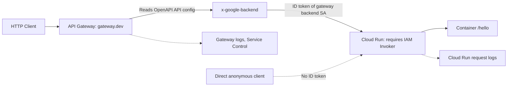

# Calling a Protected Cloud Run Backend Through API Gateway

> **Chapter:** API Gateway and Apigee  
> **Module:** CLOUD_PROVIDERS_GCP  
> **Module Scope:** Explore Google Cloud from project organization, IAM, and VPCs to Compute Engine, GKE, Cloud Run, storage services, and databases. Through deployment scenarios, learners select services, protect resources, automate releases, and monitor reliability and cost.

An HTTP API running on **Cloud Run** often needs to serve many clients without allowing anonymous direct calls to the backend. **API Gateway** provides a shared entry URL, accepts requests according to an **OpenAPI** contract, applies supported API policies, and **authenticates to Cloud Run on behalf of the gateway** using a dedicated service account.

This lesson builds the **client → API Gateway → IAM-protected Cloud Run** architecture and highlights three easily confused security layers: **client authentication at the gateway**, **gateway authentication when calling the backend**, and Cloud Run **network ingress**. The hands-on section uses a simple Python backend and an OpenAPI 2.0 config, testing both a rejected direct path and a successful path through the gateway.

## Learning Objectives

After this lesson, you can:

1. Distinguish between **API**, **API config**, **gateway**, and **Cloud Run service** in a Google Cloud architecture.
2. Explain `x-google-backend`, `address`, `jwt_audience`, `path_translation`, and the Google-signed **ID token** flow.
3. Grant `roles/run.invoker` **on the exact backend** to the service account bound to the API config.
4. Understand why Cloud Run `--no-allow-unauthenticated` does not mean client access to the **gateway URL** is protected.
5. Deploy the backend, create an API config/gateway, and test both successful and failed call paths using `gcloud`/`curl`.
6. Diagnose 401/403/404/502/503 errors, inspect Cloud Logging, and control costs/cleanup.

## 1. Architecture and Components



| Component | Purpose | Scope |
|---|---|---|
| **API** | Groups API configs and the API's managed service | API Gateway project, managed globally |
| **API config** | OpenAPI spec, paths, backend routing, auth/quota policies, backend SA | Belongs to the API; create a new config when changing the spec |
| **Gateway** | Public HTTPS endpoint formatted `*.gateway.dev` deploying one API config | Resource in a supported **location** |
| **Cloud Run backend** | Actual HTTP application executing business logic | Region, `*.run.app` URL, and IAM |
| **Backend auth service account** | Identity used by the gateway to mint ID tokens for Cloud Run | SA created by the team and specified on the API config |

**Do not confuse a gateway with a load balancer.** API Gateway handles the API contract and configured API auth/controls; Application Load Balancer handles routing/networking/TLS/load balancing and integrates with Cloud Armor/CDN. **Apigee** is a broader API lifecycle management platform with proxies, policies, analytics, and developer products. This lesson focuses on **API Gateway** because the requirement is invoking an IAM-protected Cloud Run backend.

### 1.1. Two URLs, Two Access Policies

```text
https://my-gateway-xyz.gateway.dev/hello     → Client-facing URL
https://hello-backend-xyz.a.run.app/hello     → Cloud Run backend URL
```

The two URLs above are **illustrative only**—never construct hostnames manually. Obtain actual URLs from `gcloud api-gateway gateways describe` and `gcloud run services describe`.

When Cloud Run rejects anonymous callers, ordinary clients cannot call the backend URL directly. However, **the gateway URL can still be called publicly** if OpenAPI does not require an API key/JWT. This is the single most important takeaway of this pattern: **an IAM-protected backend does not automatically turn the gateway into a private API**.

## 2. Client Authentication vs. Gateway → Backend Authentication

| Layer | Question | Primary Control |
|---|---|---|
| **Client → Gateway** | Which clients are allowed to call `/hello`? | OpenAPI security: API key, JWT issuer/audience, appropriate quotas/limits |
| **Gateway → Cloud Run** | Does the gateway have permission to invoke the backend? | API config backend SA + Google-signed ID token + Cloud Run `roles/run.invoker` |
| **Cloud Run ingress** | Can the request reach the endpoint by network source/path? | `all`, `internal`, `internal-and-cloud-load-balancing`, and network architecture |
| **App authorization** | Which specific objects/orders can the client access? | Business permission checks in the app or an appropriate API management service |

### 2.1. Service Accounts Must Have Distinct Roles

For the lab there are four identities:

- **Deployer:** holds permissions to create Cloud Run, API Gateway, IAM bindings, and **`iam.serviceAccounts.actAs`** on referenced SAs.
- **Cloud Build identity:** builds source and writes artifacts/logs when deploying containers with `--source`.
- **Gateway backend SA:** set via `--backend-auth-service-account=...` when creating the API config, and **only needs Cloud Run Invoker** on the target service in the lab.
- **Cloud Run runtime SA:** identity of the **application code** when calling Cloud Storage, Cloud SQL, Secret Manager, etc.; not the identity used by the gateway to invoke the backend.

Do not use a single SA with `roles/editor`/Owner for every step. Nor is the **Google-managed API Gateway service agent** the SA address you pass to `--backend-auth-service-account`; API Gateway uses the **SA declared on the API config** to authenticate to the backend.

### 2.2. Cloud Run IAM: Grant to the Gateway, Not `allUsers`

```bash
gcloud run services add-iam-policy-binding "$RUN_SERVICE" \
  --project="$PROJECT_ID" \
  --region="$RUN_REGION" \
  --member="serviceAccount:$GATEWAY_SA" \
  --role="roles/run.invoker"
```

The binding should be granted **at the service level**, not project-wide. Never add `allUsers` when the goal is a backend accepting only authorized callers. If deploying the same image to another environment, use separate SAs and bindings following **least privilege**.

### 2.3. Why Does the Lab Set Cloud Run `ingress=all`?

`--ingress=all` allows API Gateway's **network path** to reach `run.app` directly; `--no-allow-unauthenticated` requires a **valid IAM identity**. API Gateway **is not automatically treated by Cloud Run as an internal source** or as an external Application Load Balancer. Setting `internal` or `internal-and-cloud-load-balancing` without a compatible ingress path can cause `403` even when the gateway SA has Invoker.

This creates an important distinction:

- **Identity protection:** anonymous direct callers are rejected; the gateway SA is allowed.
- **Strict network isolation:** **not yet achieved** with `ingress=all` alone; **other** principals holding Invoker on the service can still call it directly with a valid ID token.

If the architecture requires **zero direct invocation paths**, design additional network/perimeter controls, a compatible front door, and verify against product docs; never claim a backend is "network-private" solely because IAM is enabled.

## 3. OpenAPI Configuring Backend Authentication

API Gateway reads an OpenAPI document with Google extensions to determine the backend endpoint and how to process requests.

### 3.1. Key Fields

| Field | Meaning | Risk If Misconfigured |
|---|---|---|
| `x-google-backend.address` | HTTPS URL of the Cloud Run backend | 404/502 or calling the wrong service |
| `jwt_audience` (OpenAPI 2.0) | Audience of the ID token sent by the gateway to Cloud Run | Cloud Run rejects tokens with mismatched audience |
| `path_translation` | How client `/hello` maps to the backend path | App receives unexpected route or query parameters |
| `deadline` | How long the gateway waits for the backend | Timeout even though the backend may keep running |
| `x-google-allow: configured` | Allow only declared methods/paths through | Avoid accidentally forwarding undeclared routes |
| `securityDefinitions` / `security` | **Client-at-gateway** authentication policy | If omitted, clients can call the gateway publicly |

API Gateway **mints an ID token by default** when a backend has `address` and does not set `disable_auth: true`. For Cloud Run, explicitly set `jwt_audience` to the **base URL of the Cloud Run service** to avoid audience mismatches when switching to tag/revision URLs or backend addresses containing paths.

### 3.2. `APPEND_PATH_TO_ADDRESS` vs. `CONSTANT_ADDRESS`

```text
Gateway: GET /hello
Backend base URL: https://SERVICE-...run.app

APPEND_PATH_TO_ADDRESS:
  → https://SERVICE-...run.app/hello

CONSTANT_ADDRESS:
  → https://SERVICE-...run.app
     (path parameters may be converted to query params if applicable)
```

For HTTP APIs with multiple routes, `APPEND_PATH_TO_ADDRESS` is usually clearer. **At the root level**, `x-google-backend` defaults to `APPEND_PATH_TO_ADDRESS`; **at the operation level**, the default can be `CONSTANT_ADDRESS`. This lab always declares `path_translation: APPEND_PATH_TO_ADDRESS` explicitly so behavior does not depend on extension placement.

### 3.3. Tokens and `Authorization` Headers

When the gateway authenticates to the backend, it may **overwrite `Authorization`** with the ID token of the **gateway backend SA**, while moving the original client token to `X-Forwarded-Authorization`. If the API config validates client JWTs, verified claims can be read from the gateway-provided header, such as `X-Apigateway-Api-Userinfo` per the documentation.

**Never treat `X-Forwarded-Authorization` or the userinfo header as trustworthy on its own** if the application still has direct external call paths: the app must ensure requests only arrive from the authenticated gateway or apply an appropriate source/identity verification layer. When user authorization is needed, verify JWT/claims and business permissions properly; **the gateway's ID token does not represent the end user**.

## 4. Safe Lab Preparation

> **Cost and permission note:** Creating Cloud Run, Cloud Build, Artifact Registry, API Gateway, and invoking APIs may incur charges. Only work in an authorized **sandbox project** with Billing/budgets configured. No Google Cloud resources were created while authoring this article.

### 4.1. Illustrative Values

| Variable | Sample Value | Purpose |
|---|---|---|
| `PROJECT_ID` | `my-api-gateway-lab` | Sandbox project |
| `RUN_REGION` | `asia-northeast1` | Cloud Run region |
| `GATEWAY_REGION` | `asia-northeast1` | **Region supporting API Gateway** |
| `RUN_SERVICE` | `private-api-lab` | Cloud Run backend |
| `RUN_SA` | `run-runtime-lab@PROJECT_ID.iam.gserviceaccount.com` | Runtime identity |
| `GATEWAY_SA` | `gateway-backend-lab@PROJECT_ID.iam.gserviceaccount.com` | ID token identity when gateway calls backend |
| `API_ID` | `private-api-lab` | API Gateway API |
| `CONFIG_ID` | `private-config-v1` | First API config |
| `GATEWAY_ID` | `private-gateway-lab` | Gateway with HTTPS hostname |

**Do not use `asia-southeast1` for API Gateway in this example** merely because Cloud Run supports that region; supported region lists differ between the two products. Google Cloud documentation lists `asia-northeast1` for gateways. In real deployments, verify supported regions and organizational requirements before choosing backend/frontend locations.

### 4.2. Declare Variables and Read-Only Inventory

```bash
PROJECT_ID="my-api-gateway-lab"
RUN_REGION="asia-northeast1"
GATEWAY_REGION="asia-northeast1"
RUN_SERVICE="private-api-lab"
RUN_SA_NAME="run-runtime-lab"
GATEWAY_SA_NAME="gateway-backend-lab"
RUN_SA="$RUN_SA_NAME@$PROJECT_ID.iam.gserviceaccount.com"
GATEWAY_SA="$GATEWAY_SA_NAME@$PROJECT_ID.iam.gserviceaccount.com"
API_ID="private-api-lab"
CONFIG_ID="private-config-v1"
GATEWAY_ID="private-gateway-lab"

gcloud auth list --filter="status:ACTIVE"
gcloud projects describe "$PROJECT_ID" \
  --format="table(projectId,name,lifecycleState)"

# Check every name before creating; do not overwrite someone else's resources.
gcloud run services list --project="$PROJECT_ID" --region="$RUN_REGION"
gcloud api-gateway apis list --project="$PROJECT_ID"
gcloud api-gateway gateways list --project="$PROJECT_ID" --location="$GATEWAY_REGION"
gcloud iam service-accounts list --project="$PROJECT_ID"
```

If you lack read permissions, are in the wrong project, or a resource with that name already exists, **stop creating resources** and verify ownership. Never assign Admin/Owner roles to bypass controls.

### 4.3. Enable APIs When Authorized

```bash
# ONLY in a sandbox project authorized by your administrator.
gcloud services enable \
  apigateway.googleapis.com \
  servicemanagement.googleapis.com \
  servicecontrol.googleapis.com \
  run.googleapis.com \
  cloudbuild.googleapis.com \
  artifactregistry.googleapis.com \
  iam.googleapis.com \
  --project="$PROJECT_ID"
```

To deploy from source, the build identity must have the required build/push permissions, and you may need to specify a service account per policy. The deployer needs appropriate IAM permissions to manage Cloud Run, API Gateway, and `iam.serviceAccounts.actAs` on both SAs as required by each step. The Google-managed API Gateway service agent must retain the default permissions required by the product.

## 5. Create a Cloud Run Backend Allowing Only IAM Callers

### 5.1. Small HTTP Application

In the learner's sandbox directory, create `backend/app.py` and `backend/Dockerfile`. Do not create these files inside the course content directory.

**`backend/app.py`**

```python
import json
import os
from http.server import BaseHTTPRequestHandler, ThreadingHTTPServer


class Handler(BaseHTTPRequestHandler):
    def do_GET(self):
        if self.path not in ("/hello", "/healthz"):
            self.send_error(404, "Unknown route")
            return

        body = json.dumps({
            "message": "hello through API Gateway",
            "path": self.path,
        }).encode("utf-8")
        self.send_response(200)
        self.send_header("Content-Type", "application/json; charset=utf-8")
        self.send_header("Content-Length", str(len(body)))
        self.end_headers()
        self.wfile.write(body)


if __name__ == "__main__":
    port = int(os.environ.get("PORT", "8080"))
    ThreadingHTTPServer(("0.0.0.0", port), Handler).serve_forever()
```

**`backend/Dockerfile`**

```dockerfile
FROM python:3.12-slim
WORKDIR /app
COPY app.py .
ENV PYTHONDONTWRITEBYTECODE=1 PYTHONUNBUFFERED=1
USER 65532:65532
CMD ["python", "app.py"]
```

The app reads `PORT`, listens on `0.0.0.0`, and returns JSON at `/hello`. This is a lab; production requires pinning base-image digests, dependency scanning, tests, timeouts, and graceful shutdown.

### 5.2. Runtime SA and Deployment

```bash
# Create an SA dedicated to the lab; no Editor role needed.
gcloud iam service-accounts create "$RUN_SA_NAME" \
  --project="$PROJECT_ID" \
  --display-name="Private API lab runtime"

# Run inside backend/ containing app.py and Dockerfile.
gcloud run deploy "$RUN_SERVICE" \
  --source . \
  --project="$PROJECT_ID" --region="$RUN_REGION" \
  --service-account="$RUN_SA" \
  --ingress=all \
  --no-allow-unauthenticated \
  --max-instances=2 \
  --memory=512Mi --cpu=1

# Retrieve the ACTUAL backend URL; do not assemble hostnames manually.
BACKEND_URL="$(gcloud run services describe "$RUN_SERVICE" \
  --project="$PROJECT_ID" --region="$RUN_REGION" \
  --format='value(status.url)')"
printf 'Cloud Run backend: %s\n' "$BACKEND_URL"

gcloud run services get-iam-policy "$RUN_SERVICE" \
  --project="$PROJECT_ID" --region="$RUN_REGION"
```

**Expected:** service Ready, with no `allUsers` binding for `roles/run.invoker`. `--ingress=all` is **only** the network path choice for the lab; IAM still blocks anonymous callers. The runtime SA needs no Google Cloud API permissions since the code only returns JSON.

### 5.3. Negative Test: Call Cloud Run Directly Without a Token

```bash
# Direct path from a machine without an ID token: typically rejected by Cloud Run.
curl -i "$BACKEND_URL/hello"
```

Expect **no business 200 JSON** when calling **without** a token. Cloud Run may return `401` or `403` depending on the case; verify IAM and request context. If you see 200, check `allUsers`/Invoker IAM checks/OrgPolicy and actual configuration before proceeding.

## 6. Create the Gateway Backend Service Account

```bash
gcloud iam service-accounts create "$GATEWAY_SA_NAME" \
  --project="$PROJECT_ID" \
  --display-name="API Gateway backend auth lab"

# Allow the gateway SA to invoke the EXACT target service.
gcloud run services add-iam-policy-binding "$RUN_SERVICE" \
  --project="$PROJECT_ID" --region="$RUN_REGION" \
  --member="serviceAccount:$GATEWAY_SA" \
  --role="roles/run.invoker"

# Verify IAM was applied.
gcloud run services get-iam-policy "$RUN_SERVICE" \
  --project="$PROJECT_ID" --region="$RUN_REGION"
```

The person **creating the API config** must have permission to use this SA (`iam.serviceAccounts.actAs`/Service Account User) per organizational policy. Do not grant token creator/admin to everyone because API Gateway fails; resolve each permission error per the docs.

**Reality check:** even though the gateway accepts unauthenticated requests in the basic OpenAPI configuration in the next step, it uses the **gateway backend SA** to call Cloud Run. That is **service-to-service** authentication, not end-user authentication.

## 7. Create an OpenAPI 2.0 Config with the Right Backend URL and Audience

### 7.1. Create `openapi-run.yaml` in the Lab Directory

Use **Bash** to substitute the actual URL from `gcloud`; note `BACKEND_URL` must be the root service URL without a trailing `/hello`:

```bash
# Verify variables before generating config; never print tokens/secrets.
printf 'API=%s Backend=%s\n' "$API_ID" "$BACKEND_URL"

cat > openapi-run.yaml <<YAML
swagger: "2.0"
info:
  title: $API_ID
  description: Protected Cloud Run backend via API Gateway
  version: "1.0.0"
schemes:
  - https
produces:
  - application/json
x-google-allow: configured
x-google-backend:
  address: $BACKEND_URL
  jwt_audience: $BACKEND_URL
  path_translation: APPEND_PATH_TO_ADDRESS
  deadline: 30.0
paths:
  /hello:
    get:
      summary: Read a sample greeting
      operationId: hello
      responses:
        "200":
          description: A successful response
          schema:
            type: object
YAML
```

`x-google-backend.address` is the **backend address**, not the `gateway.dev` address; `jwt_audience` is the audience checked by Cloud Run. The API name in `info.title` should align with `API_ID` to avoid confusion when enabling the managed service and applying API key restrictions.

**Lab security boundary:** the OpenAPI spec above **does not yet require a client API key/JWT**. The gateway will accept unauthenticated requests once the endpoint is live. We use this configuration to **demonstrate an IAM-private Cloud Run backend**, and it must never be used as a template for exposing real data to the Internet. Section 9 shows how to add client-side protection.

### 7.2. Create the API Config

```bash
gcloud api-gateway api-configs create "$CONFIG_ID" \
  --api="$API_ID" \
  --openapi-spec="openapi-run.yaml" \
  --backend-auth-service-account="$GATEWAY_SA" \
  --project="$PROJECT_ID"

gcloud api-gateway api-configs describe "$CONFIG_ID" \
  --api="$API_ID" --project="$PROJECT_ID" \
  --format="yaml(name,state,gatewayConfig)"
```

`--backend-auth-service-account` binds the SA to the **API config** so the gateway mints ID tokens for the backend. If you hit `FAILED_PRECONDITION` or permission errors:

- Check that the SA exists and is not disabled.
- Check that the config creator has `actAs` and the required IAM roles.
- Check `roles/run.invoker` on the **Cloud Run backend**.
- Check that API Gateway/Service Management/Service Control APIs are enabled.
- Do not set `disable_auth: true` when gateway → backend auth is desired.

API configs take time to propagate; **do not create multiple configs concurrently for the same API** while an operation is still running. When changing the spec, create a **new config ID**, then update the gateway.

### 7.3. Enable the API's Managed Service

API Gateway generates a specific **managed service name** for the API; do not guess it from `API_ID` and `PROJECT_ID`:

```bash
gcloud api-gateway apis describe "$API_ID" \
  --project="$PROJECT_ID" \
  --format="yaml(name,managedService)"

MANAGED_SERVICE="$(gcloud api-gateway apis describe "$API_ID" \
  --project="$PROJECT_ID" \
  --format='value(managedService)')"
printf 'Managed service: %s\n' "$MANAGED_SERVICE"

# Enable ONLY a non-empty value belonging to this lab's API.
if [ -n "$MANAGED_SERVICE" ]; then
  gcloud services enable "$MANAGED_SERVICE" --project="$PROJECT_ID"
else
  echo "Managed service not ready yet; stop and inspect the API." >&2
fi
```

The managed service must be enabled to use API control features such as API keys. If the field is not present yet, do not manually construct a `*.apigateway.*.cloud.goog` string; re-read the API details or Console once the API/config finishes creating.

## 8. Create the Gateway and Test the End-to-End Flow

### 8.1. Deploy the Gateway

```bash
# Deploy the gateway in a region supported by API Gateway.
gcloud api-gateway gateways create "$GATEWAY_ID" \
  --api="$API_ID" \
  --api-config="$CONFIG_ID" \
  --location="$GATEWAY_REGION" \
  --project="$PROJECT_ID"

gcloud api-gateway gateways describe "$GATEWAY_ID" \
  --location="$GATEWAY_REGION" \
  --project="$PROJECT_ID" \
  --format="yaml(name,state,defaultHostname,apiConfig)"

GATEWAY_HOST="$(gcloud api-gateway gateways describe "$GATEWAY_ID" \
  --location="$GATEWAY_REGION" \
  --project="$PROJECT_ID" \
  --format='value(defaultHostname)')"
GATEWAY_URL="https://$GATEWAY_HOST"
printf 'Gateway URL: %s\n' "$GATEWAY_URL"
```

The gateway comes with a managed HTTPS URL; no custom DNS/certificate setup is needed when using the default hostname. Test only after the gateway is **ACTIVE**, the API config is ready, and the managed service is enabled.

### 8.2. Compare Three Requests

```bash
# (1) Call backend directly without token: must be blocked by Cloud Run IAM.
curl -i "$BACKEND_URL/hello"

# (2) Call /hello via API Gateway: gateway uses its dedicated SA to call backend.
curl -i "$GATEWAY_URL/hello"

# (3) Call a route NOT declared in OpenAPI:
curl -i "$GATEWAY_URL/not-listed"
```

| Test | Expected Result in Lab | Meaning |
|---|---|---|
| Direct backend `/hello` | `401/403` or rejected, **not** 200 business JSON | Cloud Run blocks anonymous callers |
| Gateway `/hello` | `200` with JSON `hello through API Gateway` | Gateway presents ID token; Cloud Run accepts Invoker |
| Gateway `/not-listed` | Rejected, typically `404` | `x-google-allow: configured` allows only declared routes |

**If API Gateway `/hello` returns 200 while you have not enabled client auth**, this **is not an IAM bug**: the backend is still protected from anonymous direct callers, but **the gateway URL is public**. Do not deploy real data before adding client authentication, quota/rate limiting, and appropriate protection policies.

### 8.3. Verify Only the Intended Principal Holds Invoker on the Backend

```bash
gcloud run services get-iam-policy "$RUN_SERVICE" \
  --project="$PROJECT_ID" --region="$RUN_REGION"

gcloud api-gateway api-configs describe "$CONFIG_ID" \
  --api="$API_ID" --project="$PROJECT_ID" \
  --format="yaml(state,gatewayConfig)"
```

Verify the gateway backend SA is exact, `allUsers` is absent from Cloud Run IAM, and an overly broad default SA is not used. If another user already holds `roles/run.invoker`, they can call directly with a valid token—evaluate against organizational policy and do not claim "only the gateway has access" without a full IAM inventory.

## 9. Adding Client → Gateway Authentication

### 9.1. An API Key Is Not Strong User Identification

An API key helps identify the **API-consuming project/application** and supports quotas, yet it is a copyable value; **never treat an API key alone as sufficient security for sensitive data**. For user data or privileges, use JWT/OIDC with appropriate issuer, JWKS, audience, and scope/claims; the backend must still enforce **business authorization**.

| Protection | Example | What Risk Does It Mitigate? |
|---|---|---|
| Gateway API key | Google Cloud API key restricted to the managed service | Identifies consumer project; rejects invalid keys |
| Gateway JWT/OIDC | Verify issuer/JWKS/audience in OpenAPI | Verifies caller at the API edge |
| Gateway → Cloud Run IAM | Google-signed ID token of gateway SA | Prevents anonymous direct calls to backend |
| Application authorization | Check order access per principal | Prevents valid users from reading others' data |
| Quotas/Monitoring | Quotas, feature-supported rate controls, alerting | Detects/caps abuse within designed thresholds |

### 9.2. Example Requiring an API Key in OpenAPI 2.0

For a separate exercise, add these two sections to a **new OpenAPI file**:

```yaml
# At root level (same indentation as paths):
securityDefinitions:
  api_key:
    type: apiKey
    name: key
    in: query
security:
  - api_key: []
```

After creating an **API key restricted to the managed API** in the Console and storing it per secrets policy, clients call:

```bash
# Key value must be supplied securely; NEVER commit to Git or logs.
# Test example; query keys may appear in URL logs/history.
curl -i --get "$GATEWAY_URL/hello" \
  --data-urlencode "key=$API_KEY"
```

**Do not edit the old config in place.** Create `openapi-run-key.yaml` from the version with the API key, then:

```bash
NEW_CONFIG_ID="private-config-key-v2"
gcloud api-gateway api-configs create "$NEW_CONFIG_ID" \
  --api="$API_ID" \
  --openapi-spec="openapi-run-key.yaml" \
  --backend-auth-service-account="$GATEWAY_SA" \
  --project="$PROJECT_ID"

gcloud api-gateway gateways update "$GATEWAY_ID" \
  --api="$API_ID" \
  --api-config="$NEW_CONFIG_ID" \
  --location="$GATEWAY_REGION" \
  --project="$PROJECT_ID"
```

Execute only after preparing client keys/restrictions, testing in staging, and having a config rollback plan. If you want **JWT**, add `securityDefinitions` with issuer, JWKS URI, audiences, and `security`; an API key does not automatically become a JWT.

## 10. Updating Backends, Audiences, and API Configs Safely

### 10.1. Changing Revisions/Tags Can Break the Audience

If OpenAPI points to a **tagged Cloud Run URL** or a custom path, `x-google-backend.address` may differ from the **service URL** Cloud Run expects as audience. In that case use:

```yaml
x-google-backend:
  address: https://TAG---SERVICE_HOSTNAME/hello
  jwt_audience: https://SERVICE_HOSTNAME
  path_translation: CONSTANT_ADDRESS
```

Use this pattern only when using tagged URLs; `SERVICE_HOSTNAME` is a placeholder to take from the real service. If unsure, **always use the base service URL** and the same URL for `jwt_audience` as shown in the lab.

### 10.2. Change Workflow

1. Build/test the Cloud Run revision; verify service IAM has not opened anonymous access.
2. Prepare a **new** OpenAPI config with the right backend address, jwt audience, routes, and client auth.
3. Create the API config, check status, and **update the gateway** to the new config.
4. Run smoke tests directly and through the gateway; check request logs, 4xx/5xx, and SLOs.
5. On error, update the gateway back to the retained previous config; also consider rolling back the Cloud Run revision if the backend changed.

**Rolling back an API config does not automatically roll back the database or Cloud Run revision.** Ensure schema compatibility and safe side effects across versions.

## 11. Layered Observability and Troubleshooting

### 11.1. Inspecting Logs Explorer

In **Cloud Logging → Logs Explorer**, filter API Gateway by resource:

```text
resource.type="apigateway.googleapis.com/Gateway"
resource.labels.gateway_id="private-gateway-lab"
resource.labels.location="asia-northeast1"
```

If the log shows `jsonPayload.responseDetails="via_upstream"`, the error originated from the **backend**; other values typically indicate errors from the gateway or layers before the backend. Inspect Cloud Run request/revision logs alongside it to pinpoint where HTTP 401/403 came from. Never log tokens, API keys, or sensitive payloads.

### 11.2. Troubleshooting Table

| Symptom | Possible Cause | Action |
|---|---|---|
| API config creation fails on SA | Gateway backend SA missing, disabled, or lacks `actAs` | Verify exact SA, permissions, and API service agent |
| Gateway creation fails | Unsupported region, API config not ACTIVE, quota | Check supported regions, config state, and operations |
| Direct backend returns 200 without token | IAM opened to `allUsers` or Invoker check disabled | Check Cloud Run IAM and org policies before continuing |
| Gateway returns 401/403 | Backend SA lacks Invoker, wrong `jwt_audience`; or gateway client auth denied | Inspect gateway `responseDetails`, Cloud Run logs, and OpenAPI |
| Cloud Run `ingress=internal` | Direct API Gateway traffic may not be treated as internal | Review ingress/network design; do not treat the flag as a copy of IAM |
| Gateway `/hello` returns 404 | Wrong route/`path_translation`, backend app route missing | Compare OpenAPI path against app handler and forwarded URL |
| Gateway returns 502/503 | Backend crash/not ready, timeout, networking, or config propagation | Inspect service health, gateway logs, and Cloud Run logs |
| Valid API key rejected | Managed service not enabled, wrong key restrictions | Check API title, managed service, and key restrictions |
| Gateway endpoint returns 200 to everyone | `security` not configured in OpenAPI | Add client auth appropriate to data sensitivity |
| API latency increases | Cloud Run cold start, gateway overhead, slow backend DB | Compare gateway vs. Cloud Run p95, min instances, and traces |
| Bill increases | Calls, transfer, Cloud Run instances, build/storage/logs | Audit Billing Reports, quotas, and gateway/API usage |

**Never grant `roles/editor` or `allUsers` to cure every 403.** If the gateway rejects a client API key/JWT at the frontend, fix client auth; if the gateway lacks Invoker when calling the backend, fix the **gateway backend SA**.

## 12. Cost, Security, and Choosing Apigee

### 12.1. Cost Items to Budget For

| Component | Cost Type |
|---|---|
| API Gateway/Service Control | API call volume and data transfer per pricing/region |
| Cloud Run | CPU, memory, request/instance billing, min instances, and egress |
| Cloud Build/Artifact Registry | Build minutes, image storage, and transfer |
| Cloud Logging/Monitoring | Log ingestion/retention and metrics per configuration |
| API keys/quotas/traffic control | Operational overhead of managing credentials and consumption policies |

**Budget alerts do not automatically stop spend**; test in a sandbox with low request counts and clean up gateway/backend resources when done. When the gateway and backend sit in different regions, account for latency and inter-region data transfer.

### 12.2. When Is API Gateway Sufficient?

**API Gateway** is suitable when you need a managed HTTPS facade, an OpenAPI contract, gateway–backend authentication, basic API keys/JWTs, and feature-supported quotas/monitoring.

**Apigee** is a better fit when an organization needs **API products, a developer portal, lifecycle governance, advanced policies, mediation/transformation, analytics/monetization**, and multi-backend API governance. Do not switch to Apigee just to fix a broken Invoker binding; nor should you force API Gateway to act as a full API product management platform when requirements exceed its scope.

## 13. Practice Exercises and Suggested Answers

### Exercise 1 — Two Call Paths

A Cloud Run backend has `--ingress=all --no-allow-unauthenticated`, and only the gateway SA holds Invoker. A client sends `GET /hello` without a token directly to `run.app` and via `gateway.dev` (OpenAPI has no client auth configured). What happens?

**Answer:** the direct call is rejected; through the gateway it **may return 200** because the gateway attaches the ID token of the SA that holds Invoker. The gateway is public at the client layer if no security policy is configured.

### Exercise 2 — Wrong Audience

OpenAPI `address` points to a revision tag URL, while `jwt_audience` is set to the tag URL instead of the Cloud Run service URL. The gateway gets 401. What should be fixed?

**Answer:** set `jwt_audience` to the service URL accepted by Cloud Run; use an explicit audience and verify service IAM. Do not use `disable_auth: true`.

### Exercise 3 — Overwritten Authorization Header

The application wants to read the client's original bearer JWT for authorization. After passing through the gateway, `Authorization` contains the gateway SA's ID token. Where is the client token?

**Answer:** the gateway may forward the original bearer token in `X-Forwarded-Authorization`; if JWT validation is configured, use the verified claims in the appropriate userinfo header. Never trust self-asserted headers if clients can reach the backend directly.

### Exercise 4 — Wrong Route

The gateway exposes `/hello`, and the backend handler only serves `/hello`. If `x-google-backend` is placed on the operation with default `CONSTANT_ADDRESS` and a base URL without a path, what happens?

**Answer:** the backend may receive `/` instead of `/hello`, resulting in 404. Explicitly declare `path_translation: APPEND_PATH_TO_ADDRESS` or route to the appropriate specific URL.

### Exercise 5 — Designing Production Protection

An API returns private order details per user. Is it secure enough to just turn on Cloud Run IAM and grant Invoker to the gateway SA? Propose two additional controls.

**Hint:** not enough; the gateway may still be public. Add JWT/OIDC client authentication at the gateway, **user/order-level authorization** in the app, and monitoring/quotas; an API key alone does not replace a JWT.

## 14. Cleanup: Follow Dependency Order

Delete only resources **created by this lab** after verifying ownership, confirming no live traffic remains, no other API configs share the API, and no consumers depend on the endpoint. Basic order: **gateway → API configs → API → permissions/SAs → Cloud Run service**.

### 14.1. Pre-Deletion Inventory

```bash
gcloud api-gateway gateways list \
  --project="$PROJECT_ID" --location="$GATEWAY_REGION"
gcloud api-gateway api-configs list \
  --api="$API_ID" --project="$PROJECT_ID"
gcloud api-gateway apis describe "$API_ID" \
  --project="$PROJECT_ID"
gcloud run services describe "$RUN_SERVICE" \
  --project="$PROJECT_ID" --region="$RUN_REGION"
```

### 14.2. Delete Lab-Owned Gateway Resources

```bash
# ONLY when the gateway no longer serves any clients.
gcloud api-gateway gateways delete "$GATEWAY_ID" \
  --project="$PROJECT_ID" --location="$GATEWAY_REGION"

# Delete EVERY config created solely by this lab, once unused by any gateway.
gcloud api-gateway api-configs delete "$CONFIG_ID" \
  --api="$API_ID" --project="$PROJECT_ID"

# If the API key exercise created a second version belonging to this lab:
# gcloud api-gateway api-configs delete "$NEW_CONFIG_ID" \
#   --api="$API_ID" --project="$PROJECT_ID"

# Delete the API only when no other gateways/configs share it.
gcloud api-gateway apis delete "$API_ID" --project="$PROJECT_ID"
```

If you created a **managed service** and API key solely for this lesson, clean/revoke them per your organization's Service Usage/API Keys guidance; **do not disable a managed service used by other clients**. Deleting the gateway does not automatically delete API keys from Credential Manager.

### 14.3. Remove IAM Bindings and Delete the Backend

```bash
# Remove only the binding granted specifically for this lesson.
gcloud run services remove-iam-policy-binding "$RUN_SERVICE" \
  --project="$PROJECT_ID" --region="$RUN_REGION" \
  --member="serviceAccount:$GATEWAY_SA" \
  --role="roles/run.invoker"

# Delete the service only if created exclusively for this lab and not shared.
gcloud run services delete "$RUN_SERVICE" \
  --project="$PROJECT_ID" --region="$RUN_REGION"

# Delete only lab-specific SAs, never the Google-managed service agent.
gcloud iam service-accounts delete "$GATEWAY_SA" \
  --project="$PROJECT_ID"
gcloud iam service-accounts delete "$RUN_SA" \
  --project="$PROJECT_ID"
```

The `cloud-run-source-deploy` repository/built images may be shared and are not necessarily deleted along with the service. Inventory remaining Cloud Build artifacts, Artifact Registry images, Cloud Logging, Service Control/Billing, and API keys; charges may update with a delay.

## 15. Pre-Production Checklist

| Check | Pass Criterion |
|---|---|
| **API contract** | OpenAPI paths/methods, backend address, and path translation are accurate |
| **Backend identity** | API config uses the right gateway SA; audience matches the service URL |
| **Backend IAM** | Cloud Run does not allow `allUsers`; Invoker granted to the right SA/resource |
| **Ingress** | Path from gateway to Cloud Run is compatible; IAM is not confused with network isolation |
| **Client auth** | API key/JWT/OIDC matches data sensitivity; business authorization lives in the app |
| **SA permissions** | Deployer, build, gateway, and runtime identities are separated |
| **Versioning/rollout** | New API config has a rollback plan; backend version is compatible |
| **Observability** | Gateway + Cloud Run logs, 401/403/5xx, p95, SLOs, and alerts |
| **Cost** | Budget covers Gateway/Service Control, Run, egress, images/logging |
| **Cleanup** | Never delete shared APIs/configs/SAs/keys |

## Key Takeaways

**API Gateway invokes an IAM-protected Cloud Run backend using an ID token of the SA bound to the API config.** Grant `roles/run.invoker` to this SA on the service and configure `x-google-backend` with the right `address`/`jwt_audience`/`path_translation`. Cloud Run `--no-allow-unauthenticated` stops anonymous calls to the **direct backend** but does not automatically protect the **gateway URL** from clients. Production requires client authentication, business authorization, logging, quotas, and ingress/network validation matching the real architecture.

## Official Reference Documentation

- [API Gateway — Getting started with Cloud Run](https://cloud.google.com/api-gateway/docs/get-started-cloud-run)
- [API Gateway — Secure backend services](https://cloud.google.com/api-gateway/docs/securing-backend-services)
- [API Gateway — Create an API config](https://cloud.google.com/api-gateway/docs/creating-api-config)
- [API Gateway — Deploy an API to a gateway](https://cloud.google.com/api-gateway/docs/deploying-api)
- [API Gateway — OpenAPI 2.0 extensions](https://cloud.google.com/api-gateway/docs/oasv2-extensions)
- [API Gateway — Backend path translation](https://cloud.google.com/api-gateway/docs/passing-data)
- [API Gateway — Use API keys](https://cloud.google.com/api-gateway/docs/authenticate-api-keys)
- [API Gateway — Authenticate users with JWT](https://cloud.google.com/api-gateway/docs/authenticating-users-jwt)
- [API Gateway — Troubleshoot](https://cloud.google.com/api-gateway/docs/troubleshoot)
- [Cloud Run — Restrict ingress](https://cloud.google.com/run/docs/securing/ingress)
- [Cloud Run — Service-to-service authentication](https://cloud.google.com/run/docs/authenticating/service-to-service)
- [Apigee — What is Apigee?](https://cloud.google.com/apigee/docs/api-platform/get-started/what-apigee)
