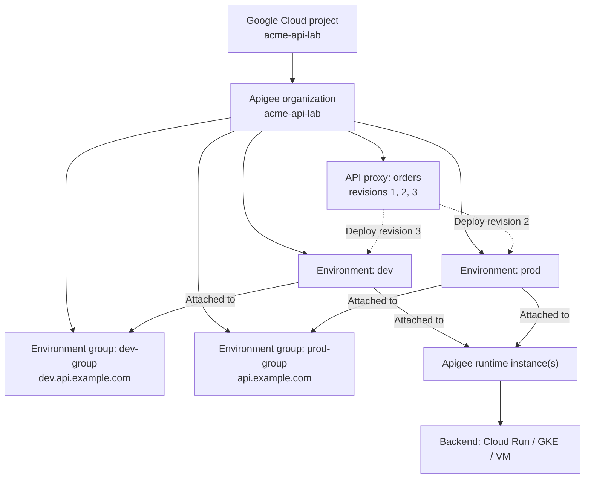
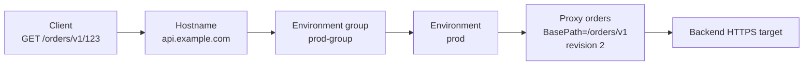
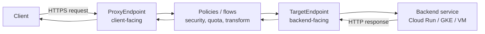
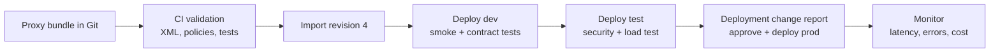

# Apigee Organizations, Environments, and API Proxies

## 1. Problem Statement and Objectives

A company operates three backends: **Cloud Run** for orders, **GKE** for inventory, and a legacy application on **Compute Engine**. External customers need to call a stable API at `https://api.example.com`, even though each backend has a different address and release mechanism. The platform team also needs to authenticate calling apps, limit traffic, monitor errors, and isolate development environments from production.

**Apigee** is Google Cloud's API management platform, placing an **API proxy** layer in front of backends. The proxy provides a stable interface for client applications and enables security, traffic management, transformation, routing, and analytics policies without implementing every cross-cutting concern inside each backend.

This lesson belongs to the **API Gateway and Apigee** chapter of the **CLOUD_PROVIDERS_GCP** module, connecting project organization, IAM, VPCs, Compute Engine, GKE, Cloud Run, storage/databases, CI/CD, reliability, and cost. It focuses on three core concepts—**organization, environment, API proxy**—and explains the **environment group**, which is required for hostname-based routing in Apigee.

### After This Lesson, You Can

1. Distinguish an **Apigee organization** from a **Google Cloud organization** and a **Google Cloud project**.
2. Explain **environment**, **environment group**, hostname, API proxy, base path, and backend target.
3. Describe the structure of **ProxyEndpoint, TargetEndpoint, flows, policies, and RouteRule**.
4. Understand why a proxy must have a **revision deployed** to an environment configured for routing.
5. Create a test reverse proxy via the Apigee UI, call it over a hostname, and inspect the result.
6. Use the **Apigee management API** to read organizations/environments/proxies/deployments.
7. Design dev/test/prod releases, IAM, authentication, observability, and cost optimization.

> **Conventions:** `acme-api-lab`, `api.example.com`, `dev.api.example.com`, and proxy names in this lesson are **hypothetical**. Apigee is a paid service, and provisioning environments/runtimes can incur charges even before API traffic arrives. Only practice modifications inside an **authorized lab Apigee organization**; never provision a new one without budget and approval.

## 2. Resource Map: Organization → Environment → Deployment



The arrows from proxy to environment represent **deployment**, not an ownership hierarchy. An API proxy is **defined inside the organization**; an environment is where a **revision** of the proxy is deployed. Environment groups manage hostnames; instances provide runtime capacity.

| Component | Responsibility | Example |
| --- | --- | --- |
| **Apigee organization** | Top-level scope holding proxies, environments, groups, API products, and management resources | `acme-api-lab` |
| **Environment** | Runtime context where revisions and environment-scoped resources are deployed | `dev`, `prod` |
| **Environment group** | Binds one or more hostnames to one or more environments for inbound routing | `prod-group` |
| **Runtime instance** | Apigee execution capacity in a supported region to which environments are attached | Instance in an appropriate region |
| **API proxy** | Defines the client-facing interface, policies, routes, and targets | `orders` |
| **Revision** | Numbered version of a proxy configuration | `orders` revision `3` |
| **Deployment** | Binds a proxy revision to an environment serving live traffic | `orders` rev 2 in `prod` |

**Core point:** Creating a proxy does not mean it is serving requests. It must be **deployed**; the environment must be attached to a **runtime instance** and at least one **environment group with a hostname** so the proxy can be reached over the network.

## 3. An Apigee Organization Is Not a Google Cloud Organization

An **Apigee organization** belongs to exactly **one Google Cloud project**; a project can have **at most one** Apigee organization. Both share an **identifier matching the Project ID**, yet they are **not the same resource type**. A Google Cloud organization (the Resource Manager layer above folders/projects) can contain many projects, including multiple Apigee organizations.

```text
Google Cloud organization: acme.example
  ├── Folder: platform
  │   ├── Project: acme-api-lab    → Apigee organization: acme-api-lab
  │   └── Project: acme-api-prod   → Apigee organization: acme-api-prod
  └── Project: acme-analytics     → Does not require an Apigee organization
```

### What Does an Organization Contain?

- **API proxies and revisions**: routing code and policies for APIs.
- **Environments, environment groups**, runtime instances/attachments.
- **API products, developers, developer apps**: manage how partner apps consume and are authorized to call APIs.
- Various configurations, analytics, and key-value maps scoped to the organization or environment.

**An organization is a governance scope, not an HTTP "endpoint."** Clients do not send requests to the organization name to call a backend. The hostname declared by an **environment group** forms the domain portion of the API URL.

### Governance Notes

1. An Apigee organization can be **evaluation** or **paid** (subscription/pay-as-you-go), with different limits and entitlements.
2. An organization name **cannot be changed after creation**; do not build automation assuming rename support.
3. Apigee integrates with Google Cloud IAM, but **Apigee** roles differ from permissions to access **Cloud Run/GKE/Cloud SQL**. Permission to edit a proxy does not automatically grant permission to manage backends.
4. When designing multiple orgs to isolate production, evaluate cost, analytics, CI/CD, developer apps, and multi-project governance; do not assume one org works for every environment or vice versa without analysis.

## 4. Environments, Environment Groups, and Hostnames

An **environment** is where a proxy revision is deployed. An **environment group** holds **hostnames** and a set of environments; Apigee uses the hostname plus **base path** to locate the proxy when a request arrives.

### Example Dev/Prod Separation

| Environment Group | Hostname | Members | Proxy Revision |
| --- | --- | --- | --- |
| `dev-group` | `dev.api.example.com` | `dev` | `orders` rev 3 |
| `prod-group` | `api.example.com` | `prod` | `orders` rev 2 |

A customer sends:

```text
https://api.example.com/orders/v1/123
        |_____________| |________| |_|
           hostname      basepath  resource path
```

The request is routed as follows:



**Do not misunderstand:** `prod` and `prod-group` **do not appear in the URL by default**; users typically see only hostname + base path + resource path. Naming an environment `catalog-prod` does not automatically create `/catalog-prod` in the URL.

### Important Routing Rules

- An environment must belong to **at least one environment group** for proxies deployed there to be reachable via the group's hostnames.
- An environment can belong to **multiple environment groups**; proxies can then appear under multiple hostnames.
- An environment group can contain **multiple environments** and **multiple hostnames**; each hostname serves proxies from member environments by base path.
- Hostnames within the same Apigee organization must be **unique across groups** and **wildcard hostnames are not supported**.
- **Base paths must avoid overlapping/shadowing** within the same hostname/group; a new deployment can alter routing for another proxy if base paths overlap.

For example, two proxies with base paths `/orders` and `/orders/v1` on the same hostname can cause requests to route to the more specific proxy. Changing a base path or deleting a deployment can **shift traffic to another proxy**. Always inspect the **deployment change report** before deploying a proxy into a shared group.

### An Environment Group Is Not a Per-Environment Load Balancer

A group can include multiple environments to aggregate a routing namespace; **a hostname is not exclusively bound to a single environment**. If a strict requirement states that host A must only invoke proxies in environment A, create a dedicated group containing only environment A and manage its hostname separately.

### An Environment Also Needs a Runtime Instance

With paid/provisioned Apigee, creating an environment is not enough: you must **attach the environment to a runtime instance**, then **attach the environment to an environment group**. In the **pay-as-you-go** model, attaching an environment to an instance may start incurring charges **before any traffic arrives**. Environment types (Base, Intermediate, Comprehensive) carry different features and pricing per plan; subscription plans have their own rules.

## 5. What Is an API Proxy and How Does It Process Requests?

An **API proxy** is an intermediary layer between clients and backends. Clients see a stable **proxy URL**; the backend can move from GKE to Cloud Run without necessarily changing the client contract, provided proxy routing/transformation preserves API behavior.



| Part of a Proxy Bundle | Function |
| --- | --- |
| **ProxyEndpoint** | Receives client requests, defines `BasePath`, flows, and routes |
| **TargetEndpoint** | Configures how to call the backend, e.g., `HTTPTargetConnection` |
| **RouteRule** | Selects a TargetEndpoint or URL based on conditions |
| **Policies** | Verify API Key, OAuth/JWT, quota, SpikeArrest, header/response transformations, etc. |
| **Flows** | Conditional steps and execution order in the request/response pipeline |
| **Shared flows / flow hooks** | Reuse common policies across multiple proxies when supported by the plan |
| **Resources** | JavaScript and runtime support files depending on proxy type |

**A proxy does not always have to forward to a backend**: it can return responses directly via policies/scripts or target integrations where supported. Still, for a typical reverse proxy, **ProxyEndpoint → TargetEndpoint → backend** is the standard path.

### Request/Response Flow

1. A request matching hostname/basepath enters Apigee at **ProxyEndpoint**.
2. The proxy request pipeline executes **PreFlow → conditional Flows → PostFlow**; security/traffic policies can reject immediately at the proxy.
3. `RouteRule` selects the **TargetEndpoint**.
4. The target request pipeline runs; Apigee sends the request to the backend.
5. The backend returns a response; the target response pipeline and proxy response pipeline can add/remove headers or transform payloads.
6. The client receives the final response; Apigee records analytics per product mode.

**Do not attach every policy mechanically to both request and response.** VerifyAPIKey typically belongs in the proxy request PreFlow to reject early; response transformations go where appropriate. Author and execute policies in a controlled order so unauthenticated requests never reach the backend.

## 6. XML Configuration Structure of an API Proxy

A traditional API proxy bundle has a structure roughly like:

```text
apiproxy/
  orders.xml
  proxies/
    default.xml
  targets/
    default.xml
  policies/
    Verify-Api-Key.xml
  resources/
    jsc/
      (optional scripts)
```

**This is an illustrative bundle layout**, not a ready-to-import ZIP. Root files, policies, and resources must follow Apigee schemas; you can create a proxy via the UI and export the revision to inspect the exact structure.

### 6.1. ProxyEndpoint Declaring BasePath and RouteRule

`apiproxy/proxies/default.xml`:

```xml
<ProxyEndpoint name="default">
  <PreFlow name="PreFlow">
    <Request/>
    <Response/>
  </PreFlow>
  <Flows/>
  <PostFlow name="PostFlow">
    <Request/>
    <Response/>
  </PostFlow>
  <HTTPProxyConnection>
    <BasePath>/orders/v1</BasePath>
  </HTTPProxyConnection>
  <RouteRule name="default">
    <TargetEndpoint>default</TargetEndpoint>
  </RouteRule>
</ProxyEndpoint>
```

### 6.2. TargetEndpoint Declaring the Backend

`apiproxy/targets/default.xml`:

```xml
<TargetEndpoint name="default">
  <PreFlow name="PreFlow">
    <Request/>
    <Response/>
  </PreFlow>
  <Flows/>
  <PostFlow name="PostFlow">
    <Request/>
    <Response/>
  </PostFlow>
  <HTTPTargetConnection>
    <URL>https://mocktarget.apigee.net</URL>
  </HTTPTargetConnection>
</TargetEndpoint>
```

Apigee's mock target is used in Google Cloud docs for practice, but **must not** be used as a production backend or assumed always available. When the target is a **Cloud Run service requiring authentication**, configuring the URL **is not enough**: you need an identity/token and `roles/run.invoker` for the proper principal (or another designed authentication path). When the target resides inside a VPC/private network, a supported network connectivity architecture is also required.

### 6.3. A Sample Policy: VerifyAPIKey

`apiproxy/policies/Verify-Api-Key.xml`:

```xml
<VerifyAPIKey name="Verify-Api-Key">
  <APIKey ref="request.header.x-api-key"/>
</VerifyAPIKey>
```

For the policy to take effect, add a `Step` in **ProxyEndpoint request PreFlow**:

```xml
<PreFlow name="PreFlow">
  <Request>
    <Step><Name>Verify-Api-Key</Name></Step>
  </Request>
  <Response/>
</PreFlow>
```

**Simply declaring `x-api-key` is not enough to call the proxy**: you must create an **API product**, a **developer app**, and approve the corresponding consumer key; verify the product covers the proxy/resource path. Never copy real API keys into docs, source code, or logs. An API key identifies the **client application**, not an individual end user like OAuth/OIDC; depending on the API, JWT/OAuthV2 policies may be needed.

### 6.4. Standard and Extensible Apigee Proxy Types

Under current Apigee pricing/feature models, proxies can be classified as **Standard** (standard policies only, feature-limited) or **Extensible** (supports extensible policies/flow hooks). Classification affects **entitlements, inclusion in API products, and cost** depending on your plan. **Do not assume every policy is available in every environment type**; verify actual entitlements before using Quota, VerifyAPIKey, or flow hooks in production.

## 7. Revisions, Deployments, and Change Lifecycle

Proxy definitions are saved as immutable **revisions** once deployed. Whenever you edit configuration, create a **new revision**; do not modify an already deployed revision and push it under the same revision number.

```text
orders revision 1  → dev (previously)
orders revision 2  → prod (currently running)
orders revision 3  → dev  (under test)
```

One proxy can be deployed to **multiple environments** at **different revisions**. Changing a revision in dev **does not automatically update prod**.

### Revision Replacement Behavior

- When deploying a new revision with the same base path to an environment running an older revision, Apigee deploys the new one before removing the old one to minimize downtime when **deployment succeeds**.
- Do not treat a new deployment as a "perfect automatic rollback" on failure. Per documentation, if a new deployment fails in certain scenarios, you may need to **redeploy the previous revision**.
- Changing base paths or routes in a **shared environment group** can affect other proxies even when backends are healthy.
- Deployments experience propagation latency to **runtime Message Processors**; a success response from the management API does not guarantee every runtime pod is updated instantaneously.
- Use a **deployment change report** to warn when a new base path shadows or alters existing routes.

**Controlled rollback:** retain a known-good revision, inspect deployment status, check canary/analytics metrics, then redeploy the verified revision. **Full undeploy** differs from rollback: it leaves the environment with **no active revision serving** that proxy.

## 8. Read-Only Inventory with the Apigee Management API

Assume you have a provisioned organization. Use an OAuth access token from the gcloud CLI **only inside an authorized shell session**—never paste tokens into tickets or commits.

```bash
# Bash / Cloud Shell - the following requests are READ-ONLY
ORG="acme-api-lab"
TOKEN="$(gcloud auth print-access-token)"

# Organization details
curl -sS -H "Authorization: Bearer $TOKEN" \
  "https://apigee.googleapis.com/v1/organizations/$ORG"

# List environments
curl -sS -H "Authorization: Bearer $TOKEN" \
  "https://apigee.googleapis.com/v1/organizations/$ORG/environments"

# List environment groups
curl -sS -H "Authorization: Bearer $TOKEN" \
  "https://apigee.googleapis.com/v1/organizations/$ORG/envgroups"

# List proxies and revisions (per API capabilities)
curl -sS -H "Authorization: Bearer $TOKEN" \
  "https://apigee.googleapis.com/v1/organizations/$ORG/apis?includeRevisions=true"

# Proxy deployments in the organization
curl -sS -H "Authorization: Bearer $TOKEN" \
  "https://apigee.googleapis.com/v1/organizations/$ORG/deployments"
```

`gcloud auth print-access-token` prints an OAuth **access token**, not an API key. The account needs appropriate Apigee **get/list** permissions; on 403, identify the exact missing permission instead of switching to an Owner account just to read quickly.

Receiving JSON from the API **does not replace checking individual revision state**: to confirm a proxy is fully deployed, check specific deployment status or inspect the Apigee UI. In organizations using **Apigee Spaces**, listing proxies may be scoped by Space/IAM; do not conclude an organization has no proxies just because your list is empty.

## 9. UI Lab: Create a Reverse Proxy Without Touching Production Backends

**Prerequisites:** an **already provisioned** Apigee organization and runtime, environment `dev` attached to an instance, and environment group `dev-group` with hostname `dev.api.example.com` properly configured with DNS/TLS. Do not create additional Apigee instances for this lab without budget approval.

1. Go to **Google Cloud Console → Apigee → Proxy development → API proxies** and select the right project/org.
2. Click **Create**, select the **Reverse proxy** template.
3. Enter **Proxy name** `orders-demo` and **Base Path** `/orders-demo` (verify no conflict with existing base paths).
4. Enter the demo target `https://mocktarget.apigee.net` per the Apigee tutorial; leave unneeded fields at defaults.
5. Create the proxy and confirm **revision 1** is created.
6. Select **Deploy** → revision 1 → environment **dev** → review service account if prompted → Deploy.
7. Check deployment status; do not assume it is active instantaneously.
8. Once the hostname is configured and the proxy is ready, send a test request:

```bash
# READ-ONLY HTTP from client side, using an actually routed lab hostname
curl -i "https://dev.api.example.com/orders-demo"
```

**Do not expect 200 for every target/path**: actual responses depend on the demo backend, target path, and TLS/DNS configuration. If you get 404/5xx, analyze hostname, basepath, revision, target status, and policies before making changes.

**Security note:** A demo proxy without VerifyAPIKey/OAuth attached must not be treated as safe for exposing real data APIs. Use the mock target and lab domain, then add appropriate protection policies and test thoroughly.

## 10. Managing Deployments via REST API

After creating `orders-demo` revision 1 in the UI, the platform team can use the Apigee Management API to inspect state before and after deployment.

### 10.1. Inspect Metadata and Current Deployments

```bash
# READ-ONLY, using ORG and TOKEN from section 8
API="orders-demo"
ENV="dev"
REV="1"

curl -sS -H "Authorization: Bearer $TOKEN" \
  "https://apigee.googleapis.com/v1/organizations/$ORG/apis/$API"

curl -sS -H "Authorization: Bearer $TOKEN" \
  "https://apigee.googleapis.com/v1/organizations/$ORG/apis/$API/deployments"

curl -sS -H "Authorization: Bearer $TOKEN" \
  "https://apigee.googleapis.com/v1/organizations/$ORG/environments/$ENV/apis/$API/revisions/$REV/deployments"
```

**Read-only commands do not create proxies or deploy revisions.** If `orders-demo`/`dev` does not exist in the org, the response may be 404; never treat an empty response body as proof of successful deployment.

### 10.2. Generate a Deployment Change Report Before Changing

```bash
# POST used to GENERATE A CHANGE REPORT; does not deploy the revision
curl -sS -X POST \
  -H "Authorization: Bearer $TOKEN" \
  "https://apigee.googleapis.com/v1/organizations/$ORG/environments/$ENV/apis/$API/revisions/$REV/deployments:generateDeployChangeReport"
```

The report can warn if **the new proxy's base path shadows or alters routing** for another proxy in the environment group. This step is especially important when a group contains **multiple environments sharing a hostname**.

### 10.3. Deploy a Revision via API

```bash
# MODIFIES PRODUCTION TRAFFIC if ENV is production!
# Run only on a lab environment after reviewing the report and getting approval
curl -sS -X POST \
  -H "Authorization: Bearer $TOKEN" \
  "https://apigee.googleapis.com/v1/organizations/$ORG/environments/$ENV/apis/$API/revisions/$REV/deployments"
```

If **another revision is already deployed** on the same base path, the API may require `?override=true`. This **does not** bypass validation or guarantee automatic rollback. Do not add `override=true` unconditionally in CI: verify the old revision, environment, and canary/rollback plan first.

Example with a tested new revision `REV=2`:

```bash
# ILLUSTRATIVE revision replacement; do not run arbitrarily on production
curl -sS -X POST \
  -H "Authorization: Bearer $TOKEN" \
  "https://apigee.googleapis.com/v1/organizations/$ORG/environments/$ENV/apis/$API/revisions/$REV/deployments?override=true"
```

After POST, **check deployment status** and call the API via the real hostname. Propagation to the runtime can take time; a 200 from the management API **does not mean all Message Processors are synced yet**.

## 11. Distinguishing Resources by Scope

Not all configurations are owned by the same proxy or environment level.

| Scope | Example Resources | Operational Implication |
| --- | --- | --- |
| **Organization** | API proxy definitions/revisions, API products, developers/apps, some KVMs/configs | Can share governance across multiple environments |
| **Environment** | Deployments, environment-scoped KVMs/caches/target servers, some config/security resources | Dev and prod can differ in endpoints, secret references, and target configs |
| **Environment group** | Hostnames, environment attachments, hostname/basepath routing | A group change can affect multiple environments |
| **Runtime instance** | Regional runtime processing capacity and environment attachments | Availability, network topology, and billable capacity |
| **Proxy bundle** | ProxyEndpoint, TargetEndpoint, policies, flows, and resources | The deployed revision must match target/env configs |

### Do Not Hard-Code Secrets or Production Addresses in Test Bundles

Externalize backend URLs, certificate references, or environment-specific values using **Apigee-supported configuration mechanisms**, such as **Target Servers, Key Value Maps (KVMs)**, and appropriate secrets/config stores. Separate read permissions for sensitive variables and use **encrypted KVMs** or supported secret protection solutions when needed. Do not treat a plain KVM as safe password storage without protection controls.

For example, an `orders` proxy can use:

```text
Environment dev:
  Target Server orders-backend → Test HTTPS endpoint

Environment prod:
  Target Server orders-backend → Production HTTPS endpoint

API proxy:
  TargetEndpoint references orders-backend
```

Thus the same proxy logic can deploy to multiple environments while routing to different backends. **Verify exact resource scope and ensure Target Servers are fully configured before deployment.**

## 12. Security: Admin IAM, API Keys, OAuth, and Backend Auth

Apigee sits between clients and backends, so there are **three separate permission layers**:

1. **Apigee administration:** who can create/edit proxies, environments, groups, and deployments (Google Cloud IAM/Apigee permissions).
2. **Client authentication/authorization:** which client apps or users may call which endpoints (API keys, OAuth/JWT, and policies).
3. **Apigee → backend authentication:** whether the proxy is allowed to invoke Cloud Run/GKE/VM/database (tokens/mTLS/networking and backend IAM).

| Mechanism | Purpose | What It Does Not Replace |
| --- | --- | --- |
| **VerifyAPIKey** | Validates consumer key and API product/app association | End-user authentication or business authorization |
| **OAuthV2 / JWT policies** | Verifies tokens, claims, and configured scopes/audience | Fine-grained database authorization |
| **Quota / SpikeArrest** | Manages consumption allowances and traffic spikes | Cloud Armor, comprehensive DDoS defense, or backend autoscaling |
| **Threat protection policies** | Inspects payloads/schemas to block certain attack patterns | Backend input validation and data controls |
| **TLS/mTLS** | Secures transport; optionally mutual certificate auth per architecture | IAM/GCP API permissions |
| **Apigee IAM** | Authorizes operators who deploy and administer Apigee | Customer API keys |

### CI/CD Permissions

The development team may have permission to **create/import revisions** but **not** to deploy to production; SREs or an approved release pipeline handle production deployments. Separate Apigee Admin, API Creator, environment-specific roles, and custom roles as needed. **Do not grant Organization Admin to every developer** just so they can view logs.

### Backend Authentication

When TargetEndpoint points to a **private Cloud Run service**, the HTTPS URL alone is not enough. The proxy runtime/deployment must obtain a **Google identity token with the right audience** using a service account holding `roles/run.invoker` (or another designed auth path). For GKE/Compute Engine backends inside a VPC, you also need **network connectivity, DNS, firewall rules, and a load balancer/private ingress**. When the target returns **403**, check **backend IAM and tokens** before rewriting all API policies.

### API Products and Developer Apps

An **API proxy** defines the HTTP processing layer. An **API product** defines a bundle of permitted APIs/resources and access conditions; a **developer app** subscribes to products to obtain credentials. Do not confuse them:

```text
API proxy     = /orders/v1 → backend + policies
API product   = Grants app access to /orders/v1/...
Developer app = Application with consumer key/secret attached to the product
```

**Feature note:** Under current Apigee Standard/Extensible classifications, not every proxy type is permitted in an API product. Always verify plan entitlements before deploying VerifyAPIKey on a given proxy type.

## 13. Connecting to Cloud Run, GKE, and Hybrid Backends

| Backend | Connectivity Path to Evaluate | Common Failures |
| --- | --- | --- |
| Public Cloud Run service | HTTPS, TLS, header forwarding, rate/concurrency | Backend 5xx, latency/cold starts |
| Authenticated Cloud Run service | HTTPS + identity token/SA/`run.invoker` | 401/403 from missing/wrong audience |
| GKE service | Ingress/Gateway/internal load balancer and Apigee → VPC path | DNS, firewall, health checks, Service with no endpoints |
| Compute Engine VM | HTTPS load balancer, routes, firewall, and backend health | VM IP change, 502/503 |
| On-premises | Hybrid connectivity (VPN/Interconnect/PSC per design) | MTU, split-horizon DNS, timeouts, certificates |

**Backend addresses do not dictate public URLs.** Clients call the environment group's hostname/basepath; Apigee determines the TargetEndpoint. This lets you swap backends while keeping the contract, yet **it does not automatically mask breaking changes in data, auth, or API responses** without proper transformations/versioning.

Apigee X (Google-managed) and Apigee hybrid differ in control plane/runtime/network architecture. Do not apply firewall or private connectivity instructions from one model to the other without consulting the official network architecture docs.

## 14. Analytics, Debug, and Separating Proxy Errors from Target Errors

Apigee provides analytics at **organization/environment/proxy** levels with performance, error, and traffic reports. Useful metrics include:

- **Requests and response codes** by proxy, environment, and hostname.
- **Proxy processing latency** and **target response latency**.
- **4xx/5xx** split into **proxy errors vs. target errors**.
- **API product/developer app usage** by granted capabilities.
- **Quota/throttling events** and backend impact.

In **Google Cloud Console → Apigee → Analytics**, choose the right environment and time range. For errors, **Error Code Analysis** distinguishes proxy-originated faults from backend errors. A target might return 500 while the proxy handles/falls back and returns 200; in that case target error counts and client-facing error counts **can differ**.

### Debug Sessions

In **Apigee → Proxy development → API proxies → select proxy → Debug**, start a debug session in a test environment and send requests. Debug shows **policy execution order, flow variables, RouteRule, TargetEndpoint, and faults** to pinpoint exactly where a request was rejected.

**Debug security:** Traces can contain headers, API keys, JWTs, PII, or payloads. Restrict roles, enable data masking, and use appropriate test data; never paste full production traces into public chats or tickets. Debug sessions have duration/request limits and are not durable audit storage.

**Analytics latency:** reporting data can lag (documentation notes up to roughly 10 minutes). During near-real-time incidents, cross-check **backend logs, load-balancer metrics, and API request traces**.

## 15. Dev → Test → Prod Release Pattern

A minimal workflow:



1. Keep proxy configurations in **Git** rather than relying solely on manual UI edits.
2. CI validates XML/policy references, routes/basepaths, credentials, and client compatibility.
3. **Import a new revision** into the organization and deploy to `dev`; run integration/smoke tests.
4. Validate API products/keys, OAuth/JWT, quota policies, and backend contracts in `test`.
5. Generate a **deployment change report** for `prod`, reviewing basepath collisions and quotas/entitlements.
6. Deploy the verified revision to `prod`; monitor statistics, SLOs, 4xx/5xx, and rollback readiness.
7. On failure, **redeploy a known-good revision**; do not delete the entire proxy just because a new deployment misses SLOs.

**Do not share a hostname between dev and prod environments unless you thoroughly understand environment group routing.** Attaching a new environment to a production group can expose that environment's proxies on the production hostname.

### Controlling Proxy Revision Changes

If `orders` rev 3 is running in prod and rev 4 is prepared:

```text
Before deploy:
  Host: api.example.com
  BasePath: /orders/v1
  Active revision: 3

After rev 4 deploys successfully:
  Host: api.example.com
  BasePath: /orders/v1
  Active revision: 4

Rollback:
  Redeploy revision 3 after compatibility checks
```

Do not interpret deploying rev 4 as creating a new `/orders/v4` URL: the **revision number** versions the proxy configuration, not the API version path. Public API versions like `/v1` or `/v2` are determined by your contract design.

## 16. Symptom-Based Troubleshooting

| Symptom | Possible Cause | Evidence and Remediation |
| --- | --- | --- |
| Newly created proxy cannot be called | Revision not deployed | Check deployments; deploy to an environment |
| Deployed successfully, but hostname returns 404 | Environment not attached to envgroup/runtime, DNS/TLS, or wrong basepath | Check group members/hostnames and runtime attachments |
| 404 on only one resource path | Proxy basepath matches, but route/backend resource is missing | Debug ProxyEndpoint and target path |
| One proxy "steals" traffic from another | Basepath conflict/overlap in the group | Deployment change report, revisions, path routing |
| Request fails with 401/403 at proxy | VerifyAPIKey/OAuth/JWT failure, invalid app/product | Debug policy execution and key/product status |
| Proxy passes, but backend returns 401/403 | Backend token/IAM, audience, service account | Target response/debug and backend logs |
| Proxy returns 429 | Quota/SpikeArrest or backend throttling | Policy fault, request analytics, quota config |
| Proxy returns 502/503/504 | Backend unavailable, timeout, network/SSL, or policy fault | Target status, VPC/LB/DNS, debug, logs |
| New revision deployment fails | Invalid bundle, missing resource, entitlement, or routing conflict | Deployment status, validation logs, revert revision |
| Analytics shows no data | Ingestion delay, wrong time range/env/hostname selected | Wait reasonably; inspect request logs/Debug |
| Cannot reach private GKE/VM | VPC connectivity, firewall, routes, DNS | Connectivity Tests and runtime network architecture |
| Cost increases despite low traffic | Billable environment attachments, proxy deployments, differing entitlements | Billing SKUs, environment/instance attachments |

### 6-Step Runbook

1. Confirm **org/project, hostname, environment group, environment, proxy name/basepath, and revision**.
2. Inspect **deployment status** and environment/group membership; verify DNS/TLS and ingress.
3. Use **Debug** to isolate whether the failure is in a ProxyEndpoint policy, RouteRule, TargetEndpoint, or the backend.
4. Correlate **client HTTP status, target status, analytics**, and backend logs.
5. Apply **one small, reversible fix**; if production is impacted, prioritize reverting to a verified known-good revision.
6. Verify with real requests, error rate/p95 latency, API product behavior, and cost metrics.

Never open the backend publicly, disable all policies, or grant Owner to "test quickly" before identifying the root cause.

## 17. Design Scenarios

### 17.1. Same Hostname, Multiple Backends

An organization wants `https://api.example.com` to serve:

| API | Apigee BasePath | Backend |
| --- | --- | --- |
| Orders | `/orders/v1` | Cloud Run |
| Inventory | `/inventory/v1` | GKE |
| Legacy billing | `/billing/v1` | Compute Engine |

Create three proxies, deploy them to environments inside the **same prod-group**, and ensure base paths do not overlap. Each proxy applies its own policies while reusing supported shared flows. The SRE team tracks proxy errors and target errors separately to distinguish Apigee issues from backend issues.

**Must verify:** hostname/TLS configuration, Cloud Run invoker identity, runtime connectivity to GKE/VMs, request latency, and cost per proxy deployment.

### 17.2. Partner API, Separate Dev and Prod

A partner tests APIs on `https://partner-dev.example.com`, while production uses `https://partner.example.com`:

1. Two environment groups with separate hostnames.
2. `partner-dev` holds sandbox backends and test credentials; `partner-prod` holds production backends.
3. API products/developer apps or credential management must ensure **test keys do not grant prod access by default**.
4. Revision promotion passes through contract tests, API key/JWT checks, rate limits, and basepath reviews.
5. Monitor logs/analytics per environment and partner/app, preserving privacy per policy.

**Do not treat different hostnames as a complete security boundary.** IAM, API products, tokens, backend data isolation, and rate limits must still be explicitly configured.

## 18. Exercises and Self-Check

1. **Distinguishing organizations:** A Google Cloud organization has 20 projects; three projects have Apigee provisioned. How many Apigee organizations exist? **Hint:** at most three, corresponding to the three projects; not identical to the Cloud Resource Manager organization.
2. **Parsing a URL:** For `https://api.example.com/orders/v1/123`, identify the hostname, basepath, and resource path. **Answer:** `api.example.com`, `/orders/v1`, and `/123`.
3. **Callability conditions:** You created a proxy and deployed rev 1 to `dev`, but `dev` is not in any envgroup. Why do requests fail to arrive? **Answer:** no hostname routing exists yet; attach it to an appropriate group and runtime instance.
4. **Routing across multiple environments:** `prod-group` contains `catalog-prod` and `orders-prod`. Two proxies share basepath `/v1`. State the risk and fix. **Hint:** routing conflict; use unique basepaths or separate hostnames/groups.
5. **Revisions:** Dev runs revision 5, prod runs revision 3. Does changing a revision in dev directly affect prod? **No**, aside from shared/group configs or backend changes outside the proxy.
6. **API key:** Only VerifyAPIKey XML was added, with no API product/developer app created yet. Can a client call with an arbitrary key? **No**; complete identity/product/approval configuration is required.
7. **Backend 403:** Debug shows ProxyEndpoint executed all policies, yet TargetEndpoint receives 403 from Cloud Run. Name three things to check. **Hint:** identity token, audience, and `roles/run.invoker`/backend IAM.
8. **Deployment change report:** A revision changes basepath `/orders` to `/orders/v1` in a group sharing a hostname. Why must you review the report? **Hint:** basepath matching and traffic may shift to another proxy.
9. **Cost:** Zero requests occurred all week, yet the Apigee bill still increased. What should you check? **Hint:** environment attachments/instances, deployment counts/plan, enabled features, Billing SKUs, and billing cycle.
10. **Read-only practice:** Use the REST API from section 8 to build a table of `environment → envgroup → hostname → proxy revision` for an org you are authorized to view; identify one undeployed proxy or one group without a hostname. Do not modify IAM or production in this exercise.

## 19. Production Deployment Checklist

- [ ] Distinguish Apigee organization from Google Cloud project/organization; confirm org/plan is provisioned.
- [ ] Each environment is attached to the right **runtime instance** and **environment group** with proper hostname/TLS/DNS.
- [ ] Verify hostnames are unique across groups, avoid wildcards, and prevent basepath overlap.
- [ ] API proxies have clear ProxyEndpoint, TargetEndpoint/RouteRule, and flow policies.
- [ ] Revisions are version-controlled; avoid manual runtime edits outside CI/CD.
- [ ] Use deployment change reports, testing, and rollback plans when promoting revisions.
- [ ] Dev/test/prod have real backend config and credential isolation, not just different hostnames.
- [ ] IAM separates developer, deployer, and prod release roles; avoid Owner for all CI jobs.
- [ ] API keys/OAuth/JWT/Quota are verified against plan entitlements; product/app registrations are complete where needed.
- [ ] Apigee → backend has TLS, authentication, network connectivity, and appropriate permissions.
- [ ] Configure Apigee Analytics, Debug masking, backend logs, request IDs, SLOs, and cost alerts.
- [ ] Test behavior for backend unavailability, deployment rollback, routing conflicts, and policy faults.
- [ ] Budget for attached environments, API calls, proxy deployments, networking/Logging, and plan tier.
- [ ] Maintain owners/runbooks, change audits, secrets/PII protection, and scheduled policy reviews.

## 20. Official Google Cloud Documentation

1. [Understanding Apigee organizations](https://cloud.google.com/apigee/docs/api-platform/fundamentals/organization-structure).
2. [About environments and environment groups](https://cloud.google.com/apigee/docs/api-platform/fundamentals/environments-overview).
3. [Working with environments](https://cloud.google.com/apigee/docs/api-platform/fundamentals/environments-working-with).
4. [Working with environment groups](https://cloud.google.com/apigee/docs/api-platform/fundamentals/environmentgroups-working-with).
5. [Understanding APIs and API proxies](https://cloud.google.com/apigee/docs/api-platform/fundamentals/understanding-apis-and-api-proxies).
6. [Understanding routes](https://cloud.google.com/apigee/docs/api-platform/fundamentals/understanding-routes).
7. [API proxy configuration reference](https://cloud.google.com/apigee/docs/api-platform/reference/api-proxy-configuration-reference).
8. [Create an API proxy](https://cloud.google.com/apigee/docs/api-platform/develop/ui-create-proxy).
9. [Deploy API proxy revisions](https://cloud.google.com/apigee/docs/api-platform/deploy/ui-deploy-new).
10. [API proxy deployment overview](https://cloud.google.com/apigee/docs/api-platform/deploy/ui-deploy-overview).
11. [Set up API key validation](https://cloud.google.com/apigee/docs/api-platform/security/setting-api-key-validation).
12. [Apigee Debug](https://cloud.google.com/apigee/docs/api-platform/debug/trace).
13. [Error Code Analysis dashboard](https://cloud.google.com/apigee/docs/api-platform/analytics/error-analysis-dashboard).
14. [Apigee REST API reference](https://cloud.google.com/apigee/docs/reference/apis/apigee/rest).
15. [Apigee pricing](https://cloud.google.com/apigee/pricing).

**Key takeaway:** An **Apigee organization** manages API resources within one Google Cloud project; an **environment** is where an **API proxy revision** is deployed; an **environment group** holds routing hostnames; and **ProxyEndpoint/TargetEndpoint** connects clients to backends. Operating APIs safely requires simultaneously controlling **routing, deployment, policies, IAM, backend connectivity, observability, and cost**—creating a proxy in the UI is only the first step.
