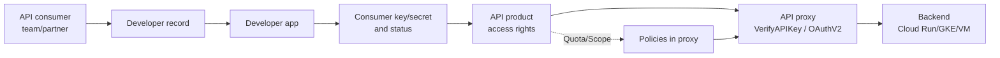
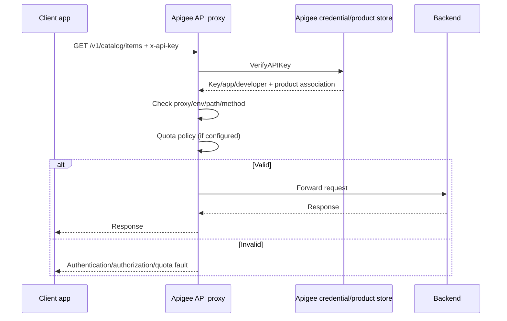
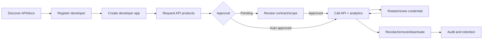

# API Products, Developer Apps, and the Consumer Lifecycle

An enterprise has exposed its product catalog API through **Apigee**, yet still cannot answer three operational questions: *which partner is allowed to call which endpoints, how many requests are they allowed, and how do we revoke access when a contract ends?* Having an API proxy and an HTTPS path **is not enough**. You must design **API products**, register **developer apps**, issue and govern **credentials**, and manage the entire **API consumer lifecycle**.

This lesson belongs to the **API Gateway and Apigee** chapter of the `CLOUD_PROVIDERS_GCP` module. Along the path from projects/IAM, VPCs, Compute Engine, GKE, and Cloud Run to storage, databases, automated releases, and reliability/cost, this content focuses on **managing API consumption permissions at the partner application level**. Examples use **Apigee** (with concepts shared with Apigee hybrid), which is distinct from **Google Cloud API Gateway**.

## 1. Learning Outcomes

After this lesson, you can:

1. Distinguish **API proxy**, **API product**, **developer**, **developer app**, **consumer key/secret**, and **API consumer**.
2. Design an API product restricting **proxies, environments, resource paths, HTTP methods, quotas, and OAuth scopes**.
3. Understand the difference between **public/private/internal visibility** and **runtime access permissions**.
4. Describe the lifecycle **register → approve → use → monitor → rotate keys → revoke/offboard**.
5. Create a product, developer, and app using the Apigee management API inside an **existing lab organization**.
6. Configure `VerifyAPIKey` or OAuthV2 to actually enforce credentials; attach a **Quota policy** when enforcing declared limits.
7. Diagnose failures when an app/key is pending, revoked, expired, or missing from the right API product.
8. Design onboarding, offboarding, auditing, and safe testing without leaking API keys.

**Practice scope limits:** do not create a new Apigee organization, environment, paid instance, or production proxy in this lesson. The lab requires an **existing Apigee organization**, a deployed test proxy, authorized administrative permissions, and an approved budget. The `POST`/`DELETE` operations in the examples have real side effects; run them only on lab resources you own.

## 2. Apigee Entity Model



| Entity | Function | What It Is Not |
| --- | --- | --- |
| **API proxy** | Front-door endpoint/flow in front of the backend executing policies | A record of consuming partners |
| **API product** | Bundle of API operations, proxies/resources, environments, quota/scopes, approval | A newly deployed proxy |
| **Developer** | Record of the organization/individual responsible for apps | A Google Cloud IAM account for deploying proxies |
| **Developer app** | Consumer application registered under a developer; links products and credentials | A Cloud Run/GKE workload or binary deployed by Apigee |
| **Consumer key** | Credential identifier of a developer app, usable as an API key or linked to OAuth tokens | Proof of an end user's identity |
| **Consumer secret** | Client secret used in applicable OAuth flows | Something sent on every API-key-only request |
| **Developer portal** | Experience for API discovery, docs, registration, and app management | Automatic runtime authentication enforcement |

**A developer can own multiple apps; an app can subscribe to multiple API products; an app can hold multiple key pairs.** Effective access depends on **developer status + app status + key status + product association + running policies**. Creating a product alone does not protect requests.

### 2.1. Distinguishing Apigee and API Gateway

**Google Cloud API Gateway** uses an API config (typically from OpenAPI) for routing and has appropriate auth/quota mechanisms; it is **not** a management store for API products, developer records, developer apps, and consumer key/secret pairs under Apigee's model. When a use case requires **self-service onboarding, entitlements/tiers, partner approvals, per-consumer API analytics, a portal, or monetization**, evaluate Apigee rather than assuming API Gateway shares the same management surface.

## 3. Designing an API Product with Least Privilege

A product can represent a **Catalog Read Trial** tier:

| Attribute | Example Value | Meaning |
| --- | --- | --- |
| Name | `catalog-read-lab` | Product ID, stable in governance |
| Display name | `Catalog Read Lab` | Human/portal-facing name |
| Environment | `test` | Test environment only |
| Proxy | `catalog-v1` | This proxy only |
| Proxy base path | `/v1/catalog` | Public base path of the proxy |
| Resources | `/items`, `/items/*` | Suffixes beneath the base path |
| Approval type | `manual` | Keys are created in pending state until approved |
| Access | `private` | Controls visibility/selection of the product on the portal |
| Product quota | 5 requests/minute | **Configured** metadata; requires a Quota policy to enforce |
| OAuth scopes | `catalog.read` if using OAuth | Not automatically enforced for plain API keys |

**API product resource paths are evaluated against `proxy.pathsuffix`, not the full URL.** If the proxy base path is `/v1/catalog`, then `/items` matches `/v1/catalog/items`; entering `/v1/catalog/items` as the resource suffix can cause authorization checks not to match. `/*` matches one sub-level, while `/**` matches multiple levels; test the root endpoint and specific methods individually.

### 3.1. Three Dangerous Configuration Mistakes

1. **Leaving `proxies` empty:** in the corresponding API product schema, the product can apply broadly to other proxies in the organization. Specify exact proxies.
2. **Leaving `environments` empty:** the product's access can apply across every environment, including production. Specify `test` for the lab.
3. **Setting `access=private` and thinking the API is now private:** `public/private/internal` mainly affects **discoverability/distribution** on the portal; it does not replace `VerifyAPIKey`, OAuth, or network restrictions.

**Separate read/write operations** when risk levels differ: use `operationGroup` to restrict HTTP methods, or create distinct products. Never apply the `/**` wildcard carelessly to administrative services.

### 3.2. A Product Is Not a Proxy Version

A proxy can deploy a new revision while the product retains its entitlement. Conversely, **editing permissions/paths/quotas on a product used by many apps** can impact consumers immediately. To launch a new tier, consider a **new product with a distinct ID** and migrate apps in batches rather than silently changing entitlements for all partners.

## 4. Approval, Status, and Effective Scope

| Layer | Status / Condition | Impact |
| --- | --- | --- |
| **Developer** | `active` or `inactive` | An inactive developer may be blocked from using issued credentials |
| **Developer app** | `approved` or `revoked` | A revoked app renders its keys invalid for calling the API |
| **API key** | `approved`, `revoked`, expired | Revoked/expired keys are rejected |
| **Key × API product** | `pending`, `approved`, `revoked` | Enables per-product control for the same key |
| **Product scope** | Proxy, environment, resource/method | Out-of-scope requests are blocked if the proxy validates credentials properly |
| **OAuth token** | Unexpired, valid scope, valid app/key | May require OAuthV2 checks; does not replace backend business authorization |

With `approvalType: auto`, key requests for the product are typically approved immediately. With `manual`, the key/product association stays **pending** until an admin approves it. You can revoke **only one API product from a key** without disabling the entire app.

**There is no "creating an app automatically protects the API."** The proxy must actually attach a credential-checking policy in the request flow and deploy that revision. Likewise, **approval status** does not mean the consumer has completed legal, contractual, or security review.

## 5. Runtime Authorization: How Requests Are Decided



Checkpoints:

- Does the consumer key exist and is it unexpired?
- Is the key approved for the matching product?
- Are the developer and app still active/approved?
- Are the proxy/environment/resource/method within allowed scope?
- If using OAuth, is the token valid with sufficient scopes?
- Do Quota/SpikeArrest policies block the request?

**API key authentication authenticates the application**, not the end user. If `GET /orders/{id}` must verify "does this user own this order," the backend or an authorization policy must enforce it separately (e.g., OAuth/JWT claims and tenant checks).

## 6. Product Quota: Definition vs. Enforcement

Setting `quota=5`, `quotaInterval=1`, `quotaTimeUnit=minute` on a product only **stores parameters**. To actually cap requests, the proxy needs a **Quota policy** and a well-defined counting strategy.

| Mechanism | Purpose |
| --- | --- |
| **Quota** | Limit request count over a period per consumer/product/operation |
| **SpikeArrest** | Smooth short-term spikes in request rate |
| **Backend concurrency/rate limit** | Protect the service, database, and shared dependencies |
| **Monetization rate plan** | Commercial billing model if enabled/entitled and configured |

An **operation-level** quota can take precedence over a product-level quota. Across multiple proxies/operations, understand the **counter scope**; never assume "1,000 requests/day" is a single org-wide counter. In real products, you can offer `basic` and `premium` tiers with identical endpoints but different allowances.

**SLO:** when rejecting due to quota, return a clear message/response consistent with the API contract rather than letting it surface as an HTTP 500 from the backend. Separate quota-violation metrics from application errors. An app rejected for unapproved credentials differs from an app exceeding quota.

## 7. End-to-End Consumer Lifecycle



Steps with clear **owners**:

| Stage | Consumer / Developer | API Publisher / Platform |
| --- | --- | --- |
| **Discover** | Reads docs, tests sandbox | Publishes product, OpenAPI, SDKs, terms |
| **Register** | Registers app identity/owner | Verifies developer, assigns portal permissions |
| **Request access** | Selects product/tier and callback URL if OAuth needed | Reviews scope, contract, risk classification |
| **Approve** | Receives credentials via secure channel | Approves key/product; never grants prod by default |
| **Use** | Keeps key secret, implements retry/backoff | Ensures policies, quotas, metrics, support |
| **Change plan** | Requests expanded scope/limits | Reviews product/operations, adjusts quota and audits |
| **Rotate** | Adds new key, shifts traffic, verifies | Allows brief overlap, revokes old key |
| **Offboard** | Stops calling, removes credentials from systems | Revokes product/key/app, retains evidence per policy |

**Do not delete developer/app records immediately upon ending a partnership if audit logs, disputes, or analytics still require correlation.** First revoke access; delete records only after retention/legal requirements are satisfied and dependencies are verified.

## 8. Lab: Prerequisites and Safe Preflight

**Assumptions:** an authorized Apigee organization already exists with a `test` environment, an API proxy `catalog-v1` deployed there with base path `/v1/catalog`, and a lab backend returning JSON for `GET /items`. The proxy has already been reviewed to attach `VerifyAPIKey` + `Quota` in the request flow; if not, the policy snippets in this lesson serve as a template for administrators to deploy through change control.

**Never run labs on production Apigee** or create an Apigee org just for learning, due to IAM/cost and network provisioning complexity. Use **Bash**, `gcloud`, `curl`, and `jq` in a lab directory separate from this documentation repository.

### 8.1. Set Variables

```bash
ORG="YOUR_AUTHORIZED_APIGEE_ORG"
ENV="test"
PROXY="catalog-v1"
PRODUCT="catalog-read-lab"
DEV_EMAIL="your-controlled-lab-email@example.com"
APP="catalog-consumer-lab"

API="https://apigee.googleapis.com/v1"
# Real URL of the authorized test environment group hostname:
GATEWAY_BASE="https://YOUR_APIGEE_TEST_HOST"

gcloud auth list
gcloud --version
jq --version
```

**Do not proceed** while placeholders remain. The developer email must be one you control, lowercase, and permitted for use; an Apigee org **does not necessarily share the project ID**. Product/app names must not collide with objects owned by other teams.

### 8.2. Read Existing Resources (Without Modifying Configs)

```bash
TOKEN="$(gcloud auth print-access-token)"

curl -fsS -H "Authorization: Bearer $TOKEN" \
  "$API/organizations/$ORG/environments/$ENV"

curl -fsS -H "Authorization: Bearer $TOKEN" \
  "$API/organizations/$ORG/apis/$PROXY"

curl -fsS -H "Authorization: Bearer $TOKEN" \
  "$API/organizations/$ORG/apiproducts"

curl -fsS -H "Authorization: Bearer $TOKEN" \
  "$API/organizations/$ORG/developers"
```

This access token is for the **Apigee management API**, distinct from the **consumer key** an app sends to the proxy runtime. GET requests are read-only, though responses may contain organizational metadata; never paste raw internal outputs into public issues.

Verify the proxy is in the **right environment**, has a healthy deployment, and is approved for lab use. On `403` from the management API, request minimal permissions through an admin—do not grant Organization Admin to all learners.

## 9. Lab A — Create a Scoped API Product

The following example uses a **private product + manual approval**, tight enough for a lab consumer. The product applies only to `catalog-v1` in `test`, for `/items` and `/items/*`; illustrative quota is **5 requests/minute**.

Create `product.json` in your lab directory (not a new file in the repository):

```bash
cat > product.json <<'JSON'
{
  "name": "catalog-read-lab",
  "displayName": "Catalog Read Lab",
  "description": "Lab product: GET catalog items in test",
  "approvalType": "manual",
  "attributes": [
    {"name": "access", "value": "private"}
  ],
  "environments": ["test"],
  "proxies": ["catalog-v1"],
  "apiResources": ["/items", "/items/*"],
  "quota": "5",
  "quotaInterval": "1",
  "quotaTimeUnit": "minute"
}
JSON
```

**Design note:** product JSON in this basic schema does not restrict **HTTP methods**. To create a genuinely **read-only** package, define operations + methods (via `operationGroup`) or restrict methods in the API proxy. Writing "GET" in the description **does not** create a read-only policy.

Once you confirm the product does not exist yet, proxy/environment are correct, and you have `apigee.apiproducts.create`:

```bash
# WRITE: only in an authorized LAB Apigee organization.
curl -fsS -X POST \
  -H "Authorization: Bearer $TOKEN" \
  -H "Content-Type: application/json" \
  --data-binary @product.json \
  "$API/organizations/$ORG/apiproducts"
```

Readback:

```bash
curl -fsS -H "Authorization: Bearer $TOKEN" \
  "$API/organizations/$ORG/apiproducts/$PRODUCT" \
  | jq '{name, approvalType, environments, proxies,
         apiResources, quota, quotaInterval, quotaTimeUnit}'
```

**Do not leave `environments` or `proxies` blank**: under the corresponding product schema, leaving them blank can broaden the APIs/environments an app can access once its credentials are valid.

## 10. Lab B — Register a Developer and Developer App

A **Developer** represents the party owning the client integration. It holds an email, name, and status, distinct from a Google Cloud user account authorized to edit the Apigee organization.

### 10.1. Create a Lab Developer

Use a real email you control and a username matching your organization's naming rules:

```bash
cat > developer.json <<EOF
{
  "email": "$DEV_EMAIL",
  "firstName": "Lab",
  "lastName": "Consumer",
  "userName": "cataloglabconsumer"
}
EOF

# WRITE: create developer; run only if the email is not already registered.
curl -fsS -X POST \
  -H "Authorization: Bearer $TOKEN" \
  -H "Content-Type: application/json" \
  --data-binary @developer.json \
  "$API/organizations/$ORG/developers"
```

A new developer typically starts **active**; status can be toggled to **inactive** via the management API or governance workflows. Never use a real partner's email to create test records.

### 10.2. Create an App Bound to the API Product

Create `app.json` with a **1-day key expiration** for the lab (in milliseconds):

```bash
cat > app.json <<'JSON'
{
  "name": "catalog-consumer-lab",
  "apiProducts": ["catalog-read-lab"],
  "keyExpiresIn": "86400000"
}
JSON

# ONLY in LAB environment. Output may contain consumer key/secret.
umask 077
curl -fsS -X POST \
  -H "Authorization: Bearer $TOKEN" \
  -H "Content-Type: application/json" \
  --data-binary @app.json \
  "$API/organizations/$ORG/developers/$DEV_EMAIL/apps" \
  -o app-created.private.json

chmod 600 app-created.private.json
```

App creation can auto-generate a **consumer key/secret**. Never commit `app-created.private.json`, print the raw response into logs/CI, or send keys/secrets via chat or issues. API keys may have no expiration if you omit `keyExpiresIn` or set `-1`, so production should design explicit lifetimes/rotation.

**Readback printing only status, never secret credentials:**

```bash
jq '{name, status, keyStatuses:
     [.credentials[]? | {status,
       apiProducts: [.apiProducts[]? | {apiproduct, status}]}]}' \
  app-created.private.json
```

Verify the **app identity**, product association, and `pending` state when the product requires manual approval. In the Apigee UI, open **Distribution → Apps** to inspect/manage credentials per permissions; note the integrated portal has limitations for apps with multiple credentials.

## 11. Lab C — VerifyAPIKey and Quota Policies on the Proxy

You cannot just create a product/app and test with curl if the proxy does not yet **enforce credentials**. A sample XML policy using the `x-api-key` header:

```xml
<VerifyAPIKey name="VK-Catalog">
  <APIKey ref="request.header.x-api-key"/>
</VerifyAPIKey>
```

A sample Quota policy **reading parameters from the API product** after VerifyAPIKey succeeds:

```xml
<Quota name="Q-Catalog">
  <Interval ref="verifyapikey.VK-Catalog.apiproduct.developer.quota.interval">1</Interval>
  <TimeUnit ref="verifyapikey.VK-Catalog.apiproduct.developer.quota.timeunit">minute</TimeUnit>
  <Allow count="5"
         countRef="verifyapikey.VK-Catalog.apiproduct.developer.quota.limit"/>
  <Identifier ref="verifyapikey.VK-Catalog.client_id"/>
</Quota>
```

In the proxy request flow, **VerifyAPIKey must run before Quota** so product/key flow variables are populated. Snippet showing how to attach `Step` entries in the request PreFlow:

```xml
<PreFlow name="PreFlow">
  <Request>
    <Step><Name>VK-Catalog</Name></Step>
    <Step><Name>Q-Catalog</Name></Step>
  </Request>
  <Response/>
</PreFlow>
```

These XML snippets are **policy/flow excerpts**, not a complete proxy bundle. Administrators must add policy files in the right folders, attach them to the real ProxyEndpoint, deploy the revision to `test`, and verify deployment. Never test on a production proxy in this lab.

**Required test cases:**

- Missing `x-api-key` → blocked.
- Invalid/revoked/expired key → blocked.
- Valid key, but outside product resource/proxy/environment → blocked.
- Valid key, in scope, and approved → backend receives request.
- Exceeding quota → Quota policy raises a violation per configuration.

Do not use `SpikeArrest` as a substitute for tier quotas. If you configure quota only on the product and forget `Q-Catalog`, the backend can still receive requests beyond the limit.

## 12. Lab D — Approve the Key and Test Access

Because the product was created with `approvalType: manual`, the key may be `pending`. Approve it from **Apigee UI → Distribution → Apps → lab app → Credentials → product → Approve** after verifying the usage request.

The Management API supports approving/revoking **a single product association on a key**:

```text
POST /v1/organizations/ORG/developers/EMAIL/apps/APP/
     keys/CONSUMER_KEY/apiproducts/PRODUCT?action=approve
```

This is an **endpoint pattern**; invoke only with approved `apigee.appkeys.manage` permission and the exact app/product key. Avoid printing consumer keys in terminal history or shared logs. After approval, confirm status via the Apigee UI or a controlled GET app call; **never treat an HTTP 2xx from the management API as proof that the proxy is enforcing policies**.

### 12.1. Call Runtime via the Test Hostname

Load the key from the private file into a shell variable without printing it:

```bash
APP_KEY="$(jq -r '.credentials[0].consumerKey // empty' \
  app-created.private.json)"

# Run only when APP_KEY is non-empty, credential is approved,
# test proxy has VerifyAPIKey, and GATEWAY_BASE is a real hostname.
curl -i -sS \
  -H "x-api-key: $APP_KEY" \
  "$GATEWAY_BASE/v1/catalog/items"
```

For an endpoint not permitted by the product:

```bash
curl -i -sS \
  -H "x-api-key: $APP_KEY" \
  "$GATEWAY_BASE/v1/catalog/admin"
```

**Expected:** `GET /items` reaches the backend if the app/key is approved and policies are configured correctly; `/admin` is denied due to product scope. Exact HTTP error codes depend on policy/fault handling. If both succeed, check policy flow, product paths, and credential validation; **do not assume access is restricted simply because a product exists**.

### 12.2. Test Quota on Test Traffic

If the proxy is dedicated to the lab and does not share counters with other consumers, send a few slow calls to observe the 5/minute quota. Never stress-test production endpoints. Limits may depend on **counter scope, window/reset timing, and deployed policies**. Stop once you observe the quota violation; never loop infinitely or evade quotas by creating extra keys.

**Evidence table:**

| Test Case | Before Approval | After Approval |
| --- | --- | --- |
| Valid key, `/items` path | Blocked as pending | Allowed when policy & backend healthy |
| Missing or invalid key | Blocked | Blocked |
| Valid key, `/admin` path | Blocked | Blocked as outside product |
| Request exceeding quota | Does not reach backend | Quota violation when Quota policy active |
| Key after revocation | Blocked | Blocked |

## 13. Rotation, Revocation, and Offboarding

### 13.1. Zero-Downtime Rotation

For a consumer using an active key K1:

1. Identify the app owner, product associations, expiry, scope, and everywhere K1 is configured.
2. Create a **new key K2** on the *same developer app* via UI/API; key K1 stays active during an approved overlap window.
3. Ensure K2 is **approved** for the exact same API products without granting unintended access.
4. Distribute K2 via a secret store/secure channel; update the application and verify traffic/analytics.
5. Watch K1 usage drop to 0, then **revoke K1**; verify requests with K1 are blocked.
6. Record timestamp, operator, apps, products, and incident/change ticket.

**You cannot modify the expiration of an existing key** after creation per the API schema; if a different lifetime is needed, issue a **new key**. Multiple credentials on one app are supported in the Apigee API/UI, though the **integrated developer portal** has limitations for multi-credential apps—check portal workflows before rolling out broad rotation processes.

### 13.2. Revoking with Minimal Blast Radius

| Requirement | Preferred Action |
| --- | --- |
| Remove only `catalog-read` access | Revoke/remove the credential's **product association** |
| Key K1 leaked | Revoke K1, issue K2, review logs and impact |
| Temporarily suspend entire app | Revoke the **developer app**; keys may remain in records but cannot call APIs |
| Developer/partner leaves program | Consider deactivating the developer after revoking apps/keys |
| Product retired | Notify consumers, migrate apps, and delete the product last |
| Wrong permissions granted | Fix scope/product, audit keys, and review all affected apps |

**Do not delete records before preserving evidence:** needed for audits, abuse analysis, disputes, and retention. Revoking an API key **is not a backend data deletion mechanism**; data, tokens, and active sessions must be handled under separate policies.

### 13.3. OAuth Tokens After Revocation

OAuth access tokens have **their own lifecycle and entitlements**. When revoking an app/key, verify how **VerifyAccessToken** behaves on already-issued tokens and, when required, proactively revoke tokens per policy. Never assume rotating a consumer secret immediately invalidates all existing access tokens; design short TTLs, refresh rotation, and incident response steps.

## 14. OAuth, Scopes, and Protecting End Users

An **API key** identifies a **client app**; if endpoints expose personal data or require user/tenant delegation, use OAuth/OIDC/JWT per approved architecture.

| Need | Typical Mechanism |
| --- | --- |
| Request metrics per consumer app | VerifyAPIKey + analytics dimensions |
| Server-to-server with scoped permissions | OAuth 2.0 client credentials + VerifyAccessToken |
| App acting on behalf of a user | OAuth/OIDC authorization code + PKCE where supported |
| Fine-grained behavior control | Scopes/claims + authorization checks at proxy/backend |
| Abuse and burst protection | Quota, SpikeArrest, WAF/Advanced API Security per plan |
| Partner-tiered policies | Product tiers + app credentials/approval + audit |

`scopes` on an API product declare which OAuth permissions are permitted/checked—they **do not turn an API key into a scoped token**. OAuthV2 and related policies must actually validate the access token. Granting `catalog.read` does not inherently authorize reading *every tenant's* data; enforce business authorization and never trust client-asserted headers.

## 15. Developer Portal and Consumer Experience

A well-run developer portal reduces manual support while preserving governance:

1. **Documentation:** product purpose, base URL, paths/methods, response examples, auth, errors, and quotas.
2. **Discovery:** public products are surfaced to intended audiences; private/internal visibility does not grant runtime permissions.
3. **Registration:** verify developer identity and ownership; guard against spam signups if public.
4. **App onboarding:** describe app name, test/prod environments, callback URLs if OAuth needed, and approval status.
5. **Self-service:** view usage, generate/request credentials per policy; contact support for 403/429 issues.
6. **Deprecation:** announce version/product changes, migration guides, and sunset dates.
7. **Offboarding:** revoke access while retaining necessary audit metadata.

Never treat a developer's email as a Google Cloud IAM identity by default. A developer portal account, an Apigee developer record, a GCP IAM principal, and a backend end user are **four distinct identity layers** requiring clear mapping and controls.

## 16. Analytics, SLOs, Security, and Cost

Useful dimensions in **Apigee Analytics**: `api_product`, `developer_app`, `developer_email`, `api_proxy`, `response_status_code`, environment, and time. For accurate consumer dimensions, the proxy must run **VerifyAPIKey/OAuthV2** and map keys/tokens to an app/product; otherwise some dimensions may appear as `(not set)`.

| Goal | Signals / Measures |
| --- | --- |
| **Adoption** | Approved developers/apps, apps generating actual traffic |
| **Reliability** | Success rate, p95/p99 latency, 5xx, and target latency per product |
| **Policy correctness** | Invalid keys, pending, revoked, quota violations |
| **Security** | Key anomalies/abuse, IAM changes, approvers, overdue rotations |
| **Experience** | Time-to-first-call, onboarding approval latency, support tickets |
| **FinOps** | Apigee subscription/PAYG, API calls, policy entitlements/add-ons, logs, backend egress |
| **Monetization** | Rate plans/subscriptions/billing if available and configured |

**Never log raw consumer keys/secrets or OAuth tokens in application logs, traces, dashboards, or analytics exports.** When keys must be passed to the proxy, prefer HTTP headers over query parameters since query parameters can appear in URL logs. Always enforce HTTPS.

### 16.1. Minimum Controls

- Separate **test/prod** Apigee environments, using separate products and keys where appropriate.
- Explicitly specify proxies, resources, HTTP methods, and environments.
- Scope permissions for managing products/apps/keys by least privilege; enforce four-eyes approval for sensitive production tiers.
- Never grant Apigee Org Admin just to run management GET requests.
- Give keys expiration/rotation, store them in secret stores, scope them properly, and maintain an emergency leak runbook.
- Backends must still enforce authorization/tenant isolation and network controls.
- Audit changes: who approved or revoked which key, when, and under which ticket.

## 17. Layered Troubleshooting

| Symptom | Possible Cause | What to Check |
| --- | --- | --- |
| Product created, yet API works without a key | Proxy lacks VerifyAPIKey/OAuthV2 or policy not deployed | Apigee Debug, proxy revision/flows |
| Newly created app cannot call yet | `manual` product leaves credential **pending** | App credentials / product approvals |
| Valid key rejected on a path | `apiResources` matches **proxy.pathsuffix**, mismatch | Base path, suffix, resource wildcards |
| Test key works in prod | Product left `environments` blank or wrong governance scope | Product environment restrictions |
| Key works on another proxy | Product lacks proxy restriction or misconfigured policy | Product `proxies` and VerifyAPIKey flow |
| Quota set to 5/min, yet higher traffic succeeds | Quota only on product, missing policy, or wrong counter scope | Proxy Quota policy, deployment, flow variables |
| Two apps unexpectedly share a quota | Missing/wrong Identifier or shared counter scope | `client_id`, product quota counter scope |
| Key rejected after rotation | K2 pending, expired, app revoked, or product not attached | Key/app/developer status and expiry |
| Valid OAuth token lacks permission | Scope mismatch across token/policy/product | OAuthV2/VerifyAccessToken, app product |
| Backend returns HTTP 403 after policies pass | Backend IAM or tenant authorization | Proxy trace vs. backend logs |
| Management API returns 403 | Missing `apigee.*` IAM permission | Principal/token and exact required permission |
| Consumer cannot see product on portal | Product is private/internal or portal audience mismatch | Access visibility, portal configuration |
| Analytics missing `developer_app` | Proxy did not verify key/token or data unattributed | Policy placement, analytics dimensions |
| Traffic spike drives up costs | Retry storms, abuse, misconfigured quota/backoff | Apigee analytics, billing, and backend monitoring |

Never fix issues by making every product `public`, approving all keys blindly, or disabling `VerifyAPIKey`. Those changes weaken controls without resolving the root cause.

## 18. Real-World Scenario: Promoting a Consumer from Trial to Partner

An API team offers two tiers:

| Attribute | Trial | Partner |
| --- | --- | --- |
| Proxy | `catalog-v1` | `catalog-v1` and dedicated transaction endpoints |
| Resources | Catalog read-only | Catalog read + approved operations |
| Quota | 1,000/day | 10,000/day or per contract |
| Approval | Auto in sandbox | Manual after contract/KYC |
| Environment | Test | Prod after security review |
| Support | Best effort | Formal SLA and contacts |

**Upgrade workflow:**

1. Partner registers a dedicated developer app for production rather than reusing trial keys across environments.
2. Admin verifies contract, redirect URIs/OAuth/client ownership, and risk profile.
3. Issue Partner product with exact operations, manual approval, and expiring keys.
4. Test scopes, quotas, and tenant isolation in staging with representative credentials.
5. Enable in production and monitor traffic and errors per app/product.
6. When the trial ends, revoke trial access if no longer used; keep traceable release/audit records.

Here the **API product is the technical contract** for which operations a consumer may invoke. API specs/docs, backend authorization, quota policies, rate plans/SLAs, and operations must all reflect that same contract.

## 19. Self-Practice Exercises

### Exercise 1 — Does an API Product Automatically Block Requests?

A team creates `catalog-read-lab`, attaches a key to a developer app, yet the proxy still returns 200 when called without a key.

**Suggested Answer:** No. You must attach `VerifyAPIKey` or OAuthV2 `VerifyAccessToken` to the request flow and deploy the revision; a product does not enforce security by itself.

### Exercise 2 — Resources by Suffix

Proxy base path is `/v1/catalog`, product has `apiResources=["/items"]`. A client calls `/v1/catalog/items`.

**Answer:** Valid path match if other conditions pass. If the product lists `/v1/catalog/items` as the suffix, it can fail to match. Keep proxy base path separate from `proxy.pathsuffix`.

### Exercise 3 — Unenforced Quota

A product has `quota=1000` per day, yet a consumer sends 2,000 requests and all succeed.

**Answer:** Product quota is configuration metadata; you must attach a `Quota policy`, ensure it runs after key verification, and check counter scope and quota variables.

### Exercise 4 — Approved App, Pending Key

A developer app is `approved`, yet the key-product association is `pending` because the product requires manual approval.

**Answer:** It cannot call that product yet; an admin must approve the exact credential/product association. Never infer from an approved app that all keys/products are approved.

### Exercise 5 — Does a Private Product Block HTTP?

An API product sets `access=private`, yet an unauthenticated request without a key still reaches the backend.

**Answer:** `private` governs portal discoverability/distribution; it does not replace `VerifyAPIKey` or network authentication.

### Exercise 6 — Selective Revocation

An app uses products A and B; contract A expires while B remains valid.

**Answer:** Revoke/remove the key's association with **A**; there is no need to delete the app or revoke the entire key if B remains valid and policy permits.

### Exercise 7 — Key Rotation

A partner wants to rotate key K1 while the API runs 24/7.

**Answer:** Create K2, approve the matching products, shift traffic, confirm K1 usage drops to 0, revoke K1; keep the overlap brief and retain audit records.

### Exercise 8 — Confusing IAM with Consumer Identity

A developer has an email on the Apigee portal, yet calling the `gcloud` management API returns 403.

**Answer:** A developer record/portal account does not grant GCP IAM permissions. The management API requires a principal with `apigee.*` permissions; runtime apps use consumer keys/tokens.

### Exercise 9 — Scopes and Personal Data

A key is approved for product `orders.read`. A client changes the URL to read another tenant's order.

**Answer:** An API key only identifies the app; the backend/proxy must verify user/tenant ownership via OAuth/JWT/authorization. Product scope does not replace business data checks.

### Exercise 10 — Analytics Missing App Dimension

Dashboards show heavy traffic, yet the `developer_app` dimension shows `(not set)`.

**Answer:** Check proxy VerifyAPIKey/OAuth verification, key/token-to-app mapping, and analytics collection; merely creating an app record does not ensure analytics attributes traffic to the client.

## 20. Implementation and Offboarding Checklist

- [ ] Apigee organization/environment/proxy owned by the team; lab isolated from production.
- [ ] Product has clear owner, display name, proxy, environment, resources/methods, and quota.
- [ ] `public/private/internal` understood as **visibility**, not runtime authorization.
- [ ] Proxy attaches appropriate **VerifyAPIKey/OAuthV2** policies and is deployed to the right environment.
- [ ] **Quota policy** attached when enforcing product limits; violations monitored.
- [ ] Developer identity verified; app has owner/contact/callback URLs when OAuth requires them.
- [ ] Credentials issued with expiration and proper approval state; never placed in Git/logs.
- [ ] Tested: no key, invalid key, pending, approved, revoked, out-of-scope, quota exceeded.
- [ ] App follows least privilege with accurate scopes; backend still enforces tenant/user authorization.
- [ ] Runbooks exist for rotation, per-product revocation, app/developer suspension, and emergency revoke.
- [ ] Monitoring broken down by product/app/proxy with alerts for error spikes and abuse.
- [ ] Process exists for tier/version upgrades, deprecation notices, and audit record retention.
- [ ] Costs/pricing, policy entitlements, and backend egress tracked against actual usage tier.
- [ ] Records deleted only after dependencies clear and retention windows expire.

## 21. Safe Lab Cleanup

**Cleanup order is not "delete everything."** In a shared test org, other products/developers/apps may serve other learners. Before cleaning up:

1. Stop the lab client and confirm the app receives no further traffic.
2. Revoke the key/product association or app to block new calls.
3. Check whether any other apps depend on `catalog-read-lab`.
4. Retain only **secret-free metadata/audit logs** per retention policy.
5. If authorized, delete the **lab app**, then the **lab developer** once no apps remain, and finally the **lab product** once no consumers depend on it.
6. Securely delete `app-created.private.json` containing credentials from the lab machine; never screenshot or commit it. Also clean up secret versions in any external secret store if created.

Example **read-only** commands before deciding to clean up:

```bash
curl -fsS -H "Authorization: Bearer $TOKEN" \
  "$API/organizations/$ORG/apiproducts/$PRODUCT"

curl -fsS -H "Authorization: Bearer $TOKEN" \
  "$API/organizations/$ORG/developers/$DEV_EMAIL/apps" \
  | jq .
```

Bulk deletion commands are intentionally omitted from this document; `DELETE` operations must be reviewed against actual ownership and API dependencies. **Never delete a shared Apigee proxy/environment/org** solely to clean up a lab, as doing so can cause service disruption or loss of governance data.

## 22. Official Google Cloud Documentation

- [Introduction to API products](https://cloud.google.com/apigee/docs/api-platform/publish/what-api-product): products, key approval, quotas, scopes, visibility.
- [Managing API products](https://cloud.google.com/apigee/docs/api-platform/publish/create-api-products): configuring products/proxies/resources/operations.
- [Registering apps and managing API keys](https://cloud.google.com/apigee/docs/api-platform/publish/creating-apps-surface-your-api): developer apps, credentials, approve/revoke, rotation.
- [API keys](https://cloud.google.com/apigee/docs/api-platform/security/api-keys): consumer keys and runtime enforcement.
- [VerifyAPIKey policy](https://cloud.google.com/apigee/docs/api-platform/reference/policies/verify-api-key-policy): XML syntax and flow variables.
- [Quota policy](https://cloud.google.com/apigee/docs/api-platform/reference/policies/quota-policy): dynamic quotas, counters, time units.
- [OAuthV2 policies](https://cloud.google.com/apigee/docs/api-platform/reference/policies/oauthv2-policy): VerifyAccessToken and grants.
- [Create API product — Management API](https://cloud.google.com/apigee/docs/reference/apis/apigee/rest/v1/organizations.apiproducts/create).
- [Create developer — Management API](https://cloud.google.com/apigee/docs/reference/apis/apigee/rest/v1/organizations.developers/create).
- [Create developer app — Management API](https://cloud.google.com/apigee/docs/reference/apis/apigee/rest/v1/organizations.developers.apps/create).
- [Approve/revoke key for a product](https://cloud.google.com/apigee/docs/reference/apis/apigee/rest/v1/organizations.developers.apps.keys.apiproducts/updateDeveloperAppKeyApiProduct).
- [Apigee Analytics dimensions](https://cloud.google.com/apigee/docs/api-platform/analytics/analytics-reference): tracking apps/products/traffic.
- [Apigee pricing](https://cloud.google.com/apigee/pricing): subscription/PAYG, policies, and related costs.

**Conclusion:** operating API consumers on Apigee does not stop at handing out an API key. A complete process **packages resources into clearly scoped API products**, registers **developers/apps**, approves credentials, **enforces permissions/quotas right at the proxy**, monitors usage, and maintains **rotation/revocation/offboarding** workflows. Once you know exactly *who can call which operation, with which credential, in which environment, and until when*, you truly control the API consumer lifecycle.
