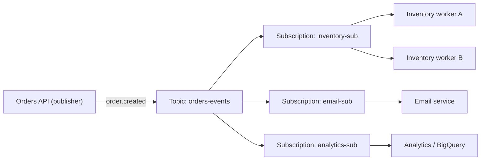
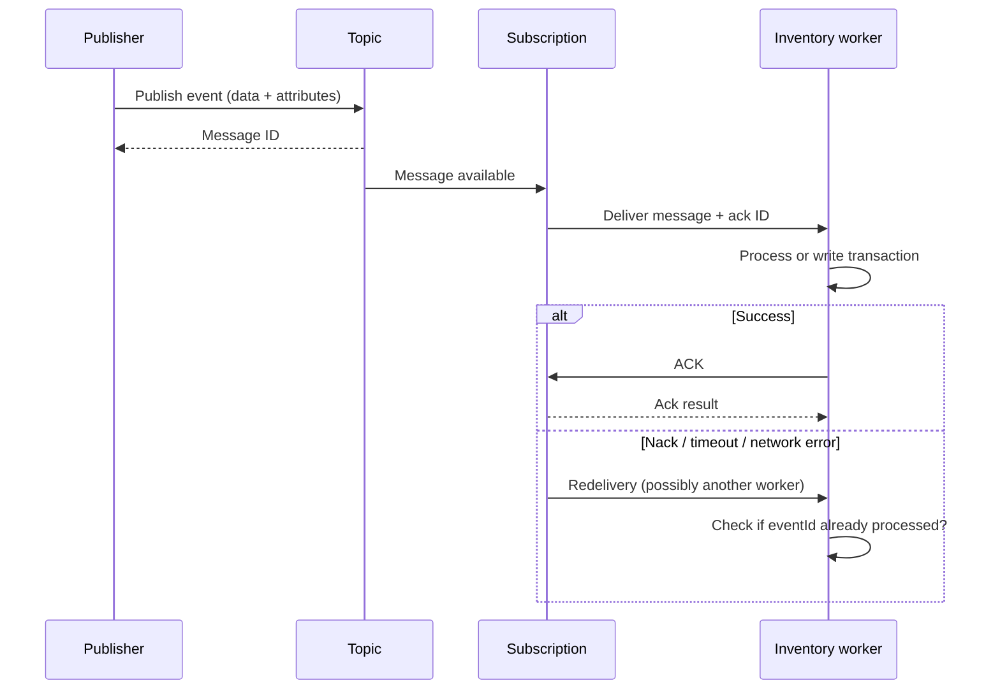
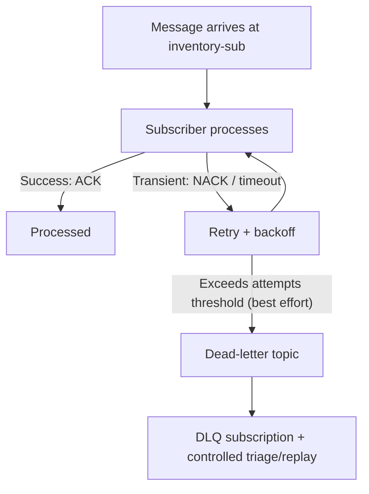

# Pub/Sub topics, subscriptions, and delivery models

When a customer places an order successfully, the Orders system needs to send a confirmation email, deduct inventory, and update reports. If the Orders API calls all three services sequentially, a slow email service can cause the order request to time out. **Google Cloud Pub/Sub** decouples *event publishing* from *event processing*: Orders publishes `order.created` once to a **topic**, while each downstream system receives it through its own **subscription**.

This lesson belongs to the **Pub/Sub and Messaging** chapter in module `CLOUD_PROVIDERS_GCP`. The knowledge connects Cloud Run/GKE/Compute Engine, IAM, VPC networking, storage, databases, reliability observability, and cost. The focus is on understanding **topic → subscription → subscriber**, choosing delivery types, handling duplicate messages, and operating backlogs.

> The examples use the `orders-lab` project and simulated messages with no real customer data. Commands that create resources or publish messages can incur charges and trigger subscribers; run them only in an authorized sandbox. The content is written concisely around a hands-on workflow and does not replace testing on a real system.

## 1. Learning outcomes

After this lesson, you will be able to:

1. Distinguish between **topic**, **message**, **publisher**, **subscription**, and **subscriber**.
2. Design **fan-out** (one event for multiple business workflows) and **competing consumers** (multiple workers sharing a subscription).
3. Choose **pull, push, or export subscriptions** based on the workload.
4. Create topics/subscriptions and publish/pull messages using `gcloud`; distinguish `ack`, `nack`, and `ack deadline`.
5. Explain default **at-least-once** delivery, ordering/exactly-once options, retention, replay, retry, and dead-letter topics.
6. Design least-privilege IAM permissions, push authentication, idempotency, and backlog/cost observability.

## 2. Concepts and message lifecycle

| Concept | Function | Example |
| --- | --- | --- |
| **Topic** | Logical address receiving messages from publishers; a topic can have multiple subscriptions | `orders-events` |
| **Publisher** | Application sending messages to a topic | Orders API |
| **Message** | Data as bytes plus key–value attributes; Pub/Sub adds message ID and publish time | `order.created` event |
| **Subscription** | Stream of messages from **one topic** for one task group; maintains its own ack/backlog state | `inventory-sub`, `email-sub` |
| **Subscriber** | Client/worker or endpoint receiving messages from a subscription | Inventory worker on GKE |
| **Ack/Nack** | Acknowledge processing completion / request redelivery | Ack after DB update |
| **Backlog** | Messages remaining to be processed or unacknowledged per subscription | 2,000 events waiting to send email |



The arrow from the topic to **each subscription** represents an independent logical delivery stream. Each message is evaluated for the subscriptions attached to the topic. Two workers A and B reading `inventory-sub` will **share the processing workload**; there is no guarantee each worker receives a copy. Conversely, subscribers on `email-sub` and `inventory-sub` have separate ack states: a broken email service does not cause messages already acked by inventory to reappear in inventory.

### 2.1. What does a message carry?

Example application event:

```json
{
  "eventId": "evt-1001",
  "eventType": "order.created",
  "schemaVersion": 1,
  "orderId": "ord-42",
  "occurredAt": "2026-11-19T09:00:00Z"
}
```

A publisher typically encodes JSON as **UTF-8 bytes** in `message.data` and attaches attributes such as `eventType=order.created`, `schemaVersion=1`. In the Pub/Sub REST/push wrapper, bytes are represented in **base64**; that is only encoding, **not security encryption**. Pub/Sub assigns `messageId` and `publishTime` after successfully receiving the message.

**Do not use `messageId` as the unique business event ID.** A publisher might republish the same event after a timeout, causing Pub/Sub to create two messages with **different message IDs**. Use a business-generated `eventId` to deduplicate downstream.

### 2.2. When does a subscription start receiving messages?

By default, **a new subscription only receives messages published after it is created**. Creating a subscription today does not automatically pull the entire topic history from last week. To replay old data, you must design **topic message retention**, or retain/save messages via subscription retention, snapshots, and seek within supported limits. A topic existing without a subscription does not imply an infinite historical queue.

## 3. Two key delivery models

### 3.1. Fan-out: one event, multiple business groups

`orders-events` has three subscriptions:

- `inventory-sub`: update inventory.
- `email-sub`: send confirmation email.
- `analytics-sub`: load data into the reporting warehouse.

Each subscription receives the topic's message stream according to its own configuration. **An ack on email-sub does not delete the message from inventory-sub**. This avoids direct coupling between services and allows adding a new consumer without modifying the publisher; however, each subscription increases delivery count, backlog, and potential cost.

### 3.2. Competing consumers: scaling workers for the same task

Three replicas of the Inventory worker pull from **one** `inventory-sub`. Pub/Sub distributes work among clients in the group; a message is usually delivered to one worker at a time, but **may be redelivered** if ack fails or expires. Do not use three different subscriptions to "scale" Inventory if the intent is for each event to update inventory once.

| Requirement | Correct design | Common mistake |
| --- | --- | --- |
| One event needs to trigger three workflows | **Three subscriptions** on one topic | One subscription expecting every service to get its own copy |
| Three replicas processing the Inventory queue together | **One subscription**, three clients | Three subscriptions causing events to be processed three times |
| Send only certain event types to Email | Subscription filter using attributes | Filtering after sending all payloads and increasing unnecessary processing |
| Isolate processing speed and retention for Analytics | Separate subscription or export subscription | Letting a slow consumer block a shared queue |

### 3.3. Fan-in and event-driven architecture

Multiple publishers can send to the same topic if the **event contract/schema is clearly managed**. For example, Orders API and Payments service send different event types; consumers must inspect `eventType` and `schemaVersion`. Do not lump all sensitive data into a single topic without clear permission boundaries or lifecycle rules.

## 4. Choosing Pull, Push, or Export subscriptions

| Type | Delivery method | Best suited for | Trade-offs |
| --- | --- | --- | --- |
| **Pull/StreamingPull** | Worker actively receives messages and sends ack RPCs | GKE/Compute Engine workers, workloads needing flow control and batching | Must operate workers, leases, and concurrency |
| **Push** | Pub/Sub sends HTTP POST to an endpoint | Cloud Run HTTP service or HTTPS webhook | Must secure endpoint, ack via HTTP response, more limited backpressure |
| **Export: BigQuery** | Pub/Sub writes directly to a BigQuery table | Analytics ingestion without writing a subscriber | Schema, IAM, delivery behavior, and export limits |
| **Export: Cloud Storage** | Pub/Sub writes objects by interval/size | Archiving/batch file landing | Not per-event request, format and batching considerations |
| **Export: Bigtable (Preview)** | Pub/Sub writes to Bigtable | Suitable Bigtable ingestion | Preview status/support availability may change |

**Pull does not automatically mean faster than push in every case.** Pull gives control over outstanding messages/bytes and ack deadline extension; push reduces self-managing worker polling, but the endpoint must respond within an appropriate time. Export options have their own IAM, format, and destination requirements; they do not by default support every pull feature such as exactly-once delivery.

### 4.1. Push messages and acknowledgment

In default push mode, Pub/Sub POSTs a JSON wrapper containing base64-encoded message data, attributes, and metadata. **An HTTP success response is recognized by Pub/Sub as an ack**; an error response or request timeout leads to a retry. Do not return `2xx` when merely accepting the request and skipping critical work before persisting it **durably** to another processing system.

Push has a **payload unwrapping** option to send raw data instead of the JSON wrapper; when enabled, the consumer must know the payload/headers contract and have a way to validate the event. Do not write a handler assuming `message.data` is always present across all push modes.

### 4.2. Pull messages and acknowledgment

A pull client receives a message along with an **ack ID** for the current delivery attempt. After completing processing, call `ack(ackId)`; on error, you can call nack or let the deadline expire so Pub/Sub redelivers it. With client libraries, use **StreamingPull**, flow control, and automatic deadline extension instead of writing a tight polling loop yourself.

## 5. CLI hands-on: one topic, two subscriptions

Follow the order **create subscriptions first, publish later**. The illustrative commands may **create resources and incur charges**; use an authorized sandbox project.

```bash
PROJECT_ID="orders-lab"
TOPIC="orders-events"
INVENTORY_SUB="inventory-sub"
EMAIL_SUB="email-sub"

# INFRASTRUCTURE CHANGE: enable API, create topic.
gcloud services enable pubsub.googleapis.com --project="$PROJECT_ID"
gcloud pubsub topics create "$TOPIC" --project="$PROJECT_ID"

# INFRASTRUCTURE CHANGE: two independent pull subscriptions.
gcloud pubsub subscriptions create "$INVENTORY_SUB" \
  --topic="$TOPIC" \
  --ack-deadline=30 \
  --message-retention-duration=7d \
  --project="$PROJECT_ID"

gcloud pubsub subscriptions create "$EMAIL_SUB" \
  --topic="$TOPIC" \
  --project="$PROJECT_ID"

# READ-ONLY: inspect topology.
gcloud pubsub topics list --project="$PROJECT_ID"
gcloud pubsub subscriptions list --project="$PROJECT_ID"
gcloud pubsub subscriptions describe "$INVENTORY_SUB" \
  --project="$PROJECT_ID"
```

If resources already exist, do not recreate them to avoid altering state. A topic creator needs `pubsub.topics.create`, and a subscription creator needs `pubsub.subscriptions.create` plus permission to attach a subscription to the corresponding topic. In multi-team projects, the platform team should standardize naming, owner, retention, and IAM via IaC.

### 5.1. Publish a simulated event

```bash
# HAS IMPACT: message is delivered to EVERY matching subscription.
gcloud pubsub topics publish "$TOPIC" \
  --message='{"eventId":"evt-1001","eventType":"order.created","orderId":"ord-42"}' \
  --attribute=eventType=order.created,schemaVersion=1 \
  --project="$PROJECT_ID"
```

On success, the CLI returns a **Pub/Sub message ID**. Only send test data; a production topic with live subscribers will process this message immediately. Publishers should log the publish outcome and retry with backoff on quota/unavailable errors, though retries can also create duplicate **business events** if idempotency is not designed.

### 5.2. Test pull on both subscriptions

```bash
# SANDBOX ONLY: --auto-ack acknowledges immediately upon pull.
gcloud pubsub subscriptions pull "$INVENTORY_SUB" \
  --auto-ack --limit=5 --project="$PROJECT_ID"

gcloud pubsub subscriptions pull "$EMAIL_SUB" \
  --auto-ack --limit=5 --project="$PROJECT_ID"
```

You will see the same `eventId` in **both subscriptions**; `--auto-ack` only marks the message as processed **on the respective subscription**. **Do not use `--auto-ack` on a production queue before business logic completes**: this flag can cause loss of processing for messages not yet durably saved by the application. `--limit=5` is an upper bound and does not guarantee every call returns all five messages.

### 5.3. Two workers on the same inventory-sub

Open two terminals and run pull on the **same `inventory-sub`**. Messages are split across workers based on availability; if you only publish one message, do not expect both terminals to receive it. To observe fan-out, create a **separate subscription** (like `email-sub`), not by adding another client.

## 6. Ack, retry, and at-least-once delivery

**By default, Pub/Sub guarantees at-least-once delivery, not ordering.** A message can be delivered multiple times, including after network issues or when a subscriber fails to ack in time. This is expected behavior to design around, **not evidence that Pub/Sub is broken**.



### 6.1. Ack deadline and lease extension

| Property | Value/meaning | Impact |
| --- | --- | --- |
| Initial `ackDeadline` | Default **10 seconds**; configurable **10–600 seconds** | Expiring without ack may trigger redelivery |
| `modifyAckDeadline` | Extend or set `0` to nack | Useful for long processing or early retry |
| High-level client library | Can auto-extend deadline, set outstanding messages/bytes limits | Reduces redelivery from overloaded workers |
| `ack` | Acknowledge on the **current subscription** | Message no longer needs delivery on that subscription |
| `nack` | Signal processing did not succeed | Triggers retry per policy/backoff cadence |

A message does not have a "system-wide deadline" formed by summing deadlines across subscriptions; each subscription has its own state and configuration. **Do not set an excessively long `ackDeadline` to mask processing failures**: monitor latency, progress, and limit in-flight work instead.

### 6.2. When is it safe to ack?

Example Inventory worker updating stock:

1. Receive message, validate schema and business key.
2. Check whether `eventId` has already been processed.
3. Write the business result and idempotency marker **within the same transaction** if the database supports it.
4. Call `ack` only after commit succeeds; if the DB fails, `nack` or skip ack to retry.
5. For permanently invalid messages, classify as poison messages and route to a DLQ per procedure instead of retrying infinitely.

**Acking before DB commit can lose work:** the subscriber reports completion, then the DB write fails; Pub/Sub has no reason to redeliver. **If DB commits but ack fails**, the message may come back: you must rely on idempotency so stock is not deducted twice.

### 6.3. Idempotency differs from Pub/Sub message ID

In the payload:

```json
{
  "eventId": "evt-1001",
  "orderId": "ord-42",
  "eventType": "order.created"
}
```

Re-published attempts can receive different `messageId` values while sharing the same `eventId`. With PostgreSQL/MySQL, one approach is a table with a unique key on **(consumer_name, event_id)**. Algorithmic idea:

```text
BEGIN TRANSACTION
  INSERT processed_events(consumer_name, event_id)
    ON CONFLICT DO NOTHING
  IF inserted:
    UPDATE stock ...               # same transaction
COMMIT
ACK message
```

This is **pseudocode**, not SQL that runs verbatim on every DBMS. For payments or sending emails via an external API, you need a service-supported **idempotency key**, transactional outbox, or reconciliation mechanism; a single database transaction cannot wrap arbitrary external side effects.

## 7. Ordering and exactly-once: how far do guarantees go?

| Feature | Default | When enabled | Limits |
| --- | --- | --- | --- |
| Delivery | **At-least-once** | Exactly-once can be enabled for pull | Does not turn the entire business flow into an exactly-once transaction |
| Ordering | No ordering guarantee | By **ordering key**, subscription enables ordering | Same key must be published in the **same region**; different keys have no global order |
| Exactly-once | Disabled | Ack takes effect, no redelivery after successful ack | **Pull/StreamingPull only**, guaranteed within **one region** |
| Publisher retries | Can occur | Use idempotent publish/application event IDs | Exactly-once delivery does not deduplicate two independent publishes of the same business event |

### 7.1. Preserving event order for a single order

Suppose an order has three events: `created → paid → shipped`. To ensure the consumer receives them in order on **one subscription**:

- Publisher uses the same `orderingKey="ord-42"` for all three messages, and publishes the same key from the **same region** in order.
- Subscription is created with `--enable-message-ordering`.
- Subscriber processes work for the **same ordering key** sequentially, even when callbacks spawn async tasks.
- Application state must still tolerate retries and late-arriving events from other sources.

```bash
# CHANGE: create a NEW SUBSCRIPTION before publishing.
gcloud pubsub subscriptions create order-state-ordered-sub \
  --topic=orders-events \
  --enable-message-ordering \
  --project=orders-lab

# HAS IMPACT: send events with a simulated ordering key.
gcloud pubsub topics publish orders-events \
  --message='{"eventId":"evt-1","type":"created","orderId":"ord-42"}' \
  --ordering-key=ord-42 \
  --project=orders-lab
```

Note: **an ordering key on a message does not automatically enable ordering on a subscription**. A failing message can delay or cause redelivery of subsequent messages with the same key; throughput and latency are affected. GCP documentation specifies that the subscription message ordering property must be set **at creation time** and cannot be changed directly on an existing subscription by default.

### 7.2. Exactly-once for pull, not Push/Export

```bash
# HAS CHANGE: pull subscription with exactly-once delivery.
gcloud pubsub subscriptions create inventory-exactly-once-sub \
  --topic=orders-events \
  --enable-exactly-once-delivery \
  --project=orders-lab
```

Exactly-once applies to **a message received by Pub/Sub and delivered through a pull subscription**, subject to regional conditions and valid acks. It prevents duplicate delivery after an ack has been accepted, though **legitimate redelivery** still occurs if the deadline expires or nack is sent before ack; additionally, a publisher resending the same payload creates a new message. It **does not automatically guarantee that a database commit or payment happens only once**.

When this guarantee is needed across multiple regions, check **locational endpoints**/subscriber regions and Pub/Sub recommendations. Exactly-once can increase latency/processing cost; for high throughput, use StreamingPull and benchmark before enabling. When combining ordering + exactly-once, acknowledgments must follow order, which can reduce per-key throughput.

## 8. Retention, replay, expiration, and dead-letter

### 8.1. Retention is not an infinite backup

| Property | Default/typical | Keep in mind |
| --- | --- | --- |
| Subscription retention | **7 days** for unacked messages | Configurable from **10 minutes to 31 days** |
| Acked messages | Not retained after ack by default | Enable `retain-acked-messages` when seek/replay within the retention window is needed |
| Topic retention | Separate option on the topic | Allows replaying published messages, even before subscription creation if still within retention |
| Subscription expiration | Default **31 days of inactivity** | Can set another duration or `never`; expiration can delete backlog |
| Seek/snapshot | Used to replay/restore state as supported | Can **redeliver** messages and requires idempotency design |

Once a subscription acks a message without retaining acked messages, the message may be purged from the subscription; **you cannot replay an event that is no longer stored**. Topic retention, subscription retention, and snapshots have different time/cost constraints and do not replace business backups.

Example creating a new subscription that retains acked messages for replay drills:

```bash
# INFRASTRUCTURE CHANGE / INCREASES STORAGE COST.
gcloud pubsub subscriptions create audit-replay-sub \
  --topic=orders-events \
  --message-retention-duration=3d \
  --retain-acked-messages \
  --expiration-period=never \
  --project=orders-lab
```

**Do not run seek on a production subscription** without a plan; old messages can be redelivered and cause duplicate side effects. Test replay with sandbox data and verify `eventId`/deduplication first.

### 8.2. Retry and Dead-Letter Topic (DLQ)

A `poison message` with an invalid schema or referencing a nonexistent order can cause an infinite loop. Pub/Sub supports immediate retry (default) or exponential backoff, and a **Dead-Letter Topic** to forward undeliverable messages after a number of delivery attempts.



A DLQ has its **own topic** and must have a **subscription monitoring the DLQ**; merely creating a dead-letter topic without a consumer will not automatically produce dashboards or alerts. For DLQ configuration, `max delivery attempts` ranges from **5 to 100**, though **the exact delivery count is not a hard boundary** because forwarding is best effort. You must grant the **Pub/Sub service agent** permission to subscribe to the source and publish to the DLQ per documentation; if permissions are missing, forwarding may not work properly.

Example configuration **assuming the DLQ topic and permissions already exist**:

```bash
# HAS CHANGE: create a new subscription with DLQ.
gcloud pubsub subscriptions create inventory-dlq-enabled-sub \
  --topic=orders-events \
  --dead-letter-topic=orders-dead-letter \
  --max-delivery-attempts=10 \
  --min-retry-delay=10s \
  --max-retry-delay=300s \
  --project=orders-lab
```

Do not use a DLQ to silently "drop errors" without an owner. Record the failure reason, message ID/eventId, and retry count; sanitize toxic/PII fields in payloads before exporting DLQ entries to logs or ticketing systems.

## 9. Filtering and schema: reducing misrouted deliveries

**Subscription filters** operate on **message attributes**, not JSON fields inside `data`. For example, Email only receives `eventType="order.created"`:

```bash
# CHANGE: filter is set at subscription CREATION time.
gcloud pubsub subscriptions create email-created-only-sub \
  --topic=orders-events \
  --message-filter='attributes.eventType="order.created"' \
  --project=orders-lab
```

Messages that **do not match the filter** are **automatically acked** by Pub/Sub on that subscription and are not added to the backlog for Email to process. Filters are immutable after creation in current API versions; to change filter logic, design a new subscription and perform a controlled migration. Other subscriptions on the topic still receive messages according to their own filters.

For JSON payloads, define an **event schema/version** and message contract (required fields, backward compatibility, idempotency fields). The Pub/Sub schema service supports **Avro and Protocol Buffers** for topics configured accordingly; if using free-form JSON, validation lives in the application. Adding `schemaVersion` to attributes helps subscription filters or routers identify the version without decoding the payload.

## 10. Example: Secured Push subscription to Cloud Run

If the Email service is an HTTP application on Cloud Run, Pub/Sub can send requests directly to the service's HTTPS URL using an **authenticated push subscription**. Unlike a pull worker, a push handler must return a **timely HTTP success status**; since sending email can take time, persist the job to a durable queue/DB before returning success, or design the handler to process and ack within the timeout.

### 10.1. Permissions and setup before creating Push

Assuming Cloud Run service `orders-email` and a user-managed service account `pubsub-push@orders-lab.iam.gserviceaccount.com` **already exist**:

1. The account used to **create the subscription** needs `pubsub.subscriptions.create`, permission to attach to the topic, and `iam.serviceAccounts.actAs` on the push service account.
2. The **Pub/Sub service agent** `service-PROJECT_NUMBER@gcp-sa-pubsub.iam.gserviceaccount.com` needs `iam.serviceAccounts.getOpenIdToken` (typically `roles/iam.serviceAccountTokenCreator`) on the **push service account**.
3. The push service account is granted `roles/run.invoker` on **Cloud Run orders-email**, not project-wide Owner.
4. The Cloud Run endpoint must accept HTTPS requests under its ingress/network policy. Pub/Sub **cannot push directly to a private VPC IP**; internal endpoints require a different architecture such as Eventarc or a pull worker.

Once permissions and the real Cloud Run URL are ready:

```bash
# CHANGE: run only with properly configured Cloud Run and accounts.
PROJECT_ID="orders-lab"
PUSH_SA="pubsub-push@$PROJECT_ID.iam.gserviceaccount.com"
EMAIL_SERVICE_URL="https://ACTUAL_CLOUD_RUN_SERVICE_URL"

# Allow Pub/Sub service agent to mint OIDC tokens as PUSH_SA.
PROJECT_NUMBER="$(gcloud projects describe "$PROJECT_ID" \
  --format='value(projectNumber)')"
PUBSUB_AGENT="service-$PROJECT_NUMBER@gcp-sa-pubsub.iam.gserviceaccount.com"

gcloud iam service-accounts add-iam-policy-binding "$PUSH_SA" \
  --project="$PROJECT_ID" \
  --member="serviceAccount:$PUBSUB_AGENT" \
  --role="roles/iam.serviceAccountTokenCreator"

# Allow PUSH_SA to invoke the target Cloud Run service.
gcloud run services add-iam-policy-binding orders-email \
  --project="$PROJECT_ID" \
  --region=asia-southeast1 \
  --member="serviceAccount:$PUSH_SA" \
  --role="roles/run.invoker"

# HAS CHANGE: create a new push subscription.
gcloud pubsub subscriptions create email-push-sub \
  --topic=orders-events \
  --project="$PROJECT_ID" \
  --push-endpoint="$EMAIL_SERVICE_URL/pubsub" \
  --push-auth-service-account="$PUSH_SA" \
  --push-auth-token-audience="$EMAIL_SERVICE_URL"
```

This is a **minimal IAM model for guidance**, not a production script runnable before resources/principals exist. Verify the subscription creator's permissions, service name, project number, and real endpoint. Do not disable Cloud Run authentication or put secret URLs in logs to work around 401/403 errors.

### 10.2. Handling the HTTP wrapper correctly and safely

The default push JSON has a structure similar to:

```json
{
  "message": {
    "data": "eyJldmVudElkIjoiZXZ0LTEwMDEifQ==",
    "attributes": {"eventType": "order.created"},
    "messageId": "SAMPLE_MESSAGE_ID",
    "publishTime": "2026-11-19T09:00:00Z"
  },
  "subscription": "projects/orders-lab/subscriptions/email-push-sub"
}
```

The handler base64-decodes `message.data`, checks `eventType/schemaVersion`, and validates the idempotency key. Cloud Run/IAM validates the token at the ingress layer; if using a self-managed HTTP endpoint, you must verify the **Google-signed OIDC JWT**, `aud`, and expected service account email rather than trusting a self-asserted header.

**Push ack:** HTTP status codes `102`, `200`, `201`, `202`, or `204` are recognized by Pub/Sub as success; HTTP errors or deadline expiration trigger a retry. Do not return 200 before the task has been **durably saved** or completed. When using an internal asynchronous queue, ensure that queue cannot lose the message after returning HTTP 200.

## 11. IAM, security, and data residency

| Principal | Recommended role/scope | Avoid |
| --- | --- | --- |
| Orders API publisher | `roles/pubsub.publisher` on `orders-events` | Project-wide Pub/Sub Admin |
| Inventory pull worker | `roles/pubsub.subscriber` on `inventory-sub` | Reading unrelated subscriptions |
| Platform operator | Role with sufficient rights to create topics/subscriptions and bind IAM, e.g., `roles/pubsub.editor` or custom role | Granting create/delete rights to runtimes unnecessarily |
| Pub/Sub push service agent | Token Creator on the **push-auth service account** | Granting Token Creator broadly project-wide when unneeded |
| Cloud Run push-auth identity | `roles/run.invoker` on the exact service | Making Cloud Run unauthenticated due to misconfigured push |
| DLQ service agent | Permission to subscribe to source and publish to DLQ per docs | Omitting permissions and assuming DLQ works automatically |

### 11.1. Private networking does not replace IAM

Pub/Sub is a managed service, not a Pod running inside a VPC. Workloads from GKE/Compute Engine/Cloud Run call Pub/Sub APIs over supported Google API paths using IAM or Workload Identity Federation. Private Google Access, Private Service Connect, or VPC Service Controls can be applied based on network and perimeter requirements; **each mechanism solves a different layer** and does not replace caller authentication or topic authorization.

Do not put unnecessary sensitive data in messages; link to encrypted data in Cloud Storage/DB and enforce authorization at the consumer where appropriate. Attribute data can also appear in logs, metrics, and debug tools; never attach access tokens, passwords, emails, or card data in attributes.

### 11.2. Message storage policy and data residency

A Pub/Sub topic is a global resource, but message data is stored and processed in regions according to routing and the **message storage policy**. If residency requirements apply, configure the allowed regions list and consider `enforceInTransit`; publishers/subscribers outside allowed regions may need **regional/locational endpoints** and appropriate network configuration.

Do not mistake a regionless **topic resource name** for a guarantee that message data is stored in all regions or in one fixed region. Using multiple regions or distant paths can change latency, availability, and egress costs; measure and verify policies against your specific project.

## 12. Observing backlog, errors, and cost

Pub/Sub provides metrics for topics and subscriptions in Cloud Monitoring; applications should supplement these with **end-to-end processing metrics** (how long from publish to business completion).

| Metric/SLI | Question | Action direction |
| --- | --- | --- |
| `subscription/num_unacked_messages_by_region` | Is backlog by region growing? | Scale worker capacity, investigate throughput |
| `subscription/oldest_unacked_message_age_by_region` | How long has the oldest event waited? | Prioritize when approaching retention TTL |
| `subscription/delivery_latency_health_score` | Are there signs of delivery degradation? | Check quota, backlog, retries, and subscriber health |
| Ack deadline expirations | Are workers finishing and acking in time? | Tune flow control/leases, optimize processing |
| Nack/retry count | Are there transient or poison messages? | Triage logs, exponential backoff, and DLQ |
| `subscription/dead_letter_message_count` | How many messages were forwarded to DLQ? | Alert, classify, and fix root cause |
| Application success/error ratio | How many tasks truly succeeded? | Business SLO, idempotency, and reconciliation |

Use **regional versions** of backlog metrics when dashboards must remain useful during a regional outage; metrics can lag by a few minutes, so do not treat a single empty data point as proof of an empty queue.

### 12.1. When backlog grows

1. Check whether publisher throughput increased.
2. Check whether subscribers are still connected and have IAM permissions, CPU, memory, and DB connections.
3. Compare **num_unacked** and **oldest_unacked age**: both rising suggests insufficient consumption throughput; small backlog with high oldest age suggests a few poison messages.
4. Inspect ack deadline, nack, retry backoff, DLQ, and flow control; scale replicas only when downstream has enough capacity.
5. Set alerts **before oldest age exceeds retention**, because expired messages may be deleted.

Example SLO: 99% of `order.created` events complete Inventory update within 60 seconds. That metric **cannot be fully inferred from queue backlog**: you need timestamps/`eventId` and must measure time from publish to DB commit in the consumer, correlating traces/logs by `eventId`.

### 12.2. Calculating cost accurately for fan-out

| Source | Impact |
| --- | --- |
| Publish + deliver | Publish volume and deliveries; one event with **3 subscriptions** can generate 3 delivery streams |
| Retained unacked messages | Large backlogs or long retention can incur storage charges |
| Retain acknowledged messages / topic retention | Increases storage cost for replay capability |
| Cross-region, exports | Egress and separate BigQuery/Cloud Storage costs |
| Unused subscriptions | May still receive messages, increasing backlog/cost |
| Retry storm | Repeated deliveries and downstream load; DLQ/retry policies help control this |

Track Cloud Billing by SKU, labels/project ownership, quotas, and current Pub/Sub pricing. A new subscription created for "testing" on a production topic can silently receive every event after creation, increasing traffic and cost even with no active subscriber.

## 13. Case study: Orders API, Inventory, and Notification

Suppose Orders runs on Cloud Run, Inventory workers run on GKE, Email sender runs on Cloud Run, and Analytics ingests via a BigQuery subscription. Requirements:

- Order placement API returns quickly, **without waiting to send email**.
- Inventory update **must not deduct stock twice** on duplicate messages.
- A 30-minute Email outage must not slow down Inventory.
- Ordering `created → paid → cancelled` matters **within each individual order**.
- Ops needs to detect backlogs and handle DLQs in a controlled way.

### 13.1. Design

| Component | Recommended configuration | Rationale |
| --- | --- | --- |
| Topic | `orders-events`, versioned JSON/Avro/Protobuf contract | Publishers are decoupled from consumer count |
| `inventory-sub` | Pull/StreamingPull, ordering key = order ID when genuinely required | Multiple GKE workers share subscription, flow control |
| `email-sub` | Authenticated push to Cloud Run or pull worker depending on processing time | Isolated email backlog/ack |
| `analytics-sub` | BigQuery export subscription or Dataflow consumer | No custom webhook needed if export matches schema |
| `orders-dead-letter` | DLQ and DLQ subscription + alert | Investigate unprocessable payloads |
| Database | Unique (consumer,eventId), transactional update | Prevents duplicate inventory updates |
| Observability | Backlog age, DLQ count, end-to-end processing latency | Measures true business success |

### 13.2. Procedure when the Email service goes down

1. Orders keeps publishing `order.created`; Inventory keeps acking on **inventory-sub** after deducting stock.
2. Pub/Sub retains unacked messages in **email-sub** within retention and retries according to policy.
3. Cloud Monitoring alerts that `oldest_unacked_message_age_by_region` on `email-sub` exceeds SLO; on-call investigates 5xx errors and Cloud Run push-auth permissions.
4. Restore Email and let the subscriber drain the backlog with rate/concurrency limits; use `eventId` to avoid sending duplicate emails.
5. Permanently failing messages move to the DLQ, where they are triaged and replayed manually only after fixing the root cause.

Do not fix an Email outage by **deleting the subscription**: that destroys the subscription's backlog. Likewise, do not let an email-sending failure roll back the Inventory transaction once the two workflows are decoupled via subscriptions.

### 13.3. Outbox to prevent losing events after commit

A subtle race condition: Orders API **commits the order to the DB and then crashes before publishing the event**. Pub/Sub cannot recover an event that was never sent. The **transactional outbox** pattern writes the order record and the outbox event in one DB transaction; a relay worker publishes events and marks their status. The relay may publish duplicates after a timeout, so consumers **must still be idempotent**.

This addresses **event publishing reliability** at the publisher, distinct from at-least-once delivery at the subscriber; both must be handled to preserve business consistency.

## 14. Common troubleshooting table

| Symptom | Possible cause | Check/remediation |
| --- | --- | --- |
| New subscription does not see old events | Created after publish, topic does not retain history | Check creation time, topic retention, replay limits |
| Publish succeeds but worker receives nothing | Wrong project/subscription, filter drops message, worker not running | Describe topic/subscription, attribute filters, IAM |
| Two Inventory workers update the same order | Redelivery or using two subscriptions instead of one | Topology, ack logs, deduplication via business eventId |
| Message redelivered after DB commit | Ack deadline expired or ack RPC failed | Transactional idempotency, lease/flow control |
| Message "disappears" after using CLI | `--auto-ack` acknowledged immediately | Demo use only; production acks after durable work |
| Ordering not as expected | Ordering not enabled, different keys, or cross-region publish | Subscription property, orderingKey, and publisher location |
| Exactly-once still has duplicate side effects | Publisher sent two separate events, external API not idempotent | Use eventId, idempotency keys, DB transaction |
| Cloud Run push returns 401/403 | Missing Invoker, Token Creator, `actAs`, wrong JWT audience | Check SA identities, service agent, and HTTPS endpoint |
| Push worker slow, frequent retries | Handler timeout/HTTP error, no durable handoff | Return 2xx only after durable success, monitor request latency |
| DLQ has no messages despite retries | Missing service agent IAM, no DLQ subscriber, or max attempts not reached | Check subscription config, IAM, DLQ subscription, metrics |
| Backlog grows despite steady publish | Slow worker/DB, flow control too small, or poison message | Regional backlog, age, CPU/DB, retries |
| Costs rise after adding a team | Each team creates a new fan-out subscription or long retention | Inventory subscriptions, labels, Billing, TTL |

## 15. Hands-on exercises

### Exercise A — Draw the topology

An `orders-events` topic has three subscriptions: Inventory, Email, and Analytics. Inventory has four replicas reading the same subscription. Draw the diagram and state how many **subscription streams** receive a single event, and why the four replicas do not receive four independent copies.

### Exercise B — CLI test in sandbox

Create one topic and two subscriptions per Section 5, publish two test events, and pull from each subscription. Prove that acking on the first subscription **does not affect** the second subscription. Why must subscriptions be created before publishing?

### Exercise C — Ack and idempotency

An Inventory worker commits a deduction of 2 items from stock, then crashes before acking. The message is redelivered. Write an algorithm using `eventId` and a unique key/transaction to avoid deducting twice; state the difference between Pub/Sub's `messageId` and a business event ID.

### Exercise D — Ordering and exactly-once

An order emits `created, paid, cancelled`. State the publisher and subscription requirements to receive them in order, and explain why pull-only exactly-once does not by itself guarantee payments are not duplicated. If publishing from multiple regions with the same key, what must be considered?

### Exercise E — Push to Cloud Run

Design an authenticated push subscription for `orders-email` on Cloud Run. List the subscription creator principal, push-auth SA, Pub/Sub service agent, `roles/run.invoker`, and JWT audience. In which cases should it return 2xx; in which cases must it retry?

### Exercise F — Retry, DLQ, and retention

A subscriber repeatedly receives a message with an invalid schema. Configure retry/backoff, 10 delivery attempts, and a DLQ; describe the DLQ handling pipeline, alerting by oldest unacked age, and the risks of running seek in production.

### Exercise G — Observability and cost

Publish rate is 1,000 events/s; there are three subscriptions and one is processing slowly. Explain why its backlog grows independently, the impact on delivery/storage volume, which metrics the dashboard needs, and how to scale capacity without overloading Cloud SQL.

### Self-check questions

1. How does a topic differ from a subscription? How many topics can a single subscription connect to?
2. Why does fan-out require multiple subscriptions, whereas scaling a single consumer usually only requires adding workers?
3. How does at-least-once differ from exactly-once delivery and an exactly-once business effect?
4. What can happen when `ackDeadline` expires?
5. Why must ack happen after durably persisting business results?
6. Does a 7-day subscription retention always allow replaying every already-acked message?
7. Does an ordering key guarantee order across different orders?
8. Does exactly-once delivery support push subscriptions?
9. Why do filters inspect attributes rather than reading JSON payloads?
10. Why can a single topic have different backlogs per subscription?

## 16. Implementation checklist and official documentation

- [ ] Topic, schema/version, eventId, and owner are clearly defined.
- [ ] Each independent workflow has its own subscription; workers for the same task share a subscription.
- [ ] Pull/push/export matches the workload and network/IAM boundaries; no unauthenticated push endpoints.
- [ ] Ack occurs after durable processing; retries, lease management, ordering/idempotency, and DLQ are tested.
- [ ] Retention/expiration/topic storage policy, replay, and data residency are reviewed.
- [ ] Dashboards track regional backlog, oldest age, retry/DLQ, and end-to-end business latency.
- [ ] Billing, quotas, owner labels, cleanup, and runbooks for subscriber outages are in place.

Official documentation:

- [Pub/Sub overview](https://cloud.google.com/pubsub/docs/pubsub_overview)
- [Topics and publish workflow](https://cloud.google.com/pubsub/docs/publish-message-overview)
- [Subscription overview](https://cloud.google.com/pubsub/docs/subscription-overview)
- [Choose a subscription type](https://cloud.google.com/pubsub/docs/subscriber)
- [Subscription properties](https://cloud.google.com/pubsub/docs/subscription-properties)
- [Create subscriptions](https://cloud.google.com/pubsub/docs/create-subscription)
- [Pull subscriptions](https://cloud.google.com/pubsub/docs/pull)
- [Push subscriptions and authentication](https://cloud.google.com/pubsub/docs/create-push-subscription)
- [Exactly-once delivery](https://cloud.google.com/pubsub/docs/exactly-once-delivery)
- [Message ordering](https://cloud.google.com/pubsub/docs/ordering)
- [Message retention and replay](https://cloud.google.com/pubsub/docs/subscription-message-retention)
- [Dead-letter topics](https://cloud.google.com/pubsub/docs/dead-letter-topics)
- [Filter subscription messages](https://cloud.google.com/pubsub/docs/subscription-message-filter)
- [Pub/Sub monitoring](https://cloud.google.com/pubsub/docs/monitoring)
- [Pub/Sub message storage policies](https://cloud.google.com/pubsub/docs/resource-location-restriction)
- [Pub/Sub pricing](https://cloud.google.com/pubsub/pricing)

**Remember:** Publishers write to a **topic**; each **subscription** is an independent processing group; multiple workers on the same subscription share the work. Always design for **at-least-once + idempotency**, ack only after durable processing, control retention/retry/DLQ, and monitor backlog **per subscription**. Pub/Sub decouples systems, but the correctness of business state changes remains the application's responsibility.
