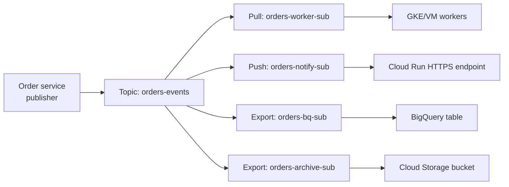
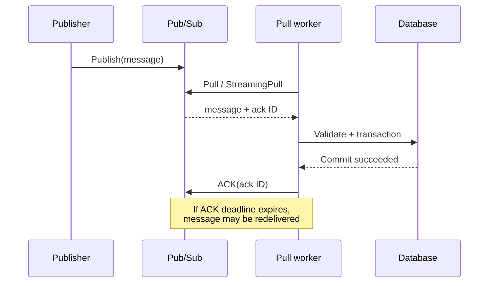

# Pull, push, and export subscriptions

In an order system, an `orders.created` event might need three different consumption patterns: a worker validating the order, an HTTP service sending notifications, and an analytics warehouse storing the event in BigQuery. **Google Cloud Pub/Sub** allows multiple **subscriptions** to attach to a single **topic**; each subscription maintains its own backlog and ACK state. Choosing **pull, push, or export** determines who controls the receive flow, who acknowledges, and where failures occur.

This lesson belongs to the **Pub/Sub and Messaging** chapter of module `CLOUD_PROVIDERS_GCP`, connecting IAM, VPC, Cloud Run, GKE, Cloud Storage, and databases. The goal is to choose the right service, protect resources, automate event processing, and monitor reliability and cost. Project/resource names are hypothetical; infrastructure-modifying commands are only for authorized labs.

## 1. Learning objectives

After this lesson, you will be able to:

1. Distinguish **topic, subscription, message, acknowledgment (ACK)**, and backlog.
2. Choose **pull/StreamingPull, HTTP(S) push, BigQuery, and Cloud Storage export** based on workload.
3. Create topics/subscriptions, publish/receive with `gcloud`, and explain ACK deadlines and redelivery.
4. Secure push endpoints with **OIDC IAM**, return HTTP ACKs at the right time, and handle retries.
5. Configure exports by **schema, file batching, and service account permissions**, and diagnose destination errors.
6. Understand **at-least-once, ordering, filtering, dead-letter, exactly-once**, and idempotency.
7. Monitor backlog, latency, throughput, and total cost.

## 2. Topic and subscription model

A publisher creates a message containing **data** (bytes), optional **attributes** (key–value), an ordering key, and metadata such as `messageId`/`publishTime`. The topic receives messages; the subscription determines how they are delivered to a consumer or destination.



**Two rules never to confuse:**

- **Multiple subscriptions on the same topic:** each subscription receives its own message delivery copy. An ACK on a pull subscription **does not ACK** the same message on a push or export subscription.
- **Multiple consumers on the same pull subscription:** share the backlog for parallel processing; they do **not** each receive a copy. If independent systems all need every event, create separate subscriptions.

Normally a new subscription receives messages published **after subscription creation**, unless appropriate retention/seek/replay configuration is in place. When comparing all three types, create the subscriptions first before publishing.

## 3. Comparison table: pull, push, and export

| Criterion | **Pull / StreamingPull** | **Push HTTP(S)** | **Export** |
| --- | --- | --- | --- |
| Who requests delivery? | Consumer calls the Pub/Sub API. | Pub/Sub actively POSTs to an endpoint. | Pub/Sub writes directly to a resource. |
| Who processes it? | Worker code on GKE, VM… | HTTP handler code, such as Cloud Run. | No custom worker needed when only storing data. |
| ACK | Consumer calls ACK/NACK; can extend deadline. | HTTP success = ACK, HTTP error/timeout = failure. | Pub/Sub manages target write results. |
| Flow control | Consumer caps workers, batches, outstanding bytes. | Pub/Sub throttles based on endpoint responses. | Pub/Sub optimizes writes to the destination. |
| Custom processing logic | Flexible, suitable for complex business/ETL logic. | Suitable for webhooks and per-request logic. | Limited, geared toward raw/schema-compatible message storage. |
| Destination | Worker, job engine, application. | HTTPS endpoint. | BigQuery/Cloud Storage; Bigtable export is currently **Preview** per current docs. |
| Pub/Sub exactly-once delivery | **Supported for pull only** when enabled and conditions are met. | **Not supported**. | **Not supported**. |
| Main risks | Worker crash, ACK lease expiry, downstream overload. | Endpoint auth/timeout, duplicate delivery. | Schema/IAM/target failure, file batching. |

**Quick rule of thumb:** need business logic and rate control → **pull**; already have an HTTP handler that should be invoked per message → **push**; only need to store messages in BigQuery/Cloud Storage without running a consumer → **export**.

## 4. Pull: consumer actively receives and ACKs



### 4.1. ACK deadline, lease, and redelivery

- **ACK deadline:** wait window after delivering a message; if not ACKed on time, Pub/Sub can redeliver it.
- **Lease extension:** StreamingPull client libraries automatically extend the ACK deadline during long processing; you still must handle connection drops and expired leases.
- **NACK:** decline processing for this attempt so the message can be redelivered per the retry policy. NACK does not fix an invalid payload.
- **Flow control:** limit in-flight messages/bytes to avoid running out of RAM or overwhelming Cloud SQL.
- **ACK after commit:** acknowledge only after important side effects are durable, or the job has been reliably handed off to another durable queue.

**Unary Pull** fits CLI/debugging; **StreamingPull** fits long-running workers via streaming, batching, flow control, and lease management. For production, use a Pub/Sub client library rather than a cronjob invoking the CLI at short intervals.

### 4.2. Safe worker pattern

```text
on_message(message):
    validate(message)
    id = business_event_id(message)
    transaction:
        if not already_processed(id):
            save_business_effect(id)
            record_processed(id)
    ACK(message)    # after commit

on_transient_failure:
    NACK or let lease expire, apply bounded retry/backoff
```

This is **pseudocode**, not a transaction for external side effects outside the DB. When calling payment/email APIs, use a target idempotency key or transactional outbox. The CLI's `--auto-ack` flag is only for testing because it ACKs immediately upon read without waiting for business logic.

**Pull fits well** when you need high-concurrency processing, coordination across systems, backpressure control, lease extension, or exactly-once delivery under supported conditions.

## 5. Push: Pub/Sub sends HTTP requests

Pub/Sub sends **one message per HTTP request** to the configured URL. The endpoint returns an HTTP success status to ACK; an error status or timeout causes the message to be retried.

### 5.1. Default wrapped payload

```json
{
  "message": {
    "data": "eyJvcmRlcklkIjoiTy0xMDAxIn0=",
    "messageId": "1234567890",
    "publishTime": "2026-11-19T01:00:00Z",
    "attributes": {"kind": "orders.created"}
  },
  "subscription": "projects/orders-dev/subscriptions/orders-notify-sub",
  "deliveryAttempt": 1
}
```

`message.data` is the **base64 encoding of the payload bytes**. `deliveryAttempt` is not guaranteed to be present in every scenario. If **payload unwrapping** is enabled, the endpoint receives the raw body and must read metadata/headers differently; do not apply the JSON wrapper parser to unwrapped payloads.

### 5.2. HTTP ACK and the 202 trap

Status codes recognized by Pub/Sub as ACK: **`102`, `200`, `201`, `202`, `204`**. Other codes or timeouts are treated as failures, triggering retries per policy.

In particular, `202 Accepted` **is already an ACK**, even if the app merely spawned an in-memory background thread. If the Cloud Run instance is replaced before the thread writes to the DB, message processing can be lost. **Return ACK only after commit**, or after creating a durable job in Cloud Tasks/a database.

### 5.3. Authenticated push to Cloud Run

Recommended design:

1. Create a **user-managed service account** for the push subscription.
2. Grant `roles/run.invoker` to this account on the **target Cloud Run service**.
3. Configure `--push-auth-service-account` and `--push-auth-token-audience` matching the verified URL.
4. Ensure the principal creating the subscription has `iam.serviceAccounts.actAs` where needed, and the Pub/Sub service agent has permission to mint **OIDC ID tokens** on behalf of the account per documentation.
5. For endpoints not verified by Cloud Run IAM, verify the **JWT signature, issuer, audience, and email/identity**, not just the presence of an Authorization header.

The Cloud Run service must still have ingress/networking configured to allow requests from Pub/Sub as designed; **never open unauthenticated access** just to work around HTTP 403. Pub/Sub adjusts push rate based on endpoint responses and latency. Push does not support modifying **per-message ACK deadlines** via ModifyAckDeadline like pull.

## 6. Export: writing directly to BigQuery or Cloud Storage

An **export subscription** removes the intermediate consumer when you only need to store data. Pub/Sub writes directly to the target resource; not every transformation or side effect is supported. **Bigtable export** is currently introduced in Preview, so verify region availability, support, and terms before using it.

### 6.1. BigQuery subscriptions

A BigQuery subscription writes to an **existing table**. Choose a data contract:

| Export mode | BigQuery table | Use when |
| --- | --- | --- |
| **No schema** | Has a `data` column of type **BYTES, STRING, or JSON**. | Storing raw payloads to parse/transform later. |
| **Use topic schema** | Topic has a schema and supported encoding; BigQuery fields are compatible. | Mapping payload to columns according to the Pub/Sub topic schema. |
| **Use table schema** | Pub/Sub interprets the message using the BigQuery table schema. | The BigQuery table is the source of truth for schema. |

`--use-topic-schema` and `--use-table-schema` **cannot be enabled simultaneously**. If using `--write-metadata`, the table must include metadata columns with the expected names and types such as `subscription_name`, `message_id`, `publish_time`, `attributes`. `--drop-unknown-fields` discards fields missing from the target schema; understand the data-loss risk before enabling it.

By default, Pub/Sub uses the **Pub/Sub service agent** of the subscription's project, formatted as `service-PROJECT_NUMBER@gcp-sa-pubsub.iam.gserviceaccount.com`. The BigQuery writer identity needs permissions such as `roles/bigquery.dataEditor` at the appropriate table/dataset scope, or use a custom export service account. Permissions of the developer creating the subscription **do not automatically transfer** to the service agent.

Schema/permission errors can cause the **backlog to grow** even while the publisher reports successful publishes. Warehouse queries should **deduplicate by event/business ID**; export does not provide Pub/Sub exactly-once delivery.

### 6.2. Cloud Storage subscriptions

Cloud Storage export groups messages into **object files** in an existing bucket rather than continuously appending to a single file like a POSIX filesystem.

- **`text` format:** payloads are written as text separated by newlines; **does not include attributes/metadata**. If payloads themselves contain newlines, splitting records safely is difficult.
- **`avro` format:** binary Avro; can enable metadata (message ID, publish time, attributes, etc.) when configured appropriately.
- **Batching:** bounded by duration, bytes, and/or message count; e.g., `5m` means no file appears immediately for each publish.
- **Filename:** prefix/datetime/UUID/suffix. Do not build downstream logic expecting a fixed filename.
- **IAM:** export identity needs **Storage Object Creator** and bucket metadata read permission per docs (commonly `Storage Legacy Bucket Reader`). The bucket must have **Requester Pays disabled**.

The `--cloud-storage-bucket` flag takes a **bare bucket name**, without `gs://`. This target suits an archive or raw landing zone, not a real-time per-message query path.

### 6.3. When should you avoid direct export?

If you need to enrich data, call REST APIs, join multiple streams, control transactions, or perform complex transformations, consider **Dataflow, pull workers, or a dedicated pipeline**. Export does not replace business logic and does not handle poison messages automatically; inspect export state, error metrics, IAM, schema, and DLQ/retention when errors occur.

## 7. Shared delivery policies

| Policy | Meaning | Pitfall |
| --- | --- | --- |
| **At-least-once** | Message may be redelivered on ACK error/deadline expiry. | Confusing it with an exactly-once side effect. |
| **Exactly-once delivery** | Applies to **pull/StreamingPull only**, within regional/feature constraints. | Assuming push/export also have it. |
| **Dead-letter topic** | Routes repeatedly failing messages to a separate topic per policy/permissions. | Assuming DLQ fixes bad data on its own. |
| **Ordering key** | Can preserve order for messages with the **same key** under supported config/region. | Assuming global order across all messages. |
| **Subscription filter** | Filters by **attributes**, does not parse JSON payloads. | Writing `data.orderId = ...` in a filter. |
| **Retention, seek/snapshot** | Enables replay within retention and config limits. | Believing a new subscription automatically contains all history. |
| **Expiration** | Inactive subscriptions can expire per policy. | Leaving critical backlogs without an owner or alert. |

**Exactly-once delivery does not equal an exactly-once transaction.** Even when ACK behavior is guaranteed under feature conditions, a worker can still commit to the DB and crash before ACKing, so side effects must still be protected with idempotency.

### 7.1. Subscription filter example

If a publisher attaches the attribute `kind=orders.created`, you can create a subscription that receives only that type:

```bash
gcloud pubsub subscriptions create orders-created-pull \
  --project="$PROJECT_ID" \
  --topic="$TOPIC" \
  --message-filter='attributes.kind="orders.created"'
```

Filters cannot be treated as SQL queries over the message body. Changing the filter on an existing subscription is restricted; if routing rules change, plan to create a new subscription and handle the backlog safely.

## 8. Hands-on 1 — Topic and pull subscription

**Prerequisites:** Cloud Shell/Bash with authenticated `gcloud`; lab project with billing and Pub/Sub API enabled; principal with permissions to create topics/subscriptions and publish/pull. Names below are hypothetical—do not use as-is in production.

### 8.1. Create topic and subscription

```bash
PROJECT_ID="orders-dev"
TOPIC="orders-events-lab"
PULL_SUB="orders-worker-lab"

# READ-ONLY: verify project, topic, subscription.
gcloud auth list
gcloud pubsub topics list --project="$PROJECT_ID"
gcloud pubsub subscriptions list --project="$PROJECT_ID"

# CREATE REAL RESOURCES: run only if these names do not already exist.
gcloud pubsub topics create "$TOPIC" --project="$PROJECT_ID"
gcloud pubsub subscriptions create "$PULL_SUB" \
  --project="$PROJECT_ID" \
  --topic="$TOPIC" \
  --ack-deadline=30
```

If a topic/subscription already exists and is owned by someone else, use different lab names; do not overwrite. For a topic in another project, you need `pubsub.topics.attachSubscription` on the topic and `pubsub.subscriptions.create` in the subscription's project.

### 8.2. Publish and pull

```bash
# REAL PUBLISH to the lab topic.
gcloud pubsub topics publish "$TOPIC" \
  --project="$PROJECT_ID" \
  --message='{"orderId":"O-1001","status":"created"}' \
  --attribute=kind=orders.created

# Use --auto-ack ONLY for demos, NOT for production consumers.
gcloud pubsub subscriptions pull "$PULL_SUB" \
  --project="$PROJECT_ID" \
  --limit=10 \
  --auto-ack
```

`--auto-ack` ACKs as soon as the CLI receives the message; it does not prove business logic completed. `--limit=10` is a maximum bound—Pub/Sub may return fewer even if the backlog is non-empty.

### 8.3. Inspect subscription metadata

```bash
gcloud pubsub subscriptions describe "$PULL_SUB" \
  --project="$PROJECT_ID" \
  --format=yaml
```

Inspect `topic`, `ackDeadlineSeconds`, retention, retry policy, and dead-letter policy (if present). If pull returns no messages, verify that the publisher ran **after the subscription was created**, along with subscriber permissions and filters.

## 9. Hands-on 2 — Authenticated push to Cloud Run

**Prerequisites:** an existing Cloud Run service `orders-notify-dev` accepting HTTP POST at `/events/pubsub`, with a valid route and handler performing idempotent processing/commit before returning ACK. Do not point a subscription to a URL without proper handler code: if the endpoint always returns `200`, messages will be ACKed without being processed.

### 9.1. Read the service URL

```bash
REGION="asia-southeast1"
RUN_SERVICE="orders-notify-dev"
PUSH_SUB="orders-notify-lab"
PUSH_SA="pubsub-push@$PROJECT_ID.iam.gserviceaccount.com"

# READ-ONLY, assuming RUN_SERVICE and PUSH_SA already exist.
RUN_URL="$(gcloud run services describe "$RUN_SERVICE" \
  --project="$PROJECT_ID" \
  --region="$REGION" \
  --format='value(status.url)')"
printf 'Cloud Run URL: %s\n' "$RUN_URL"
```

The operator must confirm the push service account exists, grant **Cloud Run Invoker** on the target, and ensure the Pub/Sub service agent can mint OIDC tokens. Example Invoker binding, **only in an approved lab environment**:

```bash
# REAL IAM CHANGE: role scoped to this Cloud Run service only.
gcloud run services add-iam-policy-binding "$RUN_SERVICE" \
  --project="$PROJECT_ID" \
  --region="$REGION" \
  --member="serviceAccount:$PUSH_SA" \
  --role="roles/run.invoker"
```

### 9.2. Create the push subscription

```bash
# CREATE REAL SUBSCRIPTION, requires valid IAM and ingress.
gcloud pubsub subscriptions create "$PUSH_SUB" \
  --project="$PROJECT_ID" \
  --topic="$TOPIC" \
  --push-endpoint="$RUN_URL/events/pubsub" \
  --push-auth-service-account="$PUSH_SA" \
  --push-auth-token-audience="$RUN_URL" \
  --ack-deadline=30

gcloud pubsub subscriptions describe "$PUSH_SUB" \
  --project="$PROJECT_ID" --format=yaml
```

`--push-auth-token-audience` here is the **base Cloud Run service URL**; if using a custom domain or different audience, align it with ID token verification settings. The endpoint must be reachable under the service's ingress policy. The HTTP handler should:

1. Verify caller/Cloud Run IAM (or verify OIDC itself if the endpoint is not protected by Cloud Run IAM).
2. Parse the push envelope, base64-decode `message.data`, and validate payload/schema.
3. Persist the business effect with an **idempotency key** or enqueue a durable job.
4. Return `200`/`204` **after** success; on transient errors, return non-2xx to retry per policy.

If you encounter `403`, do not carelessly enable `--allow-unauthenticated`. Verify the push SA, `run.invoker`, token creation permissions, token audience, ingress, and HTTP route.

## 10. Hands-on 3 — Export raw messages to BigQuery

This example uses **no-schema mode**: the BigQuery table has a single `data STRING` column storing JSON as text. This is a raw event storage path and **does not automatically split JSON into business columns**.

### 10.1. Prepare target table and IAM

```bash
BQ_DATASET="events_lab"
BQ_TABLE="raw_orders"
BQ_SUB="orders-bigquery-lab"

# CREATE REAL DATASET/TABLE: run only if they do not exist yet.
# The bq tool and corresponding BigQuery permissions must be available.
bq --location="$REGION" mk --dataset "$PROJECT_ID:$BQ_DATASET"
bq mk --table "$PROJECT_ID:$BQ_DATASET.$BQ_TABLE" data:STRING
```

Before creating the subscription, grant the Pub/Sub **service agent** or export **custom service account** appropriate table/dataset write permissions, typically `roles/bigquery.dataEditor`, at the narrowest scope. Check the subscription project's identity in cross-project setups.

### 10.2. Create the BigQuery subscription

```bash
# CREATE REAL SUBSCRIPTION.
gcloud pubsub subscriptions create "$BQ_SUB" \
  --project="$PROJECT_ID" \
  --topic="$TOPIC" \
  --bigquery-table="$PROJECT_ID.$BQ_DATASET.$BQ_TABLE"

gcloud pubsub subscriptions describe "$BQ_SUB" \
  --project="$PROJECT_ID" --format=yaml
```

Neither `--use-topic-schema` nor `--use-table-schema` is enabled, so Pub/Sub writes the raw message into `data`. **Do not enable `--write-metadata`** when the table lacks properly typed metadata columns.

### 10.3. Publish and inspect results

```bash
gcloud pubsub topics publish "$TOPIC" \
  --project="$PROJECT_ID" \
  --message='{"orderId":"O-BQ-1","status":"created"}'

# READ-ONLY: the table may take a moment before new rows appear.
bq head -n 5 "$PROJECT_ID:$BQ_DATASET.$BQ_TABLE"
```

If no data appears yet, check the BigQuery subscription's **export status**, schema/field names, export identity permissions, and destination logs/metrics. Do not treat a single empty `bq head` as proof that the message was lost.

## 11. Hands-on 4 — Export to Cloud Storage

Requires an **existing bucket** owned by the lab, **Requester Pays disabled**, and the Pub/Sub export identity granted **object creation/bucket metadata read** permissions per docs. `--cloud-storage-bucket` takes the bucket name **without `gs://`**.

```bash
BUCKET="orders-pubsub-archive-dev"
GCS_SUB="orders-archive-lab"

# READ-ONLY: verify bucket, location, and configuration first.
gcloud storage buckets describe "gs://$BUCKET" \
  --project="$PROJECT_ID"

# CREATE REAL SUBSCRIPTION: text output batched every 5 minutes.
gcloud pubsub subscriptions create "$GCS_SUB" \
  --project="$PROJECT_ID" \
  --topic="$TOPIC" \
  --cloud-storage-bucket="$BUCKET" \
  --cloud-storage-file-prefix="pubsub/orders-" \
  --cloud-storage-file-suffix=".txt" \
  --cloud-storage-output-format=text \
  --cloud-storage-max-duration=5m
```

Send another message **after the subscription exists**:

```bash
gcloud pubsub topics publish "$TOPIC" \
  --project="$PROJECT_ID" \
  --message='{"orderId":"O-GCS-1"}'

# Wait for batching/processing, then list created objects.
gcloud storage ls "gs://$BUCKET/pubsub/"
gcloud pubsub subscriptions describe "$GCS_SUB" \
  --project="$PROJECT_ID" --format=yaml
```

Text output may contain multiple lines and does not preserve attributes. If you need **message ID, publish time, attributes**, or payloads containing newlines, use **Avro + write metadata** where supported and read with an Avro tool. If files do not appear right away, check batching settings, IAM, export state, and quotas instead of publishing repeatedly.

## 12. Monitoring, IAM, and cost

### 12.1. Metrics to watch

| Symptom/metric | Question to answer |
| --- | --- |
| **Undelivered messages / oldest unacked age rising** | Is consumer capacity insufficient, endpoint failing, or export target unable to write? |
| **ACK deadline exceeded/redelivery** | Slow handler, lease not extended, worker crash, or slow downstream? |
| **Push request failures 401/403/5xx** | OIDC audience, service invoker, ingress, HTTP route, or application code? |
| **BigQuery export errors** | Table schema, permissions, quota, or missing table? |
| **Cloud Storage export errors** | Bucket IAM/metadata, Requester Pays, batching, or quota? |
| **Dead-letter backlog rising** | Permanently invalid payload, handler bug, or poorly tuned retry policy? |
| **Delivery latency health** | Where is the bottleneck between Pub/Sub and the consumer/destination? |
| **Bill rising** | Message throughput/retention, worker compute, BigQuery/GCS costs, logs/egress? |

Track Pub/Sub metrics such as **num undelivered messages**, **oldest unacked message age**, **push response class**, and export status in Cloud Monitoring where available. A successful publish **does not prove** the consumer or export has finished.

### 12.2. Least privilege by role

- **Publisher:** `roles/pubsub.publisher` on the topic.
- **Pull consumer:** `roles/pubsub.subscriber` on the subscription.
- **Push identity:** permission to invoke the HTTPS destination; Pub/Sub service agent needs permission to mint tokens per the auth mechanism.
- **BigQuery export identity:** write permission scoped to the target table/dataset.
- **Cloud Storage export identity:** Storage Object Creator + bucket metadata read permission as required.
- **Subscription administration:** create/update/delete permissions, attach subscription to topic, and cross-project IAM if applicable.

Restrict secrets, audit logs, data retention, CMEK, and VPC Service Controls per policy where supported. Avoid logging payloads containing PII. In particular, **a service account with permission to export data to a bucket/table must also be treated as a data exfiltration permission**; use a custom service account when scope isolation is needed.

### 12.3. Total pipeline cost

Costs can come from message publish/delivery throughput, retention/replay, DLQ, Cloud Run/GKE worker compute, network/egress, BigQuery ingestion/storage/query, Cloud Storage object bytes/operations, and Logging. Export reduces consumer operations but **does not make storage or BigQuery free**. With Cloud Storage, batch size/duration affects object counts and operations; with BigQuery, schema errors can keep messages sitting in the backlog.

## 13. Architecture scenarios

| Workload | Choice | Why |
| --- | --- | --- |
| Worker validates orders and commits to Cloud SQL | **Pull / StreamingPull** | Controls concurrency, ACKs after commit, extends leases for slow work. |
| Cloud Run HTTP handler sends notifications | **Push + OIDC** | No poller needed; endpoint must process durably and idempotently. |
| Store events for analytics | **BigQuery subscription** | No intermediate worker needed when schema is compatible. |
| Archive events as files every few minutes | **Cloud Storage subscription** | Pub/Sub batches into object files automatically. |
| Enrich/join streams before warehouse | **Dataflow or pull worker** | Needs transform logic beyond direct export capabilities. |
| Need Pub/Sub's exactly-once delivery | **Pull with exactly-once enabled** | Push/export do not support it; business side effects still need dedup. |

## 14. Practice exercises (with answers)

**Exercise 1 — Fan-out.** A topic needs three independent systems—fraud, email, and analytics—to receive *all* events. Will one pull subscription with three consumers work?

*Answer:* No. Three consumers on the same subscription **split messages** rather than fanning out. You need three separate subscriptions on the same topic.

**Exercise 2 — HTTP 202.** A push endpoint returns `202` immediately and spawns a background thread to update the DB. What is the risk?

*Answer:* `202` is immediately treated as an ACK by Pub/Sub; the thread is not durable and the instance may shut down before committing. ACK only after commit or after enqueueing a durable job.

**Exercise 3 — Redelivery.** A pull worker commits to the DB and crashes before ACKing; the message arrives again. Is Pub/Sub broken or does the worker need changes?

*Answer:* This is valid at-least-once delivery. The worker needs a transaction/idempotency key to prevent duplicate side effects and should ACK after verifying commit.

**Exercise 4 — Exactly-once.** Can Pub/Sub exactly-once be enabled for push to avoid sending duplicate emails?

*Answer:* **No.** Exactly-once delivery is only supported for pull under feature constraints. Email sending must still implement idempotency in the application/target.

**Exercise 5 — BigQuery backlog.** The publisher succeeds, but BigQuery has no new rows.

*Answer:* Check table/schema, export service agent IAM, export status, quota, and backlog; successful publish does not mean export succeeded.

**Exercise 6 — Storage file.** A Cloud Storage subscription has 5-minute batching; a message was just published, yet no object is visible.

*Answer:* Export batches messages into files rather than creating one object per message. Check after an appropriate interval; if still missing, inspect IAM/bucket/export status.

**Exercise 7 — Filter.** Why is the filter `data.orderId="O-1001"` invalid?

*Answer:* Subscription filters evaluate **message attributes**, not fields inside the JSON body. Put routing fields into attributes or filter inside the consumer.

**Exercise 8 — Cloud Run 403.** Push to Cloud Run returns 403. Should unauthenticated access be enabled on the service?

*Answer:* Not by default. Verify the push service account, `roles/run.invoker` on the service, Pub/Sub service agent OIDC token minting rights, audience, and ingress.

**Exercise 9 — Total cost.** A team only estimates Pub/Sub fees and forgets BigQuery, Cloud Run, and Cloud Storage.

*Answer:* You must account for compute, BigQuery ingest/storage/query, Cloud Storage storage/operations, retention, network, and Logging by region. Compare **total pipeline cost** alongside SLOs.

## 15. Pre-production checklist

- [ ] Every system needing all events has its **own subscription**; consumers on the same subscription share backlog.
- [ ] Pull ACKs after commit, with flow control, lease extension, and graceful shutdown.
- [ ] Push uses HTTPS/OIDC with proper audience/Invoker IAM; ACKs after durable processing.
- [ ] BigQuery export schema/columns and service agent permissions are tested.
- [ ] Cloud Storage export has the right bucket, Requester Pays disabled, IAM, and sensible file format/batching.
- [ ] Exactly-once is not assumed for push/export; all critical side effects are idempotent.
- [ ] Retry, DLQ, retention, message ordering, filters, and replay are designed for the workload.
- [ ] Dashboards/alerts cover backlog age, push errors, export failures, and costs.
- [ ] Tested duplicates, timeouts, IAM denials, quotas, poison messages, and restore/replay.
- [ ] Owner, runbook, least-privilege IAM, data deletion plan, and budget are in place.

### 15.1. Safely cleaning up lab resources

**Delete only the subscriptions/topic created for the lab**, after ensuring no critical backlog or other users depend on them:

```bash
# REAL DELETION: inventory first, only in the lab project.
gcloud pubsub subscriptions list --project="$PROJECT_ID"

gcloud pubsub subscriptions delete "$PULL_SUB" \
  --project="$PROJECT_ID"

# If you created the optional subscriptions in this lesson:
# gcloud pubsub subscriptions delete "$PUSH_SUB" --project="$PROJECT_ID"
# gcloud pubsub subscriptions delete "$BQ_SUB" --project="$PROJECT_ID"
# gcloud pubsub subscriptions delete "$GCS_SUB" --project="$PROJECT_ID"

# Delete the topic only if it belongs solely to the lab and has no remaining subscriptions:
# gcloud pubsub topics delete "$TOPIC" --project="$PROJECT_ID"
```

Deleting a subscription **discards its unACKed backlog**; the topic itself is not automatically deleted. BigQuery tables, Cloud Storage buckets, exported objects, and Cloud Run services are not deleted when a subscription is deleted; manage them separately by owner/retention.

## 16. Summary

Use **pull** when the consumer must throttle workload and ACK after commit; **push** when Pub/Sub should call an OIDC-protected HTTP endpoint with retry handling; and **export** when Pub/Sub can write straight to BigQuery or Cloud Storage without a custom worker. Regardless of type, distinguish **publish success** from **consume/export completion**, and prepare idempotency, IAM, backlog monitoring, and failure recovery plans.

The golden rule: **HTTP 2xx does not mean a business side effect is durable; exactly-once delivery does not automatically guarantee an exactly-once business transaction**.

### Google Cloud references

- [Choose a subscription type](https://cloud.google.com/pubsub/docs/subscriber)
- [Subscription overview](https://cloud.google.com/pubsub/docs/subscription-overview)
- [Receive messages using pull](https://cloud.google.com/pubsub/docs/pull-messages)
- [Push subscriptions](https://cloud.google.com/pubsub/docs/push)
- [Authenticate push subscriptions](https://cloud.google.com/pubsub/docs/authenticate-push-subscriptions)
- [Create BigQuery subscriptions](https://cloud.google.com/pubsub/docs/create-bigquery-subscription)
- [Create Cloud Storage subscriptions](https://cloud.google.com/pubsub/docs/create-cloudstorage-subscription)
- [Exactly-once delivery](https://cloud.google.com/pubsub/docs/exactly-once-delivery)
- [Dead-letter topics](https://cloud.google.com/pubsub/docs/dead-letter-topics)
- [gcloud pubsub subscriptions create](https://cloud.google.com/sdk/gcloud/reference/pubsub/subscriptions/create)
- [Pub/Sub pricing](https://cloud.google.com/pubsub/pricing)
