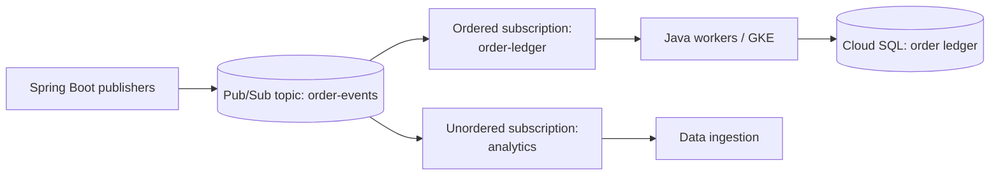
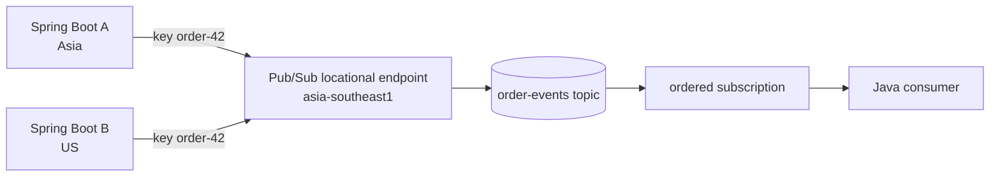
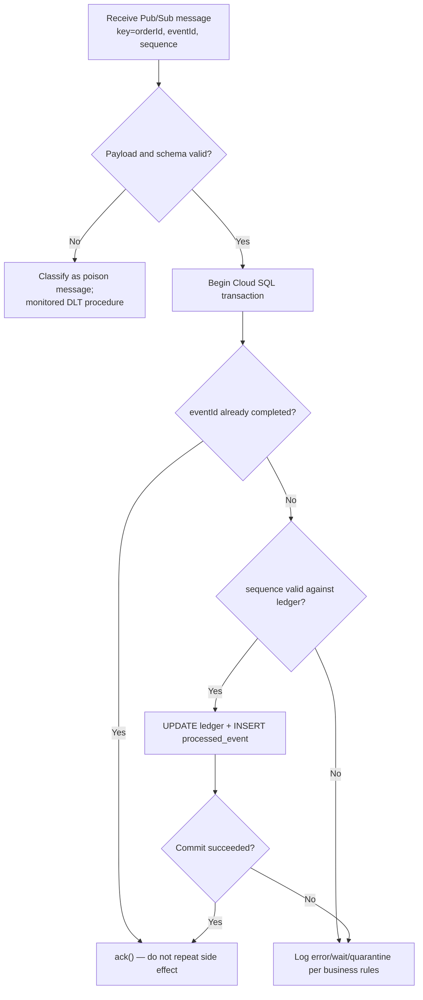
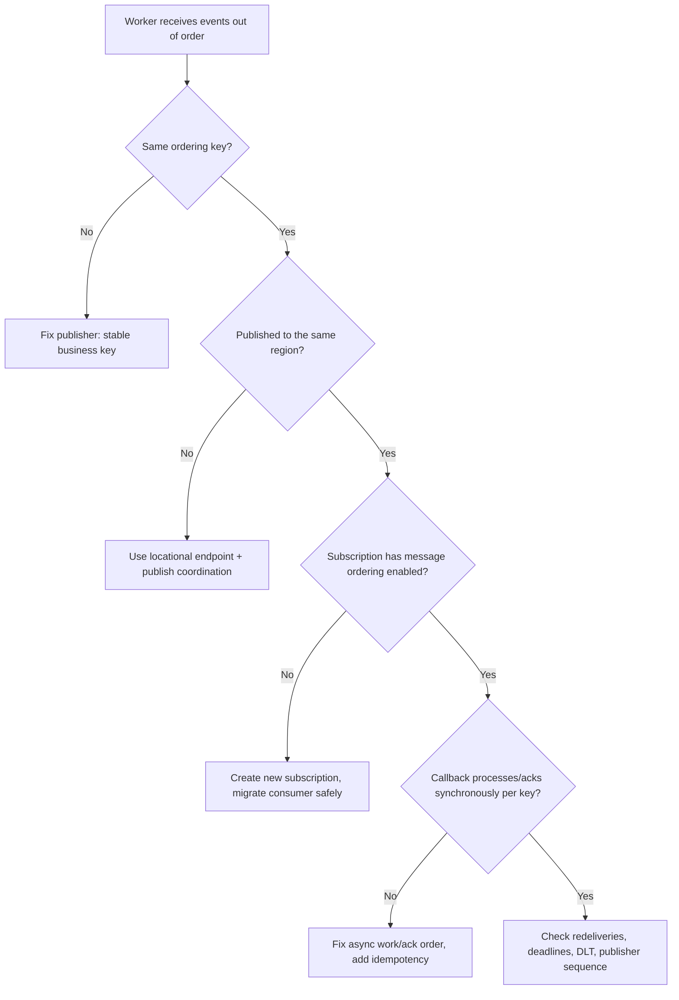

# Ordering keys and message ordering

## 1. Problem: out-of-order events corrupt order state

A **Java/Spring Boot** system on Google Cloud publishes events as an order changes: `CREATED → PAID → SHIPPED`. A worker on **Cloud Run/GKE** receives events via **Pub/Sub** and updates a summary table in **Cloud SQL**. If the worker processes `SHIPPED` before `PAID`, the system can display wrong states or execute invalid business actions. If an event is processed twice, the system could also send duplicate notifications or deduct inventory twice.

By default, Pub/Sub provides **at-least-once delivery with no ordering guarantee**. **Message ordering** solves part of this problem: guaranteeing **message delivery order within each ordering key**, provided both publisher and subscription are configured properly. Ordering does **not** automatically provide global ordering, transactions, exactly-once business processing, or deduplication of duplicate events.

In the **Pub/Sub and Messaging** chapter of module **CLOUD_PROVIDERS_GCP**, this lesson focuses on designing ordering keys, configuring topics/subscriptions, writing Java publishers/subscribers, handling ack/retry, monitoring hot keys, IAM, and cost. The goal is keeping the system reliable at scale and under failures—not merely making logs print in order during a single demo run.

**Learning outcomes:**

1. State accurately the conditions for Pub/Sub ordering and distinguish ordering **within a key** from ordering **across keys**.
2. Choose business-meaningful, well-distributed, and stable ordering keys.
3. Understand the effects of **region, multiple publishers, pull/StreamingPull, push, ack deadline, and redelivery**.
4. Create an ordered subscription and publish/consume messages using the **Java Pub/Sub client library**.
5. Distinguish message ordering, **exactly-once delivery**, **idempotency**, and Cloud SQL transactions.
6. Diagnose hot keys, backlogs, dead-letters, retries, and estimate costs.

> **Lab scope:** create topics/subscriptions only in an authorized test project. This lesson does **not** execute commands or provision GCP resources. Never send real orders to a lab topic and never delete a production subscription just to enable message ordering.

## 2. Ordering guarantee: per key and per region

An **ordering key** is a string identifying a group of related messages, such as `order-42`, `account-9`, or `customer-127`. Each message can carry one `orderingKey`; the key must be non-empty and has a **1 KB** size limit.

For a **subscription** to receive messages in order, all of the following must hold simultaneously:

1. **The publisher attaches the same ordering key** to every message in the sequence.
2. Publish requests for the **same key enter Pub/Sub in the same region**. Publishers running across multiple regions or outside GCP should use a **locational endpoint** for one region.
3. **The subscription is created with message ordering enabled**. This property is set at subscription creation; it cannot be toggled on or off on an existing subscription.

```text
Publisher (region asia-southeast1)          Subscription with ordering enabled

key=order-42:  CREATED(1) ─ PAID(2) ─ SHIPPED(3)
                                              ↓
Subscriber:    CREATED(1) → PAID(2) → SHIPPED(3)

key=order-99:  CREATED(1) ─ CANCELLED(2)
                   ↓               ↓
Subscriber:    CREATED(1) → CANCELLED(2)

No ordering constraint BETWEEN order-42 and order-99.
```

**Guarantee scope:** order is determined by **the order in which Pub/Sub receives publishes within a single region**, not by payload timestamps or clock order across servers. If two publishers send events for the same key concurrently, Pub/Sub establishes an actual receive order, but the publishers **do not know that order in advance**. If business rules require `PAID` always after `CREATED` across multiple producers, coordinate emission on the application side (transactional outbox, single writer/leader, or checked sequence numbers). <https://cloud.google.com/pubsub/docs/ordering>

### 2.1. Topic and subscription do not share an "ordering flag"

| Component | Deciding configuration | Meaning |
| --- | --- | --- |
| **Publisher message** | `orderingKey="order-42"` | Tags identity of an ordered sequence |
| **Publisher client** | Enable ordering + publish into **one region** | Ensures publish-side ordering for the key |
| **Topic** | No "enable ordering" setting on the topic | A topic can serve both ordered and unordered subscribers |
| **Subscription A** | `enableMessageOrdering=true` | Receives messages with the same key in order |
| **Subscription B** | `enableMessageOrdering=false` | Receives from the same topic with **no ordering guarantee** |

Because the subscription is the unit of delivery, each subscription has its own ack/backlog state. An error on `orders-analytics-sub` **does not mean** `orders-billing-sub` shares the same backlog.

### 2.2. A timeline is not a single queue



Example in the diagram: the ledger worker requires ordering by **orderId**; the analytics pipeline does not require ordering and can use a separate unordered subscription for higher parallelism.

## 3. Choosing ordering keys along business boundaries

An ordering key should satisfy two properties: **all events requiring serialization share the same key**, while independent streams use **different keys** to maximize concurrency.

| Candidate key | Assessment | When appropriate |
| --- | --- | --- |
| `orderId` | Each order has its own state sequence | Handling `CREATED/PAID/SHIPPED` for the same order |
| `accountId` | Serializes balance changes for one account | Managing balances and ledger order |
| `customerId` | Multiple orders for one customer are **unnecessarily serialized** | Only when business truly requires customer-wide ordering |
| `tenantId` | Large tenants can become **hot keys** | Only when tenant state is a single sequential stream |
| `"global"` | All messages share one key, creating a bottleneck | Almost never suitable for large systems |
| Random UUID **per message** | Events for the same order get different keys | **Fails** to provide ordering |

**Do not use emails, phone numbers, or sensitive identifiers as keys** unnecessarily; ordering keys appear in metadata and logs. Prefer internal non-PII IDs.

### 3.1. Why not use one key for everything?

Pub/Sub has a **1 MB/s publisher throughput limit per ordering key**. In addition, **subscriber throughput per key** is bounded by callback completion time for that key. If `tenant-A` emits 2,000 events/s while a worker processes 500/s, that key's backlog grows even while other workers sit idle.

A **hot key** cannot be fixed solely by adding Pods or raising `maxInstances`: one key must preserve order. Reduce per-message processing time, pick a finer-grained key **only if business rules allow**, or redesign how business ordering is stored.

### 3.2. Ordering keys are not Kafka partitions

Pub/Sub does not require pre-allocating a fixed number of partitions by key; the service handles a **very large number of ordering keys**. Do not carry over Kafka's mental model ("a topic has N partitions, so only N sequences"). However, **having many keys does not create cross-key ordering** and does not resolve concurrent update conflicts across multiple entities.

## 4. Region: an often overlooked requirement

Pub/Sub **guarantees ordering for a key only when publishers send that key to the same region**. If an Asia producer and a US producer both publish `order-42` into two different regions, there is no unified order between them, even on the same topic and ordered subscription.



The diagram shows **two publishers selecting the same region for a key**. Example Java endpoint: `asia-southeast1-pubsub.googleapis.com:443`. A **locational endpoint routes publishes into the specified region**; it does not by itself constitute a **strong data residency enforcement** across all storage/processing. If data must remain in a specific region, check **regional endpoints, message storage policies, and `enforce_in_transit`** in current documentation.

**Subtle detail:** subscribers can connect from another region and still receive the ordered sequence for a key published in one region. The **same-region** rule is mandatory on the **publish side**. Separately, if **exactly-once delivery** is enabled, subscribers must use endpoints in the **same region** to preserve that feature's exactly-once guarantee.

During a regional outage, failing over a publisher for the same key to another region can affect ordering. Design **leader/failover coordination, sequences, and checkpoints** at the application layer rather than promising cross-region total ordering.

## 5. Subscriber behavior: Pull, StreamingPull, and Push

| Subscription type | Ordered delivery | Notes |
| --- | --- | --- |
| **StreamingPull** via Java client | Callbacks for the **same key** execute to completion in order | Recommended for long-running Java workers; different keys run in parallel |
| **Unary Pull** | Messages for the same key are ordered within one `PullResponse`; one outstanding batch per key | Must preserve order while iterating/processing the batch |
| **Push** | Only **one outstanding message per key** | Easily increases latency when one key has many messages; unsuitable for hot keys |
| **BigQuery export** | Messages for the same key are written in order | Check table/consumer semantics |
| **Cloud Storage export** | Ordered within **a single file**, do not infer order from filenames across files | Do not use file timestamps as event sequence |

The Java high-level subscriber uses **StreamingPull** and invokes a callback per message. For the same key, one callback completes before the next runs; however, if your callback **offloads work to another thread and returns immediately**, you break **business processing order**. Keep processing synchronous inside the callback or use a **per-key queue** with a sequential worker.

### 5.1. Ack must follow durable side effects

`ack()` confirms processing finished so Pub/Sub does not redeliver the message under normal rules. `nack()` requests redelivery. With ordered subscriptions, **an ack on a later message is not recognized before the ack on an earlier message** of the same key. If processing `PAID` fails, **do not ack `SHIPPED`** and expect the system to maintain valid business state.

The high-level Java subscriber can **auto-extend the ack deadline** within configured limits while the callback runs; nevertheless, deadlines can still expire due to network errors, GC pauses, process crashes, or overload. Design short handlers, explicit timeouts, and **idempotency** rather than merely setting an enormous ack deadline.

## 6. Redelivery: ordering does not eliminate duplicates

Suppose a subscriber receives a key:

```text
order-42:
1. CREATED     → ack()
2. PAID        → slow processing, ack deadline expires
3. SHIPPED     → previously delivered/acked

When (2) is redelivered, Pub/Sub may also redeliver (3),
even if (3) was already acked earlier.
```

This is intentional behavior to preserve sequence integrity. Therefore **every message must be safe to re-process**. Combining ordering with a **dead-letter topic (DLT)** can break the assumption that "every message is always processed together in order": once Pub/Sub forwards a failing message to the DLT (best-effort), subsequent messages can proceed; **do not assume the stream will reassemble in order automatically**.

### 6.1. Exactly-once delivery differs from exactly-once processing

Pub/Sub supports **exactly-once delivery** on **Pull/StreamingPull subscriptions**, within **one region**, based on **Pub/Sub message ID**. Push subscriptions do **not** support this feature. When acked successfully and on time, the service guarantees not to redeliver the same message ID within its guarantee scope; however:

- A producer can **publish the same business event twice** and receive two **different message IDs**.
- **Seek/replay** can cause already-acked messages to be delivered again on demand.
- Side effects to **Cloud SQL, email, or REST APIs** are outside Pub/Sub's ack transaction.
- When combining ordering + exactly-once, **acks must be in order**: out-of-order acks can hit transient errors and reduce throughput.

Hence, **exactly-once delivery does not guarantee charging a card only once**. Backend transactions and idempotency are what protect business outcomes.

## 7. Designing an idempotent Java consumer

When processing `order-42/PAID`, write a **business event ID** or **(aggregate ID, sequence)** into a Cloud SQL table with a unique constraint. Within the same transaction, validate state transition rules and update the ledger. If the event was already processed, succeed and **ack**; if the transaction rolls back, **nack** or let the client retry per error type.



Conceptual schema example:

```sql
CREATE TABLE processed_event (
    event_id VARCHAR(100) PRIMARY KEY,
    order_id VARCHAR(100) NOT NULL,
    sequence_no BIGINT NOT NULL,
    processed_at TIMESTAMP NOT NULL,
    UNIQUE (order_id, sequence_no)
);

-- In a real transaction: lock the target order row, verify the
-- expected sequence_no, UPDATE order state, then INSERT event.
-- Commit before acking the Pub/Sub message.
```

**Do not use `PubsubMessage.getMessageId()` as the sole business identifier** if the producer can publish duplicates under two different Pub/Sub message IDs. Attach `eventId` and `sequence` generated from an **authoritative data source**, such as the order's transactional outbox. If two writers can modify the same `orderId`, use **serialization/locking** to establish publish order; Pub/Sub's request arrival order cannot repair a business history published out of order.

## 8. Lab: safely creating an ordered subscription with gcloud

Prerequisites: lab project with Pub/Sub API, Billing/quota, and proper permissions. Commands below use **Bash/Cloud Shell**; the Java example in Section 9 actually sends messages through **one locational endpoint**. Never use production topics/subscriptions or real customer data.

### Step 1 — Create lab resources

```bash
gcloud config set project PROJECT_ID
gcloud services enable pubsub.googleapis.com

gcloud pubsub topics create orders-events-lab

gcloud pubsub subscriptions create orders-ordered-lab \
  --topic=orders-events-lab \
  --enable-message-ordering \
  --ack-deadline=30

gcloud pubsub subscriptions describe orders-ordered-lab \
  --format="yaml(name,topic,enableMessageOrdering,ackDeadlineSeconds)"
```

If a topic/subscription with the same name already exists, **do not reuse or delete it** without verifying ownership. Subscription ordering is set **at creation time**; if accidentally created unordered, create a **new lab subscription** and review replay/backlog handling before changing real systems.

### Step 2 — Compare with an unordered subscription

```bash
gcloud pubsub subscriptions create orders-unordered-lab \
  --topic=orders-events-lab

gcloud pubsub subscriptions describe orders-unordered-lab \
  --format="yaml(name,topic,enableMessageOrdering)"
```

Both subscriptions receive their **own logical copy** of messages on the topic; only the ordered subscription guarantees per-key order. The lab uses Java for publishers to ensure **same-region** publishing. `gcloud pubsub topics publish --ordering-key=...` can be used for quick tests, but if commands hit the **global endpoint** and route to different regions, do not take that as proof of cross-region ordering.

## 9. Java 21: ordered publisher and subscriber

### 9.1. Maven structure

In a **dedicated lab directory** on a machine with JDK 21/Maven:

```text
pubsub-ordering-lab/
├── pom.xml
└── src/main/java/dev/example/pubsub/
    ├── OrderedPublisher.java
    └── OrderedSubscriber.java
```

`pom.xml`:

```xml
<?xml version="1.0" encoding="UTF-8"?>
<project xmlns="http://maven.apache.org/POM/4.0.0"
         xmlns:xsi="http://www.w3.org/2001/XMLSchema-instance"
         xsi:schemaLocation="http://maven.apache.org/POM/4.0.0 https://maven.apache.org/xsd/maven-4.0.0.xsd">
  <modelVersion>4.0.0</modelVersion>
  <groupId>dev.example</groupId>
  <artifactId>pubsub-ordering-lab</artifactId>
  <version>1.0.0</version>
  <properties>
    <maven.compiler.release>21</maven.compiler.release>
    <project.build.sourceEncoding>UTF-8</project.build.sourceEncoding>
  </properties>
  <dependencies>
    <dependency>
      <groupId>com.google.cloud</groupId>
      <artifactId>google-cloud-pubsub</artifactId>
      <version>1.157.0</version>
    </dependency>
  </dependencies>
  <build>
    <plugins>
      <plugin>
        <groupId>org.apache.maven.plugins</groupId>
        <artifactId>maven-compiler-plugin</artifactId>
        <version>3.13.0</version>
      </plugin>
      <plugin>
        <groupId>org.codehaus.mojo</groupId>
        <artifactId>exec-maven-plugin</artifactId>
        <version>3.5.1</version>
      </plugin>
    </plugins>
  </build>
</project>
```

Library versions are illustrative based on current Java Pub/Sub docs; in production, **verify against Maven Central/GCP Java BOM, JDK support, and CVEs** rather than pinning one version indefinitely.

### 9.2. Publisher sending per key in order

`OrderedPublisher.java`:

```java
package dev.example.pubsub;

import com.google.cloud.pubsub.v1.Publisher;
import com.google.protobuf.ByteString;
import com.google.pubsub.v1.PubsubMessage;
import com.google.pubsub.v1.TopicName;
import java.util.concurrent.TimeUnit;

public final class OrderedPublisher {
    public static void main(String[] args) throws Exception {
        if (args.length != 2) {
            throw new IllegalArgumentException("Usage: PROJECT_ID TOPIC_ID");
        }

        var topic = TopicName.of(args[0], args[1]);
        Publisher publisher = Publisher.newBuilder(topic)
            // All publishers for the same key must target the same region.
            .setEndpoint("asia-southeast1-pubsub.googleapis.com:443")
            .setEnableMessageOrdering(true)
            .build();

        // [ordering key, business event ID, sequence, payload]
        String[][] events = {
            {"order-42", "evt-42-1", "1", "CREATED"},
            {"order-99", "evt-99-1", "1", "CREATED"},
            {"order-42", "evt-42-2", "2", "PAID"},
            {"order-99", "evt-99-2", "2", "CANCELLED"},
            {"order-42", "evt-42-3", "3", "SHIPPED"}
        };

        try {
            for (String[] e : events) {
                PubsubMessage message = PubsubMessage.newBuilder()
                    .setOrderingKey(e[0])
                    .setData(ByteString.copyFromUtf8(e[3]))
                    .putAttributes("eventId", e[1])
                    .putAttributes("sequence", e[2])
                    .build();

                // Wait for publish confirmation for clear lab observation.
                // Production may publish asynchronously but must manage
                // futures, ordering, and failures per ordering key.
                String id = publisher.publish(message)
                    .get(30, TimeUnit.SECONDS);
                System.out.printf("key=%s seq=%s id=%s%n", e[0], e[2], id);
            }
        } finally {
            publisher.shutdown();
            publisher.awaitTermination(30, TimeUnit.SECONDS);
        }
    }
}
```

This code **uses a single publisher and one regional endpoint**; events for the same key are sent and confirmed sequentially to avoid publish-order ambiguity in the lab. Do not compare `messageId` numerically for order: it is a service-assigned ID, **not a sequence counter**.

**When an unretryable publish failure occurs for a key**, the Java Publisher may **pause that key**, causing subsequent publishes on the same key to fail. After investigating the error and ensuring business event preservation (outbox/retry), call `publisher.resumePublish(orderingKey)` to continue. **Never call resume blindly and drop the failed message**: that creates a logical gap in the ledger.

### 9.3. Subscriber using StreamingPull, processing synchronously in callback

`OrderedSubscriber.java`:

```java
package dev.example.pubsub;

import com.google.cloud.pubsub.v1.MessageReceiver;
import com.google.cloud.pubsub.v1.Subscriber;
import com.google.pubsub.v1.SubscriptionName;

public final class OrderedSubscriber {
    public static void main(String[] args) throws Exception {
        if (args.length != 2) {
            throw new IllegalArgumentException("Usage: PROJECT_ID SUBSCRIPTION_ID");
        }

        var subscription = SubscriptionName.of(args[0], args[1]);
        MessageReceiver receiver = (message, consumer) -> {
            try {
                String key = message.getOrderingKey();
                String eventId = message.getAttributesOrDefault("eventId", "");
                String seq = message.getAttributesOrDefault("sequence", "");
                String body = message.getData().toStringUtf8();

                // Demo: log output. Real systems must check idempotency
                // and commit Cloud SQL before calling ack().
                System.out.printf("key=%s seq=%s event=%s state=%s%n",
                        key, seq, eventId, body);
                consumer.ack();
            } catch (RuntimeException ex) {
                System.err.println("Processing failed: " + ex);
                consumer.nack();
            }
        };

        Subscriber subscriber = Subscriber.newBuilder(subscription, receiver)
            .build();
        Runtime.getRuntime().addShutdownHook(
            new Thread(() -> subscriber.stopAsync()));
        subscriber.startAsync().awaitRunning();
        System.out.println("Listening; Ctrl+C to stop.");
        subscriber.awaitTerminated();
    }
}
```

The high-level Pub/Sub client preserves **per-key callback order** on an ordered subscription; different keys can run in parallel. The code deliberately **avoids spawning a `CompletableFuture` and acking early**, since doing so breaks side-effect ordering guarantees. In production, replace `System.out.printf` with transactions/idempotency and proper **flow control**; inspect ack errors when exactly-once delivery is enabled.

### 9.4. Running the lab

On a lab machine using ADC:

```bash
gcloud auth application-default login
mvn -q clean package

# Publish 5 sample messages after creating subscriptions:
mvn -q exec:java \
  -Dexec.mainClass=dev.example.pubsub.OrderedPublisher \
  -Dexec.args="PROJECT_ID orders-events-lab"

# Run the subscriber in another terminal:
mvn -q exec:java \
  -Dexec.mainClass=dev.example.pubsub.OrderedSubscriber \
  -Dexec.args="PROJECT_ID orders-ordered-lab"
```

Expect `order-42` to have sequence **1 → 2 → 3** and `order-99` to have **1 → 2**; the two streams may interleave. Since the subscriber runs continuously, stop with **Ctrl+C** when finished. Every message in an ordered subscription should be processed/acked so backlog does not accumulate.

### 9.5. Comparing against the unordered subscription

Run the same Java subscriber against `orders-unordered-lab`. The receiver still works, but per-key ordering is **no longer guaranteed**. With small message counts sent sequentially in a lab, you **might still observe logs in order by coincidence**; that **does not prove** unordered subscriptions support ordering. To stress-test, increase event volume and run multiple workers—while avoiding unexpected quota spikes on shared test environments.

## 10. Scaling and handling hot keys

### 10.1. More instances do not parallelize a single key

Suppose a worker processes **each message in 40 ms**. If a key runs callbacks sequentially without extra network wait:

```text
Theoretical throughput/key ≈ 1 / 0.040 s = 25 messages/s.

If publishing 100 messages/s for the same key:
Key backlog grows by roughly 75 messages/s (ignoring retries and overhead).
```

Scaling GKE replicas from 2 to 10 helps when there are **many independent keys**, not by letting `order-42` run 10 callbacks concurrently while preserving order. Choose keys with sufficient cardinality, minimize DB round trips, combine idempotent batching if the domain allows, or use a dedicated design for hot-key sources.

### 10.2. Flow control and ack deadlines

A Java StreamingPull subscriber can bound **outstanding messages/bytes** to avoid exhausting RAM and DB connections. With ordered delivery, a slow callback forces subsequent messages for the same key to wait. Optimize **transaction duration**, avoid holding DB locks too long, configure appropriate deadlines/extensions, and ack only after data commits.

Metrics to monitor include:

- `subscription/oldest_unacked_message_age`: age of oldest unacked message, indicating backlog or hot keys.
- `subscription/num_undelivered_messages`: number of messages not yet delivered/acknowledged per service state.
- `subscription/sent_message_count` and throughput/ack latency where available.
- Rates of `nack`, deadline expirations, duplicate/redelivery, and Java processing latency per key.
- `publisher/topic_send_request_count` plus publish errors, throughput/key, and publish latency.

**Do not put high-cardinality ordering keys like individual `orderId` values into metric labels**; this can explode time-series counts and billing. Use sampling/correlation IDs in logs and aggregate by groups instead of creating a metric series per order.

## 11. Dead-letter, replay, and Dataflow interaction

### 11.1. Poison messages

A message with a malformed schema can be repeatedly nacked, stalling subsequent messages of the same key or causing redeliveries. A **dead-letter topic** forwards failing messages after a configurable number of delivery attempts (subject to Pub/Sub limits), but forwarding is **best-effort** and **ordering may not be preserved** once messages move to another topic.

Runbook: capture **eventId/key/sequence/payload reference**, diagnose root cause, fix data at the source, and decide on replay or compensation. Never merely "skip the bad message and process the next" if the domain requires a complete sequence.

### 11.2. Seek and snapshots

Pub/Sub supports **seek** to a timestamp or snapshot within retention/configuration bounds; this operation can **redeliver** previously acked messages. If using seek on a live subscription, reprocessing the same key **must be idempotent** and requires change approval because it affects the entire subscription, not a single order.

Exactly-once delivery also **does not make on-demand replay impossible**. Do not use seek as a "fix order" button when the source already published an invalid business sequence.

### 11.3. Dataflow does not need Pub/Sub ordering keys

When using **Dataflow** for stream processing, Google Cloud recommends **not enabling Pub/Sub ordering** merely to sort data in Dataflow; Dataflow has its own **event-time/windowing** and ordering mechanisms. Clarify whether your system needs **message delivery order** or **event ordering by business timestamp**, as they are two distinct requirements.

## 12. Security, reliability, and cost

### 12.1. Role-based IAM separation

| Component | Recommended permission | Should not have |
| --- | --- | --- |
| Spring Boot publisher | `roles/pubsub.publisher` on the topic | Delete subscriptions or edit project-wide IAM |
| GKE/Cloud Run Java worker | `roles/pubsub.subscriber` on the subscription | `roles/pubsub.admin` if it only consumes |
| Platform operator | Permission to create/update topics/subscriptions per process | Personal Owner account for CI/CD |
| Auditor | Read metadata, logs, and metrics | Seek/delete permissions or publish access to production topics |

On GKE use **Workload Identity Federation for GKE**; on Cloud Run use a **runtime service account**. In Java client code, prefer **Application Default Credentials (ADC)** rather than bundling service account JSON keys. Sensitive payload data must be protected via IAM, encryption, and log redaction; never log raw invoice payloads or PII.

### 12.2. Cost and SLOs

Pub/Sub charges for published/delivered data volume, message storage/retention, and applicable features/network egress per current pricing. Ordered delivery can increase **latency** and reduce **publish availability** compared to unordered delivery due to ordering coordination. Exactly-once can carry separate pricing, quotas, and latency; redelivery traffic also adds overhead.

Illustrative load model:

```text
10,000 orders/day × 4 events/order = 40,000 messages/day.
If spread across 10,000 orderIds, each key has ~4 messages.
If using key="all-orders", all 40,000 messages travel in one sequence.
```

These are **message counts**, not dollar amounts: multiply by payload/metadata size, subscription count, retention, redeliveries, regions, and network egress. Use **Cloud Billing reports/budgets**; remember **budget alerts do not automatically stop publishing**.

## 13. Layered troubleshooting

| Symptom | Possible cause | Check |
| --- | --- | --- |
| Messages for the same `orderId` arrive out of order | Publisher did not set key or subscription lacks ordering enabled | Message `orderingKey`, `subscriptions describe` |
| Same key used, yet order breaks in multi-region deploy | Publishers hit multiple regions | Endpoint, cluster region, publish audit/time |
| Cannot toggle `enableMessageOrdering` | Immutable after creation | Create new subscription, plan replay/cutover |
| Processing logs out of order despite Pub/Sub ordering | Callback offloads async work and returns immediately | Worker thread pool/`CompletableFuture`, ack timing |
| Later messages redelivered repeatedly | Earlier message with same key timed out/nacked | Ack deadline, Java GC, DB latency |
| One customer/tenant builds large backlog | **Hot key** | Rate per key, processing latency, `oldest_unacked_message_age` |
| Publisher stops sending for a key after error | Ordering key paused by unretryable error | Client logs, `resumePublish` after remediation |
| Event processed twice despite ordering | At-least-once or duplicate producer publish | Business event ID, unique constraint, redelivery logs |
| Exactly-once ack returns transient error | Out-of-order ack or deadline too short | Ack sequence/response, client extension config |
| Push callback slow across many keys | Only one outstanding push message per key | Key cardinality, response time, consider StreamingPull |
| DLT leaves a gap in the ledger | Poison message forwarded to DLT | DLT records, retry/compensation rules |
| Total cost spikes | Backlog retention, duplicates, multiple subscriptions | Billing, publish/delivery bytes, retention |

### Investigation workflow



**Do not delete a subscription or disable ordering just to make a backlog disappear**. Identify which sequence the events belong to, whether unprocessed business data exists, and the consequences of replaying or skipping.

## 14. Lab resource cleanup

Stop `OrderedSubscriber` first, then delete only the lab resources in the right project after confirming no other workload uses them:

```bash
gcloud pubsub subscriptions describe orders-ordered-lab
gcloud pubsub subscriptions describe orders-unordered-lab
gcloud pubsub topics describe orders-events-lab

gcloud pubsub subscriptions delete orders-ordered-lab
gcloud pubsub subscriptions delete orders-unordered-lab
gcloud pubsub topics delete orders-events-lab
```

**Deleting a subscription discards its backlog/snapshot state per applicable rules**; it is not a "safe pause." Never run `delete` on real topics/subscriptions or another team's automation. After cleanup, inspect Pub/Sub resources/Billing, service accounts, and logs/budgets if the lab created any.

## 15. Exercises and checklist

### Exercise A — Determine ordering

A publisher sends `order-1: CREATED(1), PAID(2), SHIPPED(3)` and `order-2: CREATED(1), CANCELLED(2)` from the **same region**; the subscription has ordering enabled. Write valid receive sequences and explain why there is no enforced order between `order-1` and `order-2`.

### Exercise B — Key design

A system processes 100,000 orders/day, with one large customer generating 50% of orders. Compare `tenantId`, `customerId`, and `orderId` by parallelism, hot keys, and business requirements. Recommend the right key for **per-order** state, then adjust the choice if serializing **per-account** balances.

### Exercise C — Java practice

Create a lab topic and ordered/unordered subscriptions; use a Java publisher with `setEnableMessageOrdering(true)` and a **locational endpoint**. Run the Java StreamingPull subscriber and record per-key order. Temporarily replace the callback with an async task **in the lab only** and observe why early `ack` fails to preserve side-effect order.

### Exercise D — Redelivery and idempotency

`order-42/PAID` updated Cloud SQL, but ack timed out; `SHIPPED` is later redelivered. Design the `processed_event` table, transaction, and ack logic so **inventory is not deducted twice and emails are not sent twice**. Distinguish business event ID from Pub/Sub message ID.

### Exercise E — Cross-region and exactly-once

Two publishers in Asia and US send the same `orderingKey="account-9"`. Explain why cross-region ordering does not hold, how to select one publish region, and the additional requirement when enabling exactly-once delivery on the subscription. Explain why exactly-once delivery does not stop a producer from publishing the same payment event twice.

### Exercise F — Capacity calculation

One ordering key receives 100 messages/s, and each callback takes 40 ms. Compute throughput capacity (~**25 messages/s**) and backlog growth (~**75 messages/s**) under sustained load. Propose fixes without violating business ordering requirements.

### Pre-production checklist

- [ ] Chosen keys along business boundaries, avoiding global keys or new UUIDs per event.
- [ ] Ensured publishers for **one key send to the same region**, coordinating multiple producers if needed.
- [ ] Created subscriptions with `--enable-message-ordering` and verified the property from the start.
- [ ] Understood that callbacks for the same key must finish before processing the next message.
- [ ] **Committed durable side effects before ack**, handling duplicates/redeliveries via idempotency.
- [ ] Understood the separate limits of ack deadlines, DLTs, seek/replay, and exactly-once.
- [ ] Monitored hot keys, oldest unacked age, quotas, throughput, Java latency, and cost.
- [ ] Applied least-privilege IAM for publishers/subscribers and protected payload data.

**Conclusion:** Pub/Sub ordering keys guarantee **per-key message delivery order within a single publish region**, without establishing global order or replacing transactional consistency. For Java workloads on GCP, reliable design requires **sound business keys, a stable publisher region, properly timed subscriber acks, idempotency, and hot-key observability**. Enable ordering only for streams that truly need it; analytics pipelines often perform better with unordered subscriptions for higher throughput.

## 16. Official references

- [Pub/Sub: Order messages](https://cloud.google.com/pubsub/docs/ordering)
- [Pub/Sub: Publish messages and ordering keys](https://cloud.google.com/pubsub/docs/publisher)
- [Best practices for publishing ordered messages](https://cloud.google.com/pubsub/docs/publish-best-practices)
- [Best practices for subscribing / acknowledgments](https://cloud.google.com/pubsub/docs/subscribe-best-practices)
- [Subscription properties](https://cloud.google.com/pubsub/docs/subscription-properties)
- [Exactly-once delivery and ordered subscriptions](https://cloud.google.com/pubsub/docs/exactly-once-delivery)
- [Regional and locational Pub/Sub endpoints](https://cloud.google.com/pubsub/docs/reference/service_apis_overview)
- [Java: publish with ordering keys](https://cloud.google.com/pubsub/docs/samples/pubsub-publish-with-ordering-keys)
- [Java client: Publisher API / resumePublish](https://cloud.google.com/java/docs/reference/google-cloud-pubsub/latest/com.google.cloud.pubsub.v1.Publisher)
- [gcloud subscription create](https://cloud.google.com/sdk/gcloud/reference/pubsub/subscriptions/create)
- [gcloud topic publish and ordering-key](https://cloud.google.com/sdk/gcloud/reference/pubsub/topics/publish)
- [Pub/Sub quotas and limits](https://cloud.google.com/pubsub/quotas)
- [Pub/Sub pricing](https://cloud.google.com/pubsub/pricing)
