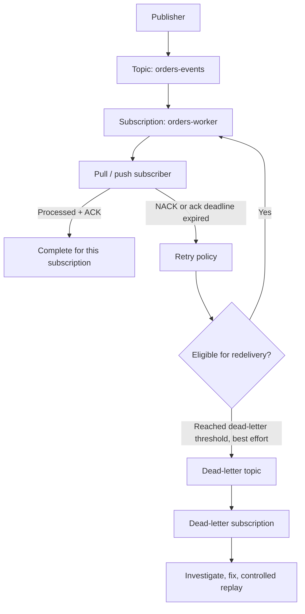
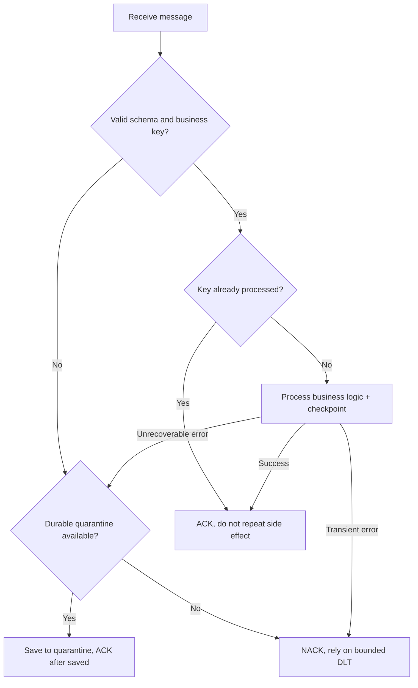

# Retry policies, dead-letter topics, and poison messages

> **Chapter:** Pub/Sub and Messaging  
> **Module:** CLOUD_PROVIDERS_GCP  
> **Module scope:** Explore Google Cloud from project organization, IAM, and VPC to Compute Engine, GKE, Cloud Run, storage services, and databases. Through deployment scenarios, learners know how to select services, secure resources, automate releases, and monitor reliability and cost.

An order-processing subscriber can fail because the database temporarily loses connectivity, or because it encounters a message with an invalid schema. Both failures can cause Pub/Sub to redeliver the message, yet **how you handle them is different**: transient errors should be retried in a controlled manner; unprocessable messages (**poison messages**) must be isolated so they do not loop forever and clog the system.

This lesson explains **ack/nack, acknowledgment deadlines, retry policies, dead-letter topics (DLT), delivery attempt counts, and poison-message workflows** in Google Cloud Pub/Sub. The hands-on section sets up a **pull subscription in a sandbox project**, uses a Python subscriber to simulate a valid message and a poison message, and observes the dead-letter subscription. Examples do not automatically provision real resources during authoring.

## Learning objectives

After this lesson, you will be able to:

1. Distinguish `ack`, `nack`, **expired ack deadlines**, redelivery, and message retention.
2. Choose **retry immediately** or **exponential backoff** and understand the **best-effort** nature of retry delays.
3. Configure a DLT **on the source subscription**, set an appropriate `maxDeliveryAttempts`, and grant proper IAM to the **Pub/Sub service agent**.
4. Classify **transient** vs. **permanent/poison** errors, design idempotency, and avoid infinite retry loops.
5. Create topics, subscriptions, and retry/DLT policies, run a test subscriber, monitor delivery attempts, and clean up safely.
6. Use Cloud Monitoring and logs to investigate backlogs, expired ack deadlines, dead-letter forwarding, and cost impacts.

## 1. How does a message flow through Pub/Sub?



**A topic can have multiple independent subscriptions**. A message ACKed on subscription A is **not** ACKed on subscription B. Retry policies and dead-letter policies also belong to the **subscription**, not the publisher or source topic.

### 1.1. ACK, NACK, and ack deadline

| Scenario | Result for the subscription |
|---|---|
| Subscriber processes and **ACKs successfully** | Pub/Sub does not need to redeliver the message to this subscription, subject to delivery semantics |
| Pull subscriber calls **NACK** | Message becomes eligible for **redelivery**; policy determines wait time |
| Subscriber fails to ACK before **ack deadline** | Message may be redelivered |
| Subscriber crashes mid-processing | UnACKed message may be redelivered when lease expires |
| Message exceeds approximate delivery threshold with valid DLT | Pub/Sub may forward to DLT and ACK on the source subscription |
| Message exceeds **retention** duration without being processed | May be discarded per retention policy; **DLT is not an infinite archive** |

For **pull**, `nack()` is equivalent to requesting `ModifyAckDeadline=0`. Subscriber libraries can automatically **extend the ack deadline** while the handler runs; do not assume processing longer than `--ack-deadline=30` automatically triggers redelivery right at 30 seconds. Check the client's **lease extension** mechanism and max extension duration.

For **push subscriptions**, subscribers do not call `nack()` via SDK: the HTTP endpoint returns a **response code Pub/Sub treats as ACK** upon success; errors/timeouts cause Pub/Sub to retry delivery. Push streams are also subject to a separate **push backoff**, unlike pull subscribers.

### 1.2. At-least-once does not mean exactly-once processing

In the default delivery mode, Pub/Sub can redeliver the same message ID multiple times. For instance, a subscriber updates an order and crashes before ACKing; the next delivery can write duplicate data without deduplication.

Pub/Sub's **exactly-once delivery** is an option for **pull/StreamingPull** within its regional scope and conditions; **push and export do not support it**. It does not eliminate duplicate publishes from a producer or guarantee that a database transaction runs only once. Whenever side effects exist, still design **idempotency**, transactions, and ACK result checks.

## 2. Retry policies: retrying when unACKed

Pub/Sub always provides a mechanism to retry unACKed messages. You can select the retry style on **each subscription**:

| Policy | Mechanism | Best suited for |
|---|---|---|
| **Retry immediately** | Default; retries promptly after NACK/ack deadline expiry | Rare errors or very short recovery times |
| **Retry after exponential backoff** | Gradually increases delay between retries within min/max bounds | Transient errors like 429s, DB outages, overloaded downstream |

Exponential backoff is **best-effort**; actual delays may be shorter or longer than configured values. Allowed min/max bounds range from **0 to 600 seconds**, e.g., `10s`–`60s`. This is **not an exact scheduler** and does not replace Cloud Tasks/Scheduler when deliberate delays are needed.

### 2.1. When does backoff apply?

- A pull subscriber **NACKs** a message.
- A message **exceeds its ack deadline** without being ACKed.
- Wait times are **per message**, not a single global timer across the whole subscription. Other messages can still be processed; exceptions apply when **message ordering** is enabled.
- If a large share of messages are continuously NACKed, Pub/Sub may reduce overall throughput or perform some redeliveries faster than the expected backoff.

### 2.2. Push backoff is a separate mechanism

For push subscriptions, when the endpoint repeatedly fails to ACK, Pub/Sub may apply **push backoff** across the entire subscription; delays can range from roughly **100 ms to 60 seconds**. When exponential retry policy is also configured, the effective delay follows whichever mechanism imposes the longer wait, **not by mechanically adding both values**.

| Push symptom | What to inspect |
|---|---|
| Cloud Run returns 5xx | Application errors, timeouts, downstream failures before responding |
| HTTP 401/403 | Push identity IAM, token audience, ingress |
| Many messages slow down despite only a few failing | **Push backoff** may be throttling delivery for the whole subscription |
| Handler returns 2xx before writing DB | Pub/Sub treats the message as done even though business state is not durable |

**Do not ACK early and process in the background** if results would be lost when the instance stops. Return success only after the required work completes or is durably persisted to an intermediate system.

## 3. Dead-letter topics: isolating undeliverable messages

A **Dead-letter topic (DLT)** is a **separate Pub/Sub topic** that receives messages unACKed after enough delivery attempts. **A DLT has no built-in consumer**: you must create a **subscription on the DLT** to inspect, alert on, or reprocess them.

```text
orders-events (topic)
    └─ orders-worker (subscription, deadLetterPolicy)
           ├─ ACK success      -> done on orders-worker
           └─ delivery failures (~5 attempts)
                  -> orders-deadletter (topic)
                        └─ orders-deadletter-inspect (subscription)
                              -> operator/quarantine/replay
```

### 3.1. Delivery attempts are an approximate limit, not an exact count

- `maxDeliveryAttempts` accepts **5–100**, defaulting to **5** when dead-lettering is enabled without another value.
- Attempts are counted approximately from the initial delivery plus NACKs/expired ack deadlines. DLT forwarding is **best-effort**: forwarding can happen **before or after** the threshold, not strictly exact.
- The delivery-attempt counter is only reliable when the dead-letter policy **and IAM** are set up properly; counters may **reset** when pull subscribers go inactive.
- A message may be delivered more times or even dead-lettered multiple times. **Do not treat a threshold of 5 as a guarantee of "strictly 5 side effects."**

### 3.2. Required IAM for the Pub/Sub service agent

For a subscription with a dead-letter policy, Pub/Sub uses the **service agent of the project containing the source subscription**:

```text
service-PROJECT_NUMBER@gcp-sa-pubsub.iam.gserviceaccount.com
```

That service agent needs:

| Resource | Role required | Reason |
|---|---|---|
| **Dead-letter topic** | `roles/pubsub.publisher` | Allows Pub/Sub to publish the message to the DLT |
| **Source subscription** | `roles/pubsub.subscriber` | Allows Pub/Sub to ACK the original message after forwarding succeeds |

These roles are **distinct** from the roles of users/workers reading messages. **Do not grant project-wide `roles/editor` to the service agent**. If the DLT lives in **another project**, grant publisher in the **project holding the DLT**, while subscriber stays on the source subscription; coordinate with both project owners.

### 3.3. What does a message forwarded to the DLT contain?

Pub/Sub publishes a **new message** to the DLT containing the wrapped original data and source attributes such as:

- `CloudPubSubDeadLetterSourceSubscription`: source subscription.
- `CloudPubSubDeadLetterSourceDeliveryCount`: tracked delivery count.
- `CloudPubSubDeadLetterSourceSubscriptionProject`: source project.
- `CloudPubSubDeadLetterSourceTopicPublishTime`: original publish timestamp.

**The message ID in the DLT is not necessarily the original message ID**. When designing replay/idempotency, retain business keys and source metadata rather than relying solely on the new DLT ID. DLT data can contain PII/secrets just like the original message; **read access and retention on the DLT are security concerns**.

## 4. Poison messages and error classification

A **poison message** is a message that a subscriber **repeatedly fails to process** because of its content/constraints or business state that cannot self-heal by simply retrying identically.

| Error | Example | Recommended policy |
|---|---|---|
| **Transient / retryable** | DB timeout, 429 rate limit, temporary DNS glitch, API 503 | NACK or let deadline expire with backoff, with alerts |
| **Permanent / poison** | Malformed JSON, unsupported schema, missing required fields | Quarantine/DLT; avoid infinite retries |
| **Business conflict** | Order already cancelled, duplicate transaction | Idempotency/no-op or isolate with reason logged |
| **System bug** | Code crashes on a new payload variant | Alert, rollback/fix code, then batch replay |
| **Security violation** | Spoofed schema, embedded secret, or oversized payload | Do not log contents, route to secure handling |

### 4.1. Choosing ACK, NACK, or quarantine?



**Design note:** in production, for permanently invalid data, if you can **durably write to a dedicated quarantine/DLT** and alert, ACKing right after saving avoids wasted retries. Without a dedicated quarantine, letting the subscription retry and forward to a DLT is the right approach. Choose between these two patterns based on SLO/risk policy—**never ACK and silently drop a message**.

### 4.2. Idempotency is mandatory even with a DLT

A worker might finish writing to the DB and lose its ACK; on the next delivery it receives the same message again. Use business keys like `orderId + actionType` or `eventId`, unique constraints/transactions, `processing/done` states, and crash-safe handling. When replaying from a DLT back to the source topic, Pub/Sub generates a **new publish**; deduplicating by business key prevents duplicate side effects across replays.

## 5. Lab — Creating a subscription with retry and dead-letter policies

> **Scope:** run only in a sandbox project with quota/budget and IAM permissions. Topics, subscriptions, Pub/Sub API, message retention, repeated processing, and Cloud Logging can incur charges. **Never use production topics/consumers** to test poison messages.

### 5.1. Declare variables and run read-only inventory

In Cloud Shell/Bash:

```bash
PROJECT_ID="my-pubsub-retry-lab"
TOPIC="orders-events-lab"
SUB="orders-worker-lab"
DLT_TOPIC="orders-deadletter-lab"
DLT_SUB="orders-deadletter-inspect-lab"

gcloud auth list --filter="status:ACTIVE"
gcloud projects describe "$PROJECT_ID" \
  --format="table(projectId,name,lifecycleState)"

gcloud pubsub topics list --project="$PROJECT_ID"
gcloud pubsub subscriptions list --project="$PROJECT_ID"
```

**Stop** if names collide with someone else's resources, permissions are missing, the project is unauthorized, or you lack a cleanup plan for lab resources. Subsequent commands **modify Cloud resources**.

### 5.2. Enable API and create source and dead-letter topics

```bash
# Only when the sandbox project is approved.
gcloud services enable pubsub.googleapis.com --project="$PROJECT_ID"

gcloud pubsub topics create "$TOPIC" --project="$PROJECT_ID"
gcloud pubsub topics create "$DLT_TOPIC" --project="$PROJECT_ID"

# Create the DLT subscription BEFORE sending test messages,
# otherwise messages forwarded before a subscription exists may not be stored.
gcloud pubsub subscriptions create "$DLT_SUB" \
  --topic="$DLT_TOPIC" \
  --project="$PROJECT_ID" \
  --ack-deadline=30
```

**The dead-letter policy belongs on the source subscription**, not on `orders-events-lab`. The DLT must be different from the source topic and should have its own owner, retention, metrics, and access policy.

### 5.3. Create the source subscription with backoff and DLT

```bash
gcloud pubsub subscriptions create "$SUB" \
  --topic="$TOPIC" \
  --project="$PROJECT_ID" \
  --ack-deadline=30 \
  --min-retry-delay=10s \
  --max-retry-delay=60s \
  --dead-letter-topic="projects/$PROJECT_ID/topics/$DLT_TOPIC" \
  --max-delivery-attempts=5

gcloud pubsub subscriptions describe "$SUB" \
  --project="$PROJECT_ID" \
  --format="yaml(name,topic,ackDeadlineSeconds,retryPolicy,deadLetterPolicy)"
```

In this example:

- `ack-deadline=30` is the subscription's ACK wait window; streaming clients can auto-extend leases.
- `10s–60s` is the **best-effort** retry backoff for unACKed messages.
- `max-delivery-attempts=5` is an **approximate dead-letter threshold**, not an exact guaranteed count.

To configure an **existing** subscription, use `gcloud pubsub subscriptions update` after inspecting current settings and getting change approval. When updating a retry policy, **pass both min and max** because omitted values may revert to defaults; do not modify shared subscriptions during a lab.

### 5.4. Grant IAM to the service agent so DLT works

```bash
# The Pub/Sub service agent belongs to the PROJECT CONTAINING THE SOURCE SUBSCRIPTION.
# Fetch the project number via gcloud rather than guessing.
PROJECT_NUMBER="$(gcloud projects describe "$PROJECT_ID" \
  --format='value(projectNumber)')"
PUBSUB_AGENT="service-$PROJECT_NUMBER@gcp-sa-pubsub.iam.gserviceaccount.com"
printf 'Pub/Sub service agent: %s\n' "$PUBSUB_AGENT"

# Allow Pub/Sub to forward to the DLT topic.
gcloud pubsub topics add-iam-policy-binding "$DLT_TOPIC" \
  --project="$PROJECT_ID" \
  --member="serviceAccount:$PUBSUB_AGENT" \
  --role="roles/pubsub.publisher"

# Allow Pub/Sub to ACK messages on the source subscription after forwarding.
gcloud pubsub subscriptions add-iam-policy-binding "$SUB" \
  --project="$PROJECT_ID" \
  --member="serviceAccount:$PUBSUB_AGENT" \
  --role="roles/pubsub.subscriber"

# Inspect policies to verify both bindings:
gcloud pubsub topics get-iam-policy "$DLT_TOPIC" --project="$PROJECT_ID"
gcloud pubsub subscriptions get-iam-policy "$SUB" --project="$PROJECT_ID"
```

If the service agent is not provisioned immediately after enabling the API, check status and wait for IAM propagation per project workflow; never substitute a user service account to "work around" it. When placing the DLT in **another project**, this service agent still belongs to the **source project**.

## 6. Python subscriber: handling valid messages and NACKing poison messages

This lab creates **a pull subscriber** to demonstrate ACK/NACK APIs. The code below intentionally omits DB writes; in production, ACK only **after** side effects are durably committed.

### 6.1. Install the library in the development environment

In a lab directory on the learner's machine, create a virtual environment and install:

```bash
python -m venv .venv
# Bash:
source .venv/bin/activate
python -m pip install "google-cloud-pubsub>=2.25,<3"

# On a local machine, configure Application Default Credentials
# per org policy; Cloud Shell usually already has auth set up.
# gcloud auth application-default login
```

Never embed a service account **JSON key** in source or commit credentials. The account/identity running the subscriber needs read permission on the **source subscription** (e.g., `roles/pubsub.subscriber` on that resource). Publishers need **`roles/pubsub.publisher` on the source topic**.

### 6.2. Create `subscriber.py`

```python
import json
import logging
import os

from google.cloud import pubsub_v1

logging.basicConfig(level=logging.INFO, format="%(levelname)s %(message)s")

project_id = os.environ["PROJECT_ID"]
subscription_id = os.environ["SUB"]

subscriber = pubsub_v1.SubscriberClient()
subscription_path = subscriber.subscription_path(project_id, subscription_id)


def callback(message):
    attempt = getattr(message, "delivery_attempt", None)
    try:
        event = json.loads(message.data.decode("utf-8"))
        if not isinstance(event, dict) or not event.get("order_id"):
            raise ValueError("Invalid order message schema")

        if event.get("simulate_poison") is True:
            raise ValueError("Simulated permanent failure for lab")

        # LAB: log only; production: transaction/commit before ACK.
        logging.info(
            "ACK message_id=%s order_id=%s attempt=%s",
            message.message_id, event["order_id"], attempt
        )
        message.ack()

    except (UnicodeDecodeError, json.JSONDecodeError, ValueError) as error:
        # LAB: NACK to observe retries and dead-letter forwarding.
        # Production: consider quarantine + ACK for permanent failures.
        logging.warning(
            "NACK message_id=%s attempt=%s reason=%s",
            message.message_id, attempt, type(error).__name__
        )
        message.nack()


future = subscriber.subscribe(subscription_path, callback=callback)
logging.info("Listening on %s; press Ctrl+C to stop", subscription_path)

try:
    future.result()
except KeyboardInterrupt:
    future.cancel()
    logging.info("Subscriber stopped")
finally:
    subscriber.close()
```

**Explanation:** `message.delivery_attempt` is typically populated on a pull subscription when dead-lettering is validly configured, but it can be empty or not exact in all situations. The code avoids logging message bodies/PII. Calling `message.nack()` does not publish directly to the DLT; Pub/Sub manages forwarding after deliveries according to policy.

### 6.3. Publish two test messages

In terminal A, run the subscriber:

```bash
# Because Python reads environment variables, export them before running.
export PROJECT_ID SUB
python subscriber.py
```

In terminal B, using the same `PROJECT_ID` and `TOPIC` already declared:

```bash
# Valid message: ACKed on the successful processing attempt.
gcloud pubsub topics publish "$TOPIC" --project="$PROJECT_ID" \
  --message='{"order_id":"lab-order-101","simulate_poison":false}'

# Intentional poison message: always NACKed in the LAB code.
gcloud pubsub topics publish "$TOPIC" --project="$PROJECT_ID" \
  --message='{"order_id":"lab-order-102","simulate_poison":true}'
```

**Expected behavior:** the callback logs ACK for `lab-order-101`, while `lab-order-102` is redelivered with an incrementing attempt **when conditions are met**; past the approximate threshold, Pub/Sub forwards the message to the DLT. **Never promise "strictly 5 times and done within 60 seconds"** because backoff, delivery attempts, IAM, and subscription state are best-effort. Do not publish hundreds of poison messages just to speed up the test.

### 6.4. Inspect the dead-letter subscription

After observing the NACKs, use **another terminal**:

```bash
gcloud pubsub subscriptions describe "$SUB" --project="$PROJECT_ID" \
  --format="yaml(retryPolicy,deadLetterPolicy)"

# Read the DLT WITHOUT auto-ack so you can still investigate;
# messages reappear after the ack deadline if not ACKed.
gcloud pubsub subscriptions pull "$DLT_SUB" \
  --project="$PROJECT_ID" --limit=10 --format=json
```

Inspect attributes such as `CloudPubSubDeadLetterSourceSubscription` and `CloudPubSubDeadLetterSourceDeliveryCount`; do not assume the ID in the DLT matches the original message ID. **`--auto-ack` on the DLT deletes the message from the subscription** upon successful pull; use it only after preserving evidence/completing handling and with authorization.

### 6.5. Use the Console for equivalent verification

Open **Pub/Sub → Subscriptions → orders-worker-lab**:

1. Inspect **Retry policy**: exponential backoff `10s–60s`.
2. Inspect **Dead lettering**: correct DLT and max attempts `5`.
3. Check action items/IAM for **Publisher on the DLT** and **Subscriber on the source subscription**.
4. Go to **orders-deadletter-inspect-lab** and view received messages.
5. Open **Monitoring** to check backlog, expired deadlines, and dead-letter count.

If the DLT has no messages right away, inspect IAM and metrics before publishing again. **Do not treat NACK log lines equaling the configured threshold as sufficient proof** that forwarding has completed.

## 7. Monitoring reliability and cost

### 7.1. Key metrics

| Cloud Monitoring metric | Question to answer |
|---|---|
| `subscription/num_unacked_messages_by_region` | How many unACKed messages are waiting/being processed? |
| `subscription/oldest_unacked_message_age_by_region` | How old is the oldest unACKed message? |
| `subscription/expired_ack_deadlines_count` | Are pull subscribers frequently missing ack deadlines? |
| `subscription/dead_letter_message_count` | How many messages did Pub/Sub forward from the source subscription to the DLT? |
| `subscription/push_request_count` (filtered by error responses) | Is the push endpoint NACKing/timing out at scale? |

Also track **NACK rate**, message processing latency, duplicate-suppressed count, retry/DLT volume, idempotency failures, and business logs. The DLT metric tracks **messages actually forwarded**, not the current count sitting in the DLT subscription; monitor **backlog/oldest age on the DLT subscriber** too so you know whether anyone is draining the investigation queue.

### 7.2. Reading the dashboard

- **Backlog and oldest age rising together:** workers cannot keep up, are crashing, or hit a systemic failure.
- **Backlog roughly steady while oldest age rises:** a few poison messages may be stuck.
- **Expired ACK deadlines rising:** slow processing, insufficient lease extension, or clients dying before ACK.
- **DLT count rising:** classify root causes; never treat "landed in DLT" as a business success.

Set alerts before **oldest unacked age approaches message retention**. Outages lasting longer than retention risk data loss; the DLT must also have explicit retention and a consumer.

### 7.3. Cost

Repeated deliveries increase processing compute, logs, network egress, and subscriber costs. DLT forwarding generates its own publish/delivery operations; storing large backlogs or long retention adds fees. Set budgets, alerts, and sensible retry policies, noting that **Budget alerts do not automatically stop spending**. Do not raise max attempts to 100 just to "avoid losing messages" when a poison message clearly cannot self-recover.

## 8. Production DLT workflow

**Never automatically republish the entire DLT back into the source topic.** Doing so can re-inject the same poison messages, inflate costs, and disrupt a newly recovered system.

Recommended workflow:

1. **Triage:** identify source subscription, delivery count, timestamp, schema version, business key, and error category; minimize reading sensitive payloads.
2. **Isolate:** maintain a DLT subscriber with proper retention and least-privilege access; trigger incidents past thresholds.
3. **Classify:** code bug, schema mismatch, downstream outage, fraud/validation failure, or unrecoverable business data.
4. **Remediate:** fix producer/consumer, run data migrations, toggle feature flags, roll back code, or restore dependencies.
5. **Selective replay:** replay only vetted messages, preserving source metadata and idempotency keys, with rate limits and small batches.
6. **Verify:** measure side effects, backlog, retry count, DLQ volume, and SLOs after replay.
7. **ACK the DLT message** only after it has been processed, archived for investigation, or handed off per policy.

### 8.1. Preventing dead-letter loops

If the DLT subscriber itself has a retry policy + DLT pointing back to the source topic, failing messages can **loop endlessly**. Use a **dedicated quarantine/DLT**, manual/controlled replay, or a governed **replay topic**. Use idempotency keys and `replay_count`/audit metadata to prevent duplicate business effects.

### 8.2. Ordered delivery and exactly-once

With **message ordering**, NACKing/retrying one message can affect subsequent messages with the same ordering key; DLT forwarding can alter ordering expectations. Do not arbitrarily increase parallelism or drop ordering constraints when stateful processing relies on them. With exactly-once pull, respect ACK deadlines and handle ACK responses; still guard DB side effects and publisher duplicates.

## 9. Troubleshooting

| Symptom | Causes to check | Remediation |
|---|---|---|
| Messages immediately redelivered repeatedly | Retry immediately, continuous NACKs | Use proper backoff, fix root error |
| Exponential configured yet fast retries still occur | Best-effort timing, many NACKs, or push backoff | Check retry settings and actual event timestamps |
| DLT empty despite heavy source NACKs | Missing Pub/Sub service agent IAM, wrong DLT, threshold not reached | Check DLT/source IAM, policy, and metrics |
| Delivery attempt blank/reset | Broken dead-letter policy/IAM or inactive subscriber | Check policy and pull subscriber status |
| DLT topic has messages yet subscriber sees none | DLT subscription created after publish, accidental ACK, retention | Create DLT subscription first, check backlog/pull |
| Push subscriber returns 403 | Wrong push IAM audience/token or Cloud Run ingress | Check push service account, Run Invoker, and route |
| Push throughput drops sharply | Push backoff from widespread HTTP failures | Investigate 4xx/5xx, timeouts, and backoff settings |
| Messages linger very long | Backlog/lease/poison, under-provisioned workers | Inspect oldest age, expiration risk, and worker logs |
| Processed message written twice | ACK failure, redelivery, replay | Idempotency key, DB transaction, verify ACK |
| Granted `roles/pubsub.publisher` on source topic yet forwarding fails | Publisher role must be on the **DLT topic** | Bind on the right resource for the source service agent |
| DLT spikes right after new deploy | Regression/schema change or external dependency | Roll back/fix code, quarantine, selectively replay |
| DLQ replay triggers poison again | Data/code unfixed, unbounded replay | Halt replay, classify error, cap batch size |

### Quick investigation checklist

```text
UnACKed message?
  ├─ Succeeded? -> ACK/commit and verify idempotency
  └─ Failed
       ├─ Temporary? -> bounded backoff + retry
       └─ Permanent? -> quarantine or DLT
            ├─ Not reaching DLT? -> source subscription policy + service agent IAM
            └─ Reaching DLT? -> investigate + fix root cause + selective replay
```

## 10. Safely cleaning up lab resources

**Delete only the topic/subscriptions created for this lesson**; never stop consumers or delete DLTs shared by other systems. Before deleting, verify no messages need to be kept; deleting a subscription can make its backlog **unrecoverable** without an existing snapshot/backup process.

### 10.1. Stop the Python subscriber and inventory

Press **Ctrl+C** in the terminal running `subscriber.py`. Then:

```bash
printf 'Project=%s Topic=%s Sub=%s DLT=%s DLTSub=%s\n' \
  "$PROJECT_ID" "$TOPIC" "$SUB" "$DLT_TOPIC" "$DLT_SUB"

gcloud pubsub subscriptions describe "$SUB" --project="$PROJECT_ID"
gcloud pubsub subscriptions describe "$DLT_SUB" --project="$PROJECT_ID"
gcloud pubsub topics describe "$TOPIC" --project="$PROJECT_ID"
gcloud pubsub topics describe "$DLT_TOPIC" --project="$PROJECT_ID"
```

### 10.2. Delete subscriptions first, topics after

```bash
# Only in the sandbox project and for lab-created resources.
gcloud pubsub subscriptions delete "$SUB" \
  --project="$PROJECT_ID"
gcloud pubsub subscriptions delete "$DLT_SUB" \
  --project="$PROJECT_ID"

gcloud pubsub topics delete "$TOPIC" \
  --project="$PROJECT_ID"
gcloud pubsub topics delete "$DLT_TOPIC" \
  --project="$PROJECT_ID"
```

If topics/DLTs still have other subscriptions, **do not delete them**. Lab-specific IAM bindings on DLT/source resources disappear when the resources are deleted; do not delete the Google-managed Pub/Sub service agent. Do not disable the Pub/Sub API or delete the project just because you finished this lesson. Check Billing Reports after cleanup; reports may update with a delay.

## 11. Exercises with answers

### Exercise 1 — Choosing a retry policy

A consumer fails because the database returns 503 for one minute. Use retry immediately or exponential backoff?

**Answer:** exponential backoff, e.g., min `10s` max `60s`, to reduce load on the struggling DB. Track total wait time and backlog, and do not assume redelivery intervals are exact.

### Exercise 2 — Configuring a DLT

A subscription has `maxDeliveryAttempts=3`, and a DLT topic exists without any subscription reading the DLT. What are the two mistakes?

**Answer:** `maxDeliveryAttempts` is **invalid** (must be 5–100), and the DLT topic **has no subscription**, so forwarded messages may not be retained for investigation.

### Exercise 3 — Missing permissions

The Pub/Sub service agent has `roles/pubsub.publisher` on the DLT topic, but lacks `roles/pubsub.subscriber` on the source subscription. What can go wrong?

**Answer:** dead-lettering will not work properly; Pub/Sub needs permission to ACK messages on the source subscription after forwarding, and attempt tracking may be unreliable. Grant Subscriber on the exact subscription.

### Exercise 4 — Counting attempts

Max attempts is set to `5`. A message is delivered 6 times before appearing in the DLT. Is the configuration definitely wrong?

**Answer:** no. DLT forwarding is **best-effort**, and attempt counts can reset or exceed the approximate threshold. Investigate if unusually prolonged, but do not treat 5 as a hard cap.

### Exercise 5 — Idempotency

A subscriber updates order status successfully then crashes before ACK. The message is redelivered; what should happen?

**Answer:** use a unique business key/transaction or `done` status to skip the duplicate side effect, then ACK successfully. A DLT does not replace idempotency.

### Exercise 6 — Push + retry

A Cloud Run push endpoint returns 500 repeatedly, even though the retry policy sets min `10s` max `60s`. Why do other messages also slow down?

**Answer:** separate **push backoff** can throttle the entire push subscription; widespread errors/HTTP 500s slow delivery even though retry policy operates per message.

## 12. Production checklist

| Item | Pass criteria |
|---|---|
| **ACK semantics** | ACK only after commit or durable enqueue, NACK on retryable errors |
| **Retry** | Sensible min/max; understand best-effort and push backoff |
| **DLT** | Both DLT topic **and** DLT subscription exist with clear owner/retention |
| **IAM** | Pub/Sub service agent has Publisher on DLT and Subscriber on source subscription |
| **Attempts** | Pick 5–100, never mistake it for a hard cap |
| **Poison** | Schema validation, transient/permanent classification, and quarantine |
| **Idempotency** | Business keys, checkpoints/transactions, protection against replay duplicates |
| **Monitoring** | Backlog, oldest age, expired deadlines, `dead_letter_message_count`, alerts |
| **Security** | Least-privilege IAM, no sensitive data in logs, DLT protected |
| **Cost** | Retry volume, delivery/storage/logging, and budget monitored |
| **Runbook** | Triage, remediation, selective replay, approvers, and cleanup documented |

## Key takeaways

**Timely ACKs**, **backoff retries** for transient errors, and **DLT/quarantine** for poison messages are three distinct parts of a reliable system. A DLT is a **separate topic configured on the source subscription**, requiring a **DLT-reading subscription** and **two IAM roles** on the Pub/Sub service agent. Attempt thresholds, backoff delays, and deliveries all have **best-effort** aspects; therefore a few flags can never replace **idempotency**, observability, runbooks, and recovery workflows.

## Official references

- [Google Cloud — Subscription retry policy](https://cloud.google.com/pubsub/docs/subscription-retry-policy)
- [Google Cloud — Dead-letter topics](https://cloud.google.com/pubsub/docs/dead-letter-topics)
- [Google Cloud — Subscription properties](https://cloud.google.com/pubsub/docs/subscription-properties)
- [Google Cloud — Exactly-once delivery](https://cloud.google.com/pubsub/docs/exactly-once-delivery)
- [Google Cloud — Push subscriptions and push backoff](https://cloud.google.com/pubsub/docs/push)
- [Google Cloud — Best practices for subscribing](https://cloud.google.com/pubsub/docs/subscribe-best-practices)
- [Google Cloud — Monitor Pub/Sub in Cloud Monitoring](https://cloud.google.com/pubsub/docs/monitoring)
- [Google Cloud — Subscription create CLI reference](https://cloud.google.com/sdk/gcloud/reference/pubsub/subscriptions/create)
- [Google Cloud — Subscription update CLI reference](https://cloud.google.com/sdk/gcloud/reference/pubsub/subscriptions/update)
- [Google Cloud — Pub/Sub IAM roles](https://cloud.google.com/pubsub/docs/access-control)
