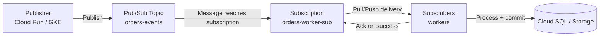
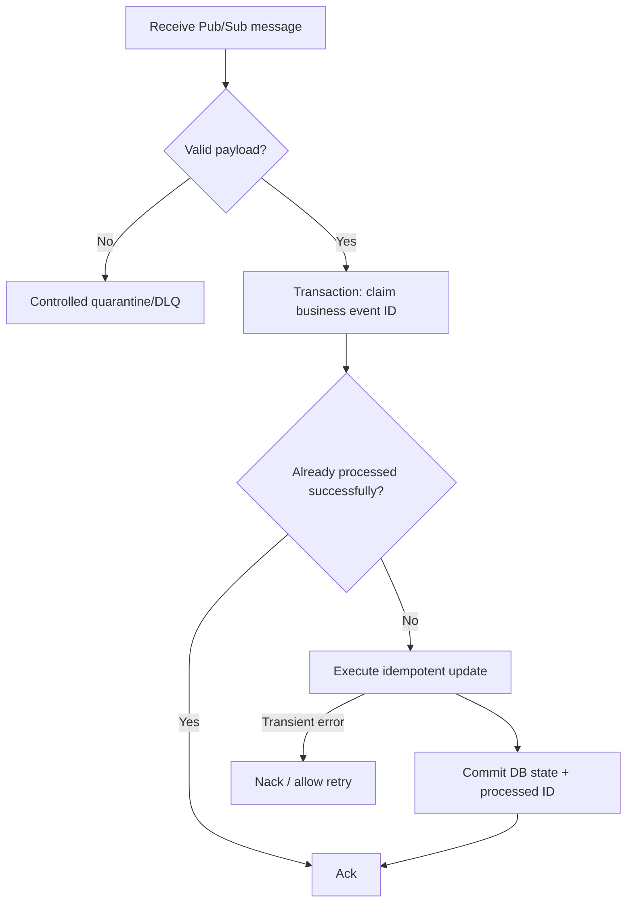

# Snapshots, seek, and message replay

## 1. When do you need to replay messages?

A service receives order events from **Google Cloud Pub/Sub**, processes them on **Cloud Run** or **GKE**, and updates **Cloud SQL**. After deploying a new version, operations discovers that the subscriber **acknowledged (acked)** several messages while writing corrupted data. At that point, deploying a fix does not automatically put those already-acked messages back into the queue.

Pub/Sub provides two mechanisms for recovery:

- **Snapshot** captures the **acked/unacked state of a subscription** at a point in time so you can return to it.
- **Seek** bulk-updates a subscription's ack state to a **snapshot** or **timestamp**, thereby **replaying** messages that are still retained.

This lesson belongs to the **Pub/Sub and Messaging** chapter in module **CLOUD_PROVIDERS_GCP**, connecting Project/IAM, VPC networking, Compute Engine, GKE, Cloud Run, and data services. The goal is to design recoverability, restrict change permissions, ensure data correctness, and control reliability and cost.

### Learning outcomes

After this lesson, you will be able to:

1. Distinguish **topic, subscription, message, ack, retention, snapshot, and seek**.
2. Choose **seek to snapshot** vs. **seek to timestamp** based on incident type.
3. Explain the **maximum 7-day snapshot lifetime** and topic/subscription retention limits up to **31 days**.
4. Use `gcloud pubsub snapshots ...` and `gcloud pubsub subscriptions seek ...` in a safe lab.
5. Recognize replay impacts on **pull, push, filtered subscriptions, dead-letter topics, and exactly-once delivery**.
6. Design **idempotent** handling, monitor backlogs, and prepare a runbook before seeking in production.

> **Warning:** Seek changes the **ack state of the entire subscription**, not just one subscriber instance. Seeking to a future timestamp can **mark a large batch of unprocessed messages as acked** and lose the opportunity to process them. Run state-changing commands only in a **lab project/subscription** or under an approved change process.

## 2. Reviewing the Pub/Sub and ack flow



| Concept | Meaning | Relevance to replay |
| --- | --- | --- |
| **Topic** | Where publishers send messages | Can enable **topic message retention** to store history independently of subscriptions |
| **Subscription** | Consumer receive stream and **ack state** | Seek modifies the ack state of the **selected subscription** |
| **Message ID** | Identifier of a message published to Pub/Sub | Must be distinguished from **business event ID** |
| **Ack** | Subscriber signals message was processed | By default, acked messages leave the subscription backlog |
| **Ack deadline** | Window for a subscriber to ack a single delivery | Expiry can trigger redelivery; **distinct from retention** |
| **Retention** | Duration messages remain stored for potential replay | Once retention expires, seek cannot recover purged content |
| **Snapshot** | Point-in-time capture of a subscription's ack state | Used to recover after a bad deployment |
| **Seek** | Bulk operation shifting ack state to a snapshot/timestamp | Can replay **or purge** backlog |

**An acked message is not the same as a correctly processed message.** Pub/Sub only sees the ack coming from the subscriber; it cannot inspect Cloud SQL transactions or report correctness. An application that wrote bad data yet still acked may need replay **paired with data compensation**, not merely re-running the same function.

### Key defaults

- Subscriptions typically retain **unacked messages for 7 days** from publish time; by default they do **not** retain acked messages.
- **Subscription message retention** can be set from **10 minutes to 31 days**; `retainAckedMessages` preserves acked messages as well.
- **Topic message retention** is a **separate** setting, **off by default**; it can retain history from **10 minutes to 31 days**.
- These numbers are **message retention** limits, **not snapshot lifetime**.

## 3. What does a snapshot actually store?

A **Pub/Sub snapshot** is a consistent **ack-state checkpoint** of a subscription. It preserves the ability to replay:

1. Messages that were **unacked** in the source subscription when the snapshot was created.
2. Messages **published to the same topic after the snapshot timestamp**.

A snapshot is **not** a downloadable CSV/JSON file listing messages, and it does **not** resurrect messages already purged from historical retention earlier.

### A timeline example

Suppose subscription `orders-sub` receives three messages:

| Time | Message A | Message B | Message C |
| --- | --- | --- | --- |
| 09:00 | Acked | Unacked | Not yet published |
| **09:05: create snapshot S1** | Acked | **Unacked — preserved by snapshot** | Not yet published |
| 09:06 | Unchanged | Acked | **Published** |
| 09:07 | Unchanged | Acked | Acked |
| **09:08: seek to S1** | Not replayed just by seeking S1 | **Replayed** | **Replayed** |

**Why is A not replayed?** A was already acked **before the snapshot was created**; the snapshot's ack state does not require reprocessing A. To replay A, you need **appropriate topic/subscription retention** and seek by timestamp (if the message is still stored), or a snapshot created **before A was acked**.

**Why is C replayed?** A snapshot preserves replayability for messages published **after the snapshot point**, even if those messages have already been acked by the time you seek.

### Scope limits

- A snapshot belongs to **one topic** and captures state from **one source subscription**.
- You can **seek another subscription on the same topic** to that snapshot, even a subscription created after the snapshot.
- You cannot use a snapshot from topic A to seek a subscription on topic B.
- A snapshot is not a backup of **API keys, schemas, filters, DLQ configuration, or subscriber side effects**.

## 4. Snapshot lifetime: not always 7 days

Maximum snapshot lifetime is **7 days**, reduced by the age of the **oldest unacked message** in the source subscription at creation time:

\[
\text{snapshot lifetime} =
7\text{ days} - \text{age of oldest unacked message}
\]

| Oldest unacked at creation | Approximate snapshot lifetime |
| --- | --- |
| No significant old backlog | Up to 7 days |
| 12 hours | About 6 days 12 hours |
| 2 days | About 5 days |
| 6 days 22 hours | About 2 hours |
| 6 days 23 hours or more | May **fail to create** because less than 1 hour remains |

Pub/Sub **rejects snapshot creation** if it would expire in **less than one hour**. Do not rely on creating a snapshot as a long-term recovery plan when the backlog is already close to expiration. Always inspect the actual `expireTime` field instead of hardcoding "snapshots last exactly 7 days."

### Two easily confused limits

- **Snapshot:** at most **7 days**, depending on backlog at creation time.
- **Topic/subscription message retention:** configurable up to **31 days**; however, **only messages still actually retained** can be replayed.

To recover from an incident **two weeks ago**, a typical snapshot is **not enough**. Design retention ahead of time or maintain a durable **event archive** in Cloud Storage/BigQuery when requirements exceed 31 days.

## 5. Seek: bulk ack-state modification

There are two main types:

| Seek type | Input | Effect | Prerequisite |
| --- | --- | --- | --- |
| **Seek to snapshot** | `SNAPSHOT_ID` | Restores ack state matching the snapshot and post-snapshot messages | Snapshot **not expired**, same topic |
| **Seek to timestamp** | Timestamp (UTC/RFC 3339) | Retained messages **before the cutoff** are marked acked; **after the cutoff** are marked unacked | Topic retention or subscription retaining acked messages covering the needed data |

### Seek is not a query on application timestamps

Pub/Sub uses the **Pub/Sub server-assigned `publishTime`**, not `createdAt` or `orderTime` inside the payload. Clock skew and delays between when the source system generates a business event and when it publishes can cause differences. Thus, seeking to 09:00 UTC does not guarantee that strictly every order with `eventTime >= 09:00` is reprocessed.

To replay by a range of **business IDs** or exact business event times, store an **event archive/index** or build a subscription/consumer filtering with application logic. Seeking by timestamp **has no per-message payload filter**.

### Seek is eventually consistent

After seek is accepted, delivery changes can take roughly **one minute** to fully propagate:

- Some messages before the cutoff or already acked in the snapshot may still be delivered during the transition window.
- Messages that should become unacked **will eventually be redelivered** per service guarantees, though not necessarily on the very next pull.
- Never rely on seek to achieve processing order or exactly-once side effects.

## 6. Choosing snapshot vs. timestamp: decision table

| Incident/operation | Recommended choice | Reason |
| --- | --- | --- |
| About to deploy a new subscriber revision and want a rollback button | **Create snapshot before deploy** | Saves ack state prior to the faulty release |
| New release acked bad data after snapshot creation | **Seek snapshot** | Replays backlog protected since the snapshot |
| Unexpected incident with no prior snapshot | **Seek timestamp** if retention exists | Rewinds to a cutoff covering retained messages |
| Need to retry the same data on a different subscriber on the same topic | **Seek snapshot** onto a test subscription | Copies ack checkpoint for safe rerun |
| Need to discard worthless old backlog | Seek timestamp **to current/future time** — very dangerous | Intentional bulk ack/purge |
| Need to recover data from 40 days ago | **Do not use standard seek** | Beyond the 31-day maximum retention |
| Need to replay only a few order IDs | **Selective business reprocessing** | Seek affects the whole subscription, not a per-ID query API |

### Runbook before any non-lab seek

1. Record **project, topic, subscription**, accountable owner, and replay objective.
2. Verify **current retention**, seek cutoff, snapshot `expireTime`, subscription filter, and dead-letter/exactly-once settings.
3. **Pause or throttle consumers** if needed to avoid contention; notify teams sharing the subscription.
4. Estimate **replayed message count, potential duplicate side effects**, database/API capacity, and cost.
5. Ensure **business idempotency keys**, backups/checkpoints, metrics, and a rollback plan.
6. Call seek only after approval; observe for at least several minutes and verify actual outputs.

> **There is no general "undo seek".** You can seek to **another** snapshot or seek forward to a timestamp **if retention still covers it**. If you purged messages and retention has expired, there is no single command to recover them from Pub/Sub.

## 7. Lab A — Create a snapshot and replay a message

Examples use **Cloud Shell Bash** and an organization-approved project `acme-pubsub-lab`. Before running, enable the **Pub/Sub API** and Billing, and ensure permissions to create topics/subscriptions/snapshots, publish, pull, ack, and seek; operations on resources incur charges.

### 7.1. Create lab topic and subscription

```bash
# CHANGE: run only in an authorized LAB project
PROJECT="acme-pubsub-lab"
TOPIC="replay-lab-topic"
SUB="replay-lab-sub"
SNAP="replay-lab-snap"

gcloud pubsub topics create "$TOPIC" --project="$PROJECT"
gcloud pubsub subscriptions create "$SUB" \
  --project="$PROJECT" \
  --topic="$TOPIC" \
  --ack-deadline=10

# READ-ONLY inspect configuration
gcloud pubsub subscriptions describe "$SUB" --project="$PROJECT"
```

`--ack-deadline=10` is **10 seconds per delivery attempt**, not the time limit for seeking; production subscriber libraries typically auto-extend deadlines while processing. If identically named resources already exist, **do not delete someone else's data**; choose distinct lab names.

### 7.2. Capture ack state before publishing

```bash
# CREATE SNAPSHOT from the lab subscription
gcloud pubsub snapshots create "$SNAP" \
  --project="$PROJECT" \
  --subscription="$SUB"

# READ-ONLY: verify topic and expireTime
gcloud pubsub snapshots describe "$SNAP" \
  --project="$PROJECT"
```

Because the subscription was just created, you may occasionally need to wait for subscription creation to propagate before creating the snapshot. The snapshot here records the starting point: no messages in backlog yet, while preserving **messages published after the snapshot**.

### 7.3. Publish and ack

```bash
# CREATE a message on the lab topic
gcloud pubsub topics publish "$TOPIC" \
  --project="$PROJECT" \
  --message='{"eventId":"demo-001","action":"create-report"}'

# CHANGE ack state: use --auto-ack ONLY for LAB messages
gcloud pubsub subscriptions pull "$SUB" \
  --project="$PROJECT" \
  --limit=10 \
  --auto-ack

# Pull again: should return no message after ack
gcloud pubsub subscriptions pull "$SUB" \
  --project="$PROJECT" \
  --limit=10
```

**Note:** `--auto-ack` acknowledges immediately **without waiting for business processing**. Never use it carelessly on production subscriptions: it can lose processing opportunities if retention does not preserve acked messages.

### 7.4. Seek to snapshot and pull again

```bash
# CHANGE ACK STATE for the entire LAB subscription
gcloud pubsub subscriptions seek "$SUB" \
  --project="$PROJECT" \
  --snapshot="$SNAP"

# Pull may need a retry while seek propagates
gcloud pubsub subscriptions pull "$SUB" \
  --project="$PROJECT" \
  --limit=10 \
  --auto-ack
```

**Expected result:** message `demo-001` is replayed because it was published **after the snapshot was created**. If it does not appear immediately, check seek/snapshot status, wait for propagation, and retry pulling in the lab; do not run seek repeatedly in a loop.

## 8. Lab B — Seek by timestamp with retained acked messages

This section creates a **separate subscription** `replay-time-sub` on the **same topic** to keep state isolated from Lab A. Do not rely on enabling `retain-acked-messages` **after acking** to recover messages that were already purged earlier.

### 8.1. Create a subscription with retention from the start

```bash
# CHANGE: new LAB subscription retaining acked messages for 2 days
TIME_SUB="replay-time-sub"

gcloud pubsub subscriptions create "$TIME_SUB" \
  --project="$PROJECT" \
  --topic="$TOPIC" \
  --message-retention-duration=2d \
  --retain-acked-messages

gcloud pubsub subscriptions describe "$TIME_SUB" \
  --project="$PROJECT"
```

From subscription creation onward, matching messages published to the topic are governed by that subscription's retention. **Do not assume a new subscription automatically receives the topic's full past history**, unless **topic retention** is enabled and a suitable seek is performed.

### 8.2. Record a timestamp before publishing

```bash
# Cloud Shell (GNU date); use UTC and record in lab notes
T0="$(date -u '+%Y-%m-%dT%H:%M:%SZ')"
echo "$T0"

# Separate from the timestamp second boundary for clarity
sleep 2

gcloud pubsub topics publish "$TOPIC" \
  --project="$PROJECT" \
  --message='{"eventId":"demo-time-001"}'

gcloud pubsub subscriptions pull "$TIME_SUB" \
  --project="$PROJECT" \
  --limit=10 \
  --auto-ack
```

### 8.3. Seek backward in time

```bash
# CHANGE ACK STATE of TIME_SUB only; does not directly affect Lab A's SUB
gcloud pubsub subscriptions seek "$TIME_SUB" \
  --project="$PROJECT" \
  --time="$T0"

gcloud pubsub subscriptions pull "$TIME_SUB" \
  --project="$PROJECT" \
  --limit=10 \
  --auto-ack
```

**Expected result:** `demo-time-001` can be redelivered because it was published after `T0` and remains within retention. If not visible yet, wait up to about a minute for seek consistency and pull again. If `T0` falls outside the retention window, seek **cannot recover** already-expunged messages.

**Do not use a timestamp inside the payload** as a substitute for the Pub/Sub publish timestamp. CLI timezones must be explicit, preferring UTC format such as `2026-11-19T02:30:00Z`. Cutoffs based on publish timestamp may be slightly imprecise at boundaries due to clock skew and propagation delay.

## 9. Retain history on the topic or on the subscription?

To seek by timestamp after messages are acked, **retention must be enabled before data is purged**. There are two approaches:

| Setting | Scope and effect | Billing characteristics |
| --- | --- | --- |
| **Subscription retention + `retain-acked-messages`** | One subscription retains acked messages for the configured duration; seeking that subscription can recover them | Storage charges for acked messages bill to the **subscription's project** |
| **Topic message retention** | Topic retains messages from publish time; supports seeking attached subscriptions and replaying messages published before subscription creation, within retention | Storage charges bill to the **topic's project** |
| **Snapshot** | Stores ack state and replayability from the snapshot point; does not require `retain-acked-messages` to seek the snapshot | Snapshot storage billed per Pub/Sub pricing |

### 9.1. Update subscription retention

```bash
# CHANGE: example only on the LAB subscription
gcloud pubsub subscriptions update replay-time-sub \
  --project=acme-pubsub-lab \
  --message-retention-duration=3d \
  --retain-acked-messages

# READ-ONLY to inspect actual configuration
gcloud pubsub subscriptions describe replay-time-sub \
  --project=acme-pubsub-lab
```

Check `retainAckedMessages` and `messageRetentionDuration` in the response. **Enabling retention now does not resurrect messages expunged yesterday**. When extending retention, verify the **subscription expiration policy** is not shorter than the retention duration; an inactive subscription can expire automatically if not configured properly.

### 9.2. Enable topic retention (an alternative)

```bash
# MODIFIES THE TOPIC shared by all publishers/subscriptions
gcloud pubsub topics update replay-lab-topic \
  --project=acme-pubsub-lab \
  --message-retention-duration=7d

# READ-ONLY
gcloud pubsub topics describe replay-lab-topic \
  --project=acme-pubsub-lab
```

Topic retention can increase charges for **every message published to the topic**, even messages already acked by all subscriptions. Before enabling in production, forecast bytes/day, check the 31-day cap, CMEK/region policies, and identify the cost owner.

**Do not confuse:** a subscription with `messageRetentionDuration=7d` and `retainAckedMessages=false` does **not** let you replay already-acked messages unless the topic retains them.

## 10. Using a snapshot with another subscription on the same topic

A snapshot can transfer processing state to **another subscription** on the same topic. This lets you test a new subscriber revision on preserved data without resetting the production subscription.

```mermaid
flowchart TB
    TOP["Topic orders-events"]
    PROD["Subscription orders-prod<br/>snapshot at T0"]
    SNAP["Snapshot orders-before-v2"]
    TEST["Subscription orders-replay-lab<br/>same topic"]
    OLD["Production consumer"]
    NEW["Lab consumer v2"]
    TOP --> PROD
    TOP --> TEST
    PROD -->|"create snapshot"| SNAP
    SNAP -. "seek"| TEST
    PROD --> OLD
    TEST --> NEW
```

### gcloud example

```bash
# Run only in the LAB set up above
TEST_SUB="replay-copy-sub"

# CREATE a subscription on the same topic
gcloud pubsub subscriptions create "$TEST_SUB" \
  --project="$PROJECT" \
  --topic="$TOPIC"

# SEEK: updates TEST_SUB's ack state without directly changing SUB
gcloud pubsub subscriptions seek "$TEST_SUB" \
  --project="$PROJECT" \
  --snapshot="$SNAP"

# READ/ACK LAB ONLY: observe delivered messages
gcloud pubsub subscriptions pull "$TEST_SUB" \
  --project="$PROJECT" --limit=10 --auto-ack
```

The mandatory requirement is that **the snapshot and target subscription share the same topic**, and the snapshot has not expired. You **cannot** apply a snapshot from `orders-events` to a subscription on `payments-events`.

### Why not test directly on the production subscription?

Two subscriber groups on the **same subscription** act as *competing consumers*: messages are split between them rather than every worker getting everything. When a lab subscriber pulls and acks a message, the production worker may never process it. A **separate subscription** establishes an independent receive/ack boundary, making testing much safer.

Still, having a test subscription receive production-like messages **does not isolate side effects**. The lab consumer must target **isolated Cloud SQL/buckets/sandbox** or dry-run mode, avoiding sending duplicate emails, charging cards twice, or mutating production data.

## 11. Interactions with filters, DLQ, retries, and exactly-once

### 11.1. Filtered subscriptions

Pub/Sub subscription filters evaluate **message attributes**, not fields inside the payload. When seeking by timestamp on a filtered subscription, Pub/Sub only **redelivers retained messages matching the target subscription's filter**.

For snapshot seeks:

- A snapshot from a filtered subscription covers unacked messages prior to the snapshot and messages published afterward, potentially including messages that did not match the original filter.
- The **subscription being sought** only receives messages **matching its own filter**.
- A subscription's filter **cannot be edited in place**; changing a filter requires designing a new subscription and performing a controlled migration.

Never use seek as a way to "bypass a filter." If an event was skipped because of a filter, inspect source attributes/retention and design replay through an appropriate subscription.

### 11.2. Dead-letter topic (DLQ)

A subscription with a **dead-letter policy** forwards messages exceeding allowed delivery attempts to a dead-letter topic when service-agent IAM is properly configured. When seeking:

- **The delivery attempt count resets to 0** for messages in the affected subscription.
- It **does not automatically pull messages back from the dead-letter topic to the source topic**.
- To replay messages already in the DLQ, process the **DLQ subscription and republish in a controlled way** after fixing the root cause.

Do not confuse **seek** with **DLQ redrive**. Both aid recovery, yet operate on different sources and state.

### 11.3. Retry policy and ack deadline

Seek also resets the subscription retry policy delay; messages can redeliver quickly depending on backoff settings. Do not use seek to cure a retry loop before fixing business code: you will just **spike backend load and costs** without adding value.

Ack deadline only governs how long each delivery stays outstanding. If the deadline expires before processing completes, the message can be redelivered even **without a seek**. Distinguish normal redeliveries from intentional replays.

### 11.4. Exactly-once delivery does not prevent replay

Pub/Sub **exactly-once delivery** (for supported pull subscriptions within its guarantee scope) suppresses duplicates **after a successful ack** during normal operation. However, an **intentional seek** can redeliver legitimately acked messages. Any **ack IDs from deliveries prior to the seek may become invalid**.

Moreover, a publisher can emit **two separate business-event copies** with different message IDs. Therefore:

**Pub/Sub exactly-once delivery ≠ exactly-once database transaction or exactly-once business side effect.**

Designing **idempotency keys** and transactions/checkpoints remains mandatory whenever a replay could write data a second time.

## 12. Seeking to purge backlog: a destructive operation requiring control

Seeking to the **current or a future timestamp** marks existing messages **as acknowledged** up to that cutoff, effectively performing a **bulk purge**. This is useful when an old backlog has **lost all business value**, but extremely dangerous for payments, audit trails, or unprocessed orders.

**Illustrative example only—NEVER run in production**:

```bash
# WARNING: bulk-acknowledges messages prior to this timestamp
# Run ONLY on a LAB SUBSCRIPTION if you specifically want to practice purging
gcloud pubsub subscriptions seek replay-copy-sub \
  --project=acme-pubsub-lab \
  --time="2099-01-01T00:00:00Z"
```

**Do not run this example as a required lab step.** If real backlog ever must be purged, follow a dedicated runbook: review scope, verify backups/retention, confirm data has no remaining value, require two-person approval, and log an audit trail. Even a purge seek is **eventually consistent**; do not rely on it to instantaneously stop an in-flight request.

For financial or audited systems, you should normally **recover and investigate messages**, rather than purging just because the backlog is large.

## 13. Designing an idempotent subscriber before replaying

Suppose a message contains:

```json
{
  "eventId": "order-2026-11019-001",
  "orderId": "ORD-1001",
  "status": "PAID",
  "schemaVersion": 1
}
```

**Do not rely solely on Pub/Sub `messageId`** for deduplication: the same business event can be published twice with two different message IDs. For orders, a suitable key is typically a **business event ID** or **order ID + event version**, maintained consistently across services.

### Safe workflow



Conceptual PostgreSQL example:

```sql
CREATE TABLE processed_events (
    event_id TEXT PRIMARY KEY,
    processed_at TIMESTAMPTZ NOT NULL DEFAULT NOW()
);

-- Within the same transaction as the order update:
INSERT INTO processed_events(event_id)
VALUES ('order-2026-11019-001')
ON CONFLICT (event_id) DO NOTHING;

-- Perform business logic ONLY when INSERT created a new row.
-- COMMIT the transaction before ACKing the message.
```

**Do not treat the SQL above as a complete implementation.** The application must check the actual inserted row count, execute business updates **inside the same transaction**, and handle rollbacks and concurrency. If **external side effects** exist (sending emails, calling payment gateways), use a **transactional outbox**, API idempotency keys, or compensating workflows. Acking **before commit** increases the risk of data loss if the application crashes.

### Handling reprocessing after corrupted writes

Replaying an `order-paid` event does not mean simply re-running `UPDATE orders SET ...` is sufficient. If an old bug wrote wrong values, you need to:

1. Identify scope and corrupted state.
2. Fix code and prepare a **data migration/compensation plan**.
3. Assign an audited business reprocessing run ID.
4. Execute idempotently; verify records before and after.
5. Reconcile row counts, checksums, event IDs, and SLOs before closing the incident.

## 14. IAM, data security, and seek permissions

Do not grant `roles/pubsub.admin` to all subscribers. A runtime service account only needs **consume/ack** on its specific subscription, while operators receive **create snapshot/seek** under a separate workflow.

| Action | Relevant IAM permission | Recommended role assignment |
| --- | --- | --- |
| Publish to topic | `pubsub.topics.publish` | `roles/pubsub.publisher` on the topic |
| Pull/ack/seek timestamp | `pubsub.subscriptions.consume` | `roles/pubsub.subscriber` on the subscription, but audit/guard against seek misuse |
| Seek to snapshot | `pubsub.subscriptions.consume` **and** `pubsub.snapshots.seek` | Grant on both target subscription and snapshot |
| Create snapshot | `pubsub.snapshots.create` plus required source permissions per API | Admin group or custom role only |
| View topic/subscription/snapshot | Corresponding `get/list` permissions | `roles/pubsub.viewer` at appropriate scope |
| Modify retention | `pubsub.subscriptions.update` or `pubsub.topics.update` | Via reviewed IaC/CI |

**Important security point:** `roles/pubsub.subscriber` includes consume permissions and can permit seeking; do not treat it as "read-only messages without modifying state." If you need to separate people who **only inspect metadata** from those permitted to replay, use **Viewer** and appropriate custom roles.

Pub/Sub messages can contain PII, access tokens, or transaction data. During replay, avoid logging full message bodies, never embed credentials in code, maintain encryption/CMEK and message storage policies, and verify legal retention/deletion rules when retaining data long-term.

## 15. Observing replay with Cloud Monitoring and logs

Success of `gcloud pubsub subscriptions seek` only indicates success of the **control-plane operation**; it does **not** prove the consumer reprocessed business state correctly.

| Signal | Metric/source | Purpose |
| --- | --- | --- |
| Unacked message count | `subscription/num_unacked_messages_by_region` | Watch backlog spike after seek and steadily drain |
| Oldest unacked message age | `subscription/oldest_unacked_message_age_by_region` | Track risk of retention expiry/SLO breach |
| Delivery latency health | `subscription/delivery_latency_health_score` | Monitor subscriber performance |
| Ack/redelivery rate | Pub/Sub metrics/Cloud Monitoring | Distinguish replay from a retry loop |
| Messages moved to DLQ | `subscription/dead_letter_message_count` | Track poison messages |
| Retained acked messages | `subscription/num_retained_acked_messages_by_region` | Measure retention cost and replay readiness |
| Snapshot expiry | `gcloud pubsub snapshots describe` | Know the deadline for seeking a snapshot |
| Business completion | Cloud SQL/Firestore/checkpoint/GCS manifest | Prove events were truly processed |

For regional dashboards, Google Cloud recommends metrics with the `_by_region` suffix because global aggregate backlog metrics can have gaps when one region is unavailable.

### Observation workflow

1. Before seeking, record a **baseline**: backlog/oldest age, throughput, errors, and business checkpoints.
2. Right after seeking, log the **operation timestamp**, snapshot ID or target timestamp, and IAM user.
3. Wait for propagation and watch the backlog; never draw conclusions from **one empty pull**.
4. Monitor CPU/RAM/instance count on Cloud Run/GKE workers, Cloud SQL error rates, and DLQ.
5. Reconcile business event IDs and transaction outcomes; alert on discrepancies or duplicate side effects.

**Pulled message count differs from valid written records.** A message redelivered multiple times while an idempotent handler updates the database once is healthy behavior, not message loss.

## 16. Cost and capacity during replay

Pub/Sub bills by **publishing/delivery throughput, data transfer, and storage**; add consumer compute (Cloud Run/GKE/Compute Engine) and any database/Cloud Storage/Logging usage.

| Change | Cost/risk |
| --- | --- |
| Enable topic retention for 7–31 days | Increases stored data on the topic, including messages already acked by every subscriber |
| Retain acked messages on subscription | Increases storage billed to the subscription's project |
| Many snapshots | Increases snapshot storage; subject to quotas/creation limits |
| Seek replay of 1 million messages | Spikes delivery throughput, CPU/runtime, log volume, and DB requests |
| Seek on a subscription with many consumers | Can trigger backlog spikes, saturate CPU/SQL, or cause downstream 429s |
| Non-idempotent reprocessing | Can cause **business damage** far exceeding Pub/Sub fees |

Rough illustrative example:

```text
One replay pass: 200,000 messages × 2 KiB average
                   ≈ 390.6 MiB of message payload data
If each message produces 1 log line and 1 database write:
                   adds ~200,000 logs + 200,000 writes
```

This is **not an exact Pub/Sub bill**: pricing also considers attribute sizes, API request batching, minimum billable bytes per pricing rules, retention, region, and SKUs. Consult [Pub/Sub pricing](https://cloud.google.com/pubsub/pricing) and **Cloud Billing exports** for accurate estimates.

### Protecting downstream systems

- Cap **subscriber concurrency / flow control** instead of replaying everything at maximum speed.
- Check Cloud SQL connection pools, API rate limits, and Cloud Run max instances.
- Maintain checkpoints/reconciliation and a **business progress** dashboard, not just Pub/Sub throughput.
- If the backlog exceeds what can be processed within retention, consider scaling capacity, partitioning workloads, or using a separate archive/backfill flow.

## 17. Quick troubleshooting

| Symptom | Possible cause | How to verify |
| --- | --- | --- |
| Cannot create snapshot | Oldest unacked too old, less than 1 hour validity left; IAM | Check oldest age, retention, `pubsub.snapshots.create` |
| Snapshot not found | Wrong project/name, expired, or deleted | `gcloud pubsub snapshots list/describe` |
| Seek snapshot reports topic mismatch | Snapshot topic and target subscription topic differ | `snapshot.topic`, `subscription.topic` |
| Seek timestamp does not replay acked messages | `retainAckedMessages`/topic retention was not enabled beforehand; messages expired | `retainAckedMessages`, topic retention, `publishTime` |
| Seek succeeds but pull returns nothing | ~1-minute eventual consistency; another subscriber already pulled it | Wait, check backlog metrics, inspect consumer instances |
| Replayed more messages than expected | `publishTime` cutoff too early, snapshot predates extra events, boundary clock skew | Check UTC cutoff, actual events, and subscription scope |
| Message redelivered despite prior ack | Intentional seek, deadline expiration, or retry | Correlate logs by seek time and message ID |
| Messages skipped by consumer due to filter | Target subscription filter did not match | Check attributes/filter; cannot edit old filter in place |
| DLQ messages do not return to source | Seek does not auto-redrive DLQ | Process DLQ subscription and perform controlled republish |
| Old exactly-once ack ID fails | Seek invalidated prior delivery/ack state | Use ack ID from the new delivery; check library and logs |
| Backlog grows and Cloud SQL overloads | Replay too fast, high consumer concurrency | Flow control, DB metrics, rate limits |
| Storage costs jump after enabling retention | Retaining acked messages or topic retention | Billing SKUs, retained bytes, new config |

### Runbook when a subscriber release corrupts or loses data

1. **Detect:** rely on business reconciliation, not just message ack counts.
2. **Scope:** identify deployment revision, bug start time, source topic/subscription, and affected data.
3. **Check permissions and retention:** is a pre-deploy snapshot still valid? If not, is `retainAckedMessages` or topic retention enabled?
4. **Prepare remediation:** fix bug, canary test, take snapshot/data backup, ensure idempotency/compensation and downstream capacity.
5. **Choose target:** prefer replaying into a **dedicated recovery subscription** on the same topic for safe validation; do not seek production immediately.
6. **Execute:** seek snapshot/timestamp per approved plan, log the operation, and monitor status.
7. **Verify:** row counts, transaction IDs, latency/errors, DLQ, logs, and cost; document postmortem/owner.

## 18. Three operational scenarios

### Scenario A — New deploy acked bad writes

Before deploying `orders-worker-v2`, SRE created snapshot `orders-before-v2`. After 20 minutes, v2 had acked many `order.paid` events while writing wrong summary rows.

**Approach:** roll back code to the tested revision or deploy a fix, verify the snapshot has not expired, use a **recovery** subscription for canary validation, then seek to the snapshot as needed. Verify business transactions before allowing billing or email triggers to run again.

**Do not:** run replay while buggy code is still active, or forget to protect the database against double writes.

### Scenario B — Bug discovered without a snapshot

An incident is discovered after 3 hours. The subscription already had **`retainAckedMessages=true`, 2-day retention** configured beforehand.

**Approach:** inspect `publishTime` around when the bug started, pick a timestamp slightly before the failure boundary to avoid missing events, accept some extra replay **protected by idempotency**, and verify outcomes. Only messages still within retention are recovered.

**Do not:** turn on retention right now and expect already-acked and purged messages to come back to life.

### Scenario C — Aging backlog with mandatory data retention

An analytics subscription was stopped for 5 days; oldest unacked messages are near expiration and the system cannot catch up in time.

**Approach:** measure backlog bytes/age, see if retention can be raised within the 31-day cap, tune capacity, restart subscribers, and add long-term archiving to your strategy if needed. A snapshot created too late has a short lifetime and is **not a long-term storage solution**.

**Do not:** seek into the future to purge just to make the chart return to 0, because unprocessed messages may be mandatory business data that must be preserved.

## 19. Controlled lab resource cleanup

Only when you are sure every resource name in `acme-pubsub-lab` was created **exclusively for this lesson**, required evidence has been saved, and no other consumer uses them:

```bash
# READ-ONLY before deleting
gcloud pubsub snapshots list --project=acme-pubsub-lab
gcloud pubsub subscriptions list --project=acme-pubsub-lab
gcloud pubsub topics list --project=acme-pubsub-lab

# CHANGE: delete ONLY lab-created resources
gcloud pubsub subscriptions delete replay-copy-sub --project=acme-pubsub-lab
gcloud pubsub subscriptions delete replay-time-sub --project=acme-pubsub-lab
gcloud pubsub subscriptions delete replay-lab-sub --project=acme-pubsub-lab
gcloud pubsub snapshots delete replay-lab-snap --project=acme-pubsub-lab
gcloud pubsub topics delete replay-lab-topic --project=acme-pubsub-lab
```

**Do not run this delete block verbatim** if project/names were changed to shared resources. Deleting a subscription or snapshot can erase recovery state; deleting a topic can impact other publishers/subscribers.

## 20. Exercises and verification questions

1. **Remembering ack state:** When snapshot S is created, message A is acked and B is unacked. Later C is published, and both B and C are acked. Seeking S will replay which messages? **Answer:** B and C, not A.
2. **Calculating snapshot age:** Oldest unacked age is 3 days 6 hours at creation time. What is the maximum remaining snapshot lifetime? **Answer:** 3 days 18 hours, barring other limits.
3. **Snapshot error:** Oldest unacked age is 6 days 23 hours 30 minutes. Can a snapshot be created? **Answer:** No; remaining lifetime is ~30 minutes, under the one-hour minimum.
4. **Acked retention:** A subscription has 7-day retention without `retain-acked-messages`, and topic retention is off. After acking, can you seek to yesterday's timestamp to recover every message? **No**; they may already be expunged.
5. **Timestamp boundary:** A message has `eventTime=08:00` in JSON but `publishTime` is `09:10Z`. Seeking `09:00Z` evaluates which timestamp? **Answer:** `publishTime` `09:10Z`.
6. **Two subscriptions:** Sub A and Sub B share one topic. Does seeking B to A's snapshot change A's ack state? **Answer:** No; only B is sought; snapshot must be on the same topic.
7. **Filtered subscription:** A filters `attributes.type="order"`, B filters `"invoice"`. Does seeking B to a snapshot from A bypass B's filter? **No**; redelivered messages follow the filter of the subscription being sought.
8. **DLQ/exactly-once:** After a seek, how does the delivery attempt counter behave with a DLQ policy? Why doesn't exactly-once prevent replay? **Hint:** counter resets to 0; intentional seek re-establishes eligibility, and old ack IDs may become invalid.
9. **Idempotency:** An order event was published twice by the publisher, yielding two Pub/Sub message IDs. Propose a business key and transaction strategy so the customer is not charged twice.
10. **Release incident:** A pre-deploy snapshot exists and 10,000 events were wrongly acked. Write a recovery plan covering change freeze, canary recovery subscription, code rollback, seek, reconciliation, and monitoring.
11. **Cost:** Replaying 100,000 messages causes Cloud SQL 429s. Should you adjust retention or subscriber concurrency first? Explain the risk of increasing parallelism.
12. **Read-only lab exercise:** List subscriptions and snapshots in an authorized project; record retention, `retainAckedMessages`, `expireTime`, topic mapping, and backlog size before proposing a replay runbook. **Do not run seek in production** for this exercise.

## 21. Pre-production seek checklist

- [ ] Confirmed **topic, subscription, project, consumer owners**, and business impact.
- [ ] Understood **seek alters ack state for the whole subscription**, not one Pod/worker.
- [ ] Chose snapshot vs. timestamp by scenario, avoiding unplanned future-timestamp purges.
- [ ] Verified snapshot shares the topic and has valid `expireTime`; did not confuse snapshot lifetime with 31-day retention.
- [ ] Verified retention was enabled beforehand for target messages; not expecting expunged messages to return.
- [ ] Verified UTC `publishTime`, not confusing it with payload timestamps.
- [ ] Checked subscription filters, DLQ policy, retry settings, exactly-once, and consumer concurrency.
- [ ] Have a tested subscriber fix and **business idempotency keys**.
- [ ] Have a sandbox/recovery subscription or safe validation path when needed.
- [ ] Separated IAM for consume, snapshot creation, and seek execution; established approval/audit.
- [ ] Estimated message counts, backlog bytes, and capacity for Cloud Run/GKE/Cloud SQL.
- [ ] Have dashboards for regional backlog, oldest age, delivery errors, DLQ, and **business reconciliation**.
- [ ] Understood seek is **eventually consistent**; will not jump to conclusions from the first pull.
- [ ] Tested rollback/compensation, assigned owner/on-call, and defined replay abort thresholds.
- [ ] Estimated costs for Pub/Sub delivery/storage, compute, database, network, and logs.
- [ ] Documented postmortem, recovery evidence, retention duration, and long-term archive plan.

## 22. Official Google Cloud references

1. [Replay and purge messages with seek](https://cloud.google.com/pubsub/docs/replay-overview).
2. [Quickstart: Replay a message by seeking](https://cloud.google.com/pubsub/docs/replay-message).
3. [Configure subscription message retention](https://cloud.google.com/pubsub/docs/subscription-message-retention).
4. [Enable topic message retention](https://cloud.google.com/pubsub/docs/create-topic#message_retention).
5. [Subscription properties](https://cloud.google.com/pubsub/docs/subscription-properties).
6. [Snapshot REST resource](https://cloud.google.com/pubsub/docs/reference/rest/v1/projects.snapshots).
7. [Seek REST method](https://cloud.google.com/pubsub/docs/reference/rest/v1/projects.subscriptions/seek).
8. [gcloud pubsub snapshots](https://cloud.google.com/sdk/gcloud/reference/pubsub/snapshots).
9. [gcloud pubsub subscriptions seek](https://cloud.google.com/sdk/gcloud/reference/pubsub/subscriptions/seek).
10. [Exactly-once delivery](https://cloud.google.com/pubsub/docs/exactly-once-delivery).
11. [Filter messages from a subscription](https://cloud.google.com/pubsub/docs/subscription-message-filter).
12. [Pub/Sub IAM access control](https://cloud.google.com/pubsub/docs/access-control).
13. [Monitor Pub/Sub in Cloud Monitoring](https://cloud.google.com/pubsub/docs/monitoring).
14. [Pub/Sub quotas and limits](https://cloud.google.com/pubsub/quotas).
15. [Pub/Sub pricing](https://cloud.google.com/pubsub/pricing).

**Remember:** A Snapshot saves an **ack-state checkpoint** for post-change recovery; Seek is a command to **bulk-change ack state** to a snapshot or publish timestamp. Replay recovers only messages **still protected by retention or a snapshot**, can deliver duplicates, and does not automatically fix corrupted business data. Combine **idempotency, least-privilege IAM, canarying, monitoring, and reconciliation** to recover safely without doubling side effects or costs.
