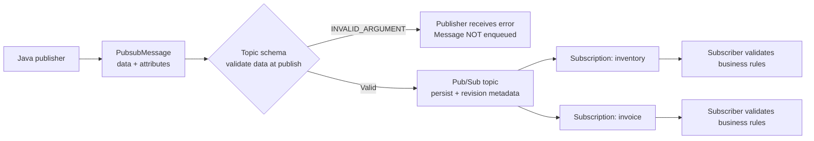
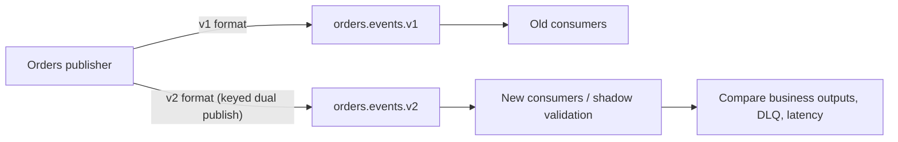

# Schemas, message validation, and format evolution

In a retail system using **Google Cloud Pub/Sub**, the Java service `orders-api` emits `OrderCreated` events for inventory, invoicing, and analytics applications to process together. One day the publisher changes `totalMinor` from a number to an arbitrary string; older Java consumers fail to decode it and messages are redelivered repeatedly. This incident can be prevented with **schemas** (format contracts), **message validation** at publish time, and controlled **schema evolution**.

This lesson belongs to the **Pub/Sub and Messaging** chapter of module **CLOUD_PROVIDERS_GCP**, connecting project/IAM, Cloud Run, GKE, storage/database services, and reliability operations. The focus is ensuring publishers and subscribers understand the same message, evolving formats without breaking the system, and recognizing the limits of schema validation.

> Projects, topics, schemas, service accounts, and messages are all examples. Commands that create resources, publish messages, or modify revisions can incur charges or affect live subscribers. Use only a lab project and synthetic messages. Never put customer data, access tokens, or secret keys into schemas, sample messages, or logs.

## Learning objectives

After this lesson, you will be able to:

1. Explain that a schema is attached to a **topic**, and Pub/Sub validates **`message.data` at publish time**, returning an error on mismatch.
2. Compare **Apache Avro** with **Protocol Buffers**, and distinguish **`JSON` vs. `BINARY` encoding**.
3. Create a schema, attach it to a topic, test valid/invalid messages with `gcloud`, and read schema revision metadata on subscribers.
4. Distinguish **syntax/type validation** from **business validation**, avoiding treating schemas as IAM or tenant authorization.
5. Evolve schemas using **compatible revisions**, choose `firstRevisionId`/`lastRevisionId`, and execute publisher/subscriber rollouts.
6. Identify breaking changes and design **new topics/schemas, data transitions, dual runs, and rollbacks**.
7. Write a schema-compliant Java publisher, handle publish failures, and manage observability, dead-letters, and cost.

## 1. Where does a Pub/Sub schema operate?

A schema is a Pub/Sub resource defining the **structure and types** of a payload. One schema can be attached to multiple topics. When a topic has an attached schema, publishers must send `data` matching the **schema type**, **encoding**, and at least one **allowed revision**.



**Separation of responsibilities:**

| Layer | What does it check? | What does it NOT do? |
| --- | --- | --- |
| **Publisher** | Builds payload, uses right encoding, populates required business fields | Should not rely solely on server errors to protect callers |
| **Pub/Sub schema** | Syntax and types of **`data`** against allowed topic revisions | Does not verify `tenantId` authorization, positive amounts, or existing orders |
| **Subscriber** | Decodes, validates semantics, enforces idempotency, handles errors | Must not assume a message is delivered strictly once |
| **Pub/Sub IAM** | Who can publish, subscribe, or edit topics/schemas | Does not authorize individual order records inside the payload |

**Validation scope:** Pub/Sub schemas validate the **`data`** field; they do not enforce contracts on `attributes`, `orderingKey`, or database referential integrity. A message rejected with `INVALID_ARGUMENT` at publish **never enters the topic**; a subscription's dead-letter topic **cannot catch** a message that was never successfully published.

If a **topic has no attached schema**, Pub/Sub does not automatically validate JSON just because the publisher sets an attribute `contentType=application/json`.

## 2. Choosing Avro or Protocol Buffers?

Pub/Sub schemas support **Apache Avro 1.11** and **Protocol Buffers (proto2/proto3)**. A Pub/Sub schema has **only one top-level type** and does not support `import` statements referencing external files in the schema definition.

| Criterion | Apache Avro | Protocol Buffers |
| --- | --- | --- |
| Definition | JSON-formatted Avro schema | `.proto` with field numbers |
| Best suited for | Data pipelines, Avro/BigQuery ecosystems | Java/Go microservices, gRPC, and generated types |
| Serialization | Avro JSON or Avro binary per schema | Proto JSON mapping or wire-format binary |
| Evolution | Depends on Avro reader/writer resolution, defaults, and unions | Keep **field number/type**, add/remove `optional` fields per Pub/Sub limits |
| Reading historical data | Must track **writer schema revision** | Generated protobuf code usually ignores unknown fields; semantics must still hold |
| Risks | Tricky Avro JSON union encoding, wrong defaults | Reusing field numbers, changing types/enums, confusing JSON field names |

### JSON and BINARY are **topic** encodings

When attaching a schema, you choose **`JSON` or `BINARY`**. These are **not** two different schema languages, and Pub/Sub **does not automatically convert** payloads between them.

| Encoding | Payload in `message.data` | Best suited for |
| --- | --- | --- |
| **`JSON`** | UTF-8 JSON conforming to Avro JSON or Protobuf JSON mapping | Human-readable in labs/logs, CLI testing |
| **`BINARY`** | Byte array produced by an Avro/Protobuf serializer | Typically more compact, used with client-generated classes |

**Common pitfall:** Proto3 `int64 total_minor` is serialized in JSON as key `totalMinor` with a **decimal string** value, such as `"145000"`. Avro JSON has its own rules for **unions**; you cannot send arbitrary JSON and assume either schema type will accept it.

## 3. First version of the OrderCreated contract

We use Protocol Buffers with JSON encoding so it can be tested via CLI. Create `order-created-v1.proto` in a lab directory:

```proto
syntax = "proto3";
package retail.events;

option java_package = "example.events";
option java_outer_classname = "OrderCreatedProto";

message OrderCreated {
  string event_id = 1;
  string order_id = 2;
  int64 total_minor = 3;
  string currency = 4;
}
```

Field meanings:

| Field | Type | Additional business rules |
| --- | --- | --- |
| `event_id` | `string` | Unique ID for deduplication |
| `order_id` | `string` | Must reference a real order belonging to a valid tenant |
| `total_minor` | `int64` | Total amount in minor currency units, **non-negative** |
| `currency` | `string` | One of the ISO 4217 codes accepted by the application |

**Proto3 limitation to remember:** Scalar fields **may be omitted and take default values** during parsing. For example, omitting `order_id` can still be valid under a Protobuf schema while producing an empty string in Java. To enforce business-required fields, **validate in both publisher and subscriber** rather than relying solely on schema syntax.

A valid message under Proto JSON mapping:

```json
{
  "eventId": "evt-001",
  "orderId": "ord-1001",
  "totalMinor": "145000",
  "currency": "VND"
}
```

The following message has a **type error**:

```json
{
  "eventId": "evt-002",
  "orderId": "ord-1002",
  "totalMinor": "not-a-number",
  "currency": "VND"
}
```

A type-invalid message is rejected at publish time, whereas `totalMinor: "-100"` is **schema-valid** yet **business-invalid**.

## 4. Lab: creating a schema, topic, and validating messages

**Prerequisites:** `pubsub.googleapis.com` enabled, Google Cloud project authorized for Pub/Sub, and Google Cloud CLI. Admin accounts need permissions to create/read schemas, attach schemas, and create topics; publishers only need `pubsub.topics.publish` on the topic. Do not grant `roles/owner` to publishers.

### 4.1 Check context (read-only)

```bash
PROJECT_ID="retail-dev-01"
SCHEMA_ID="order-created-schema"
TOPIC_ID="order-events-schema-lab"
SUB_ID="order-events-lab-sub"

gcloud auth list
gcloud config get-value project
gcloud services list --enabled --project="$PROJECT_ID" \
  --filter="config.name:pubsub.googleapis.com"
```

Replace IDs with resources that **do not exist yet** or that you own. Setting variables does not create resources.

### 4.2 Validate definition and create schema

```bash
# Validate the local .proto definition; does not create a topic yet.
gcloud pubsub schemas validate-schema \
  --type=protocol-buffer \
  --definition-file=order-created-v1.proto \
  --project="$PROJECT_ID"

# INFRASTRUCTURE CHANGE: create a new schema.
gcloud pubsub schemas create "$SCHEMA_ID" \
  --type=protocol-buffer \
  --definition-file=order-created-v1.proto \
  --project="$PROJECT_ID"

gcloud pubsub schemas describe "$SCHEMA_ID" --project="$PROJECT_ID"
gcloud pubsub schemas list-revisions "$SCHEMA_ID" --project="$PROJECT_ID"
```

`validate-schema` only verifies **definition validity**; it does not test sample payloads or compatibility with existing publishers/consumers. To test a message, use the next command.

### 4.3 Create a schema-enabled topic and subscription

```bash
# INFRASTRUCTURE CHANGE / MAY INCUR CHARGES.
gcloud pubsub topics create "$TOPIC_ID" \
  --schema="$SCHEMA_ID" \
  --message-encoding=json \
  --project="$PROJECT_ID"

gcloud pubsub subscriptions create "$SUB_ID" \
  --topic="$TOPIC_ID" \
  --project="$PROJECT_ID"

# Confirm schemaSettings/encoding on the actual topic.
gcloud pubsub topics describe "$TOPIC_ID" --project="$PROJECT_ID"
```

`--message-encoding=json` selects **Protobuf JSON mapping**, not Protobuf binary. A producer sending `toByteArray()` to a JSON-encoded topic will be rejected.

### 4.4 Test messages before publishing

```bash
VALID='{"eventId":"evt-001","orderId":"ord-1001","totalMinor":"145000","currency":"VND"}'
INVALID='{"eventId":"evt-002","orderId":"ord-1002","totalMinor":"not-a-number","currency":"VND"}'

# Validate only; does not publish to the topic.
gcloud pubsub schemas validate-message \
  --schema-name="$SCHEMA_ID" \
  --message-encoding=json \
  --message="$VALID" \
  --project="$PROJECT_ID"

# Expect validation error because totalMinor is not an int64.
gcloud pubsub schemas validate-message \
  --schema-name="$SCHEMA_ID" \
  --message-encoding=json \
  --message="$INVALID" \
  --project="$PROJECT_ID"
```

### 4.5 Publish and pull

```bash
# DATA CHANGE: publish a valid message.
gcloud pubsub topics publish "$TOPIC_ID" \
  --message="$VALID" \
  --attribute=eventType=OrderCreated \
  --project="$PROJECT_ID"

# Expect INVALID_ARGUMENT; message is not accepted into the topic.
gcloud pubsub topics publish "$TOPIC_ID" \
  --message="$INVALID" \
  --project="$PROJECT_ID"

# Lab subscription only, because --auto-ack acknowledges pulled messages.
gcloud pubsub subscriptions pull "$SUB_ID" \
  --limit=5 --auto-ack \
  --project="$PROJECT_ID"
```

**Expected outcome:** the valid publish returns a message ID; the invalid-type publish gets `INVALID_ARGUMENT`; the subscription only sees messages accepted by the topic. If pull does not immediately show the message, check publish time, subscription existence, and subscriber permissions and retry—do not immediately assume the schema is broken.

## 5. Java publisher: serialize with the matching encoding

In Java, generate classes from `.proto` using `protoc`/a Maven plugin and use official serializers. The example below **assumes** Java class `example.events.OrderCreatedProto` has been generated from the Section 3 schema and the project includes `com.google.cloud:google-cloud-pubsub` and `com.google.protobuf:protobuf-java-util`, with versions managed via BOM.

```java
import com.google.api.core.ApiFuture;
import com.google.cloud.pubsub.v1.Publisher;
import com.google.protobuf.ByteString;
import com.google.protobuf.util.JsonFormat;
import com.google.pubsub.v1.PubsubMessage;
import com.google.pubsub.v1.TopicName;
import example.events.OrderCreatedProto.OrderCreated;
import java.util.concurrent.TimeUnit;

public final class PublishOrderCreated {
  public static void main(String[] args) throws Exception {
    if (args.length != 2) {
      throw new IllegalArgumentException("Usage: PROJECT_ID TOPIC_ID");
    }
    TopicName topic = TopicName.of(args[0], args[1]);
    OrderCreated event = OrderCreated.newBuilder()
        .setEventId("evt-java-001")
        .setOrderId("ord-1003")
        .setTotalMinor(145000L)
        .setCurrency("VND")
        .build();

    // Must be JSON because the lab topic was created with --message-encoding=json.
    String json = JsonFormat.printer()
        .omittingInsignificantWhitespace().print(event);
    PubsubMessage message = PubsubMessage.newBuilder()
        .setData(ByteString.copyFromUtf8(json))
        .putAttributes("eventType", "OrderCreated")
        .build();

    Publisher publisher = Publisher.newBuilder(topic).build(); // Uses ADC.
    try {
      ApiFuture<String> id = publisher.publish(message);
      System.out.println("Published message ID: " + id.get());
    } finally {
      publisher.shutdown();
      publisher.awaitTermination(1, TimeUnit.MINUTES);
    }
  }
}
```

**If the topic uses BINARY:** with generated Protobuf messages, use `event.toByteString()` instead of `JsonFormat.printer()`. Do not unilaterally change publisher encoding while the topic still expects JSON. The Java client uses **Application Default Credentials**; on Cloud Run/GKE use workload identity/service accounts rather than storing long-lived JSON private keys.

In production, never hardcode IDs per event: `eventId` must be generated and persisted alongside the business transaction/outbox so publish retries do not emit distinct logical events. Check `future.get()` or publish failure callbacks; never report "published successfully" when Pub/Sub actually returned an error.

## 6. How does the subscriber know a message's revision?

When a message is published successfully to a schema-enabled topic, Pub/Sub attaches three **system-provided attributes**:

| Attribute | Contents |
| --- | --- |
| `googclient_schemaname` | Name of the schema used for validation |
| `googclient_schemaencoding` | `JSON` or `BINARY` |
| `googclient_schemarevisionid` | Revision ID used to validate and parse the message |

**Logic** snippet in Java:

```java
String encoding = message.getAttributesOrDefault(
    "googclient_schemaencoding", "");
String revision = message.getAttributesOrDefault(
    "googclient_schemarevisionid", "");

if ("JSON".equals(encoding)) {
  // Use JsonFormat.parser() and the generated OrderCreated.Builder.
  // Further validate eventId/orderId/amount/currency per business rules.
} else if ("BINARY".equals(encoding)) {
  // Use OrderCreated.parseFrom(message.getData()) for protobuf binary.
} else {
  // Unsupported encoding: store/quarantine cleanly, do not blind-ACK.
}
```

This is a **code fragment** inside a subscriber; it omits declaring `message`, ack/nack, and exception handling. With **Avro**, the subscriber needs the **writer schema revision** used during encoding, which can be fetched/cached by `googclient_schemarevisionid` to perform Avro schema resolution against the reader schema.

**Do not delete historical schemas or revisions right after a deploy.** On deletion, Pub/Sub may replace metadata with `_deleted-schema_` or `_deleted-schema-revision_`; in particular, BigQuery subscriptions with `Use topic schema` may fail to write messages published under a deleted revision. Documentation recommends **rolling back by creating a new revision** rather than deleting history.

### When a consumer receives schema-valid but unusable data

For example, `orderId=""` parses cleanly under Protobuf yet is business-invalid. The consumer should:

1. Log a categorized error without dumping full payloads containing PII.
2. Route to **quarantine/DLQ** per subscription design or record an audited `REJECTED` state.
3. **ACK only after** the rejected record is durably handled; if an infrastructure error is transient, NACK/retry with bounds.
4. Avoid infinite retry loops for poison messages; monitor dead-letter count/backlog and maintain a replay runbook.

## 7. Schema revisions and compatibility rules

A Pub/Sub schema can have multiple **revisions**; revision IDs are generated by Pub/Sub, not custom version numbers like `v1/v2`. When **committing a new revision**, Pub/Sub checks compatibility constraints against existing revisions. Standalone **definition validation** does not replace this compatibility check.

Technical points:

- **Protocol Buffers:** within Pub/Sub-managed schema revisions, you may **add or remove `optional` fields**, without adding/removing non-optional fields or modifying existing fields. Never arbitrarily change **field numbers**, field types, or business meaning.
- **Avro:** the new revision must preserve **both reader and writer** schema resolution compatibility with relevant revisions. When adding fields, examine `default` values and Avro unions carefully.
- A schema can hold at most **20 revisions** at a time. Schema definitions have an approximate **300 KiB** limit; monitor applicable quotas.
- **Type compatibility does not guarantee business compatibility:** adding enum values, changing currency units, or shifting timestamp interpretation can still cause older subscribers to misbehave.

### Example new revision: adding an optional field

Create `order-created-v2.proto` keeping all existing fields intact and only adding:

```proto
syntax = "proto3";
package retail.events;

option java_package = "example.events";
option java_outer_classname = "OrderCreatedProto";

message OrderCreated {
  string event_id = 1;
  string order_id = 2;
  int64 total_minor = 3;
  string currency = 4;
  optional string sales_channel = 5;
}
```

When `sales_channel` is absent, v2 consumers must apply an appropriate business default such as `"unknown"`, rather than treating `""` as a valid sales channel. Old producers can continue publishing v1 while new producers emit v2.

### Commit and inspect revision IDs

```bash
# Validate new definition without committing yet.
gcloud pubsub schemas validate-schema \
  --type=protocol-buffer \
  --definition-file=order-created-v2.proto \
  --project="$PROJECT_ID"

# SCHEMA CHANGE: create a new revision; run only after contract tests.
gcloud pubsub schemas commit "$SCHEMA_ID" \
  --type=protocol-buffer \
  --definition-file=order-created-v2.proto \
  --project="$PROJECT_ID"

# Fetch REAL revision IDs; never guess names like v1/v2 for --last-revision-id.
gcloud pubsub schemas list-revisions "$SCHEMA_ID" \
  --project="$PROJECT_ID" --view=full
```

If commit fails compatibility, **do not delete old revisions to force it through** in production; create a new schema/topic following the breaking-change strategy in Section 9.

## 8. Allowing multiple revisions and rolling forward gradually

A topic with schema revisions is configured with an **allowed revision range**:

- `firstRevisionId`: oldest **allowed** revision (inclusive).
- `lastRevisionId`: newest **allowed** revision (inclusive).
- If no range is specified, Pub/Sub defaults to allowing **the full range** configured per its rules.
- At publish time, Pub/Sub tries **from the newest allowed revision down to the oldest** until one validates or all fail.
- After changing a topic's revision range or encoding, changes can take **several minutes** to propagate.

Range diagram example:

```text
Schema revisions over time:       A (old) -- B -- C -- D (new)

Topic allows A..D  -> validates against D, C, B, A
Topic allows B..C  -> A-only and D-only are rejected
Topic allows D..D  -> only messages matching D are accepted
```

### Configuring the range intentionally

```bash
# Replace with IDs from list-revisions and verify their order.
FIRST_REVISION_ID="REAL_OLD_REVISION_ID"
LAST_REVISION_ID="REAL_NEW_REVISION_ID"

# TOPIC CHANGE: update schema settings after testing all publishers.
gcloud pubsub topics update "$TOPIC_ID" \
  --schema="$SCHEMA_ID" \
  --message-encoding=json \
  --first-revision-id="$FIRST_REVISION_ID" \
  --last-revision-id="$LAST_REVISION_ID" \
  --project="$PROJECT_ID"

gcloud pubsub topics describe "$TOPIC_ID" --project="$PROJECT_ID"
```

**CLI warning:** when updating schema settings, schema flags **omitted from the command may revert to defaults**. Always pass the schema, encoding, and desired revision bounds **explicitly**, review `describe` before/after, and never edit ad hoc in production.

### Publish a v2 message

```bash
V2='{"eventId":"evt-003","orderId":"ord-1004","totalMinor":"200000","currency":"VND","salesChannel":"mobile"}'

gcloud pubsub schemas validate-message \
  --schema-name="$SCHEMA_ID" \
  --message-encoding=json --message="$V2" \
  --project="$PROJECT_ID"

gcloud pubsub topics publish "$TOPIC_ID" \
  --message="$V2" \
  --project="$PROJECT_ID"
```

**Read revision metadata** on the subscriber: two messages on the same topic can be validated under **two different revisions** during migration. Pub/Sub **does not revalidate** already-published messages when you commit a new revision or change the allowed range; older messages retain the schema metadata from their publish time.

## 9. Evolving formats without breaking the system

### Compatible rollout: expand → migrate → contract

1. **Define contract:** finalize field semantics, data types, encoding, idempotency keys, and all subscribers' requirements.
2. **Upgrade subscribers first:** accept both old payloads and the new `salesChannel` field; test unknown/default values, replays, and revision A/B messages.
3. **Commit a compatible revision:** run `validate-schema`, `validate-message`, and staging contract tests; do not test syntax alone.
4. **Widen the topic revision range:** allow both old and new publishers to publish; check propagation and publish failures.
5. **Canary-rollout new publishers:** monitor `INVALID_ARGUMENT`, parse errors, DLQ, backlog, and business metrics.
6. **Contract once verified:** tighten the old revision bound only after all publishers, subscribers, and backfills are ready; keep rollback capability and do not delete revisions prematurely.

### When do you need a new schema/topic?

The following changes are usually **breaking** or require an explicit business version:

| Change | Risk | How to handle |
| --- | --- | --- |
| Change `total_minor` from `int64` to descriptive `string` | Type/semantic incompatibility | New schema/event type; explicit transition |
| Reuse field number `3` for another field | Old consumers decode wrong data | **Never do this**; preserve/reserve field numbers |
| Switch from Proto JSON to Avro binary | Subscribers cannot decode; encoding differs | New topic or coordinated full cutover |
| Drop a field still needed by old consumers | Business failure despite schema validity | Deploy new consumers first or maintain a bridge |
| Change currency unit from VND to another unit while keeping `int64` | Still schema-valid, wrong math | Create new event version with explicit unit |
| Add an enum value unknown to old consumers | Switch/default logic breaks | Contract tests and safe fallbacks |

**Breaking-change migration pattern:**



After verifying parity, decommission v1 producers/consumers on schedule and clean up IAM/subscriptions **after retention expires**. Dual publishing creates **two distinct messages**, so downstream consumers must enforce a **business idempotency key** to avoid generating two invoices. If safe dual publishing is infeasible, consider a bridge/transform service or a maintenance-window cutover.

### Rolling back a schema revision

```bash
# SCHEMA CHANGE: rollback creates a NEW REVISION with contents from the old revision.
gcloud pubsub schemas rollback "$SCHEMA_ID" \
  --revision-id="KNOWN_GOOD_REVISION_ID" \
  --project="$PROJECT_ID"

gcloud pubsub schemas list-revisions "$SCHEMA_ID" --project="$PROJECT_ID"
```

Rollback **does not delete already-published messages**, does not change topic encoding, and does not automatically adjust a topic's pinned revision range. Re-check `schemaSettings` on the topic as well as producers/consumers after rolling back. Never use `delete-revision` as a rollback tool: deletion is permanent and can break BigQuery subscriptions using topic schema.

## 10. Message validation is not business validation

A schema may accept this message:

```json
{"eventId":"","orderId":"","totalMinor":"-100","currency":"XYZ"}
```

It can be **Protobuf-type valid**, yet business-invalid. Define **three validation layers**:

| Layer | Example | Error response |
| --- | --- | --- |
| **Schema/type** | `totalMinor` must parse as `int64` | Reject at publisher / `INVALID_ARGUMENT` |
| **Business rules** | `eventId` non-empty, `totalMinor >= 0`, allowed currency, valid tenant | Reject/quarantine in app with audit |
| **Delivery/idempotency** | Same `eventId` delivered twice | Conditional transaction/upsert, ACK after commit |

**Pub/Sub at-least-once delivery** can still deliver the same message multiple times; schemas do not solve duplicates, ordering, late events, or side-effect management. When a consumer sees different message IDs for the same order/business operation, it needs **business idempotency**, not just message ID tracking.

### Publish succeeds yet consumer fails

That is a **post-publish failure**, distinct from topic-level schema validation errors. If a subscriber fails to parse due to a bug or new version, it may NACK/retry and eventually move to a DLQ **if configured on the subscription**. Inspect payloads using revision metadata and never ACK a message before it is durably processed or quarantined.

## 11. IAM, observability, and operational limits

### Least privilege

| Principal | Permissions needed in design | Avoid |
| --- | --- | --- |
| Schema administrator | `pubsub.schemas.create/commit/validate/attach`, scoped topic updates | Letting every publisher modify schemas |
| Java publisher | `roles/pubsub.publisher` on the **target topic** | Project-wide `roles/editor` |
| Subscriber | `roles/pubsub.subscriber` on the **target subscription** | Unneeded topic/schema delete permissions |
| Schema deploy CI | Approved schema/topic rights, WIF/SA impersonation | Service account keys stored in repo |

A schema is only a **data contract**; it does not stop a publisher with valid IAM from sending another tenant's data as long as types match. Enforce server-side authorization, input sanitization, and encryption/retention for sensitive data according to proper boundaries.

### Metrics to monitor

- **Publish failures** by `INVALID_ARGUMENT`, `PERMISSION_DENIED`, and quota: separate schema, IAM, and rate-limit errors.
- **Message ingestion/throughput** on the topic; rising validation errors can reduce successful publish volume.
- **Subscription backlog, oldest unacked age, delivery attempts, DLQ**: spot old subscribers failing to parse new revisions.
- **Schema revision distribution** from subscriber attributes: track v1/v2 traffic share during migration.
- **Business validation rejects** and actual processed orders/invoices; schema-compatible does not equal business-correct.
- **Billable operations/bytes**, log ingestion, and DLQ/storage: dual publishing and replays raise cost.

Logs should capture **message ID, schema name/revision, encoding, hashed event ID, error class, and trace ID**—never full payloads containing PII or credentials. Alert when publish errors spike after a release, backlog grows, or messages begin entering the DLQ.

### Limits to remember

- Schema definitions are capped at roughly **300 KiB**; each schema holds at most **20 revisions**.
- Supports only **Avro/Protocol Buffers** at published product versions; each schema defines **one top-level type**.
- **All publishers to a schema-enabled topic must use the same configured encoding**.
- Revision ranges and config updates can take a few minutes to take effect.
- Never delete historical revisions while messages remain in retention/replay, especially when BigQuery subscriptions use topic schema.

## 12. Quick diagnostic table

| Symptom | Likely cause | Check |
| --- | --- | --- |
| Publish `INVALID_ARGUMENT` | Wrong JSON/BINARY encoding, wrong type, or outside allowed revision range | `topics describe`, `validate-message`, contract tests |
| Java publisher uses `toByteString()` on a JSON topic | Sent protobuf binary to a JSON topic | Use `JsonFormat.printer()`; do not change topic ad hoc |
| Java subscriber parse error during v2 rollout | Consumer does not yet recognize new revision | `googclient_schemarevisionid` and generated code version |
| Valid types yet missing `orderId` | Proto3 scalar default without business validation | Check application validator |
| Commit new revision rejected | Incompatible with existing revisions | Keep types/field numbers, use `optional` field or new schema |
| Old messages absent from topic after schema update | Not revalidated retroactively | Check publish-time logs, retention, and subscription |
| `gcloud` validates yet Java publish gets 403 | CLI principal differs from workload identity/missing IAM | ADC/runtime SA, topic IAM, and Policy Troubleshooter |
| DLQ spikes after new schema deploy | Consumer failing post-publish | Check decoding/semantics, roll back canary, controlled replay |
| BigQuery subscription fails after deleting revision | Missing writer schema revision needed for decoding | Avoid deleting; restore schema per support guidance |
| Same order produces two invoices | Duplicate delivery or dual publish | Business idempotency, outbox, and dedup |

## 13. Case study: evolving a payment event format

The payments team wants to add `salesChannel` to `OrderCreated` and later change the unit of `totalMinor`.

**Option A — Adding an optional field:** commit revision v2, upgrade consumers to handle missing values, open range A..B, roll out the new Java publisher, monitor revision metadata, and narrow the range once old producers are retired. This is **compatible schema evolution** once business consumers are ready.

**Option B — Changing currency unit/data type:** do not change `totalMinor` to a string or silently alter its unit. Create `OrderCreatedV2` with a new schema/topic (e.g., `orders.events.v2`), dual-run/transform with explicit `money.currency` + `money.amountMinor` mapping. Reconcile accounting outputs, enforce idempotency, and retire v1 only when downstream and archive/replay are ready.

**If a rollout breaks:** pause the canary publisher, keep the old revision inside the allowed range, fix/revert consumers, inspect backlog and DLQ; never delete the old schema before confirming replayability.

## 14. Self-check exercises

### Exercise 1 — What does a schema validate?

A message with `orderId=""` and `totalMinor="-100"` can still pass Proto3 schema validation. Why?

<details>
<summary>Answer</summary>

A schema validates the types and format of `data`; scalar fields may be omitted or hold business-invalid values. Publishers and subscribers must verify `orderId` is non-empty and amounts are non-negative.
</details>

### Exercise 2 — Publish errors and DLQ

A publisher sends `totalMinor="abc"` to a topic with a Proto3 JSON schema. Will the subscriber's DLQ receive this message?

<details>
<summary>Answer</summary>

No. Pub/Sub rejects it at **publish time** with `INVALID_ARGUMENT`; the message never enters the topic and thus cannot enter a subscription's DLQ. The publisher must handle/fix payloads or write to a separate quarantine.
</details>

### Exercise 3 — Wrong encoding

A topic requires `--message-encoding=json`, yet the Java publisher sends `OrderCreated.toByteString()`. Why does it fail?

<details>
<summary>Answer</summary>

`toByteString()` produces Protobuf **binary**, not Proto JSON. Use `JsonFormat.printer()` to emit UTF-8 JSON, or perform a topic encoding migration coordinated across all publishers and subscribers.
</details>

### Exercise 4 — Revision range

A schema has revisions A, B, C; the topic allows only B..C. Can a message matching only A be published?

<details>
<summary>Answer</summary>

No. Pub/Sub validates from revision C down to B; if none match, publish fails. Revision A is outside the allowed range.
</details>

### Exercise 5 — Distinguishing two kinds of compatibility

Why is changing a currency unit from "dong" to "thousand dong" while keeping `int64` still dangerous?

<details>
<summary>Answer</summary>

Because the data type stays unchanged, schema validation still passes, yet old consumers compute wrong amounts. This is a **breaking semantic change**; create a new event version/schema/topic and migrate with business verification.
</details>

### Exercise 6 — Old data after update

After committing revision B, does Pub/Sub revalidate messages previously published under A and update their metadata to B?

<details>
<summary>Answer</summary>

No. Validation happens at publish time; existing messages retain the schema/revision metadata from when they were published. Subscribers must decode historical data using the corresponding writer revision.
</details>

### Exercise 7 — Rollback

You want to restore the definition from revision A. Should you delete the newly created revision B?

<details>
<summary>Answer</summary>

Never delete history, especially while retained messages or BigQuery subscriptions rely on the schema. Use `schemas rollback --revision-id=A` to create a new revision with A's content, adjust the topic range, and test consumers/publishers.
</details>

### Exercise 8 — Dual publish

To migrate from Proto JSON to Avro binary, the system publishes in parallel to two topics. Why is an idempotency key needed?

<details>
<summary>Answer</summary>

Two topics generate two distinct message IDs for the **same business operation**; if a downstream system reads both, it can process the order twice. Use a stable event/business key, atomic handling, and verify shadow results before cutover.
</details>

## 15. Production rollout checklist

- [ ] Schema clearly defines type, encoding, event name, field numbers/types, and out-of-schema business rules.
- [ ] Tested `validate-schema` and `validate-message` with valid, wrong-type, and missing-key-field payloads.
- [ ] Publishers use the serializer matching topic `JSON/BINARY` and handle publish `INVALID_ARGUMENT`.
- [ ] Java subscribers read schema metadata, handle old/new revisions, and cleanly reject business-invalid messages.
- [ ] Never rely on Pub/Sub schemas for tenant authentication, authorization, or deduplication.
- [ ] Compatibility/contract tests exist for all consumers alongside a publisher/subscriber version matrix.
- [ ] Rollout follows **consumers first, producers second**, with intentional allowed revision ranges.
- [ ] Breaking changes use a new schema/topic and safe migration/dual-run with idempotency keys.
- [ ] Never delete old revisions while retained data, replays, or BigQuery subscriptions need them.
- [ ] IAM separates schema admin, topic publisher, and subscriber; workloads use ADC/short-lived identities.
- [ ] Alerts track publish failures, backlog, DLQ, version distribution, ingestion bytes, and cost.
- [ ] Runbooks exist for rolling back topic revision ranges, pausing canaries, replaying, and cleaning up lab resources.

## Official references

- [Pub/Sub schema overview](https://cloud.google.com/pubsub/docs/schemas): limits, Avro/Proto, validation scope.
- [Create a schema](https://cloud.google.com/pubsub/docs/create-schemas): `schemas create`.
- [Associate a schema with a topic](https://cloud.google.com/pubsub/docs/associate-schema-topic): encoding and revision ranges.
- [Validate a schema definition](https://cloud.google.com/pubsub/docs/validate-schema-definition): definition syntax validation.
- [Validate messages](https://cloud.google.com/pubsub/docs/validate-schema-message): `schemas validate-message`.
- [Publish messages with a schema](https://cloud.google.com/pubsub/docs/publish-topics-schema): publish, `INVALID_ARGUMENT`, and revision metadata.
- [Parse schema messages](https://cloud.google.com/pubsub/docs/schemas-valid): `googclient_schemaname`, `googclient_schemaencoding`, `googclient_schemarevisionid`.
- [Commit a schema revision](https://cloud.google.com/pubsub/docs/commit-schema-revision): Avro/Proto compatibility and revision quotas.
- [Roll back a schema](https://cloud.google.com/pubsub/docs/roll-back-schemas): creating a new revision from a historical revision.
- [SchemaSettings API](https://cloud.google.com/pubsub/docs/reference/rpc/google.pubsub.v1#schemasettings): `first_revision_id` and `last_revision_id`.
- [Pub/Sub Java client](https://cloud.google.com/java/docs/reference/google-cloud-pubsub/latest/overview): publisher/subscriber and ADC.
- [Pub/Sub pricing](https://cloud.google.com/pubsub/pricing) and [Monitoring Pub/Sub](https://cloud.google.com/pubsub/docs/monitoring): cost and operations.
