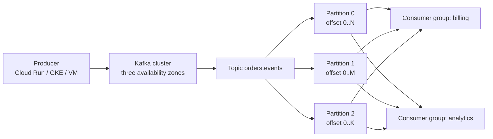
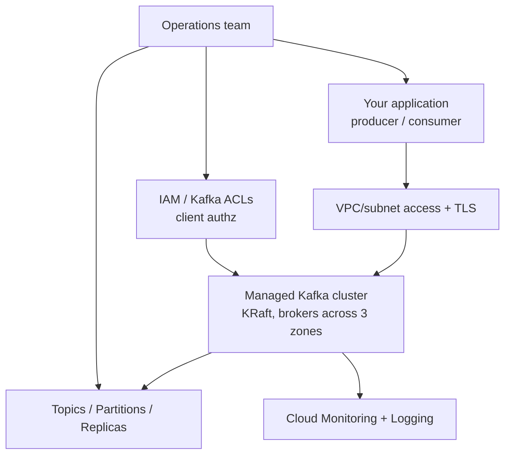
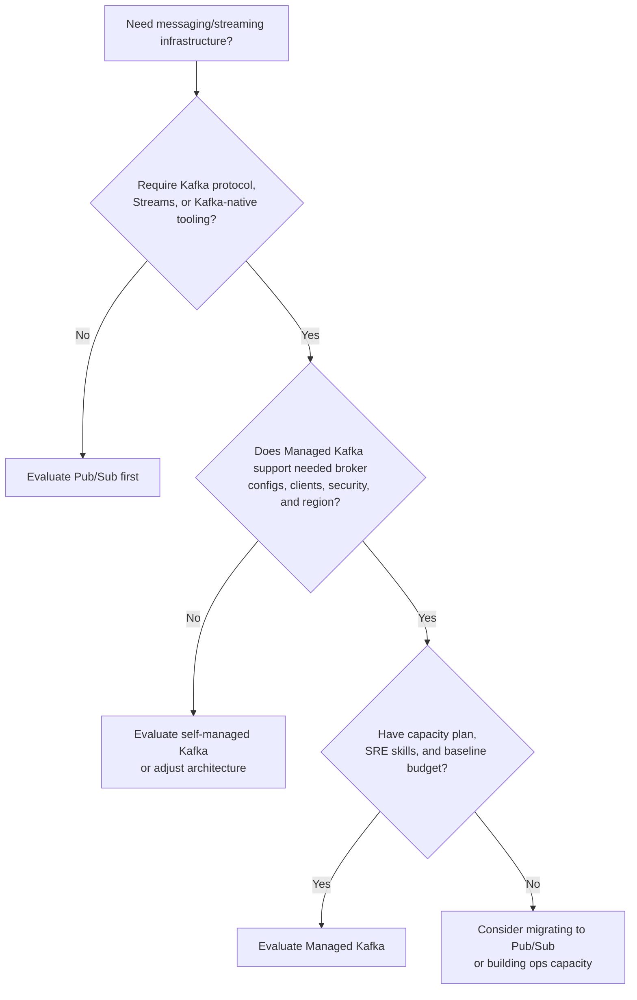
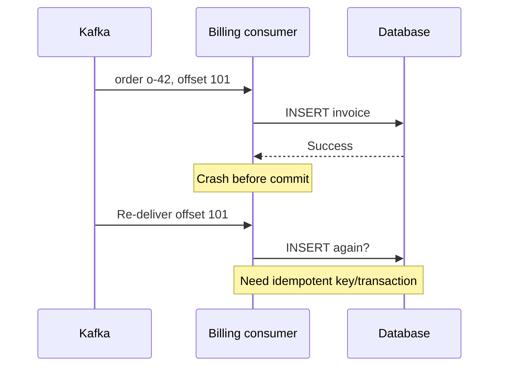

# Managed Service for Apache Kafka and selection criteria

An e-commerce team has two different needs: publishing `OrderCreated` events to multiple notification services, and feeding continuous change data streams into an analytics platform that already uses **Apache Kafka clients, consumer groups, Kafka Streams, and Kafka Connect**. Both **Google Cloud Pub/Sub** and **Managed Service for Apache Kafka** handle asynchronous messaging, yet their scaling models, ordering, retention, pricing, and operational responsibilities differ.

This lesson belongs to the **Pub/Sub and Messaging** chapter of module `CLOUD_PROVIDERS_GCP`, building on project, IAM, VPC, GKE, Cloud Run, storage, data, and operations knowledge on Google Cloud. The goal is to **choose the right service for each requirement**, understand what Managed Kafka manages, and run a safe Kafka hands-on lab against an **existing** cluster. Never assume "managed" removes the need for architecture design or observability.

## 1. Learning objectives

After this lesson, you will be able to:

1. Describe **cluster, broker, topic, partition, replica, producer, consumer group, offset**, and **retention**.
2. Explain what Google Cloud manages in **Managed Service for Apache Kafka**, its service limits, and what remains the application's responsibility.
3. Compare **Managed Kafka, Pub/Sub, and self-managed Kafka** across compatibility, latency, ordering, throughput, scaling, security, and TCO.
4. Design keys/partitions, consumer groups, retries, and safe deduplication.
5. Connect Kafka clients using **SASL/OAUTHBEARER**, **Application Default Credentials (ADC)**, and proper IAM/Kafka ACL permissions.
6. Run read-only preflight checks, create a **lab topic** on an authorized cluster, and produce/consume via Kafka CLI.
7. Monitor consumer lag, throughput, failures, disk/retention, quotas, and costs.
8. Plan migration/DR, evaluate Kafka Connect and Schema Registry, and recognize when not to choose Kafka.

**Scope:** this lesson primarily covers **Managed Service for Apache Kafka running on Google Cloud**; it is not a guide to deploying ZooKeeper/Kafka on VMs or GKE. Write commands apply strictly to authorized **test projects/clusters**. Do not create new clusters or change production IAM in this lesson; creating a cluster incurs baseline costs even with zero messages.

## 2. Kafka data model



| Component | Role | Keep in mind |
| --- | --- | --- |
| **Cluster** | Set of Kafka brokers with shared admin config | Managed Kafka provides multi-zone infrastructure |
| **Broker** | Server handling the Kafka protocol and storing partition replicas | Broker count is managed by the service; you do not control individual brokers directly |
| **Topic** | Stream of records sharing a purpose | E.g., `orders.events` |
| **Partition** | Ordered append-only log; each record has an offset | **Ordering is guaranteed only within a partition** |
| **Replication factor** | Number of partition copies across brokers | RF=3 is standard for HA, increasing network/cost |
| **Key** | Used by the partitioner to choose a record's partition | Use `orderId` when per-order ordering is needed |
| **Consumer group** | Multiple consumers sharing a group's work | Within a group, each partition is handled by one member at a time normally |
| **Offset** | Consumer's read/commit position in a partition | Can replay while records remain within retention |
| **Retention** | Time/size records stay stored even after consumption | **Records are not deleted just because a consumer committed** |

**Example:** on the same `orders.events` topic, consumer group `billing` computes invoices and `analytics` updates the warehouse. Each group tracks its own offsets, so both read every record. Inside `billing`, adding consumers increases throughput **up to the partition count**, without creating global ordering.

## 3. What does Google Cloud manage?

**Managed Service for Apache Kafka** runs Apache Kafka compatible with the open-source Kafka client protocol, integrated with Console, `gcloud`, APIs, and Cloud Monitoring/Logging. Google Cloud operates most broker infrastructure: provisioning, placing brokers across **three zones**, managing VMs/disks, replacing hardware, maintenance, and critical security patching.



**Important limits and responsibilities:**

- Clusters spread resources evenly across **three zones** in one region; you cannot pick individual zones or create single/two-zone clusters.
- The service uses **KRaft** and **does not support ZooKeeper mode**. Do not assume legacy ZooKeeper admin scripts still apply.
- You size **cluster capacity by vCPU/RAM** and design partition counts, replication factors, retention, topic configs, and Kafka clients. Do not assume boundless automatic scaling like Pub/Sub.
- You cannot freely modify every broker configuration. Some read-only configs take effect only after broker restarts/maintenance; service-managed configs cannot be edited.
- The service automatically patches critical vulnerabilities and maintains infrastructure, yet **does not commit to upgrading every Kafka minor version** on the exact schedule of a self-operated cluster.
- **Managed Kafka Connect** is a separate resource if used; connector availability and custom-plugin support differ from self-hosted Kafka Connect.
- Systems still need **cross-region DR** if business RTO/RPO requires surviving a full regional outage; three-zone replication addresses only one HA tier.

Never treat Managed Kafka as "Pub/Sub with a Kafka endpoint." The two products have distinct delivery, storage, and control-plane models.

## 4. Comparing Pub/Sub, Managed Kafka, and self-managed Kafka

| Criterion | **Pub/Sub** | **Managed Kafka** | **Self-managed Kafka** |
| --- | --- | --- | --- |
| API/clients | Google Cloud Pub/Sub API/client libraries | Existing **Apache Kafka protocol** | Apache Kafka protocol |
| Operations | Minimal: no brokers/partitions to manage | Google Cloud manages brokers; you design cluster capacity, topics, consumer groups | Self-manage brokers, storage, OS, upgrades, DR |
| Baseline cost | Primarily pay-per-use, plus applicable storage/feature fees | **Capacity-based** compute + storage/network; idle clusters still cost money | VMs/disks/network + staffing/on-call costs |
| Scaling | Automatic for large loads, no manual partition splitting | Must plan capacity/partitions and scale as load grows | Full control, heavy operational work |
| Ordering | By **ordering key** when enabled, with throughput caps | By **partition** | By partition |
| Delivery | Usually at-least-once; **exactly-once delivery** for supported pull | At-least-once common; Kafka idempotent producer/transactions | Same as Kafka |
| Replay/retention | Retention up to **31 days** per policy | Topic retention can be long/unbounded subject to config and resources | Per self-managed disk/retention |
| Ecosystem compatibility | Does not run Kafka-native protocol directly | Compatible with open-source Kafka apps | Full plugin/broker setting control |
| Latency | Typically ~100 ms end-to-end (not a fixed SLA) | Can be ~10 ms with well-tuned clients (not a fixed SLA) | Depends on infrastructure/tuning |
| Ecosystem | Pub/Sub subscriptions, BigQuery/Storage integrations | Kafka Streams/Connect/Kafka clients; some managed feature limits | Most flexible plugins/connectors |
| Broker config control | No brokers to configure | Partial, per service policy | Nearly complete |

This table shows **technical criteria, not a ranking**. Pub/Sub supports ordering and exactly-once **delivery** yet does not guarantee database side effects execute once; Kafka transactions provide exactly-once semantics **within a supported Kafka read–process–write Kafka chain** when using the right API/consumer settings, and do not automatically extend across external systems.

### 4.1. When to lean toward Pub/Sub

- New event-driven services on Google Cloud using Cloud Run/GKE that do not need Kafka-native APIs.
- Highly variable traffic where you want **autoscaling** without managing partitions or cluster capacity.
- Need push/pull subscriptions, dead-letter topics, filtering, and simple IAM.
- Cost fits a pay-per-message model without keeping an always-on cluster running.

### 4.2. When to lean toward Managed Kafka

- Systems **already using the Kafka protocol** migrating workloads to Google Cloud with minimal business code changes.
- Need Kafka Streams, Kafka-native ecosystem tools, and consumer group/partition semantics.
- Need offset-based event log replay over custom retention windows.
- Steady throughput with a team that understands partitions, rebalances, quotas, and client backpressure.

### 4.3. When to still consider self-managed Kafka

- Need broker configs or plugins unsupported by the managed service, or specialized infrastructure/version customization.
- Already have an experienced Kafka SRE team optimizing TCO beyond operational overhead.
- Data or deployment regulations incompatible with managed service constraints.
- Need deep control over upgrade schedules, brokers, storage, or plugins.

**Rule of thumb:** pick the **lowest-risk, lowest-ops option** that meets current requirements—do not pick Kafka just because of "high volume" when Pub/Sub handles it cleanly.

## 5. Selection decision tree



**Five questions to answer with numbers:**

1. Average and peak producer/consumer **MiB/s**, plus data retention duration?
2. Do you need ordering per entity key/partition, repeated replays, or transactional stream processing?
3. How many **consumer groups**, and what is each group's max tolerable lag?
4. Does the team require Kafka-native clients/protocol, specialized connectors, or unsupported broker configs?
5. What are the monthly budget, cross-region HA needs, and acceptable SRE/on-call hours?

If data is lacking, run a **proof of concept** with a few topics and a representative test workload rather than deciding from marketing tables.

## 6. Producers, partitions, and event ordering

Kafka routes records to partitions by key/partitioner. If every order emits `OrderCreated`, `OrderPaid`, and `OrderShipped`, using the **same `orderId` as the record key** sends one order's events to the same partition, preserving **per-partition** append-log order.

```json
{"eventId":"evt-1001","orderId":"o-42","type":"OrderCreated","version":1}
{"eventId":"evt-1002","orderId":"o-42","type":"OrderPaid","version":2}
{"eventId":"evt-1003","orderId":"o-99","type":"OrderCreated","version":1}
```

There is no global order between `o-42` and `o-99` when they land in different partitions. Keep in mind:

- **Skewed keys** → hot partitions can throttle the entire pipeline.
- **Increasing partition counts** boosts concurrency but can alter key→partition mapping for new records, affecting ordering assumptions if applications are not designed carefully.
- Each partition in a consumer group normally has only **one active consumer**; 12 consumers on 3 partitions do not create 12 parallel streams.
- **Replication factor=3** provides replicas for HA; replicas do **not** increase partition-level consumer concurrency.
- Producers should use `acks=all` and idempotent producers when minimizing retry duplicates; pick `min.insync.replicas` matching RF/durability goals.

Never set `acks=0` or lower replication factor just for throughput when business rules forbid losing orders.

## 7. Delivery, offsets, and practical "exactly once"

A consumer reads Kafka records, processes them, and commits offsets for its group. If it crashes **after writing the DB but before committing the offset**, the record can be read again → duplicate action.



Distinguish:

| Guarantee | Conditions/limits |
| --- | --- |
| **At-most-once** | Committing before processing can lose records on crash |
| **At-least-once** | Process then commit, accepting retries/redelivery |
| **Kafka exactly-once processing** | Idempotent producer + transactions and offset coordination within supported Kafka→Kafka flows |
| **Pub/Sub exactly-once delivery** | Scoped to delivery/ack on supported pull subscriptions; does not cover side effects |
| **Business exactly-once effect** | Requires transactions, unique keys, dedupe, or idempotency in databases/payment APIs |

Invoice protection example:

```sql
CREATE TABLE processed_events (
  event_id VARCHAR(120) PRIMARY KEY,
  processed_at TIMESTAMP NOT NULL
);
```

Write `processed_events` and the business update in the **same DB transaction**; if `event_id` already exists, skip the side effect while still committing the Kafka offset per workflow. This fits at-least-once delivery and is far easier to verify than promising "duplicates will never occur."

## 8. Retention and replay

Kafka does not delete a record when a consumer acks/commits. Records persist until `retention.ms`/`retention.bytes` and log-management rules expire them; consumers can reset offsets to re-read retained data.

| Question | Design impact |
| --- | --- |
| How many days back must you replay after an incident? | Minimum retention must exceed **expected lag + investigation/recovery time** |
| What is the ingest rate? | Drives local/long-term storage and replication network usage |
| Need current-state queries rather than an event log? | May need a compacted topic or separate database; understand compaction semantics |
| Need multi-year archival? | Evaluate retention cost; consider archiving to Cloud Storage |
| Have PII that must be deleted per policy? | Immutable/replicated/replayable event logs make "immediate per-record deletion" hard; design data and retention upfront |

**Note:** Managed Kafka docs advise against overly short retention (e.g., under 48 hours) because consumer downtime can exceed the window. A 7-day retention does **not** mean a **consumer can stay down for 8 days and still read everything**.

## 9. Cluster sizing and preliminary cost estimation

Managed Kafka requires at least **3 vCPUs/cluster**, with memory between **1–8 GiB per vCPU**, distributed across three zones. Broker count, local storage, and storage tiering are orchestrated by the service per capacity config; never treat 3 vCPUs as a production recommendation.

### 9.1. Data volume calculation example

Steady producer at **1 MiB/s**:

```text
1 MiB/s × 86,400 s/day = 86,400 MiB/day
                       = 84.375 GiB/day

3 days retention ≈ 253.125 GiB logical data
RF=3             ≈ 759.375 GiB logical replicas before
                   accounting for tiering, compression, and overhead
```

This is a **data-volume estimate**, not a billing formula: Managed Kafka bills for **compute (vCPU/RAM)**, capacity-provisioned local storage, long-term storage, **inter-zone replication/networking**, and Connect clusters/PSC when used. The service handles local/long-term tiering, and pricing is not simply `RF × retained bytes`.

### 9.2. Variables to measure

- Average and peak ingress/egress in MiB/s.
- Payload compression ratio; batch size, message size, producer acks.
- Partitions, replica count, broker saturation, per-zone traffic.
- Retention duration, consumer group count, and replay read rates.
- Inter-zone egress, PSC, cross-region access, and Kafka Connect usage.
- vCPU/RAM utilization: over-provisioning raises idle costs, while running too close to peak causes lag and timeouts.

Because Managed Kafka uses **capacity-based compute pricing**, a low-traffic cluster still has a fixed baseline cost. Pub/Sub is usually better for sparse or bursty loads; conversely, Kafka can win on TCO for steady Kafka-native workloads—always use the **Pricing Calculator** for your exact region and traffic profile.

## 10. Security: networking, authentication, and authorization

**Managed Kafka does not allow plaintext Kafka connections**. Clients connect over TLS using one of these mechanisms:

| Method | Identity | Pros/cons |
| --- | --- | --- |
| **SASL/OAUTHBEARER** | Google Cloud IAM principal via ADC/short-lived token | **Recommended** for GCE/GKE/Cloud Run and external WIF; no long-lived private keys |
| **SASL/PLAIN** | IAM principal via access token or service account key | Convenient for testing; **do not** default to static JSON keys in production |
| **mTLS** | Client certificate from CA Service | Fits PKI environments; manage cert lifecycle, authorize via Kafka ACLs |

mTLS applies only to eligible clusters based on **creation date**; verify feature support on the actual cluster rather than assuming all older clusters support it. Depending on network topology, clients from GKE/Cloud Run/VMs connect via the cluster's attached VPC/subnet; if public access is enabled, enforce trusted source allowlists and Org Policies.

### 10.1. IAM and ACLs

- **Management API:** roles such as `roles/managedkafka.clusterEditor` or `roles/managedkafka.topicEditor` for corresponding admin tasks.
- **SASL Kafka clients:** principals need `roles/managedkafka.client` (`managedkafka.clusters.connect` permission) at the appropriate scope.
- **Kafka ACLs:** restrict read/write/describe operations by topic and consumer group; with mTLS, **ACLs are the mandatory authorization mechanism** instead of IAM.
- **Default to guard against:** if a cluster has **no ACLs**, Kafka's default behavior may grant broad access to authenticated principals. **Define explicit ACLs** before sharing a cluster across multiple teams.
- GKE apps using Workload Identity Federation have specific library version/annotation requirements for Kafka auth, differing from plain service account impersonation. Check documentation before rollout.

**Never pass OAuth access tokens, service account keys, or passwords inside Kafka records or logs**. Avoid hardcoding tokens in `client.properties` or Docker images. The managed service does not replace encryption or secret management for upstream/downstream systems.

## 11. Kafka Connect, connectors, and Schema Registry

Some workloads move data between Kafka and external systems:

| Need | Consideration |
| --- | --- |
| Land Kafka records in BigQuery | Managed Kafka Connect with supported connectors; check region/IAM/cost |
| Ingest data from sources into Kafka | Matching source connector, or build a custom producer |
| Sync clusters for DR/migration | MirrorMaker 2.0 with replication and offset/failover design |
| Versioned Avro/Protobuf schemas | Managed Kafka Schema Registry (verify **Preview/GA status** and feature limits) |
| Custom-built Connect plugins | Managed Kafka Connect **does not allow uploading custom connector plugins**; may require self-hosted Kafka Connect |

**Kafka Connect is a separate resource from the Kafka cluster**, with its own CPU/memory, connectors, networking, and fees. Never assume "Managed Kafka includes every Confluent connector" or "enabling MirrorMaker equals complete automated DR."

With Schema Registry, enforce compatibility rules before letting producers change payloads. Google Cloud's Schema Registry is documented in **Preview** status per current docs and supports Avro/Protobuf—**do not assume full parity with all Confluent APIs, plugins, or JSON Schema**.

## 12. Lab A — Inspecting an existing cluster and policies

**Assumption:** the learner has access to an **existing test Managed Kafka cluster** in a supported region, with a reachable subnet from a lab Compute Engine VM or GKE workload. This lesson **does not require creating a cluster** due to baseline cost and provisioning time.

### 12.1. Read-only preflight

In Cloud Shell or Bash with `gcloud`:

```bash
PROJECT_ID="YOUR_AUTHORIZED_LAB_PROJECT"
REGION="YOUR_CLUSTER_REGION"
CLUSTER="YOUR_EXISTING_TEST_CLUSTER"
TOPIC="events-selection-lab"
GROUP="selection-lab-reader"

gcloud --version
gcloud auth list
gcloud projects describe "$PROJECT_ID" \
  --format="yaml(projectId,lifecycleState)"

gcloud managed-kafka clusters list \
  --project="$PROJECT_ID" \
  --location="$REGION"

gcloud managed-kafka clusters describe "$CLUSTER" \
  --project="$PROJECT_ID" \
  --location="$REGION"
```

Verify the cluster is `ACTIVE`, check project/region/subnets, vCPU/RAM, **bootstrapAddress**, and confirm IAM/ACL policies were reviewed by the owner. These commands **do not send Kafka records**—they only read control-plane metadata.

### 12.2. Read topics and bootstrap address

```bash
gcloud managed-kafka topics list "$CLUSTER" \
  --project="$PROJECT_ID" \
  --location="$REGION"

BOOTSTRAP="$(gcloud managed-kafka clusters describe "$CLUSTER" \
  --project="$PROJECT_ID" \
  --location="$REGION" \
  --format='value(bootstrapAddress)')"

printf 'Bootstrap address configured: %s\n' "$BOOTSTRAP"
```

If read commands fail due to IAM, never create a new cluster or escalate to Owner to "fix" the lab. If the bootstrap address resolves yet clients time out, **that is likely a VPC/DNS/firewall issue**, not an admin API failure.

**Safety rule:** never create a topic named `orders` or matching real topics, and never alter retention/ACLs on a shared cluster without approval.

## 13. Lab B — Creating a dedicated topic with explicit retention

On the authorized lab cluster, create a **new topic strictly for this lesson**, with 3 partitions, RF=3, and **3-day** retention. Available brokers must satisfy RF and the organization must approve storage costs.

```bash
# WRITE: run only when TOPIC is new and the LAB cluster is approved.
gcloud managed-kafka topics create "$TOPIC" \
  --project="$PROJECT_ID" \
  --cluster="$CLUSTER" \
  --location="$REGION" \
  --partitions=3 \
  --replication-factor=3 \
  --configs="retention.ms=259200000"

# READBACK.
gcloud managed-kafka topics describe "$TOPIC" \
  --project="$PROJECT_ID" \
  --cluster="$CLUSTER" \
  --location="$REGION"
```

Expect `partitionCount=3`, `replicationFactor=3`, and `retention.ms=259200000`. In production, retention must accommodate consumer pauses, backfills, incident investigations, and storage budgets. RF=3 with `min.insync.replicas=2` is a common baseline, though you should verify actual cluster/topic configs and producer settings.

If you lack create permissions, complete only the comparison and **read-only preflight**—do not ask admins to disable ACLs or quotas.

## 14. Lab C — Producer and consumer via Kafka CLI

The Kafka **data plane** requires clients to have network reachability to brokers plus valid auth; **default Cloud Shell cannot automatically reach private VPC Kafka**. Run this on a **VM/GKE workload with VPC access**, using a workload identity granted `roles/managedkafka.client` and the required Kafka read/write ACLs.

### 14.1. Prepare Kafka CLI

Use Kafka CLI tools compatible with the cluster along with the officially published **Google Managed Kafka authentication library**; select the version from the corresponding quickstart rather than an unverified file link.

For Java Kafka CLI, `client.properties`:

```properties
security.protocol=SASL_SSL
sasl.mechanism=OAUTHBEARER
sasl.login.callback.handler.class=com.google.cloud.hosted.kafka.auth.GcpLoginCallbackHandler
sasl.jaas.config=org.apache.kafka.common.security.oauthbearer.OAuthBearerLoginModule required;
```

**Prerequisite:** the auth library must be added to the Kafka CLI classpath per Google Cloud instructions. With only those four lines and **without the library**, the client fails to load `GcpLoginCallbackHandler`. ADC on the VM/GKE must resolve to an identity authorized to connect. Never use static JSON keys or paste access tokens into shell history.

### 14.2. Test connectivity from a VPC-authorized host

```bash
# BOOTSTRAP fetched from gcloud describe on the test cluster.
kafka-topics.sh --list \
  --bootstrap-server "$BOOTSTRAP" \
  --command-config client.properties
```

If brokers time out: check VPC/subnet routing, firewalls, DNS/private connectivity, and ports; if `SaslAuthenticationException`/authorization fails: check ADC, `roles/managedkafka.client`, and Kafka ACLs. Never expose a cluster publicly just to complete an exercise.

### 14.3. Produce two small messages

```bash
# Send simulated data only, containing no PII.
printf '%s\n' \
  '{"eventId":"lab-1","orderId":"o-42","type":"OrderCreated"}' \
  '{"eventId":"lab-2","orderId":"o-43","type":"OrderCreated"}' \
  | kafka-console-producer.sh \
      --bootstrap-server "$BOOTSTRAP" \
      --topic "$TOPIC" \
      --producer.config client.properties
```

**Verification result:** the producer reports no errors and topic metrics show ingress. This demo **does not specify a Kafka message key**, so it cannot demonstrate ordering by `orderId`. To enforce per-entity order in real applications, the producer must set the **record key** at the Kafka protocol level, not merely include an `orderId` field inside JSON.

### 14.4. Consume and verify

```bash
kafka-console-consumer.sh \
  --bootstrap-server "$BOOTSTRAP" \
  --topic "$TOPIC" \
  --consumer.config client.properties \
  --group "$GROUP" \
  --from-beginning \
  --max-messages 2
```

Expect both JSON records to appear. Because records span **multiple partitions**, **do not rely on print order across partitions**; verify record contents. Consumer group `selection-lab-reader` tracks its own offsets; a second group can read from the beginning while records remain in retention.

If no records appear, verify the topic name, publish success, existing group offsets, read ACLs, and `--from-beginning` (which applies only when the group has no committed offsets yet).

## 15. Real-world monitoring: do not just check "cluster ACTIVE"

| Signal | Meaning | When to alert |
| --- | --- | --- |
| **Consumer group offset lag** | Unprocessed records by offset for a group | Lag climbs steadily or risks exceeding retention |
| **Produce/fetch throughput** | Write/read rate by broker/topic | Near capacity or large skew across partitions |
| **Offline partitions** | Partitions without a leader/unavailable | **Any value > 0** on critical clusters |
| **Under-replicated partitions/replica lag** | Replication falling behind | Reduced durability/availability |
| **Produce/fetch errors, p95 latency** | Client or broker instability | Spikes after deploys or config changes |
| **Hot partition** | One key/partition overloaded | One partition's lag diverges sharply from the rest |
| **Storage/retention** | Local/long-term disk usage and record age | Approaching limits or rising cost |
| **Authentication/authorization failures** | IAM/ACLs, token expiry, connectivity | Widespread failures or security anomalies |

Managed Kafka exports metrics to **Cloud Monitoring** by cluster, topic, partition, and consumer group, and logs to **Cloud Logging**. In the Console, go to **Managed Kafka → Cluster → Monitoring** or use Metrics Explorer with the corresponding monitored resource. In production, also track **client-side retries, timeouts, consumer processing latency, and business outcomes** so healthy brokers do not mask stuck orders.

### 15.1. Simulating consumer lag

Have the producer write a small batch of records and **pause the lab consumer**. Observe `offset_lag` for your group. Once the consumer restarts, lag should shrink if processing rate exceeds publish rate. Never load-test 1 million messages on a shared cluster without budget limits, quota checks, and owner approval.

**Runbook:** rising lag → check producer rate, consumer errors/rebalances, downstream DB, partition skew, CPU/throttling → increase consumer capacity or partition count after assessing ordering → ensure retention is long enough to avoid data loss before catching up.

## 16. Availability, Disaster Recovery, and migration

### 16.1. HA within a single region

Managed Kafka distributes brokers across three zones automatically, yet real-world HA also depends on:

- **RF** and `min.insync.replicas` per topic.
- Producer `acks=all` plus retries and idempotence.
- Multi-zone client bootstrap/DNS/networking—never hardcode a single broker.
- Consumer group rebalances, backpressure, and retry contracts.
- Quotas/capacity headroom for broker replicas and consumers to recover after a zone failure.

A healthy cluster does not prevent application bugs: if a Kafka record is received yet the business consumer fails to commit, you still get lag or replays.

### 16.2. DR during a full regional outage

Three zones in one region **do not protect against losing the entire region**. When RTO/RPO requires it, provision a standby cluster in another region, replicate data with MirrorMaker 2.0/replication, and test:

1. Topic names/partitions/ACLs, schemas, and offset translation.
2. Producer rerouting, DNS/endpoints, and circuit breakers.
3. Consumer group offsets/failover behavior without duplicate side effects.
4. Replication throughput and real RPO under degraded networking.
5. Failback procedures and expected recovery duration.

Never configure MirrorMaker and declare "DR complete" without rehearsing switching producers and consumers to the standby region.

### 16.3. Migrating from self-managed Kafka

- Inventory clients (Kafka protocol versions), topics/partitions, retention, ACLs, and Connect plugins.
- Check which broker configs are restricted by the managed service, ZooKeeper→KRaft differences, and mTLS/SASL auth.
- Create a test cluster and compare throughput, ordering, lag, and end-to-end semantics.
- Sync data under monitoring; run shadow consumers or dual-writes with deduplication.
- Cut over consumer groups, then producers per release plan; keep a rollback path and watch lag.
- Decommission the old cluster only after holding sufficient retention/rollback buffer, and reconcile billing.

**Protocol compatibility does not mean every plugin, broker tuning flag, or ZooKeeper script transfers unchanged.**

## 17. Layered troubleshooting

| Symptom | Common cause | First diagnostic step |
| --- | --- | --- |
| `gcloud clusters describe` returns 403 | Missing management IAM | Principal and role, project/location scope |
| Bootstrap resolves yet client times out | VPC/DNS/PSC/subnet/network path | Client location, firewall rules, network routing |
| `SaslAuthenticationException` | Wrong ADC/token or missing auth library | `GcpLoginCallbackHandler`, identity, auth logs |
| `TopicAuthorizationException` | Missing Kafka ACL or client IAM | Kafka ACLs, `managedkafka.client` |
| Producer timeout with `acks=all` | Low ISR, broker error, or capacity saturation | Partition/replica health, latency |
| Consumer lag grows | Too few consumers, slow sink, hot partition, or rebalances | Group lag by partition, logs, DB |
| Adding consumers adds no throughput | Fewer partitions than consumers | Partition count and key distribution |
| Records out of expected order | Keys landed in different partitions, rebalances/retries | Record key, partitioner, producer settings |
| Duplicate business event | At-least-once retry/offset commit timing | Idempotency key and DB transaction |
| Retention drops backlog | Consumers stopped longer than retention | Topic retention, offset age, and alerts |
| Metrics healthy yet API is slow | Kafka backend OK, downstream/API bottleneck | Client tracing, database, app logs |
| High cost while idle | Provisioned cluster vCPU/RAM/storage still bills | Billing by SKU, capacity plan |
| Schema Registry API error | Preview/unsupported API or schema format | Supported formats/methods, version/feature stage |
| Connect plugin fails to load | Managed Connect lacks custom plugin support | Connector support matrix; self-host Connect if needed |

## 18. Three platform selection scenarios

### 18.1. Webhooks for new Cloud Run microservices

A company emits `PaymentSucceeded` to three Cloud Run services, averaging a few requests/s with flash-sale spikes and no existing Kafka clients.

**Lean toward Pub/Sub:** automatic scaling, zero cluster/partition setup, convenient subscription model, and usage-based billing. Design idempotency and dead-letter topics for consumer errors—no need to run a Managed Kafka cluster just to be event-driven.

### 18.2. Clickstream pipeline already using Kafka Streams

An enterprise needs to preserve Kafka-native topology, offset-based partition replay, Kafka ecosystem tooling, and handles steady traffic of tens of MiB/s.

**Lean toward Managed Kafka:** reduces broker ops while keeping the Kafka protocol and consumer semantics. Still benchmark Kafka Streams, size partitions/retention/capacity, and check replication/egress costs.

### 18.3. Extending Kafka with custom broker plugins

A legacy system requires custom broker configs/plugins unsupported by the managed service and relies on ZooKeeper operations.

**Re-evaluate architecture or self-managed Kafka**. Migrating brokers to the managed service without removing ZooKeeper or unsupported plugin dependencies may be impossible; verify compatibility before committing to migration.

## 19. Practice exercises

### Exercise 1 — Choosing a service

A new Cloud Run system emits 500 messages/day and needs neither Kafka clients nor long-term replay.

**Answer:** prefer **Pub/Sub** for minimal baseline infrastructure and pay-per-use billing; design retry/ack/dedupe.

### Exercise 2 — Ordering

A topic has 6 partitions. A team claims all records read from the topic always maintain global order.

**Answer:** false. Kafka guarantees ordering **within each partition**; use consistent entity keys when per-entity ordering is needed.

### Exercise 3 — Parallelism

A topic has 3 partitions, and a consumer group scales to 10 instances, yet throughput stops improving past the third instance.

**Answer:** the group can have at most **3 active partition assignments** concurrently; evaluate increasing partitions, key skew, and ordering impacts.

### Exercise 4 — At-least-once

A consumer writes to the DB successfully and crashes before committing its offset; the record is reprocessed.

**Answer:** expected under at-least-once. Use event IDs/transactional dedupe in the DB; do not confuse Kafka transactions with exactly-once guarantees outside Kafka.

### Exercise 5 — Retention

A topic retains 24 hours, and a consumer pauses for 36 hours. Can you guarantee reading every missed message upon restart?

**Answer:** no. Older segments may have expired past retention; size retention to exceed RTO/backlog and monitor lag instead of setting overly short retention.

### Exercise 6 — Authorization

A GKE app uses OAUTHBEARER and `roles/managedkafka.client` yet still gets a Kafka authorization error when producing.

**Answer:** check the Kafka write ACL on the topic (and relevant group); connect permission does not imply topic write permission. For GKE WIF, also verify principal/annotations and library versions.

### Exercise 7 — Cost

Two workloads share identical monthly byte totals, except one runs steadily 24/7 while the other runs only 1 hour/day.

**Answer:** Kafka's provisioned capacity charges a baseline rate for cluster uptime, making sparse workloads less favorable than usage-based Pub/Sub; model both in the Billing Calculator with actual storage and networking.

### Exercise 8 — Kafka Connect

A team needs to upload a custom connector plugin to Managed Kafka Connect.

**Answer:** the managed service does not permit uploading custom plugins under current limits; consider self-hosted Kafka Connect on GKE/VMs or an officially supported connector.

### Exercise 9 — Regional outage

Cluster brokers span three zones. Business RPO is 5 minutes even on complete regional loss. Is three-zone replication enough?

**Answer:** no. You need **cross-region** DR with replication, client failover, offset/ACL/schema planning, and RPO/RTO drills.

### Exercise 10 — Choosing replication factor

A developer wants RF=1 on an orders topic to save inter-zone traffic, despite a requirement to survive a single-zone failure.

**Answer:** unsuitable for durability/HA; standard baseline is **RF=3**, `acks=all`, verified `min.insync.replicas`/broker count, followed by cost measurement.

## 20. Decision and implementation checklist

- [ ] Confirmed whether **Kafka protocol/ecosystem** is truly required or asynchronous messaging suffices.
- [ ] Compared Pub/Sub, Managed Kafka, and self-managed Kafka on SLO, TCO, and operations.
- [ ] Measured peak ingress/egress, partitions, consumer groups, and key distribution.
- [ ] Defined retention/RPO/RTO, replay policy, idempotency, and data contracts.
- [ ] Verified Managed Kafka region, 3-zone topology, and broker feature limits fit.
- [ ] Confirmed no reliance on ZooKeeper, JMX, or unsupported custom broker configs/plugins.
- [ ] Sized vCPU/RAM to throughput, set budgets/alerts, and verified scaling limits.
- [ ] Connected clients over VPC/TLS using SASL/OAUTHBEARER+ADC or approved mTLS.
- [ ] Configured client connect IAM and least-privilege Kafka ACLs, avoiding broad default access.
- [ ] Set monitoring for offset lag, errors, offline partitions, replication, and storage/cost.
- [ ] Checked limits/release stage for Kafka Connect and Schema Registry.
- [ ] Prepared runbooks for region failover, migration, and rollback.
- [ ] Practiced in an isolated lab cluster/topic and verified producer/consumer readback.
- [ ] Verified ownership and dependencies before deleting any topic or cluster.

## 21. Lab cleanup and lingering costs

Before deleting, verify that topic `events-selection-lab` was **created solely for this lab**, no other consumers rely on it, and necessary evidence is saved.

```bash
# Read-only:
gcloud managed-kafka topics describe "$TOPIC" \
  --project="$PROJECT_ID" \
  --cluster="$CLUSTER" \
  --location="$REGION"

gcloud managed-kafka clusters describe "$CLUSTER" \
  --project="$PROJECT_ID" \
  --location="$REGION"
```

If the owner approves cleaning up the **lab topic**, you can run:

```bash
# DESTRUCTIVE DATA DELETION, LAB TOPIC ONLY.
gcloud managed-kafka topics delete "$TOPIC" \
  --project="$PROJECT_ID" \
  --cluster="$CLUSTER" \
  --location="$REGION"
```

**Never delete a shared pre-existing cluster**, subnets, service accounts, another team's ACLs/consumer groups, or environments holding non-lab data. If a VM was created for Kafka CLI outside this lesson, coordinate with its owner to clean up the VM/disk per policy. Deleting a topic does not eliminate cluster vCPU/RAM charges while the cluster remains running.

If you ever need a temporary cluster outside this lesson, budget for **cluster capacity, local storage, long-term storage, inter-zone transfer, PSC, and Kafka Connect**. Assign TTL, labels, owner, and a deletion date before creation—never leave an idle cluster running overnight just because it has no messages.

## 22. Official Google Cloud references

- [Managed Service for Apache Kafka overview](https://cloud.google.com/managed-service-for-apache-kafka/docs/overview): architecture, brokers, KRaft, and limits.
- [Choose Pub/Sub or Managed Kafka](https://cloud.google.com/pubsub/docs/choose-pubsub-kafka): comparison of protocol, latency, autoscaling, retention, and delivery.
- [Create and view a Kafka cluster](https://cloud.google.com/managed-service-for-apache-kafka/docs/quickstart-cluster): project/IAM requirements, cluster, bootstrap.
- [Create a Kafka topic](https://cloud.google.com/managed-service-for-apache-kafka/docs/create-topic): partitions, replication factor, retention configs.
- [Kafka CLI quickstart](https://cloud.google.com/managed-service-for-apache-kafka/docs/quickstart): installing client auth library, producing/consuming with SASL_SSL.
- [Configure networking](https://cloud.google.com/managed-service-for-apache-kafka/docs/networking-kafka): VPC/subnet, private and public cluster policies.
- [Kafka authentication types](https://cloud.google.com/managed-service-for-apache-kafka/docs/authn-types-kafka): SASL/OAUTHBEARER, mTLS, and IAM/Kafka ACLs.
- [Kafka access control](https://cloud.google.com/managed-service-for-apache-kafka/docs/access-control): roles and broker ACLs.
- [Kafka cluster monitoring](https://cloud.google.com/managed-service-for-apache-kafka/docs/monitor-cluster): cluster/topic/partition/group metrics.
- [Kafka client monitoring](https://cloud.google.com/managed-service-for-apache-kafka/docs/monitor-clients): throughput, errors, consumer lag.
- [Managed Kafka Connect](https://cloud.google.com/managed-service-for-apache-kafka/docs/kafka-connect-overview): supported connectors, MirrorMaker, and custom plugin limitations.
- [Schema Registry overview](https://cloud.google.com/managed-service-for-apache-kafka/docs/schema-registry/schema-registry-overview): Preview status, Avro/Protobuf, limitations.
- [Kafka disaster recovery](https://cloud.google.com/managed-service-for-apache-kafka/docs/disaster-recovery): regional DR and failover.
- [Managed Kafka pricing](https://cloud.google.com/managed-service-for-apache-kafka/pricing) and [Pub/Sub pricing](https://cloud.google.com/pubsub/pricing): compute, storage, and network cost factors.

**Conclusion:** **Pub/Sub** fits when the goal is low-ops, autoscaling messaging without Kafka-native APIs. **Managed Service for Apache Kafka** fits when you need the **Kafka protocol, partitions/consumer groups, replay, and streaming ecosystem** while letting Google Cloud manage brokers. Make the choice based on **traffic patterns, retention, ordering, delivery/idempotency, compatibility, IAM/VPC, and total cost of ownership**—not technology buzzwords.
