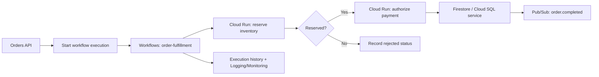
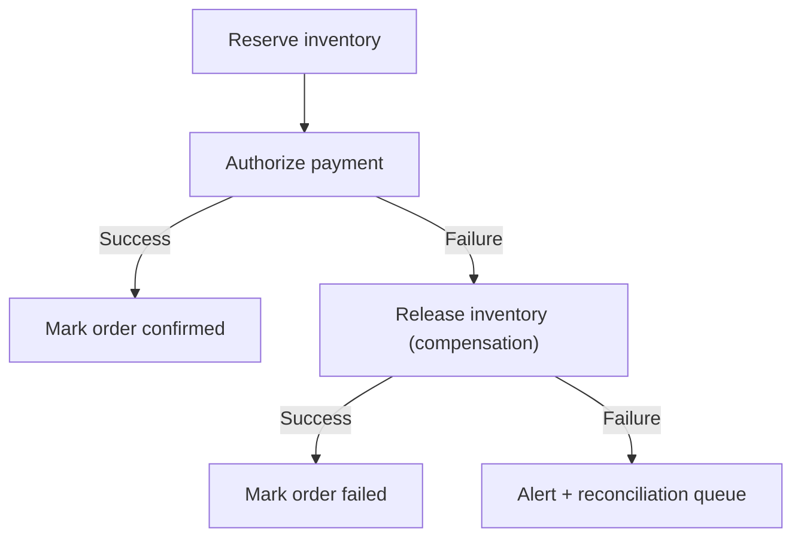
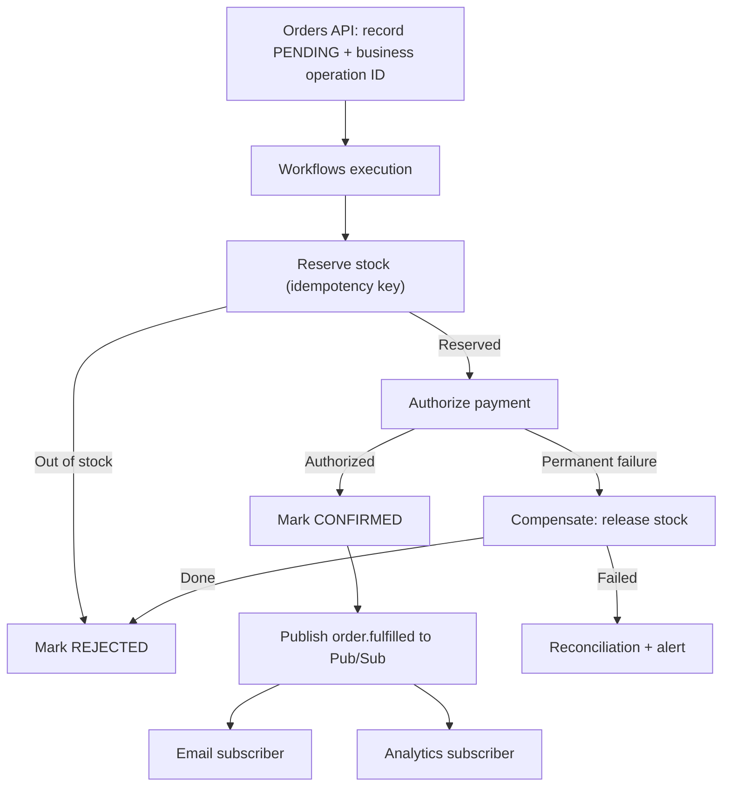

# Workflows and Google Cloud Service Orchestration

A new order requires checking inventory, confirming payment, saving state, and sending notifications. If the Orders API sequentially calls every system on its own, a transient error from the payment provider can prolong the user request, while post-error retries can easily create duplicate transactions. **Google Cloud Workflows** lets you express multi-step processes in YAML/JSON, call Google Cloud services and HTTP APIs, persist the state of each **execution**, branch, retry in a controlled manner, and track outcomes.

This lesson belongs to the **Application Orchestration and Integration** chapter, module `CLOUD_PROVIDERS_GCP`. Its content connects IAM, Cloud Run, GKE, Compute Engine, Pub/Sub, Cloud Storage, databases, reliability monitoring, and cost. The goal is to decide **when to orchestrate with Workflows**, and write workflows with proper authentication and error handling, rather than relying on a chain of API calls lacking traceability.

> The `orders-lab` project, Cloud Run URLs, topics, and orders in this lesson are examples only. Commands that enable APIs, deploy workflows, grant IAM, create Scheduler/Eventarc triggers, or run executions may modify resources, trigger real tasks, and incur charges. Only operate in an authorized sandbox. Do not include secrets or personal data in runtime arguments or logs.

## 1. Learning Outcomes

After this lesson, you will be able to:

1. Distinguish between **workflow definition**, **execution**, **step**, **subworkflow**, and **connector**.
2. Choose Workflows instead of Pub/Sub, Cloud Tasks, Cloud Scheduler, or Cloud Composer based on requirements.
3. Write YAML using `params`, `assign`, `call`, `switch`, `for`, `parallel`, `try/retry/except`, and `return`.
4. Call private Cloud Run services using **OIDC** and Google Cloud APIs using **connectors/OAuth** with least-privilege IAM.
5. Deploy/run a workflow via `gcloud`, or trigger it via Cloud Scheduler/Eventarc when appropriate.
6. Design idempotency, retries, compensating actions, logging, alerting, and cost controls.

## 2. What Problem Does Workflows Solve?

Workflows is a **serverless orchestration** service: you declare the steps and Google Cloud manages execution and persists progress state. A single run is an independent **execution**; executions can run concurrently subject to quotas. Workflows is **not a container runtime** for continuous CPU-intensive processing: work such as image processing, business queries, or sending emails should reside in Cloud Run, GKE, Cloud Run Jobs, or dedicated services.



The **control plane** stores the workflow definition (YAML code, region, service account, env vars). The **runtime** creates executions, executes steps in order/branches, and records status, results, or errors. You must distinguish between the **HTTP request starting an execution** and the **execution completing**: an accepted event or API call does not guarantee the workflow succeeded.

| Term | Meaning | Example |
| --- | --- | --- |
| `Workflow` | A resource deployed per region, referencing source code and an IAM identity | `order-fulfillment` |
| `Step` | A unit of control, API call, variable assignment, or branch decision | `reserveInventory` |
| `Execution` | A single run with JSON input, having state and history | Processing `ord-42` |
| `Subworkflow` | A parameterized/reusable logic block within the same source | `notifyFailure` |
| `Connector` | A function calling a Google Cloud API with appropriate authentication/retry integration | `googleapis.pubsub.v1.projects.topics.publish` |
| `Runtime arguments` | The input JSON of an execution | `{"orderId":"ord-42"}` |

### 2.1. How Workflows Differs from Similarly Named Services

| Need | Typically Suitable Tool | Why |
| --- | --- | --- |
| Orchestrating **multiple steps** with result dependencies, branching, and progress tracking | **Workflows** | One execution represents end-to-end process state |
| Publishing events to multiple consumers without waiting on each other | **Pub/Sub** | Topic/subscriptions fan-out, at-least-once delivery |
| Sending an HTTP task with retry/rate limiting/scheduled execution time | **Cloud Tasks** | Queue throttling independent work; task handlers ensure idempotency |
| Running a process on a cron schedule | **Cloud Scheduler** → Workflows/HTTP/Pub/Sub | Scheduler triggers on time; it does not model complex workflows itself |
| Large data DAGs, Airflow operators, data pipelines with many dependencies | **Cloud Composer (Apache Airflow)** | Suited for the DAG ecosystem and intensive data operations |
| Asynchronous processing requiring high CPU or long duration | **Cloud Run Jobs/GKE/Compute Engine** | Executes the workload; Workflows can simply invoke/await results |

An architecture can **use them together**: Cloud Scheduler triggers Workflows → Workflows calls Cloud Run → Cloud Run publishes to Pub/Sub. Do not use Workflows in place of a message queue storing millions of events, or to perform tiny operations when an application can handle them more efficiently.

## 3. Workflows YAML Syntax and Step Types

Workflows uses YAML or JSON with significant indentation. A source contains **one `main` workflow** and can include additional subworkflows. Most steps run **sequentially** from top to bottom unless directed by `switch`/`next`, `parallel`, or `return`.

| Syntax | Purpose | Notes |
| --- | --- | --- |
| `main.params` | Receives a JSON runtime argument | Input can be map/list/scalar; validate schema before calling |
| `assign` | Initializes/assigns variables | Uses `${...}` expressions; mind variable scope |
| `call`, `args`, `result` | Calls an HTTP function, connector, or stdlib; saves result | Do not call unauthenticated APIs if endpoint requires IAM |
| `switch`, `condition`, `next` | Conditional branching | Conditions are evaluated in order |
| `for` | Loops over a list/range | Mind executed step count limits and iteration capabilities |
| `parallel` | Multiple concurrent branches/iterations | Completion order is non-deterministic; avoid shared state races |
| `try` / `retry` / `except` | Retries and error handling | Retry a **side effect** only when idempotent |
| `return`, `raise` | Returns a result or raises an error | Terminates the execution in the proper state |

### 3.1. Minimal Hello Workflow

```yaml
main:
  params: [input]
  steps:
    - init:
        assign:
          - orderId: ${map.get(input, "orderId")}
    - validate:
        switch:
          - condition: ${orderId == null}
            next: reject
    - success:
        return:
          accepted: true
          orderId: ${orderId}
    - reject:
        raise: "Missing orderId"
```

The example above **does not call any real services**: it only demonstrates parameters, variables, branching, and results. With input `{"orderId":"ord-42"}`, the execution returns the map `{"accepted":true,"orderId":"ord-42"}`; if `orderId` is missing, the execution fails with an intentional error. Checking a map with `map.get` is safer than directly reading `input.orderId` when the key might not exist.

In YAML, the `${...}` syntax is a **Workflows expression**, not shell variable substitution. When an expression contains colons, parentheses, or complex expressions, enclose the entire expression in YAML single quotes as documented. Avoid embedding business secrets in source code or runtime arguments.

## 4. Calling Authenticated Cloud Run HTTP Services

Workflows uses the **workflow's service account** as its identity when calling downstream services. HTTP requests **do not send tokens automatically**; you must declare:

- **Cloud Run/Cloud Run functions:** `auth.type: OIDC`, ID token with the correct audience.
- **Google Cloud REST APIs at `*.googleapis.com`:** `auth.type: OAuth2` when calling via direct HTTP.
- **Google Cloud connectors:** the connector handles the OAuth identity for the API automatically, without writing HTTP headers manually.

Assume a Cloud Run service `orders-inventory` exposes an HTTPS endpoint `POST /reserve` that accepts JSON `orderId`, `idempotencyKey` and returns `{"status":"RESERVED"}`. This is an **illustrative application contract**: you need to deploy a real endpoint before testing the workflow.

### 4.1. YAML Calling Private Cloud Run

```yaml
main:
  params: [input]
  steps:
    - init:
        assign:
          - orderId: ${map.get(input, "orderId")}
          - baseUrl: ${sys.get_env("INVENTORY_URL")}
    - validate:
        switch:
          - condition: ${orderId == null}
            next: invalidInput
    - reserveInventory:
        try:
          call: http.post
          args:
            url: ${baseUrl + "/reserve"}
            auth:
              type: OIDC
              audience: ${baseUrl}
            headers:
              Content-Type: application/json
            body:
              orderId: ${orderId}
              idempotencyKey: ${orderId}
            timeout: 30
          result: reservation
        retry: ${http.default_retry}
    - confirm:
        switch:
          - condition: ${reservation.body.status != "RESERVED"}
            next: rejected
    - done:
        return:
          orderId: ${orderId}
          status: "RESERVED"
    - rejected:
        raise: "Inventory did not reserve items"
    - invalidInput:
        raise: "Missing orderId"
```

**Condition for retry safety in this example:** Cloud Run must truly be **idempotent by `idempotencyKey`**, such as storing the unique key and outcome inside a database transaction. `http.default_retry` can retry after timeouts or 429/502/503/504 errors; if the endpoint deducts stock on every call, a retry could deduct stock twice. Before building idempotency, consider `http.default_retry_non_idempotent` or disable automatic retries and perform reconciliation.

Here, `audience` is the **root Cloud Run service URL**, excluding `/reserve`. For URLs with paths, configuring `audience` explicitly avoids relying on the wrong default value (the default may use the exact URL being called). If calling a Cloud Run tagged URL, still verify the audience against the service URL and actual Cloud Run/IAM configuration. HTTP `2xx` does not always equate to business success — the workflow must inspect payload fields such as `status` to decide.

### 4.2. Permissions for the Call

The workflow identity, e.g. `workflows-orders@orders-lab.iam.gserviceaccount.com`, needs `roles/run.invoker` on the exact Cloud Run service. The user deploying the workflow needs Workflows create/edit permissions and **`iam.serviceAccounts.actAs`** on this identity. The caller **starting an execution** needs permission to invoke Workflows, and does not need direct permissions on the inventory service if they are not permitted to call that service directly.

Restrict who can invoke the workflow: **a workflow can perform actions with all permissions of its attached service account**. A user-supplied JSON input must not arbitrarily swap URLs, Cloud projects, or resource IDs into privileged targets. Validate action allowlists, ownership, and tenant at the invocation layer and in downstream APIs.

## 5. Calling Google Cloud APIs with Connectors

Workflows provides `googleapis.*` functions for many Google Cloud APIs, such as Pub/Sub, Firestore, Cloud Storage, BigQuery, and Secret Manager. A **Connector** automatically attaches credentials from the workflow's service account, formats API requests, and handles retries or **long-running operations (LRO)** where applicable. This differs from using `http.post` to call Cloud Run business APIs.

### 5.1. Example: Publishing a Pub/Sub Message

Suppose the topic `orders-events` already exists and the workflow service account has `roles/pubsub.publisher` on the topic:

```yaml
main:
  params: [input]
  steps:
    - prepare:
        assign:
          - projectId: ${sys.get_env("GOOGLE_CLOUD_PROJECT_ID")}
          - event:
              eventId: ${input.eventId}
              orderId: ${input.orderId}
              type: "order.fulfilled"
          - encoded: ${base64.encode(json.encode(event))}
    - publish:
        call: googleapis.pubsub.v1.projects.topics.publish
        args:
          topic: ${"projects/" + projectId + "/topics/orders-events"}
          body:
            messages:
              - data: ${encoded}
        result: published
    - done:
        return: ${published.messageIds}
```

`json.encode(event)` converts the map into **JSON bytes**, and `base64.encode(...)` encodes it into the `data` format required by the Pub/Sub API. Message payloads are **not securely encrypted** just by using Base64. The connector returns Pub/Sub message IDs once the publish API succeeds, **which does not mean subscribers have completed business processing**.

**Do not blindly retry publishing:** if the server received the message while the client timed out, a retry can publish an additional message with a new ID. Include `eventId` in the payload and design idempotent consumers. Operations modifying state across multiple systems must verify results via business status, not merely via HTTP 200 or a Pub/Sub message ID.

### 5.2. When to Use Connectors vs. HTTP?

| Target | Typical Calling Method | Required Permissions |
| --- | --- | --- |
| Cloud Run HTTPS service | `http.get/post` + `auth.type: OIDC` | `roles/run.invoker` on the service |
| Pub/Sub publish | `googleapis.pubsub.v1.projects.topics.publish` | `roles/pubsub.publisher` on the topic |
| Cloud Storage API | `googleapis.storage.*` connector or HTTP OAuth | Appropriate object/bucket action permissions |
| Secret Manager | `googleapis.secretmanager.*` connector or HTTP OAuth | `roles/secretmanager.secretAccessor` on the secret |
| Google Cloud API without a connector | `http.request` + `auth.type: OAuth2` | IAM role for the target API/resource |
| Third-party HTTPS API | `http.request` + provider-supported auth | Credentials protected via Secret Manager, TLS, allowlist |

Do not write secrets or tokens returned from connectors into `sys.log`, execution results, or error messages. If using Secret Manager, let the workflow identity read only the specific secrets actually needed, rather than granting project-wide Secret Manager Admin.

## 6. Control Flow: switch, for, parallel, and subworkflow

### 6.1. Switch for Business Decisions

Based on the status returned by the Inventory service, the workflow can branch:

```yaml
- decide:
    switch:
      - condition: ${reservation.body.status == "OUT_OF_STOCK"}
        next: rejectOrder
      - condition: ${reservation.body.status == "RESERVED"}
        next: authorizePayment
- unexpectedStatus:
    raise: "Unknown inventory status"
```

This is a **snippet**; the steps `rejectOrder` and `authorizePayment` must exist in the complete workflow. Do not treat any unfamiliar status as success; default to fail-closed when the backend schema changes.

### 6.2. For Loops Over Lists

```yaml
- inspectItems:
    for:
      value: item
      in: ${input.items}
      steps:
        - logSku:
            call: sys.log
            args:
              severity: INFO
              text: ${"Validating SKU " + item.sku}
```

This is only a **loop example** and does not perform an inventory check. For large lists, do not turn Workflows into a batch processor iterating over millions of elements: step count limits, variable sizes, duration/quotas, and costs can make the design inefficient. Offload bulk processing to Cloud Run Jobs/Dataflow/GKE and have Workflows orchestrate at the task-group level.

### 6.3. Parallel for Independent Steps

Suppose the Inventory and Fraud services both expose **read-only status** endpoints by `orderId` without mutating data. They can be called concurrently and their results combined:

```yaml
main:
  params: [input]
  steps:
    - init:
        assign:
          - inventoryUrl: ${sys.get_env("INVENTORY_URL")}
          - fraudUrl: ${sys.get_env("FRAUD_URL")}
          - inventoryStatus: null
          - fraudStatus: null
    - checkInParallel:
        parallel:
          shared: [inventoryStatus, fraudStatus]
          branches:
            - inventory:
                steps:
                  - readInventory:
                      call: http.get
                      args:
                        url: ${inventoryUrl + "/status"}
                        query:
                          orderId: ${input.orderId}
                        auth:
                          type: OIDC
                          audience: ${inventoryUrl}
                      result: inv
                  - saveInventory:
                      assign:
                        - inventoryStatus: ${inv.body.status}
            - fraud:
                steps:
                  - readFraud:
                      call: http.get
                      args:
                        url: ${fraudUrl + "/assessment"}
                        query:
                          orderId: ${input.orderId}
                        auth:
                          type: OIDC
                          audience: ${fraudUrl}
                      result: assessment
                  - saveFraud:
                      assign:
                        - fraudStatus: ${assessment.body.status}
    - done:
        return:
          inventory: ${inventoryStatus}
          fraud: ${fraudStatus}
```

The two branches may finish **in any order**. Parent variables that branches need to **write** must be declared in `shared`; local variables like `inv` and `assessment` are scoped within each branch. Do not write logic requiring Fraud to observe Inventory's result if both steps truly run concurrently: separate them into sequential steps instead.

Parallelism only improves latency when branches are **independent**; it does not automatically solve Cloud Run concurrency limits, API quotas, DB pools, or race conditions. Workflows enforces limits on concurrency/memory/step count by region and version, so check the quotas table before designing large-scale fan-out.

### 6.4. Subworkflows for Reuse

```yaml
main:
  steps:
    - format:
        call: makeResult
        args:
          id: "ord-42"
          state: "DONE"
        result: output
    - done:
        return: ${output}

makeResult:
  params: [id, state]
  steps:
    - response:
        return:
          orderId: ${id}
          status: ${state}
```

Subworkflows are suited for **standardizing responses or reusing short logic blocks**, not replacing application packages/modules. Calling a subworkflow also consumes steps and may incur charges; avoid deep recursion or passing maps containing unnecessary sensitive payloads.

## 7. Retries, Timeouts, Exceptions, and Idempotency

Networks, quotas, and downstream endpoints can return 429, 5xx, or timeouts. Workflows supports `try/retry/except`, using a **retry policy suited to how safely the operation can repeat**:

| Policy | Recommended Use | Default Retry Conditions |
| --- | --- | --- |
| `http.default_retry` | GET or POST with **genuinely implemented idempotency** | 429, 502, 503, 504, connection errors, timeouts |
| `http.default_retry_non_idempotent` | Operations with side effects not proven idempotent | More restrictive: 429, 503, or connection failure |
| Custom retry | Custom attempt counts, backoff, or error codes needed | Must define predicate and bounds explicitly |

**Even a non-idempotent retry policy does not guarantee side effects will never repeat.** HTTP 503 can occur *after* the downstream service has already written data. To ensure payments or stock deductions occur exactly once at the business level, APIs must support idempotency keys, unique constraints, and reconciliation.

### 7.1. Try/retry/except for an HTTP GET

```yaml
- queryStatus:
    try:
      call: http.get
      args:
        url: ${baseUrl + "/status"}
        query:
          orderId: ${orderId}
        auth:
          type: OIDC
          audience: ${baseUrl}
        timeout: 15
      result: response
    retry: ${http.default_retry}
    except:
      as: e
      steps:
        - logFailure:
            call: sys.log
            args:
              severity: ERROR
              text: "Downstream status check failed"
        - rethrow:
            raise: ${e}
```

This snippet belongs in a workflow where `baseUrl` and `orderId` are already assigned. When retries are exhausted or the error is ineligible for retry, `except` logs a **controlled message** and rethrows so the execution fails. Do not log the entire `e` object if the response could contain Authorization headers, tokens, or PII.

### 7.2. Compensating Actions (Saga) Are Not Transaction Rollbacks

A transaction spanning Cloud Run + Pub/Sub + Cloud SQL **does not have a single ACID transaction covering all steps**. If stock reservation succeeded but payment fails, a retryable/idempotent **releaseInventory** step is required:



Compensation itself can also fail; the workflow must **record a status requiring reconciliation** and have an operator or worker follow up. "Called the release step" does not prove inventory was actually restored. When payment has already created an external charge, refund/cancellation needs a separate contract and audit trail; do not resend the original payment request without an idempotency key.

### 7.3. Timeouts, Waiting, and Polling

Workflows provides `sys.sleep(seconds)`, `sys.sleep_until`, and connector handling for certain long-running operations. Avoid busy-polling every 100 ms; use backoff/sufficient wait intervals and check execution duration limits, HTTP timeouts, memory, steps, quotas, and downstream task behavior. If a job can run for hours, adopt a pattern that stores a job ID, checks status, or uses callbacks instead of holding an indefinitely long HTTP request.

## 8. Hands-on: Deploying and Running a Workflow

The example in Section 4 uses an existing Cloud Run Inventory endpoint in the sandbox. Users need `gcloud` authenticated, a project with Billing enabled, permissions to enable APIs (if needed), create Workflows, and `iam.serviceAccounts.actAs` on the **workflow service account**. When running in practice, verify `gcloud config get-value project` and the region before creating resources.

### 8.1. Preparing APIs and Identity

```bash
PROJECT_ID="orders-lab"
REGION="asia-southeast1"
WORKFLOW="order-fulfillment"
WORKFLOW_SA="workflows-orders@$PROJECT_ID.iam.gserviceaccount.com"

# MUTATING / MAY INCUR CHARGES: run only in an approved sandbox.
gcloud services enable \
  workflows.googleapis.com \
  workflowexecutions.googleapis.com \
  run.googleapis.com \
  --project="$PROJECT_ID"

# Create a dedicated service account if it does not already exist.
gcloud iam service-accounts create workflows-orders \
  --project="$PROJECT_ID" \
  --display-name="Orders workflow identity"

# Grant the workflow identity permission to invoke the specific Cloud Run Inventory service.
gcloud run services add-iam-policy-binding orders-inventory \
  --project="$PROJECT_ID" \
  --region="$REGION" \
  --member="serviceAccount:$WORKFLOW_SA" \
  --role="roles/run.invoker"
```

Do not re-run account creation if the account already exists. If the workflow also publishes to Pub/Sub or accesses Firestore/Secret Manager, add **exact per-resource permissions**; do not grant Editor or Owner to the workflow simply because multiple services are involved.

### 8.2. Deploying YAML Source with an Attached Service Account

Save the **template from Section 4** into a lab file named `order-fulfillment.yaml` in your own sandbox workspace (not the lesson file). Create the real Cloud Run service with `/reserve` beforehand and point the env var to the **root service URL**:

```bash
# DEPLOYMENT COMMAND: replace URL with the actual Cloud Run URL.
INVENTORY_URL="https://ACTUAL_ORDERS_INVENTORY_RUN_URL"

gcloud workflows deploy "$WORKFLOW" \
  --source=order-fulfillment.yaml \
  --location="$REGION" \
  --project="$PROJECT_ID" \
  --service-account="$WORKFLOW_SA" \
  --set-env-vars="INVENTORY_URL=$INVENTORY_URL"

# READ-ONLY: workflow status and its attached IAM identity.
gcloud workflows describe "$WORKFLOW" \
  --location="$REGION" \
  --project="$PROJECT_ID"
```

`--set-env-vars` configures the **workflow resource**, not Cloud Run's environment. When updating a workflow that already has multiple env vars, check the difference between `--set-env-vars` and `--update-env-vars` so you do not accidentally wipe existing configured values. **A URL is not a secret**; credentials must be protected via IAM/Secret Manager.

### 8.3. Running an Execution and Reading Results

```bash
# SIDE EFFECTS: calls the Inventory service and may reserve simulated stock.
gcloud workflows run "$WORKFLOW" \
  --location="$REGION" \
  --project="$PROJECT_ID" \
  --data='{"orderId":"ord-42"}'

# READ-ONLY: list executions and run IDs.
gcloud workflows executions list "$WORKFLOW" \
  --location="$REGION" \
  --project="$PROJECT_ID" \
  --limit=10

# READ-ONLY: use the actual EXECUTION_ID.
gcloud workflows executions describe EXECUTION_ID \
  --workflow="$WORKFLOW" \
  --location="$REGION" \
  --project="$PROJECT_ID"
```

`gcloud workflows run` **waits for the execution to finish** and prints the result; meanwhile, the `executions.create` REST API creates an execution and usually returns metadata once accepted, **without waiting for the entire workflow to complete**. Save the execution ID alongside the business `orderId` for investigation. For a lab that only checks syntax without reserving stock, use the **hello workflow in Section 3** or a mock Cloud Run endpoint.

### 8.4. Pre-Production Testing

| Test | Input/Assumption | Expected Result to Observe |
| --- | --- | --- |
| Valid input | `{"orderId":"ord-42"}` | Execution `SUCCEEDED`, response contains valid status |
| Missing orderId | `{}` | Execution `FAILED` with validation error, Inventory not called |
| Inventory returns OUT_OF_STOCK | Service returns business status | Workflow does not return fake success; `raise` step recorded |
| Transient Inventory 503 | Use mock to simulate | Bounded retries, backoff, no duplicate stock deduction |
| Cloud Run returns 403 | Workflow SA lacks `run.invoker` | Execution failed; fix IAM for the exact principal |
| Workflow re-run with same orderId | Duplicate business operation | Downstream is idempotent, not processed twice |

Do not perform fault injection in production without approval; use mock/staging with the same schema and appropriate IAM controls.

## 9. Triggering Workflows: Direct, Scheduled, and Event-Driven

| Trigger Source | Mechanism | Best Fit |
| --- | --- | --- |
| Operator/CI | Console or `gcloud workflows run` | Manual runs, smoke tests |
| Backend application | Workflows Executions REST/Client API | Starting business workflows with JSON input |
| **Cloud Scheduler** | Cron → HTTP POST to Executions API | Periodic reconciliation/reporting batches |
| **Eventarc** | CloudEvents from Pub/Sub, Cloud Storage, or audit events | Event-driven processing passing the event as runtime argument |

### 9.1. Cloud Scheduler Calling the Executions API

Assume a separate workflow `daily-reconcile` handles `{}` input, and service account `workflow-scheduler@orders-lab.iam.gserviceaccount.com` is granted `roles/workflows.invoker`. Example creating a daily cron job:

```bash
# MUTATING / INCURS CHARGES: create only after the account/workflow exists.
PROJECT_ID="orders-lab"
REGION="asia-southeast1"
SCHEDULER_SA="workflow-scheduler@$PROJECT_ID.iam.gserviceaccount.com"
EXEC_URL="https://workflowexecutions.googleapis.com/v1/projects/$PROJECT_ID/locations/$REGION/workflows/daily-reconcile/executions"

gcloud scheduler jobs create http daily-reconcile-job \
  --project="$PROJECT_ID" \
  --location="$REGION" \
  --schedule="0 2 * * *" \
  --time-zone="Asia/Ho_Chi_Minh" \
  --http-method=POST \
  --uri="$EXEC_URL" \
  --headers="Content-Type=application/json" \
  --message-body='{"argument":"{}"}' \
  --oauth-service-account-email="$SCHEDULER_SA"
```

**Use OAuth2 when Scheduler calls Google APIs** such as `workflowexecutions.googleapis.com`, rather than OIDC which is normally used for Cloud Run HTTP endpoints. Scheduler may **retry** on error responses: if a previous attempt actually created an execution before timing out at the caller, **two executions** may occur. Batch jobs need a business key (e.g., batch date) and a DB lock/dedup; do not expect cron to guarantee exactly-once effects.

### 9.2. Eventarc Capturing Pub/Sub and Launching a Workflow

Eventarc can receive CloudEvents and start Workflows, passing the event JSON as the **runtime argument**. Given an existing Pub/Sub topic `orders-events` and trigger service account `eventarc-workflows@orders-lab.iam.gserviceaccount.com` granted `roles/workflows.invoker`:

```bash
# MUTATING: creates an Eventarc trigger; may create a transport subscription.
gcloud eventarc triggers create orders-pubsub-trigger \
  --project=orders-lab \
  --location=asia-southeast1 \
  --destination-workflow=order-fulfillment \
  --destination-workflow-location=asia-southeast1 \
  --event-filters="type=google.cloud.pubsub.topic.v1.messagePublished" \
  --transport-topic=orders-events \
  --service-account="eventarc-workflows@orders-lab.iam.gserviceaccount.com"
```

**Schema note:** Workflows receives a **CloudEvent JSON wrapper**, not directly the `{"orderId":"..."}` map as in Section 4's example. When using Eventarc, you must add steps to **decode Pub/Sub base64 data, parse JSON, and verify event type/schema** before extracting `orderId`, or use an appropriate adapter subworkflow. Do not attach this trigger to the sample workflow without updating the input contract.

Events are **considered delivered once the workflow execution starts**; if the execution subsequently fails, Eventarc **does not automatically retry the entire execution**. Workflows provides event deduplication within a documented window (24 hours), but that **does not replace business-effect idempotency**. To recover from workflow failures after launch, you need retries/compensation, DLQs, or a dedicated reconciliation process by design.

The Eventarc trigger and workflow must reside in the same project as supported, while trigger/workflow locations may differ where supported. Check quotas, `roles/workflows.invoker` IAM, the Eventarc service account, Pub/Sub transport, and the event source. If Workflows branching is not needed, having Eventarc/Pub/Sub invoke Cloud Run directly is often simpler and cheaper.

## 10. IAM and Protecting Data Inside Workflows

| Identity | Suggested Least Privilege | Boundary |
| --- | --- | --- |
| Workflow deployer | Workflows Developer and `roles/iam.serviceAccountUser` on the workflow SA | Can edit source/config, should not hold overly broad runtime permissions |
| Workflow runtime SA | `roles/run.invoker` for target services, Pub/Sub Publisher/Storage Object Viewer as needed | Do not grant project-wide Owner/Editor |
| Application starting workflows | `roles/workflows.invoker` or custom `workflows.executions.create` | Cannot deploy/edit workflows |
| Cloud Scheduler/Eventarc trigger SA | `roles/workflows.invoker` scoped appropriately | Only triggers the target workflow |
| Operations viewer | Permissions to view executions/logs/Monitoring | Does not by default view secrets or sensitive contents |

**Input data, results, and execution history can retain payloads.** Do not pass passwords, payment card numbers, ID tokens, or unnecessary personal data through Workflows arguments; pass narrowly scoped reference resource IDs/tokens instead. With Secret Manager, never log secret values and never return them in `return`.

A workflow in a given region **executes in that region**, yet HTTP calls and connectors can access resources in other regions. If data residency or VPC Service Controls requirements apply, evaluate the **entire data path**, including target services and logs. Use HTTPS, endpoint-appropriate OIDC/OAuth, secrets policies, and TLS validation for third-party APIs. Workflows can call ingress-restricted Cloud Run as documented when IAM and access paths are configured appropriately; do not assume all private RFC1918 endpoints are directly reachable.

## 11. Observability, SLOs, Quotas, and Cost

Workflows emits execution logs on start/end; depending on configuration, you can enable call logging or log explicitly with `sys.log`. The **Workflows → workflow → Executions** page lets you inspect status, results, and step history if an appropriate history level is enabled. Enabling verbose logging of full requests/responses in production can expose payloads, so prefer **structured logs containing execution ID, business correlation ID, step name, and status**, without secrets.

Example internal log in a step:

```yaml
- logProgress:
    call: sys.log
    args:
      severity: INFO
      data:
        event: "inventory_reserved"
        orderId: ${orderId}
```

If `orderId` is sensitive data under organizational policy, use a correlation ID instead. Custom logs/call logging require the workflow identity to have `logging.logEntries.create` (e.g., `roles/logging.logWriter`).

### 11.1. A Dashboard Sufficient for On-Call

| Metric | Meaning | Suggested Alert |
| --- | --- | --- |
| Executions `SUCCEEDED/FAILED/CANCELLED` | Workflow completion ratio | Consecutive increase in failure ratio |
| Execution latency p95/p99 | End-to-end duration | Exceeds SLO or spikes after deploy |
| Errors by step/downstream | Bottlenecks from Cloud Run, Pub/Sub, IAM, quotas | Increasing 429/503 retries, repeated 403s |
| Active/queued executions and quotas | Workflow throttled by concurrency or limits | Abnormal pending/queued execution count |
| Business state | Has the order truly completed? | Inventory reserved but payment unconfirmed for too long |
| Compensation backlog | Failed compensating actions | Escalate to operator/reconciliation worker |

**Illustrative SLO:** 99.5% of orders have an execution complete successfully within 60 seconds, measured by end-to-end timestamps and business outcome. Workflows' `SUCCEEDED` status is trustworthy at the business level only if final steps verified the real work. A step returning HTTP 200 with body `{"status":"FAILED"}` must not be counted as a successful order.

### 11.2. Costs Billed per Executed Step

Workflows bills based on **internal/external steps** per month; succeeded steps, failed steps, and **retry attempts are all billed**. A subworkflow incurs charges for both the calling step and the steps inside it. Downstream charges (Cloud Run CPU/requests, BigQuery queries, Pub/Sub, Scheduler, Eventarc, logging/egress) are **excluded from Workflows billing**.

Three ways to save without sacrificing reliability:

- Combine simple calculations into reasonable `assign` blocks, avoiding hundreds of steps that add no observability value.
- Use **backoff** and cap retries instead of polling continuously at high frequency.
- Do not launch a new execution for every tiny event if a Pub/Sub consumer or batch job handles it cleanly; balance latency against cost.

Pricing, free tier, internal/external classification, and quotas can change; check [Workflows pricing](https://cloud.google.com/workflows/pricing) and [Workflows quotas](https://cloud.google.com/workflows/quotas) for your project. Workflows enforces limits on input/result sizes, variable memory, step counts, parallel branches, and concurrent executions; design against **current** limits rather than memorized figures from older material.

## 12. Case Study: Order Orchestration and Reconciliation

Suppose the Orders system consists of:

- **Cloud Run Orders API** authenticating users and recording orders in `PENDING` state;
- **Workflows** orchestrating: check inventory → reserve stock → authorize payment → confirm;
- **Cloud Run Inventory/Payment** executing business logic and recording idempotency keys;
- **Pub/Sub** publishing `order.fulfilled` for independent Notification/Analytics processing;
- **Cloud SQL** holding order state and outbox/compensation records; Cloud Monitoring tracking end-to-end status.



### 12.1. Safe Release Design

| Decision | Approach | Why |
| --- | --- | --- |
| Business request ID | Attach a unique `operationId` from Orders API | Retries or duplicate triggers do not create new transactions |
| Workflow input | Only required IDs and event type/version | Reduces PII and execution history size |
| Stock hold/payment | **Idempotent** Cloud Run endpoints | Timeout retries do not duplicate side effects |
| Status update | Transaction/state machine with state guards | Prevents late executions from flipping `CANCELLED` back to `CONFIRMED` |
| Confirmation event | Transactional outbox or publish step + reconciliation | Avoids DB committed while message remains unpublished |
| Email/analytics | Separate Pub/Sub subscriptions | Slow email delivery does not prolong payment workflow |
| Alerts | Error/latency + reconciliation backlog | Workflows `FAILED` does not automatically undo all side effects |

### 12.2. Hypothetical Incident

Payment returns HTTP 503 **after already creating an authorization**. The workflow treats the step as failed, retries, and creates a new authorization if the Payment service lacks idempotency support. This is a **business contract** bug, unfixable by increasing `max_retries`.

To remediate: (1) Payment API persists an idempotency key keyed by `operationId`; (2) retries return the prior result instead of creating a new transaction; (3) the workflow handles "unknown outcome" states via **status query/reconciliation**, without automatically refunding prior to verification; (4) when automatic compensation is impossible, create an owned ticket/queue item. After the fix, run fault injection in sandbox and verify logs, database, and the simulated payment system.

## 13. Diagnosing Common Failures

| Symptom | Possible Cause | How to Check |
| --- | --- | --- |
| YAML deploy syntax error | Bad indentation, unquoted expression, duplicate step name | Workflows syntax reference, Console editor, deploy error location |
| `run --data` fails before HTTP call | JSON input missing key, wrong type | Use `map.get`, validate input, inspect runtime argument |
| Cloud Run returns 401/403 | Missing `auth: OIDC`, wrong audience, workflow SA lacks Invoker | Execution step error, root URL, Cloud Run IAM |
| Google Cloud API returns 403 | Connector/HTTP OAuth SA lacks resource role | Verify connector, principal, exact project/resource |
| Execution `SUCCEEDED` yet order failed | HTTP 200 returned business failure status | Inspect `response.body`, state machine, business SLI |
| Inventory deducted twice | Timeout retry without idempotency | Business operation ID, DB unique constraints, logs |
| Parallel branch fails to deploy | Writing parent variable not declared in `shared` | Parallel shared/local scope |
| Workflow abnormally slow | Tight polling loop, downstream latency, retries, or quota exhaustion | Step timings, Logs/Monitoring, and retry count |
| Pub/Sub event starts execution that later FAILS | Eventarc only confirms once execution starts | Workflows errors, dedicated compensation/reconciliation |
| Scheduler launches two executions for one schedule | HTTP timeout/retry or duplicate task | Correlation key by scheduled time, idempotency lock |
| Missing Workflows custom logs | SA lacks Log Writer or querying wrong project | `sys.log` output, IAM, and Logs Explorer |
| Sudden cost spike | Retry storm, excessive loops/steps, overly frequent triggers | Step count, Billing SKUs, and downstream requests |
| New workflow calls wrong environment | Misconfigured URL env var, untrusted input source | Describe workflow/config, target allowlist, CI promotion |

**Investigation order:** confirm input/identity → inspect execution status and failed step → inspect HTTP/connector response → verify downstream business state → identify retries/duplicates → assess compensation and data impact. Never "quick-fix" by granting Project Owner or logging full responses that could contain secrets.

## 14. Hands-on Exercises

### Exercise A — Tool Selection

A system has three needs: (1) send an event to three independent consumers, (2) run a three-step nightly scheduled process, (3) send an HTTP task with rate limit/retry. Choose among Pub/Sub, Workflows, Cloud Scheduler, and Cloud Tasks; explain when to combine them rather than substitute one for another.

### Exercise B — Writing a Conditional Workflow

Starting from the Section 3 template, add non-empty `orderId` validation, call a (simulated) Inventory service, and use `switch` to handle `RESERVED`/`OUT_OF_STOCK`. Return a consistent JSON result; any unknown status must fail-closed.

### Exercise C — Deploying and Verifying Cloud Run Auth

In a sandbox with private Cloud Run Inventory, create a workflow service account, grant `roles/run.invoker` on the exact service, deploy the Section 4 template, and run `gcloud workflows run --data=...`. Temporarily remove `auth.type: OIDC` to observe 401/403, then restore it. Why should you not enable `--allow-unauthenticated` to bypass the error?

### Exercise D — Pub/Sub Connector

Write a workflow publishing `order.fulfilled` with `eventId` to Pub/Sub using `googleapis.pubsub.v1.projects.topics.publish`. Explain why `base64.encode(json.encode(event))` is required for the `data` field and why a Pub/Sub message ID does not prove the email was sent successfully.

### Exercise E — Parallelism and Variable Management

Suppose Inventory and Fraud provide independent GET endpoints. Use `parallel.branches` to reduce latency and merge results into two parent variables. If `shared` is omitted, what can happen on deploy? When should you switch to sequential processing?

### Exercise F — Retries and Saga

Suppose Inventory reserved stock, and the Payment API timed out but may have created an authorization. Design the idempotency key, retry/backoff, status query, and compensation. Distinguish `http.default_retry` from `http.default_retry_non_idempotent`; name one case where automatic retries should not be used.

### Exercise G — Eventarc, Scheduler, and Observability

Design a daily workflow for order reconciliation and a workflow triggered by a Pub/Sub CloudEvent. Specify IAM Invoker, input contract, deduplication method, SLO, error alerts, and handling when an execution starts and then fails. Estimate the types of charges incurred if workload grows 10x.

### Self-Check Questions

1. How does a workflow definition differ from an execution?
2. Why is Workflows not a tool for processing millions of messages like Pub/Sub?
3. Does `http.post` calling Cloud Run use OIDC or OAuth2?
4. Does a connector automatically handling authentication mean the workflow SA has access to every API?
5. Why can an HTTP 200 in Workflows still represent a business failure?
6. Why do payment retries require an idempotency key and reconciliation?
7. Do parallel branches run in their declared order? When is `shared` required?
8. Does Eventarc automatically retry a failed execution after the execution has started?
9. Which token type should Cloud Scheduler use when calling the Executions REST API?
10. Which steps incur Workflows charges, and why must downstream services also be measured?

## 15. Checklist and Official Documentation

- [ ] Chose the right integration type: orchestration, queue, cron, or data DAG.
- [ ] Workflow YAML defines an input contract, validation, bounded steps, and clear business success criteria.
- [ ] Uses a dedicated service account, OIDC for Cloud Run, and OAuth/connectors for Google APIs.
- [ ] Every retry-prone side effect has an idempotency key, status query, or compensation.
- [ ] Parallelism applies only to independent steps; shared state/ownership is handled properly.
- [ ] Triggers enforce IAM Invoker, input decoding, dedup, and reconciliation on execution errors.
- [ ] Execution history/logs/alerts protect PII; SLOs, timeouts/retries, and rollback are in place.
- [ ] Quotas, step counts, downstream billing, and data location are reviewed before production.

Google Cloud documentation for reference during implementation:

- [Workflows overview](https://cloud.google.com/workflows/docs/overview)
- [Workflows syntax reference](https://cloud.google.com/workflows/docs/reference/syntax)
- [Make an HTTP request](https://cloud.google.com/workflows/docs/http-requests)
- [Authenticate from a workflow](https://cloud.google.com/workflows/docs/authenticate-from-workflow)
- [Manage IAM for workflows](https://cloud.google.com/workflows/docs/authentication)
- [Workflows connectors](https://cloud.google.com/workflows/docs/connectors)
- [Parallel steps](https://cloud.google.com/workflows/docs/reference/syntax/parallel-steps)
- [Retry steps](https://cloud.google.com/workflows/docs/reference/syntax/retrying)
- [Catch errors](https://cloud.google.com/workflows/docs/reference/syntax/catching-errors)
- [Run a workflow](https://cloud.google.com/workflows/docs/execute-workflow)
- [Cloud Scheduler trigger](https://cloud.google.com/workflows/docs/schedule-workflow)
- [Eventarc triggers for Workflows](https://cloud.google.com/workflows/docs/trigger-workflow-eventarc)
- [Workflows execution logging](https://cloud.google.com/workflows/docs/log-workflow)
- [Workflows quotas and limits](https://cloud.google.com/workflows/quotas)
- [Workflows pricing](https://cloud.google.com/workflows/pricing)

**Key takeaway:** Workflows expresses the **sequence and state** of multi-service processes; Cloud Run/GKE executes business logic, Pub/Sub distributes events, and Scheduler/Eventarc triggers runs. Choosing the right IAM, verifying business outcomes, retrying with idempotency, handling compensation, and observing executions are essential for reliable workflows.
