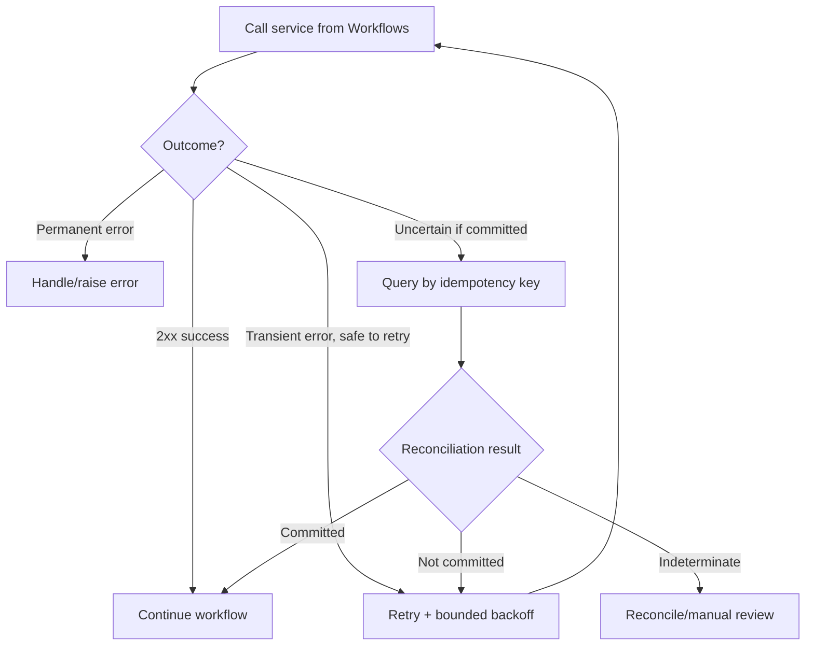
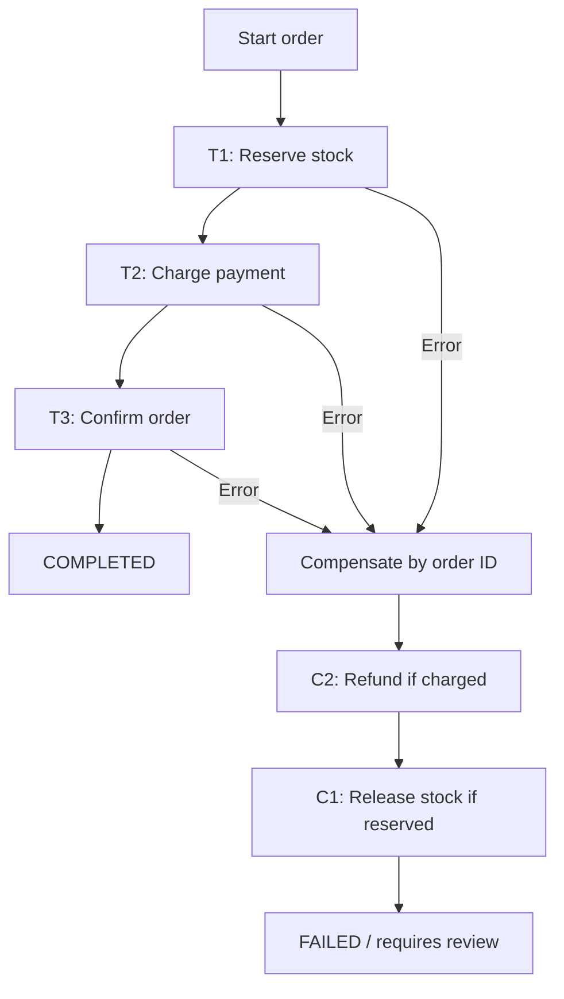

# Retries, Error Handling, and Compensation in Workflows

Suppose an order must pass through three services: **reserve inventory → charge payment → confirm order**. If the payment system returns HTTP 503, should we retry? If money was collected but the order confirmation step fails, how do we issue a refund? If an HTTP request times out after the recipient already executed the transaction, will a retry cause a double charge?

**Google Cloud Workflows** orchestrates inter-service steps in a declared sequence. Workflows supports **`try/retry/except`**, retry predicates, exponential backoff, custom errors, and subworkflows, helping build fault-tolerant flows. However, Workflows **does not create automatic distributed transactions**; applications still need **idempotency, state reconciliation, and compensation (compensating actions)** to maintain data consistency on failure.

This lesson belongs to the **Application Orchestration and Integration** chapter of the `CLOUD_PROVIDERS_GCP` module. Its examples connect Cloud Run, IAM, Pub/Sub/Cloud Tasks, databases, and Cloud Logging, focusing on safe releases, reliability, and cost. The material is self-contained with URLs/resources explicitly marked as hypothetical; **never call real payment APIs using lab data**.

## 1. Learning Objectives

After this lesson, you will be able to:

1. Distinguish **transient**, **permanent**, and **unknown-outcome** failures of an HTTP call.
2. Use `try/except`, `raise`, and error maps in Workflows.
3. Choose `http.default_retry` or `http.default_retry_non_idempotent`, and configure predicates, `max_retries`, and backoff.
4. Explain why **retry does not equal exactly-once**, especially for payment POST requests.
5. Design **Saga orchestration** with reverse-order compensation and tracking for compensation failures.
6. Write Workflows YAML examples and test success/failure branches via CLI in a lab environment.
7. Monitor execution history, logging, SLOs, IAM, and costs.

## 2. Three Failure Types Requiring Different Handling

| Type | Examples | Appropriate Action |
| --- | --- | --- |
| **Transient** | `429` rate limit, `503` temporary overload, short-lived connection errors. | Bounded retry + backoff, respecting quotas/timeouts. |
| **Permanent / business error** | `400` malformed payload, `401/403` missing permissions, `404` non-existent entity, `409` business conflict. | Fix configuration/input, or return a business error; **do not retry blindly**. |
| **Unknown outcome** | Payment POST times out after the server already received the request. | Query state via **idempotency key**, then safely retry or compensate if needed. |

Even HTTP `5xx` is not always safe to retry: if a POST already applied a side effect and then returned 500, re-executing can create two transactions. **Safe retryability is a property of business semantics and the API contract**, not merely the HTTP method.



## 3. Workflows Error Maps, try/except, and raise

### 3.1. Information Inside an Exception

A failed HTTP call step can throw an error map. For `HttpError`, common fields include `tags`, `message`, `code` (HTTP status), `headers`, and `body`. Other errors such as timeouts/connection failures have **different tags and fields**; **never access `e.code` without checking that the field exists**.

| Field | Example | Usage |
| --- | --- | --- |
| `e.tags` | `["HttpError"]` or another error tag. | Classify errors; check `"HttpError" in e.tags` before reading HTTP status code. |
| `e.message` | Diagnostic message. | Controlled logging, avoiding leaking secrets/payloads. |
| `e.code` | `404`, `503` when an HTTP error. | Identify a specific HTTP error. |
| `e.body`, `e.headers` | Response content and headers. | May contain sensitive data; retain only necessary parts. |

### 3.2. Example of try/except with Error-Handling Branches

```yaml
main:
  params: [args]
  steps:
    - read_order:
        try:
          call: http.get
          args:
            url: ${args.url}
            auth:
              type: OIDC
          result: response
        except:
          as: e
          steps:
            - handle_not_found:
                switch:
                  - condition: ${"HttpError" in e.tags and e.code == 404}
                    steps:
                      - missing:
                          return:
                            found: false
            - propagate_unexpected:
                raise: ${e}
    - success:
        return:
          found: true
          data: ${response.body}
```

This example fits when `args.url` is an internal HTTPS endpoint protected by Cloud Run IAM that the workflow service account is authorized to call. In production, **never accept arbitrary URLs from untrusted input**: configure fixed endpoints or an allowlist; if calling another endpoint type, choose matching auth.

**Key points:**

- `try` wraps the failable block; `except.as` receives the error map for classification.
- Catch `404` in an "order not found" context and return an intentional business result.
- Use `raise: ${e}` for other errors so **errors are never swallowed**. Always returning "OK" from `except` misleads callers into thinking the flow succeeded.
- Variables declared inside `except` are **locally scoped**; to use error-handling state afterward, declare the variable in an outer step first and update it inside.

### 3.3. Raising Custom Business Errors with raise

```yaml
- check_amount:
    switch:
      - condition: ${args.amount <= 0}
        steps:
          - reject:
              raise:
                code: "INVALID_AMOUNT"
                message: "Order amount must be positive"
```

`raise` can accept **a string or a map**. A custom map does not automatically become an HTTP error: custom fields/tags must be handled according to the structure you define. Do not set `e.code` to the string `INVALID_AMOUNT` and treat it as HTTP 400 without an explicit contract.

## 4. Retry Policies and Exponential Backoff

### 4.1. How Is Retry Structured?

```yaml
- read_inventory:
    try:
      call: http.get
      args:
        url: https://EXAMPLE_SERVICE_URL/stock
        auth:
          type: OIDC
      result: inventory_response
    retry:
      predicate: ${http.default_retry_predicate}
      max_retries: 3
      backoff:
        initial_delay: 1
        max_delay: 15
        multiplier: 2
    except:
      as: e
      steps:
        - record_failure:
            call: sys.log
            args:
              json:
                event: "inventory_read_failed"
                message: ${e.message}
              severity: "ERROR"
        - propagate_failure:
            raise: ${e}
```

**This is a snippet**, not a standalone workflow: it must sit inside a `steps` list and replace the hypothetical URL with an authorized Cloud Run endpoint. `retry` and `except` sit **at the same indentation level as `try`** in a step.

| Parameter | Meaning | Example |
| --- | --- | --- |
| `predicate` | Function deciding whether an exception is worth retrying. | `http.default_retry_predicate`. |
| `max_retries` | Number of **retry attempts**, excluding the initial call. | `3` → up to 4 total attempts. |
| `initial_delay` | Wait time before the first retry, in seconds. | `1`. |
| `multiplier` | Delay growth factor for exponential backoff. | `2`. |
| `max_delay` | Ceiling for delay between retries. | `15` seconds. |

In this example, theoretical backoff delays are roughly `1s → 2s → 4s` between retries (excluding HTTP call duration and execution limits). **Maximum workflow duration** depends on per-step timeouts, wait times, retries, and the total execution deadline. Each retry executes an extra step and can increase cost.

### 4.2. Which Default Policy Fits?

| Predicate / Policy | Retried Error Group | When to Use |
| --- | --- | --- |
| `http.default_retry_predicate` | HTTP **429, 502, 503, 504** and certain connection/timeout errors. | **Idempotent** APIs or APIs with guaranteed idempotency. |
| `http.default_retry_predicate_non_idempotent` | HTTP **429, 503**, and `ConnectionFailedError`. | APIs with side effects not yet proven safe to retry. |
| `http.default_retry` | Default policy object for idempotent operations. | When you want Workflows' built-in policy. |
| `http.default_retry_non_idempotent` | Default policy object for non-idempotent operations. | When you want a more conservative policy for POST/side effects. |
| Custom predicate | Application-defined errors. | APIs with explicit error contracts or special requirements. |

For instance:

```yaml
- reserve_inventory:
    try:
      call: http.post
      args:
        url: https://EXAMPLE_SERVICE_URL/reserve
        body:
          orderId: "O-1001"
    retry: ${http.default_retry_non_idempotent}
```

**Warning:** the non-idempotent policy **does not prevent duplicate side effects by itself**. A POST can commit before the caller receives the response, even when the network drops. For flows like orders/payments, require APIs to support an **idempotency key** and state lookup when outcomes are uncertain.

### 4.3. Custom Retry Predicates

If an internal API defines a custom retryable condition, use a subworkflow returning a boolean:

```yaml
retry_if_503:
  params: [e]
  steps:
    - decide:
        return: ${"code" in e and e.code == 503}
```

Attach it to a step with `try`:

```yaml
retry:
  predicate: ${retry_if_503}
  max_retries: 2
  backoff:
    initial_delay: 1
    max_delay: 5
    multiplier: 2
```

A predicate **takes the exception map as a single parameter** and returns true/false. Do not retry `400/401/403` simply because attempts remain. If an API returns HTTP 2xx with a `PENDING` status in the body, that **is not automatically an error** for `retry`: inspect it explicitly and `raise` intentionally, or use polling with an appropriate deadline.

## 5. Idempotency, Retry Budgets, and Timeouts

### 5.1. Idempotency Keys

An API performing side effects should accept a **business-stable key**. For example, every charge attempt for order `O-1001` sends the same header:

```yaml
headers:
  Idempotency-Key: ${"charge:" + order_id}
body:
  orderId: ${order_id}
```

The backend must store the key/result in a database with a **unique constraint or atomic conditional write**: duplicate requests return the same valid result without charging again. Sending a key that the backend does not enforce for deduplication **provides zero guarantee**.

### 5.2. Retry Budgets

In a Workflows → Cloud Run → Cloud SQL/third-party API chain, retries at every layer can amplify load. If Workflows tries 4 times and the downstream API tries 3 times per request, the downstream target can receive **up to 12 attempts** for a single operation.

- Set **max retries** and timeouts within an SLO-aligned budget.
- Use exponential backoff to avoid synchronized client retry storms; add jitter where supported.
- Respect upstream `429`/`Retry-After` signals during integration, noting that Workflows' default policy **does not automatically honor every rate-limit hint**.
- For persistently failing APIs, route to **quarantine/manual review** instead of retrying forever.
- Preserve idempotency keys and correlation IDs across all attempts.

### 5.3. Auth and Networking When Calling Cloud Run

In Workflows:

```yaml
auth:
  type: OIDC
  audience: ${service_base_url}
```

Use **OIDC** when calling IAM-protected Cloud Run/Cloud Run functions; the workflow service account needs `roles/run.invoker` on the target service. If the URL includes a path such as `/reserve`, set `audience` to the **base service URL** accepted by Cloud Run. For Google Cloud APIs via `googleapis.com`, use **OAuth2** or the corresponding Workflows connector; do not mix token audiences.

**IAM/network misconfigurations are usually permanent errors**—never retry dozens of times hoping to "get past 403". Restrict service endpoints to a trusted allowlist, enforce ingress controls, and never embed service account keys in workflow source.

## 6. Compensation and the Saga Pattern

If an order reserved inventory but payment fails, a `raise` statement only marks the workflow **FAILED**; it **does not automatically release stock**. Compensation consists of one or more business operations that undo previously completed steps.



This is an **orchestration-based Saga**: Workflows coordinates transactions and executes compensation when a step fails. Compensating actions **are not system-wide ACID rollbacks**:

| Transaction | Compensation | Business Condition |
| --- | --- | --- |
| `reserve(orderId)` | `release(orderId)` | Release the exact reservation; never release another order's stock. |
| `charge(orderId)` | `refund(orderId)` | Refund the exact payment; if uncharged, perform a safe no-op. |
| `finalize(orderId)` | `cancel(orderId)` (if needed) | Clear contract for whether shipment or invoicing already occurred. |

**Crucial design for unknown outcomes:** if `charge` times out, Workflows does not know whether the transaction committed. Therefore, `refund(orderId)` compensation must check status using the same **business/idempotency key** and no-op if no charge occurred. Similarly, `release(orderId)` must not trigger a new business error if the reservation never existed.

**Do not confuse "compensation requested" with "compensation succeeded".** Refunds can fail; when they do, record `COMPENSATION_PENDING`, alert, retry independently, or trigger a reconciliation process instead of merely logging and reporting the order rolled back.

## 7. Workflows YAML Example: Order Saga with Compensation

The following example is a **structurally complete workflow**. It assumes three Cloud Run services exist with these APIs:

| Service | Business Action | Compensation Action |
| --- | --- | --- |
| Inventory | `POST /reserve` | `POST /release` |
| Payment (lab mock) | `POST /charge` | `POST /refund` |
| Orders | `POST /confirm` | `POST /cancel` |

All endpoints accept JSON `{"orderId":"..."}` and an `Idempotency-Key` header, and must **deduplicate by orderId + action**. Compensation endpoints are **idempotent**, returning success even if the original action never occurred (safe no-op). They verify durable state before compensating. The workflow service account holds `roles/run.invoker` on the exact three services.

> **This illustrates architecture, not a real payment integration.** Never run against a payment provider lacking idempotency/refund contracts and reconciliation tooling. Base URLs passed via `args` must come from trusted configuration or an allowlist; never let arbitrary users dictate URLs for Workflows to call on their behalf.

```yaml
main:
  params: [args]
  steps:
    - init:
        assign:
          - order_id: ${args.order_id}
          - inventory_url: ${args.inventory_url}
          - payment_url: ${args.payment_url}
          - orders_url: ${args.orders_url}

    - orchestrate:
        try:
          steps:
            - reserve_stock:
                try:
                  call: http.post
                  args:
                    url: ${inventory_url + "/reserve"}
                    auth:
                      type: OIDC
                      audience: ${inventory_url}
                    headers:
                      Idempotency-Key: ${"reserve:" + order_id}
                    body:
                      orderId: ${order_id}
                    timeout: 20
                retry: ${http.default_retry_non_idempotent}

            - charge_payment:
                try:
                  call: http.post
                  args:
                    url: ${payment_url + "/charge"}
                    auth:
                      type: OIDC
                      audience: ${payment_url}
                    headers:
                      Idempotency-Key: ${"charge:" + order_id}
                    body:
                      orderId: ${order_id}
                    timeout: 20
                retry: ${http.default_retry_non_idempotent}

            - confirm_order:
                try:
                  call: http.post
                  args:
                    url: ${orders_url + "/confirm"}
                    auth:
                      type: OIDC
                      audience: ${orders_url}
                    headers:
                      Idempotency-Key: ${"confirm:" + order_id}
                    body:
                      orderId: ${order_id}
                    timeout: 20
                retry: ${http.default_retry_non_idempotent}

        except:
          as: original_error
          steps:
            - log_saga_failure:
                call: sys.log
                args:
                  json:
                    event: "order_saga_failed"
                    order_id: ${order_id}
                    message: ${original_error.message}
                  severity: "ERROR"

            # Compensation in reverse order.
            # All endpoints must be idempotent and safe as no-ops.
            - cancel_order:
                try:
                  call: http.post
                  args:
                    url: ${orders_url + "/cancel"}
                    auth:
                      type: OIDC
                      audience: ${orders_url}
                    headers:
                      Idempotency-Key: ${"cancel:" + order_id}
                    body:
                      orderId: ${order_id}
                retry: ${http.default_retry_non_idempotent}
                except:
                  as: cancel_error
                  steps:
                    - log_cancel_failure:
                        call: sys.log
                        args:
                          json:
                            event: "compensation_failed"
                            action: "cancel"
                            order_id: ${order_id}
                            message: ${cancel_error.message}
                          severity: "ERROR"

            - refund_payment:
                try:
                  call: http.post
                  args:
                    url: ${payment_url + "/refund"}
                    auth:
                      type: OIDC
                      audience: ${payment_url}
                    headers:
                      Idempotency-Key: ${"refund:" + order_id}
                    body:
                      orderId: ${order_id}
                retry: ${http.default_retry_non_idempotent}
                except:
                  as: refund_error
                  steps:
                    - log_refund_failure:
                        call: sys.log
                        args:
                          json:
                            event: "compensation_failed"
                            action: "refund"
                            order_id: ${order_id}
                            message: ${refund_error.message}
                          severity: "ERROR"

            - release_stock:
                try:
                  call: http.post
                  args:
                    url: ${inventory_url + "/release"}
                    auth:
                      type: OIDC
                      audience: ${inventory_url}
                    headers:
                      Idempotency-Key: ${"release:" + order_id}
                    body:
                      orderId: ${order_id}
                retry: ${http.default_retry_non_idempotent}
                except:
                  as: release_error
                  steps:
                    - log_release_failure:
                        call: sys.log
                        args:
                          json:
                            event: "compensation_failed"
                            action: "release"
                            order_id: ${order_id}
                            message: ${release_error.message}
                          severity: "ERROR"

            - propagate_original_failure:
                raise: ${original_error}

    - completed:
        return:
          order_id: ${order_id}
          status: "COMPLETED"
```

### 7.1. Reading the Flow Above

1. **Success:** reserve → charge → confirm → returns `COMPLETED`.
2. **A step fails:** each step retries per its bounded policy; if it still fails, the `orchestrate` `except` block runs.
3. **Compensation:** sequentially attempts `cancel` → `refund` → `release` using per-action and per-order idempotency keys.
4. **Compensation fails:** each action's dedicated `except` logs the error and continues attempting the remaining compensating steps. **Logging an error does not complete recovery.**
5. **Termination:** `raise original_error` ensures the workflow reflects the true failure; never return `COMPLETED` if compensation had to run.

Why attempt both `cancel` and `refund` when `confirm`/`charge` might not have succeeded? Because a timeout can occur **after the backend committed**. Compensation APIs must inspect durable state and **return success/no-op** when nothing exists to undo. Once a business process crosses a non-cancellable point (e.g., goods already shipped or payment settled), that transition requires a **dedicated business compensation flow** rather than blind refund/cancel calls.

### 7.2. What Is Missing for a Production Saga

The example above lacks a **durable Saga state store**. Production should track an `order_id` record with states such as `RESERVED`, `CHARGED`, `CONFIRMED`, `COMPENSATING`, `COMPENSATED`, and `COMPENSATION_PENDING` in order to:

- Reconcile when an HTTP request times out or an execution is cancelled/lost before entering `except`.
- Allow a **reconciler** or operator to resume failed compensation based on actual state.
- Prevent launching two concurrent executions for the same order from causing competing side effects.
- Correlate orders, reservations, payment transactions, and event IDs.
- Trigger P0/P1 alerts when collected funds lack an order or remain unrefunded past SLA.

Never store all business state solely in Workflows variables or execution history. **Workflows orchestrates; databases and business APIs are the source of truth**.

## 8. Standalone Lab: Testing Retry and Except Without a Backend

To test **syntax and retry counts** without calling Cloud Run/payment, create `retry-demo.yaml` on your lab machine:

```yaml
main:
  steps:
    - simulated_failure:
        try:
          raise:
            code: 503
            message: "simulated transient error"
        retry:
          predicate: ${retry_if_503}
          max_retries: 2
          backoff:
            initial_delay: 1
            max_delay: 4
            multiplier: 2
        except:
          as: e
          steps:
            - handled:
                return:
                  status: "HANDLED_AFTER_RETRIES"
                  error_code: ${e.code}

retry_if_503:
  params: [e]
  steps:
    - decide:
        return: ${"code" in e and e.code == 503}
```

`raise` always throws 503, so the initial attempt + two retries fail; `except` then returns `HANDLED_AFTER_RETRIES`. This example **verifies retry mechanics**, not a pattern permitting business code to "ignore all 503 errors": real applications should usually rethrow or report a failed outcome.

### 8.1. Deploying and Running in a Lab Project

Run only when the project has the **Workflows API** enabled, the user holds deploy/execute permissions, billing/quotas are active, and a suitable workflow service account is configured:

```bash
PROJECT_ID="orders-dev"
REGION="asia-southeast1"
WORKFLOW="retry-demo-lab"

# READ-ONLY: inspect existing workflows before creating.
gcloud workflows list \
  --project="$PROJECT_ID" \
  --location="$REGION"

# MUTATING RESOURCE: creates or updates the named workflow.
gcloud workflows deploy "$WORKFLOW" \
  --project="$PROJECT_ID" \
  --location="$REGION" \
  --source=retry-demo.yaml

# REAL EXECUTION: incurs step/execution charges at current pricing.
gcloud workflows run "$WORKFLOW" \
  --project="$PROJECT_ID" \
  --location="$REGION" \
  --data='{}'
```

This workflow **makes no external API calls**, so it can safely be used to observe attempts/backoff and the `HANDLED_AFTER_RETRIES` output. To inspect a specific run:

```bash
gcloud workflows executions list "$WORKFLOW" \
  --project="$PROJECT_ID" \
  --location="$REGION"

# Replace EXECUTION_ID with the actual ID from the list command.
gcloud workflows executions describe EXECUTION_ID \
  --workflow="$WORKFLOW" \
  --project="$PROJECT_ID" \
  --location="$REGION"
```

Organizational environments may restrict viewing execution details or log data. If `PERMISSION_DENIED` occurs, check workflow/executions IAM rather than granting project-wide Owner.

### 8.2. Testing the Saga with Mock Services

Deploy the Section 7 example only when **all three mock backends** actually exist and support:

- Validating `orderId`/`Idempotency-Key` and persisting state to the lab datastore.
- `reserve`/`charge`/`confirm` able to inject 429, 503, 400, or timeouts per scenario.
- `cancel`/`refund`/`release` being idempotent/no-op when the original action did not commit.
- Recording events/actions by `order_id` to verify zero duplicate charges and no orphaned reservations/payments.
- Cloud Run services requiring OIDC with the workflow runtime service account granted scoped Invoker.

An illustrative input payload:

```json
{
  "order_id": "O-LAB-1001",
  "inventory_url": "https://inventory-mock-EXAMPLE.a.run.app",
  "payment_url": "https://payment-mock-EXAMPLE.a.run.app",
  "orders_url": "https://orders-mock-EXAMPLE.a.run.app"
}
```

**Do not copy placeholder URLs into a real workflow**; replace them with your own lab service URLs and verify permissions. Since this example involves payments, authorized backends must strictly be **mock/sandbox** services, never production payment processors.

### 8.3. Mandatory Test Matrix

| Mock Scenario | Expected Workflow Outcome | Expected Business State |
| --- | --- | --- |
| All 3 calls return 2xx | `COMPLETED` | One reservation, one charge, one confirmed order. |
| Reserve returns 503 then 2xx | Retry succeeds | No duplicate reservation. |
| Charge returns permanent 400 | Fail + compensation | Inventory released, no charge created. |
| Charge commits then connection times out | May retry/compensate | No double-charge; refund/no-op based on real status. |
| Confirm commits then response times out | Workflow may fail + compensate | Cancel/refund/release per policy, no orphaned confirmed order. |
| Refund endpoint continuously returns 503 | Workflow FAILED, alert | Saga state `COMPENSATION_PENDING` requiring reconciliation. |
| Two executions with same `order_id` | Clear idempotency/collision policy | Does not create 2 orders or 2 charges. |
| Execution cancelled mid-flight | Reconciler recovers | Does not rely on `except` always running. |

**The pass criterion is not merely execution state**, but the **final system state** (inventory, payment, orders) and confirming that re-running with the same idempotency key causes no new side effects.

## 9. Logging, Observability, and Troubleshooting

### 9.1. What Should Be Logged?

| Layer | Data to Observe |
| --- | --- |
| **Workflows execution** | Workflow/revision, execution ID, state, failed step, total duration. |
| **Retry** | Operation name, attempt count, error class/code, delay, retries exhausted. |
| **Compensation** | Action, idempotency key, SUCCESS/FAILED/PENDING, reconciliation result. |
| **Downstream Cloud Run** | HTTP latency, 429/5xx, instance count, service logs, and trace ID. |
| **Database/queue** | Commit state, duplicate key conflicts, pending refunds/reservations, retry backlog. |
| **Cost** | Executed steps, retry counts, execution duration, Cloud Run/DB/Logging costs. |

`sys.log` writes to Cloud Logging per service account and configuration; example:

```yaml
- log_compensation:
    call: sys.log
    args:
      json:
        event: "compensation_attempt"
        order_id: ${order_id}
        action: "refund"
      severity: "WARNING"
```

**Avoid logging raw payment tokens, Authorization headers, PII, or full error bodies**. Log properly classified `order_id`/correlation IDs. Logs themselves are not a durable source of truth for compensation state; you need a state table/outbox and alerts.

### 9.2. Quick Diagnostics

| Symptom | Common Cause | How to Investigate |
| --- | --- | --- |
| Workflow deploy syntax error | Bad YAML indentation, `retry` misaligned with `try`, or invalid expression. | Check formatting and Workflows compiler message. |
| `403` calling Cloud Run | Runtime SA lacks `run.invoker` or audience mismatch. | Check OIDC, service URL, IAM, and ingress; do not retry forever. |
| Retries do not happen | Predicate returns false, error code excluded, or error not raised. | Inspect tags/code, custom predicate, error body vs status code. |
| Too many retries | Multi-layer retries, overly generous `max_retries`/backoff. | Sum total attempts and step fees; check downstream quotas. |
| Compensation not invoked | Uncaught exception, execution cancelled, or workflow halted unexpectedly. | Check execution history, error propagation, reconciliation store. |
| Double refund | Non-idempotent backend or key changes across attempts. | Verify key stability, conditional writes, payment reconciliation. |
| Workflows reports FAILED despite refund | Original business error was rethrown after compensation. | Check `COMPENSATED` vs `COMPENSATION_PENDING` state; FAILED may be expected. |
| `sys.log` missing on dashboard | Missing IAM/logging config or wrong filter. | Check Cloud Logging resource/log name, Logging Writer permission, and filters. |

### 9.3. Cost and SLOs

Every step, retry, connector call, HTTP request, and Cloud Run/DB operation contributes to total cost. **Exponential backoff** reduces load spikes but lengthens execution latency; **compensation** also consumes requests/compute and sometimes payment refund fees. Define SLOs covering:

- Percentage of Sagas **COMPLETED** within target time.
- Percentage **FAILED requiring compensation**, and compensation completion rate.
- Count of `COMPENSATION_PENDING` items and **max age** before reconciliation.
- p95 execution duration and retry exhaustion count.
- Cost per successful order and anomalous retry/compensation volume.

Never try to save a few Workflows steps by skipping stock/payment compensation. Workflows step billing is tiny compared to business risk and total system cost.

## 10. Practice Exercises (with Answers)

**Exercise 1 — Attempt count.** An HTTP step sets `max_retries: 4`. If every attempt fails, what is the maximum total number of calls?

*Answer:* **5 calls** = 1 initial call + 4 retries. Backoff only controls the delay between retries.

**Exercise 2 — Should 403 be retried?** A workflow calling Cloud Run receives HTTP 403 and keeps retrying 10 times, failing each time.

*Answer:* 403 typically indicates an IAM/ingress/OIDC audience or business permission error, not a transient fault. Inspect the workflow runtime SA and `roles/run.invoker` on the service instead of increasing retries.

**Exercise 3 — Choosing a predicate.** How do `http.default_retry_predicate` and `http.default_retry_predicate_non_idempotent` differ?

*Answer:* The idempotent predicate covers 429/502/503/504 and connection/timeout errors; the non-idempotent predicate is more conservative, mainly 429/503 and `ConnectionFailedError`. **Neither predicate guarantees safe side effects on its own.**

**Exercise 4 — Timeout after charge.** Payment succeeds, but the HTTP response is lost. The workflow retries POST and the customer is charged twice.

*Answer:* The API lacked idempotency/lookup by order ID. Send a consistent idempotency key so the backend enforces a single record/transaction; on unknown outcomes, reconcile before acting further.

**Exercise 5 — Compensation.** Inventory reservation succeeds, and charge fails permanently. Which step must run?

*Answer:* **Release reservation** to return stock; if the charge outcome is uncertain, perform **refund/no-op** based on true payment status before releasing. Never simply return 500 and leave stock locked indefinitely.

**Exercise 6 — Failed compensation.** Payment was charged, and the refund API also returns 503 after retries. Should you return status `REFUNDED`?

*Answer:* **No.** Record `COMPENSATION_PENDING` in a durable store, alert/reconcile, and retry in a controlled manner. Logging alone is insufficient.

**Exercise 7 — Exception scope.** A variable `compensation_failed` is created only inside `except`, and a step outside `except` fails when reading it. How do you fix this?

*Answer:* Declare the variable before `try` in the outer scope and update it inside `except`, or encapsulate the handling/return inside `except`.

**Exercise 8 — Retry amplification.** A workflow retries up to 4 attempts, and Cloud Run underneath retries up to 3 attempts. How many calls can the upstream target receive?

*Answer:* **Up to 12**. Establish a coordinated retry budget and backoff across layers; consider designating a single layer responsible for retries.

**Exercise 9 — Cancelled workflow.** An execution is cancelled after reserving stock but before `except` runs. Is stock guaranteed to be released?

*Answer:* No. You need **durable Saga state + a reconciler** to clean up orphaned/cancelled transactions rather than relying solely on catch blocks.

## 11. Production Checklist

- [ ] Every step clearly classifies transient, permanent, and unknown outcomes.
- [ ] `try/retry/except` syntax is valid; error maps never read fields without checking presence.
- [ ] Retries specify predicate, max attempts, backoff, timeouts, and total budget.
- [ ] POST requests send an idempotency key **enforced by the backend**, not a decorative header.
- [ ] Status query/reconciliation handles timeouts or dropped connections after commit.
- [ ] Compensation runs in reverse order with complete endpoints and safe no-ops.
- [ ] Saga/compensation state is persisted durably, with operator/reconciler handling for `PENDING`.
- [ ] Workflow IAM uses a least-privilege runtime SA and exact Cloud Run OIDC audience.
- [ ] Arbitrary endpoint URLs are rejected; secrets/payment details/PII are never logged.
- [ ] Tested against 429/503, 400/403, timeouts, duplicates, compensation failures, and cancellation.
- [ ] Monitoring and alerts cover executions, retries, compensation backlog, p95 latency, and cost.
- [ ] Workflow rollback/redeploy, versioned business APIs, and incident procedures are in place.

## 12. Summary

**Retries** overcome transient errors; **`try/except`** classifies failures and routes them to concrete actions; **compensation** restores business consistency when multiple services partially commit. These three mechanisms complement each other but never replace **idempotency, database transactions, and reconciliation**.

A reliable Workflows design must answer four questions:

1. **Should we retry?** Only for eligible errors and repeat-safe operations.
2. **For how long?** Bound attempts, backoff, and timeouts by SLO and cost.
3. **If it fails mid-way, how do we compensate?** Idempotent compensating actions with explicit state and order.
4. **If compensation fails or the execution vanishes, who handles it?** Durable Saga state, alerts, and a reconciler.

### Google Cloud Reference Documentation

- [Workflows — Retry steps](https://cloud.google.com/workflows/docs/reference/syntax/retrying)
- [Workflows — Catch errors](https://cloud.google.com/workflows/docs/reference/syntax/catching-errors)
- [Workflows — Workflow errors](https://cloud.google.com/workflows/docs/reference/syntax/error-types)
- [Workflows — Raise errors](https://cloud.google.com/workflows/docs/reference/syntax/raising-errors)
- [Workflows — Default retry predicate](https://cloud.google.com/workflows/docs/reference/stdlib/http/default_retry_predicate)
- [Workflows — Default non-idempotent retry predicate](https://cloud.google.com/workflows/docs/reference/stdlib/http/default_retry_predicate_non_idempotent)
- [Workflows — Authentication](https://cloud.google.com/workflows/docs/authenticate-from-workflow)
- [Workflows — Best practices: retries and Saga](https://cloud.google.com/workflows/docs/best-practice)
- [Workflows — Pricing](https://cloud.google.com/workflows/pricing)
