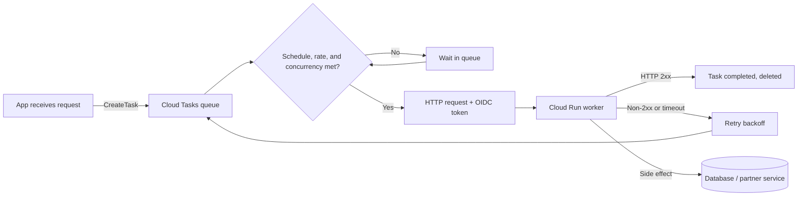

# Rate Limits, Scheduling, and Retries for Cloud Tasks

> **Chapter:** Application Orchestration and Integration  
> **Module:** CLOUD_PROVIDERS_GCP  
> **Module scope:** Exploring Google Cloud from project organization, IAM, and VPC to Compute Engine, GKE, Cloud Run, storage services, and databases. Through deployment scenarios, learners choose services, protect resources, automate releases, and monitor reliability alongside cost.

A sales API needs to send confirmation emails and call a payment partner after receiving an order. Executing everything inside the HTTP request makes buyers wait too long, while calling in bursts causes the partner API to return `429 Too Many Requests`. **Cloud Tasks** lets you place each unit of work into a **durable queue**, schedule the **earliest first-attempt time**, throttle delivery rate to the worker, and retry when the worker does not succeed.

This lesson focuses on three distinct mechanisms: **rate limits** throttling total dispatches, **schedule time** delaying the initial attempt, and **retry configuration** governing subsequent attempts after failure. We build an authenticated Cloud Run HTTP worker, a low-rate Cloud Tasks queue, and three test tasks (success, error, and scheduled), then inspect logs, handle errors, and clean up. Mutating Cloud operations are strictly for **sandbox projects**.

## Learning Objectives

After this lesson, you will be able to:

1. Explain the roles of **queue, task, dispatch attempt, and worker** and identify when to choose Cloud Tasks over Cloud Scheduler, Pub/Sub, or Workflows.
2. Configure `maxDispatchesPerSecond` and `maxConcurrentDispatches`; understand **token buckets**, bursts, and ramp-up.
3. Use RFC 3339 `scheduleTime`, distinguishing a **one-off future run** from a **recurring cron schedule**.
4. Configure `maxAttempts`, `maxRetryDuration`, `minBackoff`, `maxBackoff`, and `maxDoublings`, and accurately read retry termination conditions.
5. Invoke private Cloud Run via a task service account's **OIDC token** with least-privilege IAM.
6. Design **idempotent** handlers, classify errors, monitor queue depth/latency, and handle failed tasks without losing business data.

## 1. Where Does Cloud Tasks Fit in the Architecture?



**Cloud Tasks persists work requests and actively pushes them to workers.** The application creating the task does not need to wait for completion; successful task creation only proves it was **enqueued**, not that the worker finished processing successfully.

| Concept | Role |
|---|---|
| **Queue** | Stores tasks; defines dispatch rate and default retry policy |
| **Task** | HTTP method, URL, payload, caller identity, schedule time, and customizable settings |
| **Attempt** | A single Cloud Tasks request sent to the worker; may fail and be retried |
| **Worker/handler** | HTTP service processing the job and returning a status reflecting success/failure |
| **Task name** | Identifier within the queue; can assist in preventing duplicate task creation |

### 1.1. Choosing Cloud Tasks vs. Other Services

| Need | Usually Suitable Tool | Reason |
|---|---|---|
| Run a specific HTTP job in 10 minutes, capped at 2 req/s | **Cloud Tasks** | One-time schedule, dispatch rate, retries |
| Run a job every day at 01:00 | **Cloud Scheduler** | Recurring cron; can invoke services or create tasks |
| Fan out to multiple consumers on events | **Pub/Sub** | Publish/subscribe, each subscription receives messages |
| Sequence of steps with branches, waiting for results, and state | **Workflows** | Orchestrates multiple calls and decision branches |
| Run multi-hour batches ending per task | **Cloud Run jobs** | Execution/task lifecycle, no per-request HTTP handler needed |

**Cloud Tasks is not a cron tool.** A task with `scheduleTime` is scheduled **once**; for recurring runs, use Cloud Scheduler to trigger a producer/enqueuer. Cloud Tasks also **does not guarantee FIFO order** or exact execution timing.

## 2. HTTP Task Lifecycle and Success Rules

```text
CreateTask → SCHEDULED → time + capacity ready → DISPATCH
                                         ├─ Worker returns HTTP 2xx → SUCCESS → task deleted
                                         └─ HTTP non-2xx / timeout
                                               → BACKOFF → next DISPATCH
                                               → retries / retention exhausted → task deleted
```

- For **HTTP targets**, Cloud Tasks treats **HTTP 2xx** as success, including `200`, `201`, and `204`.
- Other responses (e.g., `400`, `401`, `429`, `500`, `503`), timeouts, and network errors can trigger retries per policy. **Never assume `400` is automatically treated as a non-retried permanent error.**
- Requests with payloads must use HTTP `POST` or `PUT`; for APIs with side effects, never place mutating logic on GET.
- Cloud Tasks provides **at-least-once delivery**; in certain cases it may redeliver even after the application already finished processing. Handlers must be **idempotent**.
- When a task completes or exhausts retry eligibility, Cloud Tasks **deletes the task**. **There is no automatic dead-letter topic** equivalent to Pub/Sub's dead-letter policy in standard HTTP Cloud Tasks.

### 2.1. Pub/Sub ACK Is Not Equivalent to Cloud Tasks Status

For Cloud Tasks HTTP targets, the worker **does not call `ack()`**. It returns an HTTP status code to report the outcome; `2xx` means task completion from Cloud Tasks' perspective. If data was committed yet the response was lost, a subsequent attempt can repeat it. At-least-once delivery guarantees **do not** imply business-level exactly-once execution.

### 2.2. Key Limits to Remember

Under current Cloud Tasks limits for HTTP targets:

| Limit | Value | Meaning |
|---|---|---|
| Furthest schedule | **30 days** from now | Do not use task scheduling for one-off schedules months ahead |
| Max task retention | **31 days** | Tasks are deleted upon hitting the limit, even if uncompleted |
| HTTP dispatch deadline | **15 seconds to 30 minutes**; default 10 minutes | Cloud Tasks stops waiting for an attempt after deadline |
| Dispatch rate per queue | **Up to 500 tasks/s** | Higher throughput requires multi-queue and capacity strategies |
| Task size | **1 MiB** | Never embed large files in HTTP tasks; pass Cloud Storage references |
| Task ID memory after deletion | **Up to 24 hours** | Recreating an old name may return `ALREADY_EXISTS` |
| Delete and recreate queue with same name | **Must wait 3 days** | Never casually delete/recreate queues in operations |

Furthest schedule and retention are **two separate limits**: a task can be scheduled up to 30 days ahead; every task remains subject to the 31-day maximum lifetime.

## 3. Rate Limits: Throttling Speed and Concurrent Attempts

Cloud Tasks throttles **dispatch attempts**, including **both initial attempts and retries**, not just newly added tasks:

| Property | Meaning | Example |
|---|---|---|
| `maxDispatchesPerSecond` | Maximum target dispatch rate via token bucket | `2` tasks/s |
| `maxConcurrentDispatches` | Maximum in-flight attempts awaiting responses simultaneously | `2` concurrent requests |
| `maxBurstSize` | Maximum accumulated tokens available for **bursting** | Auto-computed by API in many configs |
| Queue `state` | `RUNNING` or `PAUSED` | Pause halts dispatches while still allowing enqueues |

### 3.1. Token Bucket and Bursts

A queue replenishes tokens at `maxDispatchesPerSecond`; each dispatch consumes one token. When idle, tokens accumulate and enable **bursts**, so short-window dispatch rates **can exceed the configured average**. Cloud Tasks can auto-calculate `maxBurstSize`; in Cloud Tasks API/`gcloud`, do not assume a flag exists to directly set burst size on every queue.

Conversely, **newly created, recently resumed, or long-idle** queues may ramp up gradually instead of immediately reaching max dispatch rate. Therefore, **`maxDispatchesPerSecond=100` is not a promise of instant 100 tasks/s**.

### 3.2. Concurrency Plus Rate Determines Throughput

Suppose a queue has `maxDispatchesPerSecond=2`, `maxConcurrentDispatches=2`:

- If each request takes ~**0.1 seconds**, the 2 tasks/s average rate limit usually dominates.
- If each request takes **4 seconds**, two in-flight requests saturate concurrency; theoretical concurrency-bound throughput is only **2 / 4 = 0.5 tasks/s**.
- If the worker returns frequent `429`/`503` responses, Cloud Tasks also engages **congestion backoff**, lowering effective rate to protect the target.

Assuming steady load, you can estimate:

\[
\text{Throughput} \lesssim \min\left(\text{maxDispatchesPerSecond},\ \frac{\text{maxConcurrentDispatches}}{\text{attempt latency (s)}}\right)
\]

This is an **approximate bound**, not a second-by-second prediction due to bursts, ramp-up, errors, and retries. A queue limit of 2 concurrent attempts does not replace **Cloud Run max instances/concurrency**: both queue and worker must match downstream capacity.

### 3.3. Do Not Tune Only the Queue to Fix Every 429

If a partner API allows 5 req/s, count **all calling sources**, not just the queue at hand. Lowering queue `maxDispatchesPerSecond` helps, yet token buckets still burst. When strict control is required, also inspect concurrency, downstream quotas, and application-tier rate limiters. Never crank the rate to 500/s just because a backlog grows; measure downstream capacity first.

## 4. Scheduling: `scheduleTime` Controls Only the First Attempt

When creating a task, `scheduleTime` accepts an **RFC 3339** timestamp, e.g. `2026-11-19T10:30:00Z`. If omitted or set in the past, Cloud Tasks treats the task as ready for immediate dispatch.

**`scheduleTime` is not an exact execution timestamp.** Even once its time arrives, a task may wait due to a paused queue, rate limits, concurrency, backoff, infra errors, or ramp-up. Application clocks, timezone scheduling logic, and SLO requirements must be designed separately.

### 4.1. One-Off, Recurring, and Retries

| Scenario | Tool / Mechanism |
|---|---|
| Send an order reminder after 15 minutes | Cloud Tasks `scheduleTime` for **one task** |
| Send a report **every** morning | Cloud Scheduler cron → creates tasks or calls Cloud Run |
| 503 response after the first attempt | **RetryConfig** governs timing of the **next attempt** |
| Must wait for one workflow step to finish before running another | Workflows / application state management |

Set `scheduleTime` only for tasks **not yet started**; never treat it as a delay mechanism for retries. Once a task has been dispatched and failed, `minBackoff`/`maxBackoff` govern subsequent attempts.

### 4.2. Timezone Scheduling

The Cloud Tasks interface expects absolute timestamps. When a user enters "09:00 tomorrow", the application must **convert from the business timezone to UTC**, handling DST if applicable, before enqueuing. In the lab, use Cloud Shell's GNU `date` to compute a **UTC timestamp a few minutes from now** rather than hardcoding stale dates:

```bash
SCHEDULE_AT="$(date -u -d '+3 minutes' '+%Y-%m-%dT%H:%M:%SZ')"
printf 'Task scheduled for %s\n' "$SCHEDULE_AT"
```

If running in Windows PowerShell, `date -d` syntax is incompatible; use `[DateTimeOffset]::UtcNow.AddMinutes(3)` formatted as ISO 8601, or compute the timestamp in application code.

## 5. RetryConfig: Attempt Counts, Duration, and Backoff

Cloud Tasks retries after failed responses/timeouts according to these fields:

| Field | Interpretation |
|---|---|
| `maxAttempts` | Total attempts **including the first attempt**; `-1` means unlimited by count |
| `maxRetryDuration` | Retry window measured from the **first execution attempt**; `0s` means no separate time limit |
| `minBackoff` | Minimum wait duration before retry |
| `maxBackoff` | Maximum wait duration before retry |
| `maxDoublings` | Number of times the backoff interval doubles before switching to linear growth |

### 5.1. Easy-to-Miss Detail: Retry Termination Condition

Under the **current RetryConfig API**, if both a finite `maxAttempts` and a positive `maxRetryDuration` are set, Cloud Tasks stops retrying only when **both conditions are satisfied** (or the task succeeds/hits retention), **not when the first condition is met**. For example, `maxAttempts=3` and `maxRetryDuration=3600s` **does not guarantee the task stops at attempt 3** if the duration window has not elapsed.

To cap strictly by **attempt count** in a lab, set `maxRetryDuration=0s` to disable the separate time constraint; to cap strictly by time, consider `maxAttempts=-1`. Even then, **maximum retention still applies**, and never rely on Cloud Tasks to cap side effects—handlers must remain idempotent.

### 5.2. Backoff Schedule Example

With `minBackoff=10s`, `maxBackoff=300s`, `maxDoublings=3`, wait intervals after failures can follow:

```text
10s → 20s → 40s → 80s → 160s → 240s → 300s → 300s ...
```

This is the **ideal** `RetryConfig` progression; Cloud Tasks may throttle further if the worker returns `429`/`503` or the queue experiences congestion. Actual wait times are also subject to rate and concurrency limits.

### 5.3. Task-Level vs. Queue-Level Retries

The default retry policy belongs to the **queue**, though Cloud Tasks supports a **task-level `retryConfig` override** per task via API/`gcloud`. Queue-level routing/auth overrides (if enabled) can also supersede per-task settings. Do not rely on per-task creation flags if the platform team enforces queue-level policy overrides.

### 5.4. Where Do Permanently Failed Tasks Go?

Unlike Pub/Sub dead-letter policies, when a Cloud Tasks task exhausts retry/retention limits, it **can be deleted from the queue** without automatically moving to a dead-letter topic. When auditing or replaying is needed:

1. Producer saves **business job ID and state** in a database/outbox before enqueuing.
2. Worker persists **structured errors** and durable failure state.
3. For permanent data errors, worker writes a durable **quarantine record/queue** and returns `2xx` if policy considers that state handled.
4. Operator fixes the root cause and creates a **new task with a controlled ID** to replay.

Never return `2xx` for work that was neither processed nor safely persisted; conversely, never infinitely retry a known malformed payload. Failure evidence must outlive the task after Cloud Tasks deletes it.

## 6. Authenticating Cloud Run with OIDC and Least-Privilege IAM

For IAM-protected Cloud Run services, Cloud Tasks can attach a **Google-signed OIDC ID token** for a service account specified on the task:

```text
Producer SA / enqueuer ── cloudtasks.tasks.create ──> Queue
            └── iam.serviceAccounts.actAs ──> Task caller SA
Cloud Tasks service agent ── mints OIDC token for Task caller SA
Cloud Tasks request ── Bearer ID token ──> Cloud Run IAM Invoker
Cloud Run runtime SA ── business permissions ──> Database / Storage
```

| Identity | Required Permissions |
|---|---|
| **Queue administrator** | Manages Cloud Tasks queues in the sandbox |
| **Task enqueuer/producer** | `roles/cloudtasks.enqueuer` on the target queue/project and `iam.serviceAccounts.actAs` on the task caller SA |
| **Task caller SA** | `roles/run.invoker` **on the target Cloud Run service** |
| **Cloud Tasks service agent** | `roles/cloudtasks.serviceAgent` to mint tokens and operate the service (normally auto-granted) |
| **Cloud Run runtime SA** | Business API/DB permissions, distinct from the service-invoking identity |

Never grant `roles/editor` or download service account **JSON keys** locally. The task caller SA must belong to the **same project as the queue** per API rules. When sending OIDC to Cloud Run, `audience` should be the **root service URL** from `gcloud run services describe`, excluding `/tasks/process`.

### 6.1. Ingress Is Different from IAM

In this lab, Cloud Run uses `--ingress=all --no-allow-unauthenticated`. Cloud Tasks reaches the `run.app` URL over the network, yet requests without valid tokens are rejected. Do not arbitrarily switch to `--ingress=internal` unless you confirm Cloud Tasks traffic counts as a supported internal source. **An IAM-protected service does not equate to strict network isolation**; other principals holding Invoker can still call it directly.

### 6.2. Do Not Trust Cloud Tasks Headers Alone

Headers `X-CloudTasks-TaskName`, `X-CloudTasks-TaskRetryCount`, and `X-CloudTasks-QueueName` help observability, **not cryptographic authentication**: any HTTP client permitted to call the endpoint can spoof them. Enforce Cloud Run IAM/OIDC, validate payloads, and apply business authorization; treat headers strictly as tracing metadata.

## 7. Lab A — Inventory and Create a Cloud Run HTTP Worker

> **Rule:** run mutating commands only on a sandbox project with IAM permissions, Billing/budgets, and owner approval. Never create practice tasks targeting production payment, email, or infrastructure endpoints. Commands in this guide were not executed during authoring.

### 7.1. Variables and Read-Only Inventory

In Cloud Shell/Bash:

```bash
PROJECT_ID="my-cloud-tasks-lab"
REGION="asia-southeast1"
QUEUE="orders-async-lab"
SERVICE="tasks-worker-lab"
RUN_SA_NAME="tasks-runtime-lab"
CALLER_SA_NAME="tasks-caller-lab"
RUN_SA="$RUN_SA_NAME@$PROJECT_ID.iam.gserviceaccount.com"
CALLER_SA="$CALLER_SA_NAME@$PROJECT_ID.iam.gserviceaccount.com"

gcloud auth list --filter="status:ACTIVE"
gcloud projects describe "$PROJECT_ID" \
  --format="table(projectId,name,lifecycleState)"
gcloud tasks queues list --project="$PROJECT_ID" --location="$REGION"
gcloud run services list --project="$PROJECT_ID" --region="$REGION"
gcloud iam service-accounts list --project="$PROJECT_ID"
```

**Stop** if a queue/service/SA with the same name already exists and is owned by someone else; never overwrite or delete shared resources. HTTP queues can live in Cloud Tasks-supported regions without creating an App Engine app. This lab places the queue and worker in the same region to simplify latency observation, **which is not a universal requirement for every HTTP task**.

### 7.2. Enable APIs and Create Lab SAs

```bash
# Only when the sandbox project permits enabling services and modifying IAM.
gcloud services enable \
  cloudtasks.googleapis.com \
  run.googleapis.com \
  cloudbuild.googleapis.com \
  artifactregistry.googleapis.com \
  iam.googleapis.com \
  --project="$PROJECT_ID"

gcloud iam service-accounts create "$RUN_SA_NAME" \
  --project="$PROJECT_ID" --display-name="Cloud Tasks lab runtime"

gcloud iam service-accounts create "$CALLER_SA_NAME" \
  --project="$PROJECT_ID" --display-name="Cloud Tasks lab OIDC caller"
```

The deployer needs Cloud Run management permissions and `iam.serviceAccounts.actAs` on the runtime SA; the build identity needs Artifact Registry build/push permissions per project policy. The principal creating HTTP tasks needs `cloudtasks.tasks.create` (e.g., Enqueuer) and `actAs` on the caller SA. The **Cloud Tasks service agent** usually receives its platform role automatically upon enabling the API; adjust it only when a verified IAM error demands it.

### 7.3. Worker Code to Receive Requests and Simulate Errors

Create a `worker/` directory **on your learner machine** with two files; do not add files to the course repository.

**`worker/app.py`**

```python
import json
import logging
import os
from http.server import BaseHTTPRequestHandler, ThreadingHTTPServer

logging.basicConfig(level=logging.INFO, format="%(levelname)s %(message)s")


class Handler(BaseHTTPRequestHandler):
    def reply(self, code, content):
        body = content.encode("utf-8")
        self.send_response(code)
        self.send_header("Content-Type", "text/plain; charset=utf-8")
        self.send_header("Content-Length", str(len(body)))
        self.end_headers()
        self.wfile.write(body)

    def do_POST(self):
        if self.path != "/tasks/process":
            self.reply(404, "Unknown route")
            return

        try:
            size = int(self.headers.get("Content-Length", "0"))
            if not 0 < size <= 4096:
                self.reply(400, "Invalid body size")
                return
            payload = json.loads(self.rfile.read(size).decode("utf-8"))
            job_id = payload["job_id"]
            mode = payload.get("mode", "ok")
            if not isinstance(job_id, str) or not job_id:
                self.reply(400, "Missing job_id")
                return
        except (ValueError, KeyError, UnicodeDecodeError, TypeError):
            self.reply(400, "Invalid JSON task payload")
            return

        # Debug metadata only; NEVER treat headers as auth proof.
        task_name = self.headers.get("X-CloudTasks-TaskName", "unknown")
        retry_count = self.headers.get("X-CloudTasks-TaskRetryCount", "unknown")
        logging.info("task=%s job_id=%s retry=%s mode=%s",
                     task_name, job_id, retry_count, mode)

        if mode == "always_fail":
            # Simulated error: Cloud Tasks will retry according to RetryConfig.
            self.reply(503, "Simulated temporary failure")
            return

        # LAB: does not write to DB or call partners.
        # Production: transactional/idempotent commit before returning 2xx.
        self.reply(200, "processed")


if __name__ == "__main__":
    port = int(os.environ.get("PORT", "8080"))
    ThreadingHTTPServer(("0.0.0.0", port), Handler).serve_forever()
```

**`worker/Dockerfile`**

```dockerfile
FROM python:3.12-slim
WORKDIR /app
COPY app.py .
ENV PYTHONDONTWRITEBYTECODE=1 PYTHONUNBUFFERED=1
USER 65532:65532
CMD ["python", "app.py"]
```

This worker only logs and returns `200` or `503`; it **performs no real business actions**. Even `400` errors can be retried by Cloud Tasks, so production should classify malformed data, route it to durable quarantine, and only then return an intentional success. Never log payloads, PII, or tokens; `job_id` in logs must be a non-sensitive identifier.

### 7.4. Deploy the Private Service and Grant Invoker

```bash
# Run from your local worker/ directory containing app.py and Dockerfile.
gcloud run deploy "$SERVICE" \
  --source . \
  --project="$PROJECT_ID" --region="$REGION" \
  --service-account="$RUN_SA" \
  --ingress=all --no-allow-unauthenticated \
  --concurrency=2 --max-instances=2 \
  --timeout=30s --memory=512Mi --cpu=1

RUN_URL="$(gcloud run services describe "$SERVICE" \
  --project="$PROJECT_ID" --region="$REGION" \
  --format='value(status.url)')"
printf 'Worker service URL: %s\n' "$RUN_URL"

# Grant Invoker to the exact caller SA, never to allUsers.
gcloud run services add-iam-policy-binding "$SERVICE" \
  --project="$PROJECT_ID" --region="$REGION" \
  --member="serviceAccount:$CALLER_SA" \
  --role="roles/run.invoker"

gcloud run services get-iam-policy "$SERVICE" \
  --project="$PROJECT_ID" --region="$REGION"
```

**Negative check (without a token):**

```bash
curl -i -X POST "$RUN_URL/tasks/process" \
  -H 'Content-Type: application/json' \
  -d '{"job_id":"direct-no-auth","mode":"ok"}'
```

Expect Cloud Run to **reject anonymous callers** (typically `401/403`), not return `processed`. If you observe `200`, inspect IAM/Invoker and auth settings before continuing.

## 8. Lab B — Create a Queue with Rate Limits and Retries

### 8.1. Queue with 2 Concurrent Attempts, 2 Dispatches/s

```bash
gcloud tasks queues create "$QUEUE" \
  --project="$PROJECT_ID" --location="$REGION" \
  --max-dispatches-per-second=2 \
  --max-concurrent-dispatches=2 \
  --max-attempts=3 \
  --max-retry-duration=0s \
  --min-backoff=10s \
  --max-backoff=60s \
  --max-doublings=2 \
  --log-sampling-ratio=1.0

gcloud tasks queues describe "$QUEUE" \
  --project="$PROJECT_ID" --location="$REGION" \
  --format="yaml(name,state,rateLimits,retryConfig,stackdriverLoggingConfig)"
```

Meaning:

- Each queue dispatches at an average maximum of ~**2 attempts/s** (subject to bursts/ramp-up).
- At most **2 concurrent attempts in flight** on this queue.
- `maxAttempts=3` **includes the first attempt**; `maxRetryDuration=0s` removes the separate duration cap so the lab bounds strictly by attempt count; maximum retention still always applies.
- Backoff starts at `10s`, rising to `20s` and capped at `60s` across actual attempts/errors.
- `--log-sampling-ratio=1.0` captures full logs for lab observation; production usually reduces sampling based on volume and cost.

A newly created queue may need initialization time. Do not repeatedly create new queues if `describe` does not immediately reflect `RUNNING`.

### 8.2. Updating an Existing Queue (Only When Approved)

```bash
# Isolated sandbox example: adjust both rate and concurrency together.
gcloud tasks queues update "$QUEUE" \
  --project="$PROJECT_ID" --location="$REGION" \
  --max-dispatches-per-second=1 \
  --max-concurrent-dispatches=2

# Restore initial lab configuration:
gcloud tasks queues update "$QUEUE" \
  --project="$PROJECT_ID" --location="$REGION" \
  --max-dispatches-per-second=2 \
  --max-concurrent-dispatches=2
```

For production queues, snapshot configuration before updating, prepare a rollback plan, and monitor backlog/p95. If modifying **queue-level routing/auth overrides**, changes can apply to already-queued tasks, so follow documented pause, update, propagation, and resume procedures.

## 9. Lab C — Enqueue Immediate, Failing, and Scheduled Tasks

Examples use the **real URL** retrieved from Cloud Run; `oidc-token-audience` is the **root URL**, excluding `/tasks/process`. The Cloud Tasks service account and queue must reside in the same project per API rules.

### 9.1. Valid Task: Single Processing Run

```bash
TASK_OK="ok-$(date +%s)"
gcloud tasks create-http-task "$TASK_OK" \
  --project="$PROJECT_ID" --location="$REGION" --queue="$QUEUE" \
  --url="$RUN_URL/tasks/process" --method=POST \
  --header="Content-Type:application/json" \
  --body-content='{"job_id":"order-101","mode":"ok"}' \
  --oidc-service-account-email="$CALLER_SA" \
  --oidc-token-audience="$RUN_URL"
```

**Expected:** Cloud Tasks creates the task and sends an OIDC-authenticated request; the worker receives `job_id=order-101` and returns `200`, and the task is deleted. `gcloud tasks list` may **no longer show** the task once it succeeds—check logs before concluding the task was never created.

### 9.2. Simulated Error Task to Observe Retries

```bash
TASK_FAIL="fail-$(date +%s)"
gcloud tasks create-http-task "$TASK_FAIL" \
  --project="$PROJECT_ID" --location="$REGION" --queue="$QUEUE" \
  --url="$RUN_URL/tasks/process" --method=POST \
  --header="Content-Type:application/json" \
  --body-content='{"job_id":"order-102","mode":"always_fail"}' \
  --oidc-service-account-email="$CALLER_SA" \
  --oidc-token-audience="$RUN_URL"
```

**Expected:** the worker returns `503`, and Cloud Tasks retries per the queue's backoff and attempt limits. Because `maxRetryDuration=0s`, this demonstrates the **3-attempt threshold**, though real dispatch timing still depends on queue limits and congestion backoff. Once deleted after exhausting retries, **there is no automatic DLT**.

### 9.3. Task Scheduled Three Minutes Ahead

```bash
# For Cloud Shell GNU date.
SCHEDULE_AT="$(date -u -d '+3 minutes' '+%Y-%m-%dT%H:%M:%SZ')"
TASK_LATER="later-$(date +%s)"

gcloud tasks create-http-task "$TASK_LATER" \
  --project="$PROJECT_ID" --location="$REGION" --queue="$QUEUE" \
  --url="$RUN_URL/tasks/process" --method=POST \
  --header="Content-Type:application/json" \
  --body-content='{"job_id":"order-103","mode":"ok"}' \
  --oidc-service-account-email="$CALLER_SA" \
  --oidc-token-audience="$RUN_URL" \
  --schedule-time="$SCHEDULE_AT"

# Read pending / waiting tasks:
gcloud tasks list \
  --project="$PROJECT_ID" --location="$REGION" --queue="$QUEUE"
```

**Expected:** the task does not dispatch before `scheduleTime`; after that timestamp it becomes **eligible** for dispatch rather than guaranteed to run to the exact second. Never schedule beyond 30 days; for daily cron jobs, use Cloud Scheduler.

### 9.4. Task IDs and Preventing Duplicate Enqueues

If a producer resubmits the same `TASK_ID` while the task exists or remains in the **up-to-24-hour post-deletion** memory window, Cloud Tasks may return `ALREADY_EXISTS`. Use stable/hashed IDs derived from a **business operation ID** to curb duplicates during producer retries, while avoiding sequential IDs that cause hotspots at high scale.

**Do not mistake task-name dedup for end-to-end idempotency:** outside the ID retention window, upon replay, or if a producer changes task names, a request can run again. Workers must still verify business state via a database/unique constraint.

## 10. Lab D — Monitoring and Controlled Pause/Resume

### 10.1. Inspecting Queue and Worker

```bash
gcloud tasks queues describe "$QUEUE" \
  --project="$PROJECT_ID" --location="$REGION" \
  --format="yaml(name,state,rateLimits,retryConfig)"

gcloud tasks list \
  --project="$PROJECT_ID" --location="$REGION" --queue="$QUEUE"

gcloud run services logs read "$SERVICE" \
  --project="$PROJECT_ID" --region="$REGION" --limit=50
```

In worker logs, inspect `X-CloudTasks-TaskName` and `X-CloudTasks-TaskRetryCount` logged by the code. The first attempt typically shows `retry=0`; subsequent attempts increment. Never rely solely on headers as proof that a request originated from Cloud Tasks.

### 10.2. Pause/Resume Strictly for Learning Throttling

```bash
# ONLY on your own sandbox queue. Pause stops dispatching new tasks.
gcloud tasks queues pause "$QUEUE" \
  --project="$PROJECT_ID" --location="$REGION"

gcloud tasks queues describe "$QUEUE" \
  --project="$PROJECT_ID" --location="$REGION" \
  --format="yaml(name,state)"

# Once verified there is no reason to remain paused:
gcloud tasks queues resume "$QUEUE" \
  --project="$PROJECT_ID" --location="$REGION"
```

**Pausing does not cancel in-flight HTTP requests** and does not delete the backlog. Pending tasks remain subject to schedule/retry and retention limits; upon resuming, throughput may climb gradually during ramp-up. Do not use `run task`/force-run to test SLOs because that debug action can **bypass rate limits**, creating unexpected load spikes.

### 10.3. Cloud Logging and Cloud Monitoring

With queue log sampling enabled, events such as `CreateTask`, `AttemptDispatch`, and `AttemptResponse` are emitted. Cloud Run maintains separate request logs; correlate task ID, response code, timestamp, and revision to distinguish queue vs. worker errors. In **Logs Explorer**, filter with:

```text
resource.type="cloud_tasks_queue"
```

To investigate failed attempts (log schemas may evolve operationally):

```text
resource.type="cloud_tasks_queue"
jsonPayload.attemptResponseLog.status!="OK"
```

Useful Cloud Monitoring metrics (prefix `cloudtasks.googleapis.com/`):

| Metric | Operational Meaning |
|---|---|
| `queue/depth` | Number of queued tasks; sustained growth signals falling behind |
| `queue/task_attempt_count` | Attempts by `response_code`, helping spot `RESOURCE_EXHAUSTED` and `UNAVAILABLE` |
| `queue/task_attempt_delays` | Delta between eligibility time and actual dispatch time |
| `api/request_count` with method `CreateTask` | Producer task creation rate and API errors |

Cloud Tasks records **canonical statuses** on several metrics/logs: for instance, HTTP `429` may appear as `RESOURCE_EXHAUSTED`, `503` as `UNAVAILABLE`, and timeouts as `DEADLINE_EXCEEDED`. Metrics exhibit ingestion latency, so never treat an unrefreshed chart as proof that a worker stopped.

## 11. Production Design: Idempotency, SLOs, and Backpressure

### 11.1. Sizing from SLOs and Downstream Capacity

Suppose a partner allows an average of **5 requests/s**, each request has a p95 latency of **0.8 seconds**, and 1,000 orders must be processed within 10 minutes.

- Average demand: `1000 / 600 ≈ 1.67 tasks/s`, before accounting for retries.
- Choosing a queue rate around `2 tasks/s` can fit **if the partner has sufficient quota** and bursts are controlled.
- Concurrency for 0.8s p95 at 2/s needs a minimum of ~`1.6` slots; picking `2` is a starting point, not an SLA guarantee.
- If p95 climbs to 4 seconds, throughput may become concurrency-capped at ~`0.5 tasks/s`, growing the backlog.

**Rate limits are queue maximums, not per-task SLAs.** When multiple queues target the same vendor, aggregate traffic determines quota pressure; maintain a shared budget and overload handling in the application.

### 11.2. Idempotent Worker

Outline:

```text
POST /tasks/process {job_id, operation, payload_ref}
  Validate schema + principal/authorization
  BEGIN TRANSACTION
    INSERT job_execution(job_id, operation, status='processing')
      ON CONFLICT: inspect current status
    If done -> return 200 (do not repeat side effects)
  COMMIT / establish durable reservation
  Call downstream with idempotency key or outbox
  Persist status=done durably
  return 200

If downstream fails transiently -> return 503 to retry per policy.
If input is permanently invalid -> durable quarantine + audit,
  then return 2xx when policy permits completing the task.
```

If the worker crashes after writing `processing` and before `done`, you need a **lease/timeout and recovery mechanism**; a permanent `processing` row is not idempotency. For payments/emails, prefer an idempotency key on the destination API or an outbox/transaction where possible.

### 11.3. Timeouts and Duplicate Processing

Three timeouts to distinguish:

1. **Client→Producer HTTP timeout:** the user's request can drop **after the task was already enqueued**; producer retries must handle duplicate task IDs.
2. **Cloud Tasks HTTP dispatch deadline:** default 10 minutes, max 30 minutes; exceeding it allows the attempt to retry.
3. **Cloud Run request timeout:** worker configuration; must align with job duration and dispatch deadline.

Never configure a worker to run for 60 minutes assuming Cloud Tasks will wait 60 minutes: **the maximum HTTP task deadline is 30 minutes**. For long-running work, the worker can persist a **durable job/queue record** and return 2xx once handed off, or use Cloud Run jobs/Workflows.

### 11.4. Preventing Retry Storms and System Failures

- During a downstream outage, consider **pausing the queue** per runbook, lowering rates, fixing the root cause, and resuming incrementally.
- Never set `maxAttempts=-1` and `maxRetryDuration=0s` on work lacking idempotency/checkpoints: tasks can retry for the full 31-day retention.
- Never return 2xx without durable commitment, yet avoid infinitely retrying schema errors.
- Monitor **queue depth**, **oldest business job age**, **task attempt failures**, worker p95, cost, and business success rate.
- A Cloud Tasks queue does not replace a **durable business job ledger**: a task deleted after exhausting retries does not mean the business job finished.

### 11.5. Security, Data, and Cost

- Task payloads should carry **resource IDs/references** rather than secrets, PII, or large files; 1 MiB is the task limit.
- Restrict Cloud Run IAM/OIDC, task enqueuer permissions, and `actAs`; avoid static service account keys.
- Task headers, logs, and URLs can expose data: never put tokens in query strings or log raw request bodies.
- Costs arise from Cloud Tasks operations/dispatches, Cloud Run CPU/memory/requests, builds/images, Logging/Monitoring, and network egress. Mass retry failures amplify all of them.
- Budget alerts **do not automatically halt billing**. Start with low queue limits, max instances, and practical alerts; increase only after load testing and quota planning.

## 12. Troubleshooting by Root Cause

| Symptom | Common Cause | First Check |
|---|---|---|
| Task creation returns `PERMISSION_DENIED` | Producer lacks `cloudtasks.tasks.create` or `actAs` on caller SA | Enqueuer IAM, SA, and project |
| Worker receives `401/403` | Caller SA lacks Invoker, wrong OIDC audience, ingress blocks request | Cloud Run IAM, task OIDC, root URL |
| Task enqueued but not dispatched | Queue `PAUSED`, future `scheduleTime`, ramp-up, or rate limit | Queue state, `scheduleTime`, metrics |
| Dispatch slower than max rate | Concurrency, worker latency, cold queue, congestion backoff | Depth, attempts/delays, 429/503 |
| Task retried even though handler "finished" | Non-2xx response, timeout, or lost response | Response status, deadline, idempotency |
| Bad-payload task retries forever | `400` is still non-2xx, broad `retryConfig` | Validation, durable quarantine/terminal-failure policy |
| Set `maxAttempts=3` yet observe >3 attempts | Also set positive `maxRetryDuration`; stop rule checks both | Actual `retryConfig` and retention |
| Attempts exhausted with no DLT | Cloud Tasks HTTP has no automatic DLT like Pub/Sub | Ledger, logs, quarantine |
| Scheduled task arrives late | No exact-second guarantee; queue busy or paused | Schedule vs. actual dispatch delay |
| Same task ID fails with `ALREADY_EXISTS` | Task still exists or name remembered up to 24 hours | Task ID and dedup window |
| Task processed twice in database | At-least-once delivery, retry/producer duplicate, lost response | Unique business key/transaction |
| Widespread Cloud Run `429`/`503` | Max instances/concurrency/downstream overloaded | Cloud Run logs, Cloud Tasks congestion backoff |
| Queue logs missing | Default sampling is 0 or wrong filter | Logging config, resource type |
| Abnormal cost spike | Retry storm, backlog, min instances, `log-sampling=1.0` | Billing Reports, attempts, depth |

### Short Runbook

```text
Task not processed yet?
  ├─ Still in queue?
  │    ├─ Before scheduleTime / PAUSED? → wait or handle with approval
  │    └─ Past due time yet slow? → rate, concurrency, ramp-up, target errors
  └─ Gone from queue?
       ├─ Succeeded? → confirm ledger/side effect
       └─ Exhausted retries / retention? → logs, quarantine, selective replay

Worker reporting errors?
  ├─ 401/403 → OIDC, Invoker, ingress
  ├─ 429/503 → worker/downstream capacity, retry storm
  └─ 400 / bad schema → durable quarantine, do not retry forever
```

## 13. Post-Lab Cleanup and Recovery

**Delete only resources created specifically for this lesson.** Deleting a queue wipes all pending tasks, including scheduled and retrying tasks; recreating the queue cannot restore them. If tasks carry real business work or another owner shares the queue, **do not delete it**.

### 13.1. Inventory and Decide Which Tasks to Keep or Cancel

```bash
printf 'Project=%s Region=%s Queue=%s Service=%s SA=%s\n' \
  "$PROJECT_ID" "$REGION" "$QUEUE" "$SERVICE" "$CALLER_SA"

gcloud tasks queues describe "$QUEUE" \
  --project="$PROJECT_ID" --location="$LOCATION"
gcloud tasks list \
  --project="$PROJECT_ID" --location="$LOCATION" --queue="$QUEUE"
gcloud run services describe "$SERVICE" \
  --project="$PROJECT_ID" --region="$REGION"
```

Wait for valid tasks to finish or record incomplete work. If `later-*` tasks have not reached their scheduled time, **explicitly decide to cancel them** rather than deleting blindly. Stop producers so no new tasks are enqueued during cleanup.

### 13.2. Delete the Dedicated Queue After Confirming No Work Remains

```bash
# ONLY when all lab tasks may be cancelled or have completed.
gcloud tasks queues delete "$QUEUE" \
  --project="$PROJECT_ID" --location="$LOCATION"
```

**Consequences:** every task remaining in the queue is lost; recreating a queue with the same name can be blocked for **3 days**, so choose a new name for another sandbox rather than repeatedly deleting/recreating.

### 13.3. Revoke IAM and Clean Up Lab Cloud Run/SAs

```bash
gcloud run services remove-iam-policy-binding "$SERVICE" \
  --project="$PROJECT_ID" --region="$REGION" \
  --member="serviceAccount:$CALLER_SA" \
  --role="roles/run.invoker"

# Delete only services belonging strictly to this lab.
gcloud run services delete "$SERVICE" \
  --project="$PROJECT_ID" --region="$REGION"

# Delete the two service accounts only if nothing else depends on them.
gcloud iam service-accounts delete "$CALLER_SA" \
  --project="$PROJECT_ID"
gcloud iam service-accounts delete "$RUN_SA" \
  --project="$PROJECT_ID"
```

Never delete the **Cloud Tasks service agent**, default SA, project, or the `cloud-run-source-deploy` Artifact Registry repository because other applications may share them. If the queue/service existed beforehand, **restore prior settings/IAM** instead of deleting. Check Cloud Billing Reports after cleanup because billing data updates with a delay.

## 14. Exercises and Guided Answers

### Exercise 1 — Rate and Concurrency

A queue has `maxDispatchesPerSecond=10`, `maxConcurrentDispatches=4`, and the worker takes ~`2 seconds/request`. What is the approximate maximum concurrency-bound throughput?

**Answer:** `4 / 2 = 2 tasks/s`, below the 10/s rate limit. Improve latency, scale, or adjust concurrency limits rather than only raising `maxDispatchesPerSecond`.

### Exercise 2 — One-Off or Recurring?

One requirement sends an SMS payment reminder 30 minutes after an order is created; another sends a report every morning at 08:00.

**Answer:** SMS after 30 minutes → a Cloud Task with `scheduleTime`. Daily report → **Cloud Scheduler** (cron), which can call an app that creates Cloud Tasks. `scheduleTime` does not create recurrence.

### Exercise 3 — Two Retry Conditions

You set `maxAttempts=3` and `maxRetryDuration=3600s`. A task always returns 503; can you guarantee it will **never** run a fourth time?

**Answer:** **No.** Cloud Tasks stops retrying only when both finite conditions are met, or the task succeeds/hits retention. To enforce strictly by attempt count, set `maxRetryDuration=0s` to disable the separate time constraint.

### Exercise 4 — 403 Calling Cloud Run

A task specifies OIDC SA `tasks-caller-lab`, yet Cloud Run returns 403. The producer has `roles/cloudtasks.enqueuer`. What is missing?

**Answer:** verify the **caller SA** holds `roles/run.invoker` on the Cloud Run service; check that `audience` equals the root URL, ingress allows the path, and the Cloud Tasks service agent has its role. Enqueuer only permits **creating tasks**, not **invoking** targets.

### Exercise 5 — Poison Task Without a DLT

A worker returns 400 due to malformed JSON, and the task retries until deleted. How do you preserve evidence and reprocess properly?

**Guidance:** validate schemas; persist errors/quarantine **durably** with auditing; return 2xx only after safely handing off failure tracking. Once the producer/handler is fixed, replay selectively using a business idempotency key. Cloud Tasks has no automatic dead-letter topic.

### Exercise 6 — Burst Effects

A queue is configured at 5 dispatches/s yet occasionally sees more than 5 requests within one second. Is this definitely a bug?

**Answer:** no; the token bucket accumulates tokens and dispatches in bursts. Inspect `maxBurstSize`, `maxConcurrentDispatches`, sampling intervals, and real downstream limits.

### Exercise 7 — Duplicate Side Effect

The worker sent an email successfully, then the response timed out and the task was redelivered. Is relying solely on task ID enough to prevent sending twice?

**Answer:** no. Task IDs only prevent duplicate enqueuing within a limited window; the worker still needs idempotency keyed by **business operation ID** with durable state, or a target API supporting idempotency keys.

## 15. Production Checklist

| Item | Acceptance Criterion |
|---|---|
| **Service selection** | One-off tasks, cron, fan-out, and orchestration clearly distinguished |
| **Rate limits** | Dispatch/s + concurrency + burst fit total API/downstream capacity |
| **Scheduling** | RFC3339 UTC, 30-day limit, no assumption of exact-second execution |
| **Retries** | Understand min/max/doublings and stop conditions combining attempts/duration |
| **Timeouts** | Cloud Tasks HTTP deadline aligns with Cloud Run and worker timing |
| **IAM** | Producer Enqueuer/`actAs`, task caller SA Invoker, valid Cloud Tasks service agent |
| **Idempotency** | Business key/transaction; retries/replays cause no duplicate side effects |
| **Poison tasks** | Durable quarantine/audit; no expectation of automatic DLT |
| **Observability** | Queue depth, task attempts/delays, Cloud Run 4xx/5xx, SLOs |
| **Security** | No sensitive tokens/payloads in logs; never use `allUsers` or Owner to fix 403 |
| **Cost** | Budgets, log sampling, retry volume, and target capacity monitored |
| **Runbook** | Pause/resume, config rollback, selective replay, owner-governed cleanup |

## Key Takeaways

**Rate limits govern overall dispatch volume; `scheduleTime` sets only the earliest time for the first attempt; retry policy governs attempts after failure.** Cloud Tasks delivers **at least once** without ordering or exact-time guarantees; workers must be idempotent. For private Cloud Run, use an **OIDC caller service account + Run Invoker**. A task deleted after success or retry exhaustion **does not by itself prove business completion**, so logging, durable state, and inspection/replay procedures are essential.

## Official Reference Documentation

- [Google Cloud — Understand Cloud Tasks](https://cloud.google.com/tasks/docs/dual-overview)
- [Google Cloud — Configure queue routing, limits and retries](https://cloud.google.com/tasks/docs/configuring-queues)
- [Google Cloud — Create HTTP tasks](https://cloud.google.com/tasks/docs/create-tasks)
- [Google Cloud — Set retry parameters for an individual task](https://cloud.google.com/tasks/docs/configure-retry-task)
- [Google Cloud — RetryConfig API reference](https://cloud.google.com/tasks/docs/reference/rest/v2/RetryConfig)
- [Google Cloud — Create HTTP tasks with authentication](https://cloud.google.com/tasks/docs/creating-http-target-tasks)
- [Cloud Run — Execute asynchronous tasks using Cloud Tasks](https://cloud.google.com/run/docs/triggering/using-tasks)
- [Google Cloud — Cloud Tasks quotas and limits](https://cloud.google.com/tasks/docs/quotas)
- [Google Cloud — Cloud Tasks observability](https://cloud.google.com/tasks/docs/monitor)
- [Google Cloud — Manage scaling risks](https://cloud.google.com/tasks/docs/manage-cloud-task-scaling)
- [Google Cloud — Cloud Tasks issues and limitations](https://cloud.google.com/tasks/docs/common-pitfalls)
- [gcloud CLI — Create queue](https://cloud.google.com/sdk/gcloud/reference/tasks/queues/create)
- [gcloud CLI — Create HTTP task](https://cloud.google.com/sdk/gcloud/reference/tasks/create-http-task)
