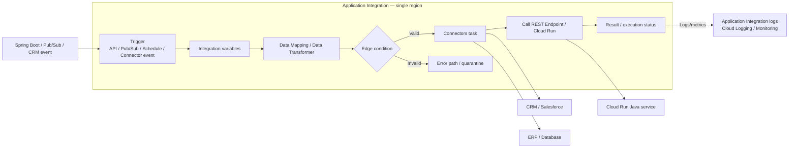
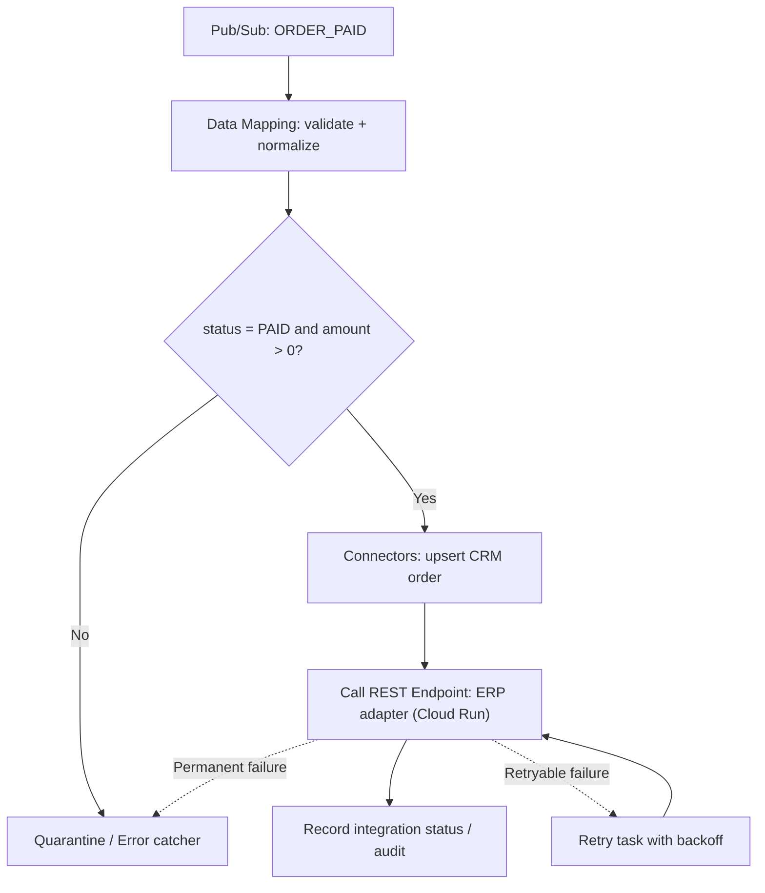
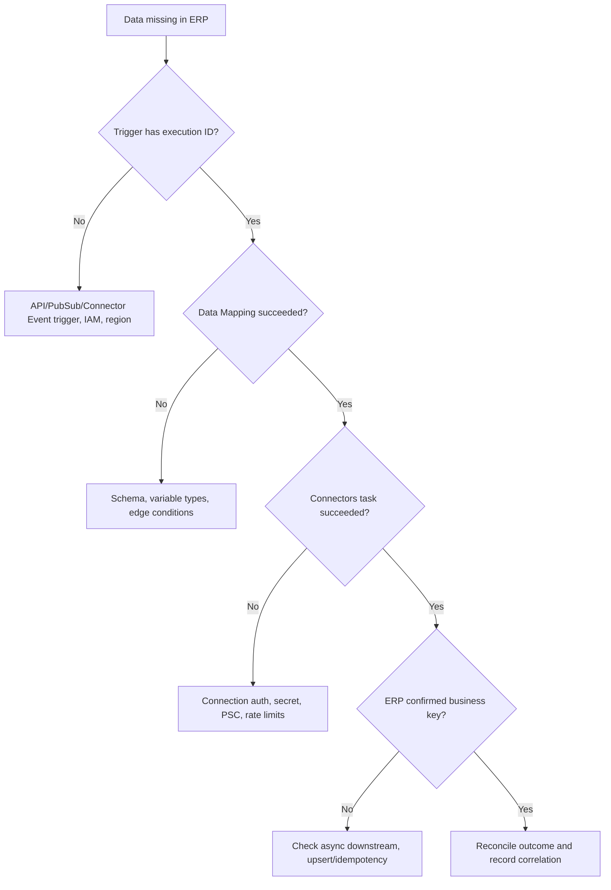

# Application Integration and Enterprise System Connectivity

## 1. The Problem: Connecting Java APIs, CRM, ERP, and Data Systems

An enterprise runs **Spring Boot** on **Cloud Run** to receive orders, **Cloud SQL** to store transactions, a CRM to manage customers, and an ERP to handle invoicing/inventory. Each platform has different schemas, authentication methods, rate limits, and error rules. If the Java API calls the CRM and then the ERP directly inside every HTTP request, an outage or rate limit in one system can fail the entire ordering flow; when a system returns an error after already writing data, retries easily create duplicate records.

**Google Cloud Application Integration** is a serverless, managed **Integration Platform as a Service (iPaaS)** for designing multi-application **integration flows** through a visual interface: receiving triggers, transforming data, invoking tasks/connectors, branching, handling errors, and observing each execution. **Integration Connectors** adds a prebuilt connectivity layer for SaaS apps, databases, and enterprise systems. You no longer have to write a separate Java microservice for every simple transformation or connector. For complex business logic, Java can still run on **Cloud Run** and be invoked from an integration.

Within the **Application Orchestration and Integration** chapter of the **CLOUD_PROVIDERS_GCP** module, this lesson focuses on securely integrating enterprise applications, connecting IAM/VPC, Pub/Sub events, release automation, and monitoring **reliability and cost**.

**After this lesson, you will be able to:**

1. Distinguish **integration, trigger, task, edge/condition, variable, version**, and **connector/connection**.
2. Choose Application Integration instead of **Workflows, Pub/Sub, Eventarc, or Cloud Run** based on business goals.
3. Design an **order → data normalization → CRM/ERP** flow with error handling, retries, and deduplication.
4. Create and test an **API trigger** without connecting to live systems; call the API from CLI/Java via IAM.
5. Understand how to set up **Integration Connectors**, credentials/Secret Manager, and network connectivity.
6. Build runbooks for publishing, rollback, operations, observability, and cost estimation.

> **Lab boundary:** use only an **authorized test project with Billing** and mock data. Provisioning a region, enabling Application Integration/Connectors, creating connection nodes, or running flows can **incur charges**, even when tasks do not create real orders. Never enter production CRM/ERP passwords into the lab, and never publish a flow that writes to live systems.

## 2. Application Integration Architecture



An **integration** is the definition of a process. A **trigger** is the starting point; **tasks** execute work steps; **edges** connect and control branching; **variables** pass data between steps. The flow runs inside a **provisioned region** of Application Integration; destinations (CRM, ERP, Cloud Run) may live in other regions/systems subject to network reachability, data residency rules, and connector support.

| Component | Meaning | Example |
| --- | --- | --- |
| **Trigger** | Starts an execution | API trigger, Cloud Pub/Sub, Schedule, Connector Event |
| **Task** | An action with inputs/outputs | Data Mapping, Connectors, Call REST Endpoint |
| **Edge/condition** | Routes control between tasks | Send to ERP only if `amount > 0` and `status=PAID` |
| **Integration variable** | Typed String, JSON, numeric, Boolean… data in the flow | `orderId`, `correlationId`, `customer` |
| **Version** | Snapshot of a flow for publishing/rollback | `v1` test, `v2` adds CRM mapping |
| **Execution** | A single concrete run | Execution ID, task statuses, timestamps, output |

A flow can hold multiple triggers, yet each event activates only its **matching trigger**, rather than running all triggers automatically. Tasks and outputs can connect via conditional branches, **fork/join**, loops, or sub-integration calls. Never treat all tasks as one atomic cross-system transaction.

## 3. Distinguishing Application Integration from Workflows and Messaging

| Service | Choose When | Do Not Expect |
| --- | --- | --- |
| **Application Integration** | Business processes, CRM/ERP/SaaS sync, data mapping, prebuilt connectors, low-code | A message queue or multi-SaaS transaction manager |
| **Workflows** | Orchestrating REST/Google APIs, infra, or pipelines with clear code-like/YAML logic | Built-in SaaS connectors/schema discovery like an iPaaS |
| **Pub/Sub** | Async event fan-out, decoupling producers/consumers, backlog/replay | Business mapping or complex stateful workflows |
| **Eventarc** | Routing events from supported sources to Cloud Run/Workflows | Replacing CRM/ERP connectors and data mapping |
| **Cloud Run Java** | Custom logic, Spring Boot APIs, validation, or specialized performance processing | Built-in integration lifecycle/retry/monitoring UI |
| **API Gateway/Apigee** | Publishing, securing, and managing APIs | Orchestrating enterprise data and state machines |

**Combined architecture example:** Spring Boot commits an order to Cloud SQL and emits an event **via transactional outbox → Pub/Sub**. Application Integration listens to Pub/Sub to update CRM/ERP via connectors. A Cloud Run service implementing complex pricing rules is invoked via **Call REST Endpoint**. Workflows can wrap a long operational pipeline without forcing everything into one tool.

**Selection rule:** if the core problem is **connecting/transforming data across enterprise systems**, favor Application Integration; if the core problem is **orchestrating services and APIs owned by engineering teams**, evaluate Workflows first. Google Cloud supports combining both in one solution.

## 4. Integration Connectors: Connector, Connection, Entity, and Action

**Integration Connectors** wraps destination application protocols and formats behind a uniform interface for Application Integration (and Apigee Integrations). It provides **authentication, endpoint configuration, protocol/data format mediation, schema discovery**, and certain **event subscriptions**.

| Concept | Interpretation | Example |
| --- | --- | --- |
| **Connector type** | Adapter for a system/technology | Salesforce, ServiceNow, MySQL, HTTP, SAP per catalog |
| **Connection** | A configured instance pointing to a specific tenant/host/database | `crm-sandbox-us` connected to CRM sandbox |
| **Authentication** | Method/credentials for the connection | OAuth 2.0, username + Secret Manager password |
| **Entity** | Data object discovered by the connector | `Account`, `Contact`, `Orders`, `Customers` |
| **Operation** | Common operation on an entity | List, Get, Create, Update, Delete if supported |
| **Action** | Specialized business operation exposed by the connector | Calling a stored procedure or custom SaaS command |
| **Connector Event** | Event emitted from the target system | Record/ticket change, depending on connector/version |

**Not all connectors expose the same entities, actions, or CRUD operations.** What appears depends on connector version, account privileges, and the live system schema. Before designing, use **Connectors → Connections → Entities/Actions** to inspect, rather than guessing that an entity named `Invoice` exists in every ERP.

### 4.1. Why Reuse Connections?

A **connection** configures host/tenant, service account, credentials, connection nodes, and networking. Multiple integrations can share it; when an endpoint/cert changes, centralized connection management cuts duplicated configs. However, a shared connection also creates a **shared failure domain**: rotating a secret incorrectly or hitting SaaS rate limits breaks multiple flows simultaneously. Separate **sandbox/prod connections** with dedicated owners and quotas.

### 4.2. Networking to Private Systems

Public SaaS APIs typically require HTTPS and OAuth; on-prem or private-IP databases/ERPs require connectivity options **supported by Integration Connectors**, such as **Private Service Connect (PSC), endpoint attachments, or proxy/host networking** depending on the connector. **Do not** assume "same project/VPC" automatically gives a connector a route to Cloud SQL or an ERP; equally, never open public IPs to the Internet to dodge network errors.

Choose location, VPC/Shared VPC, DNS, firewall rules, certificates/TLS, and data residency per organizational policy. Note that some connectors have **backend-specific TLS/encryption limits**; always read the configuration docs for **that exact connector** before handling real data.

## 5. Designing Inter-System Data Contracts

An order event from Java should carry a **stable event ID**, **business key**, schema version, and timestamp. Example:

```json
{
  "eventId": "evt-9001",
  "schemaVersion": 1,
  "type": "ORDER_PAID",
  "occurredAt": "2026-11-19T08:00:00Z",
  "order": {
    "id": "ord-1001",
    "customerId": "cust-20",
    "totalMinor": 259900,
    "currency": "VND",
    "status": "PAID"
  },
  "correlationId": "trace-order-1001"
}
```

**Use minor currency units** (`totalMinor`) and currency codes rather than formatted strings like `"259.900 đ"` or floats prone to rounding errors. Never include card numbers, emails, or sensitive payloads in logs/traces unnecessarily.

### 5.1. Mapping Example from Java to CRM/ERP

| Source | Integration Variable | Illustrative Target | Transformation |
| --- | --- | --- | --- |
| `eventId` | `eventId:String` | CRM external ID / ERP dedup key | Pass through unchanged, unique |
| `order.id` | `orderId:String` | `ExternalOrderId` | Pass through unchanged |
| `order.customerId` | `customerId:String` | `CustomerReference` | Lookup/map ID to target system |
| `order.totalMinor` | `amountMinor:Integer` | `Amount` | Convert units per currency; guard precision |
| `order.status` | `status:String` | ERP status code | Mapping table `PAID → PAYMENT_CONFIRMED` |
| `occurredAt` | `eventTime:String` | Target timestamp | ISO 8601/UTC, validate timezone |

The **Data Mapping task** assigns variables, reads/writes JSON properties, and chains mapping functions on the canvas. The **Data Transformer task** uses **Jsonnet** for complex transformations. When mapping involves loops, heavy business dependencies, or requires code-level unit tests, invoke **Cloud Run Java** rather than turning an unwieldy expression into an "unowned business rule".

Hypothetical ERP target payload:

```json
{
  "externalOrderId": "ord-1001",
  "customerReference": "cust-20",
  "amountMinor": 259900,
  "currencyCode": "VND",
  "erpStatus": "PAYMENT_CONFIRMED",
  "sourceEventId": "evt-9001"
}
```

This is an **illustrative schema**, not field names supported verbatim by all Salesforce/SAP/MySQL connectors. Before deploying, inspect the **real sandbox tenant** schema, identify nulls/defaults, required fields, and handling for missing customers.

## 6. Triggers: Synchronous and Asynchronous

| Trigger | Launch Condition | Usage |
| --- | --- | --- |
| **API trigger** | Authenticated caller invokes Integration API | Java API/Workflows explicitly requests processing |
| **Cloud Pub/Sub trigger** | Message published to topic | Async CRM/ERP sync, decoupled from HTTP latency |
| **Schedule trigger** | Configured schedule (cron/time) reached | Catalog sync, nightly reconciliation |
| **Connector Event trigger** | Connector receives event from SaaS | Ticket/customer changes in CRM |

An **API trigger** can declare input/output variables and be invoked **synchronously** via `projects.locations.integrations.execute`; scheduled execution provides an async path where applicable. **Pub/Sub/Schedule/Connector Event** triggers generally follow an asynchronous model. Therefore, never tie a Spring Boot HTTP request to a multi-minute SaaS workflow unless strictly necessary; instead, **accept the event and track status** via correlation ID.

**Delivery note:** Pub/Sub triggers do not guarantee each business event executes only once. Re-runs, retries, source redeliveries, and replays can create duplicates. **Data consistency must rely on business event IDs and idempotent operations**; enabling retries alone does not solve this.

## 7. Tasks, Branches, and Failure Policies

An enterprise-sync flow can be modeled as:



Application Integration supports **task-level error handling** and an **Error catcher** for terminal failure handling. Common strategies:

| Strategy | Behavior | Risks to Remember |
| --- | --- | --- |
| **Retry task with exponential backoff** | Retries failed task with growing delays | Side effect succeeded before lost response can repeat |
| **Retry task fixed/linear interval** | Retries task on fixed intervals | Multiple executions can congest SaaS APIs |
| **Restart integration with backoff** | Restarts the **entire flow from the beginning** | Earlier tasks may create duplicate records if not idempotent |
| **Fatal** | Terminates execution as Failed | Requires alerting/compensation workflow |
| **Ignore** | Continues as if task succeeded | Can mask data loss; never use for mandatory tasks |
| **Error catcher** | Dedicated branch collecting and handling errors | Must avoid infinite loops and masking root errors |

Classify **transient errors** (`429`, `503`, network timeouts) and **permanent errors** (bad schema, unauthorized, business conflicts) by **specific error codes and messages** rather than blindly retrying every `4xx`. Per documentation, Application Integration has its own default classification rules, so **configure retry conditions per task/connector** and verify actual behavior.

### 7.1. No Automatic Distributed Transactions

Suppose the CRM created a record yet the ERP timed out: restarting the entire integration could instruct the CRM to create the record a second time. A safer design:

1. Persist an **external business key** `evt-9001` and durable state `CRM_DONE`.
2. Use **upsert/unique external IDs** if supported by the SaaS; otherwise look up by key first and guard against race conditions.
3. When the ERP fails, retry **the specific task**, or run **compensation/saga** per business rules.
4. Report completion only after all mandatory systems sync; maintain a **partial failure** dashboard and reconciliation job.

The API trigger's idempotency key (`requestId`) helps deduplicate **at API ingress** within feature limits; it **never replaces CRM/ERP unique constraints** or guarantees single side effects across multiple APIs.

## 8. Safe Lab: API Trigger + Data Mapping Without a Live CRM

This first lab only maps and returns results—**no SaaS connections, no database writes**. You need a lab project with Billing/Application Integration permissions and a supported region (e.g., `us-central1`).

### Step 1 — Provision the Region

In **Google Cloud Console → Application Integration**, select your test project and run **Quick setup** for `us-central1` (or **Advanced setup** if your organization requires specific encryption). Quick setup can enable `integrations.googleapis.com`, `connectors.googleapis.com`, and `secretmanager.googleapis.com`, create service agents, and configure the region.

**Never test enabling CMEK in a production project:** choosing **CMEK encryption for a region has irreversible constraints** per documentation. Provisioning a region can create resources and usage-based charges. If a region is unprovisioned, the create-integration menu will not list it.

### Step 2 — Create an Unpublished Integration

Select **Integrations → Create integration**, name it `order-sync-lab`, and pick region `us-central1`. In the integration editor:

1. Add an **API trigger**, change its label to `order_ingress`; note the displayed **Trigger ID**, typically `api_trigger/order_ingress`.
2. Declare **integration variables** (String): `orderId`, `status`, `responseOrderId`, and `responseStatus`.
3. In the API trigger, add `orderId` and `status` to **Input variables**; add `responseOrderId` and `responseStatus` to **Output variables**.
4. Add a **Data Mapping task** connected from the API trigger. Map `orderId → responseOrderId` and `status → responseStatus`. Do not add REST or Connectors tasks in this basic lab.
5. Verify task/edge configuration and save the draft. If you want to validate that `status` only accepts `PAID`, add an edge condition/error branch, making sure to **verify the expression against actual variable types**.

**Completion criterion:** the canvas has the trigger, mapping task, and valid edges; outputs are explicitly declared. Never assume a variable becomes part of the response automatically unless marked as an output.

### Step 3 — Test Before Publishing

In the editor click **Test**, enter `orderId="ord-lab-001"` and `status="PAID"` for the API trigger, and run the test. Inspect the output and **Execution Logs**; both output fields must match the input values. If mapping errors occur, fix the draft and retest.

Testing from the Console executes in **synchronous mode**. Flows containing **Approval/Suspend/Timer tasks** cannot be tested this way before publishing; this lab contains none of those tasks.

### Step 4 — Publish a Version

Once testing passes, click **Publish** to activate the version. This requires a role like **`roles/integrations.integrationDeployer`**; callers testing it typically need **`roles/integrations.integrationInvoker`**. If the integration uses a **run-as service account**, the tester/publisher also needs **`roles/iam.serviceAccountUser`** on that account.

**Versioning:** publishing a new version **automatically unpublishes** the previous version; a single integration does not normally run multiple published versions simultaneously. Keep tested versions and change records so you can **republish** to roll back. Unpublishing an active version breaks callers depending on it.

### Step 5 — Invoke the Published API Trigger

From Cloud Shell with an identity holding `integrations.integrations.invoke`, run the Bash command below. Specify the **exact integration name** rather than `-` to avoid accidentally invoking multiple integrations sharing the same trigger ID:

```bash
gcloud config set project PROJECT_ID

curl --fail-with-body -X POST \
  -H "Authorization: Bearer $(gcloud auth print-access-token)" \
  -H "Content-Type: application/json" \
  -H "X-Server-Timeout: 120" \
  --data '{
    "triggerId": "api_trigger/order_ingress",
    "requestId": "lab-event-001",
    "inputParameters": {
      "orderId": {"stringValue": "ord-lab-001"},
      "status": {"stringValue": "PAID"}
    }
  }' \
  "https://us-central1-integrations.googleapis.com/v1/projects/PROJECT_ID/locations/us-central1/integrations/order-sync-lab:execute"
```

**Before running:** confirm the real API trigger ID (if the editor generated a different name, update the JSON), that the integration is published, the right region, and exact input variable names/types. The response returns execution/output metadata or an error, **not an arbitrary custom JSON document structure**. Under API v1, `inputParameters` uses `ValueType`: String is `{"stringValue":"..."}`, Integer is `{"intValue":"123"}`, JSON is `{"jsonValue":"{...}"}` (a JSON string). `requestId` is the API-level dedup key, so **reuse the same ID when retrying the same business event**.

**Do not confuse `gcloud auth print-access-token` with an ID token:** the Application Integration API is a Google API using an OAuth access token and `integrations.integrations.invoke` IAM; it **differs** from calling private Cloud Run with an OIDC ID token.

### Step 6 — Observe and Clean Up the Lab

In Console → Application Integration → **Logs/Execution Logs**, filter by integration and execution ID, and inspect each task's state. To clean up, **unpublish the lab integration**, verify no real API callers or triggers exist, then delete the integration if truly unused. **Deleting an integration has no automatic undo**; operate only on lab objects after verifying name/project/region. Never delete the region, default service agent, shared connections, or organizational Cloud SQL/SaaS credentials.

## 9. From Lab to CRM/ERP Connectivity with a Connectors Task

This extension is **strictly a sandbox lab design**, not instructions for a production tenant. Assume the enterprise has a CRM sandbox and a test MySQL database reachable via supported connectivity.

### Setting Up a Connection

1. Go to **Integration Connectors → Connections → Create connection**, and pick a compatible **connector type** and **region**.
2. Name it `crm-sandbox-conn` or `erp-test-conn`; select the connection's service account if prompted, and configure endpoint/tenant/database.
3. Choose the **connector-appropriate auth type**. For username/password, store the password in **Secret Manager** and grant `secretmanager.versions.access` with least privilege; for SaaS OAuth, use client/app credentials belonging to the **sandbox tenant**.
4. Configure **connection node settings** and private connectivity where required; verify DNS, routing, PSC endpoint attachments, and actual reachability.
5. Once the connection is **ACTIVE**, discover entities/actions and run **read-only List/Get** tests before enabling Create/Update.
6. In the integration editor, add a **Connectors task**, select the connection and entity/operation, and map inputs/outputs via Data Mapping.

**Cost note:** even with minimal requests, **connection nodes can bill per minute**. Using a Cloud Pub/Sub trigger directly does not require a Pub/Sub connector; add a Connectors task only when you genuinely need that capability.

### Mapping Example in a Connectors Task

```text
Input from Java order event:
  orderId="ord-lab-001", customerId="cust-20",
  amountMinor=259900, currency="VND"

Data Mapping:
  orderId -> CRM external order ID
  customerId -> CRM/ERP reference (via lookup if needed)
  amountMinor + currency -> amount per target schema

Connectors task:
  Connection: crm-sandbox-conn
  Entity: "Order" (only if actually exposed by the connector)
  Operation: Create/Update/Upsert (only if supported)

Output:
  remoteRecordId, status, errorCode, correlationId
```

If a connector does not support upsert by external ID, design **dedicated lookup/dedup/transaction handling**. Never assume running `Get` before `Create` prevents race conditions under concurrent executions.

## 10. Integrating Java Code with the Application Integration API

Cloud Run Java/Spring Boot can invoke an API trigger **synchronously** using a Google Cloud OAuth access token. In production, run with a **runtime service account** granted `roles/integrations.integrationInvoker` (at appropriate scope), using **Application Default Credentials (ADC)**; never commit service account JSON keys or tokens to Git.

This Java 21 snippet illustrates a **client/service class** callable from Spring Boot. Add **`com.google.auth:google-auth-library-oauth2-http`** and **`com.fasterxml.jackson.core:jackson-databind`** (typically included via `spring-boot-starter-web`) with **managed/compatibility-verified versions**:

```java
package dev.example.integration;

import com.fasterxml.jackson.databind.ObjectMapper;
import com.google.auth.oauth2.GoogleCredentials;
import java.net.URI;
import java.net.http.HttpClient;
import java.net.http.HttpRequest;
import java.net.http.HttpResponse;
import java.nio.charset.StandardCharsets;
import java.time.Duration;
import java.util.List;
import java.util.Map;

public final class OrderIntegrationClient {
    private static final ObjectMapper JSON = new ObjectMapper();
    private final HttpClient http = HttpClient.newHttpClient();
    private final String projectId;
    private final String location;

    public OrderIntegrationClient(String projectId, String location) {
        this.projectId = projectId;
        this.location = location;
    }

    public String execute(String eventId, String orderId, String status)
            throws Exception {
        // eventId stays constant across retries of the SAME business event.
        var body = Map.of(
            "triggerId", "api_trigger/order_ingress",
            "requestId", eventId,
            "inputParameters", Map.of(
                "orderId", Map.of("stringValue", orderId),
                "status", Map.of("stringValue", status)));

        GoogleCredentials credentials = GoogleCredentials
            .getApplicationDefault()
            .createScoped(List.of(
                "https://www.googleapis.com/auth/cloud-platform"));
        credentials.refreshIfExpired();

        String endpoint = String.format(
            "https://%s-integrations.googleapis.com/v1/" +
            "projects/%s/locations/%s/integrations/order-sync-lab:execute",
            location, projectId, location);

        var request = HttpRequest.newBuilder(URI.create(endpoint))
            .timeout(Duration.ofSeconds(100))
            .header("Authorization",
                "Bearer " + credentials.getAccessToken().getTokenValue())
            .header("Content-Type", "application/json")
            .POST(HttpRequest.BodyPublishers.ofString(
                JSON.writeValueAsString(body), StandardCharsets.UTF_8))
            .build();

        var response = http.send(
            request, HttpResponse.BodyHandlers.ofString());
        if (response.statusCode() / 100 != 2) {
            throw new IllegalStateException(
                "Integration API returned HTTP " + response.statusCode());
        }
        return response.body();
    }
}
```

**This is a demo client**, not a complete Spring Boot application: add timeout/exception mapping, OpenTelemetry correlation, retries with backoff for eligible errors, and guards against logging sensitive payloads. **Never log the access token.** When using synchronous calls, align the Java timeout with `X-Server-Timeout`/API task duration; move long requests to async triggers.

**Separate two idempotency layers:** `requestId=eventId` reduces duplicate API executions per service support; CRM/ERP/Cloud SQL must still enforce **unique business keys** to stay safe across Java retries or re-runs. Never generate a fresh `UUID` on every retry when aiming to deduplicate.

## 11. IAM, Execution Identities, Secrets, and Security Boundaries

Application Integration involves **multiple independent identities**; mixing up permissions across layers is a common source of `PERMISSION_DENIED`.

| Role / Identity | Typical Permissions | Recommended Scope |
| --- | --- | --- |
| **Integration designer/editor** | `roles/integrations.integrationEditor` or custom role | Edit drafts; avoid project-wide Admin unless needed |
| **Publisher/deployer** | `roles/integrations.integrationDeployer` | Publish versions in the corresponding environment project |
| **Invoker (Cloud Run Java caller)** | `roles/integrations.integrationInvoker` | Invoke only permitted integrations |
| **Run-as service account** | Read/invoke permissions actually needed by tasks | Scoped Cloud Run Invoker, Pub/Sub, Secret Manager |
| **Connections operator** | `roles/connectors.admin` or narrower scoped role | Create connections and manage credentials per duty |
| **Integration service agent** | Google-managed service-agent roles | Do not use as a business application identity |

**Note on October 2026 changes:** Google Cloud requires a **run-as service account** for new integrations created starting **October 15, 2026 (UTC)** and certain execution modes; when a region enables **integration governance**, testing/publishing also requires a run-as identity. Testers/publishers need **`iam.serviceAccounts.actAs`** (typically via `roles/iam.serviceAccountUser`) on the chosen account. Under the 2026 authorization changes, tasks may execute under the API caller's principal if no appropriate run-as identity is set. **Always configure a run-as SA explicitly** for predictable behavior, especially for asynchronous flows and connector tasks.

**Secrets:** for OAuth client secrets, MySQL passwords, CRM tokens, or certificates, use **Secret Manager** or product-supported auth profiles; never embed credentials in Data Mapping, integration variables, HTTP URLs, source repos, or logs. Rotate secrets in **sandbox first**, verify connection health, then update production.

**Data permissions:** SaaS/ERPs enforce roles **inside the target system** beyond Google Cloud IAM. Permission to execute an integration does not mean the caller should read every customer record. Audit row-level permissions, scopes, audit trails, retention, and residency; avoid routing PII through unapproved regions or SaaS tenants.

**CMEK:** when choosing **Cloud KMS customer-managed key** encryption for an Application Integration region, **irreversible constraints** apply to that choice. Never enable it in live environments without an approved KMS design, key rotation, service agent permissions, and disaster recovery plan.

## 12. Version Publishing, Rollback, and Change Management

The standard lifecycle is **Draft → Test → Publish → Execute**. A published version becomes active; publishing a new version usually **unpublishes** the previously published version automatically. Editing a published version creates a new editable version per editor workflow.

A reliable release procedure:

1. Store **mapping specs, trigger IDs, connection/schema versions, and test fixtures** in source control.
2. Test in **sandbox** against mock endpoints or CRM/ERP test tenants; verify happy paths, missing fields, 429/503s, duplicates, and out-of-order events.
3. Review **IAM deltas**, destination URLs, secret references, connection nodes/networking, data residency, and cost estimates before publishing.
4. Publish the version; run a smoke test with a synthetic **`eventId`/`correlationId`**, checking execution and task outputs.
5. Monitor errors and costs during the change window. If mapping fails, **republish the last known-good version** after verifying schema/backend compatibility.
6. If duplicate orders were already sent to CRM/ERP, rolling back the version **does not undo external side effects**; run reconciliation or compensation.

Avoid changing **connector credentials, ERP schemas, and integration versions simultaneously** whenever deployments can be staged; changing everything at once makes root-cause isolation difficult.

**Environment separation:** maintain separate connections/tenants for dev/staging/prod. With IaC or automation APIs, verify structure/versioning in the target environment; never copy connection or Secret Manager IDs across projects assuming they exist with identical permissions.

## 13. Observability, Logs, and Troubleshooting

### 13.1. What to Monitor

| Source | Observations | Why |
| --- | --- | --- |
| **Application Integration Execution Logs** | Execution ID, version, trigger, task state, duration, error code | Pinpoint the exact failing task |
| **Integration Connectors** | Connection state, auth errors, action/entity errors, rate limits | Separate connector issues from Java/ERP issues |
| **Cloud Logging** (when enabled) | Task errors, correlation, audit logs, alerts | Centralized monitoring integration |
| **Cloud Run/Java** | HTTP 4xx/5xx, p95 latency, GC, timeouts, Cloud SQL pool | Diagnose downstream application behavior |
| **Pub/Sub** | Backlog, oldest unacked age, redelivery, dead-letter | Detect stuck messages or load spikes |
| **Cloud Monitoring / Billing** | Execution rate, failed executions, connection-node minutes, data processed | Track SLOs and cost |

Application Integration **Execution Logs** are retained in the service for up to roughly **32 days** per current docs; enable **Cloud Logging** to manage retention/alerts per policy. Cloud Logging for integrations is **not enabled by default** and must be configured on an unpublished version. Choose **local logging** mode carefully: asynchronous logging minimizes latency impact yet can drop occasional execution logs in rare failures; synchronous logging is more reliable at the cost of added latency.

**Sensitive data:** execution logs can record **integration variables/inputs/outputs**. Enable **variable masking** at region/integration/variable level where supported; log only `eventId`, `correlationId`, status, and error codes when permitted. Cloud Logging incurs storage costs beyond free allotments and enforces log entry size limits; never push raw customer JSON or tokens into logs.

### 13.2. Layered Troubleshooting Table

| Symptom | Common Cause | Check |
| --- | --- | --- |
| Cannot create integration | Region unprovisioned or missing permissions/API | Console Regions, `integrations.googleapis.com`, IAM |
| Test/Publish reports missing run-as identity | Governance or updated requirement | Run-as SA and `iam.serviceAccounts.actAs` |
| API trigger returns 403 | Caller lacks Invoke permission or wrong token | `roles/integrations.integrationInvoker`, OAuth token, project/region |
| API trigger returns input error | Wrong Trigger ID, variable/type mismatch, or flow unpublished | `api_trigger/NAME`, `ValueType`, input variables |
| Connector `UNAUTHENTICATED` | Expired credentials, wrong OAuth scope | Secret Manager version, connection auth, SaaS role |
| Connector timeout | PSC/VPC/networking, CRM rate limit, or DNS | Connection endpoint, logs, firewall, target health |
| Mapping output is null | Input schema changed, missing field, or wrong JSON path | Variable types, masked sample, Data Mapping |
| CRM creates duplicate records | Retry/replay or race condition; missing external ID | Event ID, Upsert/unique key, and task retry policy |
| Task executes slowly | SaaS throttling, sequential loops, low quota | Task duration, concurrency, rate limits, connection nodes |
| Execution completes yet ERP lacks data | `Ignore` error handling, wrong branch condition, async downstream | Execution/task results, ERP acknowledgment, reconciliation |
| Publishing new version breaks entire flow behavior | Changed schema/connection mapping; old version unpublished | Version history, downstream schema, rollback procedure |

### 13.3. Sequential Runbook



**Never delete the integration, disable all retries, or expose a connector to the public Internet** to hide failures. If SaaS side effects already occurred, any replay/retry must go through **dedup and the business owner**; partially completed executions are not automatically rolled back when marked Failed.

## 14. Cost, Quotas, and Trade-Offs

Application Integration billing typically includes:

- **Integration executions**: billed per execution, including failed runs per pricing policy.
- **Data processed**: volume of data flowing through integrations/connections.
- **Connection nodes**: capacity/connection infrastructure billed over time, which can incur charges even with low or zero requests depending on connector type and tier.
- **Related services**: Pub/Sub, Cloud Run, Cloud SQL, Secret Manager, Cloud Logging, network egress, and SaaS API plans.

**Illustrative load estimate, not Google Cloud pricing:**

```text
20,000 orders/day × 30 days = 600,000 business events/month.
Each event triggers 1 integration execution: ~600,000 executions.
If every event fails once and restarts the entire flow:
  could reach ~1,200,000 executions (hypothetical).

If connection nodes run continuously:
  24 hours/day × 30 days = 720 node-hours PER node
  (excluding node type, pricing tier, and scaling).
```

This is purely a capacity model: actual usage depends on **retry strategy, sub-integrations, task count, connector nodes, data volume**, pricing configuration, and free tier. Never multiply executions by a flat unit price while ignoring connection-node hours and data egress.

**Quotas/limits** vary by region/tier: integration versions, concurrent executions, task counts, trigger/input payload sizes, connector connections, and throughput. For example, API trigger v1 enforces a **total input variables limit around 8 MB**; pass **Cloud Storage URIs** for large files instead of embedding full objects into integration variables.

**Optimization:** avoid overly frequent SaaS polling, strip unnecessary payloads/PII, use Pub/Sub fan-out for multiple independent consumers, provision connection nodes only where needed, set retry budgets, and track **cost per successfully synced order**. **Cloud Billing budget alerts do not automatically stop executions.**

## 15. Exercises and Checklist

### Exercise A — Service Selection

An enterprise needs to (1) sync customers between Salesforce ↔ ERP, (2) fan out orders to three consumers, (3) call three Google Cloud APIs sequentially to deploy infrastructure, and (4) serve a Java API with 30 endpoints. Choose among **Application Integration, Pub/Sub, Workflows, and Cloud Run**, explaining why one service should not handle everything.

### Exercise B — Non-Mutating API Trigger

In a region-provisioned test project, create `order-sync-lab` with an API trigger, `orderId` and `status` inputs, and a Data Mapping task producing outputs. Run **Test → Publish → `curl :execute`** using a stable `requestId`. Record the execution ID and task states. Describe responses when **Trigger ID is wrong**, Invoke IAM is missing, or status is null.

### Exercise C — Mapping and Schema Evolution

The CRM has field `ExternalOrderId` and the ERP uses `OrderReference`, while the Java event carries `order.id`. Sketch the mapping, pick a canonical schema, handle currency/minor units and missing customer references, and design v2 adding `taxMinor` without breaking v1.

### Exercise D — Secure Connector Design

A MySQL ERP has only a private IP and password auth. Outline the connectivity steps: connector type, region, supported networking/PSC/proxy, Secret Manager, service account, **read-only test**, and finally Create/Update. Explain why enabling a public IP on the DB is not an optimal fix.

### Exercise E — Retries and Idempotency

The CRM returns success, yet the integration times out before receiving the response. The task retries, while the ERP has not written yet. Design the **external business key**, transaction/unique constraint, error catcher, compensation, and replay runbook. Distinguish `requestId` on the API trigger from idempotency inside the CRM.

### Exercise F — FinOps and SLOs

Given 20,000 events/day over 30 days, averaging one execution per event and one continuously running connector node, verify **600,000 executions** and **720 node-hours**. Explain why costs still depend on data processed, retries, node type, region, egress, Logging, and SaaS quotas. Set a **99.9% synced within 5 minutes** SLO and propose metrics/alerts.

### Pre-Production Checklist

- [ ] Identified when to use Application Integration vs. Workflows/Pub/Sub.
- [ ] Understood triggers, tasks, edges, variables, versions, and executions.
- [ ] Selected region, residency, and trust boundaries for enterprise systems.
- [ ] Defined canonical event schema, correlation IDs, and clear mappings without leaking excess PII into logs.
- [ ] Tested API triggers/outputs and published versions with change records.
- [ ] Separated Invoker/Deployer IAM, **run-as service account**, and connector credentials.
- [ ] Used Secret Manager, least-privilege SaaS roles, and supported private networking.
- [ ] Tested timeouts, rate limits, retries, duplicates/replays, and failure compensation.
- [ ] Monitored execution/task logs, connector health, backlogs, and end-to-end SLOs.
- [ ] Estimated executions, connection-node hours, data processed, and SaaS/network costs.
- [ ] Built runbooks for integration rollback **and** reconciling external side effects.

**Conclusion:** **Application Integration** connects enterprise apps and normalizes data without hand-coding every adapter; **Integration Connectors** simplifies communicating with SaaS and databases. Yet production success depends on **data contracts, execution identities, networking, idempotency, bounded retries, observability, and budgets**. Use Java/Cloud Run for code-heavy business logic, Pub/Sub for async fan-out, and Workflows for engineering orchestration where suited rather than forcing one tool to solve everything.

## 16. Google Cloud Reference Documentation

- [Application Integration overview](https://cloud.google.com/application-integration/docs/overview)
- [Application Integration concepts: triggers, tasks, variables, versions](https://cloud.google.com/application-integration/docs/concepts)
- [Choose Application Integration or Workflows](https://cloud.google.com/application-integration/docs/choose-application-integration-or-workflows)
- [Set up Application Integration / provision regions](https://cloud.google.com/application-integration/docs/setup-application-integration)
- [API trigger and calling execute](https://cloud.google.com/application-integration/docs/configure-api-trigger)
- [Application Integration REST execute v1](https://cloud.google.com/application-integration/docs/reference/rest/v1/projects.locations.integrations/execute)
- [InputParameters / ValueType REST schema](https://cloud.google.com/application-integration/docs/reference/rest/v1/ValueType)
- [Triggers and tasks](https://cloud.google.com/application-integration/docs/triggers)
- [Data mapping overview](https://cloud.google.com/application-integration/docs/data-mapping-overview)
- [Integration Connectors overview](https://cloud.google.com/integration-connectors/docs/overview)
- [Configure a Connectors task](https://cloud.google.com/application-integration/docs/configure-connectors-task)
- [Test and publish integration versions](https://cloud.google.com/application-integration/docs/test-publish-integrations)
- [Error handling and retry strategies](https://cloud.google.com/application-integration/docs/error-handling-strategy)
- [Authorization changes and run-as service accounts](https://cloud.google.com/application-integration/docs/authorization-changes-troubleshoot)
- [Execution logs and retention](https://cloud.google.com/application-integration/docs/integration-execution-logs)
- [Cloud Logging for integrations](https://cloud.google.com/application-integration/docs/introduction-logs)
- [Application Integration pricing](https://cloud.google.com/application-integration/pricing)
- [Application Integration quotas and limits](https://cloud.google.com/application-integration/docs/quotas-limits)
