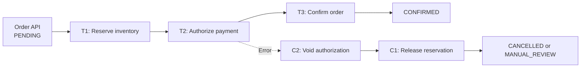
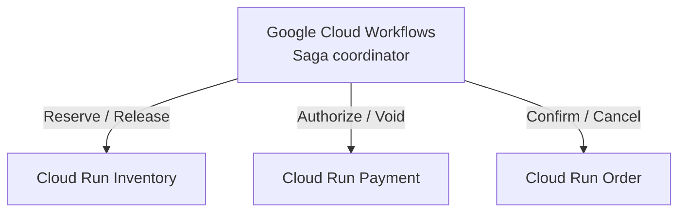
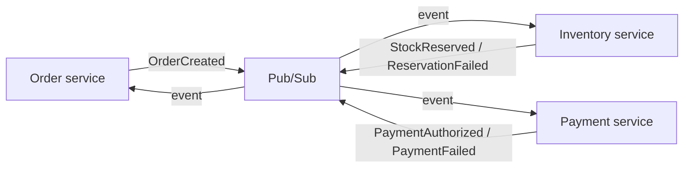
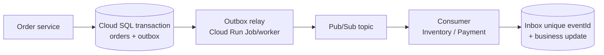

# Saga Design and Partial Failure Handling on GCP

## 1. The Problem: An Order Traversing Multiple Services

Suppose an e-commerce application uses **Cloud Run** for its Order API, Inventory API, and Payment API; each service stores its own data in **Cloud SQL** or Firestore. When a customer places an order, the system must:

1. Reserve stock in inventory.
2. Hold funds or **authorize payment**, **without capturing yet**.
3. Confirm the order and only then trigger side effects such as sending notifications.

If Inventory reserves stock successfully yet Payment fails, a database transaction in the Order API **cannot roll back the change in Inventory**. If Payment processed the request yet the HTTP response was lost, the Order API does not even know whether payment happened. This is **partial failure** in a distributed system.

A **Saga** is a design pattern coordinating multiple **local transactions**. After each successful step, the system records progress; when a later step fails, it executes **compensating actions** to return the business process to an acceptable state. A Saga is **not** an ACID transaction spanning multiple Cloud SQL databases, Cloud Run services, or Pub/Sub topics.

This lesson belongs to the **Application Orchestration and Integration** chapter of the `CLOUD_PROVIDERS_GCP` module, applying concepts from Projects/IAM, VPC, Cloud Run, GKE, storage, and databases to build resilient workflows, enforce access controls, automate releases, and measure reliability alongside cost.

**After this lesson, you will be able to:**

- Design **forward** steps, **compensation**, durable state, and business invariants.
- Compare **orchestration** via Google Cloud Workflows with **choreography** via Pub/Sub/Eventarc.
- Handle timeouts, retries, duplicate messages, committed updates with lost ACKs, and compensation failures.
- Read/write a YAML workflow invoking Cloud Run via OIDC with `try/retry/except`.
- Combine Cloud Tasks, transactional outbox/inbox, Cloud Logging/Monitoring, and recovery runbooks.
- Choose approaches based on SLOs, consistency, complexity, and cost.

> **Safety:** URLs, projects, service accounts, and order IDs below are hypothetical. Deploy/execute commands can incur charges or mutate data. Run only in an authorized test project; never use real payments or log card data, tokens, or PII.

## 2. Understanding Sagas, Local Transactions, and Compensation



Each step `Tn` is a transaction **within one service/data store**. If `T1` ran and `T2` did not complete, `C1` is called to release the reservation. If `T2` authorized funds and `T3` failed, `C2` usually must run **before** `C1`—that is, compensating in **reverse order**.

| Concept | Meaning | Example |
| --- | --- | --- |
| **Forward action** | Business operation moving toward the goal | `ReserveStock(orderId)` |
| **Compensation** | New operation undoing/offsetting a business effect | `ReleaseStock(reservationId)` |
| **Local transaction** | Atomic commit inside one service/data store | Insert reservation + update stock in one DB transaction |
| **Saga state** | Committed progress milestone persisted durably | `PAYMENT_AUTHORIZED`, `COMPENSATING` |
| **Business invariant** | Rule that must always remain true in business terms | Never create two captures for the same payment intent |
| **Reconciliation** | Checking and repairing inconsistencies when state is uncertain | Reconciling Payment status against the order ledger |

**Compensation does not turn back time.** If an email was already sent, the recipient may still read it even if the system later sends a correction email. If funds were already captured, a **refund** is a brand-new financial transaction that can incur delays/fees and is not identical to voiding an uncaptured authorization. For irreversible effects, design **forward recovery**, business compensation flows, or route to **manual review**.

### Choosing Step Order to Reduce Risk

Put **easily compensatable steps first**, e.g. **reserve inventory → authorize payment → confirm**. Avoid "ship goods first, check payment later" without a return/clawback process. Always define reservation TTLs, authorization expiration times, and timeout conditions so resources are not held indefinitely.

## 3. How Sagas Differ from ACID Transactions and 2-Phase Commit

| Criterion | Single Local ACID Transaction | Saga | Two-Phase Commit (2PC) |
| --- | --- | --- | --- |
| Scope | One transaction-capable database/resource | Multiple services, each committing independently | Participating resource managers running a protocol |
| System-wide atomicity | Yes within DB scope | **No**; intermediate states are observable | Yes per 2PC protocol, with coordinator/availability trade-offs |
| Failure recovery | DB rollback | Retries, compensation, reconciliation | Commit/abort across participants |
| Execution duration | Typically short | Can be long, asynchronous | Locks/prepare phase can cause contention |
| External system interaction | Hard to cover email, payment, Pub/Sub | Explicitly designed side effects | Not straightforward across arbitrary Google Cloud APIs |

A Saga is the architectural choice when you need **eventual consistency** and failure handling across services owning independent data. **Not every operation needs a Saga**: if all changes can occur inside one Cloud SQL transaction, do not split them across multiple services just to use a Saga.

## 4. Orchestration or Choreography?

### 4.1. Orchestration: One Coordinator Decides the Next Step



**Google Cloud Workflows** fits when there is a clear step order, conditional branches, timeouts, retries, compensation, and single-execution traceability. It calls Cloud Run via HTTPS/OIDC or Google APIs via connectors. Workflows **persists execution progress**, yet **does not replace a durable business database** for order history, idempotency, reconciliation, and long retention requirements.

### 4.2. Choreography: Services React to Events



**Pub/Sub** fits fan-out, loosely coupled consumers, and asynchronous event processing. However, business flow, compensation, and state are scattered across consumers; hard-to-read event cycles form easily without **correlation IDs**, state machines, outbox/inbox, timeouts, and tracing.

| Criterion | Workflows Orchestration | Pub/Sub Choreography |
| --- | --- | --- |
| Who defines the flow? | Central workflow | Services via event contracts |
| Progress visibility | Centralized execution steps; link with business ledger | Traces/correlation spanning multiple topics/subscribers |
| Retries and compensation | `try/retry/except`, calling compensating endpoints | Consumers handle errors, emit compensation events |
| Coupling | Coordinator knows the steps | Services barely know each other directly, but depend on contracts |
| Best fit | Ordered processes with explicit rollback | Fan-out, many independent consumers |
| Risks | Overgrown workflow, downstream bottlenecks | Event loops, duplicates, hard to determine completion |

**You do not have to pick strictly one.** A Workflows saga can publish `OrderConfirmed` via outbox/Pub/Sub **after the confirm transaction commits**, allowing auxiliary services to send emails or update analytics.

## 5. Saga State Must Be Persisted Durably

Example order state machine:

```text
PENDING
   → STOCK_RESERVED
   → PAYMENT_AUTHORIZED
   → CONFIRMED
or
   → COMPENSATING
   → CANCELLED
or
   → MANUAL_REVIEW
```

**Lock down invariants before writing YAML:**

1. One `orderId` has **at most one active saga**, enforced by unique constraint/transaction.
2. Each step has a stable **`operationId`** such as `<sagaId>:reserve` or `<sagaId>:authorize`, reused on retries.
3. Never transition `CANCELLED` back to `CONFIRMED` due to a late message/command without valid new business initiation.
4. Never emit `OrderConfirmed` to downstream consumers before order state actually commits.
5. A saga unable to complete compensation must enter `MANUAL_REVIEW` with an owner, deadline, and evidence.

### Minimal Ledger Tables (Reference Design)

```sql
CREATE TABLE sagas (
    saga_id           TEXT PRIMARY KEY,
    order_id          TEXT NOT NULL UNIQUE,
    status            TEXT NOT NULL,
    current_step      TEXT,
    updated_at        TIMESTAMPTZ NOT NULL DEFAULT now(),
    version           BIGINT NOT NULL DEFAULT 0
);

CREATE TABLE saga_operations (
    operation_id      TEXT PRIMARY KEY,
    saga_id           TEXT NOT NULL REFERENCES sagas(saga_id),
    step_name         TEXT NOT NULL,
    status            TEXT NOT NULL,
    external_ref      TEXT,
    updated_at        TIMESTAMPTZ NOT NULL DEFAULT now()
);
```

This is a **starting schema**, not a complete implementation. State transitions must use **transactions and optimistic locking** (`version`/conditional updates) so two executions cannot simultaneously confirm an order. Store **classified** error codes and expiration timestamps; **never** store credentials or raw payment details.

### Per-Service API Contract

| Hypothetical Endpoint | Forward / Compensation | Mandatory Condition |
| --- | --- | --- |
| `POST /reservations` | Reserve stock | Same `operationId` must return the prior result; out-of-stock returns business error |
| `POST /reservations/release` | Release stock | Idempotent; releasing twice must not restore stock twice |
| `POST /authorizations` | Authorize payment | Same payment intent/idempotency key must not authorize twice |
| `POST /authorizations/void` | Void authorization | Idempotent; must not void twice as two separate transactions |
| `POST /orders/confirm` | Confirm order | Confirm only after stock + payment succeed per business state |
| `GET /operations/{operationId}` | Reconcile outcome | Returns durable state when HTTP response was lost |

**A timeout does not prove a transaction rolled back.** The backend may commit right before the connection drops. Endpoints must support **query by `operationId`**, idempotency, and rules rejecting *late arrivals* after a saga has transitioned to compensation.

## 6. Partial Failures: Classify Before Retrying or Compensating

| Scenario | What We Know | Safe Handling |
| --- | --- | --- |
| Inventory returns `409 OUT_OF_STOCK` | Clear business failure; cannot reserve | Cancel order or report out of stock; do not retry forever |
| Payment returns `429` or `503` | Potentially transient | Bounded retry with backoff/jitter; always reuse `operationId` |
| HTTP timeout after `POST` | **Unknown whether it committed** | Query status by `operationId`; idempotent retry; never create a new payment intent |
| Workflows receives `200` with JSON `status: FAILED` | Transport succeeded, **business logic failed** | Inspect `response.body`; intentionally raise a business error |
| Payment authorized, confirm order fails | Committed side effect needs undoing | Void authorization, release stock, then mark `CANCELLED` |
| Compensation also times out | Unknown whether compensation completed | Reconcile; route to `MANUAL_REVIEW`, bounded retries |
| Workflows crashes before writing saga state | Prior step may have committed | Durable ledger + operation status to recover/restart |
| Two requests share `orderId` | Race / duplicate initiation | Unique constraint/lock/fencing; return existing saga or 409 |

**Pragmatic rule:** Automatically retry only when an action is **idempotent**, or guarded by a **durably stored idempotency key**. Google Cloud Workflows provides `http.default_retry` for transient HTTP errors, yet retrying a non-idempotent `POST` can create duplicate transactions. Cloud Run, Pub/Sub, and Cloud Tasks **do not automatically make database writes idempotent**.

## 7. Workflows YAML Example: Reserve and Authorize, Compensate on Failure

The example below is a **minimal saga** with two forward steps (**reserve stock**, **authorize payment**) and two compensators (**void authorization**, **release stock**). After both succeed, the workflow returns `AUTHORIZED`; a production system must also **commit order confirmation**, emit an event via outbox, and define recovery if confirm fails.

### Critical Prerequisites

- Both Cloud Run services already exist, **require authentication**, return **2xx only after local transaction commit**, and return semantically accurate **4xx/5xx** codes.
- Endpoints are **idempotent** by `operationId`; compensators accept calls even when the forward step never ran, already finished, or has an unknown outcome, and block **late forward** calls from overwriting a cancelled saga.
- The Workflows service account holds `roles/run.invoker` on **both** services; use **OIDC** with `audience` set to each Cloud Run service's root URL.
- Replace both placeholder URLs with real HTTPS URLs; **never** accept arbitrary client-supplied URLs (to prevent using Workflows' identity to call unintended endpoints).
- `orderId` and `sagaId` must be **generated and uniquely constrained in the ledger**; never generate a fresh random ID on every step retry.

**`order-saga.yaml` (Workflows DSL YAML, not Kubernetes YAML):**

```yaml
main:
  params: [args]
  steps:
    - init:
        assign:
          - orderId: ${args.orderId}
          - sagaId: ${args.sagaId}
          - inventoryRoot: "https://inventory-PLACEHOLDER-uc.a.run.app"
          - paymentRoot: "https://payment-PLACEHOLDER-uc.a.run.app"
          - compensationFailed: false

    - forward:
        try:
          steps:
            - reserve_stock:
                try:
                  call: http.post
                  args:
                    url: ${inventoryRoot + "/reservations"}
                    auth:
                      type: OIDC
                      audience: ${inventoryRoot}
                    body:
                      orderId: ${orderId}
                      operationId: ${sagaId + ":reserve"}
                  result: reserveResult
                retry: ${http.default_retry}

            - authorize_payment:
                try:
                  call: http.post
                  args:
                    url: ${paymentRoot + "/authorizations"}
                    auth:
                      type: OIDC
                      audience: ${paymentRoot}
                    body:
                      orderId: ${orderId}
                      operationId: ${sagaId + ":authorize"}
                  result: paymentResult
                retry: ${http.default_retry}

        except:
          as: originalError
          steps:
            - void_payment:
                try:
                  call: http.post
                  args:
                    url: ${paymentRoot + "/authorizations/void"}
                    auth:
                      type: OIDC
                      audience: ${paymentRoot}
                    body:
                      orderId: ${orderId}
                      operationId: ${sagaId + ":void"}
                      forwardOperationId: ${sagaId + ":authorize"}
                retry: ${http.default_retry}
                except:
                  as: voidError
                  steps:
                    - flag_payment_compensation:
                        assign:
                          - compensationFailed: true

            - release_stock:
                try:
                  call: http.post
                  args:
                    url: ${inventoryRoot + "/reservations/release"}
                    auth:
                      type: OIDC
                      audience: ${inventoryRoot}
                    body:
                      orderId: ${orderId}
                      operationId: ${sagaId + ":release"}
                      forwardOperationId: ${sagaId + ":reserve"}
                retry: ${http.default_retry}
                except:
                  as: releaseError
                  steps:
                    - flag_stock_compensation:
                        assign:
                          - compensationFailed: true

            - choose_failure_status:
                switch:
                  - condition: ${compensationFailed}
                    return:
                      sagaId: ${sagaId}
                      state: "MANUAL_REVIEW"
                      reason: "COMPENSATION_NOT_CONFIRMED"
                  - condition: true
                    return:
                      sagaId: ${sagaId}
                      state: "COMPENSATED"
                      reason: "FORWARD_FAILED"

    - forward_succeeded:
        return:
          sagaId: ${sagaId}
          state: "AUTHORIZED"
          orderId: ${orderId}
```

### What This Example Demonstrates and What It Does Not Yet Do

1. The outer `try/except` catches errors from forward steps; both compensators run **in reverse order**.
2. Each compensator has its own `try/retry/except` so **a failed void still attempts to release stock**; if at least one compensation goes unconfirmed, it returns `MANUAL_REVIEW`.
3. With `http.default_retry`, Workflows retries HTTP `429`, `502`, `503`, `504` and certain connection/timeout errors per policy; it **does not automatically retry `400`/`403`/`409`**.
4. **Backends could return `200` with a business body `FAILED`**: this YAML assumes backends **do not** do that. If they do, inspect `result.body` and `raise` an error to trigger compensation.
5. **HTTP successes/timeouts still race.** Endpoints and the ledger must enforce idempotency, terminal-state fencing, and reconciliation; YAML alone cannot prove two transactions fully reversed.
6. The workflow **returns a `COMPENSATED` or `MANUAL_REVIEW` map and may be marked technically succeeded by Workflows**. Callers must inspect the **business `state`**, and the backend must persist it to the **durable saga ledger**, alerting on `MANUAL_REVIEW`; never treat an HTTP 200 from the workflow API as "order completed".
7. Never run this against real payments until integrated with a gateway supporting idempotency/void/refund, transactions, and proper compliance.

**Upgrading to a full saga:** After `AUTHORIZED`, have the Order service **confirm the order** in a local transaction and write an **`OrderConfirmed` outbox record**. If confirm fails or times out, **query operation status before voiding**; compensate only if order confirmation did not commit or a valid cancellation transition exists. Every transition must be written to the ledger for crash recovery.

## 8. Deploying and Testing Workflows Safely

Assume `acme-saga-lab` has Workflows API and Cloud Run API enabled, and both mock services are **already deployed** implementing the HTTP contracts above.

### 8.1. Least-Privilege Permissions

```text
Deployer / CI:
  workflows.workflows.create/update (via appropriate role)
  iam.serviceAccounts.actAs on workflows-sa

Workflow runtime SA:
  roles/run.invoker on inventory service
  roles/run.invoker on payment service
  specific logs/connector permissions if needed

Caller:
  workflows.executions.create on workflow
  execution read permissions per monitoring needs
```

Never grant `roles/owner` to the Workflows SA; it does **not** need direct read access to all Cloud SQL databases when calling protected Cloud Run APIs. For Google Cloud API connectors, use **OAuth2** per product docs; for **Cloud Run HTTPS endpoints**, use **OIDC**.

### 8.2. Command Syntax

```bash
# MUTATING: only after replacing URLs and creating the right service account
gcloud workflows deploy order-saga-lab \
  --project=acme-saga-lab \
  --location=asia-southeast1 \
  --source=order-saga.yaml \
  --service-account=workflows-sa@acme-saga-lab.iam.gserviceaccount.com

# MUTATING: creates an execution (using fake payment/backends in lab)
gcloud workflows run order-saga-lab \
  --project=acme-saga-lab \
  --location=asia-southeast1 \
  --data='{"orderId":"LAB-ORDER-1001","sagaId":"LAB-SAGA-1001"}'

# READ-ONLY
gcloud workflows describe order-saga-lab \
  --project=acme-saga-lab --location=asia-southeast1

gcloud workflows executions list \
  --workflow=order-saga-lab \
  --project=acme-saga-lab --location=asia-southeast1
```

`gcloud workflows run` waits for execution completion and returns the result, whereas `gcloud workflows execute` starts without necessarily waiting. Re-running with the **same** `sagaId` must prove the mock backend does not reserve or authorize a second time. If a workflow returns a `MANUAL_REVIEW` map, the caller must inspect the `state` field rather than only the CLI exit code.

### 8.3. Failure Injection Testing

Each scenario below requires mock backends **actively returning controlled outcomes**, without injecting errors into live systems:

| Scenario | Inventory | Payment | Expected Outcome |
| --- | --- | --- | --- |
| Happy path | Reserve 2xx | Authorize 2xx | `AUTHORIZED`, not yet captured |
| Out of stock | `409` | Not called | Compensation is no-op, `COMPENSATED`/cancelled |
| Transient payment error | Reserve 2xx | `503` then 2xx | Retried with same `operationId`, single authorization |
| Persistent payment failure | Reserve 2xx | Fails past retries | Void if needed + release; no stock held |
| Lost response after commit | Reserve 2xx | Timeout after authorize | Idempotent query/retry, no double authorization |
| Void/release failure | Forward fails | One compensator fails | `MANUAL_REVIEW` and on-call alert |
| Repeated call with same `sagaId` | Duplicate calls | Duplicate calls | Result served from ledger, no doubled effects |

**One happy-path test is insufficient:** also test retries, eventual consistency, concurrent requests, process crashes between **commit and response**, and cases where compensation arrives ahead of a delayed forward request.

## 9. Choreography: Pub/Sub, Outbox, and Inbox

When choosing choreography, never implement:

```text
COMMIT orders DB
PUBLISH Pub/Sub OrderCreated
```

as two disconnected actions without recovery. If the database commits yet the publisher crashes before publishing, **the event is lost**. If publish happens first and the database rolls back, consumers may process **a non-existent order**.

### Transactional Outbox

Inside **one local database transaction**, the Order service writes both:

1. The `orders(status=PENDING)` row.
2. The `outbox(eventId, type, payload, status=NEW)` row.

An **outbox relay** reads the outbox table and publishes to Pub/Sub. If publishing succeeds yet the relay crashes before marking `SENT`, the relay publishes again: **duplicates are expected**, so consumers must implement **inbox/dedup**.



**Inbox pattern:** the consumer inserts `eventId` into a unique-keyed table **in the same transaction** as its local business update. When a Pub/Sub message is redelivered, an insert conflict indicates the event was already processed and the consumer acks based on durable state. Pub/Sub **exactly-once delivery** (where supported) does not eliminate duplicates **when a publisher emits two events** or side effects span multiple data stores.

### Implications of Ordering and Fan-Out

- Pub/Sub guarantees **at-least-once** by default; subscribers can see redeliveries.
- **Ordering keys** only provide per-key ordering when configured and product conditions are met; there is no global ordering across all orders/topics.
- Correlate events with `sagaId`, `orderId`, `eventId`, and `stepVersion`; consumers use version/fencing checks to discard late events.
- Add a **timeout watchdog** (Cloud Scheduler/Workflows/Cloud Tasks as needed) for stuck sagas; relying solely on event chains can leave orphaned reservations forever.

## 10. Where Do Cloud Tasks, Eventarc, and Cloud Run Jobs Fit?

A Saga does not force every step to be synchronous HTTP. Pick tools based on **task characteristics**:

| GCP Service | Suitable Role in a Saga | Limits to Remember |
| --- | --- | --- |
| **Workflows** | Multi-step orchestration, state machine, retries, error branches, compensation, waits | Does not turn local commits into an atomic transaction |
| **Cloud Run services/functions** | Run local transactions and expose idempotent APIs | HTTP timeouts do not tell whether the DB committed |
| **Pub/Sub** | Event emission, fan-out, async choreography, DLQs | At-least-once; publishers/consumers need outbox/inbox |
| **Eventarc** | Routes CloudEvents from Google Cloud sources to consumers | Does not replace a saga ledger or compensation |
| **Cloud Tasks** | Calls HTTP endpoints **with scheduling/rate limits/retries** per task | At-least-once; enqueue success is not business success |
| **Cloud Run Jobs** | Bounded batches/backfills, multi-task processing | Task retries and duplicate executions must be idempotent |
| **Cloud Scheduler** | Periodic run/watchdog trigger | Trigger ACK only means request accepted, not saga succeeded |
| **Cloud SQL / Firestore / Spanner** | Local transactions, saga ledger, dedup/outbox | Each system has its own transaction model and limits |

### Cloud Tasks vs. Pub/Sub in a Saga

**Cloud Tasks** fits when a step must **invoke one specific HTTP handler** with dispatch rate caps and retry/backoff policies, e.g. scheduling an authorization check 10 minutes later. Task names help **curb duplicate enqueues** within service limits, yet do not guarantee exactly-once business execution; handlers must stay idempotent.

**Pub/Sub** fits when **multiple independent consumers** must receive the same event such as `OrderConfirmed`. Do not use Pub/Sub just to mimic a long sequential workflow across dozens of topics without a state machine or recovery rules.

### Long-Running Steps

If an image processing or backfill step takes many minutes or hours, instead of holding an HTTP request open:

1. Create a **Cloud Run job** or a durably tracked operation.
2. Save `operationId` and status `STARTED`.
3. Have Workflows track **operation completion** via bounded polling or supported callbacks.
4. If the step fails, choose retries or compensation based on committed business state.

Distinguish Workflows/Cloud Run **request timeouts** from the entire saga's **business deadline**; never simply crank up HTTP timeouts to mask a lack of long-running task tracking.

## 11. Handling Uncertain Outcomes (*Unknown Outcome*)

A dangerous failure sequence:

```text
T0 Workflows POST /authorizations(operationId=SG-1:authorize)
T1 Payment service commits AUTHORIZED
T2 Connection drops before response reaches Workflows
T3 Workflows sees TimeoutError
```

At T3, "Payment failed" **is unproven**. If a retry uses a **different `operationId`**, it can authorize twice. If compensation runs while the operation is still in flight, **void can arrive before authorize** and then authorize lands late—leaving funds held.

### Defensive Design

- **Stable Operation ID** per business step, reused across all retries.
- **Backend state ledger**: `PENDING/COMMITTED/COMPENSATED/FAILED`, readable via `GET /operations/{operationId}`.
- **Fencing/tombstones**: once a saga enters `CANCELLING` or `CANCELLED`, late forward requests cannot commit against the terminal state.
- **Idempotent compensation**: calling void/release repeatedly for the same operation produces only one effect.
- **Recovery worker** polls `UNKNOWN` states on a schedule and escalates to **`MANUAL_REVIEW`** on deadline expiry or conflicting partner states.
- **Correlation/tracing**: log `sagaId`, `operationId`, and `orderId` hashed/masked per policy; never log card payloads or PII.

### Clearer API Contract

```text
POST /authorizations
  request:  {operationId, orderId, amount, currency}
  response: {operationId, state: AUTHORIZED | DECLINED}

GET /operations/{operationId}
  response: {state: PENDING | AUTHORIZED | DECLINED | VOIDED}

POST /authorizations/void
  request: {operationId: "SG-1:void", forwardOperationId: "SG-1:authorize"}
  response: {state: VOIDED | NOOP}
```

**Every service must enforce state transitions via transactions/compare-and-set**, not `if` checks on cached in-memory state. For third-party Payments, prefer the **provider's official idempotency API**, reconcile webhooks, and run periodic reconciliation. Never create real monetary transactions in labs.

## 12. Designing Compensation by Reversibility

Not every step has an exact rollback action:

| Completed Step | Possible Compensation | Part That Cannot Be Fully "Undone" |
| --- | --- | --- |
| Reserve one unit of stock | Release reservation with same ID | While held, the item was unavailable to other orders |
| Authorize payment (uncaptured) | Void authorization | Bank may still show a temporary hold |
| Capture payment | Refund by payment ID | Refunds take time/fees, and audit trail remains |
| Book shipment | Cancel shipment if unshipped | Once shipped, needs return/reverse logistics flow |
| Send email/SMS | Send correction notice | Cannot un-send what the recipient already read |
| Generate report or write Cloud Storage | Write new version / update manifest, mark superseded | Versioning and audit preserve history |

### When Compensation Also Fails

Maintain a **compensation queue/ledger** tracking state and attempt counts:

```text
SG-1: RESERVE_COMPLETED
SG-1: PAYMENT_AUTHORIZED
SG-1: COMPENSATING
SG-1:void:   RETRY_PENDING
SG-1:release: DONE
SG-1: MANUAL_REVIEW
```

**Never mark `CANCELLED` merely upon sending a void request without confirmation.** Failed compensations can undergo bounded retries, followed by escalation to on-call or human operators. Keep full evidence links and business expiration deadlines (e.g., when an authorization auto-expires) in the ledger.

### When to Prefer *Forward Recovery*

If goods already shipped or payment can no longer be voided, rather than forcing `releaseStock`, transition to a **refund/return** process without erasing historical records. Your saga structure must allow ending in meaningful business states like **`PARTIALLY_COMPLETED`** or **`REQUIRES_INTERVENTION`**, rather than forcing every path into `SUCCESS/FAILED`.

## 13. Designing IAM and Security for Sagas

On GCP, the **Workflows service account** is the workflow execution identity, distinct from the **Cloud Run runtime service accounts** of Inventory/Payment/Order. Scope least privilege along the call direction:

| Identity | Example Permissions | Avoid |
| --- | --- | --- |
| CI/deployer | Workflows deploy/update and `iam.serviceAccounts.actAs` as needed | Project Owner |
| Workflows runtime SA | `roles/run.invoker` on each required Cloud Run service | Direct access to all databases when only calling APIs |
| Inventory runtime SA | Inventory service DB/stock permissions | Payment secrets access |
| Payment runtime SA | Access to payment provider secret via Secret Manager and local DB | Reading/writing the entire order DB |
| Caller/trigger | `workflows.executions.create` on authorized workflows | Arbitrary override of service URLs/roles |
| Operator | Controlled read access to executions, logs, and ledger | Unaudited manual approval of refunds/compensations |

**OIDC** is used when Workflows calls Cloud Run over HTTPS; `audience` must match the Cloud Run service root URL or configured custom audience. A `401/403` from Cloud Run **does not imply a network error**; inspect the principal, `run.invoker`, token audience, and ingress. For Google APIs/connectors, use OAuth2 and API-specific permissions.

### Data Protection

- Never place secrets in workflow YAML, query strings, or logs; use **Secret Manager** and Workflows/Cloud Run runtime identities.
- Enforce HTTPS/TLS, IAM/RBAC, and ingress policies; analyze **VPC routing, firewalls/egress** for private backends.
- Never allow workflow callers to pass arbitrary URLs, turning the Workflows SA into a **confused deputy** calling out-of-scope resources.
- Enforce authorization in **every service**; holding permission to invoke Inventory does not grant authority to mutate every order.
- Be careful with **workflow execution history** and call logging: they can capture inputs/outputs containing business data. Choose logging levels per policy and redact PII.
- Separate **dev/test/prod** via projects/SAs/data stores, using Terraform/IaC and permission change reviews.

## 14. Observability: Do Not Monitor Only Workflows Success

A Workflows execution finishing without exceptions does not guarantee the order is `CONFIRMED`. If the YAML returns `{state: "MANUAL_REVIEW"}`, Workflows may count the **execution as succeeded** while the business process **remains incomplete**.

### Minimum Telemetry

| Signal | Source | Meaning |
| --- | --- | --- |
| Workflows executions `SUCCEEDED/FAILED/CANCELLED` | Workflows API/Cloud Monitoring | Technical execution state |
| Saga business state `CONFIRMED/CANCELLED/MANUAL_REVIEW` | Saga ledger | Real business outcome |
| Saga age / time in state | Database/Monitoring custom metric | Detects stuck sagas |
| Compensation attempts/success/failure | Saga operations + structured logs | Risk of uncleaned side effects |
| HTTP 429/5xx/timeout by step | Cloud Run request logs / Workflows step history | Retry vs. backend scaling needed? |
| Pub/Sub unacked backlog/oldest age | Cloud Monitoring | Is a choreography consumer falling behind? |
| Cloud Tasks queue rate/retries | Cloud Tasks/Monitoring | Dispatcher bottleneck or endpoint issue? |
| Cloud SQL errors/locks/connections | Cloud SQL metrics/logs | Are local transactions blocked? |
| Amount/inventory discrepancies | Reconciliation job | Measures correctness, not just availability |

**Sample structured log (PII-free):**

```json
{
  "event": "saga_step",
  "sagaId": "SG-1001",
  "operationId": "SG-1001:authorize",
  "step": "authorize_payment",
  "result": "RETRY_PENDING",
  "attempt": 2,
  "errorClass": "HTTP_503",
  "correlationId": "req-abc123"
}
```

Link the Workflows execution ID with `sagaId` in logs, the business ledger, and trace span attributes. **Never log full payment provider responses, access tokens, credit card details, or PII-bearing bodies.** Set appropriate retention and access controls in Cloud Logging.

### SLOs and Alerts

Example thresholds **defined by the application team**:

```text
At least 99.9% of sagas reach a terminal business state within 5 minutes
Zero payment authorizations remain open > 15 minutes when order is CANCELLED
MANUAL_REVIEW saga rate < 0.1% over the measurement window
Any compensation FAILED for > 2 minutes must page on-call
```

These **are not Google Cloud SLAs**. Base SLOs on business requirements, refund windows, backend speed, and compensation cost. On every deploy, watch **error budget**, manual review rate, and duplicate operations prevented.

## 15. Saga Cost and Capacity

Billable components may include:

- **Workflows** billed per executed step, connector/internal/external steps, and execution count; **retries** add billable steps.
- **Cloud Run** requests, vCPU/RAM, and instance duration per configuration.
- **Pub/Sub** publish/delivery/storage when using choreography/outbox.
- **Cloud Tasks** task operations/dispatch; **Cloud Scheduler** triggers if used.
- **Cloud SQL/Firestore/Spanner**, network egress, Cloud Logging/Monitoring, and Secret Manager.
- Higher-impact business costs: **payment gateway fees**, locked inventory, manual refund handling, customer goodwill credits.

### Rough Estimation Example

```text
One saga:
  2 forward HTTP calls
  2 compensation HTTP calls on failure
  3 retries to Payment on 503

1,000 sagas/day, 2% requiring compensation:
  at least 2,000 forward calls/day without retries
  plus ~40 compensation calls/day if each failure needs 2 calls
  excluding status queries, outbox, logs, retries, and reconciliation.
```

This **is not a standard invoice**, because Workflows steps, Cloud Run billing, DB transactions, and retries each meter differently. When enabling **`parallel`** workflows to cut latency, check backend rate limits and Cloud SQL capacity; **increasing parallelism helps nothing** if every call contends on the same inventory lock or hits a payment provider QPS cap.

## 16. Troubleshooting by Failure Point

| Symptom | Suspect First | How to Verify |
| --- | --- | --- |
| Workflows fails to deploy | YAML DSL/step syntax or IAM | `gcloud workflows deploy` error, syntax docs |
| Workflows calling Cloud Run gets 401/403 | Missing `roles/run.invoker` or OIDC audience/ingress | Workflow SA, Cloud Run request logs |
| Continuous HTTP 503 | Backend overload, downstream DB unavailable | Retry policy, Cloud Run latency, DB metrics |
| Timeout followed by two Payment authorizations | Non-idempotent POST or retry changed `operationId` | Payment ledger, request IDs, idempotency logs |
| Workflows returns `COMPENSATED` yet stock still held | Release returned 2xx before commit or late-forward race | Reservation state/operation status |
| Status `CANCELLED` yet capture occurred | Wrong compensation order or late arrival | Business ledger, payment provider reconciliation |
| Saga stuck in `COMPENSATING` for hours | Compensator retry loop, missing watchdog | Saga age, failed operations, DLQ |
| Pub/Sub event missing after DB commit | Dual-write without outbox | Orders/outbox DB, relay logs |
| Pub/Sub processed twice | Redelivery/duplicate publisher, missing inbox | `messageId`, business `eventId`, DB unique constraint |
| Workflows technically `SUCCEEDED` yet order unfinished | Returned `MANUAL_REVIEW` as business result | Inspect saga ledger and response body |
| Cost spike after retry storm | Excessively high `max_retries` or looping DLQ/reconciler | Workflows steps, Cloud Run, DB, Billing |
| Compensation rejected with 409 | Invalid business state/transition | Query operation; distinguish conflict from transient error |

### Incident Investigation Runbook

1. Confirm `sagaId`, `orderId`, Workflows execution ID, UTC timestamp, and deployed revision.
2. Read the **business ledger** first: which steps actually committed, and which are `UNKNOWN` or `COMPENSATION_PENDING`?
3. Correlate Workflows step history, Cloud Run logs, Cloud SQL transaction outcomes, and payment provider state using **`operationId`**.
4. Pause **new initiations** or throttle concurrency if blast radius could grow; **never delete saga state**.
5. Choose **idempotent retry**, compensation, forward recovery, or manual review according to invariants.
6. Verify secondary side effects too: emails, Pub/Sub events, stock releases, charges/refunds, and business metrics.
7. Record the incident timeline, root cause, impacted IDs (securely), owner, actions, and preventive measures.

**Never substitute "did HTTP return 200?" for "did the transaction commit?".** Only durable state and reconciliation provide valid grounds for compensation decisions.

## 17. Three Practical Design Scenarios

### 17.1. Ticketing or Seat Reservation

**Flow:** hold seat → authorize payment → issue ticket. Holds carry a **TTL** to auto-release if the workflow dies. Payment authorization uses an idempotency key; ticket issuance writes the ticket and outbox event in one transaction. If ticket issuance fails, void authorization and release the seat—yet if issuance committed and the response was lost, **query ticket status first**.

**Core risk:** two sagas holding the same seat. Enforce a unique key/conditional update on seat ID rather than checking `available=true` and writing across two separate requests.

### 17.2. SaaS Tenant Provisioning

**Flow:** create tenant record → provision database/schema → configure IAM/secrets → enable subscription → send welcome email.

**Compensation:** revoke IAM resources and delete test resources if failure happens before the tenant stores real data. Once the tenant has created live data, **dropping the database** is no longer an acceptable rollback; transition to suspended/manual review and apply retention policy.

**Core risk:** overly broad cleanup job permissions. Use least-privilege service accounts, scope actions strictly to tenant ID, add confirmation steps, and audit.

### 17.3. Media Processing Pipeline

**Flow:** Cloud Storage upload → Eventarc → Workflows → Cloud Run job encodes → write output manifest → publish `MediaReady` via outbox/Pub/Sub.

**Compensation:** mark output `FAILED`, delete/hide temporary artifacts using generation preconditions, and never delete the original input. If encoding finished yet the callback was lost, query job execution/manifest before re-running expensive work.

**Core risk:** preventing output objects from triggering Eventarc back into the same pipeline infinitely; separate buckets/prefixes and key idempotency on object generation.

## 18. Reinforcement Exercises

1. **Choosing architecture:** For a 4-step process with explicit compensation needing per-step debugging, prefer Workflows or Pub/Sub? **Hint:** Workflows orchestration; optionally emit a Pub/Sub event upon completion.
2. **Ordered compensation:** T1 reserves stock, T2 authorizes payment, T3 confirms order. T3 fails cleanly before committing; what is the usual compensation order? **Answer:** void authorization then release reservation, then mark cancelled in the ledger.
3. **Ambiguous timeout:** Payment committed yet the response timed out. Why is calling `POST /authorize` with a new ID dangerous? **Answer:** it can hold funds twice; reuse the same `operationId` and query status.
4. **HTTP 200 with business `FAILED`:** Does Workflows automatically enter `except`? **Answer:** No; inspect the body and `raise` a business error.
5. **Idempotency:** Two requests with the same `orderId` but different `sagaId`s enter two workflow executions. What blocks this? **Hint:** unique constraint/lock per order, mapping to one active saga.
6. **Outbox:** Why is `COMMIT order` followed by `PUBLISH Pub/Sub` non-atomic? Describe the failure if the app crashes between them and the solution pattern. **Answer:** dual-write gap; use transactional outbox + relay.
7. **Exactly-once:** A Pub/Sub pull subscriber enables exactly-once. Is inbox/dedup still needed? **Yes**, because publishers can emit duplicate events with distinct message IDs, and consumers trigger side effects outside Pub/Sub.
8. **Compensation failure:** Void payment succeeds, yet release stock returns 503 endlessly. Should final state be `CANCELLED` or `MANUAL_REVIEW`? **Hint:** manual review / compensation pending until release is confirmed.
9. **Cloud Tasks vs. Pub/Sub:** One step needs webhook retries to a specific service capped at 5 QPS; which service fits? **Hint:** Cloud Tasks. If multiple independent consumer groups must receive an event, Pub/Sub fits better.
10. **IAM troubleshooting:** A workflow has `roles/workflows.invoker`, yet calling Cloud Run returns 403. Which role needs fixing and where? **Hint:** `roles/run.invoker` on the service for the Workflows runtime SA, plus checking OIDC audience.
11. **Cost:** 1,000 sagas, 5% Payment errors, each error retrying 3 extra calls. Calculate extra calls per day from retries. **Answer:** 50 × 3 = 150 additional calls, before counting compensation and state queries.
12. **Runbook design:** A saga has been `PENDING` for 30 minutes with Inventory `RESERVED` and Payment `UNKNOWN`. Write the query sequence, decision/compensation rules, deadline, and reconciliation; explain why you must not start by blindly releasing stock.

## 19. Pre-Production Checklist

- [ ] Each step has a clear **local transaction** and business invariant.
- [ ] Steps are classified as **reversible**, compensatable, or irreversible; avoid irreversible side effects too early.
- [ ] Orchestration vs. choreography chosen based on observability, coupling, operations, and complexity.
- [ ] Durable **saga ledger** with transition validation, optimistic locking, and terminal states.
- [ ] Fixed `sagaId` and `operationId`, idempotency, and duplicate-initiation guards.
- [ ] Handles **unknown outcomes**, response timeouts, late forward requests, and compensation races.
- [ ] Compensators are idempotent with bounded retries/backoff and deadlines.
- [ ] Watchdog/reconciliation and `MANUAL_REVIEW` with owner/escalation exist.
- [ ] If using choreography: outbox/inbox or equivalent prevents dual-write gaps.
- [ ] Verified Pub/Sub at-least-once, DLQs, Cloud Tasks retries, and ordering requirements.
- [ ] Workflows runtime SA, Cloud Run runtime SAs, and IAM/data permissions are separated.
- [ ] OIDC audience is accurate; never accept arbitrary callback URLs using privileged identities.
- [ ] Secrets/PII/payment data kept out of code, input logs, and unprotected execution history.
- [ ] Integration tests and failure injection cover 409, 429, 503, timeout-after-commit, duplicates, concurrency, and compensation failures.
- [ ] Dashboards track **business terminal state**, saga age, compensations, backend latency, and downstream failures.
- [ ] Concurrency/rate limits, quotas, timeouts, Billing alerts, and retry cost estimates are configured.
- [ ] Canary/rollback, data reconciliation, postmortems, and appropriate history retention policies exist.

## 20. Official Google Cloud Documentation

1. [Google Cloud Workflows overview](https://cloud.google.com/workflows/docs/overview).
2. [Workflows syntax overview](https://cloud.google.com/workflows/docs/reference/syntax).
3. [Catch errors in Workflows](https://cloud.google.com/workflows/docs/reference/syntax/catching-errors).
4. [Retry Workflows steps](https://cloud.google.com/workflows/docs/reference/syntax/retrying).
5. [Invoke Cloud Run services/functions from Workflows](https://cloud.google.com/workflows/docs/calling-run-functions).
6. [Authenticate from Workflows](https://cloud.google.com/workflows/docs/authenticate-from-workflow).
7. [Execute a workflow](https://cloud.google.com/workflows/docs/executing-workflow).
8. [Workflows callbacks](https://cloud.google.com/workflows/docs/creating-callback-endpoints).
9. [Workflows quotas and limits](https://cloud.google.com/workflows/quotas).
10. [Workflows pricing](https://cloud.google.com/workflows/pricing).
11. [Pub/Sub subscriber best practices](https://cloud.google.com/pubsub/docs/subscribe-best-practices).
12. [Pub/Sub exactly-once delivery](https://cloud.google.com/pubsub/docs/exactly-once-delivery).
13. [Compare Cloud Tasks and Pub/Sub](https://cloud.google.com/tasks/docs/comp-pub-sub).
14. [Cloud Tasks retry configuration](https://cloud.google.com/tasks/docs/configuring-queues).
15. [Cloud Run authentication](https://cloud.google.com/run/docs/authenticating/service-to-service).
16. [Eventarc Standard overview](https://cloud.google.com/eventarc/standard/docs/overview).
17. [Cloud Run jobs](https://cloud.google.com/run/docs/create-jobs).

**Key takeaway:** A Saga is a **sequence of local transactions with compensation**, not a global auto-rolling-back transaction. On GCP, **Workflows** provides stateful orchestration, while **Pub/Sub/Eventarc** support choreography and fan-out. To handle partial failures safely, what matters most is **idempotency, durable state, reconciling uncertain outcomes, verified compensation, and monitoring business outcomes** — not merely turning on retries.
