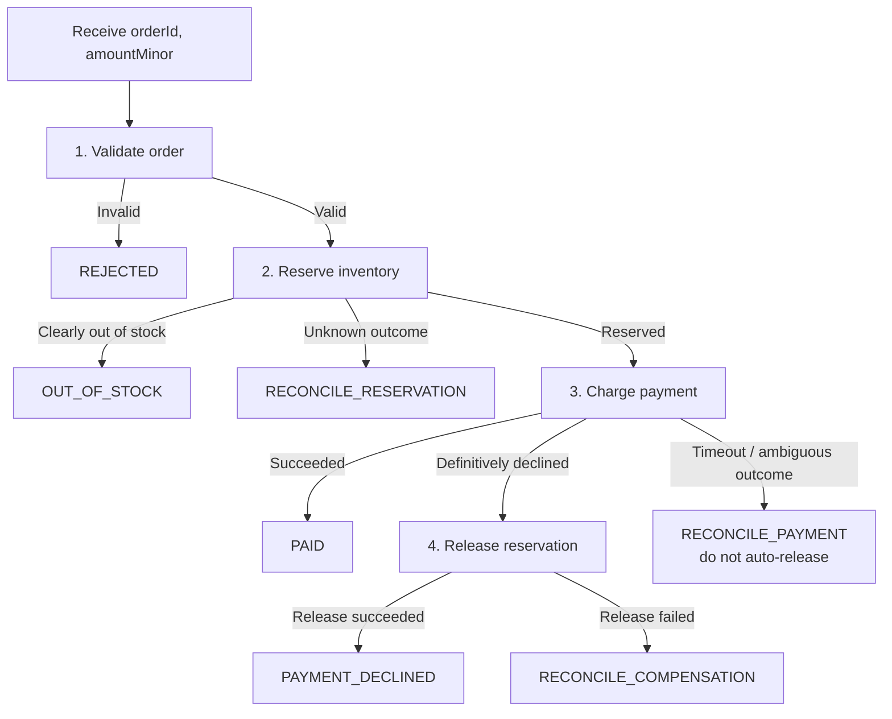

# Hands-on Orchestrated Order Processing Workflow

A Java API receiving orders must **validate the order**, **reserve inventory**, **charge payment**, and then **confirm the result**. If a controller calls services sequentially without persisting state, a timeout at the payment gateway can leave stock held with an unknown transaction outcome, or a user retrying the request can be charged twice. **Google Cloud Workflows** lets you describe the step sequence, conditions, retries, and error branches in a traceable execution. When a transaction spans multiple systems, we add **Saga/compensation** and **idempotency**.

This lesson belongs to the **Application Orchestration and Integration** chapter in the **CLOUD_PROVIDERS_GCP** module, connecting project/IAM, VPC, Cloud Run, GKE, data, monitoring, and cost to an e-commerce flow. The lab uses **Workflows + a Java 21 Cloud Run function simulating four operations**, without calling real payment or inventory services.

> Project names, service accounts, and orders are examples only. Deploying and running Workflows/Cloud Run may incur charges. Run only in an authorized lab project. The simulated Java code **does not persist durable state, hold real stock, or charge real money**; the final sections describe what must be added for production.

## Objectives

After this lesson, you will be able to:

1. Distinguish **orchestration** from **choreography**, choosing Workflows vs. Cloud Tasks/Pub/Sub.
2. Build a **validate → reserve → charge → complete** flow with **release** compensation when payment is definitively declined.
3. Call private Cloud Run via `http.post` with `auth.type: OIDC`, granting scoped `roles/run.invoker` IAM.
4. Write Workflows YAML using `params`, `assign`, `switch`, `try/retry/except`, and `return`.
5. Distinguish business errors where **payment definitely did not occur** from **unknown payment status**, handling the latter via reconciliation instead of blind reversal.
6. Deploy, run, inspect execution history/metrics, and implement retries/idempotency/rollback.

## 1. Business Design and Saga



**Orchestration:** Workflows maintains step order and conditions. **Choreography:** services react independently to events on Pub/Sub/Eventarc. They can combine: Workflows handles the core transaction, while Pub/Sub emits `OrderPaid` after durable state commits so email/analytics run independently.

| Service | Role | Does Not Guarantee Automatically |
| --- | --- | --- |
| **Workflows** | Step orchestration, branching, retries, awaiting callbacks, compensation | Atomic transactions across services |
| **Cloud Run** | Runs Java APIs for validate/reserve/charge/release | Exactly-once if backend lacks stored idempotency |
| **Cloud Tasks** | Delivers HTTP tasks with retries/deadlines | Arbitrary multi-step Saga logic |
| **Pub/Sub/Eventarc** | Event distribution and fan-out | Global ordering or exactly-once side effects |
| **Cloud SQL/Firestore** | Stores order state, ledger, outbox, and receipts | Automatic handling of side effects in other systems |

**Compensation is not a database rollback.** For example, calling `release` can return held stock, yet cannot erase a notification a customer already saw or undo a finalized capture without a separate transaction. Therefore you must separate clear error states from uncertain outcomes.

### Lab API Contract

A Cloud Run function accepts `POST` with JSON containing `action`, `orderId`, `amountMinor`, and `idempotencyKey`. The four actions return:

| `action` | Success Response | Simulated Error | Real Side Effects? |
| --- | --- | --- | --- |
| `validate` | `{"valid":true}` | Amount ≤ 0 → HTTP 422 | No |
| `reserve` | `{"reservationId":"res-..."}` | `orderId` ending in `-soldout` → 409 | No |
| `charge` | `{"paymentId":"pay-..."}` | `-payfail` → 402; `-payunknown` → 504 | No |
| `release` | `{"released":true}` | No simulated error in initial version | No |

**Lab convention:** HTTP 402 means **definitively declined, no funds collected**, so releasing stock is safe. HTTP 504 means **unknown outcome**, so never release before reconciling with the payment provider. Real error codes depend on each provider's API contract.

## 2. Preparing Google Cloud and Permissions

Prerequisites: a Google Cloud project with billing, CLI, permissions to create Workflows/Cloud Run, use service accounts (`iam.serviceAccounts.actAs`), and enable APIs. Workflow callers need `workflows.executions.create` (e.g., `roles/workflows.invoker`). Never use broad Owner/Editor roles for runtime identities.

```bash
# Example commands in Bash / Cloud Shell.
PROJECT_ID="retail-dev-01"
REGION="asia-southeast1"
BACKEND="order-step-mock"
WORKFLOW="order-saga-lab"
WF_SA="orders-workflow@${PROJECT_ID}.iam.gserviceaccount.com"
BACKEND_SA="orders-backend@${PROJECT_ID}.iam.gserviceaccount.com"

gcloud auth list
gcloud config get-value project
gcloud workflows list --project="$PROJECT_ID" --location="$REGION"
gcloud run services list --project="$PROJECT_ID" --region="$REGION"
```

Substitute your real project variables and verify no identically named services already exist. The following operations **modify the project and may incur charges**:

```bash
gcloud services enable \
  run.googleapis.com workflows.googleapis.com \
  cloudbuild.googleapis.com artifactregistry.googleapis.com \
  --project="$PROJECT_ID"

gcloud iam service-accounts create orders-workflow \
  --project="$PROJECT_ID" \
  --display-name="Order workflow invoker lab"

gcloud iam service-accounts create orders-backend \
  --project="$PROJECT_ID" \
  --display-name="Order backend runtime lab"
```

If an SA already exists, do not recreate it. Separate the **Workflows identity** from the **Cloud Run runtime identity**, granting only the permissions each role genuinely requires.

## 3. Java 21 Backend Simulating Four Operations

To stay focused on orchestration, the backend derives responses from `orderId` without connecting to a database or payment provider. Example lab layout on **the learner's machine**:

```text
order-backend/
  pom.xml
  src/main/java/demo/OrderAction.java
order-saga.yaml
```

### Maven (`order-backend/pom.xml`)

```xml
<project xmlns="http://maven.apache.org/POM/4.0.0"
         xmlns:xsi="http://www.w3.org/2001/XMLSchema-instance"
         xsi:schemaLocation="http://maven.apache.org/POM/4.0.0
           https://maven.apache.org/xsd/maven-4.0.0.xsd">
  <modelVersion>4.0.0</modelVersion>
  <groupId>demo</groupId>
  <artifactId>order-step-mock</artifactId>
  <version>1.0.0</version>
  <properties>
    <maven.compiler.release>21</maven.compiler.release>
    <project.build.sourceEncoding>UTF-8</project.build.sourceEncoding>
  </properties>
  <dependencies>
    <dependency>
      <groupId>com.google.cloud.functions</groupId>
      <artifactId>functions-framework-api</artifactId>
      <version>1.1.0</version>
      <scope>provided</scope>
    </dependency>
    <dependency>
      <groupId>com.google.code.gson</groupId>
      <artifactId>gson</artifactId>
      <version>2.11.0</version>
    </dependency>
  </dependencies>
</project>
```

### Java Function (`order-backend/src/main/java/demo/OrderAction.java`)

```java
package demo;

import com.google.cloud.functions.HttpFunction;
import com.google.cloud.functions.HttpRequest;
import com.google.cloud.functions.HttpResponse;
import com.google.gson.Gson;
import com.google.gson.JsonObject;
import com.google.gson.JsonParser;
import java.io.IOException;
import java.util.Map;
import java.util.Set;

public final class OrderAction implements HttpFunction {
  private static final Gson JSON = new Gson();
  private static final Set<String> ACTIONS =
      Set.of("validate", "reserve", "charge", "release");

  @Override
  public void service(HttpRequest req, HttpResponse res) throws Exception {
    if (!"POST".equalsIgnoreCase(req.getMethod())) {
      send(res, 405, Map.of("error", "POST required"));
      return;
    }
    try {
      JsonObject body = JsonParser.parseReader(req.getReader()).getAsJsonObject();
      String action = field(body, "action");
      String orderId = field(body, "orderId");
      long amount = body.has("amountMinor")
          ? body.get("amountMinor").getAsLong() : 0L;
      if (!ACTIONS.contains(action) || !orderId.matches("[a-zA-Z0-9-]{1,60}")) {
        send(res, 400, Map.of("error", "Invalid action or orderId"));
        return;
      }
      switch (action) {
        case "validate" -> {
          if (amount <= 0) send(res, 422, Map.of("error", "Invalid amount"));
          else send(res, 200, Map.of("valid", true));
        }
        case "reserve" -> {
          if (orderId.endsWith("-soldout"))
            send(res, 409, Map.of("error", "Out of stock"));
          else send(res, 200, Map.of("reservationId", "res-" + orderId));
        }
        case "charge" -> {
          if (orderId.endsWith("-payfail"))
            send(res, 402, Map.of("error", "Payment declined"));
          else if (orderId.endsWith("-payunknown"))
            send(res, 504, Map.of("error", "Payment outcome unknown"));
          else send(res, 200, Map.of("paymentId", "pay-" + orderId));
        }
        case "release" -> send(res, 200, Map.of("released", true));
        default -> send(res, 400, Map.of("error", "Unknown action"));
      }
    } catch (RuntimeException invalidPayload) {
      send(res, 400, Map.of("error", "Malformed request"));
    }
  }

  private static String field(JsonObject json, String key) {
    return json.has(key) && !json.get(key).isJsonNull()
        ? json.get(key).getAsString() : "";
  }

  private static void send(HttpResponse res, int code,
                           Map<String, ?> value) throws IOException {
    res.setStatusCode(code);
    res.appendHeader("Content-Type", "application/json");
    res.getWriter().write(JSON.toJson(value));
  }
}
```

The Java code returns deterministic responses without holding stock, calling payments, saving receipts, or enforcing `idempotencyKey`. Production must use transactions/state machines, caller validation, and idempotency in each service. If Cloud Run buildpacks have updated how dependencies/runtimes are managed, verify your pipeline and tests before deploying.

### Deploying the Private Cloud Run Function

```bash
# Run from the directory containing order-backend/ and order-saga.yaml.
# INFRASTRUCTURE CHANGE / INCURS CHARGES.
gcloud run deploy "$BACKEND" \
  --project="$PROJECT_ID" --region="$REGION" \
  --source=order-backend \
  --function=demo.OrderAction \
  --base-image=java21 \
  --service-account="$BACKEND_SA" \
  --no-allow-unauthenticated \
  --ingress=all

BACKEND_URL="$(gcloud run services describe "$BACKEND" \
  --project="$PROJECT_ID" --region="$REGION" \
  --format='value(status.url)')"
echo "$BACKEND_URL"
```

`--no-allow-unauthenticated` enforces **IAM**, while `--ingress=all` does not make the network private: the endpoint remains reachable from the Internet **if a caller holds permissions**. Production requires separate ingress, VPC, and service perimeter reviews.

### IAM for Workflows to Call the Backend

```bash
# Grant only on the lab Cloud Run service, never project-wide.
gcloud run services add-iam-policy-binding "$BACKEND" \
  --project="$PROJECT_ID" --region="$REGION" \
  --member="serviceAccount:$WF_SA" \
  --role="roles/run.invoker"
```

Workflows needs `roles/run.invoker` to invoke Cloud Run. The workflow deployer needs Workflows create/update permissions and `iam.serviceAccounts.actAs` on `WF_SA`. **Never open `allUsers` or grant Editor to fix a 403 error.**

## 4. Writing Workflows YAML: Orchestration and Compensation

Create `order-saga.yaml` in your lab directory:

```yaml
main:
  params: [input]
  steps:
    - init:
        assign:
          - backend: ${sys.get_env("ORDER_BACKEND_URL")}
          - orderId: ${input.orderId}
          - amountMinor: ${input.amountMinor}

    - validateOrder:
        try:
          call: http.post
          args:
            url: ${backend}
            auth:
              type: OIDC
              audience: ${backend}
            headers:
              Content-Type: application/json
            body:
              action: validate
              orderId: ${orderId}
              amountMinor: ${amountMinor}
          result: validationResult
        retry: ${http.default_retry}
        except:
          as: validationError
          steps:
            - rejectOrReview:
                return:
                  orderId: ${orderId}
                  status: VALIDATION_NOT_CONFIRMED
                  # 422 means rejection; network/IAM issues require separate investigation.
                  code: ${map.get(validationError, "code")}

    - reserveInventory:
        try:
          call: http.post
          args:
            url: ${backend}
            auth:
              type: OIDC
              audience: ${backend}
            headers:
              Content-Type: application/json
            body:
              action: reserve
              orderId: ${orderId}
              amountMinor: ${amountMinor}
              idempotencyKey: '${orderId + ":reserve"}'
          result: reservationResult
        retry: ${http.default_retry_non_idempotent}
        except:
          as: reservationError
          steps:
            - stockDecision:
                switch:
                  - condition: ${map.get(reservationError, "code") == 409}
                    return:
                      orderId: ${orderId}
                      status: OUT_OF_STOCK
            - unknownReserve:
                return:
                  orderId: ${orderId}
                  status: RECONCILE_RESERVATION

    - chargePayment:
        try:
          call: http.post
          args:
            url: ${backend}
            auth:
              type: OIDC
              audience: ${backend}
            headers:
              Content-Type: application/json
            body:
              action: charge
              orderId: ${orderId}
              amountMinor: ${amountMinor}
              idempotencyKey: '${orderId + ":charge"}'
          result: paymentResult
        retry: ${http.default_retry_non_idempotent}
        except:
          as: paymentError
          steps:
            - decidePayment:
                switch:
                  - condition: ${map.get(paymentError, "code") == 402}
                    steps:
                      - releaseReservation:
                          try:
                            call: http.post
                            args:
                              url: ${backend}
                              auth:
                                type: OIDC
                                audience: ${backend}
                              headers:
                                Content-Type: application/json
                              body:
                                action: release
                                orderId: ${orderId}
                                idempotencyKey: '${orderId + ":release"}'
                            result: releaseResult
                          retry: ${http.default_retry_non_idempotent}
                          except:
                            as: releaseError
                            steps:
                              - compensationPending:
                                  return:
                                    orderId: ${orderId}
                                    status: RECONCILE_COMPENSATION
                      - paymentDeclined:
                          return:
                            orderId: ${orderId}
                            status: PAYMENT_DECLINED
                            inventoryReleased: true

            # Timeout/502/503/504: unknown whether payment collected funds.
            - uncertainPayment:
                return:
                  orderId: ${orderId}
                  status: RECONCILE_PAYMENT
                  inventoryReleased: false

    - complete:
        return:
          orderId: ${orderId}
          status: PAID
          reservationId: ${reservationResult.body.reservationId}
          paymentId: ${paymentResult.body.paymentId}
```

### Reading Key Structures

| Component | Meaning |
| --- | --- |
| `params: [input]` | Each execution receives a JSON map, here containing `orderId` and `amountMinor` |
| `sys.get_env("ORDER_BACKEND_URL")` | Reads the Cloud Run URL from deploy config, avoiding hardcoded endpoints |
| `http.post` | Calls the Cloud Run backend; `result.body` is the parsed JSON response |
| `auth.type: OIDC` | Workflows sends a Google-signed ID token using `WF_SA` |
| `try / retry / except` | Controlled retries and error catching when HTTP returns 4xx/5xx or fails |
| `switch` | Releases only upon receiving **402 = definitively uncharged** per mock contract |
| `return` | Returns the execution's final outcome; does not automatically create order DB records |

**Important on retries:** `http.default_retry` suits **idempotent** steps and defaults to up to 5 retries for certain 429/502/503/504 or connection/timeout errors. `http.default_retry_non_idempotent` retries a narrower set like 429/503/connection setup failures, yet **can still send duplicate requests**. In this lab all actions are mocks without data mutations. In production, use retries on `reserve/charge/release` only when backends **genuinely store and enforce the idempotency key**, or replace with a safer policy.

**Distinguishing statuses:** if `validate` returns 422, the input is invalid; if the error is 401/403 or a timeout, the order is not "business-invalid". The lab groups these under `VALIDATION_NOT_CONFIRMED` and returns `code` for analysis. Production should cleanly separate `REJECTED`, `RETRYABLE_FAILURE`, and `SYSTEM_MISCONFIGURATION`.

### Why Not Release If Charge Times Out?

A payment provider may **have already collected funds** before the response was lost. If Workflows receives 504 and immediately releases inventory, the order can end up **charged yet without stock**. Instead, return `RECONCILE_PAYMENT`, query provider status using the **business idempotency key**, and proceed only once a definitive outcome is known. A Workflows execution finishing `SUCCEEDED` with `status=RECONCILE_PAYMENT` **does not mean the order succeeded**.

## 5. Deploying the Workflow and Running Four Test Branches

### 5.1 Deploying with Verified Identity and URL

```bash
# MUTATES Workflows resource; order-saga.yaml saved in lab directory.
gcloud workflows deploy "$WORKFLOW" \
  --project="$PROJECT_ID" \
  --location="$REGION" \
  --source=order-saga.yaml \
  --service-account="$WF_SA" \
  --set-env-vars="ORDER_BACKEND_URL=$BACKEND_URL"

# Read-only config verification after deploy.
gcloud workflows describe "$WORKFLOW" \
  --project="$PROJECT_ID" --location="$REGION"
```

**Never omit quotes around an env-var URL containing special characters**, and never put JWTs/passwords in Workflows environment variables. If the backend URL changes, redeploy the workflow and verify the new revision; already-running executions retain their launch deployment's config.

### 5.2 Successful Order

```bash
gcloud workflows run "$WORKFLOW" \
  --project="$PROJECT_ID" --location="$REGION" \
  --data='{"orderId":"ord-1001","amountMinor":145000}'
```

Expect the workflow to complete with a result similar to:

```json
{
  "orderId": "ord-1001",
  "status": "PAID",
  "reservationId": "res-ord-1001",
  "paymentId": "pay-ord-1001"
}
```

### 5.3 Out of Stock

```bash
gcloud workflows run "$WORKFLOW" \
  --project="$PROJECT_ID" --location="$REGION" \
  --data='{"orderId":"ord-1002-soldout","amountMinor":145000}'
```

Expect `status: OUT_OF_STOCK`; the `charge` step is not called. Note: if `reserve` times out and reservation state is uncertain, the workflow returns `RECONCILE_RESERVATION` instead of falsely declaring out-of-stock.

### 5.4 Definitively Declined Payment

```bash
gcloud workflows run "$WORKFLOW" \
  --project="$PROJECT_ID" --location="$REGION" \
  --data='{"orderId":"ord-1003-payfail","amountMinor":145000}'
```

Expect `PAYMENT_DECLINED` and `inventoryReleased: true`. In real systems, mark rollback complete only after **the release has durably committed**.

### 5.5 Unknown Payment Outcome

```bash
gcloud workflows run "$WORKFLOW" \
  --project="$PROJECT_ID" --location="$REGION" \
  --data='{"orderId":"ord-1004-payunknown","amountMinor":145000}'
```

Expect `RECONCILE_PAYMENT` with `inventoryReleased: false`. This is a **reconciliation-required** state, neither paid nor declined.

### 5.6 Inspecting Execution History

```bash
# List executions and pick the matching ID:
gcloud workflows executions list "$WORKFLOW" \
  --project="$PROJECT_ID" --location="$REGION"

EXECUTION_ID="REPLACE_WITH_REAL_EXECUTION_ID"
gcloud workflows executions describe "$EXECUTION_ID" \
  --workflow="$WORKFLOW" \
  --project="$PROJECT_ID" --location="$REGION"

# Read Cloud Run backend logs:
gcloud run services logs read "$BACKEND" \
  --project="$PROJECT_ID" --region="$REGION" --limit=30
```

In Console → **Workflows → Executions**, select an execution to trace its step path and errors. Never enable `log-all-calls`/detailed history by default on sensitive production data, because request bodies, responses, and variables may contain customer details.

## 6. Correctness Principles to Add Before Production

**A Workflows execution is not a transaction across three services.** Real systems must implement a durable state machine:

```text
NEW -> VALIDATED -> RESERVED -> PAID
                  |         |
                  |         +-> PAYMENT_UNKNOWN -> RECONCILE -> PAID/CANCELLED
                  +-> OUT_OF_STOCK
RESERVED -> PAYMENT_DECLINED -> RELEASE_PENDING -> CANCELLED
                                        |
                                        +-> RELEASE_FAILED -> RECONCILE
```

| Issue | Production Approach |
| --- | --- |
| Same order processed by two executions | Use `orderId + operationId` as business idempotency key; CAS/transaction to claim state |
| `reserve` retry creates two reservations | Backend persists receipt keyed by `orderId:reserve`; duplicate requests return existing reservation |
| `charge` times out after provider debited | Use **provider idempotency key** and status query API; never charge again with a new key |
| Crash after DB commit before publishing `OrderPaid` | **Transactional outbox** written in same transaction; worker publishes/retries with stable event key |
| Compensation fails | Persist `RELEASE_PENDING`, retry, and alert; avoid returning `CANCELLED` before release is confirmed |
| Order modified while saga is pending | Optimistic locking/version checks, reservation TTL, immutable terminal states |
| Late/duplicate events | Idempotent subscribers checking `eventId` + business key; never assume exactly-once |
| Data/tenant security | IAM/OIDC between services; authenticate users at ingress and authorize per order in backend |

### Distinguishing Workflow Success from Business Success

A Workflows execution can have platform state `SUCCEEDED` while its returned JSON says `PAYMENT_DECLINED` or `RECONCILE_PAYMENT`. Because the workflow **handled the error branch cleanly**, orchestration finishes normally. Dashboards/alerts must track **business status** separately rather than counting every `SUCCEEDED` execution as a paid order.

### Asynchronous Options

For long processing, never hold a user's HTTP request open until all steps finish. The API can record `PENDING`, start the Workflow, and return `202 Accepted` with `orderId`/status URL. Workflows can use **callbacks** for manual approvals or payment webhooks, plus **Cloud Tasks/Pub/Sub** for background steps. Callback endpoints also need IAM protection and expiration bounds; never treat a callback URL as an eternal bearer secret.

## 7. Reliability, Quotas, Logging, and Cost

| Signal | Source | What to Detect |
| --- | --- | --- |
| `Workflows executions`: state, latency, errors | Workflows/Cloud Monitoring | Failed runs, slowdowns, concurrency/quota breaches |
| Business states: `PAID`/`RECONCILE_*` | Database/application metrics | Orders needing intervention despite `SUCCEEDED` execution |
| Cloud Run HTTP `401/403` | Cloud Logging | Misconfigured Workflows SA, OIDC audience, or IAM invoker |
| `429/503/504` and retry count | Workflows steps/Cloud Run | Quotas, cold starts, downstream overload |
| Payment reconciliation age | Worker/DB dashboard | Ambiguous transactions left unresolved |
| Stock reservation TTL and pending compensation | Inventory datastore | Stock held too long, failed releases |
| Billable steps and active executions | Workflows/Billing | Excessive retries, long waits, rising cost |

Workflows bills by **executed steps** (internal/external), including failed and retried steps; **it does not charge solely because a workflow is waiting or idle**. Still, long waits affect latency, execution duration/concurrency limits, and operational design. Cloud Run, Cloud Logging, Cloud Tasks, and databases incur separate charges. For async payments, **callbacks** or event triggers usually beat tight polling; estimate costs against real traffic volumes.

**Security:** Workflows and Cloud Run use distinct runtime service accounts; keep IAM scopes tight and never log tokens or return them in execution results. Private-by-IAM Cloud Run does not automatically verify end-user ownership on `GET /orders/{id}`; backends must enforce tenant authorization. Use Secret Manager for payment credentials; never embed them in workflow YAML, labels, or input JSON.

## 8. Layered Error Handling Runbook

| Symptom | Common Cause | How to Check |
| --- | --- | --- |
| Workflows deploy returns 400 | Bad YAML expression/indent, undeclared variable | `gcloud workflows deploy` error line, inspect `main.steps` |
| `401` calling Cloud Run | Invalid OIDC token/audience | `auth.type: OIDC`, URL, and token audience |
| `403` calling Cloud Run | Workflows SA lacks `roles/run.invoker` | IAM policy on the exact Cloud Run service; never grant project-wide casually |
| `404` from Cloud Run | Wrong service URL/path/region | `services describe`, Workflows `ORDER_BACKEND_URL` |
| `OUT_OF_STOCK` | Mock returned explicit 409 | Do not call charge; verify business status |
| `RECONCILE_RESERVATION` | Reserve timed out/5xx past retries | Query inventory receipt instead of retrying with a new order key |
| `RECONCILE_PAYMENT` | Payment 504/timeout or ambiguous outcome | Query provider with same idempotency key; do not release immediately |
| `RECONCILE_COMPENSATION` | Release failed after payment decline | Retry release idempotently, alert ops team |
| Duplicate transaction | Two executions/order or repeated side effect | DB idempotency transaction + payment provider key |
| Rising billing/latency | Retry storm, sleep/poll loops, Cloud Run cold starts | Step metrics, traces, Cloud Run/DB capacity |

### Controlled Remediation Workflow

1. Record project, region, Workflow revision/execution ID, masked `orderId`, and timestamp.
2. Verify IAM/OIDC, HTTP codes, and **committed vs. uncommitted** state in each service.
3. Separate **definitive** errors from **uncertain** ones; never re-invoke payment without verifying key/state.
4. Test fixes in lab/canary; measure `PAID`/`RECONCILE_*`, latencies, and retries.
5. Deploy the approved revision; maintain a rollback plan for workflow/backend and audit in-flight old executions.

## 9. Hands-on Exercises

### Exercise 1 — Success Path and Order

For `ord-1001`, list the four processing states in order and the returned result.

<details>
<summary>Answer</summary>

Validate → Reserve → Charge → return `PAID` with `reservationId` and `paymentId`. `Release` is not called on the happy path.
</details>

### Exercise 2 — Out of Stock

Why does the workflow skip `release` compensation when `reserve` returns 409 "definitively out of stock"?

<details>
<summary>Answer</summary>

Per the mock contract, 409 indicates no reservation was created. There is no committed side effect to undo; the workflow ends with `OUT_OF_STOCK`. With real backends, verify the exact semantics of 409.
</details>

### Exercise 3 — 504 After Payment

If the payment provider returns 504, why should you not automatically release stock and report `CANCELLED` to the customer?

<details>
<summary>Answer</summary>

The provider may have already collected funds before the response was lost. Releasing before reconciling puts payment and inventory state out of sync. Return `RECONCILE_PAYMENT` and query payment status using the original idempotency key.
</details>

### Exercise 4 — OIDC and IAM

Workflows YAML declares `auth.type: OIDC`, yet Cloud Run still returns 403. Name two items to check.

<details>
<summary>Answer</summary>

Check which service account the workflow runs as and whether that principal holds `roles/run.invoker` on **the exact Cloud Run service**; check the audience URL and ingress policy. Never enable public invoker.
</details>

### Exercise 5 — Non-Idempotent Retries

Does simply switching retries to `http.default_retry_non_idempotent` guarantee no double charges?

<details>
<summary>Answer</summary>

No. That policy can still retry 429/503 and connection failures; clients can also launch a new execution. The Payment API must **persist and enforce an idempotency key** so a business transaction is charged only once.
</details>

### Exercise 6 — Two Executions for the Same Order

Two concurrent user HTTP requests launch two Workflows executions for the same `orderId`. What must be added?

<details>
<summary>Answer</summary>

Use a database transaction/conditional update claiming `orderId + operationId`; duplicate workflows must read/return the same outcome. The mock implementation lacks this guarantee.
</details>

### Exercise 7 — Failed Compensation

Payment was definitively declined, yet `release` timed out. May the workflow return `inventoryReleased: true`?

<details>
<summary>Answer</summary>

No. Return `RECONCILE_COMPENSATION` and durably record `RELEASE_PENDING`; safely retry using the reservation ID and monitor until confirmed.
</details>

### Exercise 8 — When to Use Pub/Sub?

After `PAID`, three systems—email, data warehouse, and CRM—must react independently. Should all three sit inside the Workflows critical path or consume an event?

<details>
<summary>Suggested Answer</summary>

To avoid lengthening the critical path, after durably committing `PAID`/outbox, publish `OrderPaid` via Pub/Sub so subscribers process independently with retries/DLQs and idempotency. Workflows remains appropriate for the preceding transaction/Saga.
</details>

## 10. Lab Cleanup and Checklist

Clean up only after confirming the service/workflow belongs to **the exact lab project** and no data must be retained:

```bash
# MUTATING/DELETES RESOURCES; never run in production.
gcloud workflows delete "$WORKFLOW" \
  --project="$PROJECT_ID" --location="$REGION" --quiet

gcloud run services delete "$BACKEND" \
  --project="$PROJECT_ID" --region="$REGION" --quiet

# Delete service accounts only if created solely for this lab
# and not shared with any other services.
```

Checklist before applying this architecture to real systems:

- [ ] Defined Saga states, which steps have side effects, and which have compensations.
- [ ] API distinguishes **definitive business errors** from **timeouts/ambiguous outcomes**.
- [ ] Workflows calls Cloud Run via OIDC; IAM invoker scoped to the exact service, runtime SA holds no excess permissions.
- [ ] Every reserve/charge/release operation carries a durable idempotency key and concurrency handling.
- [ ] State machine/order ledger lives in a database, not solely in Workflows variables.
- [ ] Payment status query and reconciliation worker handle `PAYMENT_UNKNOWN`.
- [ ] Release/compensation has safe retries, alerts, and TTL/manual escalation.
- [ ] Tests cover happy path, 409, payment decline, 504, duplicates, and compensation failures.
- [ ] Cloud Logging/Monitoring distinguishes workflow `SUCCEEDED` from business `PAID`.
- [ ] Bounded retries, quotas, downstream timeouts, budgets, and rollback plan are in place.
- [ ] Long/async tasks are offloaded to callbacks, Cloud Tasks, or Pub/Sub as appropriate.
- [ ] Data, tokens, payment credentials, and PII are protected and excluded from execution history/logs.

## Official Reference Documentation

- [Workflows overview](https://cloud.google.com/workflows/docs/overview): orchestration model and executions.
- [Using Workflows to connect Cloud Run services](https://cloud.google.com/run/docs/tutorials/workflows): HTTP calls and IAM examples.
- [Invoke Cloud Run from Workflows](https://cloud.google.com/workflows/docs/calling-run-functions): HTTP + OIDC authentication.
- [Grant Workflows permissions](https://cloud.google.com/workflows/docs/authentication): service accounts, `roles/run.invoker`, and `iam.serviceAccounts.actAs`.
- [Workflows syntax overview](https://cloud.google.com/workflows/docs/reference/syntax): `params`, `assign`, `switch`, `return`.
- [Catch errors](https://cloud.google.com/workflows/docs/reference/syntax/catching-errors): `try/except` and HTTP error maps.
- [Retry steps](https://cloud.google.com/workflows/docs/reference/syntax/retrying): `http.default_retry` vs. `http.default_retry_non_idempotent`.
- [Workflows environment variables](https://cloud.google.com/workflows/docs/use-environment-variables): `--set-env-vars` and `sys.get_env`.
- [Execute a workflow](https://cloud.google.com/workflows/docs/executing-workflow): `gcloud workflows run` and executions.
- [Best practices for Workflows](https://cloud.google.com/workflows/docs/best-practice): Sagas, callbacks, step budgets, and reliability.
- [Implementing Saga pattern in Workflows](https://cloud.google.com/blog/topics/developers-practitioners/implementing-saga-pattern-workflows): rollback/compensation across services.
- [Deploy Cloud Run functions](https://cloud.google.com/run/docs/deploy-functions): Java runtime and `gcloud run deploy --function`.
- [Cloud Run authentication](https://cloud.google.com/run/docs/authenticating/service-to-service): OIDC tokens and Cloud Run Invoker.
- [Workflows pricing](https://cloud.google.com/workflows/pricing) and [Cloud Run pricing](https://cloud.google.com/run/pricing): execution/step and compute billing.
