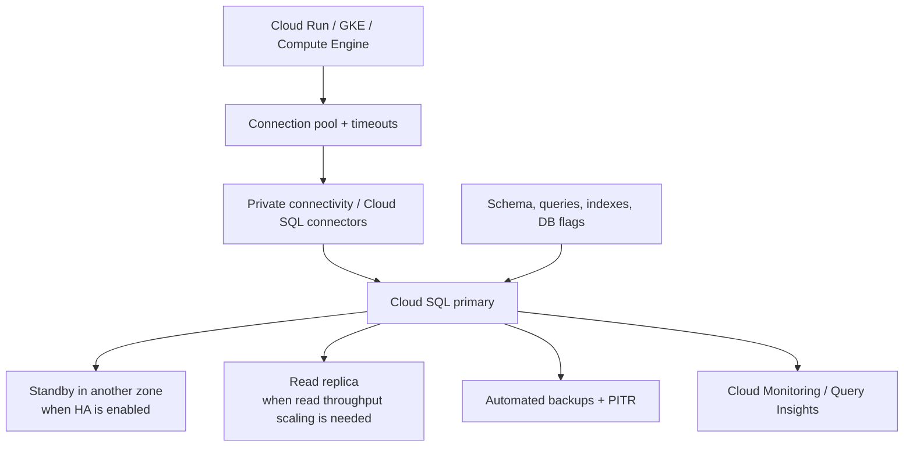

# Cloud SQL Instance Sizing, Storage, and Database Configuration

An order processing app running on Cloud Run sees latency jump from 80 ms to 900 ms during peak hours. The development team wants to upgrade Cloud SQL from 2 to 8 vCPUs. Yet the root cause could be **queries missing indexes, too many connections, saturated CPU, memory pressure, slow I/O, or a nearly full disk**. Adding CPU does not automatically solve every bottleneck and can drive up costs while still missing the SLO.

This lesson belongs to the **Cloud SQL and AlloyDB** chapter of the `CLOUD_PROVIDERS_GCP` module. Along the Google Cloud learning path from project/IAM/VPC organization to Compute Engine, GKE, Cloud Run, storage services, databases, and reliability/cost operations, this lesson covers how to **size Cloud SQL for measured workloads**, select editions/machines/storage, configure engine flags, monitor, and resize resources safely.

This lesson uses **Cloud SQL for PostgreSQL** for command and SQL examples; the sizing principles apply to MySQL and SQL Server as well, though **flag names, machine series, editions, limits, and tuning methods differ by engine**. Check the corresponding documentation before applying them to another engine.

## 1. Learning Objectives

After this lesson, you will be able to:

1. Distinguish **vCPU, RAM, disk capacity, IOPS, throughput, latency, connection counts, and query workload**.
2. Choose **Cloud SQL Enterprise/Enterprise Plus**, machine series, and configurations available for each engine and region.
3. Estimate resources from real metrics rather than sizing based solely on registered user counts.
4. Design storage with **headroom**, auto-increase, and budget caps; understand why increasing capacity does not mean infinite performance.
5. Configure PostgreSQL flags and connection pools safely; distinguish connection limits from useful concurrency.
6. Evaluate **regional HA, read replicas, backups, PITR, maintenance, and private connectivity** in your design.
7. Inventory and monitor instances with `gcloud`, Query Insights, and read-only SQL.
8. Plan resize operations with baselines, load tests, rollback/recovery steps, and downtime control.
9. Solve exercises on sizing, storage math, and identifying bottlenecks from metrics.

**Safety scope:** read-only preflight/SQL steps can be run on an **existing authorized Cloud SQL lab instance**. The `create`/`patch`/`delete` commands are for illustrating how changes are made — **do not run them on production or shared instances** without change approval, a backup/restore plan, and a designated owner. Creating an instance incurs CPU, RAM, storage, and network charges even with zero traffic.

## 2. What Cloud SQL Manages vs. What the App Still Manages



Google Cloud operates the OS, database software, and storage infrastructure within product boundaries. **The application team remains responsible** for schemas/indexes, connection pooling, SQL transactions, sizing/configuration choices, data retention, database permissions, SLOs, and restore drills.

| Option | Solves | Does Not Replace |
| --- | --- | --- |
| **Add vCPU** | CPU-bound queries, higher concurrency when queries are efficient | Indexes, query plans, reducing lock contention |
| **Add RAM** | Memory pressure, low cache hit rate, OOM | Pool sizing and per-query memory limits |
| **Add disk capacity** | Storage space; may affect performance depending on disk type | Diagnosing IOPS/throughput/latency |
| **Hyperdisk IOPS/throughput** | I/O bottlenecks where supported by machine/edition | Fixing full table scans or long-held locks |
| **Read replica** | Offloading read queries and reporting | Scaling primary write capacity; automatic HA standby |
| **Regional HA** | Failover on instance/zone failure | Backups/PITR, cross-region DR |
| **Backup/PITR** | Recovering from logic bugs or human mistakes | Immediate availability for live production traffic |
| **AlloyDB** | Managed PostgreSQL option for higher performance/architecture demands | Benchmarking, compatibility checks, and TCO analysis |

**Key baseline:** an instance in `RUNNABLE` state means the server is up, **not** that queries are fast or that no operations are running.

## 3. Choose Engine, Edition, and Region Before Choosing vCPU

Cloud SQL supports **PostgreSQL, MySQL, and SQL Server**. Choose the engine based on the application, extensions, ecosystem, licensing, and compatibility needs. For example, PostgreSQL `jsonb`, MVCC, and extensions do not translate automatically into MySQL or SQL Server syntax.

### 3.1. Enterprise and Enterprise Plus

| Criterion | Enterprise | Enterprise Plus |
| --- | --- | --- |
| Target | Standard business databases, balanced cost | Workloads demanding higher performance, availability, and observability |
| Machine series | General-purpose/dedicated lines; **N4** where supported | High-performance series such as **N2, C4/C4A/C4D** depending on engine/region |
| Storage | SSD/HDD on certain machine classes, **Hyperdisk Balanced** on eligible lines | SSD or Hyperdisk Balanced depending on machine series |
| Data cache | Depends on edition/features | Available on supported configs to boost read efficiency |
| HA/SLA | Per edition/HA terms | Higher capabilities and SLA on eligible configurations |
| Cost | Fits many small/medium systems | Higher resource pricing, potentially better throughput/SLO ratio |

**Do not treat this table as a rigid mapping.** For instance, Enterprise N4 pairs with Hyperdisk Balanced while general-purpose dedicated machines can use SSD; Enterprise Plus N2 and C4 do not necessarily use the same disk type. **Machine series, database version, region, and edition determine valid combinations**. Check the Cloud SQL UI and current machine-series docs to finalize configurations.

### 3.2. How Should You Choose a Region?

- Place the database close to the primary applications to reduce **network RTT** and data transfer fees.
- Verify availability of the edition, machine series, and engine in that region.
- For HA applications, select **regional availability** if single-zone resilience is needed; primary and standby reside in the same region.
- For **data residency/DR**, verify backup storage policies and recovery plans in another region.

**Do not pick a region based on the operator's location**; choose based on workload location, data gravity, regulatory constraints, and availability.

## 4. Collect a Workload Baseline Before Sizing

You must observe **peak**, not just averages. Record at least 1–2 representative business cycles if possible (peak hours, end-of-day batch, campaigns); for new products, use estimates followed by **load testing**.

| Metric Group | What to Measure | Why |
| --- | --- | --- |
| Traffic | Queries/s, transactions/s, write/read ratio, concurrency | Determines CPU and throughput demand |
| CPU | Utilization, CPU wait, query load | Distinguishes CPU-bound work from I/O or lock waits |
| Memory | Memory usage, total usage, cache behavior, OOM/restarts | Checks headroom and page cache |
| Disk | Used/provisioned size, growth rate, IOPS, throughput, latency | Determines capacity and performance tier |
| Connections | Active/idle connections, peaks, connection errors | Sizes pools and `max_connections` |
| SQL queries | p50/p95/p99, top queries, rows scanned, locks, temp files | Optimizes queries before scaling |
| HA | RTO/RPO, backup duration, replica lag, maintenance | Sets reliability criteria |
| Cost | CPU/RAM hours, storage, backups, network, replicas | Calculates TCO against SLO |

Example: CPU is 30% yet p99 spikes, `pg_stat_activity` shows many `wait_event_type=Lock` entries, and disk reads are low → **investigate transactions/locks**; there is no evidence yet for adding vCPUs.

### 4.1. Signals That Should Not Be Interpreted in Isolation

- **Sustained 85% CPU + high query CPU load:** justifies testing higher CPU after checking query plans.
- **High total memory usage:** may include OS page cache; compare process memory usage, OOMs, and swapping/thrashing rather than assuming RAM exhaustion from one metric.
- **Disk utilization >80%:** a common early warning threshold, not a sole outage criterion; track time remaining until full.
- **High connection count:** does not mean high throughput. Hundreds of idle sessions can burn RAM while doing zero work.
- **Read replica lag:** reflects write/apply pressure and replica health; replicas are unsuitable for queries needing read-after-write consistency.

## 5. Sizing CPU and RAM

With Cloud SQL Enterprise general-purpose dedicated CPU, you can select **custom vCPU and memory** within engine/edition limits. A valid starting point for evaluation is **2 vCPU + 7.5 GiB RAM**, though you should never assume it suffices for a specific workload.

### 5.1. Sizing Process

1. Pick the right engine, version, edition, and region first.
2. For new workloads, start with a small **upgradable** baseline and load-test at peak traffic.
3. If CPU stays high, identify top SQL and inspect query plans/indexes before adding cores.
4. If OOMs, cache misses, and memory pressure appear, increase RAM or trim connections and excessive `work_mem`.
5. Leave headroom for batch jobs, vacuuming, backups, schema migrations, and failover.
6. Re-evaluate metrics after changes: throughput, p95/p99, errors, CPU/RAM, and billing; investigate further if metrics do not improve.

**There is no fixed formula** like "N users = M vCPU," because a single heavy analytical dashboard query can cost more than thousands of simple HTTP requests.

### 5.2. CPU Budget Example (Rough Estimate)

Suppose each transaction takes an average of **15 ms CPU time** on the server, and peak demand is **120 transactions/s**:

```text
CPU-seconds needed per second = 120 × 0.015 = 1.8 CPU-s/s
Equivalent CPU at 100%        ≈ 1.8 vCPU
Targeting 60% CPU utilization:
  1.8 / 0.60 = 3.0 vCPU → consider >= 4 vCPU configuration
```

This is only a **preliminary model**: per-core performance varies by machine series, and workloads involve parallel queries, I/O wait, context switching, connection overhead, and replication. Finalize sizing only after benchmarking on the actual configuration.

## 6. Storage: Capacity, SSD/HDD, and Hyperdisk Balanced

### 6.1. Choosing Storage Type by Machine Series

| Type | Characteristics | When to Use |
| --- | --- | --- |
| **SSD** | Latency and IOPS suited to most OLTP workloads | Default choice for many Cloud SQL configurations |
| **HDD** | Lower per-GB cost but poor latency/random I/O | Only on supported editions/machine series with low random I/O |
| **Hyperdisk Balanced** | Provisions storage with **provisioned IOPS/throughput**, limits depend on machine/disk | When supported by machine series and performance must match workload |

Never pick HDD to save money on random read/write OLTP and then expect adding CPU to fix I/O latency.

With **Hyperdisk Balanced**, `storage-provisioned-iops` and `storage-provisioned-throughput` can be tuned within valid bounds for the machine type, disk size, and region. Never copy values from another VM type while ignoring Cloud SQL limits.

### 6.2. Provisioned Capacity Differs from Raw Data Size

Cloud SQL storage holds tables/indexes, WAL or binary logs, temporary files, bloat, and overhead. Never size storage from the size of a compressed SQL dump file.

90-day calculation example:

```text
Current data + indexes        = 80 GiB
Projected net growth          = 1 GiB/day
Over 90 days                  = 90 GiB
Projected total data          = 170 GiB
25% headroom buffer           = 42.5 GiB
Approximate target capacity   = 212.5 GiB
```

You might plan for **220 GiB** or more depending on temp/WAL, backup operations, and variance. This is a **capacity estimate**, not an IOPS calculation. If quota or budget restricts you, curb data growth via retention/archiving or workload splitting rather than eliminating all headroom.

### 6.3. Automatic Storage Increase and Limits

Cloud SQL provides **automatic storage increase** (often enabled by default). When free space drops below a threshold, the service allocates more storage up to the permitted limit.

- **Auto-increase only grows**; it does not shrink the disk after a spike passes. Some configurations support **manual storage shrinking** under current eligibility rules, but it is not an instant rollback step — verify eligibility, data, and downtime first.
- `storage-auto-increase-limit` sets an **auto-growth cap** in GB. If set too low, the instance can still run out of space and stop serving.
- Per best-practice guidance, if auto-increase is disabled or tightly capped, maintain **at least 20% free space** for critical maintenance operations.
- The storage limit must exceed current usage and cover expected growth, logs/PITR, and maintenance.
- Larger disk capacity can affect pricing, backup duration, and performance, but **never replaces monitoring storage utilization**.

**Never leave it `unlimited` without budget alerts and growth forecasts**; likewise, never set the limit right at current usage to "lock costs," as filling the disk can cause an outage.

## 7. PostgreSQL Flags and Memory Management

PostgreSQL needs RAM for shared buffers, backend processes, sorts/hashes, maintenance, and OS cache. Raising all memory flags simultaneously can trigger out-of-memory crashes.

| Flag | Meaning | Risk If Misconfigured |
| --- | --- | --- |
| `max_connections` | Maximum backend sessions | Too high wastes memory/context switching; too low rejects connections |
| `shared_buffers` | Shared memory cache | Too high starves OS/processes of headroom; usually requires restart |
| `work_mem` | Max memory **per sort/hash operation**; one query can allocate multiple | `work_mem × sessions` underestimates peak; parallel queries can spike RAM |
| `maintenance_work_mem` | Memory for VACUUM/index maintenance | Can raise RAM pressure during maintenance tasks |
| `log_min_duration_statement` | Logs queries exceeding threshold (ms) | Increases log volume/cost; risks logging sensitive values |
| `statement_timeout` | Aborts queries running longer than limit | Too low can kill legitimate migrations or batch jobs |
| `autovacuum_*` | Reclaims dead tuples, limits bloat | Poor tuning causes table bloat or excessive background load |

**Cloud SQL only allows database flags from its supported list**; valid ranges and units may differ from self-hosted PostgreSQL. Some flags require a restart, which can also restart replicas. Changing a flag at the Cloud SQL level changes the **instance configuration**, not just one SQL session.

### 7.1. Count Connection Pools Before Raising max_connections

Example: Cloud Run runs at most **20 instances**, each with a pool of up to **10 database connections**:

```text
20 app instances × 10 connections = 200
+ background jobs / migrations    = 20
+ admin / monitoring / failover   = 10
Total estimated demand            = 230 connections
```

The goal here is **not to immediately set `max_connections=1000`**. Evaluate instead:

- Raising `max_connections` consumes RAM and does not make CPU or I/O faster.
- Shrinking pool sizes, applying queuing/backpressure, and capping app scale-out are often more effective.
- Apps connecting via Cloud SQL Auth Proxy/Connectors still need a **DB connection pool**; the proxy does not solve session limits on its own.
- **Managed Connection Pooling** for PostgreSQL has specific edition/architecture requirements (currently **Enterprise Plus** and networking/maintenance version requirements); evaluate it only if appropriate, as transaction pooling differs from session pooling semantics.

### 7.2. SQL Commands to Inspect Live Configuration

After connecting to a **PostgreSQL lab** using an authorized tool:

```sql
SELECT current_setting('server_version') AS server_version;
SHOW max_connections;
SHOW shared_buffers;
SHOW work_mem;
SHOW maintenance_work_mem;
SHOW statement_timeout;

SELECT state, count(*) AS sessions
FROM pg_stat_activity
GROUP BY state
ORDER BY sessions DESC;

SELECT datname, numbackends, xact_commit, xact_rollback,
       deadlocks, temp_bytes
FROM pg_stat_database
ORDER BY temp_bytes DESC;
```

**Do not run `ALTER SYSTEM` in Cloud SQL** as you would on a self-managed host: use supported **Cloud SQL database flags** via Console/`gcloud sql instances patch` to configure the instance. `SET LOCAL`/`SET` can be used at the session/transaction scope where supported, but does not replace proper change management.

## 8. Inspecting Table/Index Sizes and Queries

**Read-only** PostgreSQL SQL examples:

```sql
-- Size of the currently connected database.
SELECT current_database() AS db,
       pg_size_pretty(pg_database_size(current_database())) AS db_size;

-- Top 10 largest tables, including indexes and TOAST.
SELECT schemaname, relname,
       pg_size_pretty(pg_total_relation_size(
         format('%I.%I', schemaname, relname)::regclass
       )) AS total_size
FROM pg_stat_user_tables
ORDER BY pg_total_relation_size(
  format('%I.%I', schemaname, relname)::regclass
) DESC
LIMIT 10;

-- Number of sessions actually doing work.
SELECT count(*) FILTER (WHERE state = 'active') AS active,
       count(*) FILTER (WHERE state = 'idle') AS idle
FROM pg_stat_activity;
```

To find slow queries, use **Query Insights** and `EXPLAIN (ANALYZE, BUFFERS)` on staging or safe queries. `EXPLAIN ANALYZE` **actually executes the SQL statement**: for `UPDATE/DELETE` with side effects, wrap in a rolled-back transaction with approval; never test directly on production.

Distinguish the symptoms:
- Large tables + frequent full scans → index/query design.
- Rising temp files → possible sort/hash spills; check `work_mem` and execution plans.
- Low CPU but high `Lock` waits → shorten transactions and reduce hot rows.
- Disk I/O saturation despite free RAM → check cache hit ratio, indexes, and storage performance tier.

## 9. How HA, Backups, PITR, and Replicas Affect Sizing

### 9.1. High Availability (Regional)

Cloud SQL **Regional HA** places primary and standby in different zones within the same region, failing over on instance or zone failure. In supported scenarios, the standby assumes the primary role, yet **active connections still drop**; applications must implement retry/reconnect with backoff.

HA improves availability but **does not replace backups/PITR**. Accidental table drops or bad schema changes are replicated to the standby.

### 9.2. Backups and PITR

- **Automated backups:** create periodic restore points; check retention and storage location.
- **PITR:** combines transaction logs (WAL for PostgreSQL) with backups to restore to a supported timestamp; adds storage/log overhead.
- **Restore drills:** verify the app can recover schemas, roles, and data within acceptable RTO.
- On instances created via CLI/API, **do not assume PITR is always on by default**. Configure and verify it explicitly.

Never size a disk so small that WAL/PITR and maintenance tasks exhaust space, and never place all backups in a strategy that fails to meet DR needs.

### 9.3. Read Replicas

A read replica serves **read workloads** with system-dependent replication lag; it is not write sharding. Applications must actively route read-only queries to the replica and account for **replication lag** when fresh reads are required.

| Issue | Appropriate Mitigation |
| --- | --- |
| Primary CPU spikes from reporting reads | Index/optimize first, then evaluate a read replica |
| Write transactions / lock contention | Optimize locks, queries, partitioning, or architecture |
| Zone outage | Regional HA and client retries |
| Logical data deletion | Backup/PITR restore |
| Data survival across full-region loss | Cross-region DR, backups/replication/drills |
| Consistent read immediately after write | Read from primary or use appropriate consistency logic |

**Total sizing:** account for **primary + HA standby + read replicas + storage + backups + network**; regional HA can roughly double the compute/storage cost components compared to standalone depending on product pricing, and replicas add further cost.

## 10. Networking, IAM, and Database Protection

- **Prefer Private IP** for workloads inside Google Cloud; configure Private Services Access/Private Service Connect and appropriate routing.
- Never add `0.0.0.0/0` to **authorized networks** just for a demo.
- **Cloud SQL Auth Proxy/Language Connectors** establish connections and use IAM to control connection access; they **do not automatically grant** SQL table permissions.
- A service account typically needs `roles/cloudsql.client` to connect via a connector/proxy; the app still needs **database authentication** (DB user/password or IAM DB authentication where supported by engine/config).
- Store credentials in **Secret Manager**, not in Dockerfiles, `app.yaml`, or Git.
- Configure TLS/SSL and firewalls/networking per your connection model; separate principals managing instances from application database users.
- Enable appropriate auditing/logging, avoiding logging raw SQL containing PII or secrets when slow query logs are on.

**Boundary:** IAM decides who can **manage or connect via Google Cloud APIs**; PostgreSQL GRANTs/roles decide who can execute `SELECT/INSERT/UPDATE` inside the database.

## 11. Lab A: Inventorying an Existing Instance

This main lab uses an **existing authorized test instance**. You do not need to create instances or alter workloads to understand sizing.

### 11.1. Variables and Preflight

```bash
PROJECT_ID="YOUR_AUTHORIZED_LAB_PROJECT"
INSTANCE="YOUR_EXISTING_POSTGRES_INSTANCE"

gcloud --version
gcloud auth list
gcloud projects describe "$PROJECT_ID" \
  --format="yaml(projectId,lifecycleState)"

gcloud sql instances list \
  --project="$PROJECT_ID"
```

If the instance is not part of a lab or you only have viewer access, **do not run patch/delete commands**. If no test instance exists, still work through the sizing math on paper; never create a new instance just to "complete" the lab without budget approval.

### 11.2. Reading the Full Configuration

```bash
gcloud sql instances describe "$INSTANCE" \
  --project="$PROJECT_ID" \
  --format="yaml(name,region,databaseVersion,state,settings.edition,settings.tier,settings.dataDiskType,settings.dataDiskSizeGb,settings.storageAutoResize,settings.storageAutoResizeLimit,settings.availabilityType,settings.backupConfiguration,settings.databaseFlags,settings.ipConfiguration)"

# Check operation status, not just RUNNABLE.
gcloud sql operations list \
  --project="$PROJECT_ID" \
  --instance="$INSTANCE"

gcloud sql backups list \
  --project="$PROJECT_ID" \
  --instance="$INSTANCE"
```

Fields to record: engine/version, edition/series/tier, vCPU/RAM, disk type/provisioned size, auto-grow/limit, HA, backup/PITR, IP config, flags, and latest operations.

**Note:** Cloud SQL API/CLI field names may differ from labels shown in the Cloud Console. If `--format` omits a field in your CLI version, inspect the full read-only `describe` output to map it accurately.

## 12. Lab B: Inspecting the Database from Inside via psql

For a lab PostgreSQL instance reachable from a machine in the right VPC, **Cloud SQL Auth Proxy** can use private IP connectivity. Example:

```bash
# Connect to the LAB instance from a host with proper private network routing.
# CONNECTION_NAME has the format PROJECT:REGION:INSTANCE.
CONNECTION_NAME="YOUR_PROJECT:YOUR_REGION:YOUR_INSTANCE"

cloud-sql-proxy --private-ip \
  --port=5432 \
  "$CONNECTION_NAME"
```

In another terminal:

```bash
# Use DB user/password or IAM DB auth per granted permissions.
# Local psql -> local proxy on loopback; proxy encrypts traffic to Cloud SQL.
psql "host=127.0.0.1 port=5432 dbname=postgres user=YOUR_DB_USER" \
  -c "SELECT current_database(), now();"
```

The proxy identity must have `roles/cloudsql.client`, a network path to the private IP, a valid database user, and **Cloud SQL Auth Proxy v2** installed. If the VM/Cloud Shell lacks private network connectivity, **do not open public IP or authorized networks** to bypass the error. Contact an admin or use a VPC-connected lab host.

### 12.1. Observing Four Key SQL Signals

```sql
SELECT pg_size_pretty(pg_database_size(current_database())) AS db_size;

SELECT state, count(*)
FROM pg_stat_activity
GROUP BY state
ORDER BY count(*) DESC;

SELECT count(*) FILTER (WHERE wait_event_type = 'Lock') AS waiting_for_lock,
       count(*) FILTER (WHERE state = 'active') AS active_sessions
FROM pg_stat_activity;

SHOW max_connections;
```

Using these metrics and queries, build a **peak/off-peak** baseline table. Never use a single brief snapshot to decide on resizing production.

## 13. Lab C: Finding Bottlenecks with Query Insights and Monitoring

In Cloud Console:

1. **Cloud SQL → Instance → Monitoring**: CPU, memory (usage and total usage), disk utilization, throughput, connections, network, operations.
2. **Query Insights** (if enabled and authorized): top queries by CPU/IO/lock waits, latency, call counts, and query plans; sample during peak hours.
3. **Cloud Logging**: errors, restarts, failovers, and slow query logs per permissions.
4. **Cloud Billing**: compute, storage, backups, data transfer, HA/replicas; distinguish baseline costs from traffic spikes.

### 13.1. Metric-to-Action Matrix

| Observation | Initial Hypothesis | First Action to Try |
| --- | --- | --- |
| CPU >80% for hours, p95 rising | CPU-bound or poor query plan | Top SQL/indexes; test 2→4 vCPU after tuning |
| Low CPU, high I/O wait | Disk / full scans / cache misses | EXPLAIN, indexes, disk performance/cache |
| High process memory, OOMs | Too many sessions or query memory | Pool size, `work_mem`, RAM sizing |
| Disk >80% and climbing steadily | Approaching capacity exhaustion | Forecast growth, auto-grow, archiving |
| High connections + low CPU | Idle connections, oversized pools | Shrink pools, reuse sessions |
| High lock waits, low CPU | Long transactions / hot rows | Shorten transactions, add indexes |
| Rising read replica lag | Slow replica apply, write spikes | Monitor replica CPU/IO and workload |
| p99 spikes as Cloud Run scales | Connection storms | Pool caps, max instances, managed pooling if eligible |

The **80%** threshold is a starting point for investigation, **not an automatic resize rule**. Factor in duration, SLO impact, and post-change measurements.

## 14. Lab D: Example New Instance Creation — Only If Approved

**Optional for this lesson.** If your organization provides a **dedicated empty lab project with billing, Private Services Access configured, and sufficient quota/budget**, here is an example for creating a dedicated PostgreSQL Enterprise instance:

```bash
# WRITES BILLABLE RESOURCES: DO NOT RUN on production!
NEW_INSTANCE="sql-sizing-lab"
REGION="asia-southeast1"
NETWORK="projects/$PROJECT_ID/global/networks/YOUR_PREPARED_VPC"

gcloud sql instances create "$NEW_INSTANCE" \
  --project="$PROJECT_ID" \
  --region="$REGION" \
  --database-version=POSTGRES_17 \
  --edition=enterprise \
  --cpu=2 \
  --memory=7680MB \
  --storage-type=SSD \
  --storage-size=50 \
  --storage-auto-increase \
  --storage-auto-increase-limit=100 \
  --availability-type=zonal \
  --backup-start-time=02:00 \
  --enable-point-in-time-recovery \
  --network="$NETWORK" \
  --no-assign-ip \
  --deletion-protection
```

**Design choices explained:** 2 vCPU/7.5 GiB serves as a lab baseline, 50 GB SSD auto-growing up to 100 GB, private IP only, backups/PITR explicitly enabled, and deletion protection against accidental deletion. `zonal` saves cost over regional HA but **lacks automatic zonal failover**; acceptable only in labs. Production must define availability per SLO before creation.

**Prerequisites:** PostgreSQL 17 and the chosen edition/machine/region/storage options must be available; the VPC must have **Private Services Access** configured; service networking, SQL Admin API, and permissions must be ready beforehand. If networking prerequisites are missing, **do not** fall back to public IP/`0.0.0.0/0` just to make the command succeed.

Readback:

```bash
gcloud sql instances describe "$NEW_INSTANCE" \
  --project="$PROJECT_ID" \
  --format="yaml(name,state,region,databaseVersion,settings)"

gcloud sql operations list \
  --project="$PROJECT_ID" \
  --instance="$NEW_INSTANCE"
```

If project policies mandate regional HA, CMEK, or a specific edition, **stop** and use compliant settings; never lower standards just to make a lab cheaper.

## 15. Lab E: Patching Storage/CPU and Flags on a Lab Instance

**Patch operations can restart the instance, drop connections, or permanently raise costs.** Run only after capturing a baseline/readback, taking a backup, and securing a change ticket.

### 15.1. Scaling CPU/RAM

```bash
# WRITES: example updating the LAB instance to 4 vCPU and 15 GiB RAM.
gcloud sql instances patch "$NEW_INSTANCE" \
  --project="$PROJECT_ID" \
  --cpu=4 \
  --memory=15360MB
```

This **can cause a restart/downtime**, reset connections, and change billing. Never change CPU and database flags simultaneously in production if you need to isolate performance effects. Machine series with **preset tiers** may require a valid `--tier` instead of custom `--cpu`/`--memory` flags.

### 15.2. Enabling Auto-Grow or Setting a Growth Cap

```bash
# WRITES: updates storage scaling settings on the LAB instance.
gcloud sql instances patch "$NEW_INSTANCE" \
  --project="$PROJECT_ID" \
  --storage-auto-increase \
  --storage-auto-increase-limit=200
```

Setting a **200 GB** limit does not immediately expand storage to 200 GB; it only lets Cloud SQL auto-grow up to that cap. If the instance is already at 50 GB and you want 100 GB right away, use `--storage-size=100` per current docs/limits. Increased capacity does not automatically shrink back to 50 GB when load subsides.

### 15.3. Changing Database Flags: Read All Existing Flags First

```bash
# READ-ONLY: inspect the current list of flags.
gcloud sql instances describe "$NEW_INSTANCE" \
  --project="$PROJECT_ID" \
  --format="yaml(settings.databaseFlags)"
```

`gcloud sql instances patch --database-flags` can **replace the entire existing flag list**, rather than appending one entry. Always capture existing flags first, preserve required settings, check flag documentation, units, and restart impact, and then apply the patch within an approved change window.

Example **illustrative only for a lab instance with no other custom flags**:

```bash
# WRITES: may trigger restart and increase log volume; do not run on shared instances.
gcloud sql instances patch "$NEW_INSTANCE" \
  --project="$PROJECT_ID" \
  --database-flags=log_min_duration_statement=500
```

Read back changes with `gcloud sql instances describe` and SQL `SHOW log_min_duration_statement`. 500 ms is purely an example threshold; the final choice depends on your SLO and log ingestion budget. Do not run these commands unless `NEW_INSTANCE` was created exclusively for you with confirmed ownership.

## 16. Verifying Changes Against SLO, Not Just Status

After every adjustment:

1. Wait for the operation to finish and the instance to report `RUNNABLE`.
2. Verify DB connections recover, the application accepts requests, and CRUD smoke tests pass.
3. Compare CPU, memory, disk I/O, connections, p95/p99, error rates, and throughput **under the same load** before vs. after.
4. Observe an entire peak cycle, not just 5 idle minutes.
5. Record compute/storage/network cost deltas and rollback criteria.
6. If resizing did not help, inspect locks, query plans, connections, replica lag, or downstream services.

### 16.1. What Does a Proper "Rollback" Look Like?

- **CPU/RAM:** can be patched back to the prior shape **if still supported**, but incurs another restart, billing impact, and maintenance window.
- **Increased storage:** do not assume you can shrink it immediately; manual shrinking (where supported) has strict prerequisites.
- **Database flags:** restore the previous full flag list, which may require a restart.
- **Schema/data:** cannot be undone by changing machine size; requires backups/PITR/restores or migration rollbacks.
- **Edition/machine-series:** switching can affect storage/feature compatibility and is not a simple "undo" button.

**Never test rollback capability for the first time on production.** Rehearse on staging and document fallback procedures using a restored instance or traffic failover when needed.

## 17. Cloud SQL vs. AlloyDB for PostgreSQL

This same chapter covers **AlloyDB for PostgreSQL**. Never assume AlloyDB is always cheaper or faster for every workload.

| Question | Cloud SQL for PostgreSQL | AlloyDB for PostgreSQL |
| --- | --- | --- |
| Workload | General-purpose OLTP, flexible cost, managed engine | PostgreSQL workloads needing AlloyDB-grade throughput/analytics and HA/scale |
| Sizing | Choose edition, machine series, storage, and flags | Choose primary instances, read pools, cluster/storage per AlloyDB model |
| SQL compatibility | Managed PostgreSQL with supported extensions/flags | PostgreSQL-compatible, does not mean every extension/flag is supported |
| Pricing | CPU/RAM/storage/HA/replicas/backups/network | Cluster compute/storage/read pools/backups/network |
| Decision | Benchmark with appropriate operational overhead | Benchmark p95/p99, throughput, features, and TCO |

When Cloud SQL meets your SLO, there is no reason to switch to AlloyDB solely for marketing speed claims. When query throughput, scale, or Cloud SQL limits fall short, compare AlloyDB using the **same dataset, query mix, and concurrency**, alongside HA/RPO/RTO requirements.

## 18. Real-World Scenario: Cloud Run 5xx Spike

A payment processing API has the following setup:

| Peak Metric | Observed Value |
| --- | --- |
| Cloud Run max instances | 50 |
| Pool size per instance | 12 |
| PostgreSQL CPU | 45% |
| Process RAM | 75% |
| Connections | 560/600 |
| p99 | 1.2 s |
| Error | `too many clients already` |

**Diagnosis:** 50 × 12 = **600 potential connections**, right against the database `max_connections` limit. CPU still has headroom, so **adding CPU is not the first step**.

Action plan:

1. Reduce per-service max pool size (e.g., from 12 down to 4–6), set connection acquisition timeouts, and add backpressure.
2. Evaluate capping Cloud Run max instances/concurrency to match DB capacity and transaction cost.
3. Monitor idle/active sessions, connection errors, and DB memory.
4. On eligible Enterprise Plus/PostgreSQL configurations, evaluate **Managed Connection Pooling**; understand transaction pooling and session semantics limits.
5. Only if the workload becomes CPU-bound after tuning should you benchmark larger vCPU/RAM machines.

**Success criteria:** p99 and 5xx rates drop below SLO at peak load without excessive pool queue waits, and costs remain predictable.

## 19. Symptom-Based Troubleshooting

| Symptom | Likely Cause | Priority Action |
| --- | --- | --- |
| High CPU, slow queries | Full scans, missing indexes, bad plans, or insufficient CPU | Query Insights/EXPLAIN, try indexing before resizing |
| High RAM, OOM/restarts | Oversized session pools, `work_mem`/query memory | Pools, memory metrics, flags, RAM sizing |
| `too many connections` | Many app instances / oversized pools | Sum total pools, trim idle sessions, cap scaling |
| Disk nearly full | WAL/temp/index bloat, data growth, auto-grow cap | Retention, VACUUM, archiving, storage headroom |
| High disk latency | IOPS/throughput limits or full scans | Monitor I/O, indexes, storage tier |
| Resizing didn't lower p99 | Lock/network/downstream bottleneck | Tracing, DB locks, query mix |
| Slow read replica | Lag/apply bottleneck | Replica CPU/IO, primary writes, routing |
| Failover causes 5xx | Unhandled reconnects/retries | Connection pool retries/backoff, health checks |
| Cost jumped after enabling PITR | WAL/log retention, backups | Inspect backup/log storage vs. RPO need |
| Instance RUNNABLE yet patch fails | Another operation in progress | `gcloud sql operations list` |
| Risky public connectivity | Overly broad authorized networks | Private IP/connector, IAM/DB roles |
| Raised disk but cannot shrink | Auto-grow never auto-shrinks; manual shrink rules | Check current docs, planning/restore |
| Flag change caused downtime | Flag requires restart / replica restart | Change window, baseline flags, rollback |
| Cloud SQL cannot sustain write throughput | Primary bottleneck, contention | Query/index/sharding/AlloyDB evaluation |

**Investigation order:** request SLO → top SQL/locks → connections → CPU/RAM → disk/storage → network → sizing/edition → cost. Never grant broad IAM roles or disable backups to "fix" an undiagnosed issue.

## 20. Practice Exercises

### Exercise 1 — CPU Sizing

A workload runs 200 transactions/s, each averaging 10 ms of CPU time. Targeting 50% CPU utilization, what is the minimum vCPU count in an idealized model?

**Answer:** 200 × 0.010 = 2 CPU-s/s; 2 / 0.5 = **4 vCPU** before headroom buffer and real benchmarking.

### Exercise 2 — Storage Growth

A database currently holds 100 GiB logical data and grows 2 GiB/day. What is the 60-day forecast with a 20% buffer?

**Answer:** (100 + 2 × 60) × 1.20 = **264 GiB**. Still account for temp/WAL, disk type, and auto-grow limits — do not set 264 GiB as a hard ceiling.

### Exercise 3 — Understanding Memory

Cloud SQL total memory usage is 92% while process usage is 60%, with no OOMs or abnormal cache misses. Should you add RAM immediately?

**Answer:** Do not decide from total usage alone because it includes OS page cache. Compare process memory usage, query cache/latency, OOMs, and peak behavior before resizing.

### Exercise 4 — Connection Pools

Cloud Run has max 30 instances with a pool max of 20; Cloud SQL `max_connections` is 400. What happens at peak?

**Answer:** 30 × 20 = **600 potential connections**, exceeding 400 even before admin/background sessions. Reduce pool sizes or enable eligible pooling and backpressure before raising `max_connections`.

### Exercise 5 — Storage Auto-Increase

Storage is 200 GiB, auto-increase limit is 210 GiB, and disk utilization is already 94%. Does the limit prevent an outage by "capping cost"?

**Answer:** No. Once auto-increase cannot expand further, the instance can run out of disk space and stop serving. Raise headroom/limits per forecast or reduce data usage, and configure alerts.

### Exercise 6 — Read Replica Instead of HA?

A team wants zone failure resilience by creating only a read replica without enabling regional HA.

**Answer:** A read replica serves read scaling/DR by design and **is not equivalent** to an auto-failover HA standby for the primary. You still need RTO/RPO analysis, promotion/failover runbooks, and verification.

### Exercise 7 — Query Insights

CPU is 35%, I/O wait is high, and `SELECT * FROM orders WHERE account_id = ?` scans millions of rows.

**Answer:** Inspect the query plan, select only needed columns, and evaluate an index on `account_id`, table statistics, and partitioning strategy before adding vCPUs.

### Exercise 8 — Flags

An operator runs `gcloud sql instances patch --database-flags=statement_timeout=5000` on an instance that already has 4 custom flags.

**Answer:** This can **wipe out the other flags** because the command replaces the full list; read all existing flags first and re-submit the complete approved set, checking restart/replica impact.

### Exercise 9 — Cost

Two options: (A) Enterprise 2 vCPU with 2 read replicas, (B) Enterprise Plus 4 vCPU with no replicas. How do you pick the cheaper one?

**Answer:** Never guess from vCPU alone. Price by region/edition, HA, replica compute/storage, backups, I/O/network, and SLO, then benchmark the query mix; replicas may be required for read-heavy loads whereas write-heavy loads behave differently.

### Exercise 10 — PITR and Deletion Protection

Someone accidentally deleted 10,000 rows in a table. The instance has regional HA enabled, but PITR was not checked.

**Answer:** HA does not roll back logical mistakes. Check actual backups/PITR retention and rehearse a restore. Deletion protection prevents accidental instance deletion, not SQL `DELETE` statements.

## 21. Configuration Checklist

- [ ] Engine, version, and region selected for workload and compatibility.
- [ ] Valid combination of edition, machine series, region, and storage verified in Cloud SQL docs.
- [ ] Peak baseline captured for CPU, RAM, connections, queries, I/O, storage growth, and SLO.
- [ ] Not adding CPU when the real bottleneck is locks, indexes, or connection storms.
- [ ] Storage capacity includes headroom covering WAL/temp/indexes/backup activity.
- [ ] Auto-increase enabled or growth plan with alerts in place; limit does not risk disk exhaustion.
- [ ] Hyperdisk IOPS/throughput (if used) matches workload and machine limits.
- [ ] `max_connections` and pool sizes satisfy concurrency without exhausting RAM.
- [ ] Database flags managed like versioned config with approval and restart plans.
- [ ] Backups/PITR and restore drills match RPO/RTO; HA/replicas serve their proper roles.
- [ ] Private connectivity, TLS, IAM, and DB roles follow least privilege.
- [ ] Query Insights, disk/CPU/memory/connection alerts, and Billing budgets configured.
- [ ] Resizing follows baseline, smoke tests, p95/p99 re-measurement, and rollback planning.
- [ ] Clear ownership assigned for capacity maintenance, engine upgrades, and cost.

## 22. Safe Lab Cleanup

**If you only ran read-only preflight and SQL commands, there are no resources to delete.** If you created **`sql-sizing-lab`** in a dedicated lab project, delete it only after confirming no apps, users, or critical backups/replicas depend on it:

```bash
# READ-ONLY: inspect instance, operations, and backups.
gcloud sql instances describe "$NEW_INSTANCE" \
  --project="$PROJECT_ID"

gcloud sql operations list \
  --project="$PROJECT_ID" --instance="$NEW_INSTANCE"

gcloud sql backups list \
  --project="$PROJECT_ID" --instance="$NEW_INSTANCE"
```

If the lab instance was created with deletion protection, deletion requires an **authorized administrator** to explicitly remove protection; this is a safety guard and **should not be bypassed automatically** during cleanup. For an instance **strictly belonging to your lab and approved for deletion**:

```bash
# IMPACTFUL: removes deletion protection on YOUR OWN LAB instance.
gcloud sql instances patch "$NEW_INSTANCE" \
  --project="$PROJECT_ID" \
  --no-deletion-protection

# DESTRUCTIVE: only after verifying no data or workload needs to be kept.
gcloud sql instances delete "$NEW_INSTANCE" \
  --project="$PROJECT_ID"
```

Deleting an instance can delete data or trigger retained/final backup rules; never assume all charges vanish instantly. Never delete shared VPCs, Service Networking, Cloud SQL service accounts, CMEK keys, or shared backups. Check **Cloud Billing**, backup retention, logs, and network resources after cleanup.

## 23. Official Google Cloud Documentation

- [Cloud SQL best practices](https://cloud.google.com/sql/docs/best-practices): CPU/memory/disk/utilization, operations, and security.
- [Cloud SQL PostgreSQL instance settings](https://cloud.google.com/sql/docs/postgres/instance-settings): editions, storage, automatic increases, backups, maintenance.
- [Choose Cloud SQL machine series](https://cloud.google.com/sql/docs/postgres/machine-series-overview): Enterprise/Enterprise Plus and regional support.
- [Choose Cloud SQL storage](https://cloud.google.com/sql/docs/postgres/storage-options-overview): SSD/HDD/Hyperdisk Balanced, IOPS, and throughput.
- [Create Cloud SQL PostgreSQL instances](https://cloud.google.com/sql/docs/postgres/create-instance): `gcloud sql instances create` and options.
- [gcloud sql instances patch](https://cloud.google.com/sdk/gcloud/reference/sql/instances/patch): modifying machine/storage/flags.
- [PostgreSQL database flags](https://cloud.google.com/sql/docs/postgres/flags): supported flags, ranges, and restarts.
- [Best practices for PostgreSQL memory](https://cloud.google.com/sql/docs/postgres/manage-memory-usage-best-practices): shared/local memory and OOM risks.
- [Cloud SQL Managed Connection Pooling](https://cloud.google.com/sql/docs/postgres/managed-connection-pooling): Enterprise Plus requirements and session/transaction semantics.
- [Monitor Cloud SQL PostgreSQL](https://cloud.google.com/sql/docs/postgres/monitor-instance): CPU, memory, disk, and connection metrics.
- [Cloud SQL Query Insights](https://cloud.google.com/sql/docs/postgres/using-query-insights): slow queries and query load.
- [Cloud SQL HA](https://cloud.google.com/sql/docs/postgres/high-availability): regional standby and failover.
- [Cloud SQL point-in-time recovery](https://cloud.google.com/sql/docs/postgres/backup-recovery/pitr): backup/WAL retention and restore.
- [Connect using Cloud SQL Auth Proxy](https://cloud.google.com/sql/docs/postgres/connect-auth-proxy): IAM/networking and proxy v2.
- [Cloud SQL pricing](https://cloud.google.com/sql/pricing): CPU, memory, HA, storage, backups, and egress.
- [AlloyDB documentation](https://cloud.google.com/alloydb/docs/overview): architecture and trade-offs compared to Cloud SQL.

**Conclusion:** effective Cloud SQL sizing is an **iterative loop: measure → diagnose → select edition/machine/storage → adjust safely → re-measure SLO and cost**. CPU/RAM, capacity/IOPS, PostgreSQL flags, connection pooling, HA/backups, and networking are **distinct control knobs**. Targeting the actual bottleneck with rollback and restore plans ready beats blindly upgrading to the largest machine without knowing why.
