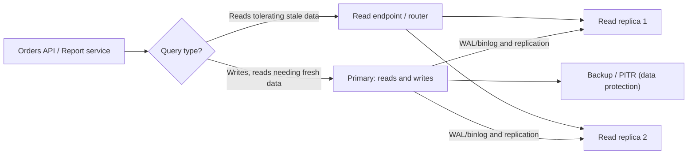
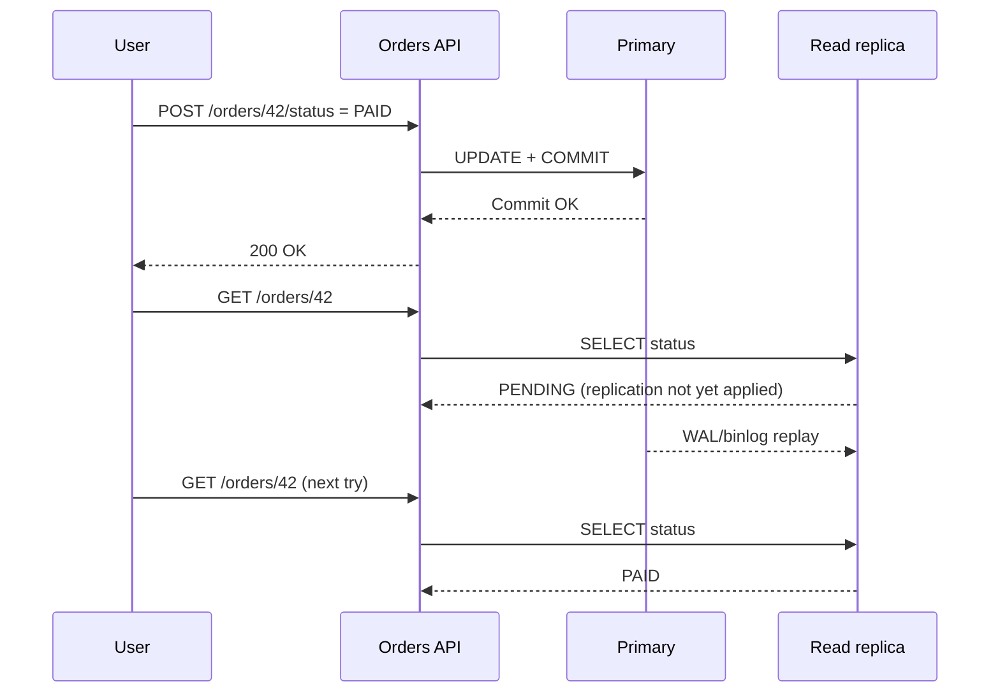
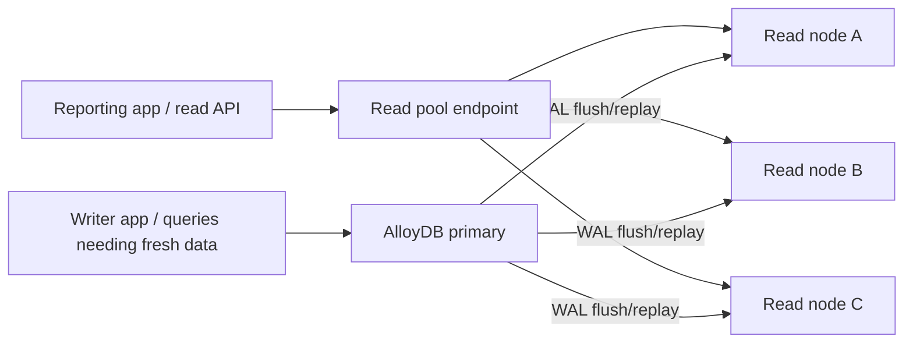

# Read Replicas and Scaling Read Demand

An ordering system receives 1,000 order-status read requests per second yet only 50 write transactions. When all queries hit a single primary database, rising CPU and connection counts can slow down order placement as well. **Read replicas** or **read pools** let you offload part of your read queries from the primary, in exchange for managing **replication lag, read–write routing, and additional billable resources**.

This lesson belongs to the **Cloud SQL and AlloyDB** chapter of the `CLOUD_PROVIDERS_GCP` module. It connects Google Cloud service selection, IAM/VPC, Cloud Run/GKE apps, storage and databases, SLO observability, and cost. The focus is on verifiable read-scaling architecture, not spinning up extra databases and assuming the system gets faster automatically.

> The projects, instances, and queries below are examples only. Commands that create replicas/read pools, modify configurations, or promote instances **can incur charges or alter write paths**; run them only in an authorized sandbox. This lesson uses Cloud SQL **PostgreSQL** for the lab, then compares MySQL/SQL Server and AlloyDB.

## 1. Learning Outcomes

After this lesson, you will be able to:

1. Distinguish primaries, read replicas, Cloud SQL read pools, AlloyDB read pools, and HA standbys.
2. Explain **asynchronous replication**, replication lag, and **read-after-write** limits.
3. Create and connect to a Cloud SQL PostgreSQL read replica, and verify data, state, and read-only privileges.
4. Understand the load-balanced endpoints of **Cloud SQL Enterprise Plus read pools** and **AlloyDB read pools**.
5. Design read/write routing for Spring Boot/Cloud Run/GKE with connection pooling and safe fallbacks.
6. Distinguish **scaling read capacity**, **high availability**, **backups**, and **disaster recovery**.
7. Monitor metrics, diagnose replica lag, evaluate sizing/costs, and design consistency tests.

## 2. Primary, Replica, and Read Pool Models



The **Primary** executes write transactions and guarantees commits per database semantics. A **Replica** receives changes from the primary and serves `SELECT` queries, typically via **asynchronous replication**. Arrival and replay can lag behind the commit; therefore, data on a replica is **not guaranteed to be up to date**.

| Component | Function | What Must Not Be Assumed |
| --- | --- | --- |
| Primary | Reads/writes; authoritative transaction source | Adding replicas automatically increases write throughput |
| Standalone read replica | A read-only database instance with its own endpoint/connection name | Automatically load-balances queries across multiple replicas |
| **Cloud SQL read pool** | Enterprise Plus; one read endpoint balancing **connections** across multiple read pool nodes | Automatically picks the node with the lowest replication lag |
| **AlloyDB read pool** | Read-only instance with multiple nodes behind a load-balanced endpoint | Automatically provides strong consistency for every request |
| HA standby | Standby/failover target for the primary in HA mode | A read endpoint applications can freely query |
| Backup/PITR | Recovery after accidental deletes, corruption, or data incidents | Read replicas can replace backups |

**Read replicas are not synchronous copies guaranteeing read-your-writes.** For Cloud SQL, individual read replicas **do not include a built-in load balancer**; the application or proxy must select endpoints. However, **Cloud SQL Enterprise Plus now also supports integrated read pools with a load-balanced endpoint** on eligible configurations. Do not confuse these two features.

## 3. Consistency and Replication Lag

### 3.1. Why Can SELECT Return Stale Data?



Cloud SQL PostgreSQL ships **Write-Ahead Logs (WAL)**, MySQL uses binary logs/GTID, and SQL Server uses SQL Server replication mechanisms. AlloyDB has its own storage/log architecture, yet read pool nodes can still experience **replay lag**. Distinguish two components:

- **Network/receive lag:** committed changes have not yet reached the replica.
- **Apply/replay lag:** changes have arrived but have not yet been applied to query results.

Results can be stale for some interval; there is no fixed guarantee of "always under 1 second." On an overloaded replica, during schema changes, large transactions, or cross-region links, lag can spike sharply. Even when a metric reads near zero, consider sampling intervals and active replication health.

### 3.2. Routing by Consistency Requirements

| Query Type | Recommended Endpoint | Rationale |
| --- | --- | --- |
| `INSERT/UPDATE/DELETE`, business transactions | Primary | Replicas/read pools are read-only |
| Reads immediately after payment/status change, checking live inventory | **Primary** or a mechanism verifying replica catch-up | Avoids reading stale state |
| Product listings, reporting pages, or dashboards tolerating a few seconds of lag | Replica/read pool | Offloads read pressure from primary |
| Long analytical queries, multi-table scans | Dedicated replica or BigQuery depending on requirements | Isolates resources from OLTP contention |
| Read pool experiencing high lag / connection loss | Per fallback policy / primary protection | Never dump unlimited read traffic back onto the primary |

Ways to guarantee **read-your-writes** include: keeping post-write reads on the primary, caching recently committed results, or using watermarks/LSNs with bounded waits until a replica catches up. For simpler apps, routing **consistency-sensitive requests to the primary** is easiest to verify. Never treat an HTTP 200 from a write API as proof that all replicas have replayed the change.

## 4. Comparing Three Ways to Scale Reads on Google Cloud

| Criterion | Cloud SQL Standalone Read Replica | Cloud SQL Enterprise Plus Read Pool | AlloyDB Read Pool |
| --- | --- | --- | --- |
| Foundation | Cloud SQL MySQL/PostgreSQL/SQL Server per support | Cloud SQL **Enterprise Plus**, new network architecture | **AlloyDB for PostgreSQL** cluster |
| Resource entity | One read replica is one instance | One read pool containing multiple read nodes | One read pool instance containing multiple nodes |
| Connection distribution | **App/proxy chooses replica** | **Single read endpoint** distributes connections | **Single instance endpoint** distributes connections |
| Read scaling | Add more replicas, scale each instance | Add/remove nodes, scale machine type; autoscaler where supported | Add/remove nodes and scale machine type, with autoscaler |
| Data freshness | Asynchronous, has lag | Asynchronous replication, may hit a lagging node | WAL/replay lag can occur |
| HA capability | Does not replace primary HA; replicas have separate HA options | Pool ≥2 nodes improves availability per docs | Pool ≥2 nodes distributed across zones |
| When preferred | Simple 1–2 read workloads needing dedicated endpoints | Already on Enterprise Plus and want a unified read endpoint | PostgreSQL workloads needing high read compute and AlloyDB architecture |

**Cloud SQL read pools differ from traditional read replicas.** For PostgreSQL, they require Enterprise Plus and the **new network architecture**, and the primary must also be Enterprise Plus; pools support **1–20 nodes** within documented limits. Cloud SQL offers pools for other engines with different limits/capabilities (such as SQL Server), so do not apply identical node counts or CLI flags across all engines.

AlloyDB allows multiple read pools; total read nodes in a cluster are bounded by configuration and quotas (current docs cite up to **20 read pool nodes** total). Never hardcode individual read pool node IPs into apps: nodes can be replaced during scaling or maintenance.

## 5. Cloud SQL PostgreSQL Lab: Creating a Read Replica

Assume a Cloud SQL PostgreSQL primary named `orders-pg-primary` in project `orders-lab`, region `asia-southeast1`, containing demo data and authorized for instance creation. Creating a replica may require taking a backup/initializing from the primary; on large primaries or during long transactions, this takes extra time and resources.

### 5.1. Check the Primary First (Read-Only)

```bash
PROJECT_ID="orders-lab"
PRIMARY="orders-pg-primary"
REPLICA="orders-pg-reader-1"
REGION="asia-southeast1"

gcloud sql instances describe "$PRIMARY" \
  --project="$PROJECT_ID" \
  --format="yaml(name,region,state,databaseVersion,settings.edition,settings.tier,settings.availabilityType,settings.ipConfiguration,ipAddresses,replicaNames)"

gcloud sql instances list --project="$PROJECT_ID"
```

Verify PostgreSQL version/edition, private IP or Private Service Connect (PSC), network, region, backup/recovery settings, disk capacity, and permissions. **A replica must use a connectivity type compatible with the primary**: with PSC you must configure allowed projects and separate PSC endpoints/DNS per the docs; do not copy Private Services Access commands verbatim to PSC without adjustments.

### 5.2. Create a Replica in the Sandbox

```bash
# INFRASTRUCTURE CHANGE + BILLABLE.
# Basic command; edition/tier/network flags may be required depending on primary.
gcloud sql instances create "$REPLICA" \
  --master-instance-name="$PRIMARY" \
  --region="$REGION" \
  --project="$PROJECT_ID"

# READ-ONLY: wait for RUNNABLE state and verify primary relationship.
gcloud sql instances describe "$REPLICA" \
  --project="$PROJECT_ID" \
  --format="yaml(name,region,state,masterInstanceName,ipAddresses,connectionName,settings.tier,settings.edition)"
```

The basic command works when instance type/edition can be inherited per documentation. **Some older Enterprise Plus PostgreSQL versions and MySQL/SQL Server setups require passing `--tier`/`--edition`**, and PSC replicas require extra flags and endpoints. Do not retry creation repeatedly while an operation is still provisioning.

### 5.3. Verify Read-Only Mode and Synchronization

Connect with `psql` to the **actual replica endpoint** using Cloud SQL Auth Proxy/Cloud SQL Language Connector or private IP + TLS per your design. Never expose a public database just to run a lab.

```sql
-- Run inside a session connected to the PostgreSQL READ REPLICA.
SELECT pg_is_in_recovery() AS is_replica;
SHOW transaction_read_only;

-- Check WAL receiver status; normally returns status='streaming'.
SELECT status, last_msg_receipt_time
FROM pg_stat_wal_receiver;

-- Compare WAL receive/replay; do not treat timestamps alone as absolute lag.
SELECT pg_last_wal_receive_lsn(), pg_last_wal_replay_lsn();
```

An idle replica with no recent write transactions can show a very large `now() - pg_last_xact_replay_timestamp()` **even with zero backlog**; combine **replication state, `network_lag`, `replica_lag`, and WAL LSNs**. If the receiver query returns empty, distinguish temporary connection drops, maintenance windows, and broken replication before jumping to conclusions.

### 5.4. Read-After-Write Test

On a sandbox DB, create a small table with a primary key and sample data (this **modifies data** — never run on production):

```sql
-- RUN ONLY ON SANDBOX PRIMARY:
CREATE TABLE IF NOT EXISTS demo_order_status (
    order_id text PRIMARY KEY,
    status text NOT NULL,
    updated_at timestamptz NOT NULL DEFAULT now()
);
INSERT INTO demo_order_status(order_id, status)
VALUES ('ord-42', 'PAID')
ON CONFLICT (order_id)
DO UPDATE SET status = EXCLUDED.status, updated_at = now();

-- ON REPLICA: read-only, may not see the new commit immediately.
SELECT order_id, status, updated_at
FROM demo_order_status WHERE order_id = 'ord-42';
```

**Table creation and writes run only on the primary; the replica `SELECT` must run on a separate session/endpoint.** Do not write test scripts assuming an immediate `SELECT` miss right after commit is a bug; it may just be normal lag, though persistent lag warrants checking replication health.

## 6. Cloud SQL Enterprise Plus Read Pool: Unified Read Endpoint

Unlike separate standalone read replicas, a **Cloud SQL read pool** groups replica nodes into one logical instance and provides a **single read endpoint with a stable IP**. New connections are distributed to healthy nodes; apps do not need to track individual node IPs when scaling the pool up or down. This is especially useful when multiple apps share read access and the platform team wants centralized node management.

**Prerequisites:** per Cloud SQL docs, read pools require **Enterprise Plus** and the **new network architecture** on both the primary and the read pool. For PostgreSQL, pools support 1 to 20 nodes; for SQL Server, maximum node counts differ, so **check by engine and edition**.

### 6.1. Example: Creating a PostgreSQL Read Pool

Assume `orders-pg-primary` is already Enterprise Plus, uses the new network architecture, and has appropriate private IP connectivity:

```bash
# MODIFIES / BILLABLE: uses an existing primary; do not run carelessly on production.
gcloud sql instances create orders-pg-readpool \
  --project=orders-lab \
  --region=asia-southeast1 \
  --master-instance-name=orders-pg-primary \
  --instance-type=READ_POOL_INSTANCE \
  --node-count=2 \
  --tier=db-perf-optimized-N-4 \
  --edition=ENTERPRISE_PLUS \
  --no-assign-ip

# READ-ONLY: get POOL IP/connectionName; do not target individual node IPs manually.
gcloud sql instances describe orders-pg-readpool \
  --project=orders-lab \
  --format="yaml(name,region,state,instanceType,nodeCount,connectionName,ipAddresses,nodes)"
```

Network flags may need adjustments for the primary's VPC/PSC setup. The command above is a **lab example for Enterprise Plus PostgreSQL** and does not apply to a standard Enterprise primary. A read pool resides in the **same region as the primary**; never treat it as a cross-region DR solution.

### 6.2. Scaling a Read Pool

```bash
# CONFIG + COST CHANGE: scale from 2 to 3 read nodes.
gcloud sql instances patch orders-pg-readpool \
  --project=orders-lab \
  --node-count=3
```

This scales **horizontal read capacity**. Cloud SQL read pools may support autoscaling depending on version and eligibility; review configuration and quotas before enabling. Scaling does not speed up queries missing indexes, eliminate transaction locks, or make primary writes faster.

**Consistency trap:** a Cloud SQL read pool **balances connections by node health, not by lowest replication lag**. A node that is healthy yet lagging can still receive connections; a session reconnecting to another node might observe an **older replication position than the previous session**. Use the read endpoint only for queries tolerating eventual consistency.

**Administrative limit trap:** a read pool is not an independent replica you can promote. Never rely on a read pool as a DR primary or cascading replication source unless engine documentation explicitly supports it. Keep HA, backups/PITR, and DR separate.

## 7. AlloyDB: Read Pool Instances and Node Scaling

**AlloyDB for PostgreSQL** separates compute and storage using its own distributed architecture. A cluster has a **primary instance** for writes and one or more **read pool instances** serving read-only queries. Within each read pool, Google Cloud balances connections across nodes via an **instance-assigned IP/endpoint**. Individual nodes are replaceable resources.



With a read pool of **two or more nodes**, nodes are spread across zones, improving availability if a single node or zone fails. **A single-node read pool** lacks multi-zone availability. During a primary failover, read pools can continue serving reads, though WAL synchronization may pause temporarily and increase lag; monitor replication lag closely.

### 7.1. Inspecting and Creating an AlloyDB Read Pool

Assume the `orders-alloydb` cluster already exists with a primary and reachable network:

```bash
# READ-ONLY: inspect the cluster and existing instances.
gcloud alloydb clusters describe orders-alloydb \
  --project=orders-lab \
  --region=asia-southeast1

gcloud alloydb instances list \
  --project=orders-lab \
  --cluster=orders-alloydb \
  --region=asia-southeast1

# MODIFIES / BILLABLE: create a two-node read pool.
gcloud alloydb instances create orders-readpool \
  --project=orders-lab \
  --cluster=orders-alloydb \
  --region=asia-southeast1 \
  --instance-type=READ_POOL \
  --read-pool-node-count=2 \
  --cpu-count=4

# READ-ONLY: check the IP/endpoint provided by the instance.
gcloud alloydb instances describe orders-readpool \
  --project=orders-lab \
  --cluster=orders-alloydb \
  --region=asia-southeast1
```

The `2 nodes × 4 vCPU` size is illustrative. Every node in the same read pool shares the same machine series/type; the primary can use a different configuration. If using **Private Service Connect** or public IP, additional networking flags and IAM apply; never assume this pool-creation example makes it reachable from an internet laptop.

### 7.2. Scaling and Autoscaling

AlloyDB supports **scaling up** (changing the read pool's machine type) or **scaling out** (adding nodes), subject to the cluster's total read pool node cap (current docs cite **up to 20**). Connect via the **instance-level endpoint** so applications need no address updates when nodes change.

```bash
# MODIFIES: example scaling up to 3 read nodes.
gcloud alloydb instances update orders-readpool \
  --project=orders-lab \
  --cluster=orders-alloydb \
  --region=asia-southeast1 \
  --read-pool-node-count=3
```

AlloyDB also supports **read pool autoscaling** based on CPU, connection count, or schedules where available. Example gcloud configuration on an existing pool:

```bash
# MODIFIES + COST: test only when the autoscaler feature is available.
gcloud alloydb instances update orders-readpool \
  --project=orders-lab \
  --cluster=orders-alloydb \
  --region=asia-southeast1 \
  --enable-autoscaler \
  --autoscaler-max-node-count=6 \
  --autoscaler-target-cpu-usage=0.65
```

These settings do not mean the pool scales instantaneously on traffic spikes: the autoscaler needs evaluation and provisioning time and can be constrained by quotas or machine availability. Removing a node drops active connections to that node; when connecting through the **pool endpoint**, drivers must implement proper retries/reconnects.

### 7.3. AlloyDB Lag Does Not Vanish Because of Shared Storage

The AlloyDB primary ships WAL to read pool nodes; receiving and replaying can still bottleneck on CPU, memory, long-running queries, or write bursts. In **System insights**, monitor flush/replay lag and resources on both primary and read pools. The service can throttle/adapt queries based on lag in some cases to protect freshness, but **never treat that as a strong read-after-write guarantee**. If an app must read just-committed state, send the query to the primary or use an appropriate synchronization check.

## 8. Splitting Read/Write Paths in Cloud Run or GKE

A replica is useful only when the application **actually routes SELECTs to the reader**, rather than creating a pool and still sending everything to the primary. The clean pattern uses two database connection pools:

```text
Orders API (Cloud Run / GKE)
  ├─ WRITE datasource  --> primary endpoint
  │   └─ POST /orders, POST /payments, immediate post-write GET /orders/{id}
  └─ READ datasource   --> read replica / read pool endpoint
      └─ GET /catalog, GET /reports, lag-tolerant dashboards
```

**Illustrative** Spring Boot configuration assuming the app explicitly wires two separate `DataSource` beans via Java config/HikariCP:

```yaml
# application.yaml - describes logical datasource properties only.
orders:
  db:
    write:
      jdbc-url: ${ORDERS_WRITE_JDBC_URL}
      username: ${ORDERS_DB_USER}
      password: ${ORDERS_DB_PASSWORD}
      maximum-pool-size: 6
    read:
      jdbc-url: ${ORDERS_READ_JDBC_URL}
      username: ${ORDERS_DB_READER_USER}
      password: ${ORDERS_DB_READER_PASSWORD}
      maximum-pool-size: 8
```

This is **not standard `spring.datasource.*` auto-configuration**: you need Java code defining `HikariDataSource`/`JdbcTemplate` beans or a routing datasource mapping the exact prefixes. Both URLs must come from real connection names/IPs/endpoints; never commit real passwords to Git. Use Secret Manager, Workload Identity, and Cloud SQL/AlloyDB connectors per your architecture.

**Spring trap:** `@Transactional(readOnly = true)` **does not automatically switch JDBC connections to a replica** unless the application configures `AbstractRoutingDataSource` or separates repositories/`JdbcTemplate`s explicitly. Attempting to swap datasources mid-transaction can also keep using the connection already acquired from the primary. Resolve routing **before the transaction starts** and verify with test queries against both endpoints.

### 8.1. Verifying You Never Accidentally Write to the Reader

```sql
-- Run on a session connected to a PostgreSQL read-only endpoint.
SHOW transaction_read_only;
SELECT pg_is_in_recovery();

-- RUN ONLY on a dedicated sandbox DB to test write rejection:
-- INSERT INTO demo_order_status(order_id,status)
-- VALUES ('ord-test','CREATED');
```

The app should also use a **DB user with SELECT-only privileges** scoped to allowed tables/views; IAM permissions to call Cloud SQL/AlloyDB APIs **do not replace database privileges**. A read-only replica/read pool endpoint can still leak data if the reader user has overly broad `SELECT` grants.

### 8.2. Managing Connection Pools with Serverless

Cloud Run/GKE can scale out to many instances/Pods, and each instance creates its own HikariCP read and write pools. Calculate connection limits across both paths:

```text
Potential connections:
  app_instances × (write_pool_max + read_pool_max)
  + admin/jobs/monitoring connections

Example: 12 Cloud Run instances × (6 + 8) + 10 ≈ 178 connections
```

This is an **estimated upper bound**, not always-open connections. If a traffic surge scales Cloud Run aggressively, DB CPU or `max_connections` can still saturate even with many read pool nodes. Tune HikariCP max pool sizes, Cloud Run `max_instances`/concurrency, idle timeouts, and database managed pooling (where supported) from **real measurements**, not defaults.

### 8.3. Falling Back to Primary Must Be Bounded

If the reader fails or lags severely, options include **returning errors or degrading non-critical queries**, waiting for the reader to recover, or **temporarily reading from the primary with strict rate limiting**. Never shift **100% of reporting traffic** onto the primary without limits, as that can overload the primary and **take down the Orders write path** too. Use circuit breakers, timeouts, retries with backoff, and feature flags to protect core transactions.

## 9. Monitoring Replica Lag and Query Performance

Build dashboards separating the **primary and replicas/read pools**, and when multiple nodes exist, inspect per-node metrics as needed. Watching CPU alone is not enough: the goal is to **reduce read latency without exceeding your staleness budget**.

| Signal | Meaning | Sample Action Threshold |
| --- | --- | --- |
| Cloud SQL `database/replication/replica_lag` | Approximate replay lag in seconds | Investigate if continuously over 5 seconds |
| Cloud SQL `database/replication/network_lag` | WAL transit delay from primary to replica | If high: inspect primary, network, cross-region link |
| Cloud SQL replication state | Sync status (`Running/Stopped/Error`) | Stop sending reads to a halted replica |
| PostgreSQL replica WAL lag bytes | Gap across sent/write/flush/replay WAL | Separates receive bottlenecks from replay bottlenecks |
| AlloyDB read pool flush/replay lag | Whether data reached the node and replayed | Alert per workload freshness requirement |
| CPU, memory, disk I/O, DB connections | Capacity health of primary and readers | Scale or tune queries on sustained overload |
| p95 query latency, QPS, errors | User-facing quality | Compare before and after traffic shifting |

The **5-second threshold is an exercise example**, not a Google Cloud SLA. A reporting view might tolerate much higher lag, while payment confirmation may require reading the primary. Cloud Monitoring metrics also have **collection/display latency** — never treat a single empty data point as proof that a replica is in sync.

### 9.1. Cloud SQL PostgreSQL Diagnostic Hints

On the **primary**, inspect transaction/write pressure and queries holding long locks. On the **replica**, check:

```sql
-- READ-ONLY: run on a PostgreSQL read replica.
SELECT pg_is_in_recovery();
SELECT status, last_msg_receipt_time
FROM pg_stat_wal_receiver;
SELECT pg_last_wal_receive_lsn(), pg_last_wal_replay_lsn();
SELECT datname, confl_lock, confl_snapshot, confl_bufferpin
FROM pg_stat_database_conflicts;
```

High replica lag with low network lag usually indicates the **replica is receiving WAL fine but cannot replay fast enough**: read overload, CPU/I/O limits, long queries, or DDL/VACUUM conflicts. In PostgreSQL, standby delay flags or `hot_standby_feedback` can alter conflict behavior, **but also risk retaining old row versions and bloating the primary**. Never toggle flags blindly; evaluate effects on OLTP, vacuuming, and SLOs.

For MySQL, inspect binary log/GTID replication metrics and apply status; SQL Server uses its own metrics and replication views — **do not run `pg_stat_*` queries on other engines**. In AlloyDB, use System insights/Query insights to find long-running queries and wait events on read pool nodes.

### 9.2. Proper Load Testing

1. Pick a realistic read workload (catalog, order lookup, reporting) and capture a **primary-only** baseline.
2. Create the replica/pool in a sandbox or production-like staging environment; wait for sync and verify metrics.
3. Gradually shift 10% → 50% → 100% of **stale-tolerant reads**, keeping writes on the primary.
4. Measure QPS, p95/p99 latency, error rate, pool utilization, connections, WAL lag, and primary CPU.
5. Test read-after-write separately, cross-connection read consistency, and behavior when a node/replica disconnects.
6. Scale out only when the bottleneck is clear; prioritize query tuning, indexes, and fixing N+1 queries before adding too many nodes.

**Never run unauthorized bulk write/read load tests on production.** Unbounded queries and connection spikes can drive up replication lag and disrupt writes.

## 10. High Availability, Promotion, and Disaster Recovery

| Mechanism | Problem Solved | Replaces Read Replicas for Read Scaling? |
| --- | --- | --- |
| **Cloud SQL HA (regional)** | Primary failover on zone/instance loss per config | No; HA standby is for failover, not a read pool |
| **Cloud SQL read replica** | Read offloading; can be cross-region | Yes for reads, but does not auto-failover primary on outage |
| **Cloud SQL cross-region DR replica** | Recovery/primary replacement via supported failover/promotion workflow | Readable within supported limits, but prioritize RPO/RTO and topology |
| **Cloud SQL read pool** | Load-balanced reads in the same region | Yes for reads, but cannot be promoted to primary like a standalone replica |
| **AlloyDB primary HA** | Failover between primary/standby nodes | Not a read pool |
| **AlloyDB read pool** | In-region read scaling and read availability | Does not replace secondary clusters/backups/PITR for DR |

A Cloud SQL **cross-region read replica** can be **promoted** to a standalone primary via documented procedures, yet promotion breaks the replication link and can have a **non-zero RPO** due to unreplicated lag. Take backups, quiesce writes if feasible, verify lag, and update app connections/DNS/secrets before redirecting writes. Never promote a replica just to clear replication lag.

With AlloyDB, multi-region DR uses **secondary clusters** or appropriate backup/restore workflows — adding a read pool in the same cluster is not DR. During an AlloyDB primary failover, read pools may continue serving slightly older reads; apps still need to reconnect and check freshness. **Replicas do not replace backups/PITR** because accidental changes or deletes on the primary replicate to readers too.

## 11. IAM, Networking, and Data Protection

| Identity | Permissions / Scope | What to Avoid |
| --- | --- | --- |
| DB/platform operator | Cloud SQL Admin/AlloyDB Admin to create/scale per role | Granting Admin to every application Pod |
| Cloud Run/GKE app identity | `roles/cloudsql.client` or `roles/alloydb.client` when using connectors/proxies | Baking static JSON service account keys into images |
| Database writer user | Minimal DML/DDL on business schemas | Granting SUPERUSER or full DB ownership |
| Database reader user | `SELECT` on allowed tables/views | Granting INSERT/UPDATE or unneeded PII access |
| On-call viewer | Scoped Viewer/Monitoring/Logs | Granting Editor just to view replica lag |

**Cloud IAM and database privileges are two separate layers.** Successfully connecting through Cloud SQL Auth Proxy does not mean the SQL user can read every table; IAM authorizes service access, and the DB enforces authentication and SQL authorization.

Connectivity choices:

- Cloud SQL private IP/Private Services Access or **Private Service Connect**, paired with VPC routing, DNS, firewalls, and Cloud SQL Auth Proxy/Language Connectors where suitable;
- AlloyDB private networking/PSC for clusters, read pool instance IP/DNS, AlloyDB Auth Proxy, or language connectors;
- Cloud Run **Direct VPC egress** or Serverless VPC Access to reach private endpoints; GKE requires VPC reachability and Workload Identity.

Never open public IPs and broad authorized networks just to test lab connections. For multi-node read pools, always use the **pool address**, never ephemeral node IPs. In cross-region setups, check network latency, residency, egress charges, and cross-project/VPC permissions.

## 12. Optimizing Queries and Costs Before Scaling

High read volume does not mean replicas are always the first answer. Before adding machines:

1. Use Query Insights/`EXPLAIN (ANALYZE, BUFFERS)` on a **sandbox or authorized queries** to spot slow queries, sequential scans, N+1 patterns, and missing indexes.
2. Add pagination, row limits, query batching, and eliminate redundant repeated queries.
3. Cache catalog/reference data with sensible TTLs and clear invalidation on writes.
4. Isolate heavy reporting queries from OLTP, or offload long analytical pipelines to BigQuery.
5. Only after tuning, measure whether more readers, scaling up, or scaling out is needed.

| Cost Component | What to Estimate |
| --- | --- |
| Cloud SQL replicas | CPU/RAM, storage, and I/O of **each instance**, HA option, backups/logs |
| Cloud SQL read pool | Machine type × node count, storage/network, autoscaler headroom |
| AlloyDB read pool | Node count × machine type, storage/network/IO, and enabled features |
| Cross-region replica | Inter-region transfer/egress, storage, latency, DR drills |
| App connectivity | Cloud Run/GKE instances and connection pooling/proxy overhead |
| Observability | Monitoring, Query Insights, Logging ingestion/retention |

**Measure value by SLO and price:** adding two readers may lower peak latency yet still cost money while idle, whereas one good index or cache layer can be far cheaper. Autoscaling nodes adjusts to load but is not free; review min/max node bounds, quotas, and scheduled budget alerts. Check the official pricing page for current regional/edition rates.

## 13. Orders Scenario: Offloading Reads While Preserving Payment Consistency

Assume normal weekday traffic is 300 reads/s and 50 writes/s, surging to **2,000 reads/s** during a flash sale. Primary CPU hits 90%, catalog read p95 rises to 850 ms, and checkout p95 climbs along with it even though writes barely increased.

### 13.1. Endpoint Classification

| Business Endpoint | Freshness Requirement | Recommended Path |
| --- | --- | --- |
| `POST /orders` and `POST /payments` | Must commit accurately | Primary |
| `GET /orders/{id}` right after payment | Must see latest status | Primary |
| `GET /catalog`, `GET /product-list` | Tolerates a few seconds of staleness | Cache + read replica/read pool |
| 15-minute trend dashboard | Tolerates short staleness | Read pool / reporting reader |
| End-of-period accounting report | Needs reconciled snapshot | Database snapshot / BigQuery or explicit consistency workflow |

Suppose the team re-measures after adding a Cloud SQL read replica or Enterprise Plus read pool (depending on edition): primary CPU drops to 55% and catalog p95 drops to 220 ms. **These numbers are illustrative for the exercise**, not a benchmark. Success holds only if error rates stay flat, reader lag stays within bounds, and read-after-write remains correct.

### 13.2. Incident: "Paid Yet Showing Unpaid"

After a rollout, `GET /orders/{id}` was mistakenly routed to a replica. A user completes payment, immediately refreshes, and sees `PENDING`. Remediation steps:

1. Stop/roll back the feature flag so endpoints needing fresh data route to the **primary**.
2. Inspect write transaction commits, read routing logs, replica lag, and connection pools.
3. Verify the true state on the primary; **never retry payment** just because a replica returned stale data.
4. Add a "write commit → immediate GET" integration test and an alert for excessive stale reads.
5. Audit endpoints for creating/canceling orders, checking inventory, payments, and PII read permissions.

If read pool lag rises during a flash sale, shed low-priority queries and check pressure on readers/primary; do not blindly fail over all traffic to the primary and choke writes.

## 14. Quick Troubleshooting

| Symptom | Likely Cause | Check / Fix |
| --- | --- | --- |
| Replica created successfully yet app stays slow | App still sends `SELECT`s to primary, or queries lack indexes | Verify datasource endpoints, query plans, metrics |
| `INSERT` fails on reader | Replica/pool is read-only | Route write transactions to primary; test read-only routing |
| Read-after-write returns stale data | Asynchronous replication lag | Use primary for freshness-sensitive endpoints; measure lag |
| High replica lag, low network lag | Replay bottlenecked by CPU/I/O/long queries | Check `pg_stat_database_conflicts`, CPU, Query Insights |
| High network lag | Primary WAL sender, cross-region network, or resource saturation | Check primary/network metrics, workload, region |
| Cloud SQL read pool "goes back in time" after reconnect | New connection lands on a node at an earlier WAL position | Do not rely on pool for monotonic reads; use primary |
| Cloud SQL `read pool create` fails | Primary lacks Enterprise Plus/new network architecture or invalid tier | Check edition, network architecture, CLI support |
| AlloyDB read pool cannot scale | Cluster in maintenance, quota/max nodes, or policy | Check cluster state, total node cap, autoscaler |
| Pool connection fails | Wrong Private VPC/PSC/DNS/IAM/DB auth | Verify endpoint, routing, service account, credentials |
| Cloud Run hits `too many connections` | `Instances × pool size` exceeds DB cap | Shrink max pool, cap instances, use managed pooling if eligible |
| Read traffic uneven across nodes | Long-lived connections, load balancer balances per connection | Check connections per node and `maxLifetime` |
| Reader unhealthy while primary is OK | Replica lag/full disk, network, or node failure | Isolate reader, throttle reporting, protect primary |
| Cannot write after promotion | Datasource not updated, user roles, fencing/routing issue | Follow DR runbook; confirm single valid writer and DNS |
| Bill spikes | Readers/nodes left running during low load, cross-region transfer | Check Billing by SKU, autoscale caps, approved cleanup |

## 15. Practice Exercises

### Exercise A — Separating Objectives

A Cloud SQL primary in region A has HA enabled; the team plans to create a read replica in region B to scale reads and claims it will automatically fail over when the primary goes down. Identify what is right/wrong and outline separate plans for **read scaling**, **HA**, and **DR**.

### Exercise B — Cloud SQL PostgreSQL Replica

In a sandbox, run `gcloud sql instances describe` to inspect the primary's edition and network. Create a replica per Section 5, run `pg_is_in_recovery()`, `transaction_read_only`, and `pg_stat_wal_receiver`, and test a `SELECT` after an `UPDATE` on the primary. List the conditions required to conclude replication is healthy.

### Exercise C — Comparing Read Pools

A team uses Cloud SQL Enterprise Plus and wants to grow from 2 to 4 read nodes without editing application endpoints. Choose between **Cloud SQL read pool** and standalone replicas; explain network architecture requirements, endpoints, read consistency limits, and why a lagging node can still receive connections.

### Exercise D — AlloyDB Autoscaling

An AlloyDB read pool has 2 nodes × 4 vCPU, and traffic triples. Propose CPU/connection autoscaler thresholds, min/max nodes, SLO monitoring, and checks for quotas and the 20-node cluster cap. Why can't you assume the autoscaler reacts instantaneously?

### Exercise E — Spring Boot Routing

Design two datasources for the Cloud Run Orders API: write primary and read replica/pool. Explain why `@Transactional(readOnly = true)` does not switch endpoints by itself. Which endpoints must always read the primary, and how will you test this?

### Exercise F — Diagnosing Lag

The dashboard shows `replica_lag=20s` while `network_lag≈0s`. Give three hypotheses involving replay, long-running queries, and CPU/I/O, and pick SQL views/metrics to verify them. If the system only handles 20 reads/s, why shouldn't you scale immediately?

### Exercise G — Reading Under Flash Sale Load

Orders experiences 2,000 reads/s and 50 writes/s. Propose query classification, cache TTLs, read pool sizing, primary protection, consistency gates, and how to evaluate success via p95/5xx/lag. If the reader dies, how do you fall back without crashing writes?

### Exercise H — Cost Estimation

Compare (1) one standalone 8-vCPU replica, (2) one 3-node × 4-vCPU read pool, and (3) an AlloyDB read pool autoscaling 2–6 nodes. List CPU/memory, storage, network/egress, Monitoring, and idle costs. Why is comparing total vCPUs alone insufficient?

### Self-Check Questions

1. Can an asynchronous replica return stale data right after a commit?
2. Does a standalone Cloud SQL read replica automatically balance reads across multiple replicas?
3. How does a Cloud SQL Enterprise Plus read pool differ from standalone read replicas?
4. Should you connect to an AlloyDB read pool via individual node IPs or the instance endpoint?
5. Do an HA standby and a read replica serve the same role?
6. Does a read pool endpoint automatically exclude a node with high replication lag?
7. Why is `@Transactional(readOnly=true)` alone not enough to route queries to a reader?
8. Does `replica_lag` always accurately reflect backlog when the primary is completely idle?
9. When the primary fails, does a cross-region replica automatically become the new writer?
10. Does adding more readers automatically speed up a `SELECT` missing an index?

## 16. Checklist and Official Documentation

- [ ] Identified stale-tolerant queries vs. queries requiring the primary.
- [ ] Cloud SQL edition/network or AlloyDB cluster meets read pool prerequisites.
- [ ] Connections target the proper reader endpoint; ephemeral node IPs are never hardcoded.
- [ ] Read-only DB user and IAM/VPC/PSC/Secret Manager follow least privilege.
- [ ] Tested read-after-write, connection reconnects, and reader failure.
- [ ] Metrics track replication lag, network/replay lag, QPS, p95, CPU/I/O, and connections.
- [ ] Circuit breakers, bounded fallbacks, SLOs, and independent DR/backup runbooks are in place.
- [ ] Benchmarked after query optimization; node, storage, and egress costs estimated.

Official documentation to consult when applying:

- [Cloud SQL PostgreSQL replication overview](https://cloud.google.com/sql/docs/postgres/replication)
- [Create PostgreSQL read replicas](https://cloud.google.com/sql/docs/postgres/replication/create-replica)
- [Manage PostgreSQL replicas](https://cloud.google.com/sql/docs/postgres/replication/manage-replicas)
- [Cloud SQL PostgreSQL replication lag](https://cloud.google.com/sql/docs/postgres/replication/replication-lag)
- [Cloud SQL Enterprise Plus read pools](https://cloud.google.com/sql/docs/postgres/about-read-pools)
- [Create/manage Cloud SQL read pools](https://cloud.google.com/sql/docs/postgres/create-read-pool)
- [Cloud SQL for MySQL replication](https://cloud.google.com/sql/docs/mysql/replication)
- [Cloud SQL high availability](https://cloud.google.com/sql/docs/postgres/high-availability)
- [AlloyDB overview](https://cloud.google.com/alloydb/docs/overview)
- [Create AlloyDB read pool](https://cloud.google.com/alloydb/docs/instance-read-pool-create)
- [Scale AlloyDB read pool/autoscaler](https://cloud.google.com/alloydb/docs/instance-read-pool-scale)
- [AlloyDB replication troubleshooting](https://cloud.google.com/alloydb/docs/troubleshoot/replication-issues)
- [Cloud SQL pricing](https://cloud.google.com/sql/pricing)
- [AlloyDB pricing](https://cloud.google.com/alloydb/pricing)

**Key takeaway:** The primary is the source for writes and consistent reads; replicas and read pools expand capacity for **lag-tolerant reads**. Standalone Cloud SQL replicas require the app to distribute connections, whereas Cloud SQL Enterprise Plus read pools and AlloyDB read pools expose a load-balanced endpoint. Always route by data freshness, monitor lag, protect the primary, and keep HA, backups, and DR as distinct mechanisms.
