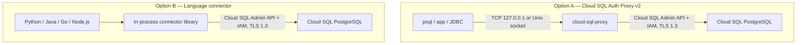
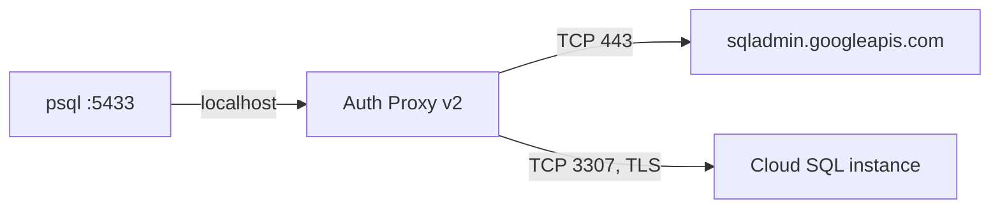

# Cloud SQL Auth Proxy and Language Connectors

> **Chapter:** Cloud SQL and AlloyDB  
> **Module:** CLOUD_PROVIDERS_GCP  
> **Module Scope:** Exploring Google Cloud from project, IAM, and VPC organization to Compute Engine, GKE, Cloud Run, storage services, and databases. Through deployment scenarios, learners select services, secure resources, automate delivery, and monitor reliability and cost.

A Python app on Cloud Run needs to connect to PostgreSQL, while an engineer on a workstation wants to run `psql` to inspect data. Both must authenticate with Google Cloud, encrypt traffic, and comply with network policies. **Cloud SQL Auth Proxy v2** provides an authorized tunnel via a sidecar/local process; **Cloud SQL Language Connectors** embed the same capability directly into Java, Python, Go, or Node.js code. They **do not replace database user privileges, connection pooling, or VPC networking**.

This lesson uses an **existing Cloud SQL for PostgreSQL instance in a sandbox project** to demonstrate both methods. Do not create new instances, open public IPs, alter IAM, or modify production data. At the end, we briefly contrast **AlloyDB Auth Proxy** because the two products do not share the same proxy or instance identifiers.

## Learning Objectives

After this lesson, you will be able to:

1. Explain the flow **ADC → IAM Cloud SQL Client → short-lived certificates/mTLS → SQL database login**.
2. Choose between Cloud SQL Auth Proxy v2 and Python/Java/Go/Node.js connectors based on runtime, driver, and operations.
3. Distinguish **IAM for connecting to Cloud SQL**, **database user/password**, and **IAM database authentication**.
4. Verify public IP, private IP, and Private Service Connect (PSC) connectivity, plus egress requirements on ports `443` and `3307`.
5. Test connections via proxy + `psql` and Python Connector + SQLAlchemy without exposing passwords in code.
6. Configure connection pools, cap connection counts, diagnose errors, and clean up strictly within lab scope.

## 1. Role of Auth Proxy and Language Connectors



**Both** use a Google Cloud identity to authorize the connection and handle server identity verification and encryption. After passing the connector layer, **PostgreSQL/MySQL/SQL Server still checks the database account** per its configuration. Having `roles/cloudsql.client` does not mean you can `SELECT` every table.

| Criterion | Cloud SQL Auth Proxy v2 | Cloud SQL Language Connectors |
|---|---|---|
| Deployment model | **Separate process**, sidecar container, or managed integration | **Library** called directly by the app |
| Clients | `psql`, `mysql`, `sqlcmd`, and any app speaking DB protocol | Supported language/driver apps |
| Encryption / IAM | Fetches short-lived certs and performs IAM auth | Equivalent functionality embedded in code |
| Local TCP / Unix socket | Yes; Windows does not support Unix sockets | Connects via in-process driver; no local proxy socket needed |
| DB password / privileges | Still required unless supported IAM DB auth is used | Same |
| Pooling | **No connection pooling** inside proxy | Connector does not replace SQLAlchemy/HikariCP/pgx pools |
| Operations | Manage process, lifecycle, ports, sockets, and logs | Manage dependency, refresh strategy, and connection lifecycle |
| Best fit | Local `psql`, apps unable to use libraries, trusted local listeners | Java, Python, Go, Node.js apps controlling code and pools |

**Do not use legacy Cloud SQL Auth Proxy v1** (`cloud_sql_proxy`) for new labs; the current release is `cloud-sql-proxy` (v2). Legacy v1 examples and flags like `--enable_iam_login` do not map directly to v2.

## 2. Two Independent Authentication Layers

```text
App/proxy runtime identity (IAM principal)
    ├── Application Default Credentials (ADC)
    ├── cloudsql.instances.connect → roles/cloudsql.client
    └── Cloud SQL Admin API: fetch connection metadata + short-lived cert
                        │
                        ▼
               Encrypted TLS channel
                        │
                        ▼
PostgreSQL/MySQL/SQL Server database login
    ├── Database user + password   OR
    └── IAM database authentication (when supported by engine/instance)
                        │
                        ▼
         Database/schema/table-level GRANTs/roles
```

| Layer | Purpose | Typical Errors |
|---|---|---|
| **ADC** | Selects which principal the proxy/connector uses | Could not find credentials or expired token |
| **Cloud SQL IAM** | Authorizes principal to connect to the instance | `403`, missing `cloudsql.instances.connect` |
| **Database authentication** | Logs in as a DB user | PostgreSQL `FATAL: password authentication failed` |
| **Database authorization** | Grants access to specific schemas/tables | `permission denied for table ...` |

### 2.1. Least Privilege

- **Standard apps:** the principal running the proxy/connector needs `roles/cloudsql.client` on the project hosting the **Cloud SQL instance** (or a custom role with equivalent permission).
- **If using IAM database authentication:** also grant `roles/cloudsql.instanceUser`, enable/configure IAM database authentication on the instance, add the IAM DB user or configure an IAM group, and then **GRANT database privileges**.
- **Two-project setups:** the Cloud SQL Admin API usually needs to be enabled on both the client project **and** the instance project, with the IAM role granted in the **instance project**.
- **Compute Engine:** beyond IAM, VM access scopes must permit tokens for Cloud SQL; new workloads should use `cloud-platform` scope and enforce permissions via IAM.

Never grant `roles/editor` to a runtime SA and never bake a service account **JSON key** into a container image. On Cloud Run/GKE/VMs, use the attached runtime identity or Workload Identity; on workstations, use **developer ADC** or approved impersonation.

### 2.2. ADC Is Not the Same as `gcloud auth login`

`gcloud auth login` controls the identity for most `gcloud` commands; Python libraries and the proxy look for **Application Default Credentials** by default. Locally, you typically check:

```bash
# Inspect active identity only; do not print access tokens.
gcloud auth list --filter="status:ACTIVE"
gcloud auth application-default --help

# If org policy permits interactive login and local ADC is needed:
# gcloud auth application-default login
```

Never paste tokens, private keys, or ADC file contents into docs or issues. If using **service account impersonation** for local ADC, the user needs Token Creator permission on that SA and org policy allowance.

## 3. Networking: Proxy/Connectors Do NOT Create a Path into Your VPC

Cloud SQL Auth Proxy and language connectors **secure connections over an existing network path**; they do not create VPNs, VPC peerings, PSC endpoints, or routes:

| IP / Path Type | Network Prerequisite | Proxy / Connector Option |
|---|---|---|
| **Public IP** | Instance allows public IP; host has internet egress and required ports open | Proxy defaults to public IPv4 if available; Python `IPTypes.PUBLIC` |
| **Private IP** | Client is in a VPC with valid routing to the instance's private IP | Proxy `--private-ip`; Python `IPTypes.PRIVATE` |
| **Private Service Connect (PSC)** | Client VPC has a PSC endpoint and DNS mapping; supported region/instance type | Proxy `--psc`; connector configured for PSC per library version |

**Cloud Shell is not automatically inside your private VPC.** If an instance has only a private IP, running the proxy from your laptop or Cloud Shell without a VPN/route will time out even with valid IAM.

### 3.1. Egress Ports

Cloud SQL Auth Proxy and Language Connectors require outbound access to:

- **TCP 443** to `sqladmin.googleapis.com` for the Cloud SQL Admin API; this endpoint does not use a single static IP.
- **TCP 3307** to the Cloud SQL instance IP for the TLS tunnel — **not the application-facing SQL port**.
- Locally, the proxy can listen on `127.0.0.1:5432` for PostgreSQL, `3306` for MySQL, or `1433` for SQL Server, or any custom port to avoid conflicts.



**Port 5433 in the diagram is just an example local listener**, not a port you must open inbound on the VPC. Your environment's firewalls, egress rules, NAT, and DNS must still allow reaching the API and the instance. PSC also requires accurate DNS and endpoint configuration.

### 3.2. Loopback Is a Critical Security Boundary

The proxy listens on **`127.0.0.1` by default**. The **local client → proxy hop is not encrypted by the proxy**; only the **proxy → Cloud SQL** tunnel is automatically encrypted. Therefore:

- **Never** run `--address=0.0.0.0` on a shared VM/host or expose the proxy to the internet.
- When running as a sidecar container, restrict socket/port access strictly to trusted app containers via Pod network namespace or Unix socket permissions.
- Do not treat the proxy listener as a per-connection IAM-enforced API: the proxy authorizes the tunnel using **its own process principal**.
- Enforce least privilege at the DB user/GRANT, host OS, namespace, and IAM layers to shrink the blast radius.

## 4. Cloud SQL Auth Proxy v2: How It Works and Its Limits

The proxy is a Go binary built for Cloud SQL. On startup, it authenticates its principal via ADC or specified credentials, retrieves metadata and a short-lived certificate from the Cloud SQL Admin API, opens a local listener, and forwards DB traffic over a managed TLS tunnel. Certificates **rotate automatically**; apps do not need to provision SSL client certificates.

**What the proxy does NOT do:** create VPC routes, enforce SQL GRANTs in place of the DB, pool connections, encrypt the local client → proxy leg, prevent connection drops on failover, or keep an instance running.

### 4.1. TCP and Unix Sockets

```bash
# TCP: localhost-only listener (suited for local labs).
cloud-sql-proxy --address 127.0.0.1 --port 5433 \
  "PROJECT_ID:REGION:INSTANCE_ID"

# Linux/macOS: Unix socket; directory must have strict permissions.
# cloud-sql-proxy --unix-socket /path/to/private-sockets \
#   "PROJECT_ID:REGION:INSTANCE_ID"
```

**Unix sockets are not supported on Windows** and have path-length limits (often ~108 bytes on Linux). For PostgreSQL, clients may expect the `.s.PGSQL.5432` suffix; socket paths differ from TCP host/port arguments. Prefer a dedicated socket directory with tight permissions — never run `chmod 777` on shared hosts.

### 4.2. Public IP, Private IP, and PSC

```bash
# Only when the host actually has connectivity to the instance's private VPC:
# cloud-sql-proxy --private-ip --port 5433 "$INSTANCE_CONNECTION_NAME"

# When the instance uses PSC and endpoint/DNS are ready:
# cloud-sql-proxy --psc --port 5433 "$INSTANCE_CONNECTION_NAME"
```

If the proxy runs with `--private-ip` without a VPC path, timeouts or `network unreachable` errors **do not indicate missing IAM**. For PSC, verify the Cloud SQL-provided DNS name and a PSC-capable proxy version; never alter production DNS for a lab.

## 5. Language Connectors: Direct In-App Integration

Cloud SQL provides connectors for **Java, Python, Go, and Node.js**. They perform IAM authorization and TLS tunneling just like the proxy, managed inside the application lifecycle.

| Language | Library / Integration | Common Pool / Driver |
|---|---|---|
| **Python** | `cloud-sql-python-connector` | `pg8000`/`asyncpg` + SQLAlchemy |
| **Java** | Cloud SQL Java Connector, Socket Factory/JDBC | HikariCP with JDBC driver |
| **Go** | `cloud.google.com/go/cloudsqlconn` | `database/sql`/pgx |
| **Node.js** | `@google-cloud/cloud-sql-connector` | `pg`/`mysql2` and matching pools |

**Choose per supported language and driver**; do not assume every connector supports identical DB engines or IAM DB auth options. For Python PostgreSQL, the example below uses **pg8000** and **SQLAlchemy**. If using `asyncpg`, use an async engine/pool — never mix sync and async drivers in the same snippet.

### 5.1. Why Serverless Runtimes Must Mind Refresh Strategy

Some connectors run a background thread to refresh certificates/tokens. In environments where **CPU is allocated primarily during request handling** (certain Cloud Run configurations), background refreshes may not run reliably. The Python Connector supports `refresh_strategy="LAZY"`, fetching metadata/certificates on demand in the request path. Never instantiate a new connector on **every HTTP request**: reuse the connector and pool at the application instance level.

### 5.2. Connection Pooling Is a Separate Responsibility

Auth Proxy **does not multiplex multiple client connections into one DB session**. If an app scales to 20 Cloud Run instances, each with `pool_size=5` and `max_overflow=5`, theoretical peak load reaches **20 × (5+5) = 200 database connections**, excluding admin tools, cron jobs, and other apps.

Use small bounded pools, `pool_pre_ping`, sensible connection lifetimes/recycling, clean disposal on shutdown, and plan around database connection limits. When instances scale out, connection count limits usually matter far more than choosing between the proxy binary and a language connector.

## 6. IAM Database Authentication: Optional, Not Automatic

**Cloud SQL IAM database authentication** on supported engines (primarily PostgreSQL and MySQL per feature docs) lets users log into the database using an IAM identity. With **automatic IAM DB auth**, the connector/proxy automatically fetches short-lived access tokens so the app never stores a DB password.

| Mode | Google Cloud IAM | Database Login |
|---|---|---|
| **Standard DB password** | `roles/cloudsql.client` | Provisioned DB username/password |
| **Automatic IAM DB auth** | `roles/cloudsql.client` **and** `roles/cloudsql.instanceUser` | IAM DB username (user/SA added to instance), token managed by connector/proxy |

**Additional prerequisites:** IAM DB authentication must be enabled on the instance; the IAM user, service account, or group must be added as a DB user in the required format; SQL GRANTs/roles are still required. **The IAM identity launching the connector must match the identity logging into the DB** when using automatic IAM auth.

### 6.1. Database Username Format

PostgreSQL examples:

```text
Google user:       analyst@example.com
PostgreSQL DB user: analyst@example.com  (lowercase)

Service account:    app-sa@my-project.iam.gserviceaccount.com
PostgreSQL DB user: app-sa@my-project.iam
```

**Service account DB usernames drop the `.gserviceaccount.com` suffix** and must satisfy PostgreSQL username length limits. Never pass the full SA email if the engine docs require the shortened format.

### 6.2. Auto IAM Auth Proxy Example (Only When Provisioned)

```bash
# Run only if instance has IAM DB auth enabled, IAM principal
# is added as a DB user, and has Cloud SQL Client + Instance User.
cloud-sql-proxy --auto-iam-authn --port 5433 \
  "$INSTANCE_CONNECTION_NAME"

# Another terminal: IAM_DB_USER must match the ADC's PostgreSQL DB username.
psql -h 127.0.0.1 -p 5433 \
  -U "$IAM_DB_USER" -d "$DB_NAME" -c 'SELECT current_user;'
```

Never attempt IAM DB auth on SQL Server or flip `cloudsql.iam_authentication` in production just to experiment. For long-lived pools, **automatic IAM auth** is safer than manually minting an OAuth access token and pasting it as a static password, since short-lived tokens expire and need refresh.

## 7. Lab A — Inventorying an Existing Cloud SQL PostgreSQL Instance

> **Prerequisites:** you have an **existing running sandbox Cloud SQL PostgreSQL instance**, plus a database and read-only DB user provided by the owner. If no instance exists, **stop at the design exercises** rather than creating billable instances or altering production IAM. Commands in this document are instructions, not executed live during writing.

### 7.1. Lab Variables and Read-Only Inventory

Run in **Cloud Shell/Bash** or an authorized dev machine with `gcloud`:

```bash
PROJECT_ID="my-cloudsql-sandbox"
INSTANCE_ID="pg-learning-lab"
DB_NAME="app_demo"
DB_USER="reader_lab"

gcloud auth list --filter="status:ACTIVE"
gcloud projects describe "$PROJECT_ID" \
  --format="table(projectId,name,lifecycleState)"
gcloud sql instances list --project="$PROJECT_ID"
gcloud sql instances describe "$INSTANCE_ID" \
  --project="$PROJECT_ID" \
  --format="yaml(name,region,databaseVersion,state,connectionName,ipAddresses)"
```

**Proceed only if** the instance is in the expected project/region, runs PostgreSQL, is in `RUNNABLE` state, and you have approved network and DB access. Querying can incur egress/instance load; never run schema migrations or create tables in this lab.

### 7.2. Retrieving the Exact Connection Name

```bash
INSTANCE_CONNECTION_NAME="$(gcloud sql instances describe "$INSTANCE_ID" \
  --project="$PROJECT_ID" --format='value(connectionName)')"
printf 'Connection name: %s\n' "$INSTANCE_CONNECTION_NAME"
```

`INSTANCE_CONNECTION_NAME` follows **`PROJECT_ID:REGION:INSTANCE_ID`**. It is **not a hostname, private IP, database name, or AlloyDB instance URI**. Never substitute an arbitrary string.

### 7.3. Checking IAM/APIs and Network Before Starting the Proxy

Verify with the owner:

1. The ADC principal holds `roles/cloudsql.client` on the instance project (or equivalent permission).
2. `sqladmin.googleapis.com` is enabled on relevant projects; if not, the owner enables it per policy.
3. If using public IP, the instance exposes public IP; if using private IP, **the proxy host sits in a reachable VPC**.
4. Outbound traffic from the client to Cloud SQL Admin API (**443**) and the instance (**3307**) is allowed.
5. DB user `reader_lab` has minimal read-only privileges on the test database; password is supplied via Secret Manager or secure channel.

Never add `0.0.0.0/0` to authorized networks to test via proxy. Never open inbound DB firewall rules just for testing when proxy + IAM already cover it.

## 8. Lab B — Using Auth Proxy v2 with `psql`

### 8.1. Install the Official Binary

Install **Cloud SQL Auth Proxy v2** for Linux/macOS/Windows from the official guide and verify it is in `PATH`. Avoid unverified downloads or legacy v1 binaries from outdated tutorials.

```bash
cloud-sql-proxy --version
cloud-sql-proxy --help
```

Locally, if ADC is unset and policy permits, run interactive ADC login; in managed runtimes, rely on attached identity. **Never download static key files to work around missing permissions.**

### 8.2. Run the Proxy in Terminal A

```bash
# Use port 5433 to avoid colliding with local PostgreSQL on 5432.
# Default network: uses public IP if enabled on the instance.
cloud-sql-proxy --address 127.0.0.1 --port 5433 \
  "$INSTANCE_CONNECTION_NAME"
```

Expect log lines **Listening on 127.0.0.1:5433** and **Ready for new connections**. Keep this terminal running; stopping the proxy prevents new client connections. If the instance is private-IP-only, add `--private-ip` **after confirming the host has VPC access**. Never switch to `--address=0.0.0.0` to work around VPC issues.

### 8.3. Connect in Terminal B

```bash
# libpq prompts for the DB password if required by the server.
# sslmode=disable applies ONLY to the localhost -> proxy hop.
psql "host=127.0.0.1 port=5433 dbname=$DB_NAME user=$DB_USER sslmode=disable" \
  -c 'SELECT current_database(), current_user, now();'
```

**Expected output:** one row showing the database name, DB user, and timestamp. If `psql` reports `password authentication failed`, the issue is at the **database login** layer — do not grant `roles/editor` to your Google Cloud identity to fix it.

**Why can local `sslmode=disable` still be safe?** The client connects over **loopback** on the same host as the proxy; **proxy → Cloud SQL is encrypted with TLS**. Never use `sslmode=disable` for direct connections over the internet or VPC without the proxy just because you saw it here.

### 8.4. Stop the Proxy After Testing

In Terminal A press **Ctrl+C**, confirming no other apps depend on port `5433`. Never kill a shared system proxy. Never delete instances or rotate shared passwords just to clean up this lab.

## 9. Lab C — Python Connector and SQLAlchemy (PostgreSQL)

Goal: **no sidecar proxy**, no hardcoded IPs or certificates; use **Python Connector** with `pg8000` and SQLAlchemy against the same Cloud SQL sandbox and DB user from Lab A.

### 9.1. Dependencies

```bash
# Run on the learner's machine inside a dedicated venv.
python -m venv .venv
source .venv/bin/activate
python -m pip install "cloud-sql-python-connector[pg8000]" "SQLAlchemy>=2,<3"

# Set env vars in lab shell; keep DB password out of shell history.
export INSTANCE_CONNECTION_NAME DB_NAME DB_USER
```

**Note:** These commands are for learner practice only; when writing STEP 4 content, do not execute Python, install packages, or touch Cloud SQL.

### 9.2. Sample `connector_demo.py`

```python
import getpass
import os

import sqlalchemy
from sqlalchemy import text
from google.cloud.sql.connector import Connector, IPTypes

instance = os.environ["INSTANCE_CONNECTION_NAME"]
db_name = os.environ["DB_NAME"]
db_user = os.environ["DB_USER"]

# Interactive lab use only: production must use Secret Manager /
# workload identity and follow organizational secret management.
db_password = getpass.getpass("Database password: ")

# PUBLIC works only if instance and network allow it.
# Inside a VPC with private access, switch to IPTypes.PRIVATE.
ip_type = IPTypes.PUBLIC

connector = Connector(refresh_strategy="LAZY")


def getconn():
    return connector.connect(
        instance,
        "pg8000",
        user=db_user,
        password=db_password,
        db=db_name,
        ip_type=ip_type,
    )


# Create engine ONCE per app; pool bounds active DB sessions.
engine = sqlalchemy.create_engine(
    "postgresql+pg8000://",
    creator=getconn,
    pool_size=2,
    max_overflow=0,
    pool_timeout=30,
    pool_recycle=1800,
    pool_pre_ping=True,
)

try:
    with engine.connect() as connection:
        row = connection.execute(
            text("SELECT current_database(), current_user")
        ).one()
        print("Database:", row[0], "DB user:", row[1])
finally:
    engine.dispose()
    connector.close()
```

**Expected output:** prints database name and DB user without printing passwords or tokens. The demo **reads metadata only**; still use a **read-only** SQL account and never a production instance. If the client sits outside the VPC of a private-only instance, switching to `IPTypes.PRIVATE` **will not create a route**.

### 9.3. Why Both Connector and SQLAlchemy Are Needed

- **Connector:** resolves instance routing, IAM authorization, TLS certificates, and IP type.
- **pg8000:** speaks the PostgreSQL wire protocol and handles DB login.
- **SQLAlchemy:** manages the connection pool, checkout/checkin, and transactions.
- **DB user/GRANT:** determines which SQL statements are permitted after login.

`SELECT 1` succeeding does not mean the user can read every schema — that is **least privilege** working as intended.

## 10. Connecting on Cloud Run, VMs, and GKE

| Environment | Practical Choice | What to Check |
|---|---|---|
| **Developer machine** | Auth Proxy v2 + DB client, or language connector | Local ADC, ports/sockets, network path |
| **Cloud Run service** | Managed Cloud SQL integration via Unix socket or language connector | Runtime SA Cloud SQL Client, Cloud SQL instance connection, pool/max instances |
| **Compute Engine VM** | Auth Proxy running as service/sidecar, or connector | VM SA/scopes, egress firewalls, OS permissions |
| **GKE** | Sidecar Auth Proxy or in-process connector | Workload Identity Federation for GKE, NetworkPolicy/egress, Pod lifecycle |

### 10.1. Cloud Run Managed Integration (Optional Example)

Cloud Run can attach a Cloud SQL instance to expose `/cloudsql/INSTANCE_CONNECTION_NAME` to the app via managed integration:

```bash
# Configuration reference only; DO NOT run on a live service without approval.
# gcloud run services update "$SERVICE" \
#   --project="$PROJECT_ID" --region="$RUN_REGION" \
#   --add-cloudsql-instances="$INSTANCE_CONNECTION_NAME"
```

For PostgreSQL Unix sockets, drivers may need `/cloudsql/INSTANCE_CONNECTION_NAME/.s.PGSQL.5432`. Cloud Run **first-generation execution environment** has limitations around Cloud SQL Auth Proxy v1 and server CA modes; check runtime generation and CA policy before connecting to instances using newer CA models. For private IP, you still need appropriate VPC egress/routing; "attaching Cloud SQL" does not replace IAM or VPC connectivity.

### 10.2. Do Not Scale Pools Linearly on Scale-Out

Suppose a service has `max-instances=20` and each instance uses `pool_size=5, max_overflow=0`: reserve up to **100 connections** for this service alone, excluding migrations, Cloud Run jobs, and admin tools. Rapid scale-out can hit `max_connections` or quotas, triggering `too many connections`, slow handshakes, or restarts/failovers.

Keep pools small, apply backpressure and timeouts, measure **active connections**, and load-test realistically. For long transactions, shrink connection hold times; never leak connections opened per request. Neither proxies nor connectors can rescue a database that has run out of connection slots.

## 11. AlloyDB: Same Goal, Different Tooling

**AlloyDB for PostgreSQL does not use `cloud-sql-proxy` or the Cloud SQL Python Connector.** AlloyDB has **AlloyDB Auth Proxy** and AlloyDB-specific language connectors; resource syntax and IAM roles differ from Cloud SQL.

| Criterion | Cloud SQL PostgreSQL | AlloyDB for PostgreSQL |
|---|---|---|
| Proxy | `cloud-sql-proxy` | `alloydb-auth-proxy` |
| Connection identifier | `PROJECT_ID:REGION:INSTANCE_ID` | `projects/PROJECT/locations/REGION/clusters/CLUSTER/instances/INSTANCE` |
| IAM for connecting | `roles/cloudsql.client` | `roles/alloydb.client` and `roles/serviceusage.serviceUsageConsumer` |
| Control plane API | `sqladmin.googleapis.com` | `alloydb.googleapis.com` |
| Outbound proxy to DB | TCP **3307** | TCP **5433** |
| HTTPS API | TCP **443** | TCP **443** |
| Python language connector | `cloud-sql-python-connector` | `google-cloud-alloydb-connector` |
| Private path | Cloud SQL VPC/PSC setup | AlloyDB VPC/PSC setup |

AlloyDB Auth Proxy also listens on `127.0.0.1:5432` by default, uses mTLS, and supports `--psc` or `--public-ip` where configured; never just **swap the binary name** in Cloud SQL commands and assume compatibility. Before using AlloyDB, check instance URIs, VPCs, IAM, engines/users, pricing, and the **dedicated AlloyDB documentation**.

## 12. Production Security and Operations

### 12.1. Least Privilege at Every Layer

- **Proxy/connector principal:** `roles/cloudsql.client` scoped strictly where needed; avoid Editor/Owner SAs.
- **IAM DB auth (if used):** `roles/cloudsql.instanceUser`, provisioned IAM DB user/group, minimal PostgreSQL GRANTs.
- **Standard DB accounts:** passwords managed in Secret Manager and rotated; never bake into Dockerfiles, Git, image layers, CLI history, or logs.
- **Network:** private IP/PSC/VPC when required by policy; public access via connector still requires IAM and permitted egress.
- **Local listener:** loopback or tightly permissioned Unix socket only; never accidentally turn a proxy into a "public DB gateway."

### 12.2. Behavior During Instance Failover

Proxies/connectors manage certificates and tunnels, yet **do not preserve in-flight transactions across database failover**. Old connections drop; applications need **idempotent** retries, fresh connections, bounded retry/backoff, and alerting. Never blindly retry a transaction with side effects after a network timeout without knowing whether the commit succeeded.

### 12.3. Observing the Right Layer

| Signal | What It Diagnoses |
|---|---|
| Proxy/connector logs | ADC/tokens, Admin API calls, TLS handshakes, IP type, network errors |
| Cloud SQL connection metrics | Connection count, CPU/memory, saturation, `max_connections` |
| PostgreSQL logs | `FATAL` auth errors, permission denied, SQL errors, slow queries |
| Application traces | Pool checkout wait, query latency, retry counts, failover impact |
| Cloud Audit Logs | IAM changes, instance config edits, role grants, admin operations |

Never leave debug logs containing URLs, identities, or payloads enabled indefinitely in production. Cloud SQL proxy logs **do not replace** database auditing or application tracing. Keeping egress, logging, and connection counts bounded prevents unexpected instance, network, and observability charges.

## 13. Root-Cause Troubleshooting

| Symptom | Layer Involved | Check / Fix |
|---|---|---|
| `cloud-sql-proxy: command not found` | Local tool | Install v2 binary from official source; verify `PATH` and `--version` |
| `could not find default credentials` | ADC | Run `gcloud auth application-default login` (local) or check runtime identity |
| `403` / missing `cloudsql.instances.connect` | Cloud SQL IAM | Grant `roles/cloudsql.client` to the right principal in the instance project |
| `Cloud SQL Admin API not enabled` | API / project | Check API status on both client and instance projects; owner enables if approved |
| `connection timed out` with `--private-ip` | Network / VPC | Check routes, VPC, DNS, port 3307; do not randomly tweak IAM |
| `dial tcp ...:3307 timeout` | Network egress | Check firewalls/NAT/routes to the instance; distinct from local port 5433 |
| `dial tcp ...:443 timeout` | API egress | Check HTTPS egress to Cloud SQL Admin API and DNS resolution |
| `bind: address already in use` | Local listener | Use `--port 5433` or stop the competing local service if appropriate |
| `FATAL: password authentication failed` | DB login | Verify DB user/password and target instance/DB; Cloud SQL Client doesn't replace password |
| `FATAL: role does not exist` | DB user provisioning | Create the DB user or IAM DB user via owner workflow |
| `permission denied for relation` | DB GRANT | DB owner grants minimal table/schema privileges |
| `IAM database authentication failed` | IAM DB auth | Verify instance flag, `instanceUser`, username format, connector identity, token |
| `too many connections` | Capacity / pool | Sum `pool × instances`, cap overflow, shorten long queries |
| `.s.PGSQL.5432` socket not found | Unix socket | Confirm proxy is running and check path/permissions; no Unix sockets on Windows |
| Connections drop on failover | DB lifecycle | Reconnect, bounded retries, and idempotency; monitor recovery |
| PSC resolves to wrong IP | PSC / DNS | Verify endpoint and DNS per docs; never alter shared project DNS unilaterally |

### 13.1. Minimal Diagnostic Decision Tree

```text
Cannot connect?
  ├─ Proxy/connector fails to start? → binary/version/ADC/Admin API/IAM
  ├─ IAM OK yet times out?           → IP type, VPC/PSC, egress 443/3307
  ├─ Reaches PostgreSQL yet FATAL?   → DB user/password or IAM DB auth
  ├─ Query gets permission denied?   → SQL GRANT/schema/table
  └─ Queries work intermittently?    → pools, max_connections, restarts/failover
```

**Never "fix" every error by opening public IP or granting Owner.** Separate Google Cloud IAM errors from networking, PostgreSQL login, and database privilege errors.

## 14. Exercises and Suggested Answers

### Exercise 1 — Choosing the Right Tool

Someone runs `psql` on a laptop; a Python API on Cloud Run uses SQLAlchemy; a Java app uses HikariCP. Pick the appropriate connection method for each.

**Answer:** `psql` → Cloud SQL Auth Proxy v2; Python → Python Connector with `pg8000`/SQLAlchemy or Cloud Run managed integration; Java → Java Connector with JDBC/HikariCP. Verify networking, IAM, and pools for all three.

### Exercise 2 — IAM Succeeds Yet DB Rejects

A runtime SA has `roles/cloudsql.client`. Proxy logs "Ready for new connections," yet `psql` fails with `FATAL: password authentication failed`. What is missing?

**Answer:** Check the **database user/password** (or configured IAM DB auth) — do not escalate IAM roles. Google Cloud connector auth is separate from DB login.

### Exercise 3 — Private IP from Cloud Shell

An instance has only a private IP. A developer passes `--private-ip` in Cloud Shell and gets a timeout, despite valid IAM. What should they do?

**Answer:** Cloud Shell has no automatic route into your private VPC; run from a VM/Cloud Run with VPC egress, VPN, or another approved path. `--private-ip` does not create a VPC tunnel.

### Exercise 4 — Calculating Max Connections

Cloud Run has max 30 instances, each with `pool_size=4` and `max_overflow=2`. What is the upper bound from this service alone?

**Answer:** **30 × (4+2) = 180** theoretical concurrent DB connections, excluding other callers. Compare against `max_connections` and leave headroom.

### Exercise 5 — IAM DB Authentication

An app wants to eliminate static long-lived passwords. Is passing `--auto-iam-authn` to the proxy enough?

**Answer:** No. The instance must have IAM DB auth enabled, the principal needs **Client + Instance User**, an appropriate IAM DB account must exist with the exact DB username format, and **SQL GRANTs** must be issued. With auto IAM auth, the proxy's identity must match the DB login identity.

### Exercise 6 — Exposed Local Listener

A VM runs `cloud-sql-proxy --address 0.0.0.0` so other machines can connect through it; the VM has IAM Cloud SQL Client. What are the risks?

**Answer:** The client → proxy leg may be unencrypted, and the listener does not check IAM per remote caller. Anyone reaching that port can attempt DB logins over the proxy's IAM tunnel. Bind to loopback/private socket or use an approved network/access design.

### Exercise 7 — Cloud SQL vs. AlloyDB

A team migrates PostgreSQL from Cloud SQL to AlloyDB. Can they keep `cloud-sql-proxy` and `PROJECT:REGION:INSTANCE`?

**Answer:** No. AlloyDB uses `alloydb-auth-proxy`, resource URIs like `projects/.../clusters/.../instances/...`, and different IAM/ports/APIs; redesign and re-test connection configs.

## 15. Lab Cleanup and Checklist

### 15.1. Proper Resource Cleanup

This lab **only reads an existing Cloud SQL PostgreSQL instance** from clients; it creates no instances, DBs, or users. After testing:

1. Close `psql`/Python app and press `Ctrl+C` on the proxy you started.
2. Call `engine.dispose()` and `connector.close()` in Python; confirm connections closed cleanly.
3. Remove the virtual environment/code files **only if created in your personal lab folder**; never delete shared directories.
4. Never delete shared databases, instances, Cloud SQL Admin API enablements, service accounts, Cloud SQL IAM bindings, or Secret Manager secrets.
5. Review Cloud SQL metrics, Cloud Logging, and Billing Reports to observe load/costs; billing reports may lag.

### 15.2. Production Checklist

| Item | Acceptance Criterion |
|---|---|
| **Tool choice** | Proxy v2 or language connector matches driver, runtime, and CA policy |
| **IAM** | ADC uses right principal, Cloud SQL Client granted; Instance User if using IAM DB auth |
| **DB account** | User exists, login works, and SQL GRANTs follow least privilege |
| **Networking** | Correct IP type, VPC/PSC/routing, outbound TCP 443 and 3307 |
| **Local security** | Loopback/restricted Unix socket listener; never bound arbitrarily to `0.0.0.0` |
| **Secrets** | No hardcoded passwords or SA keys; Secret Manager or IAM DB auth |
| **Pooling** | `Total pool × instances` fits `max_connections` with timeouts and recycling |
| **Reliability** | Failover reconnects, idempotent retries, no long-held SQL transactions |
| **Observability** | Proxy logs, Cloud SQL connection metrics, SQL logs, SLOs, and alerts |
| **Cost** | Instance/network/logging measured, with budgets and an owner |
| **Cleanup** | Stop only lab-created processes/files; leave shared databases untouched |

## Key Takeaways

**Cloud SQL Auth Proxy v2** and **Cloud SQL Language Connectors** provide IAM-authorized, TLS-encrypted channels to Cloud SQL, yet **they do not replace network paths, database logins/GRANTs, or connection pooling**. For PostgreSQL, separate `roles/cloudsql.client` from `roles/cloudsql.instanceUser`; enable `--auto-iam-authn` only when IAM DB authentication is configured end-to-end. Keep proxies bound to loopback, bound pools during scale-out, and remember that **AlloyDB uses its own proxy and connectors**.

## Official References

- [Cloud SQL for PostgreSQL — About the Cloud SQL Auth Proxy](https://cloud.google.com/sql/docs/postgres/sql-proxy)
- [Cloud SQL for PostgreSQL — Connect using Auth Proxy](https://cloud.google.com/sql/docs/postgres/connect-auth-proxy)
- [Cloud SQL — Auth Proxy quickstart](https://cloud.google.com/sql/docs/postgres/connect-instance-auth-proxy)
- [Cloud SQL — Language Connectors](https://cloud.google.com/sql/docs/postgres/connect-connectors)
- [Cloud SQL — Python Connector + SQLAlchemy sample](https://cloud.google.com/sql/docs/postgres/samples/cloud-sql-postgres-sqlalchemy-connect-connector)
- [Cloud SQL — IAM database authentication](https://cloud.google.com/sql/docs/postgres/iam-authentication)
- [Cloud SQL — Automatic IAM logins](https://cloud.google.com/sql/docs/postgres/iam-logins)
- [Cloud SQL — Add/manage IAM database users](https://cloud.google.com/sql/docs/postgres/add-manage-iam-users)
- [Cloud SQL — Connect from Cloud Run](https://cloud.google.com/sql/docs/postgres/connect-run)
- [Cloud SQL — Private Service Connect connectivity](https://cloud.google.com/sql/docs/postgres/configure-private-service-connect)
- [AlloyDB — About the AlloyDB Auth Proxy](https://cloud.google.com/alloydb/docs/auth-proxy/overview)
- [AlloyDB — Connect with AlloyDB Auth Proxy](https://cloud.google.com/alloydb/docs/auth-proxy/connect)
- [AlloyDB — Language Connectors](https://cloud.google.com/alloydb/docs/connect-language-connectors)
