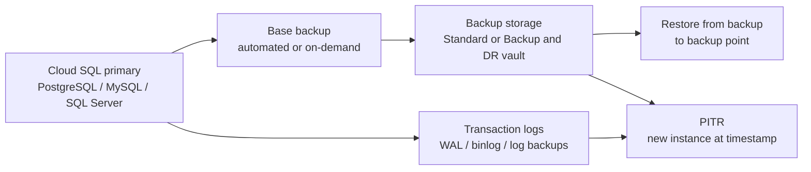
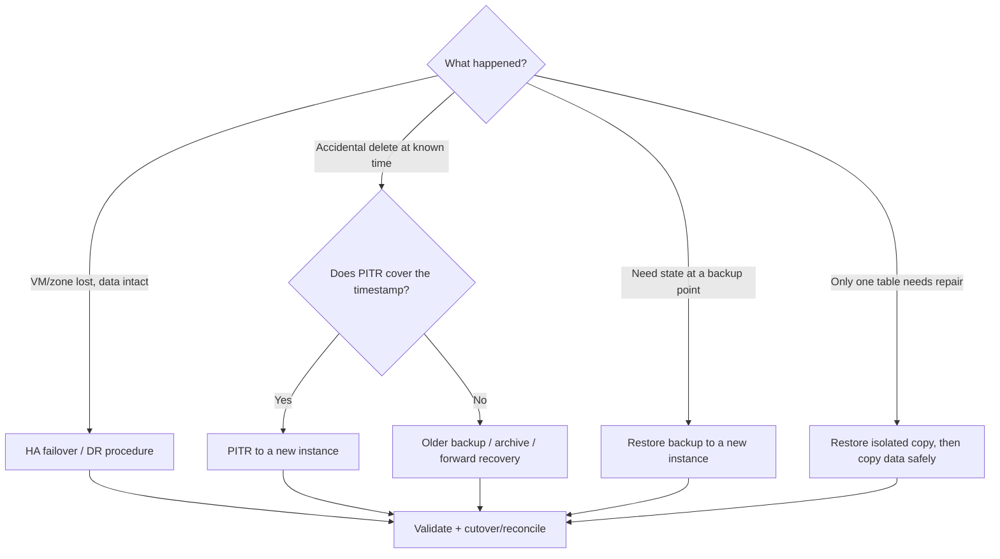

# Backups, Point-in-Time Recovery, and Cloud SQL Recovery

## 1. When a Database Fails, What Needs to Be Recovered?

An ordering service on **Cloud Run** writes data to **Cloud SQL for PostgreSQL**. At 09:15, a flawed migration deletes many rows from the `orders` table. High availability (HA) cannot save this data: the standby instance synchronously applies the same valid database-level change. If the latest backup was taken at 02:00, restoring that backup alone would lose transactions created after 02:00.

**Cloud SQL backups** and **point-in-time recovery (PITR)** solve different goals:

- **Backup restore:** returns a database to the state captured in an existing backup.
- **PITR:** combines a base backup with **transaction logs** to create a **new instance** at a specific timestamp before the incident, within the actually protected recovery window.
- **High availability / failover:** minimizes downtime during node/zone failure; **does not** undo committed `DELETE`, `DROP TABLE`, or application bugs.

This lesson belongs to the **Cloud SQL and AlloyDB** chapter in the **CLOUD_PROVIDERS_GCP** module. It builds on Project/IAM, VPC, Compute Engine/GKE/Cloud Run, storage, and data services to design backups, recovery, releases, and operations with controlled **reliability, security, and cost**.

After this lesson, you will be able to:

1. Distinguish **automated/on-demand backups, Standard/Enhanced tiers, PITR, HA, replicas, and exports**.
2. Inspect backup configurations, transaction logs, and recovery windows across **PostgreSQL, MySQL, and SQL Server**.
3. Create backups in a lab and perform PITR to a **new instance** without overwriting the source instance.
4. Design a **restore → data validation → cutover → reconciliation** workflow aligned with RPO/RTO.
5. Manage retained/final backups, backup vaults, CMEK, IAM, monitoring, and costs.

> **Safety:** All projects, instances, and connection details in this lesson are **hypothetical**. Commands modifying backup/PITR settings can **restart the instance** and incur charges; restoring onto an **existing instance can overwrite all data**. Operate only in an authorized lab project, and never run production restores without approval and a safe copy.

## 2. RPO and RTO: Two Different Questions

| Metric | Business Question | Illustrative Example |
| --- | --- | --- |
| **RPO – Recovery Point Objective** | What is the maximum acceptable window of recent data loss? | At most 5 minutes of transactions |
| **RTO – Recovery Time Objective** | What is the maximum acceptable service downtime before recovery? | Within 60 minutes |
| **Recovery window** | Which timestamps currently have data/logs available for PITR? | Last 7 days, depending on edition/config |
| **Retention** | How long are backups/logs kept per policy? | Backups 30 days, transaction logs 7 days |
| **Restore test** | Has backup usability actually been proven? | Provisioning an isolated instance and verifying data |

**30-day retention does not mean RPO = 30 days.** Daily backups only provide daily restore points; with PITR enabled and intact logs, you can target a timestamp much closer to the incident. **Nor does RTO equal the runtime of the restore command**: it also includes data verification, updating connections, running compatible migrations, warming up the app, and business sign-off.

```text
02:00                 09:14:50   09:15               09:40
 | Backup succeeded      | PITR target | Accidental delete  | Recovery starts
 |-----------------------|------------X----------------|
              Transaction logs retained continuously
                               ↓
                    New recovered instance
```

Pick `09:14:50` only if it falls inside the actual **PITR recovery window** and precedes the accidental delete. Never guess the target timestamp from when users reported errors: check application logs, database audits, and commit timestamps.

## 3. How Cloud SQL Backups and Transaction Logs Work Together



**The base backup and logs must belong to the same valid data timeline** for PITR to work. Log names differ by engine:

| Engine | Log Type Used for PITR | Notes |
| --- | --- | --- |
| **PostgreSQL** | Write-ahead log (**WAL**) | Cloud SQL manages backup and log archiving |
| **MySQL** | Binary log (**binlog**) | `binaryLogEnabled` flag reflects PITR-related config |
| **SQL Server** | Transaction log backups | Subject to database and edition requirements/limits |

Do not confuse **transaction logs used for PITR** with **Cloud Logging application/database error logs**. Cloud Logging aids investigation, but cannot replace WAL/binlog/transaction log backups for data recovery.

### Distinguishing Five Commonly Confused Mechanisms

| Mechanism | Best For | Does Not Guarantee |
| --- | --- | --- |
| **HA / automatic failover** | VM/zone failure, higher availability | Recovering data prior to a bad write |
| **Read replica** | Scaling reads, supporting some DR scenarios | Independent backup; replicas also apply accidental deletes |
| **Automated backup** | Restoring to a scheduled backup point, DR | Second-by-second recovery between backups |
| **PITR** | Returning to a timestamp inside the recovery window | Recovery outside retention or missing log windows |
| **Logical export/import** | Selective tables/databases, moving data formats | Instance-wide consistent snapshot without prep |

## 4. Standard Backups vs. Enhanced Backups

Cloud SQL currently offers two **backup options**. **Do not assume all instances share the same CLI or storage mechanism**, especially when adopting **Backup and DR Service**.

| Feature | **Standard backup tier** | **Enhanced backup tier** |
| --- | --- | --- |
| Management | Cloud SQL native backup settings | **Backup and DR**: backup plan + backup vault |
| Automated/on-demand | Yes | Yes, governed by backup plan |
| Retention | Cloud SQL rules; count/limits vary by edition | Backup plan/vault policy, **enforced retention** |
| Admin isolation | Within Cloud SQL/project and its controls | Supports a separate **backup management project** |
| Cross-region backup | Per Cloud SQL backup capabilities/types | Backup vault can reside in another region where supported |
| PITR | Uses instance recovery window/logs | Uses **backup vault/data source** for PITR |
| Cost | Cloud SQL backups and logs per SKU | Backup and DR storage/management, plus data transfer if cross-region |

**Enhanced backups** do not guarantee immediate restore availability if the entire source region goes down. If the instance uses **CMEK** and a cross-region backup vault still relies on a **KMS key in the source region**, losing the source region can **prevent decrypting backups** until that key returns. DR designs must test **key availability**, region placement, and KMS permissions.

### Automated, On-Demand, Final, and Retained Backups

| Backup Type | When Created | Key Point |
| --- | --- | --- |
| **Automated** | Scheduled by backup config/plan | Monitor that backups **actually succeed** |
| **On-demand** | Requested by operator/automation | Take before major migrations or high-risk changes |
| **Final backup** | Taken at instance deletion if configured/required | Distinct from retained backups; has its own retention |
| **Retained backup** | Existing backups preserved after instance deletion per setting | Not kept forever by default |

Per current docs, **Standard on-demand backups** can persist until explicitly deleted, whereas **Enhanced on-demand backups** follow backup plan retention up to vault rules. Final backups also have separate retention bounds (Standard typically **1–365 days**, Enhanced up to **10 years** per plan/vault). **Never treat a single default number as company retention policy**: inspect actual instance/plan settings and org rules.

## 5. PITR: Prerequisites and Limits by Edition/Engine

### 5.1. Prerequisites

1. The instance has **automated backups** and **PITR enabled**.
2. Transaction logs cover the entire recovery interval with no gaps breaking the recovery chain.
3. The chosen timestamp lies between the actual **earliest recovery time** and **latest recovery time**.
4. Sufficient quota, IAM/KMS permissions, region capacity, and machine config exist to **create a new instance**.
5. The operations team has prepared **cutover and data verification**, not just the clone command.

**Important:** PITR **always creates a new instance** — it never performs PITR in place over an existing instance. Do not confuse it with **backup restore**, which can target an existing instance and **overwrite its data**.

### 5.2. PITR Defaults Vary by Creation Method

With **Cloud SQL Enterprise Plus**, PITR is normally **enabled by default** on new instances. With **Enterprise**, creating via **Google Cloud Console** usually enables PITR by default, whereas creating via **gcloud/Terraform/API** may leave it disabled; MySQL HA also has specific default rules. **Always inspect live settings** rather than assuming "Cloud SQL always has PITR."

**PITR log retention**:

| Edition | Allowed Range | Common Default |
| --- | --- | --- |
| **Cloud SQL Enterprise** | 1–7 days | 7 days |
| **Cloud SQL Enterprise Plus** | 1–35 days | 14 days |

This is the **configured log retention window in days**, not a guarantee that every second in that range is recoverable. Verify **earliest/latest recovery times** before executing.

### 5.3. Command Differences for Enabling PITR

- PostgreSQL and SQL Server: `gcloud sql instances patch INSTANCE --enable-point-in-time-recovery`.
- MySQL: `gcloud sql instances patch INSTANCE --enable-bin-log` (and verify `backupConfiguration.binaryLogEnabled`).
- For PostgreSQL/SQL Server, status appears under `backupConfiguration.pointInTimeRecoveryEnabled`.

**Enabling PITR on an existing instance can trigger a restart.** Changing backup tier, retention, or log placement can also impact availability and cost; schedule a change window and take a backup first. **Toggling PITR off and back on to reset logs can wipe out recovery history prior to that reset.**

## 6. Choosing the Right Recovery Path



**Never overwrite all of production just to recover one table** when you can restore into an **isolated instance**, extract the exact rows, and merge via controlled transactions/reconciliation. PITR generally restores the **entire instance**; selective database restore applies only to certain engines/features (such as SQL Server options) — do not assume it exists for PostgreSQL/MySQL.

## 7. Preflight: Checking Backup/PITR Before an Incident (Read-Only)

Assume the lab has:

```text
Project:    acme-db-lab
Instance:   orders-pg-lab
Region:     asia-southeast1
Engine:     PostgreSQL
Backup:     Standard tier in lab
```

### Inspect Instance Configuration

```bash
# READ-ONLY – verify exact project and instance
gcloud sql instances list --project=acme-db-lab

gcloud sql instances describe orders-pg-lab \
  --project=acme-db-lab \
  --format="yaml(name,region,databaseVersion,state,settings.edition,settings.backupConfiguration,settings.availabilityType,settings.ipConfiguration)"

# Standard backups: list and inspect backup details
gcloud sql backups list \
  --instance=orders-pg-lab \
  --project=acme-db-lab

gcloud sql backups describe BACKUP_ID \
  --instance=orders-pg-lab \
  --project=acme-db-lab
```

**`BACKUP_ID`** must come from listing the actual instance; never guess it from a date or make one up. Inspect `status`, `type`, `startTime`, `endTime`, retention, and location. For **Enhanced backups**, check **Cloud SQL Backups → Enhanced tier → Backup vault/Backup plan**, since `gcloud sql backups list` does not show every vault-managed backup.

### Check Point-in-Time Recovery Availability

```bash
# READ-ONLY: check latest PITR recovery time when an instance is unavailable
gcloud sql instances get-latest-recovery-time orders-pg-lab \
  --project=acme-db-lab
```

This command is especially useful when an instance is **unavailable or deleted**; for live instances, Console and PITR window details confirm bounds. **Never substitute the latest backup timestamp for the latest log recovery time.** If the instance is healthy, do not assume a failure just because a command built for unavailable instances behaves differently.

**Also verify:** Cloud SQL Admin API, `settings.backupConfiguration.enabled`, PITR flag, `transactionLogRetentionDays`, UTC timezone, instance storage, IAM, and KMS. Confirm whether the instance uses **Standard or Enhanced** rather than guessing from its name.

## 8. Lab A — Enabling Automated Backups/PITR and Creating an On-Demand Backup

This lab uses an **existing PostgreSQL instance** to avoid spinning up a production-class instance solely for practice. **The following commands modify settings and can restart the instance** — run them on `orders-pg-lab` only after confirming permissions and budget.

### 8.1. Automated Backups

```bash
# MODIFIES lab instance: sets backup window starting at 02:00 UTC
gcloud sql instances patch orders-pg-lab \
  --project=acme-db-lab \
  --backup-start-time=02:00
```

`--backup-start-time=HH:MM` specifies the **UTC start of the backup window**, not a guarantee the backup finishes at `HH:MM`. Cloud SQL schedules the backup within that window; monitor for actual completion.

### 8.2. Enable PITR with Appropriate Retention

```bash
# MODIFIES PostgreSQL lab instance: may trigger a restart
gcloud sql instances patch orders-pg-lab \
  --project=acme-db-lab \
  --enable-point-in-time-recovery \
  --retained-transaction-log-days=7

# READ-ONLY: confirm configuration actually applied
gcloud sql instances describe orders-pg-lab \
  --project=acme-db-lab \
  --format="yaml(settings.backupConfiguration)"
```

For MySQL, use `--enable-bin-log` instead of copying `--enable-point-in-time-recovery`. Enterprise Plus allows longer retention; do not pass 35 days to Enterprise and wonder why the API rejects it.

### 8.3. On-Demand Backup Before a Migration

```bash
# MODIFIES: creates a Standard-tier backup; may incur storage charges
gcloud sql backups create \
  --instance=orders-pg-lab \
  --project=acme-db-lab \
  --description="lab-before-schema-change"

# READ-ONLY: verify backup status after the operation finishes
gcloud sql backups list \
  --instance=orders-pg-lab \
  --project=acme-db-lab
```

**Start a migration only once the backup reports a successful state.** Receiving an operation ID or seeing `RUNNING` is not proof the data can be restored.

## 9. Lab B — Testing PITR with a New Instance

Run a test **without touching production data**. In the PostgreSQL lab, create data inside an isolated schema and record a timestamp prior to the simulated mistake.

### 9.1. Prepare Sample Data

Connect to the PostgreSQL lab via Cloud SQL Auth Proxy, Cloud SQL connector, or an IAM/VPC-approved path and run:

```sql
-- RUN ONLY on the test database; create an isolated schema
CREATE SCHEMA IF NOT EXISTS recovery_lab;

CREATE TABLE IF NOT EXISTS recovery_lab.orders (
    order_id TEXT PRIMARY KEY,
    amount NUMERIC(12, 2) NOT NULL,
    status TEXT NOT NULL
);

INSERT INTO recovery_lab.orders(order_id, amount, status)
VALUES ('ORDER-LAB-1001', 125.00, 'PAID')
ON CONFLICT (order_id) DO NOTHING;

SELECT * FROM recovery_lab.orders ORDER BY order_id;
```

Wait for the transaction to commit and make sure the recovery window covers the newly inserted data. Record the **exact UTC timestamp** from PostgreSQL and cross-check the Cloud SQL PITR window:

```sql
-- READ-ONLY; server UTC time, not client laptop clock
SELECT clock_timestamp() AT TIME ZONE 'UTC' AS utc_now;
```

Save this timestamp as a reference point, then wait a few seconds before running the test delete.

### 9.2. Simulate a Controlled Accidental Delete

```sql
-- WARNING: DESTROYS LAB DATA inside schema recovery_lab
DELETE FROM recovery_lab.orders
WHERE order_id = 'ORDER-LAB-1001';

SELECT * FROM recovery_lab.orders WHERE order_id = 'ORDER-LAB-1001';
```

Never touch `public.orders` or run an unfiltered `DELETE FROM orders`. Never run destructive test patterns on a production instance, even if table names look similar.

### 9.3. PITR to Create a New Instance

**Pick a timestamp inside the recovery window, after the INSERT commit and before the DELETE commit.** The example below illustrates syntax only; replace `2026-11-19T02:31:00Z` with your **real lab UTC timestamp** rather than running it verbatim:

```bash
# MODIFIES: creates a NEW Cloud SQL instance, incurring charges
# Run only after verifying the timestamp falls inside the PITR window
gcloud sql instances clone orders-pg-lab orders-pg-recovery-lab \
  --project=acme-db-lab \
  --point-in-time="2026-11-19T02:31:00Z"
```

Cloud SQL **does not modify the source instance** during PITR; the new instance `orders-pg-recovery-lab` may need IP/network/SA/backup/connectivity settings rechecked before use. **Never assume a clone automatically inherits identical IPs or integrations from the source.**

### 9.4. Verify Results

```bash
# READ-ONLY
gcloud sql instances describe orders-pg-recovery-lab \
  --project=acme-db-lab \
  --format="yaml(name,region,databaseVersion,state,ipAddresses,settings)"
```

Connect to the **recovery target** with a test account and run:

```sql
SELECT order_id, amount, status
FROM recovery_lab.orders
WHERE order_id = 'ORDER-LAB-1001';
```

**Expected:** row `ORDER-LAB-1001` exists on the recovery instance, while the source instance no longer has it after the DELETE. Also verify `COUNT(*)`, constraints, indexes, extensions, user permissions, and test workload logs to confirm complete recovery.

This is only **data verification**, not cutover. **Do not switch production connection strings** just because one row appeared on the clone.

## 10. Restoring from a Specific Backup: Target Selection Safety

**Backup restore and PITR are different**: a backup restore returns to the exact state **when the backup was taken**, whereas PITR picks any point covered by transaction logs. With Standard backups, you can target a **new instance** or an **existing instance**, depending on method and product constraints.

### 10.1. Recommended Option: Restore to a New Instance

To avoid overwriting live data, in **Google Cloud Console → Cloud SQL → Backups → Standard tier**:

1. Pick the exact **source instance**, engine, project, and a `SUCCESSFUL` backup.
2. Click **Restore**, and verify the **backup ID**, backup timestamp, and region.
3. Under destination, select **Restore to a new instance**.
4. Provide a new ID such as `orders-pg-from-backup-lab`, and check database version/region, storage capacity, encryption, and networking.
5. Confirm creation and watch `Operations` until finished.
6. Connect to the **target instance** and verify row counts, constraints, schemas, and data before wiring applications.

Cloud SQL requires the destination database version to match the source backup. When restoring to a new instance, storage size is set from the configured capacity and backup size per Cloud SQL rules; billing for the new instance starts immediately upon creation.

### 10.2. Restoring to an Existing Instance — Understanding the Danger

```bash
# DANGEROUS: SYNTAX example for restoring into an EXISTING instance.
# DO NOT RUN on production or without approval and a safe target backup.
gcloud sql backups restore BACKUP_ID \
  --project=acme-db-lab \
  --backup-instance=orders-pg-lab \
  --restore-instance=orders-pg-restore-target-lab
```

**This command does not spin up an arbitrary new instance from a backup ID.** Using the traditional backup ID syntax requires a prepared target meeting command prerequisites; newer methods using a **backup resource name** can create a new target per their options. Read `gcloud sql backups restore --help`/engine docs, and **never substitute a production instance as the target carelessly**.

**Restoring into an existing instance overwrites all current data on the target, including prior PITR logs.** Any read replicas on the target must be handled per restore requirements; never delete production replicas impulsively. Older backups may still persist per retention, yet that is never an excuse to restore without a plan.

### 10.3. "Copying One Table" Without Overwriting Production

When a small table is accidentally deleted, it is usually safer to:

1. PITR/restore into a **separate instance**.
2. Extract that table using PostgreSQL tools like `pg_dump` or a secured export.
3. Load it into a **staging table** on the live instance.
4. Compare primary keys, missing rows, and valid updates that occurred after the incident.
5. Only after review, execute a **conditional merge** and commit the transaction.

**Never overwrite the entire table** if other rows received valid updates after the recovery timestamp. Recovery must preserve legitimate post-incident changes too.

## 11. Enhanced Backups and Deleted Instances

With the **Enhanced backup tier**, Cloud SQL uses a **Backup and DR backup plan** and **backup vault**. The backup plan lives in the same region as the instance, while the vault can reside in another region where supported; the backup management project can be isolated from the application project.

### 11.1. Vault Recovery Sequence

1. Open **Cloud SQL → Backups → Enhanced tier** and select the management project's backup vault.
2. Identify the source instance/data source, valid backup, schedule/retention, and CMEK details.
3. Choose **Restore to new instance** to validate first; if using PITR, confirm the target timestamp falls inside the recovery window.
4. Review location constraints, target project, Backup and DR IAM, and KMS; verify that cross-region backups **do not automatically permit cross-region PITR targets**.
5. After restoring, verify configuration, data, and new endpoints before cutover.

For **PITR from an enhanced backup vault**, Cloud SQL provides a command targeting the **data source resource**, for example:

```bash
# MODIFIES: syntax illustration only; DO NOT run with placeholders
# DATA_SOURCE must come from an actual validated backup vault
gcloud sql instances point-in-time-restore DATA_SOURCE \
  orders-pg-enhanced-recovery-lab \
  "2026-11-19T02:31:00Z" \
  --project=acme-db-lab \
  --region=asia-southeast1
```

Even if the vault sits in another region, **PITR target placement may still be restricted to the source region**. Consult **Cloud SQL PITR using backup vault** for your specific edition/engine and backup plan; never swap `gcloud sql instances clone` and `point-in-time-restore` when the data source lives in a vault.

### 11.2. Deleted Cloud SQL Instances

For an accidentally deleted instance, distinguish three recovery paths:

- **Retained backups:** prior backups configured to remain after instance deletion.
- **Final backup:** a backup taken at deletion time if allowed/enabled by policy.
- **PITR for a deleted instance:** recovers within the recovery window when required data/logs and metadata remain available per engine/backup option rules.

On the **Standard tier**, retained backups carry **source instance deletion time** metadata. A PITR command for a deleted instance looks like:

```bash
# REFERENCE SYNTAX - requires real deletion timestamp and PITR window.
# Do not run with example timestamps or reused instance names.
gcloud sql instances clone DELETED_SOURCE_INSTANCE \
  recovered-from-deletion-lab \
  --project=acme-db-lab \
  --point-in-time="2026-11-19T02:31:00Z" \
  --source-instance-deletion-time="2026-11-19T02:40:00Z"
```

On the **Enhanced tier**, you instead locate the **backup vault data source** and invoke `point-in-time-restore`. Omitting `source-instance-deletion-time` or picking a backup from a reused instance ID risks restoring the wrong source.

**Never rely on an assumption that "Cloud SQL always keeps backups after deletion."** Verify retained/final backup policies **before deleting an instance**, or data can be permanently lost. Nor will backups preserve the deleted instance's old IP/endpoint; prepare to update application configurations.

## 12. Real-World RPO/RTO and Cutover to the Recovered Instance

After cloning/PITR creates a new instance, **the source may still be receiving new writes**. If you switch apps over to a past-state clone without coordination, valid writes committed after the target timestamp will be **missing** from the clone. That trade-off is a business decision that must be explicit.

### 8-Step Cutover Runbook

1. **Scope the incident:** pinpoint the exact timestamp of the bad change, affected databases/tables, and impacted services.
2. **Preserve evidence:** capture audits/logs/transaction IDs, backup ID, and PITR window; **do not delete the current source**.
3. **Halt or throttle harmful writes** in affected apps, or switch to event queuing/reconciliation if stopping is impossible.
4. **Restore/PITR to a new instance** in an isolated environment without opening public access or broad authorized networks.
5. **Validate data correctness:** row counts, checksums, foreign keys, indexes, extensions, users/roles, and sensitive fields.
6. **Reconcile** legitimate writes after the PITR target using independent business sources: outbox tables, Pub/Sub, payment ledgers, Cloud Storage audits, or business logs.
7. **Controlled cutover:** update connection names/IPs/secrets/Cloud SQL connectors on Cloud Run/GKE, verify IAM, networking, connection pools, read replicas, and readiness.
8. **Monitor and hold rollback:** watch API success rates, p95 latency, valid order counts, and error logs; keep the old source safe until verification finishes.

**RTO** spans all of these steps, not just Cloud SQL restore duration. If multiple services share the database, updating connection strings must align with rollout/secret versioning — never let half the services write to the old source while the rest write to the clone without synchronization.

### Reconciliation Table Example

| Object | Check on Recovery | Consequence If Skipped |
| --- | --- | --- |
| `orders` | PKs, counts by status, payment references | Valid orders lost or duplicated |
| `inventory_reservations` | Reservation IDs, TTLs, stock balances | Overselling or permanently locked stock |
| `payments` | Reconcile against gateway transaction IDs | Double charges or wrong refunds |
| `schema_migrations` | Application and database versions | New app incompatible with older schema |
| IAM/users | Service accounts, DB users, connectivity | DB restore succeeds yet app hits 403/connection failures |

**Never "roll back schema" by blindly deleting migration history rows.** If PITR reverts to a pre-migration schema, the currently running app version may break; coordinate application version rollbacks/deployments accordingly.

## 13. Security: IAM, Networking, CMEK, and Backup Isolation

### 13.1. Recovery Permissions Are Sensitive

Never grant `roles/cloudsql.admin` to every developer or CI pipeline. Recovery operations require permissions such as **Cloud SQL instances get/clone/update**, **backup create/list/restore**, plus **Backup and DR vault** permissions on Enhanced tier; verify exact IAM permissions per API method. Users who only view backups should receive read-only roles.

Role separation:

| Identity | Responsibility | Guardrail |
| --- | --- | --- |
| **Status observer** | View backup status, retention, monitoring | No restore or delete rights |
| **Backup automation** | Trigger backups, verify success | Needs no root DB access |
| **Recovery operator** | Clone/PITR/restore into approved targets | Requires approval, audit, scoped target project |
| **Runtime Cloud Run/GKE SA** | Connect to business databases | Cannot delete backups |
| **Cloud SQL service agent** | Service/KMS operations per product | Never confuse with app accounts |

### 13.2. VPC, Private IP, and New Connections

A recovered instance **does not automatically inherit the source's IP or DNS**. Re-verify **Private Services Access/PSC**, VPC networks, firewalls/routes, Cloud SQL Auth Proxy/connectors, and network policies for your connection model. Never open `0.0.0.0/0` to test; prefer private networking and IAM database credentials.

### 13.3. Customer-Managed Encryption Keys (CMEK)

With CMEK, Cloud SQL and Backup and DR may need `roles/cloudkms.cryptoKeyEncrypterDecrypter` for the **target project's Cloud SQL service agent** on the appropriate key. Restoring to another region requires a **KMS key in that destination region** if CMEK is configured on the destination. With cross-region enhanced backups, a remote vault **can still depend on the source-region key** — a critical DR design risk.

**Never disable or destroy a KMS key version** just because the original instance was deleted. Without that key, backups encrypted by it become unrecoverable.

### 13.4. Protecting Backups Against Accidental Deletion / Ransomware

- Use **Backup and DR enforced retention / backup vaults** when deletion separation and lock periods are needed.
- Consider a dedicated backup management project, KMS governance, audit logging, and organization policies.
- Test recovery when the **workload project is deleted or compromised**, not just when a DBA drops a table.
- Audit Cloud SQL, Backup and DR, Cloud KMS, and VPC Service Controls permissions for cross-project restores.
- Keep test data and backups in regions compliant with **data residency, retention, and PII policies**.

## 14. Monitoring, Alerting, and Recovery Drills

Backups being **enabled** does not guarantee **usable backups exist**. Monitor both configuration and restore evidence.

| Signal | Where to Check | Alert When |
| --- | --- | --- |
| Backup job success/failure | Cloud SQL backups/operations, Cloud Monitoring/Logging | Scheduled backup fails or no recent successful backup exists |
| Age of latest backup | Backup metadata + dashboards | Exceeds RPO/backup policy threshold |
| PITR enabled + log retention | `backupConfiguration` / Backup plan | Disabled unexpectedly or retention changed |
| Earliest/latest recovery time | PITR tools/Console | Fails to cover required protection window |
| Restore drill duration | Start/end timestamps + app validation | Exceeds target RTO |
| Free disk / transaction-log usage | Cloud SQL storage metrics | Disk/logs nearly full, auto-increase misconfigured |
| Backup vault / retained backups | Backup and DR policy/metadata | Retention altered, vault deleted, or backups missing |
| KMS key availability | Cloud KMS/IAM/Audit Logs | Key disabled, IAM revoked, or key region unavailable |
| Business reconciliation | Cloud SQL queries / app ledger | Mismatched totals after restore/cutover |

### A Good Drill Must Prove Four Things

1. **Valid backups/logs exist** matching recovery objectives.
2. **Permissions and networking exist** to provision the new target.
3. **Data validation and cutover workflows** preserve integrity without duplicating or dropping valid transactions.
4. **End-to-end elapsed time** meets RTO and the runbook works accurately.

Log a drill report covering: backup ID, recovery target, recovery window, duration, reconciled record counts, IAM gaps/errors, manual steps required, incurred costs, and owner. Schedule drills regularly rather than trusting green backup icons on a dashboard.

## 15. Cost and Backup Policy Optimization

Potential cost drivers:

- **Standard backup storage**, retained/final backups, and transaction logs, varying by edition/region.
- **Enhanced backups / Backup and DR**: backup storage/management, vault retention, and **inter-region data transfer** for cross-region vaults.
- **Longer PITR logs** consume more storage; configurations storing logs on instance disk can affect instance capacity.
- **New restored instances:** compute (CPU/RAM), storage, and enabled features accrue charges while running.
- **Cloud KMS**, network egress, Cloud Logging, and verification workloads if applicable.

### Sizing Math Example

Suppose a database holds **200 GiB of data**, generates **15 GiB/day** of logs, and retains logs for **7 days**. Raw log volume estimate:

```text
15 GiB/day × 7 days = 105 GiB
```

**This is not exact billed storage or invoice cost**: compression, incremental backups, retention rules, write churn, engine, and SKUs affect actual charges. Use **Cloud SQL pricing**, **Backup and DR pricing**, and **Cloud Billing exports** to build budgets. Never slash PITR retention solely over cost without re-evaluating RPO and compliance.

### Resource Limits to Verify

- Ability to provision a **second instance** in the project/region: quotas, edition, and regional availability.
- Database/transaction log size and realistic restore duration.
- Restore operations are rate-limited per project/instance/region; **never spam parallel clone retries** trying to "speed up" recovery.
- For cross-region recovery, verify cross-region support, network connectivity, KMS, and data transfer costs before an incident strikes.

## 16. Troubleshooting: From Symptom to Decision

| Symptom | Common Cause | Resolution |
| --- | --- | --- |
| Latest backup missing | Automated backups disabled, failed job, or still running | Check `instances describe`, `backups list`, Operations |
| Backup created yet cannot restore | Status not yet `SUCCESSFUL` | Wait for operation completion; inspect errors |
| PITR unavailable | Feature off, no base backup/log chain yet | Enable per engine/edition; past gaps cannot be regenerated |
| Cannot pick desired PITR timestamp | Outside earliest/latest recovery time | Choose a covered timestamp or restore older backup/archive |
| `gcloud sql instances clone --point-in-time` fails | Wrong timezone/format or outside window | Use UTC RFC 3339; inspect instance/backup settings |
| Ran `--enable-point-in-time-recovery` on MySQL without expected effect | MySQL uses binlog flag | Check `binaryLogEnabled` and MySQL docs |
| Enhanced PITR cannot find backup | Wrong vault/data source or region/project | Verify backup plan/vault and `DATA_SOURCE` |
| Backup exists yet target instance fails to create | Quota, database version, storage/KMS/region limits | Inspect the specific creation error |
| Existing-instance restore blocked by read replicas | Target has unhandled replicas | Follow replica handling steps; never drop prod replicas lightly |
| Post-restore app hits 401/403/TCP errors | IAM/service account/VPC/connector/credentials | Update and verify new endpoint and permissions |
| Data matches PITR timestamp yet recent orders missing | Target precedes legitimate writes | Reconcile from business ledger/CDC/outbox |
| Cross-region vault holds backup yet cannot decrypt | Source-region CMEK key unavailable | Redesign KMS/region DR; never disable keys |
| Backup storage costs spike | Long retention, retained post-delete backups, heavy log churn | Review Billing SKUs, backup plans, retained/final backups |

### Accidental Data Deletion Runbook

1. Pinpoint the **exact error commit timestamp**, instance, database, tables, and affected rows.
2. **Halt harmful writes** (never delete the instance itself) and notify the incident owner.
3. Check backup/PITR options, recovery window, and IAM/KMS; target a **new recovery instance**.
4. Run PITR to a moment right before the mistake; inspect the clone and verify data correctness.
5. Reconcile valid writes committed after the recovery point; decide between **selective merge** or full cutover.
6. Update Cloud Run/GKE connections, run integration/health/SLO checks, and watch quotas/costs.
7. Preserve evidence and record measured RPO/RTO, root cause, rollback steps, and preventive controls.

## 17. Three Real-World Design Scenarios

### 17.1. Migration Accidentally Drops a Table on Cloud SQL for PostgreSQL

The mistake happened at 14:05; PITR is enabled and the window covers 14:04. **Prefer PITR to a separate instance** at 14:04, extract the lost table, and **merge** it back into the live database. If valid transactions occurred after 14:04, **do not** cut all of production over to the clone without reconciliation.

**Completion evidence:** row counts, PK consistency, payment/order ledger match, and no spike in app errors after merge.

### 17.2. Cloud SQL Primary Becomes Unavailable

A Cloud SQL HA VM or zone fails while data remains consistent. First rely on **HA/failover** per the product runbook — never run PITR to an earlier timestamp to fix an availability outage. If the entire region goes down and out-of-region backups exist, verify **cross-region restore/PITR restrictions, CMEK, KMS, connectivity, and provisioning time**.

**Completion evidence:** API serving again, replication/HA healthy, data verified, and RTO recorded.

### 17.3. Accidental Deletion of an Instance Using Enhanced Backups

An admin deletes an instance, but the backup plan targeted a **vault in a separate management project**. The recovery team checks retained/final backups, the data source, and KMS permissions; creates a new instance rather than hastily reusing the old name; and updates connectors and app secrets. If PITR before deletion time is needed, check the **PITR window and data source**, not just the latest snapshot.

**Completion evidence:** recovery succeeds despite workload project disruption, data is complete, and backup vault access remains intact.

## 18. Exercises and Verification Questions

1. **HA vs. PITR:** An erroneous `DELETE` committed on the primary and replicated to the standby. Does failing over to the standby restore the pre-`DELETE` data? **No**; you need backup/PITR or logical recovery.
2. **RPO:** Daily backup runs at 02:00, corruption happens at 09:00, and PITR is off. In the worst case, how much valid data could be lost? **Answer:** roughly 7 hours, aside from any differences at backup time.
3. **PITR target:** Bug started at 14:05:15 UTC; earliest recovery is 2 days ago, latest is 14:10. Which timestamp do you pick? **Hint:** right before the bad transaction committed, e.g., 14:05:00 once confirmed no bad updates ran earlier.
4. **Restore method:** Why is `gcloud sql backups restore` into an existing instance riskier than PITR to a new instance? **Answer:** it can overwrite all existing data and PITR logs on the target.
5. **Different defaults:** A PostgreSQL Enterprise instance created via Terraform did not enable PITR. Should you assume 7 days of history were saved automatically? **No**; verify features and backup config at creation time.
6. **Engine-specific:** On MySQL, what gcloud flag typically enables PITR support? **Answer:** `--enable-bin-log`; PostgreSQL and SQL Server use `--enable-point-in-time-recovery`.
7. **Backup options:** When do you choose the Enhanced tier? **Hint:** when you need centralized plan/vault management isolation, enforced retention, or cross-region backup policies, trading off setup and cost.
8. **KMS:** Vault is in region B, backup is encrypted with a CMEK key in region A, and region A goes completely dark. Is the backup guaranteed to restore immediately in B? **No**; the key may be unreachable.
9. **Reconciliation:** A PITR clone restores state at 09:14, yet the app accepted valid payments at 09:16. What do you do before cutover? **Hint:** reconcile from the payment ledger/outbox so transactions are neither lost nor duplicated.
10. **Table recovery:** If only one table was accidentally deleted while other tables have valid newer writes, should you overwrite the whole instance or restore a copy and merge? **Hint:** restore an isolated copy and perform a controlled merge.
11. **Cost math:** Logs grow at 20 GiB/day with 14-day retention. Approximate raw log volume? **Answer:** 280 GiB before compression or tier-specific pricing.
12. **Read-only practice:** List instances, backup history, `backupConfiguration`, edition, backup tier, and recovery window in an authorized Cloud SQL project. Build an expected RPO/RTO table and highlight **one** protection gap if present; **do not** modify production.

## 19. Production Readiness Checklist

- [ ] Defined **RPO and RTO** with business owners and on-call teams.
- [ ] Distinguished HA, read replicas, backup restore, PITR, and logical export.
- [ ] Documented each instance's **PostgreSQL/MySQL/SQL Server** engine, edition, and **Standard/Enhanced backup tier**.
- [ ] Automated backups are running and the latest backup is **successful**, not merely enabled.
- [ ] PITR is enabled with appropriate log retention and verified earliest/latest recovery times.
- [ ] Accounted for PITR flag differences between PostgreSQL/SQL Server and MySQL.
- [ ] On-demand backups taken **before major data changes**, plus scheduled restore drills.
- [ ] Retained/final backup policies protect against accidental instance deletion.
- [ ] Backup plans/vaults, KMS keys, service agents, cross-project IAM, and residency verified.
- [ ] Never restore over production while restoring/testing into a new instance is possible.
- [ ] Verified quotas, regional capacity, IP/network/connectors, and database version compatibility for recovery targets.
- [ ] Runbook includes UTC timestamps, backup ID/data source, owner, approvals, rollback, and verification commands.
- [ ] Process exists to reconcile valid post-target writes and update app connection strings.
- [ ] SLOs/metrics alert on backup failures, PITR windows, storage pressure, restore times, and data correctness.
- [ ] Budgeted for backup/log retention, Backup and DR, cross-region transfer, restored instances, and Cloud Logging.
- [ ] Drill records capture **measured RTO**, data validation proof, and postmortem actions.

## 20. Official Google Cloud Documentation

1. [Cloud SQL for PostgreSQL – Backup overview](https://cloud.google.com/sql/docs/postgres/backup-recovery/backups).
2. [Cloud SQL – Choose your backup option](https://cloud.google.com/sql/docs/postgres/backup-recovery/backup-options).
3. [Manage standard backups](https://cloud.google.com/sql/docs/postgres/backup-recovery/manage-standard-backups).
4. [Manage enhanced backups](https://cloud.google.com/sql/docs/postgres/backup-recovery/manage-enhanced-backups).
5. [Restore an instance overview](https://cloud.google.com/sql/docs/postgres/backup-recovery/restore).
6. [Restore an instance from a backup](https://cloud.google.com/sql/docs/postgres/backup-recovery/restoring).
7. [Configure PITR – PostgreSQL](https://cloud.google.com/sql/docs/postgres/backup-recovery/configure-pitr).
8. [Perform PITR – PostgreSQL](https://cloud.google.com/sql/docs/postgres/backup-recovery/pitr).
9. [Configure PITR – MySQL](https://cloud.google.com/sql/docs/mysql/backup-recovery/configure-pitr).
10. [Perform PITR – MySQL](https://cloud.google.com/sql/docs/mysql/backup-recovery/pitr).
11. [Configure PITR – SQL Server](https://cloud.google.com/sql/docs/sqlserver/backup-recovery/configure-pitr).
12. [Perform PITR – SQL Server](https://cloud.google.com/sql/docs/sqlserver/backup-recovery/pitr).
13. [gcloud sql backups create](https://cloud.google.com/sdk/gcloud/reference/sql/backups/create).
14. [gcloud sql backups restore](https://cloud.google.com/sdk/gcloud/reference/sql/backups/restore).
15. [Cloud SQL pricing](https://cloud.google.com/sql/pricing).
16. [Backup and DR pricing](https://cloud.google.com/backup-disaster-recovery/pricing).
17. [Cloud SQL – CMEK](https://cloud.google.com/sql/docs/postgres/configure-cmek).

**Key takeaway:** **Backups** preserve captured snapshots, **PITR** restores Cloud SQL to a timestamp inside the recovery window by **creating a new instance**, and **HA** preserves availability across node/zone failures. Recovery succeeds only when **data is accurate, valid transactions are reconciled, applications switch connections safely, and RPO/RTO are proven through drills**.
