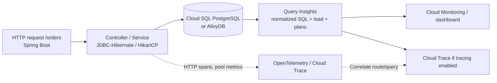
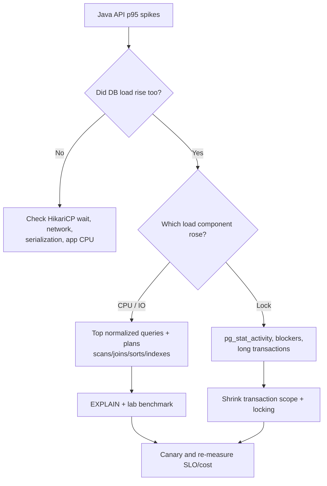
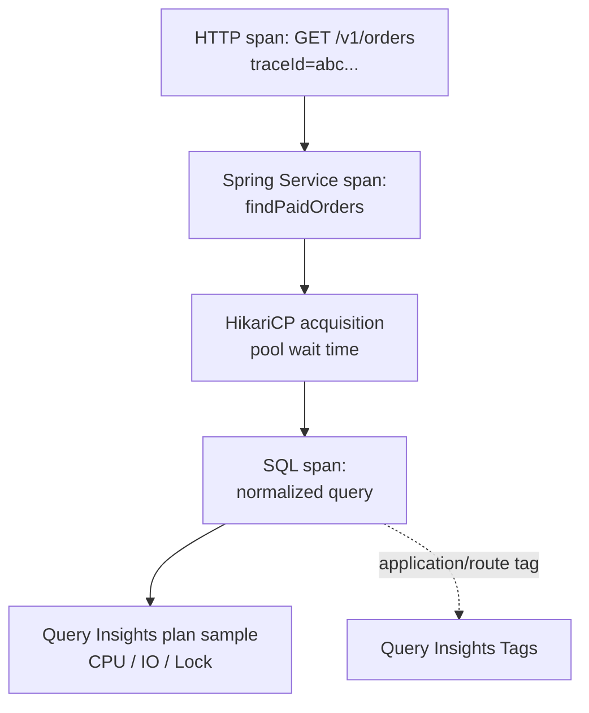

# Query Insights and Query Performance Analysis

## 1. Scenario: Java API Slow Even Though the Database Is Healthy

A **Spring Boot** application running on **Cloud Run/GKE** serves `GET /orders?customerId=17`. After a promotional campaign, **p95 latency** jumps from 120 ms to 900 ms; Cloud SQL remains `RUNNABLE` with no obvious connection errors. The operations team needs to know: which SQL query is driving load, whether it is CPU, I/O, or lock contention, which application route emits it, and whether to add an index or fix application code first?

**Query Insights** is the query observability capability in **Cloud SQL** and **AlloyDB for PostgreSQL**, showing **database load, top normalized queries, latency, wait times, query plans**, and — where supported — **traces, application tags, index recommendations, and active queries**. The tool supplies diagnostic evidence; **it does not rewrite SQL, alter transactions, or guarantee that a new index will speed up every query**.

This lesson belongs to the **Cloud SQL and AlloyDB** chapter in the **CLOUD_PROVIDERS_GCP** module, connecting databases, IAM, networking, Spring Boot/JDBC, reliability, and cost. The SQL examples below target **PostgreSQL / AlloyDB PostgreSQL**; general dashboard workflows also help on Cloud SQL **MySQL** and **SQL Server**, though `EXPLAIN`/`pg_stat_activity` syntax and indexing strategies are **not interchangeable** across engines.

**After this lesson, you will be able to:**

1. Distinguish Query Insights across **Cloud SQL Enterprise/Enterprise Plus** and **AlloyDB standard/advanced**.
2. Read **query load, CPU/IO/Lock Wait, p95/p99 latency, calls, and plans**, and trace back to Java routes.
3. Use **normalized SQL**, `EXPLAIN (ANALYZE, BUFFERS)`, and PostgreSQL stats to validate hypotheses.
4. Optimize **indexes, query shapes, transactions/locks, and connection pools** without guessing in production.
5. Follow a **read-only-first workflow**, validate in a lab, and assess IAM, overhead, retention, and cost.

> **Safety:** This lesson does not create or alter real Cloud SQL/AlloyDB instances. Enabling Query Insights/advanced features, changing sampling settings, or building indexes can require a **restart**, add CPU/RAM/storage load, and affect live transactions. Run mutating commands only on an **authorized lab instance** within a change window; never run `EXPLAIN ANALYZE` on production write statements.

## 2. What Query Insights Measures — and What It Does Not



### 2.1. Normalized Queries and Fingerprints

Statements with the same shape but different parameter literals are grouped together:

```sql
-- Two distinct requests:
SELECT id, status FROM orders WHERE customer_id = 17;
SELECT id, status FROM orders WHERE customer_id = 29;

-- Query Insights shows the normalized form, e.g., PostgreSQL:
SELECT id, status FROM orders WHERE customer_id = $1;
```

This aggregates **execution time and frequency per query shape** without storing every sensitive literal. However, **SQL comments, application tags, and client IPs** can still leak sensitive info: never put tokens, emails, phone numbers, or customer IDs into tags.

### 2.2. Database Load Is Not Request Count

**Database load** is expressed roughly as **Average Active Sessions (AAS)**: total time queries spend using CPU or waiting on resources within a window, divided by the wall-clock duration of that window.

```text
Assume 100 queries/second, each active for 80 ms on average:
   Approximate load = 100 × 0.080 = 8 active sessions.

On a 4-vCPU machine, load 8 does NOT automatically mean CPU usage = 200%.
Inspect CPU & CPU wait, I/O wait, and Lock wait separately.
```

A query waiting 5 seconds on a **lock** generates noticeable DB load with near-zero CPU; a query spawning **parallel workers** can burn more CPU-seconds than client-observed wall time. **Query load, latency, and CPU utilization are three distinct measurements.** Never compare the load line directly against vCPU count while ignoring the wait breakdown.

| Metric | Meaning | Question to Answer |
| --- | --- | --- |
| **Query load / AAS** | Database work and wait intensity over time | When did the DB start overloading? |
| **CPU and CPU wait** | CPU execution plus time waiting for OS scheduler | Are scans/sorts/computations heavy? |
| **IO Wait** | Waiting for storage/buffer reads or writes | Missing indexes, random I/O, or cache misses? |
| **Lock Wait** | Waiting on locks held by another transaction | Long transactions or hot-row contention? |
| **Calls / times called** | Execution count of the statement | N+1 query pattern or traffic spike? |
| **Avg latency / p95 / p99** | Query duration and tail latency (where supported) | A few very slow queries or all queries slow? |
| **Query plan sample** | Sampled scan/join/sort execution steps | Seq Scans, heavy Sorts, or bad row estimates? |

## 3. Capabilities by Product, Edition, and Engine

There is no single "one-size-fits-all Query Insights" dashboard across services. Check **edition, database version, machine type, primary/read pool, region, and enabled features**.

| Capability | **Cloud SQL Enterprise** | **Cloud SQL Enterprise Plus** | **AlloyDB for PostgreSQL** |
| --- | --- | --- | --- |
| Initial state | **Must enable Query Insights** | Must enable; advanced Enterprise Plus features have separate toggles | **Standard Query Insights enabled by default** |
| Dashboard metric retention | **7 days** | **30 days** with advanced Enterprise Plus | Standard **7 days**; advanced Query Insights **30 days** when enabled |
| Query plan sampling | Up to **20 plans/min**, default 5 | Up to **200 plans/min**, default 200 for advanced | Standard up to 20, default 5; advanced configurable separately |
| Wait-event analysis | Not in standard edition | Available when advanced is enabled | Included in standard breakdown; advanced adds deeper analysis |
| Index advisor | Not in standard set | Available when supported features are enabled | Included in **advanced Query Insights** |
| Active queries | Observable when enabled | Observable plus session termination with sufficient permissions | Includes **advanced active queries** |
| App tracing / tags | Yes, depending on tag/tracing toggles | Yes, with richer data | Yes, via `sqlcommenter` and Cloud Trace |

**Cloud SQL:** Query Insights dashboards also exist for **MySQL and SQL Server**, though you must consult **each engine's docs** because supported versions, query plans, restart rules, and edition capabilities differ from PostgreSQL. For PostgreSQL Enterprise Plus, advanced Query Insights features **do not apply to shared-core machine types or read replicas** per documentation — do not assume "30-day retention and index advisor" apply universally to every replica.

**AlloyDB:** Standard Query Insights is always on per docs, with views for both **primary** and **read pools** (read pools can aggregate across nodes). **Advanced Query Insights** adds near-real-time query stats, wait-event drilldowns, active queries, index advisor, and blocked/blocking transaction analysis; it is a distinct feature set, **not simply renamed Cloud SQL Enterprise Plus**. Advanced features carry separate storage/retention footprints and may be restricted on **secondary clusters**.

These figures reflect capabilities at the time of writing and do not replace **release notes** for your running edition and region. Choose tiers based on observability needs, workload, and total database cost — never upgrade an edition solely for one chart if a lighter workflow suffices.

## 4. Before Opening the Dashboard: Permissions and Context

### 4.1. Viewing Permissions vs. Mutating Permissions

For **Cloud SQL Query Insights**, users inspecting historical data typically need **`roles/databaseinsights.viewer`** alongside **`roles/cloudsql.viewer`** on the project containing the instance. For historical Enterprise Plus insights features, docs require those exact two predefined roles; custom roles may not suffice. To view **query plans and end-to-end traces**, enable the **Cloud Trace API** and grant trace read access.

For **AlloyDB**, users need permissions to view instances/Query Insights; viewing traces/plans requires **`cloudtrace.traces.get`** or a role granting it. **Dashboard read access does not grant permission to run SQL, create indexes, or kill sessions.**

### 4.2. Safe Inventory with gcloud

**Read-only** commands — substitute placeholders before running:

```bash
gcloud config set project LAB_PROJECT_ID

# Cloud SQL PostgreSQL:
gcloud sql instances describe CLOUD_SQL_INSTANCE \
  --project=LAB_PROJECT_ID \
  --format="yaml(name,region,databaseVersion,settings.edition,settings.insightsConfig)"

# AlloyDB PostgreSQL:
gcloud alloydb clusters list \
  --project=LAB_PROJECT_ID \
  --region=DB_REGION

gcloud alloydb instances list \
  --project=LAB_PROJECT_ID \
  --region=DB_REGION \
  --cluster=ALLOYDB_CLUSTER
```

**Do not confuse your gcloud context with the application project:** a Java service may run in Project A while Cloud SQL sits in Project B. During an investigation, record the **database instance/cluster, region, database, user, role, UTC window, primary/read pool endpoint, and Java release version**.

## 5. Cloud SQL PostgreSQL: Enabling Query Insights Safely

If Query Insights is already enabled, **do not patch it again**. In Google Cloud Console: **SQL → Instances → select instance → Query Insights**; if disabled, go to **Edit configuration → Query Insights → Enable** and review settings.

Core options include:

- **Query length**: Cloud SQL Enterprise `256–4500 bytes` (default 1024); Enterprise Plus up to `100 KB` (default ~10 KB).
- **Query plan samples/minute**: 0–20 on Enterprise (default 5), up to 200 on Enterprise Plus advanced (default 200).
- **Record application tags / client addresses**: **off** by default on Cloud SQL; enable only under appropriate data governance.
- **Enterprise Plus advanced features**: wait events, index advisor, active queries, and AI-assisted troubleshooting (some in **Preview**); several require explicit opt-in.

**Lab example only when approved:** on a **Cloud SQL PostgreSQL Enterprise test instance** with `cloudsql.instances.update` permission:

```bash
# MODIFIES CONFIGURATION — LAB ONLY, never run in production:
gcloud sql instances patch CLOUD_SQL_INSTANCE \
  --project=LAB_PROJECT_ID \
  --insights-config-query-insights-enabled \
  --insights-config-query-plans-per-minute=5 \
  --insights-config-query-string-length=1024 \
  --insights-config-record-application-tags
```

**Restart risk:** on older PostgreSQL maintenance versions, enabling Enterprise Plus Query Insights / index advisor **triggers a restart**; starting from maintenance version `20250302.00_RC31` and later, many enable/query-length changes no longer require a restart. Never assume **every** change on every version is zero-downtime. Review **effective flags, maintenance version, backups, HA, and service disruption risk** before applying. When enabling Enterprise Plus advanced features, also check **automatic storage increases** requirements.

In Terraform, configuration sits inside `settings.insights_config` on `google_sql_database_instance`. **Illustrative fragment only, not a complete resource**:

```hcl
settings {
  insights_config {
    query_insights_enabled  = true
    query_string_length     = 1024
    query_plans_per_minute  = 5
    record_application_tags = true
    record_client_address   = false
  }
}
```

**Never import or edit Terraform state of a real instance** just to test an example. Infrastructure changes need a reviewed `terraform plan` and backups. Disabling Query Insights later does not immediately purge historical metrics/traces already stored in monitoring systems.

## 6. AlloyDB: Reading Standard Insights Before Enabling Advanced Features

In **Google Cloud Console → AlloyDB for PostgreSQL → Clusters → select cluster/instance → Query insights**, choose **Primary** or **Read pool**, database/user/client address, and time range. **Standard Query Insights is enabled by default**; never run `gcloud sql instances patch` against AlloyDB since it is a **different product and API**.

Standard AlloyDB displays query load, normalized SQL, CPU/IO/lock breakdowns, sampled query plans, and tags/traces when enabled. Data can lag by a few minutes rather than streaming microsecond-by-microsecond. Standard metrics live in **Cloud Monitoring** and traces in **Cloud Trace**; default dashboard retention is roughly one week.

**Advanced Query Insights** adds multi-dimensional query analysis, **wait events, blocked queries, active queries, and index advisor**. It retains dashboard data up to **30 days**, refreshes closer to real time, and consumes additional storage/CPU/RAM depending on settings. Enable only when justified after checking quotas and cost; **do not enable advanced features on a secondary cluster** if unsupported by your version.

To customize, open **Query insights → Edit settings** on the target instance and check **Query plan sampling, Query length, Store application tags/client IP**. **Changing the query-length cap on standard AlloyDB can restart the instance**, and longer limits consume more memory. Collected query comments can contain sensitive details; if enabling **Store query comments** in advanced features, restrict viewer permissions.

## 7. Reading Query Insights: From Overview to Specific SQL

Keep **time windows and filters consistent** throughout an investigation:

1. **Select the right instance and UTC window** spanning the p95 spike; capture pre/post-deploy baselines.
2. Inspect **Database load** against the **CPU capacity** line. Compare CPU/CPU wait, IO wait, and Lock wait.
3. In **Top queries / Tags**, sort by **total time/load** — not just the single slowest individual execution.
4. Inspect **normalized SQL, calls, avg latency, rows returned**, and p95/p99 variance where available.
5. Open **Query plans** and **traces** for affected samples; correlate with app routes/revisions, HikariCP pools, and DB stats.
6. Form a measurable hypothesis, **test in a lab first**, deploy small, and re-measure under comparable load.



### 7.1. Total Time vs. One Slow Query

A query executing **10,000 times × 20 ms ≈ 200 seconds total time** can consume far more resources than one running **1 time × 5 seconds**. Prioritize by **total DB load and SLO impact**, not `max latency` alone. If high call counts come from a **Hibernate N+1 pattern**, fixing fetch/batching strategies often helps more than adding another index.

### 7.2. Do Not Treat a Sampled Query Plan as Every Request's Plan

Query Insights **samples** plans; the optimizer can pick different plans depending on **parameter values, data skew, statistics, caches, and timing**. An older sampled plan does not prove every live request uses that exact plan. Running `EXPLAIN` with representative parameters against **current data and stats** confirms actual behavior.

## 8. PostgreSQL Lab: Spotting Seq Scans and Testing Indexes

This SQL lab uses an **isolated database/schema** strictly on a **test Cloud SQL PostgreSQL or AlloyDB PostgreSQL instance**. Never run it on production, never load real customer data, and never create indexes on live tables. Requires `CREATE` schema/table privileges, query access, and sufficient disk space.

### 8.1. Generate Synthetic Data

Connect with `psql` over **Cloud SQL Auth Proxy** or a properly configured AlloyDB connector/private endpoint; never open a public DB IP just to run the lab. In `psql`:

```sql
CREATE SCHEMA IF NOT EXISTS qi_lab;

CREATE TABLE IF NOT EXISTS qi_lab.orders (
    id BIGSERIAL PRIMARY KEY,
    customer_id BIGINT NOT NULL,
    status TEXT NOT NULL,
    created_at TIMESTAMPTZ NOT NULL,
    total_minor BIGINT NOT NULL CHECK (total_minor >= 0)
);

-- ONLY on an EMPTY lab table, generate synthetic rows:
INSERT INTO qi_lab.orders(customer_id, status, created_at, total_minor)
SELECT
    (n % 1000) + 1,
    CASE WHEN n % 4 = 0 THEN 'PAID' ELSE 'CREATED' END,
    now() - (n * interval '1 second'),
    n * 100
FROM generate_series(1, 100000) AS n;

ANALYZE qi_lab.orders;
```

This `INSERT` generates **100,000 records**; run once on an empty lab table, never on large or production tables. Re-running doubles the dataset and alters query plans.

### 8.2. Query to Analyze

```sql
EXPLAIN (ANALYZE, BUFFERS)
SELECT id, customer_id, status, created_at, total_minor
FROM qi_lab.orders
WHERE customer_id = 17
  AND status = 'PAID'
ORDER BY created_at DESC
LIMIT 20;
```

**`ANALYZE` actually executes the SQL statement**, so use it here only with `SELECT` on synthetic data. Inspect the plan for: `Seq Scan` (scanning many rows), `Sort`, `Rows Removed by Filter`, `Buffers: shared hit/read`, **estimated vs. actual rows**, and `Execution Time`. On tiny datasets or low-selectivity filters, PostgreSQL may **optimally still choose a Seq Scan** — that is not automatically a bug.

### 8.3. Test a Targeted Index

Because the app filters **`status='PAID'`**, looks up by customer, and sorts `created_at DESC`, a **partial composite index** may fit:

```sql
-- Run in lab only, outside a transaction block:
CREATE INDEX CONCURRENTLY IF NOT EXISTS
  idx_qi_orders_paid_customer_created
ON qi_lab.orders (customer_id, created_at DESC)
WHERE status = 'PAID';

ANALYZE qi_lab.orders;

EXPLAIN (ANALYZE, BUFFERS)
SELECT id, customer_id, status, created_at, total_minor
FROM qi_lab.orders
WHERE customer_id = 17
  AND status = 'PAID'
ORDER BY created_at DESC
LIMIT 20;
```

Compare `Execution Time`, blocks read, rows filtered out, and `Index Scan / Bitmap Heap Scan / Seq Scan` before vs. after. The planner is **not forced** to use an index; statistics and selectivity decide. Indexes also add **storage, write amplification, and maintenance cost** and can impact other queries — never blindly create every suggested index without benchmarking.

**`CREATE INDEX CONCURRENTLY`** cannot run inside a transaction block, consumes extra resources, and can leave an invalid index if interrupted. Production rollouts need backups, canarying, lock/IO checks, and change windows. After the lab, if data is no longer needed:

```sql
-- Drop ONLY a verified isolated lab SCHEMA:
DROP SCHEMA qi_lab CASCADE;
```

### 8.4. Correlating Results in Query Insights

Run the query from your Java lab app enough times for it to surface in query stats, then open the dashboard **filtered to the exact database and time window**. Because metrics and plans are sampled, not seeing a query after a couple of calls **does not mean instrumentation is broken**. Capture baseline SQL shapes, calls/latency/load, then compare post-index using the **same dataset and traffic pattern**. Never compare two windows with completely different traffic volumes and credit the index alone.

## 9. Locks, Long Transactions, and Read-Only PostgreSQL SQL

Low CPU combined with **high Lock Wait** usually points to **lock-holding transactions**, not an immediate need for more vCPUs. The queries below read system views only; visibility into other users' query texts/sessions depends on database roles (such as `pg_monitor`), so avoid superuser accounts for apps.

```sql
SELECT pid,
       usename,
       application_name,
       state,
       wait_event_type,
       wait_event,
       now() - xact_start AS transaction_age,
       now() - query_start AS query_age
FROM pg_stat_activity
WHERE pid <> pg_backend_pid()
ORDER BY transaction_age DESC NULLS LAST
LIMIT 30;

-- Observe blocked sessions only; do not terminate sessions:
SELECT pid, pg_blocking_pids(pid) AS blocking_pids,
       wait_event_type, wait_event
FROM pg_stat_activity
WHERE cardinality(pg_blocking_pids(pid)) > 0;
```

If sessions sit in `idle in transaction` for long periods, check whether a Java controller/service holds a transaction open across **network calls, HTTP requests, or external APIs**. Shrink transaction boundaries, add bounded timeouts, and avoid inconsistent lock ordering. **Never run `pg_terminate_backend`, kill queries, or reboot a production instance** without assessing in-flight writes, HA impact, and SLOs.

`pg_stat_statements` can provide PostgreSQL statement statistics (when the extension is enabled and granted), yet it is **distinct from** GCP-managed Query Insights. Never edit `shared_preload_libraries` or restart a production database to enable an extension outside change control.

## 10. Connecting Query Insights to Spring Boot, JDBC, and HikariCP

An HTTP request can be slow **before any SQL reaches the database**: waiting to borrow a connection from HikariCP, Cloud SQL connector retries, network latency, JSON serialization, or thread pool saturation. Optimizing the top SQL query alone may not drop HTTP p95.

### 10.1. Parameterized Queries and Data Mapping

Example **service fragment** using Spring JDBC (not a complete application). Assumes `spring-boot-starter-jdbc`, PostgreSQL JDBC driver, and a datasource pointing to the **lab database**:

```java
package dev.example.orders;

import java.time.Instant;
import java.util.List;
import org.springframework.jdbc.core.JdbcTemplate;
import org.springframework.stereotype.Service;

@Service
public class OrderReadService {
    private final JdbcTemplate jdbc;

    public OrderReadService(JdbcTemplate jdbc) {
        this.jdbc = jdbc;
    }

    public record OrderView(
            long id, String status, Instant createdAt, long totalMinor) {}

    public List<OrderView> findPaidOrders(long customerId) {
        String sql = """
            SELECT id, status, created_at, total_minor
            FROM qi_lab.orders
            WHERE customer_id = ? AND status = 'PAID'
            ORDER BY created_at DESC
            LIMIT 20
            """;

        return jdbc.query(sql,
            (rs, rowNum) -> new OrderView(
                rs.getLong("id"),
                rs.getString("status"),
                rs.getTimestamp("created_at").toInstant(),
                rs.getLong("total_minor")),
            customerId);
    }
}
```

`?` is a **JDBC bind parameter**, preventing string concatenation of `customerId` into SQL. Query Insights displays the **normalized fingerprint**, grouping calls across different customer IDs into one entry. Note this SQL references `qi_lab.orders`, which exists only after running the lab schema setup.

### 10.2. Pool Configuration and Connection Budgeting

Fragment in `application.properties` (lab environment):

```properties
# Tuning example only, not optimal for every system.
spring.datasource.hikari.maximum-pool-size=8
spring.datasource.hikari.connection-timeout=3000
spring.datasource.hikari.minimum-idle=0
```

If Cloud Run scales to **20 instances** with `maximum-pool-size=8`, **potential** Hikari connections hit **160**, excluding monitoring, batch workers, migrations, and other services. Never multiply pool sizes blindly by DB CPU or `max_connections`; size bounds around **actual concurrent in-flight queries, throughput, transaction length, and headroom**.

Watch these metrics together:

- **HTTP server p95/p99** by route and application revision.
- **Hikari active/idle/pending connections**, acquisition wait time, and timeouts.
- **Database connection count, load, waits**, and query calls/latency in Query Insights.
- **Cloud Run/GKE scaling, Cloud SQL connector/Proxy latency**, JVM GC, and CPU.

When Hikari pending climbs while DB load stays flat, the bottleneck is likely **undersized pools, connection leaks, or connections held across non-DB work**, not a missing index. When DB load and query p95 spike together, focus on query plans, locks, and I/O.

## 11. SQL Commenter, Application Tags, and End-to-End Traces

Apps using **Hibernate/JPA** generate SQL from entities/repositories, making it hard to tell which **route/controller** issued a top query. **sqlcommenter** attaches metadata as **SQL comments** for supported ORMs/frameworks. Query Insights groups by **application tags** when enabled and properly formatted.

```sql
-- sqlcommenter syntax illustration; NEVER put customerId into tags:
SELECT id, status
FROM qi_lab.orders
WHERE customer_id = 17
/*application='orders-api',controller='OrderController',route='%2Fv1%2Forders'*/;
```

Literals are normalized for analysis, while tags filter by **application/route/controller**. **Never attach arbitrary high-cardinality tags**: each tag increases cardinality and unused fields are ignored by Query Insights. Commonly supported keys include `application`, `controller`, `action`, `route`, and `framework`.

With **Spring Boot + Hibernate**, auto-generating comments requires **sqlcommenter integration/instrumentation compatible with your version**; Query Insights **does not inject SQL comments simply because you checked Store application tags**. With raw JDBC, you can append compliant comments manually or use observability instrumentation. Test effects on prepared statement caching and driver behavior.

**End-to-end tracing:** traces in **Cloud Trace** link HTTP request → Java service → database query when app and driver/ORM instrumentation propagate trace context. Cloud Trace API and permissions must be enabled; sampled query plans do not guarantee a trace exists for every request. Avoid placing raw **SQL params, PII-bearing URLs, or Authorization headers** into spans. Tracing is a **correlation aid**, not the sole source of truth.



**Common pitfall:** a 900 ms request p95 may break down into **700 ms waiting for a Hikari connection + 50 ms SQL + 150 ms JSON/HTTP**. Query Insights sees only the database portion; cutting SQL from 50 ms to 20 ms leaves the request mostly slow.

## 12. Index Advisor, Query Plans, and Choosing Optimizations

**Cloud SQL Enterprise Plus** includes **Index Advisor** in Query Insights when enabled; **AlloyDB advanced Query Insights** provides recommendations as well. A `CREATE INDEX` suggestion is a **candidate to evaluate**, not a mandatory command.

Before adding an index, check:

1. **Query fingerprint** and its share of load/calls during the target window.
2. **Current plan**, estimated vs. actual rows, filter selectivity, and buffer reads.
3. **Column cardinality** and `customerId/status` skew, especially multi-tenant skew.
4. Whether a **composite/partial/covering index** or a **query rewrite/pagination fix** fits better.
5. **Storage, write, and replication overhead**, impact on OLTP writes, and index build time.
6. **Canary benchmark** measuring app p95/p99 and other queries post-change.

| Signal | Priority Action | Why |
| --- | --- | --- |
| Seq Scan filtering out most rows on large table | Test an index matching predicates and `ORDER BY` | Cuts scanned blocks |
| Hibernate N+1, high calls per request | Fix fetch strategy, batching, DTO projections | Eliminates round trips, not just single-SQL time |
| Heavy sort/hash memory usage | Add supporting index, limit rows, check `work_mem` | Prevents RAM pressure and disk spills |
| High Lock Wait | Shrink transactions, fix lock order, audit blockers | Adding indexes rarely removes lock contention |
| High CPU and I/O from unneeded queries | Caching, keyset pagination, avoid `SELECT *` | Reduces total work performed |
| High DB connections | Fix pools/leaks; evaluate pooling | Cuts session pressure and context switching |
| Read pool/replica loaded separately | Analyze primary and read pools independently | Primary load does not guarantee healthy read replicas |

**Changing query shape often intersects with correctness:** avoid caching strongly consistent data or using unstable offset pagination when ordering mutates. Run regression tests with realistic data skew rather than uniform lab distributions.

## 13. Specifics for MySQL, SQL Server, and AlloyDB

**Cloud SQL for MySQL** provides Query Insights, yet plan interpretation must use **MySQL** tools such as `EXPLAIN`/`EXPLAIN ANALYZE` (where supported), `performance_schema`, and MySQL settings. MySQL `max_digest_length` can affect query text truncation on Enterprise; **never run `pg_stat_activity` or `CREATE INDEX CONCURRENTLY`**, which are PostgreSQL-only.

**Cloud SQL for SQL Server** offers Query Insights paired with SQL Server execution plans/DMVs and **Query Store** per permissions/edition. Wait types, parameter sniffing, plan caches, and index maintenance carry SQL Server semantics — never apply PostgreSQL `EXPLAIN` to T-SQL. Check Active Queries access, index recommendations, and Enterprise Plus limits on the **SQL Server documentation page**.

**AlloyDB for PostgreSQL** shares familiar PostgreSQL syntax yet has a distinct optimizer/storage engine and **primary/read pool/secondary cluster** topology. When analyzing load, select the exact instance; standard Query Insights can aggregate load across **multiple read pool nodes**. Advanced features like blocking analysis and index advisor still require proper settings and permissions; **never assume metrics on a secondary cluster match primary completeness**.

## 14. Production Incident Workflow and Alerting

### 14.1. Runbook from SLO to Database Root Cause

| Symptom | Check First | Optimization Direction |
| --- | --- | --- |
| High HTTP p95, flat DB load | Hikari pending, JVM GC, network, Cloud SQL connector | Fix pool/app/network first |
| DB CPU load exceeds baseline | Top normalized queries, calls, CPU/CPU wait, plans | Rewrite, index, eliminate N+1 |
| High DB IO Wait | Plans, buffer misses, large scans, storage metrics | Indexing, scan reduction, caching |
| Sharp Lock Wait spike | `pg_stat_activity`, blocking PIDs, transaction durations | Shrink transactions / cut contention |
| Calls surge while per-query latency holds | Traffic spike or app deploy introducing N+1 | Cap calls/request, batch queries |
| Per-query latency jumps while calls hold | Plan regression, stale stats, skew, locks | Compare plans, `ANALYZE`, targeted fixes |
| Query Insights empty | Feature disabled, missing IAM, wrong region/instance, filters, sampling | Check config, dashboard/trace permissions |
| DB restarted after config change | Maintenance version/config apply/restart rule | Roll back per change record, check HA/backups |
| New index slows INSERT/UPDATE | Write amplification, lock/storage pressure | Audit redundant indexes; drop safely if needed |
| Client IP/tags missing | Tracking disabled, pool proxy, malformed SQL comments | Verify tracking flags, client path/sqlcommenter |

### 14.2. Separate Observation from Risky Mutations

1. **Read-only:** capture Query Insights dashboards, top queries/tags, p95, resource metrics, logs, and deploy timelines.
2. **Validate hypotheses:** reproduce SQL plans on a **snapshot/lab**; for locks, pinpoint the exact blocker and owner.
3. **Canary fix:** test a targeted index or small Java fix; measure **before/after** under equivalent traffic.
4. **Rollback:** have an approved DDL rollback ready; consider `DROP INDEX CONCURRENTLY` only for team-owned indexes after dependency checks.
5. **Postmortem:** record fingerprint, plan, emitting app, timeline, root cause, and preventive actions.

Never terminate queries or transactions from Query Insights **without evaluating active writes, lock dependencies, and user impact**. A red CPU chart alone never justifies upgrading editions, resizing instances, or restarting a database.

### 14.3. Alert on SLOs Rather Than Arbitrary Thresholds

Example app requirement: **99% of `GET /orders` under 500 ms over 30 days**, error rate below **0.5%**. Combine alerts across:

- **Spring Boot / Cloud Run p95/p99**, error rates, and thread/pool saturation.
- **Cloud SQL / AlloyDB CPU/storage/connections**, database load, and supported wait-event breakdowns.
- **Query latency/calls/load** for top fingerprints, Cloud SQL error logs, and read replica lag if used.

Not all Query Insights dashboard metrics share identical APIs, resource types, or retention: inspect metric availability and labels in Cloud Monitoring **Metrics Explorer** before writing alert policies. Some advanced stats live inside the database/Query Insights rather than mapping 1:1 to Cloud Monitoring time series.

## 15. IAM, Security, Retention, and Cost

### 15.1. Protecting Telemetry

Query Insights **normalizes literals**, and plan traces omit constant values by design; yet **normalized query shapes, table/column names, application tags, client IPs, SQL comments, and log/trace entries** can still expose sensitive context. Grant Viewer/Cloud Trace permissions on a need-to-know basis, and never embed customer data in `application` or `route` tags. On Cloud SQL, **Record client IP/tags** is off by default; assess privacy before enabling. AlloyDB has different tracking defaults and scopes — verify effective instance settings.

**Separate IAM from PostgreSQL grants:** a Cloud SQL Viewer cannot automatically `SELECT` tables, and PostgreSQL's `pg_monitor` role does not grant Google Cloud Console or Cloud Trace access. Java runtime SAs need only DB connectivity and domain SQL privileges — never `cloudsql.admin` or `alloydb.admin` just to run SQL.

### 15.2. Storage and Overhead

- **Cloud SQL Query Insights** carries no separate per-feature charge on Enterprise/Enterprise Plus per docs, yet **edition/instance tier**, Monitoring/Trace APIs, logging, and **storage for advanced metrics** can affect your bill. Enterprise standard metrics are stored in Cloud Monitoring; Enterprise Plus advanced features require **automatic storage increases** when enabled.
- **AlloyDB standard Query Insights** has no separate feature fee per product pages, writing metrics to Cloud Monitoring and traces to Cloud Trace. **Advanced Query Insights** retains data longer and can consume extra AlloyDB storage; measure and budget for your retention settings.
- **Long query strings, high sampling rates, and tag/IP tracking** increase memory, CPU, data volume, cardinality, and exposure risk. Enable only what you need and benchmark before/after.
- **Additional indexes** consume storage, write I/O, and replication/backup bandwidth, which can outweigh CPU savings on write-heavy workloads.

Illustrative math **not a pricing sheet**:

```text
100 queries/sec × 0.080 sec active/query = load 8.
If optimizing the query cuts it to 0.030 sec at the same traffic:
  new theoretical load ≈ 100 × 0.030 = 3.

This compares query capacity, not an immediate cloud bill drop:
the Cloud SQL/AlloyDB instance remains provisioned at its chosen shape.
```

**Database spend may remain unchanged** immediately after tuning because instance resources are provisioned upfront. The real financial win is **deferring instance upgrades**, cutting timeouts/SLO breaches, or handling more traffic before scaling out. Verify via **Cloud Billing reports, budgets, and instance metrics** rather than inferring cost directly from load graphs.

## 16. Exercises and Evaluation Criteria

### Exercise A — Reading Database Load

A system handles **100 queries/s with an 80 ms average active duration on 4 vCPUs**. Compute theoretical query load **8**. Explain why this does not prove 200% CPU usage and why **CPU/IO/Lock Wait** must be checked to diagnose the cause.

### Exercise B — Choosing the Right Edition

A team on **Cloud SQL PostgreSQL Enterprise** wants 30-day metric retention, wait-event drilldowns, and index recommendations. Which features require **Enterprise Plus advanced**? Compare against an **AlloyDB standard** instance and list risks of enabling advanced insights on primaries vs. secondaries.

### Exercise C — SQL Optimization in the Lab

Create `qi_lab.orders` from Section 8 and run `EXPLAIN (ANALYZE, BUFFERS)` for the query filtering `customer_id` and `status`. Build a **partial composite index** in the lab and rerun the same query. Report **plan, buffers, execution time, and differences**, even if the planner still picks a Seq Scan. Explain why indexes add write and disk cost.

### Exercise D — N+1 Queries from Spring Boot

An API runs one query to fetch orders followed by **50 queries fetching customer names** per request. Query Insights shows the normalized customer query's calls spiking even though each call takes only 3 ms. Design a **join/batch-fetch/projection** fix and measure calls/request and latency. Explain when an index is still needed vs. when fixing N+1 suffices.

### Exercise E — Lock Wait and Transactions

`Lock Wait` is high while CPU is low; `pg_stat_activity` shows sessions `idle in transaction` for 3 minutes. List **read-only** steps to locate the blocker, then propose shrinking `@Transactional` scope, removing external API calls inside transactions, and safely rolling out the fix. Why shouldn't you kill queries immediately?

### Exercise F — Permissions, Tags, and Sensitive Data

A team wants to embed `customerEmail` inside SQL comments to trace slow requests. Explain the risks, replace it with low-cardinality `application/controller/route` tags, and design `roles/databaseinsights.viewer` + `roles/cloudsql.viewer` plus Cloud Trace read access. Note the privacy impact if **record client IP** is enabled.

### Checklist Before Declaring Resolved

- [ ] Identified the exact instance, region, engine, edition, and **primary/read pool**.
- [ ] Remembered **Cloud SQL Query Insights must be enabled**, while **AlloyDB standard is on by default**.
- [ ] Understood normalized queries, query load, CPU/IO/Lock Wait, and calls/p95.
- [ ] Did not equate HTTP p95 directly with SQL latency; checked HikariCP/Java/networking.
- [ ] Gathered query plan/`EXPLAIN` evidence rather than optimizing by guesswork.
- [ ] Tested indexes/SQL rewrites in a lab, checking write/disk cost and canary metrics.
- [ ] Separated dashboard/Cloud Trace IAM from PostgreSQL database privileges.
- [ ] Excluded SQL constants, tokens, emails, and private PII from tags.
- [ ] Captured baselines, SLO criteria, rollback plans, and runbooks avoiding impulsive kills/restarts.
- [ ] Accounted for edition costs, metric retention, advanced storage, and workload shifts.

**Conclusion:** Query Insights pinpoints **which query shapes, from which applications, at what times, and on which resources** drive load on Cloud SQL or AlloyDB. For Java on Google Cloud, reliable performance tuning links **HTTP SLO → query load/waits → SQL plan → Java/HikariCP → lab testing and canarying** — never equating "slow query" with "just add an index or more CPU."

## 17. Official Google Cloud and PostgreSQL References

- [Cloud SQL for PostgreSQL — Using Query Insights](https://cloud.google.com/sql/docs/postgres/using-query-insights)
- [Cloud SQL for PostgreSQL — Index Advisor](https://cloud.google.com/sql/docs/postgres/use-index-advisor)
- [Cloud SQL for PostgreSQL — Monitor active queries](https://cloud.google.com/sql/docs/postgres/monitor-active-queries)
- [Cloud SQL for MySQL — Using Query Insights](https://cloud.google.com/sql/docs/mysql/using-query-insights)
- [Cloud SQL for SQL Server — Using Query Insights](https://cloud.google.com/sql/docs/sqlserver/using-query-insights)
- [AlloyDB — About Query Insights](https://cloud.google.com/alloydb/docs/query-insights-overview)
- [AlloyDB — Improve Query Performance with Query Insights](https://cloud.google.com/alloydb/docs/using-query-insights)
- [AlloyDB — Advanced Query Insights overview](https://cloud.google.com/alloydb/docs/advanced-query-insights-overview)
- [AlloyDB — Advanced Query Insights usage](https://cloud.google.com/alloydb/docs/using-advanced-query-insights)
- [gcloud sql instances patch — Insights flags](https://cloud.google.com/sdk/gcloud/reference/sql/instances/patch)
- [Cloud SQL pricing](https://cloud.google.com/sql/pricing)
- [AlloyDB pricing](https://cloud.google.com/alloydb/pricing)
- [PostgreSQL — EXPLAIN](https://www.postgresql.org/docs/current/sql-explain.html)
- [PostgreSQL — Monitoring database activity](https://www.postgresql.org/docs/current/monitoring-stats.html)
