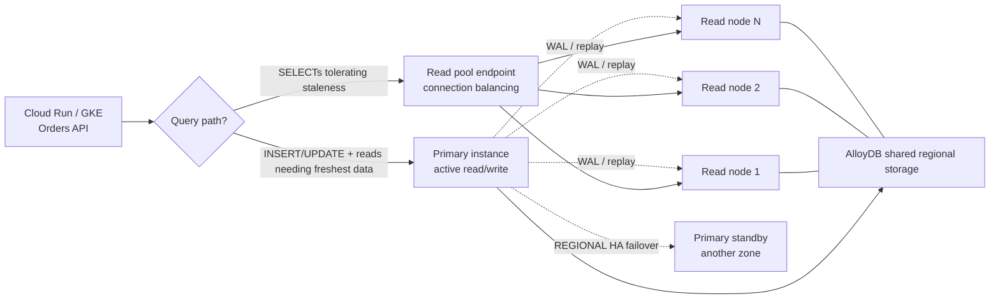
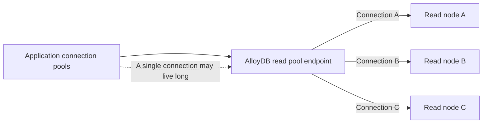
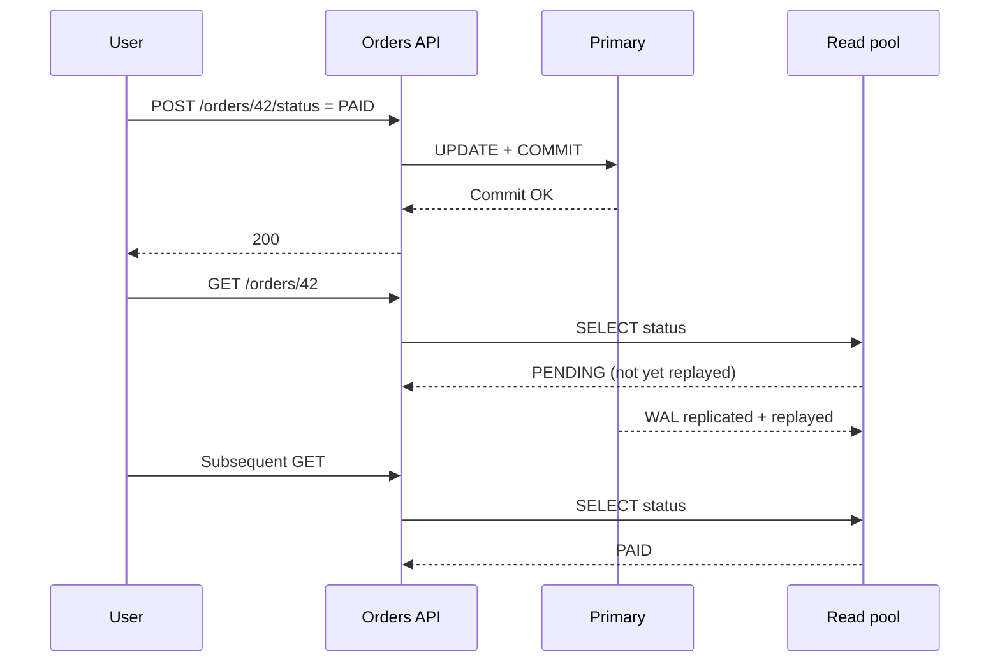

# AlloyDB Clusters, Primary Instances, and Read Pools

An ordering application might generate a few dozen write transactions per second alongside thousands of read queries: product lookups, order history, reports, and dashboards. When every query hits a single PostgreSQL server, CPU, memory, and connections on the write path face heavy contention. **AlloyDB for PostgreSQL** decouples compute from storage, organizes resources under a **cluster**, and provides a **primary instance** for reads/writes plus **read pool instances** to scale read queries.

This lesson belongs to the **Cloud SQL and AlloyDB** chapter of the `CLOUD_PROVIDERS_GCP` module. The goal is to design an appropriate database architecture for Cloud Run/GKE/Compute Engine, connect securely via IAM and VPC, preserve business consistency, monitor performance, and control cost. A read pool does not automatically make writes faster, is not a backup, and does not guarantee every `SELECT` immediately sees a just-committed transaction.

> **Warning:** Commands that create clusters, primaries, or read pools, change node counts, or delete resources modify Google Cloud and **can incur significant charges**. Examples use hypothetical projects/instances intended for an authorized sandbox. Run only after verifying project, region, IAM permissions, networking, budget, and owner. Never delete clusters holding real data.

## 1. Objectives and Expected Outcomes

After this lesson, you will be able to:

1. Explain the **cluster → primary instance → read pool instance → read nodes** hierarchy, and distinguish it from Cloud SQL read replicas and HA standbys.
2. Describe **storage/compute separation**, read-replica WAL replay, and **read-after-write** boundaries.
3. Choose between a **REGIONAL** or **ZONAL** primary, and size node counts and machine types for read pools based on availability needs.
4. Understand the **primary endpoint** vs. the **read pool endpoint**, and why you never connect directly to an arbitrary individual node.
5. Inspect resources with `gcloud`, provision an appropriate lab environment, and access the database over secured connections.
6. Route **writes + reads requiring fresh data** to the primary, and **lag-tolerant reads** to the read pool.
7. Scale read pools via **node count / autoscaler**, monitoring CPU, connections, p95 latency, and replication lag.
8. Decide between AlloyDB, Cloud SQL, and analytics options based on SLO and cost.

## 2. AlloyDB Architecture: Clusters, Primaries, and Read Pools



This diagram illustrates **logical roles**: AlloyDB uses shared regional storage along with log shipping/replay so read nodes serve query results. Do not assume each read node maintains an independent full storage copy or that every committed transaction becomes visible instantaneously on every node.

| Component | Role | What Must Not Be Assumed |
| --- | --- | --- |
| **Cluster** | Regional resource boundary; owns database version, storage, networking, backups/PITR, and instances. | That a cluster is just one VM or one IP. |
| **Primary instance** | Compute for read/write transactions and coordinating writes. Each active primary cluster has one primary. | Adding read pool nodes increases the primary's write throughput. |
| **Primary standby** (REGIONAL) | Standby node in another zone for HA failover. | That applications can query the standby as a read endpoint. |
| **Read pool instance** | Group of one or more homogeneous **read nodes** behind a dedicated read endpoint. | That it balances every individual SQL statement by lowest node lag. |
| **Read node** | Compute receiving/replaying changes and serving read-only queries. | That a node keeps a permanent IP/identity safe for long-term app pinning. |
| **Backup/PITR** | Restores data after accidental deletes, logic bugs, or other incidents per config. | That HA or read pools replace backups. |

### 2.1. What Does Separating Compute and Storage Achieve?

In a traditional single-host PostgreSQL setup, SQL execution and storage live on the same infrastructure. AlloyDB lets you scale **primary/read pool compute** relatively independently of **cluster storage**. When more `SELECT` capacity is needed, you add read nodes without standing up a full separate storage copy as in many traditional replication setups.

Even with shared storage, **WAL flush/replay and caches on read nodes** still introduce lag. A read pool does not provide synchronous primary-grade consistency for every query.

### 2.2. Clusters, Instances, Nodes: How Costs Add Up

An example with **1 cluster**, **1 REGIONAL primary**, and **1 read pool of 3 nodes**:

- The **REGIONAL primary** includes active and standby nodes to recover from zone/node failures.
- The read pool holds **3 read nodes** behind one **read pool endpoint**.
- **Storage** belongs to the cluster; primary and read pool compute are billed per provisioned capacity and pricing rates.
- Never count the primary standby node as a "reporting read replica"; it is strictly HA failover capacity.

Read pools can use a different machine series than the primary where supported; however, **all nodes inside the same read pool instance share one machine type**. If reporting workloads need a different shape than API traffic, create a second read pool to isolate workloads rather than forcing all queries to compete for the same resources.

## 3. Primary Instances: ZONAL vs. REGIONAL

### 3.1. The Primary Is the Cluster's Write Path

Applications send `INSERT`, `UPDATE`, `DELETE`, DDL, and write transactions to the **primary instance endpoint**. The primary also serves `SELECT`s; any `SELECT` that must see just-committed data or drives business-critical decisions on live state should target the primary.

| Availability | Architecture | When to Consider |
| --- | --- | --- |
| **ZONAL** | Single primary node in one zone; no automated HA failover to a standby. | Sandboxes/testing where interruptions are acceptable. |
| **REGIONAL** | Active and standby across different zones with service-managed automated failover. | Production workloads needing minimal disruption on node/zone failure. |

A REGIONAL primary is usually the right production default. However, **HA does not equal zero downtime**: connections can drop during failover or maintenance; applications must reconnect, retry transactions **using idempotency**, and maintain connection pool health checks.

### 3.2. A Primary Is Not Cross-Region DR

REGIONAL HA protects against certain **intra-region** failures. If DR is required when an **entire region** fails, design a **secondary cluster/cross-region replication, recovery procedure, backups/PITR, and DNS/app failover** matching your org's RTO/RPO. An **in-region read pool** never replaces a secondary cluster.

### 3.3. Inspecting Primary Status

```bash
PROJECT_ID="orders-lab"
REGION="asia-southeast1"
CLUSTER="orders-alloydb-lab"
PRIMARY="orders-primary"

# READ-ONLY: verify project, clusters, and instances.
gcloud auth list
gcloud config get-value project
gcloud alloydb clusters list \
  --project="$PROJECT_ID" --region="$REGION"
gcloud alloydb instances list \
  --project="$PROJECT_ID" --region="$REGION" --cluster="$CLUSTER"
gcloud alloydb instances describe "$PRIMARY" \
  --project="$PROJECT_ID" --region="$REGION" --cluster="$CLUSTER" \
  --format=yaml
```

Inspect instance type, machine config, availability, IP addresses, state, and labels; check owner and maintenance windows before making changes. `gcloud` manages **infrastructure**, while PostgreSQL roles and data permissions must be managed separately inside the DB.

## 4. Read Pools: Scaling Reads Through an Instance Endpoint

### 4.1. One Pool with Multiple Nodes

A read pool instance serves `SELECT` queries via the **instance endpoint**. AlloyDB distributes **database connections** across nodes in the pool; it does not route **every individual SQL statement** to the "least-lagged" node.



When you increase node count, **existing open connections stay pinned to their current nodes**; if app pools hold connections indefinitely, new nodes may receive little load. Tune connection max lifetimes, rotate connections safely, and observe per-node CPU and active connection distribution after scaling out.

**Never use individual read node IPs** in application config. Nodes are ephemeral and replaced during scaling and maintenance. Always target the stable **read pool instance IP** or the DNS/connection target appropriate for your connectivity method.

### 4.2. Node Count and Availability

| Read Pool | Availability | Trade-off |
| --- | --- | --- |
| **1 node** | Single-node read path, zonal scope. | Lower cost, but a single node failure disrupts reads. |
| **2 or more nodes** | Nodes distributed across multiple zones per supported config. | Higher capacity and resilience, at additional compute cost. |
| **Multiple read pools** | Each pool gets its own endpoint, machine type, and node count. | Isolates reporting/API/analytics, requiring multiple connection targets. |

Per current documentation, a read pool supports **1–20 nodes** per instance and **no more than 20 read nodes total across all read pool instances in one cluster**. These are product limits, not a recommendation to start high. Verify regional availability, quotas, and machine series before capacity planning.

### 4.3. Read Pools Reject Writes

Read pool queries are optimized for read workloads; statements attempting data mutations over a read-only connection fail. While this isolates reads from accidental writes, **it does not replace SQL authorization**. You still need least-privilege DB roles scoped by schema/table, IAM, and network controls to protect data.

### 4.4. How Do Read Pools Differ from Cloud SQL Read Replicas?

| Criterion | **Cloud SQL Read Replica** | **AlloyDB Read Pool** |
| --- | --- | --- |
| Resource model | Each replica is a read-only instance with its own endpoint. | One read pool instance containing multiple read nodes. |
| Read routing | App/proxy usually picks among replica endpoints; Cloud SQL Enterprise Plus read pools are a separate feature. | One pool endpoint distributes connections across read nodes. |
| Storage | Storage/replication per Cloud SQL engine and edition. | Separated compute/storage in AlloyDB with WAL replay on read nodes. |
| Scale-out | Add replicas and manage endpoints; Enterprise Plus adds read pool support. | Raise node count or enable read pool autoscaling. |
| When to consider | Already on Cloud SQL and need one or a few traditional replicas. | PostgreSQL workloads needing pooled reads, HA, and deep compute scaling. |

Never switch to AlloyDB solely because you have many readers: if Cloud SQL meets your SLO, cost, and feature needs, migrating may offer no net gain. AlloyDB is **PostgreSQL-compatible** — check extensions, flags, SQL behavior, and permission models before replacing an active system.

## 5. Replication Lag and Read-After-Write

A write committed on the primary may **not yet be replayed** on read nodes. Therefore:



**Replication lag** can climb during write bursts, heavy WAL generation, long transactions, expensive queries, CPU/memory pressure, or replay conflicts. AlloyDB tracks both WAL flush/delivery and **replay lag**; shared storage **does not eliminate the need for replay**.

### 5.1. Designing Read Routing Around Consistency

| Query | Route | Rationale |
| --- | --- | --- |
| `INSERT/UPDATE/DELETE`, write transactions | **Primary** | Read pools are read-only. |
| Inventory checks, payment status right after commit | **Primary** | Requires read-your-writes consistency. |
| Product catalog, dashboards with multi-second stale SLA | **Read pool** | Offloads `SELECT` pressure from primary. |
| Long reports, analytics | **Dedicated read pool**, or BigQuery depending on scale | Prevents CPU contention with OLTP queries. |
| Read pool lagging or unavailable | Per **fallback policy**, rate limits, and circuit breakers | Never dump unbounded read traffic onto the primary and break writes. |

To guarantee **read-your-writes**, the simplest pattern is querying the primary immediately after a write transaction, or tracking watermarks/LSNs and reading from the pool only once caught up. Never assume `lag=0` at one sample point means stale reads cannot happen later.

### 5.2. SQL Example Distinguishing Primary vs. Read Node

Connect to each endpoint in **separate** `psql` sessions using authorized auth/networking:

```sql
-- Run on PRIMARY or READ POOL to inspect node state.
SELECT pg_is_in_recovery() AS is_read_node;
SHOW transaction_read_only;
SELECT current_database(), current_user;
```

Normally on a primary `pg_is_in_recovery() = false`; on a read node it reflects recovery/read-only state. `SHOW transaction_read_only` checks whether the session is forced read-only. **Never treat a single SQL check as proof that all app routing is right**, as user roles and session flags also affect permissions.

### 5.3. Testing Fresh vs. Stale Reads

```sql
-- MODIFIES DATA: run ONLY on sandbox PRIMARY.
CREATE TABLE IF NOT EXISTS demo_orders (
    order_id text PRIMARY KEY,
    state text NOT NULL,
    updated_at timestamptz NOT NULL DEFAULT now()
);
INSERT INTO demo_orders (order_id, state)
VALUES ('ord-42', 'PAID')
ON CONFLICT (order_id)
DO UPDATE SET state = EXCLUDED.state, updated_at = now();

-- ON READ POOL: open a separate session to read.
SELECT order_id, state, updated_at
FROM demo_orders WHERE order_id = 'ord-42';
```

If the update is not visible immediately, record the **commit timestamp, query output, and replication lag**. Queries may briefly observe prior state; if lag persists, inspect replay state, workload, and resource metrics. Never declare a pool broken from a single read milliseconds after commit.

## 6. Lab: Preparing a Cluster, Primary, and Read Pool

This is a **deployable workflow** for a sandbox with billing, IAM, and VPC ready. If your org already provides an AlloyDB test cluster, **skip creating the cluster/primary** and stick to read-only inspection or creating a read pool if permitted by the owner.

### 6.1. Prerequisites

| Requirement | What to Verify |
| --- | --- |
| **Project/region** | AlloyDB API enabled, region supports chosen machine type, sufficient quota and budget. |
| **VPC** | **Private Services Access** configured for AlloyDB, or **Private Service Connect** via its separate workflow. |
| **Creation permissions** | Authorized principal, e.g., permissions from `roles/alloydb.admin` and network usage rights. |
| **App permissions** | Dedicated service account, separate DB roles, valid network path/connector. |
| **Data** | Sandbox holds zero real user data, with an assigned owner and cleanup plan. |

This example uses **Private Services Access (PSA)**, not PSC. Ensure the VPC and Private Services Access connection exist **before** creating the cluster. Never create networks, allocate CIDRs, or modify peerings without network admin authorization.

```bash
PROJECT_ID="orders-lab"
REGION="asia-southeast1"
NETWORK="orders-vpc"
CLUSTER="orders-alloydb-lab"
PRIMARY="orders-primary"
READ_POOL="orders-read-pool"

# Read-only: project, VPC, clusters.
gcloud config get-value project
gcloud compute networks describe "$NETWORK" \
  --project="$PROJECT_ID" \
  --format="yaml(name,selfLink)"
gcloud alloydb clusters list \
  --project="$PROJECT_ID" --region="$REGION"
```

**Note:** seeing the VPC via `describe` **does not prove Private Services Access is ready**; confirm the Service Networking connection and reserved IP range using your platform team's network checks.

### 6.2. Creating a Cluster in the Console (Preferred for Labs)

In **Google Cloud Console → AlloyDB → Clusters → Create cluster**:

1. Select your sandbox project, choosing **Production single-zone** for labs or **multi-zone** if testing HA with budget approval.
2. Choose **region**, an app-supported PostgreSQL version, and cluster ID `orders-alloydb-lab`.
3. Select Private Services Access on the preconfigured `orders-vpc`; if using PSC, choose that connectivity model upfront and prepare allowed projects/endpoints.
4. Set the admin password securely via the UI, and pick backups/PITR and encryption per policy — never save passwords in docs or Git.
5. Pick an appropriate primary machine type and record the **primary instance ID, availability, region, and IP/connection target**.
6. Review cost estimates and create; wait for the operation to finish before adding a read pool.

Cluster creation via CLI is also possible, yet `--password` can leak via **shell history, process arguments, and logs** if mishandled; hence this lab prefers the UI for initial credentials. For automation, use Terraform/IaC with organizational secret management rather than hardcoding passwords in files or commands.

### 6.3. CLI to Create a Primary on an Existing Cluster (Optional)

**Run only if the cluster already exists without a primary**, creation is approved, and you did not just create the primary in the UI:

```bash
# INFRASTRUCTURE CHANGE + BILLABLE.
# REGIONAL = primary with active/standby across multiple zones.
gcloud alloydb instances create "$PRIMARY" \
  --project="$PROJECT_ID" \
  --region="$REGION" \
  --cluster="$CLUSTER" \
  --instance-type=PRIMARY \
  --availability-type=REGIONAL \
  --machine-type=n2-highmem-4

# READ-ONLY: verify instance and state.
gcloud alloydb instances describe "$PRIMARY" \
  --project="$PROJECT_ID" --region="$REGION" --cluster="$CLUSTER" \
  --format=yaml
```

If the cluster already has a primary, **never create a second primary**. For sandboxes not needing HA, use `--availability-type=ZONAL`; production must weigh RTO/RPO, region, and SLO first. The machine type shown is illustrative and must be supported by your region and org policy.

### 6.4. Creating a 2-Node Read Pool

```bash
# INFRASTRUCTURE CHANGE + BILLABLE.
gcloud alloydb instances create "$READ_POOL" \
  --project="$PROJECT_ID" \
  --region="$REGION" \
  --cluster="$CLUSTER" \
  --instance-type=READ_POOL \
  --read-pool-node-count=2 \
  --machine-type=n2-highmem-4

# READ-ONLY: verify node count, endpoint, and state.
gcloud alloydb instances list \
  --project="$PROJECT_ID" --region="$REGION" --cluster="$CLUSTER"
gcloud alloydb instances describe "$READ_POOL" \
  --project="$PROJECT_ID" --region="$REGION" --cluster="$CLUSTER" \
  --format=yaml
```

**Do not copy these flags verbatim for PSC:** when a cluster uses Private Service Connect, you need **`--allowed-psc-projects`** and PSC endpoints/DNS for clients, not just a VPC name. Never turn on public IP and `0.0.0.0/0` just for quick testing.

Once created, applications target the **read pool instance endpoint**, never individual nodes. A two-node pool delivers better availability and read spread than a single node, yet **still has replication lag** and does not boost primary write throughput.

## 7. Connecting Applications Securely

### 7.1. Choosing the Network Method

| Connection Method | Best Fit | Prerequisites |
| --- | --- | --- |
| **Private Services Access (PSA)** | GKE/VMs/Cloud Run with reachability into the prepared private VPC. | VPC networking, peering/PSA, firewalls, and valid DNS. |
| **Private Service Connect (PSC)** | Multi-VPC/multi-project topologies where direct peering doesn't fit. | PSC-enabled cluster, allowed projects, endpoints, and DNS. |
| **AlloyDB Auth Proxy / Language Connectors** | Need automatic mTLS, IAM auth, and cert rotation. | Authorized IAM principal, **plus a working network path** to the instance. |
| **Public IP** | Special security-approved external cases. | Use Auth Proxy/connectors, IAM, and source allowlists; avoid wide exposure. |

**Proxies are not VPNs:** AlloyDB Auth Proxy and Language Connectors handle auth/mTLS, not private VPC routing. For Cloud Run over private IP, configure **Direct VPC egress** or a Serverless VPC Access connector matching your topology; for GKE/Compute Engine, verify VPC routing and IAM.

### 7.2. IAM Is Separate from PostgreSQL Privileges

To use Auth Proxy, the principal typically needs `roles/alloydb.client` and `roles/serviceusage.serviceUsageConsumer` per docs, alongside network reachability. Yet PostgreSQL still enforces **database authentication/roles**; `roles/alloydb.admin` does not grant `SELECT/UPDATE` across every table automatically.

Recommendations:

- Give each workload its own **service account**; avoid baking long-lived JSON keys into images.
- Separate read/write and read-only **DB roles**; never run apps as `postgres`.
- For read-only workloads, grant `SELECT` only on needed tables/schemas and point to the read pool endpoint.
- On Cloud Run/GKE, use Workload Identity/attached SAs and Secret Manager per policy; never log passwords to Git or stdout.
- Bound concurrent DB connections and test automatic reconnects after maintenance/failover.

### 7.3. Interactive Connection via gcloud beta

From a machine **permitted to reach the instance's network**, with `psql` and valid permissions:

```bash
# May require gcloud beta and psql installed.
# Opens a DB session; does not mutate schema if you only run SELECT.
gcloud beta alloydb connect "$PRIMARY" \
  --project="$PROJECT_ID" \
  --region="$REGION" \
  --cluster="$CLUSTER" \
  --user=postgres

# Second terminal / separate session to the read pool:
gcloud beta alloydb connect "$READ_POOL" \
  --project="$PROJECT_ID" \
  --region="$REGION" \
  --cluster="$CLUSTER" \
  --user=postgres
```

The beta CLI wraps AlloyDB Auth Proxy and `psql`. **Cloud Shell cannot reach a PSA private IP directly** because it sits outside your VPC. Run from an authorized VM/bastion inside the VPC or another approved path; if using PSC/public IP, use the designed flags and networking rather than opening firewalls arbitrarily.

### 7.4. Auth Proxy for Apps Using Two Endpoints

With an approved **AlloyDB Auth Proxy** binary and valid network/IAM path:

```bash
PRIMARY_URI="projects/$PROJECT_ID/locations/$REGION/clusters/$CLUSTER/instances/$PRIMARY"
READ_URI="projects/$PROJECT_ID/locations/$REGION/clusters/$CLUSTER/instances/$READ_POOL"

# Terminal A: proxy listens on loopback only; never expose to the internet.
# Primary -> localhost:5432, read pool -> localhost:5433.
alloydb-auth-proxy "$PRIMARY_URI" "$READ_URI"
```

Two `psql` sessions in terminals B and C:

```bash
# Enter the appropriate DB user password when prompted.
psql -h 127.0.0.1 -p 5432 -U postgres
psql -h 127.0.0.1 -p 5433 -U postgres
```

**5432/5433 here are local proxy ports**, not AlloyDB server TCP ports or Direct VPC ports. App configs/secrets must keep primary and pool endpoints distinct. When using PSC, Auth Proxy requires `--psc` and valid PSC DNS/endpoints.

### 7.5. Application-Level Read/Write Routing

Service-layer logic illustration (pseudocode, not runnable Java):

```text
placeOrder(order):
    transaction(primaryConnection):
        INSERT order
        UPDATE inventory
        COMMIT
    return orderId

getOrder(orderId, requireFresh):
    if requireFresh:
        return SELECT ... using primaryConnection
    else:
        return SELECT ... using readPoolConnection
```

**Never split one write transaction across two connections**: a PostgreSQL transaction belongs to one connection. Consistency-sensitive reads within a business flow should stay on the primary (and same transaction if needed). App pools (e.g., HikariCP) must cap connections per endpoint; **managed connection pooling**, when enabled and appropriate, must still be tuned and benchmarked rather than replacing app pool limits.

## 8. Scaling Read Pools: Manual and Autoscaling

### 8.1. Changing Node Counts with gcloud

Suppose a read pool has 2 nodes and needs 3:

```bash
# INFRASTRUCTURE AND COST CHANGE: run only on an authorized lab pool.
gcloud alloydb instances update "$READ_POOL" \
  --project="$PROJECT_ID" \
  --region="$REGION" \
  --cluster="$CLUSTER" \
  --read-pool-node-count=3

# READ-ONLY verification.
gcloud alloydb instances describe "$READ_POOL" \
  --project="$PROJECT_ID" \
  --region="$REGION" \
  --cluster="$CLUSTER" \
  --view=FULL \
  --format="yaml(nodes)"
```

Scaling out **does not migrate existing open connections** onto new nodes. Scaling in can drop connections to removed nodes; apps must handle reconnects/retries safely. Watch per-node CPU, connection spread, and cache warm-up after scaling.

### 8.2. Autoscaling by CPU or Connections

AlloyDB supports **read pool autoscaling** by CPU utilization, connection count, and schedules where supported. Example enabling CPU autoscaling on a new pool with **min 2 / max 4 nodes**:

```bash
# PICK ONE: this example replaces the manual READ_POOL creation in Section 6.4.
# INFRASTRUCTURE + COST CHANGE.
gcloud alloydb instances create "$READ_POOL" \
  --project="$PROJECT_ID" \
  --region="$REGION" \
  --cluster="$CLUSTER" \
  --instance-type=READ_POOL \
  --read-pool-node-count=2 \
  --machine-type=n2-highmem-4 \
  --enable-autoscaler \
  --autoscaler-max-node-count=4 \
  --autoscaler-target-cpu-usage=0.7
```

**Do not run `create` again** if the read pool already exists. On an existing pool, use `gcloud alloydb instances update` with `--enable-autoscaler` and matching targets/caps instead of duplicating it. When combining CPU, connection, and schedule policies, the autoscaler picks the highest node count recommended by any active policy within configured bounds.

| Scaling Type | Meaning | Limits |
| --- | --- | --- |
| **Vertical primary** | Upgrade/change primary machine type. | Not horizontal write scaling; causes operational impact. |
| **Vertical read pool** | Change the pool's machine type. | All nodes in one pool share the same type. |
| **Horizontal read pool** | Add/remove read nodes. | Scales reads only; subject to quotas, capacity, caches, and sticky connections. |
| **CPU autoscaling** | Adds nodes when CPU exceeds target. | Low CPU won't speed up queries bottlenecked by I/O or locks. |
| **Connection autoscaling** | Adds nodes when connections climb. | Connection count ≠ QPS; poolers change the signal. |
| **Schedule-based scaling** | Pre-raises min nodes for expected peaks. | Incurs cost even if projected traffic doesn't materialize. |

**Autoscaling is not instantaneous**: provisioning takes time, and new nodes start with cold caches; on scale-in, connections to drained nodes must reconnect. You can add multiple read pools or switch machine series if a region runs low on a VM shape, provided you re-benchmark.

## 9. HA, Backups, and Incident Handling

**Three mechanisms address three distinct risks:**

| Need | Mechanism | Does Not Solve |
| --- | --- | --- |
| **Primary node/zone failure** | `REGIONAL` primary active/standby and automated failover. | Replicated accidental deletes or logic bugs. |
| **Rising SELECT load / read node fault** | Multi-node read pool with connection balancing and optional autoscaler. | Primary write availability or absolute strong consistency. |
| **Accidental delete / corruption** | Backups and point-in-time recovery per retention and config. | Shifting all app traffic automatically if a full region fails. |
| **Full-region outage** | Secondary cluster / cross-region replication + DR runbook. | Zero RPO/RTO by default. |

In production:

1. Enable backups/PITR per RPO, verify retention/restore permissions, and **run periodic restore drills** into another cluster.
2. Use a `REGIONAL` primary when SLOs require intra-region HA; test failover and app reconnects.
3. Provision read pools with at least two nodes if the read path must survive a single node/zone fault.
4. Keep app connection pools, timeouts, health probes, and circuit breakers tuned so reconnect storms don't overwhelm recovery.
5. If cross-region DR is required, design secondary clusters, failover, data/app routing, and independent RTO/RPO validation.

Never treat a read pool's `READY` status as proof that arbitrary queries meet latency or consistency SLOs — **measure from the application**.

## 10. Observability and Troubleshooting

### 10.1. Metrics to Monitor

| Signal | Layer | Meaning |
| --- | --- | --- |
| **CPU utilization / available memory** | Primary, read pool / nodes | Query load, cache pressure, compute utilization. |
| **Active connections / peak connections** | Per instance/node | Load spread, connection caps, pool behavior. |
| **Read pool maximum replication lag** | Read pool | Slow replay on a node; stale-read exposure. |
| **Read latency p95/p99, throughput** | App & database | User-facing responsiveness and heavy queries. |
| **Active read nodes, autoscaler decisions** | Read pool | Whether scaling added needed capacity and caches warmed up. |
| **Long queries / locks / wait events** | PostgreSQL Query Insights | Whether reporting/transactions are stalling WAL replay. |
| **Failover/maintenance, connection errors** | Platform + app | Availability and retry/reconnect behavior. |
| **Storage growth, backups, costs** | Cluster & Billing | Capacity, retention, and budget tracking. |

Cloud Monitoring provides **`alloydb.googleapis.com/instance/postgres/replication/maximum_lag`** (in milliseconds per metric reference) along with node-level metrics such as `node/postgres/replay_lag` where exposed. Inspect metrics per **instance and node**, not only cluster averages. **System insights** and **Query insights** correlate CPU/connections/queries with lag spikes; sampling introduces delay, so never rely on a single data point for read-your-writes guarantees.

### 10.2. Troubleshooting Matrix

| Symptom | Likely Cause | Investigation Steps |
| --- | --- | --- |
| Client hits `connection refused/timeout` | VPC/PSA/PSC/DNS, firewall, wrong endpoint, or Auth Proxy lacks network path. | Verify connectivity method, proxy logs, IP, and port; never open `0.0.0.0/0`. |
| Auth Proxy returns `PERMISSION_DENIED` | Missing `alloydb.client`/Service Usage Consumer or wrong credential. | Inspect workload principal, IAM, and Google API access. |
| PostgreSQL `password authentication failed` | Wrong DB user/password or IAM DB auth config. | Verify DB role and auth method; never grant AlloyDB Admin to "fix" it. |
| `SELECT` on read pool returns stale data | WAL receive/replay lag. | Check `maximum_lag`, Query insights, write bursts, read-after-write routing. |
| Pool added nodes yet old node CPU stays high | App pools hold long-lived connections. | Rotate connections safely; inspect active connections per node. |
| `INSERT` fails on read pool | Read-only endpoint. | Route write transactions to the primary. |
| Scale operation fails | Regional capacity/quota/machine type or active maintenance. | Check operation state, quotas, machine type; retry with backoff if transient. |
| `SELECT` p95 slow despite low CPU | Unoptimized SQL/indexes, locks, network, or storage waits. | Check query plans, `EXPLAIN`, Query insights, downstream app latency. |
| App errors during primary failover | Old connections invalid, in-flight transactions severed. | Idempotent reconnect/retry, pool health checks, DR runbook. |

### 10.3. Triage Runbook for High Read Pool Lag

1. **Assess impact:** check p95 latency/read freshness, affected users, and consistency-sensitive queries.
2. **Read metrics:** inspect maximum replication lag, pool CPU/memory/connections, and primary write throughput.
3. **Classify cause:** long-running queries, massive transactions, WAL bursts, replay conflicts, or insufficient node compute.
4. **Mitigate impact:** route critical reads to the primary **with rate limits and capacity guardrails**, isolate heavy reports, or cap concurrency.
5. **Fix root cause:** tune queries/indexes, batch writes cleanly, adjust node size/count, and tune pooling with measurements.
6. **Verify recovery:** confirm lag, p95/5xx, connection churn, business correctness, and post-change cost.

Never scale a read pool solely because a CPU chart looks high: if lag stems from query locks or write bursts, adding nodes may not fix it — always measure before and after.

## 11. Sizing, Service Selection, and Cost

### 11.1. Sizing Capacity by Workload

To size an initial read pool:

- **Measure:** `SELECT` RPS, p95/p99, concurrency, CPU/connections per query, cache hit ratio, and replication lag.
- **Separate workloads:** low-latency APIs, heavy reporting, and batch analytics carry different SLOs.
- **Estimate:** if one read node safely serves ~300 reads/s in benchmarks, 900 reads/s needs at least 3 nodes for raw throughput, **excluding HA, headroom, and load skew**.
- **Test:** a multi-node read pool balances connections; with long-lived pools, verify actual distribution rather than assuming `3 × 300` automatically.
- **Watch the write path:** a primary can still bottleneck on lock contention, WAL writes, or transaction throughput.

```text
Capacity estimate example (planning only):
Peak read traffic:           900 queries/second
Load-tested safe node rate:  300 queries/second
Lower bound:                 900 / 300 = 3 read nodes
Production target:           3+ nodes, adding headroom/HA per SLO
```

### 11.2. Cost Components to Budget

| Group | Potential Charges | Optimization Direction |
| --- | --- | --- |
| Primary compute | Machine type and HA active/standby. | Right-size for write throughput and SLO. |
| Read pool compute | **Read node count × machine type × uptime**. | Use bounded autoscalers; split workloads by SLO. |
| Cluster storage | Stored data, growth, and storage/bandwidth per pricing. | Retention policies, archiving, and capacity planning. |
| Backups/PITR | Backup volume and retention window. | Align with RPO/RTO; never cut backups just to save cost. |
| Networking | Intra/cross-region traffic, VPC/NAT/PSC as applicable. | Co-locate compute near DB; avoid unnecessary detours. |
| Observability | Cloud Monitoring/Logging, trace exports. | Intentional sampling and retention. |
| App compute | Cloud Run/GKE/VM connection pools and retries. | Curb fan-out and bound connections. |

**Read pools are not free while idle just because zero queries run.** Adding 4 nodes requires evaluating full-day utilization, not just peak hours. Rates and promotions vary by region; use [AlloyDB pricing](https://cloud.google.com/alloydb/pricing) and actual Cloud Billing data to decide.

### 11.3. When to Choose AlloyDB Over Cloud SQL?

Evaluate AlloyDB when PostgreSQL workloads need **separated compute/storage, high performance/HA, and horizontally scalable read pools**, high transaction throughput, or isolation across diverse reader groups. Choose Cloud SQL for small/medium workloads where current features and pricing already meet needs and operational simplicity is preferred. For massive analytics, evaluate **BigQuery or CDC pipelines** rather than letting heavy reports lag request-serving read pools.

Before migrating, verify **PostgreSQL compatibility, extensions, roles, flags, backup/restore, networking, HA/DR, and licensing/cost**, then test with real datasets and query plans. Never treat switching managed database engines as a zero-risk import command.

## 12. Cleaning Up Sandbox Resources

Delete **only resources created specifically for this lab**, never shared team infrastructure:

```bash
# READ-ONLY: confirm project, owner, state, and data.
gcloud alloydb instances list \
  --project="$PROJECT_ID" --region="$REGION" --cluster="$CLUSTER"
gcloud alloydb clusters describe "$CLUSTER" \
  --project="$PROJECT_ID" --region="$REGION" \
  --format=yaml

# ACTUAL DELETE: only when READ_POOL is strictly lab-owned with zero active clients.
# gcloud alloydb instances delete "$READ_POOL" \
#   --project="$PROJECT_ID" --region="$REGION" --cluster="$CLUSTER"
```

**Never delete a primary/cluster containing data that must be kept.** If a cluster was created strictly for this lab, verify backups/retention, owner, and dependencies, and follow documented deletion steps. Deleting a read pool preserves cluster data; deleting a cluster can **terminate data access** per policy. Check Billing after cleanup, and never delete shared VPC/PSA/PSC connections.

## 13. Practice Exercises (with Answers)

**Exercise 1 — Role of a cluster.** A team says "a cluster is the VM running PostgreSQL, so scaling the cluster means adding CPU." Correct?

*Answer:* **False.** The cluster manages storage, config, networking, and backups; the **primary** and **read pool nodes** provide compute. Scaling CPU changes an instance's machine type, while scaling read capacity adds nodes/read pools.

**Exercise 2 — Write path.** You send `UPDATE orders SET status='PAID'` to the read pool endpoint. What happens?

*Answer:* Read pools are read-only, so the write is rejected. Write transactions must target the **primary**.

**Exercise 3 — Read-after-write.** The API returns 200 after payment; an immediate follow-up `GET` hits the read pool and still sees `PENDING`. Why might this happen?

*Answer:* **WAL replay lag**. When business logic requires the latest state, route that `GET` to the **primary** or wait for a verified watermark/LSN.

**Exercise 4 — Scale-out didn't lower CPU.** A pool grows from 2 to 4 nodes, yet CPU on the two original nodes stays high while the new nodes sit idle. Why?

*Answer:* The endpoint balances **new connections**, without migrating existing long-lived connections. Rotate connections or bound app pool `maxLifetime` safely and track per-node connection distribution.

**Exercise 5 — Primary standby.** A team wants to run reports on the `REGIONAL` standby to avoid paying for a read pool. Should they?

*Answer:* No. The primary standby exists strictly for **HA/failover**, not as an application `SELECT` endpoint. Use the primary or a properly sized read pool.

**Exercise 6 — Read node count.** Benchmarks show one node safely handles 300 reads/s, and peak is 900 reads/s. What is the lower bound on nodes?

*Answer:* **3 nodes** as a rough floor, before adding headroom/HA and testing query mix, load distribution, replication lag, and peak bursts.

**Exercise 7 — IAM.** A Cloud Run runtime SA has `roles/alloydb.client`, yet `psql` reports `password authentication failed`. Should you grant Owner to the SA?

*Answer:* No. `alloydb.client` authorizes the Auth Proxy/connector tunnel; **DB username/password or IAM DB auth + database roles** must still match. Check auth configuration, VPC routing, and minimal IAM rather than granting broad roles.

**Exercise 8 — HA vs. backups.** A `REGIONAL` primary fails over automatically. Can you disable PITR and backups?

*Answer:* Not if RPO or critical data matters. HA handles infrastructure faults; backups/PITR recover from logic bugs and accidental deletes. Cross-region DR requires its own design.

**Exercise 9 — Read pool autoscaling.** The autoscaler adds nodes, yet long-running reports still cause lag while writes spike. How do you address this?

*Answer:* Measure `maximum_lag`, WAL volume, CPU/locks, query plans, and per-node connections. Isolate heavy reports, optimize queries, cap long-running reads, check replay throttling, and add nodes only when capacity is the bottleneck and quota permits.

**Exercise 10 — Cost.** Peak lasts 2 hours a day, yet the team keeps 8 read nodes running 24 hours a day. What should they evaluate?

*Answer:* Test autoscaling with SLO-backed min/max/schedule bounds, accounting for node sizes, cache warm-up, and provisioning latency; compare 24-hour node spend and test scale-in/out behavior. Do not drop min below HA needs if the read path requires zone resilience.

## 14. Pre-Production Checklist

- [ ] Cluster region, database version, VPC topology, and ownership approved.
- [ ] Primary `REGIONAL`/`ZONAL` chosen per SLO, with reconnect/failover paths tested.
- [ ] Backups, PITR/restore drills, and cross-region DR (if required) verified.
- [ ] Read pool machine type, node count, and cluster quotas/limits validated.
- [ ] App routes **writes and consistency-sensitive reads to the primary**, and lag-tolerant reads to the read pool.
- [ ] Connects strictly to the **read pool instance endpoint**, never pinning individual node IPs.
- [ ] Workload IAM, PostgreSQL roles, network paths, proxies/connectors, and secrets kept separate.
- [ ] Connection pool limits, `maxLifetime`, and graceful reconnects tested.
- [ ] Dashboards/alerts cover replication lag, p95 latency, CPU, connections, and Query insights.
- [ ] CPU/connection/schedule autoscaler bounds (min/max) and cache warm-up monitored.
- [ ] Tested stale reads, read pool node loss, primary failover, quotas/capacity, and recovery.
- [ ] Benchmarked PostgreSQL compatibility, queries/indexes, and total cost across primary, readers, storage, and backups.
- [ ] Runbooks, rollback/change management, and clear ownership established before modifying clusters.

## 15. Summary

An **AlloyDB cluster** is the boundary for data, networking, and configuration; the **primary instance** handles read/write transactions; and a **read pool instance** exposes a unified endpoint across multiple read nodes to scale reads. This architecture isolates read workloads, yet still requires managing **WAL replay lag, sticky connections, consistency-aware routing, HA/backups, and compute costs**.

To operate reliably: start by **measuring workloads**, select primary HA per SLO, size read pools with evidence, route writes and reads consistently to the right endpoints, separate IAM/VPC/DB roles, and monitor **replication lag + p95 latency + active connections**. **A healthy read pool does not mean data is always fresh, nor does it replace backups or DR.**

### Official Google Cloud References

- [AlloyDB overview](https://cloud.google.com/alloydb/docs/overview)
- [Create a cluster and its primary instance](https://cloud.google.com/alloydb/docs/cluster-create)
- [Create a read pool instance](https://cloud.google.com/alloydb/docs/instance-read-pool-create)
- [Scale an instance and configure read pool autoscaling](https://cloud.google.com/alloydb/docs/instance-read-pool-scale)
- [Choose an AlloyDB connectivity option](https://cloud.google.com/alloydb/docs/choose-alloydb-connectivity)
- [Connect with AlloyDB Auth Proxy](https://cloud.google.com/alloydb/docs/auth-proxy/connect)
- [Connect using gcloud](https://cloud.google.com/alloydb/docs/connect-gcloud)
- [Monitor instances and System insights](https://cloud.google.com/alloydb/docs/monitor-instance)
- [Troubleshoot replication issues](https://cloud.google.com/alloydb/docs/troubleshoot/replication-issues)
- [System insights metrics reference](https://cloud.google.com/alloydb/docs/reference/system-insights-metrics)
- [AlloyDB pricing](https://cloud.google.com/alloydb/pricing)
