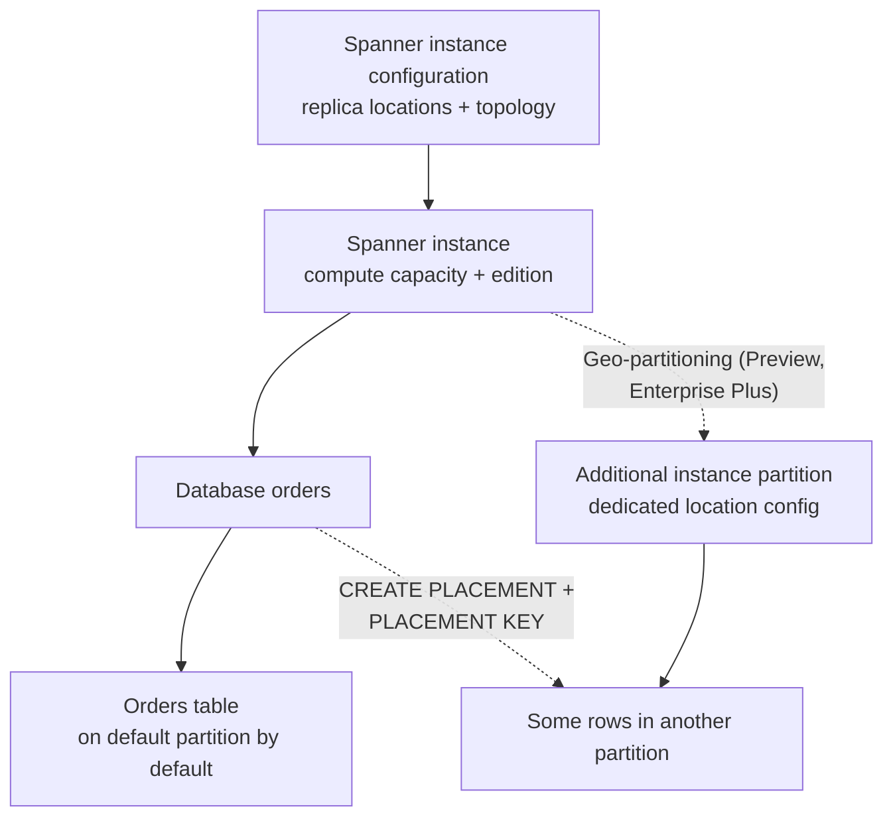
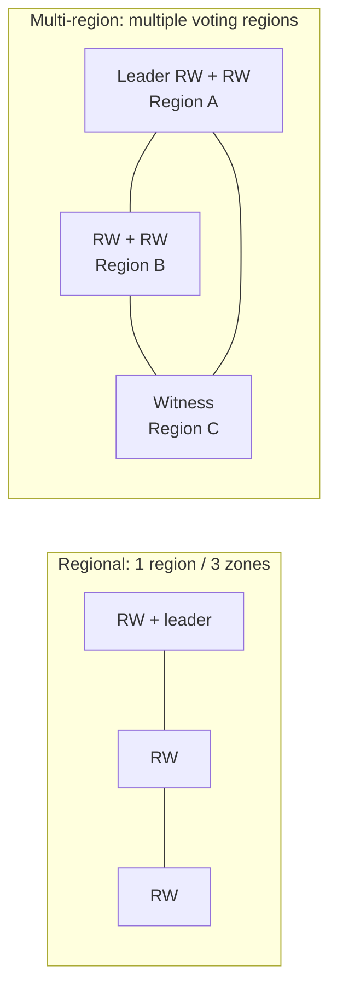
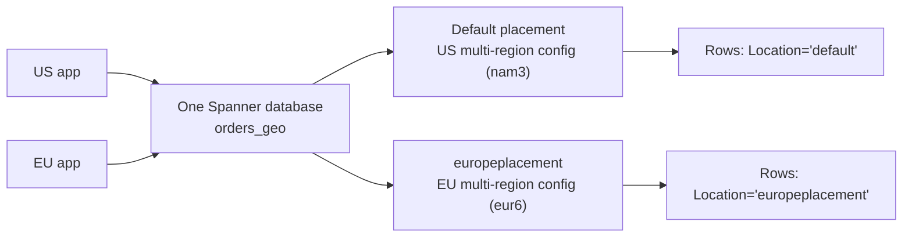

# Instance Configurations and Location-Based Data Placement

A Java order-processing application runs in Singapore, with most transactions originating in Southeast Asia; later, the business expands to Japan and Europe. When using **Spanner**, the question is not just "which region should the database be placed in?" but also: **where are replicas located, where are writes processed, do reads require absolute freshness, and is data allowed to leave a country/region?** Choosing an inappropriate configuration can increase write latency, replication costs, or violate data residency requirements even when SQL and schemas are correct.

This lesson belongs to the **Spanner** chapter in the **CLOUD_PROVIDERS_GCP** module, connecting project, IAM, VPC, Compute Engine, GKE, Cloud Run, storage, and database knowledge with reliability design, automation, and cost optimization. The focus is on **regional, dual-region, and multi-region instance configurations**, replica/leader placement, **custom configurations**, and **geo-partitioning** to control placement per row under supported conditions.

> All projects, instances, databases, tenants, and figures are examples. Creating a Spanner instance and adding partitions/replicas can incur significant charges even with zero traffic. Do not run commands to create, move, or delete resources in production without approval, backup protection plans, residency checks, and cost review. **Geo-partitioning Preview** features are subject to changing support conditions.

## Objectives

After this lesson, you will be able to:

1. Explain the **instance configuration → instance → database** hierarchy, and distinguish **replica placement** from **row placement**.
2. Compare regional, dual-region, and multi-region configurations by **availability, latency, geographic constraints, and cost**.
3. Distinguish **read-write**, **read-only**, and **witness** replicas, quorum, leader, and how read types affect latency.
4. Inspect Spanner configurations via Console/`gcloud`, create a regional instance in a lab, and observe database leader placement.
5. Understand how to **change the default leader region**, add a read-only replica via a custom configuration, and **move an instance** safely.
6. Describe geo-partitioning (**instance partition, placement, PLACEMENT KEY**), Preview/Enterprise Plus prerequisites, and data movement risks.
7. Choose appropriate placement for real-world scenarios, and establish metrics, capacity, IAM, data protection, and budget controls.

## 1. Three Data Location Layers That Are Easily Confused



| Concept | Defines | Not Equivalent To |
| --- | --- | --- |
| **Instance configuration** | Regions/zones hosting replicas, replica types, and replication topology | The region of a VM/Cloud Run service |
| **Instance** | Spanner resource containing databases, edition, and compute capacity (nodes/processing units) | A single server |
| **Database** | DDL, tables, indexes, data, and transactions | An independent location by default |
| **Default leader region** | Preferred region for placing the leader of eligible database/placements | Moving all data to that region |
| **Instance partition** | Compute/storage following a location configuration within the same instance, used for geo-partitioning | A Kubernetes partition or custom key-hash sharding |
| **Placement / placement key** | Maps rows to the default or a specified partition | A business label like `country=VN` automatically enforcing residency rules |

When **not using geo-partitioning**, databases in an instance share the replica topology of the instance configuration. A column `CountryCode='JP'` in a table does not automatically move the row to Japan. Even when deploying geo-partitioning, the application must **assign the placement key explicitly** and verify constraints.

## 2. Regional, Dual-Region, and Multi-Region

Spanner replication provides **strong consistency/external consistency** across multiple replicas. In return, every write must be acknowledged by a **write quorum**, so distance between voting replicas affects write latency.

| Configuration Type | Basic Layout | Best Suited For | Limitations / Trade-offs |
| --- | --- | --- | --- |
| **Regional** | Three read-write replicas in zones within **one region** | Apps/write loads concentrated in the same region, prioritizing write latency and cost | No data replicas in a second region to survive a region-wide outage |
| **Dual-region** | Two regions **in the same country**; each region has 2 read-write + 1 witness | In-country residency + cross-region resilience | Enterprise Plus, higher price, write quorum across two regions |
| **Multi-region** | Typically 2 read-write regions (2 replicas each) + 1 witness region; optionally read-only regions | Multi-region users, high RTO/availability, multi-area reads | Enterprise Plus, higher cost and write latency; requires leader selection |

Per product documentation, **regional offers a 99.99% SLA** and **dual/multi-region offers 99.999%** *when corresponding SLA conditions are met*; this is a contractual service commitment, **not** a guarantee that the application will always achieve that level if the frontend, network, dependencies, or operations lack redundancy.

### Configuration Selection Examples

- **`regional-asia-southeast1` (Singapore):** suitable if Java/Cloud Run/GKE and most writes are in Singapore; provides zone-fault tolerance per regional design.
- **`dual-region-japan1`:** data is replicated in Tokyo and Osaka within Japan; fits domestic Japan residency rules and cross-region HA needs, **not** applicable as a "Singapore–Japan dual region."
- **A multi-region configuration with read-write/read-only replicas across multiple areas:** suitable for global workloads, but inspect the **actual replica locations** list rather than guessing countries or cities from names like `nam3`/`eur6`.

**Edition:** Standard/Enterprise offer regional options according to edition capabilities; **dual-region and multi-region require Enterprise Plus**. Adding a read-only replica to a custom **regional/multi-region** configuration requires a supporting edition (Enterprise or Enterprise Plus) and a region from Google's **published optional regions**. Custom dual-region configurations cannot be created.

### Typical Replica Diagrams



The diagram illustrates **regional** and one **common multi-region** topology, not every configuration verbatim: for example, `asia2` has three read-write regions instead of a witness region. **Dual-region** has a different structure: each of the two regions has **2 RW + 1 witness**, and quorum when both are healthy requires enough voting replicas from **both regions**.

## 3. Reads, Writes, and Replica Roles

| Replica | Participates in Voting Quorum | Can Serve as Leader | Can Serve Reads | Role |
| --- | --- | --- | --- | --- |
| **Read-write** | Yes | Yes | Yes | Stores data, participates in writes/reads |
| **Read-only** | No | No | Yes | Serves reads (especially stale reads near clients) |
| **Witness** | Yes | No | No | Adds quorum votes without serving read data |

A write transaction commits once it reaches **quorum** for the configuration. For example, a 3-RW regional config needs **2/3** voting replicas to commit. Multi-region configs distribute voting replicas across regions, so writes may wait on cross-region network round trips; read-only replicas do not count toward quorum and do not increase write-region survivability.

### Strong Read, Stale Read, and Latency

- **Strong read** requires the latest data with guaranteed consistency; routing and leader/quorum state can increase latency depending on client location.
- **Stale read** permits reading a snapshot older by a chosen interval to utilize a replica close to the client; suitable for reporting, catalogs, or non-real-time data.
- For multi-region, documentation recommends **at least 15 seconds of staleness** when optimizing reads from a **non-default leader** region in many scenarios.
- Do not use stale reads for payment or inventory checks where business rules require fresh data and consistent transactions.

**Do not equate "read-only replica = independent DR."** If the instance's write quorum stops operating, an optional read-only replica does not become an independent database serving reads indefinitely. Backup/PITR/DR plans must still be designed separately.

### Application Location vs. Database Location

```text
Cloud Run (asia-southeast1) -> Spanner regional-asia-southeast1
    typically optimizes round-trip for reads/writes originating in Singapore

Cloud Run (Europe) -> Spanner multi-region with leader in North America
    cross-region write RTT still exists even with a local read-only replica
```

Prefer deploying **write-heavy workers** in/near the leader region; deploy **read-heavy workers** near read replicas and measure strong/stale reads against targets. Spanner's leader-aware routing automatically routes read-write transactions, **without eliminating physical network latency** between the application and the leader.

## 4. Choosing an Instance Configuration Using Measurements

Before choosing a location, document:

1. **Residency:** where are data, backups, logs, CMEK keys, and replicas permitted to reside?
2. **Availability/RTO/RPO:** must it survive a single-region outage, and is the application already running redundantly in two regions?
3. **Traffic:** read/write ratio, RPS per region, p95/p99 latency, and percentage of cross-region transactions.
4. **Consistency:** which flows require strong reads/writes, and which can use stale reads?
5. **Cost:** edition, nodes/processing units per location, storage, backups, network, cross-region egress, and application compute.
6. **Ecosystem constraints:** Cloud Run/GKE/Cloud SQL regions, VPC, IAM, private connectivity, compliance, and quotas.

### Latency Impact Illustration (Hypothetical, Not a Benchmark)

| Scenario | App → Leader RTT | Notes |
| --- | ---: | --- |
| App and regional Spanner both in Singapore | 2 ms (hypothetical) | Fewer network hops |
| App in Tokyo, leader in Singapore | 70 ms (hypothetical) | Can raise transaction p95 if write-heavy |
| App in EU, leader in North America | 120 ms (hypothetical) | Cross-region latency impacts round trips |

RTT is only for **design comparison**, not a Spanner guarantee. Real transactions can involve multiple round trips, lock waits, quorum propagation, contention, and application processing. **Measure with real requests from clients deployed in the target region**, rather than using a generic endpoint ping as the sole metric.

## 5. Lab: Inspecting Instance Configurations and Creating a Regional Instance

This lab **does not require Enterprise Plus**: it uses a base regional configuration to inspect replica locations, create an instance and database, and test SQL. Cloud Shell/Bash is used in the examples.

### 5.1 Checking Account and Available Resources

```bash
PROJECT_ID="retail-dev-01"
INSTANCE_ID="spanner-orders-lab"
DATABASE_ID="orders_lab"
CONFIG="regional-asia-southeast1"

gcloud auth list
gcloud config get-value project

# Read-only: verify Spanner API is enabled and project permissions are sufficient.
gcloud services list --enabled --project="$PROJECT_ID" \
  --filter="config.name:spanner.googleapis.com"
gcloud spanner instance-configs list --project="$PROJECT_ID"
gcloud spanner instance-configs describe "$CONFIG" --project="$PROJECT_ID"
gcloud spanner instances list --project="$PROJECT_ID"
```

In the `instance-configs describe` output, pay attention to `replicas[].location`, `replicas[].type`, and `defaultLeaderLocation` (if present). **Do not assume** a regional configuration has a fixed leader selectable with the same operation as multi-region.

### 5.2 Creating a Billable Instance

```bash
# INFRASTRUCTURE CHANGE: billed by Spanner edition/capacity/region.
# 1 node chosen to simplify the lab; clean up when finished.
gcloud services enable spanner.googleapis.com --project="$PROJECT_ID"

gcloud spanner instances create "$INSTANCE_ID" \
  --project="$PROJECT_ID" \
  --config="$CONFIG" \
  --edition=STANDARD \
  --description="Orders regional lab" \
  --nodes=1

gcloud spanner instances describe "$INSTANCE_ID" --project="$PROJECT_ID"
```

**One node = 1,000 processing units.** This is **compute capacity**, not a single data replica or a VM you manage. Spanner maintains replicas according to the instance configuration, not just one replica when `--nodes=1`. If you have quota/cost constraints, choose fewer processing units per the appropriate quota/edition after checking pricing documentation.

### 5.3 Creating a Database and a Table

```bash
# DATA/DDL CHANGE: run only on the lab instance you created.
gcloud spanner databases create "$DATABASE_ID" \
  --instance="$INSTANCE_ID" \
  --project="$PROJECT_ID"

gcloud spanner databases ddl update "$DATABASE_ID" \
  --instance="$INSTANCE_ID" \
  --project="$PROJECT_ID" \
  --ddl='CREATE TABLE Orders (
    TenantId STRING(40) NOT NULL,
    OrderId STRING(60) NOT NULL,
    AmountMinor INT64 NOT NULL,
    CreatedAt TIMESTAMP OPTIONS (allow_commit_timestamp=true)
  ) PRIMARY KEY (TenantId, OrderId)'

gcloud spanner databases describe "$DATABASE_ID" \
  --instance="$INSTANCE_ID" --project="$PROJECT_ID"
```

The table has no `PLACEMENT KEY`, so all rows use the **default instance partition**. You can use **Spanner Studio** (GoogleSQL) to run sample DML:

```sql
INSERT INTO Orders (TenantId, OrderId, AmountMinor, CreatedAt)
VALUES ('shop-a', 'order-1001', 145000, PENDING_COMMIT_TIMESTAMP());

SELECT TenantId, OrderId, AmountMinor
FROM Orders
WHERE TenantId = 'shop-a' AND OrderId = 'order-1001';
```

Run the INSERT and SELECT **in two separate executions if the tool requires different transaction modes**. Expected output is a row `order-1001` with `AmountMinor=145000`. The `TenantId` field is only a logical key—it **does not** cause Spanner to automatically store the tenant in another country.

### 5.4 Cleaning Up the Lab Safely

```bash
# DESTRUCTIVE! Only run after confirming the exact lab instance name and
# that every database/backup inside it can be deleted.
gcloud spanner instances describe "$INSTANCE_ID" --project="$PROJECT_ID"
gcloud spanner instances delete "$INSTANCE_ID" \
  --project="$PROJECT_ID"
```

Do not run delete commands on shared instances or instances containing production data. When deleting an instance, data can be permanently lost depending on retention/backup policies; do not treat `delete` as a "temporary" cost-saving pause that can be automatically undone.

## 6. Default Leader Region: Optimizing the Write Path

In **dual-region or multi-region**, one of the **read-write regions** is designated as the **default leader region** for a database. The leader coordinates writes; Spanner's **leader-aware routing** routes read-write transactions from clients in non-leader regions to the leader. This helps, but you still pay **physical network latency** between regions and associated round trips.

For example, `dual-region-japan1` has two read-write regions: **`asia-northeast1` (Tokyo)** and **`asia-northeast2` (Osaka)**. If most write-heavy Java services run in Osaka, you can consider changing the **database's** default leader to Osaka (after measuring latency/quorum):

```bash
# Example on an ENTERPRISE_PLUS instance with config dual-region-japan1.
# DATABASE METADATA CHANGE; run only after approval/benchmark.
PROJECT_ID="retail-prod-01"
INSTANCE_ID="spanner-japan-ha"
DATABASE_ID="orders_ha"

# Before changing: inspect the config's leaderOptions list.
gcloud spanner instance-configs describe dual-region-japan1 \
  --project="$PROJECT_ID"

gcloud spanner databases describe "$DATABASE_ID" \
  --instance="$INSTANCE_ID" --project="$PROJECT_ID"

# Set the leader to Osaka using GoogleSQL DDL.
gcloud spanner databases ddl update "$DATABASE_ID" \
  --instance="$INSTANCE_ID" --project="$PROJECT_ID" \
  --ddl='ALTER DATABASE orders_ha
         SET OPTIONS (default_leader = "asia-northeast2")'

# Verify the change after the operation completes.
gcloud spanner databases describe "$DATABASE_ID" \
  --instance="$INSTANCE_ID" --project="$PROJECT_ID"
```

**Four notes:**

1. You may only choose a **read-write region** listed in `leaderOptions`, never a witness or optional read-only region.
2. **Changing the leader is a metadata operation**; it **does not move all row data to Osaka** and does not automatically satisfy a new residency policy.
3. The change can take several minutes; measure **commit p95/p99**, transaction aborts, and load across client regions before and after.
4. For multi-region, Spanner supports **automatic leader failover** when the default leader region experiences an outage per topology/quorum. **Dual-region has its own quorum/failover model**, which may require manual failover steps per runbook to maintain operations during a regional outage; do not assume both types share the same RTO.

To revert to the configuration's default leader, set `default_leader = NULL` per the documentation—**no need** to move the Spanner instance.

## 7. Custom Instance Configurations and Optional Read-Only Replicas

Base configurations have Google-defined regions and replica types. You **cannot turn a witness into read-write** or alter a base config's topology directly. In **Enterprise/Enterprise Plus**, you can create a **custom instance configuration** by cloning a **base regional or multi-region** config and adding an **optional read-only replica** in a **supported region** (which must differ from regions already in the base configuration).

An example showing how to preview optional regions and create a custom config based on `nam3`:

```bash
PROJECT_ID="retail-lab-01"
BASE_CONFIG="nam3"
CUSTOM_CONFIG="custom-nam3-us-west2"

gcloud spanner instance-configs describe "$BASE_CONFIG" \
  --project="$PROJECT_ID"

# INSTANCE CONFIGURATION CHANGE; only execute if
# optionalReplicas actually permits us-west2 and the edition is eligible.
gcloud spanner instance-configs create "$CUSTOM_CONFIG" \
  --clone-config="$BASE_CONFIG" \
  --add-replicas=location=us-west2,type=READ_ONLY \
  --project="$PROJECT_ID"

gcloud spanner instance-configs describe "$CUSTOM_CONFIG" \
  --project="$PROJECT_ID"
```

**Do not create a custom dual-region config**: this feature is not supported for dual-region. An optional read-only replica helps **read data closer to users**, especially for stale reads, but **does not participate in voting quorum** and **does not automatically increase the SLA or DR capability of voting regions**. Adding replicas increases footprint/cost, can affect residency, and requires throughput evaluation.

### When Should You Add a Read-Only Replica?

An application mainly **writes in the US**, while many reporting queries read from the US West Coast. A read-only replica in a nearby optional region can help reduce latency for **stale reads**. If the entire workload needs strong read-write transactions in the new region, merely adding a read-only replica generally **does not solve** write latency caused by the leader/quorum remaining in the original regions.

## 8. Moving an Instance to Another Configuration: A Major Change, Not Changing Leader

Spanner supports **moving an instance** between eligible regional, dual-region, multi-region, and custom configurations. Documentation describes the process as **zero-downtime** while preserving consistency guarantees, though during the move **write latency, transaction abort rate, and CPU** may increase alongside network/cost impacts.

```bash
# Process example only; DO NOT run in production without
# completing preflight/backup/CMEK/edition/quota review.
PROJECT_ID="retail-prod-01"
INSTANCE_ID="spanner-orders-prod"
TARGET_CONFIG="nam3"

gcloud spanner instances describe "$INSTANCE_ID" --project="$PROJECT_ID"
gcloud spanner instance-configs describe "$TARGET_CONFIG" \
  --project="$PROJECT_ID"

# STOP here for risk assessment!
# Move command after approval:
# gcloud spanner instances move "$INSTANCE_ID" \
#   --target-config="$TARGET_CONFIG" --project="$PROJECT_ID"
```

### Mandatory Pre-Move Checklist

- **Edition/compute:** moving requires at least **1 node / 1,000 processing units**. Moving from Standard regional to dual/multi-region requires **upgrading to Enterprise Plus first**.
- **Location/residency:** review all voting/read-only/witness regions, encryption model, compliance policies, and new pricing.
- **Quota/capacity:** ensure the target region has sufficient quota; prepare CPU headroom, and plan for app retries/transaction aborts and latency.
- **Backups/backup schedules:** per the official move workflow, backups and backup schedules **are not moved**; you must handle/delete them before moving and maintain a **separate data protection copy plan**. Never blindly delete production backups just to run the command.
- **CMEK:** databases using customer-managed encryption keys require **keys in the target location** and appropriate `--target-database-move-configs` settings to avoid losing decryption capability.
- **Regional endpoints:** requests using a **regional endpoint** may be impacted by regional enforcement; verify client endpoints.
- **Geo-partitioning:** moving an instance only moves the **default instance partition**; it **does not** move additional partitions.
- **Completion:** monitor the long-running operation, create new backups/schedules for the target config, test restore, measure latency/billing, and update runbooks.

**Distinguishing the three operations:**

| Operation | What Changes? | What Does Not Automatically Change? |
| --- | --- | --- |
| `ALTER DATABASE … default_leader` | Preferred region for processing writes | Replica topology and physical location of data |
| Custom config + optional RO replica | Topology gains an RO region once the instance uses the new config | Voting quorum/SLA do not automatically increase |
| `instances move --target-config` | Geographic footprint/topology of the **default partition** | Project ID; additional geo partitions |

## 9. Geo-Partitioning: Placing Individual Rows by Placement

When one database serves multiple countries, **replicating the entire database** everywhere may violate rules like "EU customer data must be stored in approved EU locations, and US customer data in approved US locations." **Geo-partitioning** lets you bind individual rows in a **placement table** to an **instance partition** with its own geographic configuration.

**Feature status at time of writing: Preview, Enterprise Plus.** Key current conditions:

- **Both the default instance partition and additional partitions must use multi-region configurations**; regional/dual-region partitions are not used in this Preview model.
- Each additional instance partition requires at least **1 node (1,000 processing units)**; quotas apply to partition counts, placements, and rows/node.
- You cannot create multiple instance partitions in one instance using **the same base instance configuration**.
- Free trial instances / instances below the required node minimum are not supported; an instance partition cannot be changed to another configuration after creation.
- In a placement table, **`PLACEMENT KEY` cannot be added or removed after table creation**. Every row must have a valid placement value.
- Transaction restrictions: `INSERT`/`DELETE` on a placement table must be the **only statement in a transaction** under Preview limits; updates/read-write DML have strict rules involving the primary key.

Because of these constraints and costs, **do not make geo-partitioning a default step** in the section 5 regional lab. The section below is an **advanced paid lab**, to be run only in a project enabled/authorized for the Preview feature.

### US–EU Example Architecture



The diagram illustrates the **per-row** concept; it does not automatically guarantee that all control metadata, logs, backups, and query paths stay strictly in EU/US. Residency verification must also inspect `per_placement_routing_metadata`, actual locations of configs, and the full data lifecycle.

### 9.1 Creating an Enterprise Plus Instance with a Default Multi-Region

```bash
# Run separately in an authorized lab project; higher cost than regional.
PROJECT_ID="retail-geo-lab-01"
GEO_INSTANCE="orders-geo-lab"
GEO_DB="orders_geo"

gcloud spanner instance-configs describe nam3 --project="$PROJECT_ID"
gcloud spanner instance-configs describe eur6 --project="$PROJECT_ID"

# INFRASTRUCTURE CHANGE / BILLABLE:
gcloud spanner instances create "$GEO_INSTANCE" \
  --project="$PROJECT_ID" \
  --edition=ENTERPRISE_PLUS \
  --config=nam3 \
  --description="Geo-partitioning preview lab" \
  --nodes=1

gcloud spanner databases create "$GEO_DB" \
  --instance="$GEO_INSTANCE" --project="$PROJECT_ID"
```

**Both `nam3` and `eur6` must be available and permitted in your project/edition.** Create only after checking `instance-configs describe`/quotas; a multi-region name is not a complete residency guarantee.

### 9.2 Creating an Additional Instance Partition

```bash
# CHANGE / INCURS SEPARATE COSTS for the EU partition.
gcloud spanner instance-partitions create eu-partition \
  --instance="$GEO_INSTANCE" \
  --config=eur6 \
  --description="EU placement partition" \
  --nodes=1 \
  --project="$PROJECT_ID"

gcloud spanner instance-partitions list \
  --instance="$GEO_INSTANCE" --project="$PROJECT_ID"
```

**Do not take the regional instance created in section 5 and run `instance-partitions create` directly on it**: Preview requires the default partition to be multi-region. If the edition/feature is not supported in your project, stop rather than bypassing checks by changing IAM indiscriminately.

### 9.3 Choosing Where to Store Routing Metadata Before Creating Placements

For geo-partitioned databases, Spanner provides an option:

- `per_placement_routing_metadata=TRUE`: routing metadata resides with the data's partition, typically helping same-region access.
- `FALSE`: routing metadata is centralized in the default partition, which may suit frequent cross-region queries.

**Starting in July 2026, the default for this option changed to TRUE** (previously FALSE), so **set it explicitly according to your traffic pattern**. The option **cannot be changed once placements exist**.

In Spanner Studio or via `gcloud`:

```bash
# DATABASE DDL CHANGE; run BEFORE creating placements.
gcloud spanner databases ddl update "$GEO_DB" \
  --instance="$GEO_INSTANCE" --project="$PROJECT_ID" \
  --ddl='ALTER DATABASE orders_geo
         SET OPTIONS (per_placement_routing_metadata = TRUE)'
```

### 9.4 Creating a Placement and Placement Table

```bash
# DATABASE DDL CHANGE: maps placement name -> instance partition.
gcloud spanner databases ddl update "$GEO_DB" \
  --instance="$GEO_INSTANCE" --project="$PROJECT_ID" \
  --ddl="CREATE PLACEMENT europeplacement
         OPTIONS (instance_partition='eu-partition')"

# Create table with placement column. PLACEMENT KEY cannot be added later.
gcloud spanner databases ddl update "$GEO_DB" \
  --instance="$GEO_INSTANCE" --project="$PROJECT_ID" \
  --ddl='CREATE TABLE OrdersByRegion (
    OrderId STRING(64) NOT NULL,
    AmountMinor INT64 NOT NULL,
    Location STRING(MAX) NOT NULL PLACEMENT KEY
  ) PRIMARY KEY (OrderId)'
```

To insert data in **Spanner Studio (GoogleSQL)**, run each statement in **a separate transaction** per Preview limits:

```sql
-- Row in default placement (nam3 in this example).
INSERT INTO OrdersByRegion (OrderId, AmountMinor, Location)
VALUES ('us-1001', 145000, 'default');

-- Run separately: row assigned to EU placement (eur6).
INSERT INTO OrdersByRegion (OrderId, AmountMinor, Location)
VALUES ('eu-2001', 10000, 'europeplacement');
```

The `Location` value must **exactly** match a created placement name or `default`. Values like `'eu'`, `'Europe'`, or an arbitrary country code **have no automatic mapping** and may be rejected. When querying/updating placement tables, verify constraints around **primary-key lookups**, routing metadata, index/transaction modes, and cross-partition behavior.

### 9.5 Moving a Row Between Placements

Changing `Location` to another placement is an **actual data movement operation**, not merely relabeling. In Preview, changing placement requires a specific workflow and may use **partitioned DML**, rate-limited by the target partition's nodes. Therefore:

1. Verify compliance for the target placement and compute quota.
2. Read the official SQL/DML limitations; do not issue a bulk `UPDATE Location` inside a small transaction without testing.
3. Measure move duration, write latency, cost, and row counts in the target partition.
4. Maintain your data source/backup/restore strategy per policy before cutting over traffic.

**Geo-partitioning does not replace a complete legal compliance architecture.** Inspect replicas, metadata, log exports, backup locations, networking, and administrative access paths—not just the `Location` column.

## 10. Case Study: Data Placement for an E-Commerce Platform

The business has three groups:

| Need | Approach | Rationale |
| --- | --- | --- |
| 85% of writes from Cloud Run Singapore, mostly SEA customers | **Regional Singapore** | Prioritizes write latency/cost, zone fault tolerance |
| Japan services requiring domestic data and cross-region resilience | **Dual-region Japan** (Enterprise Plus) | Two regions in the same country, higher HA; verify failover runbook |
| Global shared data and multi-region reads | **Multi-region** with leader near writes | Cross-region voting quorum, stale reads elsewhere; higher cost |
| One logical database where EU/US rows must reside in approved areas | **Geo-partitioning Preview** if eligible | Per-row placement key; requires metadata/residency, limits, and billing review |

### Scenario: Changing Requirements

Initially, orders were only in Singapore. A year later, 40% of read traffic comes from Japan. Three options:

- **A. Keep regional Singapore:** simple, writes stay fast; Japan reads over the WAN and p95 may be high.
- **B. Add an optional read-only replica** in a supported region via a custom regional config: helps some reads, especially stale reads, but writes still go through the original quorum/leader and the regional SLA does not automatically become 99.999%.
- **C. Move to dual/multi-region** if edition, residency, HA, and budget align. Adds read-write regions and failover, but write latency and costs change; requires preparation before moving.

The choice does not rely on "multi-region is always best." The decision must be validated with a **regional traffic map, consistency SLOs, budget, data requirements, and load testing**.

## 11. Monitoring, IAM, and Regional Operations

### Essential Dashboard

| Signal | Question |
| --- | --- |
| p50/p95/p99 read/write latency by client region | Which region incurs RTT/quorum overhead? |
| High-priority/total CPU utilization by instance/region | Is capacity sufficient for the busiest region? |
| Storage utilization and per-partition rows | Approaching placement rows/node or storage limits? |
| Transaction abort rate, lock wait/commit latency | Are hot keys, contention, or a move impacting performance? |
| Active session counts and client-side latency | Are pools/sessions sufficient, or is there overload/misrouting? |
| Default leader and leader changes/failover | Are writes going to the expected leader region? |
| Backup/PITR status, backup locations | Does data recovery meet expectations and constraints? |
| Billing by edition, capacity, storage, network | How does each optional replica/partition impact the budget? |

In **regional** configurations, performance docs recommend keeping **high-priority CPU below ~65%**; in **multi-region**, around **45%** for headroom. These are **operational guidelines**, **not hard quotas**, and do not replace real load testing. Use **Key Visualizer** and Query Insights to detect hot keys/transaction contention before concluding "the region is too far."

### Least-Privilege IAM

- Operators running `gcloud spanner instance-configs list/describe` need **config viewer** permissions; creating instances or custom configs requires `spanner.instances.create` or `spanner.instanceConfigs.create` respectively.
- Java services need database read/write permissions suited to the workload (IAM database roles or fine-grained access control if designed appropriately), not Spanner Admin to serve requests.
- `instances move`, changing leaders, adding partitions, or deleting backups must go through **change approval**, logging/auditing, and restricted permissions; CI should use short-lived service accounts / Workload Identity Federation, avoiding service account JSON keys in repos.
- Residency encompasses both **who can read the data** and **where data is stored/read**: IAM, CMEK, private connectivity, org policies, and audit logs must all be checked.

### Latency Troubleshooting Runbook

1. Record **project/instance/database/config**, client region, leader region, transaction mode, timestamp, and p95/p99.
2. Identify the type: slow **strong read**, **stale read**, or **read-write transaction**; measure region-to-region RTT.
3. Check **quorum/replica health, CPU, sessions, aborts, and hot keys**; do not change config when lock contention is the real culprit.
4. If writes are far from the leader, consider **deploying writers near the leader** or **changing the default leader** (only when eligible).
5. If stale reads are far from clients, evaluate a **read-only region**/staleness or custom config; measure results before adding replica cost.
6. If physical placement must change, plan an **instance move/geo-partitioning** with edition, backup/CMEK, quotas, approvals, and post-checks.

## 12. Exercises and Answers

### Exercise 1 — What Does Instance Configuration Determine?

An `Orders` table in Singapore regional Spanner has a column `CountryCode='JP'`. Is that row automatically stored in Japan?

<details>
<summary>Answer</summary>

No. The regional instance configuration places replicas within Singapore. The `CountryCode` column is just business data; per-row placement requires a dedicated geo-partitioning feature and placement key.
</details>

### Exercise 2 — Regional Quorum

A regional configuration has three read-write replicas across three zones. How many voting replicas are needed to commit a write in a typical configuration?

<details>
<summary>Answer</summary>

**Two out of three** replicas satisfy quorum. This provides single-zone fault tolerance, not availability if the **entire region** fails.
</details>

### Exercise 3 — Witness Replica

Does a witness participate in quorum? Can it serve as leader or serve SQL queries?

<details>
<summary>Answer</summary>

A witness **has a vote**, but **cannot become leader** and **cannot serve reads**. Its role is to support voting quorum, not act as a replica for BI queries.
</details>

### Exercise 4 — Dual-Region and Residency

A business must keep all transaction data in Japan while requiring HA against a single-region outage. Name an appropriate configuration and one item that must be verified.

<details>
<summary>Suggested Answer</summary>

`dual-region-japan1` (Enterprise Plus) with Tokyo/Osaka is worth evaluating. You must also verify residency requirements, quorum/failover procedures, costs, locations of logs/backups/KMS, and redundant frontends across both regions.
</details>

### Exercise 5 — Changing Leader

A multi-region database has its default leader in region A. Does changing `default_leader` to region B automatically move all rows to B?

<details>
<summary>Answer</summary>

No. Changing the leader is a **metadata operation** selecting which region in the allowed read-write set handles writes; replica locations are governed by the instance configuration.
</details>

### Exercise 6 — Read-Only Replica and DR

Does adding a read-only replica in a third region automatically increase write quorum or turn it into an independent recovery region if both voting regions go down?

<details>
<summary>Answer</summary>

No. A read-only replica **does not vote** and **does not become an independent DR site** when the primary quorum is lost. It primarily improves serving reads closer to clients.
</details>

### Exercise 7 — SQL Placement

In a placement table, a row has `Location='eu'` while the only created placement is `europeplacement`. Does the row automatically land in the EU?

<details>
<summary>Answer</summary>

No. The placement key must be a **declared placement name** or `default`. With an invalid value, the operation can be rejected; you must use `Location='europeplacement'`.
</details>

### Exercise 8 — Geo-Partitioning Preview

A team wants to add an EU partition to a `regional-asia-southeast1` instance on Standard edition provisioned with 100 processing units. Name three conditions that are not met.

<details>
<summary>Answer</summary>

Geo-partitioning currently requires **Enterprise Plus**, a **multi-region default instance partition**, and **at least 1,000 processing units (1 node) per additional partition**; in Preview, additional partitions must also be multi-region. This cannot be fixed simply by granting IAM permissions.
</details>

### Exercise 9 — Does Moving an Instance Need a Backup Review?

A DBA assumes `instances move` has "zero downtime" and can be run immediately without checking backups/CMEK/quotas. Is this accurate?

<details>
<summary>Answer</summary>

False. A move can still increase latency/aborts/CPU; backup schedules and backups do not move with the instance, CMEK requires valid keys in the destination, and you must have quota/capacity plus a separate data protection/recovery plan before starting.
</details>

## 13. Data Placement Decision Checklist

- [ ] Verified instance configuration and **actual replica locations**, without guessing from names.
- [ ] Understood the difference between **replica topology, leader region, and row placement**.
- [ ] Selected regional/dual/multi-region based on SLA, RTO/RPO, write latency, residency, and budget.
- [ ] Reviewed edition requirements: dual/multi-region requires Enterprise Plus, custom read-only has conditions.
- [ ] Placed frontends/Cloud Run/GKE near the write leader; evaluated stale reads separately.
- [ ] Evaluated backups, logs, exports, KMS, cross-border networking, and access permissions.
- [ ] Load-tested p95/p99, CPU, abort rate, sessions, and monitoring before/after changes.
- [ ] Selected optional RO replicas from the supported list; did not treat them as write quorum/independent DR.
- [ ] Prepared instance move checklist covering quotas, backups, CMEK, regional endpoints, CPU headroom, and post-checks.
- [ ] Used geo-partitioning only when preview/edition/quotas support it, with explicit placement keys and residency verification.
- [ ] Estimated instance/partition nodes, storage/replicas, backups, egress, and alerts; cleaned up labs properly.
- [ ] Applied least-privilege IAM, infrastructure change approvals, auditing, and rollback/recovery plans.

## Official References

- [Regional, dual-region, and multi-region configurations](https://cloud.google.com/spanner/docs/instance-configurations): topology, SLA, residency, trade-offs, and leader.
- [Replication](https://cloud.google.com/spanner/docs/replication): read-write/read-only/witness replicas and quorum.
- [Create and manage instances](https://cloud.google.com/spanner/docs/create-manage-instances): `gcloud spanner instances create`, editions, compute capacity.
- [Instances overview](https://cloud.google.com/spanner/docs/instances): distinguishing instances and databases.
- [Leader-aware routing](https://cloud.google.com/spanner/docs/leader-aware-routing): read-write transaction routing.
- [Modify the leader region](https://cloud.google.com/spanner/docs/modifying-leader-region): `ALTER DATABASE … default_leader`.
- [Create and manage instance configurations](https://cloud.google.com/spanner/docs/create-manage-configurations): cloning/adding optional read-only replicas.
- [Move an instance](https://cloud.google.com/spanner/docs/move-instance): quotas, backups/CMEK, impacts, and steps.
- [Geo-partitioning overview](https://cloud.google.com/spanner/docs/geo-partitioning): Preview, Enterprise Plus, placement keys, and limitations.
- [Create and manage instance partitions](https://cloud.google.com/spanner/docs/create-manage-partitions): creating/listing/scaling partitions.
- [Create and manage data placements](https://cloud.google.com/spanner/docs/create-manage-data-placements): routing metadata, `CREATE PLACEMENT`, placement table DDL/DML.
- [Spanner pricing](https://cloud.google.com/spanner/pricing) and [Google Cloud Pricing Calculator](https://cloud.google.com/products/calculator): editions, compute/storage, backups, and network.
- [Spanner quotas and limits](https://cloud.google.com/spanner/quotas): instance sizes, partitions, and residency-related quotas.
