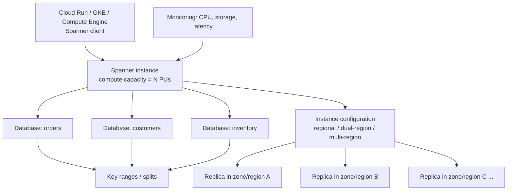

# Nodes, Processing Units, and Spanner Capacity Management

An order API powered by **Google Cloud Spanner** is experiencing elevated p99 latency during peak hours. The development team sees that the instance is only using 400 **processing units (PUs)** and wants to immediately increase it to 2,000 PUs. Will increasing capacity improve latency, or does the real issue come from **a primary key hotspot, queries scanning too much data, transaction contention**, or requests concentrating on a single partition?

This lesson belongs to the **Spanner** chapter of the `CLOUD_PROVIDERS_GCP` module, within the Google Cloud path from projects/IAM/VPC to Compute Engine, GKE, Cloud Run, storage, databases, reliability operations, and cost management. It focuses on **measuring and managing Spanner compute capacity** using **nodes/processing units**, understanding corresponding storage limits, setting guardrails for **manual scaling/managed autoscaling**, and validating changes with observability data.

## 1. Learning Objectives

After this lesson, you will be able to:

1. Explain `node`, `processing unit`, `instance`, `database`, `replica`, and `split` in Spanner's architecture.
2. Convert **1 node = 1,000 PUs**, recognize valid increments, and understand the limitations of sub-1-node instances.
3. Calculate maximum storage allowances corresponding to PUs/nodes and distinguish **storage quota** from **billable actual data**.
4. Read **high-priority CPU**, total CPU, 24-hour smoothed CPU, storage utilization, latency, throughput, and hot splits to detect bottlenecks.
5. Estimate capacity from baselines and SLOs, weighing regional versus dual-/multi-region setups.
6. Distinguish **manual allocation** from **managed autoscaler** (Enterprise/Enterprise Plus), choosing minimum/maximum bounds and CPU/storage targets.
7. Use `gcloud` to inspect configurations; if approved, adjust PUs/nodes or autoscaling on an **existing lab instance**.
8. Prepare safe scale-up/down plans, cost estimates, IAM security, and runbooks when p99/CPU rises.
9. Solve exercises calculating PUs, storage headroom, target CPU, and relative costs.

**Lab scope:** use an **authorized project/Spanner instance**, prioritizing read-only operations. The `gcloud spanner instances update` examples **modify configuration and incur/adjust charges**; run them only with change approval. This lesson does not create a production database, load real data, or delete shared instances.

## 2. Spanner Compute Capacity Lives at the Instance Level



**Compute capacity is provisioned at the instance level** and shared across all databases within the instance, **not** dedicated as separate nodes per database. If the `orders` database sees a spike in heavy queries, the `customers` database on the same instance can also be affected if the instance becomes overloaded.

Key concepts:

| Concept | Meaning | Should Not Be Confused With |
| --- | --- | --- |
| **Instance** | Logical container for databases, geographic configuration, and compute capacity | A VM running PostgreSQL |
| **Node** | **Logical unit** equal to 1,000 PUs | A physical server or a single replica |
| **Processing unit (PU)** | Sub-node unit of compute measurement | A dedicated CPU core or Compute Engine vCPU |
| **Instance configuration** | Selects region/replica topology and data residency | Just a region label |
| **Replica** | Data copy in a zone/region; read/write role depends on configuration | A database copy users must synchronize themselves |
| **Split** | A contiguous key range served and distributed by Spanner | A manually managed application partition like Kafka |
| **Database** | Schema, tables, data, and transaction workloads | Having an isolated default CPU quota |

Google Cloud manages replication, splits, server placement, and the database substrate. The application team still must design **keys, indexes, queries, transaction boundaries, IAM, latency SLOs, and cost budgets**.

## 3. Nodes and PUs: Conversions and Valid Sizes

**Basic formula:**

\[1\ \text{node}=1000\ \text{processing units}\]

- For capacity **below 1 node**, specify in **multiples of 100 PUs**: `100`, `200`, …, `900`.
- At or above **1 node**, choose `1, 2, 3, … nodes` (equivalent to `1,000, 2,000, 3,000, … PUs`).
- **Do not** treat `1,300 PUs` or `1.5 nodes` as valid manual configurations; levels above 1,000 PUs must be multiples of 1,000 PUs.
- For small instances, PUs provide fine-grained capacity steps without forcing you to buy a full node.

| Capacity | Node Equivalent | When to Consider |
| --- | ---: | --- |
| 100 PUs | 0.1 node | Sandbox, low traffic |
| 300 PUs | 0.3 node | Starting a small workload, requires benchmarking |
| 600 PUs | 0.6 node | Growing load that does not yet need 1 node |
| 1,000 PUs | 1 node | Steady workload requiring higher throughput and more splits |
| 2,000 PUs | 2 nodes | Higher traffic/storage, after measurement |
| 4,000 PUs | 4 nodes | Scaling up for verified load |

**A node is not a physical VM:** Spanner allocates corresponding CPU/RAM across multiple servers and replicas to maintain HA. Scaling from 1 to 2 nodes **does not add new replica regions**; it increases compute/memory/disk resources **within the chosen topology**.

### 3.1. Why Can Sub-1-Node Instances Be Slower Than Expected?

Below 1 node, resources and parallelism are **constrained**; some workloads exhibit non-linear latency increases. Assuming "100 PUs gives 100 QPS, so 200 PUs guarantees 200 QPS" **does not hold for every schema/query**. For latency-sensitive apps, test p95/p99, throughput, and hotspots rather than relying on linear multiplication.

### 3.2. Nodes/PUs vs. Replica Count

In a typical regional configuration, there are **three read-write replicas across three zones**. A **1-node** instance provides **the equivalent of 1,000 PUs for each corresponding replica/zone**, **not** 1,000/3 ≈ 333 PUs per zone. Other topologies have different replica counts and types; billing is based on **edition, instance configuration, and replica resources** per the pricing schedule, not simply "1 node = 1 VM."

## 4. How Instance Configuration Affects Performance and Cost

| Configuration | Key Point | Selection Guidance |
| --- | --- | --- |
| **Regional** | Replicas across zones of **one region**; typically intra-region write quorum | Single-region apps seeking balanced latency/cost |
| **Dual-region** | Replicas across two regions in the same country in supported configs | Residency/HA requirements per design, **Enterprise Plus** |
| **Multi-region** | Read-write/read-only/witness replicas per config; serves broader areas | Cross-region HA and multi-region read latency, **Enterprise Plus** |

One **node** provisions capacity for **each replica** in the instance topology; adding nodes increases compute in the participating regions/zones rather than increasing the **number** of replicas. With dual-/multi-region, leader placement, cross-region write quorum, and network RTT can make **write latency** higher than regional. Read latency can be optimized with read-only replicas/stale reads when consistency and edition allow.

**Do not switch from regional to multi-region just to increase QPS**; that changes data placement, RPO/RTO, latency, and cost. If the app does not require regional failover or global reads, regional may be more sensible.

## 5. Storage Capacity Depends on PUs/Nodes

Spanner enforces a **database storage limit based on compute capacity**:

| Compute Capacity | Approximate Storage Allowance |
| --- | --- |
| 100 PUs | **1 TiB** (1,024 GiB) |
| 200 PUs | **2 TiB** |
| 500 PUs | **5 TiB** |
| 1,000 PUs / 1 node | **10 TiB** |
| 2 nodes | **20 TiB** |

Allowance formula:

\[
L_\text{storage}=
\begin{cases}
1024\ \text{GiB}\times \frac{\text{PUs}}{100},&\text{PUs}<1000\\
10\ \text{TiB}\times \text{nodes},&\text{nodes}\ge1
\end{cases}
\]

These thresholds are **storage limits**, not consumed data. **Spanner bills for actual database storage used**, not automatically for 10 TiB just because an instance has 1 node. **Backup storage** is billed and limited separately, not counted against the database storage limit. For storage tiering configs/features, check the applicable quotas for SSD/HDD and combined data.

### 5.1. Example: Forecasting 30-Day Headroom

An instance has 100 PUs and **850 GiB of data**, projected to grow by **15 GiB/day**:

```text
Storage after 30 days = 850 + 15 × 30 = 1,300 GiB
100 PUs storage allowance = 1,024 GiB  -> insufficient

If target utilization <=70%:
  required allowance >= 1,300 / 0.70 = 1,857.2 GiB

200 PUs provides allowance = 2,048 GiB
  projected utilization = 1,300 / 2,048 ≈ 63.5% -> reasonable
```

In this case, **200 PUs** meets storage needs *on paper*. You still must check **CPU/p99/splits** rather than sizing by GiB alone. When exceeding the storage limit, Spanner may reject writes or schema/index changes; alert well before running out of headroom.

### 5.2. Deleted Data, Yet the Metric Has Not Dropped?

Spanner runs compaction. Deleting many rows may **not reduce storage utilization immediately** because physical space has not yet been reclaimed. Do not immediately scale down right after running cleanup and seeing the metric still high; wait for compaction and verify before/after.

## 6. CPU Metrics and Safe Headroom for Failover

Spanner exposes multiple CPU metrics—avoid drawing conclusions from a single chart:

| Metric | Meaning | How to Use |
| --- | --- | --- |
| **High-priority CPU utilization** | Compute consumed by high-priority work, including default user requests | Monitor app load and **headroom for failover** |
| **Total CPU utilization** | All high/medium/low-priority work, including background tasks | Observe total pressure and background work |
| **24-hour smoothed CPU** | 24-hour rolling average, helping spot sustained overload | Alerting and capacity planning beyond brief spikes |
| **CPU by operation type** | CPU broken down by read/write/commit and operation types | Diagnose which operations drive load |

Google Cloud recommended thresholds to preserve availability during a zone/region loss:

| Metric | Regional | Dual-/multi-region (per region) |
| --- | ---: | ---: |
| **High-priority CPU** | **≤65%** | **≤45%** |
| **24h smoothed aggregate CPU** | **≤90%** | **≤90%** |

**Recommended thresholds, not hard limits:** an instance can exceed them briefly, but sustained overload increases latency and reduces failover headroom. Conversely, high background CPU during zero user traffic may simply be system tasks using idle capacity; do not treat it as an outage if p99/SLOs remain healthy.

### 6.1. When Should You Scale CPU?

Consider scaling up if:

- High-priority CPU is **sustained high**, and p95/p99 rises under a representative workload.
- Queries/schemas are already optimized, yet there is no headroom left for peaks/failover.
- Database/storage operations genuinely need more compute and are not stuck on a hotspot or contention.

**Do not rush to scale** if instance-wide CPU is 30% while one split is hot, a query has a bad plan, or transactions are waiting on locks. Added capacity may not help a single hot key range process faster in parallel.

## 7. Sizing Compute from Measured CPU

There is no universal "users → PUs" formula for every app. Use **load testing with a representative query mix and dataset**.

A rough estimate when the workload is well distributed:

\[
\text{New PUs needed}\ \approx\ \text{Current PUs}
\times \frac{\text{Observed CPU}}{\text{Target CPU}}
\]

Example: a **400 PU** regional instance has **78%** high-priority CPU at peak, and the design target is **60%** for headroom:

```text
400 × (78 / 60) = 520 PUs (theoretical)
Valid step below 1000 PUs: 600 PUs
Benchmark after scaling up to 600 PUs.
```

If the instance is **1,000 PUs** with the same 78%/60%, the math gives **1,300 PUs**. Because capacity at 1 node or above increments in whole nodes, the next valid manual step is **2,000 PUs (2 nodes)**. That can noticeably raise costs; inspect **Query Insights, Key Visualizer, and indexes/scans** to avoid buying unnecessary capacity.

**Note:** CPU does not always scale inversely linearly with PUs due to workload skew, split distribution, retries, index backfills, and instance topology. The formula is only a **starting point**, not a substitute for benchmarking/monitoring.

### 7.1. Theoretical Throughput Is Not an SLA

Google Cloud publishes **peak reads/writes per node reference figures** by instance configuration, storage, and sample workload. These are informational and typically assume **100% CPU** with pure reads or pure writes; actual throughput varies with row size, indexes, transaction conflicts, consistency, locality, and schema.

**Proper benchmarking process:** generate production-equivalent load in a test environment, ramp request rate in steps, record p95/p99, CPU by priority, read/write/commit latency, abort/retry rate, and cost/QPS. Finalize capacity only when SLOs pass at peak **and** failover headroom remains.

## 8. Hotspots: Cases Where Adding Nodes Cannot Fix It

Spanner partitions data by **key ranges**. If a table uses a **monotonically increasing** primary key such as a timestamp or sequence where traffic always writes to the beginning/end of one key range, it can create a **hotspot**, especially as QPS grows.

Example of an at-risk table model:

```sql
-- GoogleSQL, for design discussion; do not run DDL on production.
CREATE TABLE Events (
  CreatedAt TIMESTAMP NOT NULL,
  EventId STRING(36) NOT NULL,
  Payload STRING(MAX)
) PRIMARY KEY (CreatedAt, EventId);
```

When `CreatedAt` increases monotonically and all writes target the edge of a key range, a single split can saturate even when **average instance CPU is low**. Remedies include:

1. Choose **well-distributed keys**, such as a hash/shard prefix combined with an entity ID, if queries allow.
2. Use **randomly distributed UUIDs** instead of monotonically increasing IDs where appropriate.
3. Design indexes to avoid a **hot index** on an ascending timestamp; consider omitting indexes on fields used only for retention/offline queries, or adding a shard key.
4. Measure hot keys/splits and latency using **Key Visualizer**, Query Insights, and transaction metrics.
5. Assess transaction contention, avoid holding read-write transactions open too long, and retry `ABORTED` with backoff.

Do not blindly hash every primary key: it complicates **range queries**, locality, and locality-aware joins. Choose keys based on **access patterns** and data modeling; optimizing Spanner requires balancing load distribution and query efficiency.

## 9. Why Do Databases in One Instance Affect Each Other?

Suppose an instance has 600 PUs and 3 databases:

| Database | Workload | Risk |
| --- | --- | --- |
| `orders` | User-facing transaction writes | Requires stable p99 |
| `analytics_temp` | Hourly full scans | Consumes CPU/IO, impacting other workloads |
| `catalog` | Heavy reads during promotions | Competes for capacity on the same instance |

All of them consume **instance compute capacity**. Spanner offers high/medium/low **request priorities** to help schedule work: user-facing queries can run at high priority, while batch/backfill jobs can use low priority when appropriate. However, priority **does not carve out dedicated CPU** per database, and background jobs still must finish.

If workloads have sharply different SLOs and owners, you can separate them into **distinct Spanner instances** for better quota/cost/monitoring isolation. Weigh the extra baseline cost, data distribution, and transaction boundaries; do not split arbitrarily if business logic depends on transactions spanning those tables.

## 10. Manual Allocation vs. Managed Autoscaling

| Attribute | **Manual allocation** | **Spanner managed autoscaler** |
| --- | --- | --- |
| Edition | Per supported edition/configuration | **Enterprise and Enterprise Plus** |
| Resources | Fixed PUs/nodes until modified | Scales automatically by CPU, storage, and min/max |
| Minimum size | Can start at **100 PUs** on eligible instances | **Minimum 1 node (1,000 PUs)** |
| Control | `gcloud instances update --processing-units/--nodes` | CPU/storage targets, min/max, and downscaling policy |
| Cost | Easy baseline forecast, but risks overprovisioning | Varies with used capacity; requires budgets/alerts |
| Operations | Admin/scheduler decides when to scale | GKE/Cloud Run apps don't operate a custom scaler |
| Drawback | Risks underprovisioning during traffic spikes | Scaling isn't instant; bound by quotas/max and split rebalancing |

**Managed autoscaler** differs from the open-source **Autoscaler tool** deployed on Cloud Run functions/GKE. When choosing an approach, know which one you are using. This lesson covers the **built-in managed autoscaler**; do not build a custom function polling and updating the instance every minute.

### 10.1. Examples of Choosing a Mode

- **100–500 PU sandbox, low traffic:** manual makes sense because the managed autoscaler has a **1-node minimum**, which could raise baseline cost.
- **Production with peak hours, Enterprise/Plus, >=1 node:** consider managed autoscaler with benchmarked min/max bounds.
- **Workloads spiking within seconds:** keep **`min` capacity with enough buffer**, as scaling up and split rebalancing take time.
- **Workloads with hot keys:** fix the data model/queries first; the autoscaler cannot promise to fix a single hot split.

## 11. How Does the Managed Autoscaler Determine Size?

The managed autoscaler evaluates **multiple dimensions**:

1. **High-priority CPU utilization target**.
2. **Total CPU utilization target** (if configured).
3. **Storage utilization target**.
4. **Minimum/maximum compute capacity**.

Each dimension produces a recommendation, and the system picks the **highest required capacity**, without exceeding `max` or valid quotas. If storage requires 3 nodes while CPU requires 5 nodes, the autoscaler targets **5 nodes**, not the average of 4.

### 11.1. Regional Baseline Configuration

A reference configuration for a **regional Enterprise instance**:

| Field | Example Value | Rationale |
| --- | ---: | --- |
| Min nodes | 1 | Never drop below tested acceptable capacity |
| Max nodes | 3 | Allows peak scaling while capping capacity cost |
| High-priority CPU target | 65% | Headroom per regional guidelines |
| Total CPU target | 70% | Preserves capacity for background/index tasks |
| Storage target | 70% | Avoids waiting until disk nears 100% |

**Constraints:** if both high-priority and total targets are set, the **high-priority target must be lower than the total target**. CPU targets must fall within supported bounds (currently around 10–90%); storage target also has its own range. Minimum cannot be less than **10% of maximum**, and maximum cannot exceed **10× minimum**.

Do not choose `min=1, max=30` as it exceeds the 10× ratio. The autoscaler **cannot allocate nodes beyond quota**, even if `max` is set high; if `max` is hit while high-priority CPU remains above target or storage fills up, request latency/errors can still climb.

### 11.2. Regional and Multi-Region Should Not Share the Same CPU Target

Failover baseline recommendations:

- **Regional:** high-priority CPU 65%, total CPU 70%.
- **Multi-region:** high-priority CPU 45% **per region**, total CPU 50%.

For dual-/multi-region setups, consider replica roles, leader region, and failover footprint. Setting higher targets may cut compute costs under normal conditions, but **reduces headroom when a region is lost**. If using **asymmetric read-only autoscaling** on read-only replicas (where eligible), configure per-region targets and ensure read traffic/DR won't bottleneck; do not apply it as a way to control read-write/witness replicas.

## 12. Sizing by Storage and CPU Must Be Considered Together

Suppose a regional instance currently has:

| Metric | Value |
| --- | ---: |
| Capacity | 300 PUs |
| High-priority CPU peak | 42% |
| Stored data | 2.4 TiB |
| Storage allowance | 3 TiB |
| Data growth | 0.2 TiB/month |
| SLO | p99 under 100 ms |

CPU still has headroom, but storage utilization is already **80%**. Within 2 months, data could reach **2.8 TiB**, pushing near the storage allowance even though CPU remains at 42%. Therefore, **you may need to scale capacity for storage rather than CPU**.

At **400 PUs**, the storage allowance is **4 TiB**; the projected 2.8 TiB will be 70% used. Still, capacity is only justified after verifying growth forecast accuracy, quotas, edition, CPU, and pricing. Never conclude "CPU is low, so the instance is oversized."

**Billing distinction:** increasing PUs increases **compute charges**; storage is billed by **actual** data volume. Adding PUs **does not immediately increase stored data**, though raising the ceiling enables index creation, data growth, or backup restores.

## 13. Inspecting Lab Resources Before Making Changes

Run the following commands in Bash/Cloud Shell with `gcloud`. Learners must have IAM permissions to view Spanner instances; **do not use a production admin account just for observation**.

```bash
PROJECT_ID="YOUR_AUTHORIZED_LAB_PROJECT"
INSTANCE="YOUR_EXISTING_SPANNER_LAB_INSTANCE"
DATABASE="YOUR_EXISTING_LAB_DATABASE"

gcloud --version
gcloud auth list

gcloud projects describe "$PROJECT_ID" \
  --format="yaml(projectId,lifecycleState)"

# Read-only: list instances.
gcloud spanner instances list \
  --project="$PROJECT_ID"

# Read-only: status, edition, config, and capacity.
gcloud spanner instances describe "$INSTANCE" \
  --project="$PROJECT_ID"

# Read-only: supported region/instance topology configurations.
gcloud spanner instance-configs list \
  --project="$PROJECT_ID"

# Read-only: databases in the instance.
gcloud spanner databases list \
  --instance="$INSTANCE" \
  --project="$PROJECT_ID"
```

Before any **mutating** command, verify that `INSTANCE` is your lab instance, and check its edition, regional/multi-region config, node count/PUs, autoscaler mode, storage used/limit, quotas, billing, and any in-progress operations.

### 13.1. Preflight Success Criteria

- `gcloud spanner instances describe` returns the expected **project/instance/config/edition** and capacity.
- Verify either `processingUnits` or `nodeCount` in the output—**do not add them together** as two separate compute pools.
- The instance has no pending config-change operations, and the workload owner approves the action.
- `DATABASE` is a **lab** database with read access, not a business system.
- Baseline CPU/p99/storage/throughput metrics from Cloud Monitoring are recorded.
- Budget/alerts and a restore/safe-change plan are ready if applying changes.

If IAM viewer permissions are missing, request least-privilege access. Do not grant `roles/spanner.admin` to every learner just to read metadata.

## 14. Read-Only SQL with Spanner

Cloud Spanner supports both **GoogleSQL** and the **PostgreSQL interface** dialect; there are functional differences compared to self-hosted PostgreSQL. This lesson uses a minimal query that works in both dialects, **without creating tables or writing data**:

```bash
# Read-only: test connectivity to the existing lab database.
gcloud spanner databases execute-sql "$DATABASE" \
  --instance="$INSTANCE" \
  --project="$PROJECT_ID" \
  --sql="SELECT 1 AS ready"
```

To inspect a query plan, use `--query-mode=PLAN` on an authorized, permission-checked `SELECT` statement:

```bash
gcloud spanner databases execute-sql "$DATABASE" \
  --instance="$INSTANCE" \
  --project="$PROJECT_ID" \
  --sql="SELECT 1 AS ready" \
  --query-mode=PLAN
```

`SELECT 1` **does not** reveal production QPS or split distribution; it is only a connectivity and permissions smoke test. For real SQL, inspect **Query Insights, Execution Plans, Key Visualizer, and Query Statistics** to evaluate hotspots/indexes and latency. Do not query internal system tables of real databases without proper authorization.

**Authorization:** permission to view an instance and permission to query database data are two separate layers. Applications need a principal with database data access via IAM/FGAC; `spanner.instances.get` does not automatically grant row-reading permissions. Always use ADC/workload identity; avoid unnecessary JSON keys.

## 15. Lab: Changing Manual Processing Units on an Existing Instance

**This is a mutating operation that can increase costs and alter latency.** Only test with approval on a `manual allocation` lab instance currently at **300 PUs** with no other active operations.

### 15.1. Planning the Change

| Step | Conditions |
| --- | --- |
| Before | Verify 300 PUs capacity, storage/headroom, p95/p99, CPU, ticket, and owner |
| Target | Test scaling up to **500 PUs**, a valid sub-1-node multiple |
| Expected outcome | CPU drops if workload is evenly distributed and CPU-bound; p99 improves |
| Monitor | Instance status, priority CPU, request latency, storage, billing |
| Rollback | Return to 300 PUs **if storage/splits/headroom allow**; not safe by default |
| Constraint | Do not run if the instance is autoscaling, production, or shared |

### 15.2. Adjustment Command

```bash
# WRITE, MODIFIES COMPUTE AND BILLING: ONLY ON AN APPROVED LAB INSTANCE.
gcloud spanner instances update "$INSTANCE" \
  --project="$PROJECT_ID" \
  --processing-units=500
```

Readback:

```bash
gcloud spanner instances describe "$INSTANCE" \
  --project="$PROJECT_ID"
```

Scaling up compute typically finishes in a few minutes, though in some cases it can take up to about an hour. After updating, data/splits may need time to rebalance and utilize the new resources. **Do not judge p99 within just the first 30 seconds.**

To test scaling back to baseline **only with owner approval** and when storage/headroom/splits permit:

```bash
# WRITE: can increase latency/cause overload; do not run without sufficient headroom.
gcloud spanner instances update "$INSTANCE" \
  --project="$PROJECT_ID" \
  --processing-units=300
```

**Compute scale-down has constraints:** it must not push storage past its allowance (for example, dropping 200 → 100 PUs with >1 TiB of data), and an instance with too many splits may reject scaling down. Wait for Spanner to balance/merge splits or choose a smaller reduction—never force a scale-down by deleting production data.

### 15.3. When the Instance Is Already at 1 Node

At 1,000 PUs or above, manual operations use **integer nodes**:

```bash
# WRITE example: 1 node -> 2 nodes, ONLY after cost approval.
gcloud spanner instances update "$INSTANCE" \
  --project="$PROJECT_ID" \
  --nodes=2
```

Do not run this command after the 500 PUs example unless you have **verified the actual state** and are authorized to move the instance to 2 nodes. Keep scenarios on separate tracks so learners do not accidentally exceed target capacity.

## 16. Optional Lab: Enabling Managed Autoscaler

**Use only when the instance is Enterprise/Enterprise Plus**, not currently in an instance move, and the team has approved switching from manual to autoscaling. The managed autoscaler requires a minimum of **at least 1,000 PUs**, so **you cannot keep a 300 PU baseline** once enabled.

Example on an existing **Enterprise regional lab instance** starting at **1 node**, with owner approval for 1–3 nodes:

```bash
# WRITE: ENABLES MANAGED AUTOSCALER AND CAPACITY RANGE, INCURS COSTS.
gcloud spanner instances update "$INSTANCE" \
  --project="$PROJECT_ID" \
  --autoscaling-min-nodes=1 \
  --autoscaling-max-nodes=3 \
  --autoscaling-high-priority-cpu-target=65 \
  --autoscaling-total-cpu-target=70 \
  --autoscaling-storage-target=70
```

The values `65`, `70`, `70` are **percentages**, not decimals like `0.65`. This example is for a **regional instance**; multi-region setups require lower CPU targets per topology and failover needs.

After updating:

```bash
gcloud spanner instances describe "$INSTANCE" \
  --project="$PROJECT_ID"
```

Inspect **Spanner → Instance → System insights** in the Console:

- Actual capacity over time, min/max.
- High-priority CPU and total CPU.
- Storage utilization.
- Autoscaling events and reasons for capacity changes.
- p99, abort/retry rate, and QPS under real traffic.

**If load spikes rapidly:** the autoscaler needs time to provision resources and rebalance. Keep `min` higher than normal if you must absorb sudden peaks. If `max=3` nodes is reached while CPU/storage still exceeds targets, **the autoscaler cannot exceed max/quota**; plan to raise max and quota or optimize the workload.

### 16.1. Flag and Edition Notes

- Do not pass `--nodes`/`--processing-units` together with `--autoscaling-min/max-*` in the same command.
- Do not mix `--autoscaling-min-nodes` with `--autoscaling-max-processing-units`.
- With 1–3 nodes, a 1:3 min/max ratio is valid; 1–20 nodes is **invalid** because it exceeds 10×.
- Autoscaler requires **Enterprise/Enterprise Plus**; Standard uses manual scaling or an edition upgrade per change plan.
- `--disable-downscaling` exists if you need to temporarily pause scale-down, though keeping capacity elevated **increases charges**; do not leave it on permanently without measuring.

## 17. Why Is Scaling Down Harder Than Scaling Up?

Spanner can add compute rapidly, whereas reducing capacity must **keep data, splits, and performance** within bounds:

- Storage must not exceed **10 TiB/node** (or 1 TiB/100 PUs below 1 node).
- There may be **too many splits** for the smaller capacity; the system needs time to merge splits, sometimes taking several days to 1–2 weeks depending on workload.
- Post-reduction CPU must not exceed long-term targets, especially during failover.
- Latency may rise temporarily during downscaling/rebalancing.
- Quotas and autoscaler bounds must be valid; never scale down just to cut a bill at the cost of write availability.

**Rolling back capacity** is unlike rolling back a schema or data change. If queries, schemas, or partitioning have shifted CPU upward, reverting to the old node count can violate SLOs. Ensure load testing and alerting are in place after every scale-down.

## 18. Monitoring: Which Signal Leads to Which Action?

| Observation | Primary Hypothesis | First Action |
| --- | --- | --- |
| Regional high-priority CPU >65% sustained | Insufficient compute or rising query load | Query Insights, inspect load, then scale per benchmark |
| Multi-region high-priority CPU >45% in any region | Low failover headroom | Inspect per-region load, leader/read traffic, and capacity |
| 24h smoothed CPU >90% | Sustained load, little room for system tasks | Scale / shed load / optimize queries |
| Low instance CPU but high p99 | Hot split, lock/transaction conflict, network | Key Visualizer, Query Insights, latency breakdown |
| Storage >80% and rising | Growth will hit allowance soon | Forecast exhaustion date, add PUs/nodes or archive |
| Autoscaler stuck at max | Insufficient max/quota or excessive workload | Capacity plan, quotas, targets, and hotspots |
| CPU hasn't dropped after scale-up | Rebalance unfinished or hot key/queries | Wait sufficient time, monitor splits/plans |
| Rising `ABORTED` retries | Transaction contention | Shorten transactions, fix key hotspots, review retries |
| High remote read latency | Network/consistency/leader placement latency | Client locality, bounded staleness if appropriate |
| High cost when idle | High manual/managed min, costly edition/region | Measure baseline, lower min safely, separate workloads |

Configure **Cloud Monitoring alerts** for CPU by priority, 24-hour smoothed CPU, storage used/limit, request p95/p99, operation errors, and autoscaler events. If your organization manages incidents by SLO, include **user impact** in alerts rather than just "CPU 81%."

### 18.1. Measuring Before and After a Change

Record the following metrics over the same time window and traffic mix:

```text
timestamp, instance, edition, configuration, capacity_PUs
QPS read/write, p50/p95/p99, high-priority CPU, total CPU
24h CPU, storage bytes & allowance, aborted/retries, hot splits
cost estimate, approver, rollback criteria
```

If p99 does not improve after scaling up, **do not keep adding nodes reflexively**; look for the root cause in query plans/indexes/transaction contention or client location.

## 19. Cost Optimization and Edition Selection

Spanner bills across primary categories: **compute capacity (nodes/PUs over time, edition, and instance configuration/replicas), used database storage, backup storage, network, and add-ons** such as Data Boost. Unused storage allowance is free, but **compute capacity is always provisioned** while an instance exists—Spanner has no "suspend to pause compute billing" feature.

### 19.1. Relative Cost Example

Assuming the same regional config/edition, running **730 hours/month** with manual allocation:

```text
300 PUs × 730 h = 219,000 PU-hours
Equivalent to      219 node-hours (since 1 node=1,000 PUs)

1 node × 730 h  = 730 node-hours
Compute ratio    = 730 / 219 ≈ 3.33x
```

This is a **ratio of compute capacity over time**, not a USD invoice: unit rates also depend on **edition, configuration/replicas, and pricing/discount terms**. Storage/backup/network are billed separately. If you run 300 PUs and want to turn on the managed autoscaler, the **1-node minimum** raises baseline compute roughly 3.33× before autoscaling even kicks in—calculate ROI carefully.

### 19.2. Three Ways to Save Without Sacrificing SLOs

1. **Optimize queries/schemas first:** eliminate full scans, hot indexes, and unnecessary transaction retries.
2. **Right-time capacity:** scheduled manual scaling with change management, or managed autoscaler when the workload is large enough and the edition supports it.
3. **Set limits and governance:** min/max bounds, quotas, budget alerts, least-privilege IAM, and project/label-level billing dashboards.

**Budget alerts only notify**—they do not block spending. Setting an autoscaler maximum too low just to "cap the bill" can overload CPU/storage and hurt customers; review limits alongside the reliability team.

## 20. Regional vs. Multi-Region: A Failover Scenario

Suppose a team needs Spanner for a payment app. With a regional configuration, peak high-priority CPU is **58%** and storage has plenty of room. That sits below the **65%** regional guideline, leaving only about 7 percentage points of buffer for a flash sale.

When evaluating:

1. **Do you need more compute?** Measure peak p99, workload growth, and expected spike size; 65% is a failover guideline, not an automatic on/off switch.
2. **Do you need multi-region?** Only when RTO/RPO, data residency, and availability requirements demand it; multi-region introduces topology/cost/latency trade-offs.
3. **If multi-region:** examine high-priority CPU **per region**, targeting typically **≤45%**, rather than copying the 65% regional target.
4. **Read-only replicas:** lower read latency where needed without changing write quorum; design routing/stale reads and budget accordingly.

**Key takeaway:** failover can shift which region receives traffic or increase load on surviving replicas. Capacity plans must test **fault tolerance**, not just QPS when every zone/region is healthy.

## 21. Runbook for Sudden p99 Spikes

**Symptom:** at 11:00, p99 jumps from 90 ms to 650 ms, high-priority CPU rises from 48% to 82%; regional instance is 600 PUs with 35% storage utilization.

### Step 1 — Scope the Issue

- Identify which service/revision saw increased request rates, top SQL statements, and aborted transactions.
- Check whether CPU is uniformly high or concentrated in a few hot splits.
- Inspect request retries/client deadlines, networking, and Key Visualizer.
- Confirm whether the instance uses autoscaling; if so, check if it is near `max`.

### Step 2 — Choose a Remediation

| Finding | Action |
| --- | --- |
| CPU uniformly high, legitimate load grew, queries already tuned | Scale from 600 to 800/900 PUs per benchmark and monitor |
| A table/index has a hot key | Fix the key/index and reduce contention; scaling alone is not a permanent cure |
| Transaction retries rising | Reduce transaction scope; review backoff/idempotency |
| Autoscaler hit max | Increase max/quota with approval if justified while investigating load |
| Storage nowhere near limit | No need to add PUs *just for storage* |

### Step 3 — Verify and Communicate

Monitor **p95/p99, CPU, error/`ABORTED` rate, throughput, instance events, and billing**. If SLOs still fail after scaling, pivot to query/schema tuning or load shedding per the application runbook. Document the incident timeline, capacity decision, and lessons for tuning min/max bounds.

## 22. Common Troubleshooting

| Symptom | Possible Cause | Resolution |
| --- | --- | --- |
| `--processing-units=1300` rejected | Above 1 node requires multiples of 1,000 PUs | Use `--nodes=2` or a valid configuration |
| Scale-down rejected | Storage limit or too many splits | Check storage/Key Visualizer, reduce less or wait for merges |
| Autoscaler refuses min 300 PUs | Managed autoscaler minimum is **1 node** | Keep manual for small instances or raise baseline with budget |
| Standard won't enable managed autoscaler | Unsupported edition | Use manual scaling or evaluate upgrading to Enterprise |
| Autoscaler won't scale higher | Hit max/quota, or invalid target/config | Inspect events, quotas, bounds, CPU/storage metrics |
| Low CPU yet high p99 | Hot key, contention, network, or bad query plan | Key Visualizer, Query Insights, client traces |
| High total CPU while high-priority is low | System/backfill/compaction tasks | Analyze priority breakdown and SLOs before resizing |
| Storage allowance full | Data growth exceeded PUs/nodes, growing indexes | Increase compute capacity or manage/archive data |
| Changing node count didn't add replicas | Topology doesn't change when scaling compute | Check instance config; don't equate nodes with replicas |
| Neighbor DB on same instance slowed down | Shared capacity, noisy neighbor workload | Investigate cross-DB load, request priority, split instances if needed |
| High multi-region write p99 | Cross-region write quorum and client/leader placement | Align locality/consistency/instance config |
| High compute cost with zero requests | Spanner capacity is always provisioned | Manually scale down safely or evaluate autoscaling |
| CLI describe returns 403 | Missing IAM to view instance/project | Request least-privilege viewer, avoid blanket admin |
| SQL `SELECT` rejected | Has metadata permission but lacks data access/FGAC | Verify IAM DB role, dialect, and principal |

## 23. Self-Practice Exercises

### Exercise 1 — PU Conversion

An instance has 700 PUs. How many nodes is that? Is setting 1,300 PUs valid?

**Answer:** 0.7 nodes. 1,300 PUs is **not** a valid manual step for instances at 1 node or above; use 1,000 or 2,000 PUs depending on needs.

### Exercise 2 — Replicas Do Not Split PUs

A regional instance has 1,000 PUs across three zones. Does each zone only receive about 333 PUs?

**Answer:** No. The full 1,000 PUs of compute is provisioned for each replica/zone in the topology, not divided as 1,000/3. A node is a logical unit, not a physical server.

### Exercise 3 — Storage Allowance

What is the storage allowance of a 400-PU instance? Does 3.5 TiB of data exceed it?

**Answer:** 4 TiB. It has not exceeded the hard limit, but utilization is **87.5%**, close to the ceiling; review growth forecasts and headroom before adding indexes or data.

### Exercise 4 — Scaling Capacity for Storage

100 PUs currently stores 900 GiB; projected growth adds 300 GiB, and you want storage utilization ≤75%. What is the smallest valid PU size?

**Answer:** Total data = 1,200 GiB; required allowance = 1,200 / 0.75 = 1,600 GiB. **200 PUs** (2,048 GiB) is the smallest valid step meeting the target.

### Exercise 5 — Regional CPU Target

A 400-PU regional instance hits 75% high-priority CPU at peak. Targeting 60%, what is the estimated new PU count?

**Answer:** 400 × 75/60 = 500 PUs; **500 PUs** is valid. Re-benchmark afterward, since linear scaling is not guaranteed.

### Exercise 6 — Multi-Region CPU Target

A team copies a 65% high-priority CPU target from regional to multi-region, while needing enough capacity when one region fails.

**Answer:** Does not align with guidance; evaluate **≤45% per region** for multi-region and test failover, cost, and latency.

### Exercise 7 — Autoscaler on a Small Instance

A team with a 300-PU Standard instance wants the managed autoscaler to scale down to 300 PUs and up to 2 nodes.

**Answer:** Not possible. Managed autoscaler requires **Enterprise/Enterprise Plus** and a minimum of **1 node**; keep manual scaling or design another scaling approach.

### Exercise 8 — Autoscaler Max/Min Bounds

An Enterprise instance sets min 1 node, max 15 nodes, high-priority CPU 65%, total 70%, storage 70%.

**Answer:** The min/max range is **invalid** because max cannot exceed 10× min. Choose max ≤10 or raise min according to needs and budget.

### Exercise 9 — Low CPU, Bad Latency

Instance CPU is 25%, yet a write key range on a monotonic timestamp drives p99 to 2 seconds.

**Answer:** Likely a **hotspot**; check Key Visualizer, key design, and secondary indexes. Adding nodes will likely not fix an overloaded hot split.

### Exercise 10 — Cost Estimate

A manual 300-PU instance and a 1-node instance on the same edition/config run for 720 hours. How many times higher is the 1-node instance's compute capacity time?

**Answer:** 1,000/300 ≈ **3.33×**. This is a ratio of node-hours, **not** the total bill when storage, backups, network, or configurations differ.

## 24. Decision and Lab Completion Checklist

- [ ] Understand `1 node = 1,000 PUs`, step rules, and do not confuse nodes with VMs/replicas.
- [ ] Documented instance config, edition, regional/dual-/multi-region, and shared databases.
- [ ] Captured baseline p95/p99, QPS, high/total/24h CPU, storage, abort/retry, and cost.
- [ ] Evaluated both **CPU** and **storage limit/headroom** before setting capacity.
- [ ] Forecasted data growth, index/backup usage; did not rely solely on export file size.
- [ ] Used Key Visualizer/Query Insights to rule out hot keys/indexes and large scans.
- [ ] Applied regional high-priority CPU ≤65% and multi-region ≤45%/region as failover headroom guides.
- [ ] If manual: target is a valid capacity, change-approved, and measured post-change.
- [ ] If managed: Enterprise/Plus edition, min ≥1 node, max ≤10× min, and sufficient quotas.
- [ ] Configured realistic CPU/storage targets, without setting max so low that scaling stalls.
- [ ] Tested QPS/p99 under workload, accounting for rebalancing and scaling latency.
- [ ] Configured separate IAM viewer/data-access roles using ADC; did not grant Admin just to read.
- [ ] Understand scale-down can be blocked by storage or splits; do not assume rollback is effortless.
- [ ] Set billing budgets/alerts and tracked compute/storage/backup/network costs.
- [ ] Established failover and incident runbooks plus clear capacity/SLO ownership.

### 24.1. Cleaning Up the Lab

If you only ran **read-only** commands, there are no new resources to delete. If you changed manual capacity on your own lab instance, you can **restore the pre-lab capacity** with the corresponding update command **after** verifying storage/splits/headroom and obtaining approval. Never delete instances, databases, backups, or IAM bindings belonging to another team.

**If you enabled the managed autoscaler in the lab**, do not try to "clean up" by setting 300 PUs while the autoscaler is still active: handle scaling-mode transitions with proper planning, constraints, and edition checks; by default, keep the state approved by the owner. Do not run `gcloud spanner instances delete` in this lesson because deleting an instance removes all its databases and can cause permanent data loss.

## 25. Official Google Cloud Documentation

- [Spanner: Compute capacity, nodes and processing units](https://cloud.google.com/spanner/docs/compute-capacity): PU/node units, compute allocation across replicas, and storage limits.
- [Create and manage Spanner instances](https://cloud.google.com/spanner/docs/create-manage-instances): creating/adjusting capacity and managed autoscaler.
- [Instances overview](https://cloud.google.com/spanner/docs/instances): instances, databases, and compute capacity.
- [Spanner editions overview](https://cloud.google.com/spanner/docs/editions-overview): Standard/Enterprise/Enterprise Plus and features.
- [Regional, dual-region and multi-region configurations](https://cloud.google.com/spanner/docs/instance-configurations): topology, failover, and locality.
- [CPU utilization metrics](https://cloud.google.com/spanner/docs/cpu-utilization): high-priority/total/24h metrics, 65%/45% thresholds.
- [Storage utilization](https://cloud.google.com/spanner/docs/storage-utilization): usage/limit, compaction, and alerts.
- [Performance overview](https://cloud.google.com/spanner/docs/performance): reference QPS/node by instance configuration.
- [Managed autoscaler](https://cloud.google.com/spanner/docs/managed-autoscaler): CPU/storage targets, min/max, limits, and cost.
- [Autoscaling overview](https://cloud.google.com/spanner/docs/autoscaling-overview): managed vs. open-source autoscaler.
- [Spanner Key Visualizer](https://cloud.google.com/spanner/docs/key-visualizer): identifying hot splits and key patterns.
- [Spanner Query Insights](https://cloud.google.com/spanner/docs/query-insights-overview): slow SQL, execution plans, and resource usage.
- [Cloud Spanner quotas and limits](https://cloud.google.com/spanner/quotas): storage and database limits.
- [gcloud spanner instances update](https://cloud.google.com/sdk/gcloud/reference/spanner/instances/update): capacity changes and autoscaler flags.
- [gcloud spanner databases execute-sql](https://cloud.google.com/sdk/gcloud/reference/spanner/databases/execute-sql): read-only SQL, query plans, and diagnostics.
- [Spanner pricing](https://cloud.google.com/spanner/pricing): compute/storage/backup/network/edition/replica billing.

**Conclusion:** managing Spanner capacity is not just picking a larger node number. You must **convert PUs/nodes and storage limits accurately**, inspect **CPU by priority alongside p99**, distinguish **hotspots from compute scarcity**, choose manual or autoscaling with the right **edition/min/max**, and re-measure SLOs and costs after every change. A sound capacity plan maintains enough headroom for data and failover without paying needlessly for unused resources.
