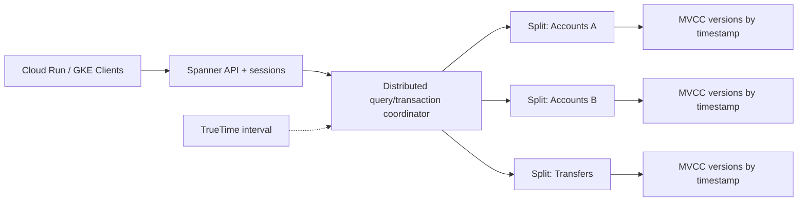
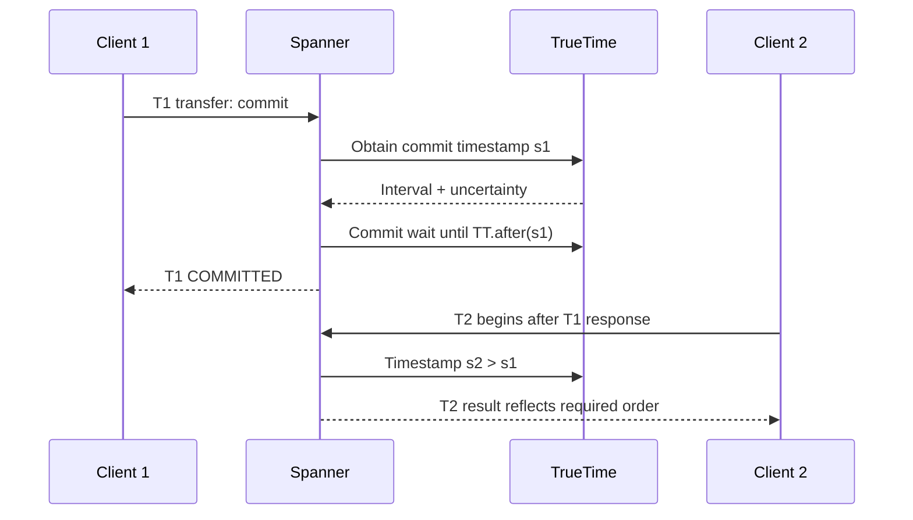
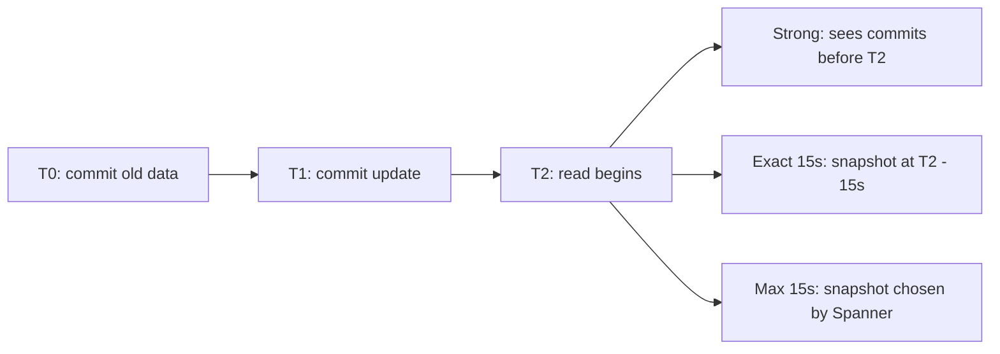
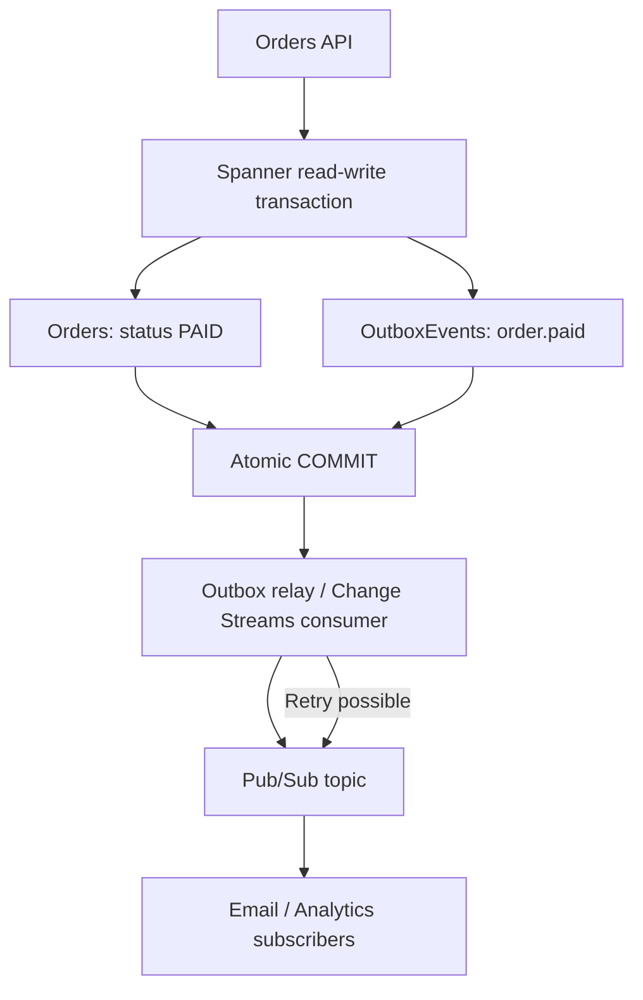

# Transactions, Consistency, and Spanner's Time Model

A customer transfers 300,000 VND from wallet A to wallet B. The service must guarantee that **either both balances change together or neither changes**, even when rows are distributed across multiple machines/regions. At the same time, a reporting system wants consistent data but tolerates a 15-second lag to reduce query latency. **Google Cloud Spanner** solves both requirements through distributed transactions, timestamp-versioned data (MVCC), and the distributed clock **TrueTime**.

This lesson belongs to the **Spanner** chapter of the `CLOUD_PROVIDERS_GCP` module: learners connect project/IAM/VPC fundamentals with applications running on Compute Engine, GKE, and Cloud Run, storage and database choices, release automation, SLO monitoring, and cost. The focus is on **choosing the right transaction type and data freshness for business logic**, rather than assuming every query uses the same consistency or pays the same cost.

> Projects, balances, and commands in this lesson are examples. Commands creating databases, running DDL/DML, or executing transactions can modify data and incur charges; run them only in an authorized sandbox. SQL examples use the **Spanner GoogleSQL dialect** and do not apply directly to the Spanner PostgreSQL dialect.

## 1. Learning Outcomes

After this lesson, you will be able to:

1. Explain **ACID**, **serializable isolation**, **external consistency**, **TrueTime**, and **MVCC** in Spanner.
2. Distinguish read-write transactions, read-only snapshot transactions, single-use reads, and partitioned DML.
3. Choose **strong**, **exact staleness/read timestamp**, or **bounded staleness** based on freshness needs.
4. Perform atomic multi-row reads/writes with the Java Spanner client library and handle `ABORTED` errors properly.
5. Use commit timestamps, understand version retention limits, and avoid timestamp-based hotspots.
6. Identify risks around concurrency, transaction retries, side effects, multi-region latency, and cost.
7. Apply these concepts to an Orders/Payments system and design consistency tests.

## 2. Data Model: A Consistent State at a Point in Time

Spanner stores multiple **versions** of a value, each associated with a commit timestamp. Reading at timestamp `t` returns a **consistent snapshot** of data committed up to `t`; half a transaction is never visible.



If transferring 30 units from A (100) to B (50):

| Logical Read Time | Balance A | Balance B | Total |
| --- | ---: | ---: | ---: |
| Before transaction | 100 | 50 | 150 |
| **After commit** | 70 | 80 | 150 |

A consistent snapshot read **must never** observe A=70, B=50 when the same transaction wrote both rows. That is **atomicity**. However, if the application executes **two separate strong reads** at different instants, one could read A before the commit and the other read B after the commit. To aggregate consistently, read both inside **the same read-only transaction/snapshot**.

### 2.1. ACID and Transaction Scope

| Property | Meaning in Spanner | What the App Remains Responsible For |
| --- | --- | --- |
| **Atomicity** | Changes in a read-write transaction commit together or roll back | Never sneak external payment/email API calls inside a retriable callback |
| **Consistency** | Transactions/constraints and isolation protect DB state | Business rules like non-negative balances must still be coded and tested |
| **Isolation** | Defaults to `SERIALIZABLE`, providing strong guarantees for concurrent transactions | Pick the right isolation level; weaker modes allow anomalies |
| **Durability** | Successful commits are protected by Spanner's replication/consensus model | Does not replace backups, audits, or downstream reconciliation |

Spanner transactions can span multiple tables and splits **within a single database**. It is **not a distributed ACID transaction across every external service**: Cloud SQL, Pub/Sub, Stripe, or another payment service need their own idempotency/outbox/Saga mechanisms.

## 3. TrueTime and External Consistency

### 3.1. TrueTime Is Not a Clock with a Zero-Error Exact Instant

TrueTime provides a bounded real-time uncertainty interval: `TT.now() = [earliest, latest]`. Spanner uses this interval to assign **commit timestamps** and perform **commit wait**, ensuring timestamps match the observable order of completed transactions. This is how Spanner preserves real-time ordering even when data spans different regions.



**External consistency** (external serializability) means: transactions behave as if executed in a serial order **and** that order respects real-time order whenever one transaction finishes before the next begins committing. It is far stronger than "all replicas will eventually sync up."

**Do not equate commit timestamps with application server clocks.** App server timestamps from `System.currentTimeMillis()` can skew; Spanner commit timestamps are assigned at commit. Two transactions writing to **disjoint data** can share the exact same commit timestamp; never use the timestamp alone as a unique ID key.

### 3.2. Why Can Strong Reads Be Consistent Across Regions?

Spanner uses **MVCC + timestamp ordering** to serve a consistent snapshot. A strong read must reflect every transaction committed before the read began, regardless of which eligible replica serves it. Synchronization/consensus, data distribution, and leader placement affect latency; **strong consistency does not mean every read has local-RAM latency**.

A **stale read** chooses a past timestamp yet **remains consistent at that timestamp**, unlike eventual consistency models where a single read might see fragments from inconsistent instants. In multi-region setups, appropriate stale reads can be served near the client, cutting latency and read load.

## 4. Isolation Levels: Default SERIALIZABLE, Optional REPEATABLE_READ

Spanner currently supports two isolation levels for suitable scenarios:

| Isolation | Model | Characteristics | When to Choose |
| --- | --- | --- | --- |
| **SERIALIZABLE** (default) | External consistency; defaults to pessimistic concurrency control | Can acquire locks, wait, and abort under contention | Money transfers, inventory, multi-row invariant checks |
| **REPEATABLE_READ** | Snapshot isolation; defaults to optimistic concurrency control | Reads at a consistent snapshot, detects write conflicts at commit | Workloads accepting snapshot isolation anomalies and verified against business rules |

**Never claim all Spanner transactions are always externally consistent regardless of isolation level.** The external consistency guarantee applies to **serializable isolation**; repeatable read permits anomalies that serializable prevents, classically **write skew**.

### 4.1. Write Skew: Two Transactions Reading the Same Snapshot

Suppose an on-call schedule lists doctors A and B with the rule "at least one doctor must always remain on call." T1 sees B is on call and marks A off; concurrently, T2 sees A is on call and marks B off. Because both write to **two different rows**, snapshot isolation can allow both to commit, leaving **nobody on call**.

For invariants spanning multiple rows, use **SERIALIZABLE** and place both the check and updates inside the **same transaction**; expect `ABORTED` and retry the entire transaction on conflict. Avoid checking outside the transaction and running an independent `UPDATE`.

### 4.2. Pessimistic and Optimistic Concurrency

- **Pessimistic:** acquires locks covering read/written ranges to block conflicting concurrent transactions; works well under high contention, though long transactions hold locks longer.
- **Optimistic:** reads a snapshot without holding active read locks, checking for conflicts at commit; suits certain read-heavy workloads, though commits may abort and retry.
- Isolation level and lock mode are configured separately; do not infer a fixed locking behavior in every version or transaction purely from the isolation name.

**Practice:** start with the default `SERIALIZABLE` unless business logic is proven safe under `REPEATABLE_READ`. If tuning isolation for latency, test concurrent transactions and anomalies rather than benchmarking single queries in isolation.

## 5. Spanner Transaction Types

| Type | Allows Writes? | Guarantees | Ideal Use Case |
| --- | --- | --- | --- |
| **Read-write transaction** | Yes | Atomically commits reads + writes; serializable by default | Updating multiple accounts or inventory |
| **Read-only transaction** | No | Multiple reads at the **same snapshot timestamp**, no commit needed | Multi-table reports needing consistency |
| **Single-use read** | No | Single read/query with a timestamp bound, avoiding transaction lifecycle overhead | Fetching rows from a single table |
| **Partitioned DML** | Yes | One statement split into per-partition transactions; **not table-wide atomic** | Idempotent backfills, large-scale cleanup |

### 5.1. Read-Write Transactions

A transaction can read first and then decide what to write; Spanner protects consistency via concurrency control and its transaction protocol (potentially using two-phase commit across multiple splits). On conflict, it returns `ABORTED`: **re-execute the entire transaction logic**, not just resend a commit request over stale read values.

Avoid holding a transaction open while waiting on user input, calling external APIs, or sleeping; this increases lock contention, timeouts, aborts, and cost. With the Java Spanner client library, `TransactionRunner` automates retries on `ABORTED` for well-behaved callbacks.

### 5.2. Read-Only Snapshot Transactions

Spanner picks one read timestamp and keeps it fixed across multiple `SELECT` statements within the same read-only transaction. It performs no mutations, requires no commit, and generally takes no read locks; however, it may wait briefly for active writes to establish a consistent snapshot. **Two separate read-only transactions** may pick different timestamps even if both are strong.

Ideal for summing two balances, joining `Orders` and `OrderLines`, or rendering multi-part reports that require a single snapshot. Do not keep read-only transactions alive too long due to session/resource consumption, timestamp retention, and report staleness.

### 5.3. Partitioned DML Is Not an Atomic Multi-Row Transaction

Partitioned DML splits a sufficiently simple `UPDATE`/`DELETE` statement into multiple per-partition transactions. **Already-committed partitions are not rolled back** if a later partition fails; the statement must be **idempotent** because the system can retry a partition.

| Valid in Principle | Inappropriate |
| --- | --- |
| `UPDATE Orders SET Archived = TRUE WHERE CreatedAt < TIMESTAMP("2025-01-01T00:00:00Z")` | `UPDATE Accounts SET Balance = Balance - 100` (not idempotent) |
| Assigning a fixed value per row independently | Two-row money transfer requiring atomicity |

Partitioned DML executes **one DML statement** per invocation and carries partitioning restrictions; it does not provide whole-operation atomicity or rollback. For high-throughput blind writes, evaluate the **Batch Write API** and accept its distinct semantics.

## 6. Choosing Read Freshness: Strong, Exact, and Bounded Staleness

Spanner provides **timestamp bounds** for read-only transactions or single reads. A bound specifies freshness at a **snapshot timestamp**, not retry counts or timeouts.

| Timestamp Bound | Read Timestamp Chosen | Guarantee | Use Case |
| --- | --- | --- | --- |
| **Strong** (default) | Current timestamp chosen by Spanner | Sees all commits finished before the read starts | Payment status, account balance |
| **Exact staleness** | Exact `now - Δ` (approximately when the read starts) | Consistent snapshot at a deterministic offset | Dashboards tolerating 15 s staleness |
| **Exact read timestamp** | Specific UTC/commit timestamp | Multiple separate queries can re-read **the same snapshot** while retained | Reconciliation or report comparison |
| **Bounded staleness** | Spanner picks a timestamp no older than the bound | Consistent snapshot; often favors a nearby replica | Fast product pages tolerating bounded lag |

### 6.1. Strong Means Latest *When the Read Starts*, Not a Time Lock

If T1 committed before a **strong read** started, the read must see T1. If T2 commits while the read is already running, the snapshot might **not** include T2. Two separate strong reads can observe different timestamps; to share one snapshot across multiple reads, use a **read-only transaction**.

### 6.2. Exact Staleness and Exact Read Timestamp

With exact staleness = 15 seconds, Spanner reads at a timestamp roughly 15 seconds before the read started. An order committed 3 seconds ago will not appear, **yet every row in the read reflects the same valid snapshot**.

When passing a **specific read timestamp** (e.g., a saved report timestamp), later runs can reproduce the exact same snapshot as long as the timestamp remains within the **version retention window**. If the timestamp is in the future, Spanner may wait until that time arrives instead of returning immediately. Always set request deadlines and never trust client-supplied timestamps to pretend a commit happened.

### 6.3. Bounded Staleness Differs from Exact Staleness

With max staleness = 15 seconds, Spanner chooses the freshest convenient timestamp within the allowed window, often served from a nearby replica without waiting on active write transactions. It **may return fresher data** than exact staleness of 15 seconds, though picking the timestamp adds a step. Two separate reads with the same bound **do not necessarily** use the same timestamp.

**Important limitation:** bounded staleness only supports **single-use reads / single-use read-only transactions**, not multi-use read-only transactions executing multiple reads against a fixed snapshot. When you need multiple reads on one snapshot, use strong or exact timestamp/exact staleness inside a read-only transaction. Stale reads yield clearer benefits when staleness is sufficiently large (Google recommends around 10–15 seconds where applicable); 1 ms of staleness rarely improves latency.



### 6.4. Selecting by API / SLO

| API | Data Requirement | Recommended Bound |
| --- | --- | --- |
| `POST /transfer`, post-transfer balance check | Requires strict transactional integrity | Read-write transaction + strong read if needed |
| `GET /wallet/{id}` right after transfer | Read-your-writes | Strong read or return balance from commit result |
| `GET /catalog` | Tolerates 15-second lag | Exact/bounded staleness, benchmarked |
| `GET /daily-reports` across multiple tables | Same point in time and reproducible | Read-only transaction with exact read timestamp |
| `GET /inventory-to-reserve` | Must not decide writes from stale values | **Read-write transaction** instead of stale `SELECT` then `UPDATE` |

## 7. Commit Timestamps, MVCC, and Version Retention

A **commit timestamp** is chosen when Spanner commits a transaction. In GoogleSQL, set `OPTIONS (allow_commit_timestamp=true)` on a `TIMESTAMP` column, then use `PENDING_COMMIT_TIMESTAMP()` in DML or `Value.COMMIT_TIMESTAMP` in the Java Mutation API.

```sql
-- DDL for Spanner GoogleSQL dialect; sandbox, not PostgreSQL.
CREATE TABLE Accounts (
  AccountId STRING(36) NOT NULL,
  Balance INT64 NOT NULL,
  UpdatedAt TIMESTAMP OPTIONS (allow_commit_timestamp=true)
) PRIMARY KEY (AccountId);
```

Once the table is created, an individual DML statement can store the commit timestamp:

```sql
-- Data change: run only on an existing sandbox account.
UPDATE Accounts
SET Balance = 70000, UpdatedAt = PENDING_COMMIT_TIMESTAMP()
WHERE AccountId = "A";
```

Because the timestamp is unknown until commit, **after writing `PENDING_COMMIT_TIMESTAMP()`, subsequent SQL reads on the same table/index inside the same transaction can be rejected**. Perform reads/checks first, and write the commit timestamp toward the end of the transaction.

**Do not use commit timestamps as unique IDs:** two commits touching disjoint fields can share the same timestamp. Placing a monotonically increasing timestamp at the **head of a primary key or secondary index** can cause a **hotspot**; use well-distributed keys instead of `(CommitTs)` alone as a primary key for high-write tables.

### 7.1. Retention Limits Time Travel

Spanner **garbage-collects** old versions. The database option `version_retention_period` supports retaining versions from **1 hour to 7 days**, defaulting to **1 hour** per current DDL docs; reading older than `earliest_version_time` fails, as GC'd data cannot be recovered.

```sql
-- READ-ONLY: inspect current retention setting in Console/API.
-- Example DDL when changing retention is needed (affects storage/cost):
ALTER DATABASE `orders-db` SET OPTIONS (version_retention_period = '1d');
```

The DDL above **modifies database configuration** and applies only if the database name/dialect matches. Longer retention helps audits and point-in-time reads, but consumes storage and has limits. **Retention does not replace backups/PITR, change streams, or long-term business archiving.**

## 8. gcloud Lab: Strong Reads and Reading at a Specific Timestamp

Assume instance `orders-spanner` and database `orders-db` already exist in project `orders-lab`, using **GoogleSQL**, with an `Accounts` table and sample rows. If resources do not exist yet, an administrator must create the instance/database with approved region config, billing, and IAM; never run instance-creation commands in production.

### 8.1. Inspecting Instance/Database and Schema (Read-Only)

```bash
PROJECT_ID="orders-lab"
INSTANCE="orders-spanner"
DATABASE="orders-db"

gcloud spanner instances describe "$INSTANCE" --project="$PROJECT_ID"
gcloud spanner databases describe "$DATABASE" \
  --instance="$INSTANCE" --project="$PROJECT_ID"
gcloud spanner databases ddl describe "$DATABASE" \
  --instance="$INSTANCE" --project="$PROJECT_ID"
```

### 8.2. Creating the Table in the Sandbox (If Not Present)

```bash
# SCHEMA CHANGE / BILLABLE. Do not run if the table already exists.
gcloud spanner databases ddl update "$DATABASE" \
  --instance="$INSTANCE" --project="$PROJECT_ID" \
  --ddl='CREATE TABLE Accounts (AccountId STRING(36) NOT NULL, Balance INT64 NOT NULL, UpdatedAt TIMESTAMP OPTIONS (allow_commit_timestamp=true)) PRIMARY KEY (AccountId)'

# DATA CHANGE: two separate statements, demo balances (app-defined units).
gcloud spanner databases execute-sql "$DATABASE" \
  --instance="$INSTANCE" --project="$PROJECT_ID" \
  --sql='INSERT INTO Accounts (AccountId, Balance) VALUES ("A", 100), ("B", 50)'
```

If re-running the script, `INSERT` can fail with a duplicate primary key error: **never delete real data just to re-run a demo**. Two consecutive `execute-sql` commands **do not share a transaction**; atomic transfers are implemented using the Java client in section 9.

### 8.3. Strong Read via CLI

```bash
# READ-ONLY: latest data committed before the read starts.
gcloud spanner databases execute-sql "$DATABASE" \
  --instance="$INSTANCE" --project="$PROJECT_ID" \
  --strong \
  --sql='SELECT AccountId, Balance FROM Accounts ORDER BY AccountId'
```

### 8.4. Reading at a Specific UTC Timestamp

```bash
# READ-ONLY: substitute an actual TIMESTAMP still within version retention.
READ_TS="2026-11-19T01:00:00Z"
gcloud spanner databases execute-sql "$DATABASE" \
  --instance="$INSTANCE" --project="$PROJECT_ID" \
  --read-timestamp="$READ_TS" \
  --sql='SELECT AccountId, Balance FROM Accounts ORDER BY AccountId'
```

**The timestamp is illustrative:** if older than retention or before table creation, the command fails. Never hardcode the same sample timestamp for real environments; capture a valid timestamp from an execution/read transaction or stored commit timestamp.

## 9. Java: Atomic Balance Transfer with TransactionRunner

Java apps on Cloud Run or GKE should use the **Google Cloud Spanner Java client library** rather than building custom transaction protocols. Declare `com.google.cloud:google-cloud-spanner` using versions managed by the **Google Cloud Libraries BOM** or project dependency management; authenticate via **Application Default Credentials / Workload Identity**.

### 9.1. Obtaining a DatabaseClient

```java
import com.google.cloud.spanner.*;
import com.google.cloud.Timestamp;

// Initialize one Spanner client and reuse it across requests.
String projectId = "orders-lab";
String instanceId = "orders-spanner";
String databaseId = "orders-db";

try (Spanner spanner = SpannerOptions.newBuilder()
         .setProjectId(projectId).build().getService()) {
  DatabaseClient db = spanner.getDatabaseClient(
      DatabaseId.of(projectId, instanceId, databaseId));
  // Call methods from sections 9.2/9.3 with db.
}
```

This is a **snippet inside a Java method**, not a standalone Java file. In a real service, create the `Spanner` client once for the application lifecycle to reuse its **session pool**, rather than opening/closing a client per HTTP request. Database permissions and the `spanner.googleapis.com` API must be enabled; never bake JSON service account keys into containers.

### 9.2. A Two-Row Transfer Transaction

Suppose the `Accounts` table from section 7 has A=100, B=50 in integer units, and a user requests transferring 30:

```java
import com.google.cloud.Timestamp;
import com.google.cloud.spanner.*;
import java.util.List;
import java.util.Objects;

static Timestamp transfer(DatabaseClient db, String fromId,
                          String toId, long amount) {
  if (amount <= 0 || fromId.equals(toId)) {
    throw new IllegalArgumentException("Invalid transfer");
  }

  TransactionRunner runner = db.readWriteTransaction();
  runner.run(tx -> {
    Struct from = Objects.requireNonNull(
        tx.readRow("Accounts", Key.of(fromId), List.of("Balance")));
    Struct to = Objects.requireNonNull(
        tx.readRow("Accounts", Key.of(toId), List.of("Balance")));

    long beforeFrom = from.getLong("Balance");
    long beforeTo = to.getLong("Balance");
    if (beforeFrom < amount || beforeTo > Long.MAX_VALUE - amount) {
      throw new IllegalStateException("Insufficient funds or overflow");
    }

    tx.buffer(Mutation.newUpdateBuilder("Accounts")
        .set("AccountId").to(fromId)
        .set("Balance").to(beforeFrom - amount)
        .set("UpdatedAt").to(Value.COMMIT_TIMESTAMP)
        .build());
    tx.buffer(Mutation.newUpdateBuilder("Accounts")
        .set("AccountId").to(toId)
        .set("Balance").to(beforeTo + amount)
        .set("UpdatedAt").to(Value.COMMIT_TIMESTAMP)
        .build());
    return null;
  });
  // Only read commit timestamp AFTER runner.run() succeeds.
  return runner.getCommitTimestamp();
}
```

Both mutations commit **atomically**; if funds are insufficient, the callback throws an exception and nothing commits. On conflict, `TransactionRunner` can rerun the entire callback with a fresh snapshot/locks. Never put `sendEmail()`, `chargeCard()`, or `publishPubSub()` **inside** the callback: they could fire multiple times even though Spanner commits at most once.

This is a **technical sample**, not yet production-ready: production requires caller authentication, wallet ownership checks, duplicate-transfer protection across retried HTTP requests, amount limits, an immutable ledger, and auditing. If an API call retries after a successful commit whose response was lost, another `transfer` invocation could transfer money twice. Use a **unique `operationId`**, persist the result in the same transaction, and return the stored outcome on duplicate requests.

### 9.3. Read-Only Snapshots and Stale Reads

```java
import com.google.cloud.spanner.*;
import java.util.concurrent.TimeUnit;

static void readConsistentBalances(DatabaseClient db) {
  // Both reads share a single snapshot timestamp.
  try (ReadOnlyTransaction snap = db.readOnlyTransaction()) {
    Struct a = snap.readRow("Accounts", Key.of("A"),
                            java.util.List.of("Balance"));
    Struct b = snap.readRow("Accounts", Key.of("B"),
                            java.util.List.of("Balance"));
    System.out.printf("A=%d, B=%d, readTs=%s%n",
        a.getLong("Balance"), b.getLong("Balance"),
        snap.getReadTimestamp());
  }
}

static void read15SecondsOld(DatabaseClient db) {
  // Single-use query, approximately 15 seconds in the past.
  try (ResultSet rows = db
      .singleUse(TimestampBound.ofExactStaleness(
          15, TimeUnit.SECONDS))
      .executeQuery(Statement.of(
          "SELECT AccountId, Balance FROM Accounts ORDER BY AccountId"))) {
    while (rows.next()) {
      System.out.printf("%s=%d%n",
          rows.getString("AccountId"), rows.getLong("Balance"));
    }
  }
}
```

For a single **bounded** stale read, change to `TimestampBound.ofMaxStaleness(15, TimeUnit.SECONDS)`. If two queries need **the same snapshot**, keep `ReadOnlyTransaction` or pass a valid exact `readTimestamp`—never run two separate `singleUse(...)` calls and assume their timestamps match. SDK calls can throw errors if a row does not exist or a read timestamp is too old; the snippet is intentionally concise, so real apps must handle exceptions.

## 10. Concurrency, ABORTED, and Proper Retries

At the same instant, T1 and T2 both attempt to debit A. Both might initially read the starting balance; Spanner must prevent both from committing against stale state and breaking invariants. Under serializable isolation, conflicting transactions wait or one receives **`ABORTED`**, depending on keys, contention, and execution paths.

### 10.1. Common Errors

| Code / Status | Common Meaning | How to Handle |
| --- | --- | --- |
| `ABORTED` | Transaction aborted due to conflict/concurrency or transient cause | **Retry the entire read–check–write** with backoff; use `TransactionRunner` |
| `DEADLINE_EXCEEDED` | Response did not arrive before deadline | Distinguish read vs. commit timeout; **never assume a write definitely failed** |
| `UNAVAILABLE` | Transient connectivity/service error | Bounded retry via SDK; retain idempotency key |
| `FAILED_PRECONDITION` | Timestamp too old or prerequisite violated | Check retention, schema, transaction mode; do not retry endlessly |
| `PERMISSION_DENIED` | Missing IAM or database role | Fix exact permissions; never grant project Owner |
| `RESOURCE_EXHAUSTED` | Quota/capacity/session pressure | Rate limit, optimize queries, scale resources properly |

**Commit timeouts / unknown outcomes are especially dangerous:** the client may not receive a response even though the DB committed. Re-read by **`operationId` or ledger** to determine state before issuing another write with side effects. For automatic transaction retries, callbacks must be **deterministic from the values read** and free of external side effects.

### 10.2. Reduce Contention Instead of Just Increasing Retries

- Keep transactions **short**; never call HTTP endpoints or wait on users inside them.
- Access by **primary keys** or tight ranges where possible; avoid full-table scans in read-write transactions.
- Avoid a single global counter row receiving every write; consider **sharded counters** or domain partitioning.
- Use read-only transactions for reports instead of unnecessarily acquiring read-write locks.
- Use sound schemas/indexes and well-distributed keys; watch out for sequential keys, timestamp-leading keys, and index hotspots.
- Measure **abort rate, lock wait, transaction attempts, and commit latency** before and after tuning.

If errors appear only under rising concurrency, **adding compute nodes will not always fix a single-key hotspot**. Change the data design/key partitioning and throttle input load.

## 11. Cross-Service Consistency and the Outbox Pattern

Spanner guarantees atomicity **within one database**; it does not fold Pub/Sub messages and payment HTTP calls into the same transaction. For instance, `Orders` commits successfully, then the worker crashes before publishing `order.paid`; without recovery, downstream systems never learn the order was paid.

**Transactional outbox**: write `Orders` and `OutboxEvents` inside the same Spanner read-write transaction. After commit, a relay reads the outbox, publishes to Pub/Sub, and marks it published. The relay can publish duplicates if an ack is lost, so consumers still require **idempotent `eventId` handling**. Never emit messages from inside a transaction callback before commit completes.



With Spanner **change streams**, you can observe committed changes and build data pipelines; you still must understand semantics, ordering, and potential downstream duplicates. External APIs like payments require **idempotency keys and reconciliation**, even though Spanner transactions are serializable.

## 12. Distributed Latency, Leader Region, and Read Choices

**Consistency and latency** depend on how Spanner coordinates consensus, splits, and client placement:

| Decision | Latency Impact | Notes |
| --- | --- | --- |
| Regional instance configuration | Usually shorter network distance for single-region workloads | Evaluate availability and DR separately |
| Multi-region configuration | Geographically spread reads/writes with leader and replication quorum | Remote strong reads/writes may incur extra round trips |
| Strong read | Must reflect every commit finished prior to read start | May require communicating with leader/appropriate replicas |
| Exact/bounded stale read | Can use nearby replicas to lower latency | Never use for decisions requiring the latest writes |
| Read lease region (where supported) | Can lower strong-read latency in distant regions | Can raise write latency; verify capability and SLOs |
| Multi-split transaction | May require distributed commit coordination (2PC) | Avoid touching more partitions/rows than necessary |

There is no universal constant `write latency = N ms` for every instance: leader placement, partitioning, participant count, load, lock contention, and TrueTime uncertainty all play a role. Measure **end-to-end latency from Cloud Run/GKE by region** and separate server-side commit latency to pinpoint bottlenecks.

**Long-running transactions** increase contention and wait times; read-only transaction durations can also rise when waiting for a snapshot. Never hold a transaction open across a user HTTP request waiting on external callbacks.

## 13. IAM, Connectivity, and Data Security

Spanner is a managed database accessed over Google Cloud APIs; use **Application Default Credentials (ADC)** and IAM, never baking service account JSON keys into images. Cloud Run/GKE can use service accounts and Workload Identity Federation for GKE; when organizational policies require private connectivity/perimeters, evaluate Private Google Access, Private Service Connect for Google APIs, and VPC Service Controls.

| Identity | Recommended Spanner Permission | Notes |
| --- | --- | --- |
| Orders service executing transactions | `roles/spanner.databaseUser` on the specific database, or a narrower **fine-grained database role** | `databaseUser` also grants DDL edits; not strictly read/write least privilege |
| Read-only reporting service | `roles/spanner.databaseReader` or fine-grained role | Never grant write/DDL when unneeded |
| Schema migration pipeline | Role with `spanner.databases.updateDdl` in approved scope | Separate from runtime identity |
| Database/platform admin | `roles/spanner.databaseAdmin`/Admin by scope | Admin tasks only; never attach to business Pods |
| Monitoring operator | Viewer/Monitoring roles sufficient for metrics/insights | Never grant data read/write just to view charts |

**Fine-grained access control** uses database roles with `roles/spanner.fineGrainedAccessUser` and `roles/spanner.databaseRoleUser` paired with IAM conditions per guidance. In multi-tenant systems, Spanner transaction consistency **does not replace tenant ownership checks**: SQL queries and app authorization must enforce tenant boundaries.

### 13.1. Session Pooling

The Spanner Java client manages **sessions**; creating a new client per HTTP request adds overhead and session pressure. With Cloud Run autoscaling, total sessions scale with instance counts, pool sizes, and concurrency. Configure timeouts, warm-up, graceful shutdown, and max instances based on **measured session metrics**.

Avoid logging sensitive parameters to Cloud Logging: log correlation IDs, pseudonymized `operationId`, transaction type, error code, latency, and retry attempts; never log account numbers, PII, or access tokens without valid justification and policy.

## 14. Observability, SLOs, and Cost

Spanner provides Cloud Monitoring, **Query insights**, **Lock insights**, and **Transaction insights**. For read/write transactions, watch **latency, commit latency, attempts/aborts, lock wait, participant counts, CPU, and storage**. Track client-side p95/p99 as well, since server-side metrics omit network and serialization overhead.

| Signal | Operational Question | Priority Action |
| --- | --- | --- |
| Transaction aborts / attempts | Is contention too high? | Reduce hotspots, transaction scope/duration |
| Lock wait and top lock conflicts | Which rows/indexes cause waiting? | Inspect Transaction/Lock insights and query plans |
| Commit latency | How much do consensus/participants/region add? | Compare regions, reduce touched splits |
| Strong vs. stale read p95 | Does the freshness/latency trade-off meet SLOs? | Tune bounds per API type |
| High CPU / storage / sessions | Capacity or query plan issue? | Tune indexes, enable autoscaling per edition |
| `ABORTED`, `DEADLINE_EXCEEDED` errors | Are retries amplifying load? | Bound backoff, verify deadlines |
| Business invariants | Negative balances, mismatched totals, duplicate orders? | Integration tests, audits/reconciliation |

Example SLOs:

- **Payments:** 99.95% of transactions commit successfully and appear in strong reads within the latency target; zero double debits.
- **Reports:** 99% of 15-second stale snapshot queries meet the p95 target, always using valid timestamps.
- **Correctness:** zero ledger invariant violations under concurrent transactions; alert on reconciliation failures, not just HTTP 5xx.

### 14.1. Cost Factors in Consistency Design

| Component | Impact |
| --- | --- |
| Processing capacity (nodes/processing units) | CPU/compute and throughput by edition/region |
| Multi-region replication | Availability, latency, and instance configuration price |
| Storage / MVCC version retention | Longer version retention increases storage usage |
| Backups/PITR, change streams, Data Boost | Recovery/analytics features carry separate billing/limits |
| Read/write operations and network | Cross-region load, remote reads, and response sizes affect latency/cost |
| Cloud Logging/Monitoring and client runtimes | Trace/log ingestion and Cloud Run/GKE compute usage |

**Stale reads are not a universal cost-cutting switch.** They can reduce latency/CPU by serving from nearby replicas when applicable, yet query counts, scanned bytes, instance capacity, and version storage still require optimization. A well-chosen index, eliminating N+1 queries, or offloading analytics to Data Boost can matter far more than tweaking timestamp bounds.

## 15. Orders Scenario: Slow Reports, Yet Transactions Must Be Exact

The Orders application includes:

- `POST /transfer`: updates two wallets and creates a ledger record; requires a **`SERIALIZABLE`** transaction.
- `GET /wallet/{id}`: users who just transferred money need to see the latest state; uses a **strong read**.
- `GET /daily-summary`: aggregates across multiple tables at **the same snapshot**, allowing 15 seconds of staleness.
- `POST /notify`: emits post-commit events via an outbox rather than sending emails directly inside the transaction.

### 15.1. Scenarios and Decisions

| Scenario | Choice | Rationale |
| --- | --- | --- |
| Two concurrent transactions withdraw 80 each from A=100 | Read-write `SERIALIZABLE`, validate balance inside transaction | Prevents both from succeeding on the stale balance |
| `GET` balance immediately after HTTP 200 | Strong read or return balance from commit result | Guarantees read-your-writes |
| Dashboard viewing transaction totals | Read-only snapshot, exact staleness 15 s | Multi-table consistency and lower latency |
| Re-running a finalized report at a past timestamp | Exact read timestamp within retention | Reproduces identical state before versions are GC'd |
| Transaction callback reruns after `ABORTED` | No email/card charge inside callback | Prevents duplicate side effects |
| Client timeout after commit request | Query ledger by `operationId` | Avoids transferring funds twice |

### 15.2. Hypothetical Incident: Mismatched Totals from Two Separate Strong Reads

A team implemented a report with two independent calls: reading wallet A at 10:00:00.000, then reading wallet B at 10:00:00.120. A transfer committed between the two reads; the report summed values from **two different snapshots** and reported an incorrect total.

**Fix:** use **one read-only transaction** for both `SELECT`s (or record/pass an exact read timestamp). You do not turn off strong consistency; what needs fixing is the **snapshot scope across multiple reads**. Concurrency tests should verify invariant sums inside a read-only transaction versus two independent strong reads.

### 15.3. Hypothetical Incident: Re-Executed Transfer Callback

Cloud Run receives a request with `operationId=transfer-1001`. Transaction T1 hits `ABORTED` under contention; the SDK automatically reruns the callback as T2 and commits. If the callback sent a notification before commit, the recipient gets **two emails**. If the HTTP client retries the API after a lost response, money could be transferred a second time even though Spanner committed only one valid transaction per API call.

**Fix:** keep the callback strictly to Spanner reads/writes; save a unique `operationId` and ledger entry alongside the transfer, publish events via an outbox after commit, and check `operationId` before starting a new transaction when receiving an API retry. Test lost responses, concurrent requests with duplicate `operationId`, and post-commit failures.

## 16. Symptom-Based Troubleshooting

| Symptom | Possible Cause | Action |
| --- | --- | --- |
| `ABORTED` spikes at peak traffic | Hot keys/indexes, long transactions, lock contention | Transaction insights, narrow scope, fix key distribution |
| Frequent `DEADLINE_EXCEEDED` | Slow queries, cold sessions, network/region, or locks | Check p95, query plans, session pool, and realistic deadlines |
| Strong read still returns "stale" data | Read started before commit finished, wrong DB/tenant, client cache | Verify commit/result, timestamps, routing, and caching |
| Two strong `SELECT`s produce skewed report | Two different snapshots | Share one read-only transaction |
| Stale read misses just-committed write | Past timestamp chosen by design | Use strong read for read-after-write |
| Bounded staleness fails in multi-use txn | API restricts bounded staleness to single-use | Switch to strong or exact timestamp for multi-use |
| Exact timestamp query fails | Beyond retention, future timestamp, or schema changed | Check `earliest_version_time`, retention, and deadline |
| Duplicate commit timestamps | Disjoint transactions can share a timestamp | Use a distinct `operationId`/primary key |
| Scanning/updating millions of rows hits limits | Using a large read-write txn instead of partitioned DML | Switch to idempotent partitioned DML / batch writes as appropriate |
| Partitioned DML partially completed on error | Not atomic across the whole table | Reconcile partitions, rerun idempotent statement |
| Java client opens too many sessions | Creating clients per request, rapid autoscaling | Reuse `Spanner` client, tune pool/max instances |
| `PERMISSION_DENIED` | Missing IAM or database role | Grant scoped DB/role permissions; never project Owner |
| Multi-region write latency rises | Leader/quorum location, many splits, lock waits | Measure commit latency, locality, and transaction scope |

## 17. Practice Exercises

### Exercise A — ACID and Snapshots

Two accounts hold A=100, B=50; one transfer moves 30 from A to B. Diagram valid states before/after commit. Why can two separate strong `SELECT`s yield an inconsistent sum while one read-only transaction cannot?

### Exercise B — TrueTime and External Consistency

Explain the `[earliest, latest]` interval, commit wait, and ordering between T1 and T2 when T1 finishes before T2 begins committing. Distinguish external consistency from eventual consistency and from a single strong read.

### Exercise C — Serializable and Repeatable Read

Using the two on-call doctors scenario where both try to go off call, design two concurrent transactions illustrating **write skew** under snapshot isolation. Why does serializable protect the "at least one doctor on call" invariant?

### Exercise D — Java Transactions and ABORTED

In the sandbox, use the `Accounts` table and Java `TransactionRunner` to transfer 30 units. Spawn two threads transferring concurrently from a small account; log retry attempts and commit results. Why must you not send emails/charge cards inside the callback, and why is `operationId` still required beyond internal retries?

### Exercise E — Timestamp Bounds

A dashboard tolerates up to 15 seconds of staleness; a transfer screen must show the latest result. Choose strong, exact, or bounded staleness. Explain why two bounded reads may choose different timestamps and how to reproduce a report at the exact same snapshot.

### Exercise F — Commit Timestamps and Retention

Add an `UpdatedAt` column supporting `allow_commit_timestamp=true`, write rows using `PENDING_COMMIT_TIMESTAMP()`, and read them back. Give two reasons timestamps should not serve as unique IDs or leading index keys. Test reading at a timestamp older than a one-hour retention window.

### Exercise G — DML or Partitioned DML?

Classify these tasks: transferring 100 between two accounts, setting `Archived=TRUE` on millions of old orders, and increasing every balance by 10%. Which fits partitioned DML, and why do idempotency and partial completion matter?

### Exercise H — SLOs and Fault Tolerance

Design a dashboard of up to eight charts covering abort rate, lock wait, transaction latency, commit latency, CPU, sessions, query latency, and business anomalies. Describe the runbook when Cloud Run returns a timeout after a commit request: how do you verify whether the transaction happened without double-charging?

### Self-Check Questions

1. Under which default isolation level does Spanner guarantee external consistency?
2. Is repeatable read equivalent to serializable/external consistency?
3. Does a strong read necessarily see a transaction that commits *after* the read has started?
4. Why can two separate strong reads return results from different snapshots?
5. How do exact staleness and bounded staleness differ?
6. Can bounded staleness be used inside a multi-use read-only transaction?
7. How does `TransactionRunner` handle `ABORTED`?
8. Can `PENDING_COMMIT_TIMESTAMP()` be used as a globally unique ID?
9. Does Partitioned DML roll back the entire table if one partition fails?
10. Why does a Spanner ACID transaction not automatically include Pub/Sub messages or external HTTP payment calls?

## 18. Deployment Checklist and Official Documentation

- [ ] Clearly choose transaction isolation level; default to `SERIALIZABLE` unless another level is proven safe.
- [ ] Place all read-dependent writes inside the **same read-write transaction**.
- [ ] Use **one snapshot** or exact read timestamp for multi-`SELECT` reports.
- [ ] Use strong reads for read-after-write; reserve stale bounds for data tolerant of lag.
- [ ] Retry the full transaction on `ABORTED`, with no external side effects inside callbacks.
- [ ] Design API `operationId`/idempotency and reconciliation for uncertain commit outcomes.
- [ ] Configure commit timestamps and version retention properly, avoiding hotspots and expired history reads.
- [ ] Review IAM/database roles, session pooling, region/quorum locality, SLOs, quotas, and billing.

Official Google Cloud Documentation:

- [Transactions overview](https://cloud.google.com/spanner/docs/transactions)
- [TrueTime and external consistency](https://cloud.google.com/spanner/docs/true-time-external-consistency)
- [Isolation levels overview](https://cloud.google.com/spanner/docs/isolation-levels)
- [Concurrency control](https://cloud.google.com/spanner/docs/concurrency-control)
- [Timestamp bounds](https://cloud.google.com/spanner/docs/timestamp-bounds)
- [Reads outside transactions](https://cloud.google.com/spanner/docs/reads)
- [Java read-write transaction sample](https://cloud.google.com/spanner/docs/samples/spanner-read-write-transaction)
- [Java read stale data sample](https://cloud.google.com/spanner/docs/samples/spanner-read-stale-data)
- [Commit timestamps in GoogleSQL](https://cloud.google.com/spanner/docs/commit-timestamp)
- [Data Manipulation Language best practices](https://cloud.google.com/spanner/docs/dml-best-practices)
- [Partitioned DML](https://cloud.google.com/spanner/docs/dml-partitioned)
- [Point-in-time recovery/version retention](https://cloud.google.com/spanner/docs/pitr)
- [Lock and Transaction insights](https://cloud.google.com/spanner/docs/use-lock-and-transaction-insights)
- [Spanner IAM roles](https://cloud.google.com/spanner/docs/iam)
- [Spanner pricing](https://cloud.google.com/spanner/pricing)

**Remember:** Spanner supports distributed ACID transactions and **external consistency under its default serializable isolation**, powered by TrueTime/commit timestamps and MVCC. Strong reads observe commits completed before the read begins; stale reads remain consistent at a past timestamp; **multiple reads needing consistency require a shared snapshot**. Keep transactions short, retry safely, enforce business invariants, and monitor aborts, locks, and latency rather than relying solely on database correctness.
