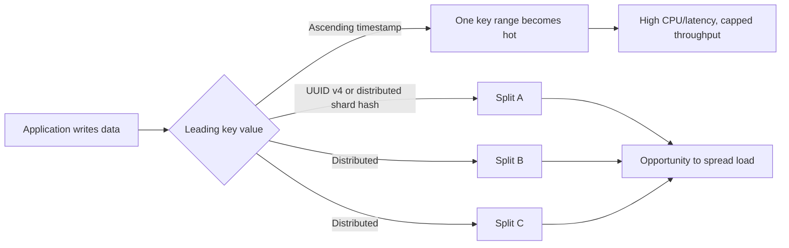

# Indexes, Query Plans, and Avoiding Hotspots

> **Chapter:** Spanner  
> **Module:** CLOUD_PROVIDERS_GCP  
> **Module scope:** Explore Google Cloud from project organization, IAM, and VPC to Compute Engine, GKE, Cloud Run, storage services, and databases. Through deployment scenarios, learners select services, secure resources, automate releases, and monitor reliability alongside cost.

Spanner distributes data by **key ranges** across serving resources. This enables scalability, yet it also makes **primary key**, **secondary index**, and **query** design directly govern performance: a query missing an index can scan many rows, while an index starting with a monotonically increasing timestamp can funnel every write into a single hot region (**hotspot**).

This lesson consistently uses the **GoogleSQL dialect** to design indexes, read execution plans, investigate with Query Insights/Key Visualizer, and pick hotspot-avoidance strategies. SQL snippets are learning material; hands-on steps are read-only on an **existing Spanner sandbox database**. Creating tables/indexes or generating test load is optional and requires approval—never run them on production databases.

## Learning Objectives

After this lesson, you will be able to:

1. Explain primary-key indexes, secondary indexes, **key prefixes**, `STORING`, and index back joins.
2. Create indexes tailored to `WHERE`, `ORDER BY`, and `LIMIT`, balancing read latency against write amplification.
3. Read query plans with `PLAN` and `PROFILE`, recognizing scans, filters, distributed execution, and base-table lookups.
4. Identify hotspots caused by **monotonic primary keys/indexes**, low-cardinality values, or heavily contended single keys.
5. Choose well-distributed UUIDs, bit-reversed sequences, composite keys, or **hash/shard prefixes**, understanding fan-out query trade-offs.
6. Use Query Insights, Index Advisor, Key Visualizer, and metrics to collect before/after optimization evidence.

## 1. Why Does Key-Range Distribution Matter?

Spanner stores tables and indexes ordered by **key**; the platform divides those key ranges into **splits** and allocates them to serve traffic. Adding compute capacity will not fix a design that continuously writes to the **tail of a single key range**.



A **hotspot** occurs when many requests concentrate on one split/server or a group of rows/keys to the point of overload. There are at least three distinct causes:

| Hotspot Type | Example | Direction to Address |
|---|---|---|
| **Sequential write** | Primary key starts with ascending `CreatedAt` | Use UUID v4, bit-reversed sequence, or hash/shard key |
| **Secondary-index write** | PK is UUID, yet index starts with `CreatedAt DESC` or `Status='NEW'` + timestamp | Fix the **index key**, not just the primary key |
| **Hot row / hot logical key** | Every transaction increments one total-amount row | Split counters/transactions, partition domain logic, cut contention |

**Rule:** both the **base table and every secondary index** are key-ordered structures. A new index can speed up reads while making **writes slower** if the index key converges on a single range.

## 2. Primary Keys and Secondary Indexes

The primary key uniquely identifies each row and supports key lookups. Spanner organizes table data by its primary key automatically; never create a secondary index identical to the primary key.

**GoogleSQL example:** a multi-tenant orders table; `OrderId` is application-generated as UUID v4 rather than a sequential number.

```sql
-- ILLUSTRATIVE DDL; apply only if you have an authorized lab database.
CREATE TABLE Orders (
  TenantId STRING(36) NOT NULL,
  OrderId STRING(36) NOT NULL,
  CustomerId STRING(36) NOT NULL,
  CreatedAt TIMESTAMP NOT NULL,
  Status STRING(16) NOT NULL,
  TotalAmount NUMERIC,
  ExternalRef STRING(64)
) PRIMARY KEY (TenantId, OrderId);

CREATE INDEX OrdersByCustomerCreatedAt
ON Orders(TenantId, CustomerId, CreatedAt DESC)
STORING (Status, TotalAmount);
```

Analysis:

- Primary key `(TenantId, OrderId)` groups rows by tenant and spreads `OrderId` across the keyspace **within each tenant** if IDs are well distributed. An ultra-hot tenant still requires monitoring.
- Index `(TenantId, CustomerId, CreatedAt DESC)` serves queries finding orders by **tenant + customer** and returns newest orders first without sorting the entire dataset.
- `STORING (Status, TotalAmount)` copies two columns into the index, turning it into a **covering index** for certain common `SELECT` queries.
- Since `OrderId` belongs to the primary key, it can be retrieved directly from the secondary-index entry per Spanner's storage model.

### 2.1. Index Key Prefix and Column Order

Suppose a common query is:

```sql
SELECT OrderId, CreatedAt, Status, TotalAmount
FROM Orders
WHERE TenantId = 'tenant-blue'
  AND CustomerId = 'customer-007'
ORDER BY CreatedAt DESC
LIMIT 20;
```

The index matches well because both **equality** predicates come first, followed by `CreatedAt DESC` to fetch the latest 20 rows. However, filtering only by `WHERE CustomerId = ...` without `TenantId` prevents Spanner from using the index as efficiently as a full-prefix query. Similarly, once a **range predicate** begins, trailing columns become less effective for narrow range seeking.

A **single index does not optimize every query**. Choose column order based on real query patterns and data distribution, rather than blindly placing "commonly queried" columns first.

### 2.2. Covering Indexes vs. Back Joins

When a query needs a column **not stored in the index**, Spanner can scan the index to find matching keys and then **back-join** to the base table for missing columns:

```text
Index scan → find PKs matching filter conditions
           → table lookup / distributed cross apply
           → read missing columns from base table
           → return results
```

`STORING` eliminates these lookups at the cost of increased:

- Storage footprint and billing.
- Write/maintenance work on the index whenever stored columns change.
- Backfill overhead when adding an index to a populated table.

Never reflexively add `STORING` for every column or run `SELECT *`. Measure **rows scanned, latency, CPU, lookup count**, and write load before deciding.

### 2.3. NULL_FILTERED and UNIQUE

If `ExternalRef` is populated on only a small fraction of orders, a regular index still stores rows with `NULL`. GoogleSQL lets an index exclude rows where index-key columns are `NULL`:

```sql
CREATE NULL_FILTERED INDEX OrdersByExternalRef
ON Orders(TenantId, ExternalRef);
```

Queries wishing to use this index must exclude the corresponding `NULL` rows:

```sql
SELECT OrderId
FROM Orders@{FORCE_INDEX=OrdersByExternalRef}
WHERE TenantId = 'tenant-blue'
  AND ExternalRef = 'merchant-ref-123'
  AND ExternalRef IS NOT NULL;
```

**Do not use `NULL_FILTERED`** if business logic must query `ExternalRef IS NULL` rows via that index. A `UNIQUE` index enforces uniqueness, yet **`UNIQUE NULL_FILTERED`** does not enforce uniqueness across rows excluded from the index for containing `NULL`. If uniqueness is required even with nullable values, design constraints and data normalization accordingly.

**Dialect differences:** in the **Spanner PostgreSQL dialect**, use `INCLUDE` instead of `STORING`, partial indexes `WHERE col IS NOT NULL` instead of `NULL_FILTERED`, and comment-style hints. **Never paste raw GoogleSQL DDL into a PostgreSQL-dialect database.**

## 3. Index Usage: Prefer the Optimizer, Force Only with Evidence

The Spanner optimizer usually chooses automatically between base-table scans and secondary indexes. When testing and comparing a specific index, GoogleSQL supports `FORCE_INDEX`:

```sql
-- Test forcing the index for PLAN/PROFILE comparison.
SELECT OrderId, CreatedAt, Status, TotalAmount
FROM Orders@{FORCE_INDEX=OrdersByCustomerCreatedAt}
WHERE TenantId = 'tenant-blue'
  AND CustomerId = 'customer-007'
ORDER BY CreatedAt DESC
LIMIT 20;

-- Compare against reading the base table, also for diagnostics only.
SELECT OrderId, CreatedAt, Status, TotalAmount
FROM Orders@{FORCE_INDEX=_BASE_TABLE}
WHERE TenantId = 'tenant-blue'
  AND CustomerId = 'customer-007'
ORDER BY CreatedAt DESC
LIMIT 20;
```

**`FORCE_INDEX` is a directive:** Spanner errors if the index does not exist or belongs to another table, and may error if forcing a `NULL_FILTERED` index without a matching `IS NOT NULL` predicate. On healthy queries, forcing an index can become **worse** than the optimizer after data volume, statistics packages, or schemas evolve.

### 3.1. Anti-Pattern: Good Index for ORDER BY That Wrecks Write Throughput

```sql
-- Not recommended for high-write tables with monotonically increasing CreatedAt.
CREATE INDEX OrdersByCreatedAt
ON Orders(CreatedAt DESC);

-- Risks similar hot ranges if most writes have Status='NEW'.
CREATE INDEX OrdersByStatusTime
ON Orders(Status, CreatedAt DESC);
```

Even when `OrderId` is a random UUID, **every insert also updates secondary indexes**. With a timestamp-leading index, most writes converge at the head/tail of a single key range; with `Status='NEW'`, a large burst of new events also piles into one range. `DESC` only flips which end is hot—**it does not distribute writes**.

## 4. Index Lifecycle: Backfills, Quotas, and Cost

Adding an index to a populated table triggers a **backfill** to build index entries. Spanner continues serving traffic while the DDL operation runs, but backfilling consumes resources and can raise latency/write pressure.

**Recommended production workflow:**

1. Use **Query Insights / Index Advisor** to locate workloads needing optimization and record a baseline.
2. Design key ordering, `STORING`, nullability/uniqueness, and assess **write hotspot** risk.
3. Prototype in a staging database with a similar data distribution.
4. Apply DDL during an approved change window, monitoring the **long-running operation/backfill** and CPU/storage headroom.
5. After completion, compare `PLAN`/`PROFILE`, read latency, rows scanned, **and write latency**.
6. If unhelpful, roll back via DDL **only after dependency checks**; never drop an index used by another service.

**Note:** `ALTER INDEX ... ADD STORED COLUMN` can also trigger a backfill and grow index size. Index Advisor provides **suggestions**, not infallible commands for every environment. Major schema or data-distribution shifts may require the optimizer's **next statistics package**.

## 5. Reading Query Plans: PLAN vs. PROFILE

A query plan describes how Spanner executes SQL across machines and splits. `ExecuteSql` query modes:

| Query Mode | Executes SQL? | Returns |
|---|---|---|
| `NORMAL` | Yes | Rows, no plan/stats |
| `PLAN` | **Does not execute query** | **Estimated** plan; no runtime stats |
| `PROFILE` | **Yes** | Rows + plan + aggregate and per-operator stats |
| `WITH_STATS` | Yes | Rows + aggregate stats |
| `WITH_PLAN_AND_STATS` | Yes | Rows + plan + aggregate stats |

**Never run `PROFILE` on a broad scan query in production just to view graphs**: it actually reads data, consumes CPU/I/O, and incurs profiling overhead. Run `PLAN` first; use `PROFILE` only on narrowly scoped `SELECT`s with approved data and timing.

### 5.1. Common Operators

```text
Distributed Union
  └─ Serialize Result
      └─ Limit / Sort
          └─ Filter
              └─ Index Scan  (or Table Scan)
                  └─ [Back Join / Distributed Cross Apply if columns are missing]
```

This is an **illustrative diagram**, not a fixed output structure. Spanner chooses operators based on schema, statistics, query shape, and optimizer version.

| Signal in Plan | Question to Ask |
|---|---|
| **Table Scan** over many rows | Are predicates/indexes selective enough? Is a full table scan truly needed? |
| **Index Scan** + back join | Is adding a few `STORING` columns worth the write/storage overhead? |
| **Filter** above a large scan | Can the predicate be pushed down into the scan? Does the index key prefix match? |
| **Large Sort/TopK** | Does an index provide the required sort order? Is `LIMIT` pushed down? |
| **Many Distributed Union/Apply** and remote calls | How many key ranges/servers does the query touch? Is fan-out needed? |
| **Rows scanned ≫ rows returned** | Are we reading far too many rows only to discard them? |

Do not automatically treat "Table Scan = bug" for `COUNT(*)`, full-table analytical queries, or tiny tables. **What matters is cost relative to business goals.**

### 5.2. Interpreting Metrics with an Example

Suppose a query returns **20 orders**, yet `PROFILE` shows:

| Hypothetical Metric | Before Index | After Covering Index |
|---|---|---|
| Rows returned | 20 | 20 |
| Rows scanned | 500,000 | 22 |
| Remote calls | 180 | 4 |
| p95 latency | 900 ms | 45 ms |

These figures are **educational illustrations, not Google Cloud benchmarks**. To prove an index genuinely helps, measure repeatedly across equivalent workloads, recording CPU, write latency, optimizer version, and statistics package—never compare a cold query against a cached query.

## 6. Table and Index Hotspots: Identifying the True Root Cause

### 6.1. Monotonic Primary Key

```sql
-- Anti-pattern for high-rate inserts into an events table:
CREATE TABLE EventLogBad (
  EventTime TIMESTAMP NOT NULL,
  EventId STRING(36) NOT NULL,
  Payload STRING(MAX)
) PRIMARY KEY (EventTime, EventId);
```

When `EventTime` almost always rises, inserts pile into the **tail of the key range**; flipping `ASC` to `DESC` merely shifts the hotspot from tail to head.

### 6.2. An Independent Index Can Still Get Hot

Suppose you already fixed the event primary key to a UUID v4 `EventId`:

```sql
CREATE TABLE EventLogById (
  EventId STRING(36) NOT NULL,
  EventTime TIMESTAMP NOT NULL,
  Payload STRING(MAX)
) PRIMARY KEY (EventId);

-- STILL risks a hotspot on the secondary index:
CREATE INDEX EventsByTime
ON EventLogById(EventTime DESC);
```

Every insert writes the row at a distributed `EventId` **and writes an index entry** at the latest timestamp. Fixing the primary key without checking secondary indexes may leave the hotspot intact.

### 6.3. Hot Row vs. Hot Range

A single `GlobalStats(Id='all', TotalOrders)` row updated concurrently by thousands of transactions will generate contention/aborts even when the schema has plenty of splits. You cannot add a secondary index to "fix" a **hot row**. Typical remedies:

- Switch to writing **append-only events** and aggregate asynchronously.
- Use **sharded counters** across multiple distributed rows and sum on read.
- Adjust transaction boundaries, cut lock contention, and bound retries.

## 7. Hotspot-Avoidance Strategies and Trade-Offs

| Strategy | Benefit | Cost / Limitation |
|---|---|---|
| **UUID v4 / random ID** as leading key | Spreads writes across keyspace; easy ID lookups | No chronological ordering; more random access |
| **Bit-reversed sequence** | Distributed numeric IDs, reducing hotspots vs. sequential counters | Use Spanner's supported sequence feature rather than naive manual bit flipping |
| **Hash/shard prefix** before timestamp | Spreads writes across multiple key ranges | Global time-based queries must read **multiple shards** and merge |
| **Reorder composite key** | Moves a well-distributed column ahead of an ascending column | Changes how prefix-based queries must be written |
| **Drop unused indexes** | Cuts write amplification and index hotspots | Some reads may slow down; verify dependencies first |
| **Split hot counters** | Reduces contention on a single row | Reading totals adds an aggregation step |

**UUIDs must be randomly distributed in their leading bits** (e.g., **UUID v4**). UUIDs embedding timestamps in high-order bits can still create write hotspots; never assume all hyphenated strings behave identically.

### 7.1. Shard Key Before Time

Design for a high-write per-tenant event stream using a small, verified shard count:

```sql
-- GoogleSQL. Use only in a dedicated lab database authorized for DDL updates.
CREATE TABLE EventLogSharded (
  TenantId STRING(36) NOT NULL,
  ShardId INT64 NOT NULL,
  EventId STRING(36) NOT NULL,
  EventTime TIMESTAMP NOT NULL,
  Payload STRING(MAX)
) PRIMARY KEY (TenantId, ShardId, EventId);

CREATE INDEX EventsByTenantShardTime
ON EventLogSharded(TenantId, ShardId, EventTime DESC);
```

In the application, compute `ShardId` **deterministically from `EventId`** (e.g., `SHA256(EventId) mod N`)—never pick `ShardId=TenantId` or `ShardId=hour`, which would concentrate writes again. Size **N** according to node counts, load, and read needs; start small, measure, and tune. Changing N later may require backfill/migration.

To fetch the 20 latest events for a tenant across 4 shards:

```sql
-- May read/merge across all 4 key ranges; inspect PLAN/PROFILE.
SELECT EventId, EventTime
FROM EventLogSharded@{FORCE_INDEX=EventsByTenantShardTime}
WHERE TenantId = 'tenant-blue'
  AND ShardId IN UNNEST([0, 1, 2, 3])
ORDER BY EventTime DESC
LIMIT 20;
```

**Trade-off:** finding an event by `EventId` needs its shard for an efficient lookup; fetching "latest 20 across the whole tenant" fans out across N shards and merges/sorts. This trades some **read complexity** for **write throughput**; design according to actual read/write ratios.

### 7.2. Multiple Tenants Do Not Guarantee No Hotspots

`PRIMARY KEY (TenantId, OrderId)` can work well for multi-tenancy, yet if one tenant drives most writes, the `TenantId` prefix concentrates load into that tenant's range; UUID `OrderId` helps spread writes **within that range**, but requires real observation. If a workload has an **extremely hot tenant**, you may need a secondary shard key and corresponding index/query updates.

## 8. Observability Tooling: Never Tune Schemas by Guesswork

### 8.1. Query Insights and Index Advisor

In **Google Cloud Console → Spanner → instance → database → Query insights**:

1. Select the time window when latency/CPU spiked.
2. Identify **TopN queries/tags** by CPU, latency, and execution count.
3. Inspect **Avg rows scanned vs. Avg rows returned** and parameter patterns.
4. Review **index recommendations** if Spanner suggests any; read the DDL and estimate write/backfill impact before applying.
5. Open the query in **Spanner Studio → Explanation** to inspect the plan and operators.

Index Advisor is a suggestion engine—**not a replacement for DBA review**. An index may speed up a read query while slowing down other write transactions.

### 8.2. Key Visualizer

**Key Visualizer** plots a heatmap across **time (horizontal axis)** and **key ranges (vertical axis)**. You can scope to a **table or index** to see where reads/writes concentrate:

| Common Heatmap Pattern | Likely Interpretation | Next Step |
|---|---|---|
| A **diagonal bright streak** moving over time | Writes on a monotonic key/timestamp | Check PK and leading index keys |
| A **fixed horizontal bright band** | One key group/tenant/row stays hot | Check hot tenants, counters, or index prefixes |
| Evenly scattered bright bands | Better load spread, though not yet proof of SLO compliance | Cross-check CPU/latency/abort rate |
| Bright block appearing during backfill | Index rebuild/DDL/batch ingestion | Inspect operations and deploy history |

**Limitations:** Key Visualizer samples/buckets up to a capped number of key ranges (e.g., up to 1,000 ranges), has reporting lag, and can omit fine detail on small tables or with many indexes. It is not per-request tracing. Always correlate with Query Insights, CPU, latency, lock/transaction stats, and workload metrics.

### 8.3. Metrics and Application Errors

Monitor together:

- **Reads:** p50/p95/p99 query latency, rows scanned/returned, per-query CPU, remote calls, seek counts.
- **Writes:** commit latency, transaction aborts/retries, write throughput, per-split/server CPU, index backfill load.
- **Capacity:** Spanner CPU utilization, storage, nodes/processing units, autoscaling, quotas.
- **Cost:** compute, storage **including indexes**, backup/replication, and network egress per config.

High CPU can come from heavy query scans, write hotspots, or insufficient capacity. **Adding nodes** helps when load is distributed, but typically **will not solve** traffic piling into a single key range.

## 9. Lab A — Reading Plans on an Existing Database (Creating No Resources)

> **Prerequisites:** an existing **Spanner sandbox instance/database** with owner read permission. If no database is available, **skip the Cloud commands and complete the design exercises**; do not create instances on your own, as compute capacity and storage incur charges. Never run broad `PROFILE` queries in production.

### 9.1. Read-Only Inventory

In Cloud Shell/Bash:

```bash
PROJECT_ID="my-spanner-sandbox"
INSTANCE_ID="spanner-learning"
DATABASE_ID="app-lab"

gcloud auth list --filter="status:ACTIVE"
gcloud projects describe "$PROJECT_ID" \
  --format="table(projectId,name,lifecycleState)"
gcloud spanner instances list --project="$PROJECT_ID"
gcloud spanner databases list \
  --project="$PROJECT_ID" --instance="$INSTANCE_ID"

# Check database dialect; this lesson uses GOOGLE_STANDARD_SQL.
gcloud spanner databases describe "$DATABASE_ID" \
  --project="$PROJECT_ID" --instance="$INSTANCE_ID" \
  --format="yaml(name,databaseDialect,state)"

# Read schema without modifying the database.
gcloud spanner databases ddl describe "$DATABASE_ID" \
  --project="$PROJECT_ID" --instance="$INSTANCE_ID"
```

**Do not proceed** with the `Orders` examples if the database lacks the matching table or uses **`POSTGRESQL` dialect**. In that case, inspect plans from **`SELECT` queries matching the existing schema** with least privilege; never create or alter schemas just to force an example to run.

### 9.2. Comparing PLAN and PROFILE via CLI

Assuming the sandbox database has `Orders` and the index from section 2:

```bash
SQL="SELECT OrderId, CreatedAt, Status, TotalAmount \
FROM Orders \
WHERE TenantId='tenant-blue' AND CustomerId='customer-007' \
ORDER BY CreatedAt DESC LIMIT 20"

# PLAN only compiles the plan without executing the SELECT.
gcloud spanner databases execute-sql "$DATABASE_ID" \
  --project="$PROJECT_ID" --instance="$INSTANCE_ID" \
  --query-mode=PLAN --sql="$SQL"

# PROFILE executes the SELECT and gathers runtime stats:
# ONLY when the sandbox database has safe data and query scope.
gcloud spanner databases execute-sql "$DATABASE_ID" \
  --project="$PROJECT_ID" --instance="$INSTANCE_ID" \
  --query-mode=PROFILE --sql="$SQL"
```

Comparing plans in **Spanner Studio → Explanation** makes operators easier to read than CLI output. If the table is empty or has only a few rows, the optimizer may choose a different plan than in production; **never treat those numbers as a benchmark**.

### 9.3. Comparing Optimizer, Index, and Base Table

Run **`PLAN` first** on three variants:

```sql
-- A. Let the optimizer decide.
SELECT OrderId, CreatedAt, Status, TotalAmount
FROM Orders
WHERE TenantId='tenant-blue' AND CustomerId='customer-007'
ORDER BY CreatedAt DESC LIMIT 20;

-- B. Force the index.
SELECT OrderId, CreatedAt, Status, TotalAmount
FROM Orders@{FORCE_INDEX=OrdersByCustomerCreatedAt}
WHERE TenantId='tenant-blue' AND CustomerId='customer-007'
ORDER BY CreatedAt DESC LIMIT 20;

-- C. Force reading the base table.
SELECT OrderId, CreatedAt, Status, TotalAmount
FROM Orders@{FORCE_INDEX=_BASE_TABLE}
WHERE TenantId='tenant-blue' AND CustomerId='customer-007'
ORDER BY CreatedAt DESC LIMIT 20;
```

**Lab report:** record index vs. table scan, whether a back join occurs, estimated vs. actual stats, remote calls, rows scanned, and rows returned. If the dataset is too small, document **hypotheses** instead of inventing measurements.

## 10. Lab B — Designing DDL on Paper or in a Dedicated Lab Database

If you lack schema-creation permissions, perform this lab **on paper**. If you have a **dedicated GoogleSQL sandbox database** with DDL approval, you can use the earlier example:

```bash
# ONLY in an empty or dedicated sandbox database after verifying dialect/owner.
# Example of creating the index AFTER the Orders table already exists:
gcloud spanner databases ddl update "$DATABASE_ID" \
  --project="$PROJECT_ID" --instance="$INSTANCE_ID" \
  --ddl="CREATE INDEX OrdersByCustomerCreatedAt ON Orders(TenantId, CustomerId, CreatedAt DESC) STORING (Status, TotalAmount)"
```

Before running this, confirm `Orders` has the **exact schema from section 2**, the index does not already exist, and the owner approves the backfill. **Do not run** if the index already exists or the table serves another app. Creating an index consumes compute/storage, even though it does not halt all queries.

**Qualitative observation exercise:** compare two designs:

| Design | Observation |
|---|---|
| `PRIMARY KEY (EventTime, EventId)` and `INDEX(EventTime DESC)` | **Both structures** risk write hotspots as timestamps increase |
| `PRIMARY KEY (TenantId, ShardId, EventId)` with `INDEX(TenantId, ShardId, EventTime DESC)` | Writes can spread across shards; top-N reads must fan out and merge |

Do not generate **heavy artificial load** or insert hundreds of thousands of rows just to make Key Visualizer show a hot streak. With small datasets, reasoning from key ordering + plans satisfies learning goals; performance benchmarks require a separate plan and guardrails.

## 11. Real-World Troubleshooting Workflow

| Symptom | Evidence to Gather | Sensible Action |
|---|---|---|
| Query returns 20 rows yet reads millions | `PROFILE` rows scanned ≫ rows returned, full scan | Design matching prefix index/filters, narrow projection |
| Query uses an index yet remains slow | Heavy back joins, many remote calls, large sort | Evaluate targeted `STORING` columns or rewrite query |
| Writes slow down right after adding index | Backfill/storage/CPU rose, writes hitting new index key | Check operation and **index** hotspot; don't just add nodes |
| Ascending timestamp PK spikes latency | Diagonal hot streak in Key Visualizer | UUID v4, bit-reversed sequence, or shard prefix |
| Random PK yet writes still hot | Index starts with `CreatedAt` or low-cardinality `Status` | Redesign the **secondary index** |
| Transactions on same row abort often | Lock/transaction stats, shared business key | Sharded counters, reduce contention, shorten transactions |
| Query plan changed, latency jumped | Optimizer/stats package/schema change | Diff before/after `PLAN`, analyze regression, consider temporary hint |
| Index Advisor recommends many indexes | High read CPU, unclear write cost | Review full workload, storage/backfill/unused indexes |
| Many shards yet top-N query is slow | Fan-out/Sort/remote calls | Tune N down sensibly, materialized aggregation, controlled cache |
| High CPU yet key heatmap looks even | Insufficient capacity or full-table scans | Inspect CPU/node, Query Insights, total work volume |

### 11.1. Never Edit Schemas Before Measuring

```text
SLO degrades → Query insights / transaction metrics
             → PLAN first, safe SELECT PROFILE
             → Key Visualizer separates table vs. index hotspot
             → Hypothesis: index / key order / hot row / capacity
             → Staging + measure read/write + cost
             → Monitored DDL rollout / owner-approved rollback
```

## 12. Exercises and Suggested Answers

### Exercise 1 — Right Index for a Query

Orders are queried by `TenantId` and `CustomerId`, newest first, returning `OrderId, CreatedAt, Status`. Compare index `(TenantId, CustomerId, CreatedAt DESC) STORING(Status)` with an index on `(CreatedAt DESC)` alone.

**Answer:** the first index aligns with the equality prefix + ordering + covering columns; a timestamp-only index filters poorly by tenant/customer and risks write hotspots.

### Exercise 2 — Is FORCE_INDEX Needed?

A query already chooses the right index and meets its p95 SLO. Should you add `FORCE_INDEX` to every query to "stabilize" it?

**Answer:** no. Use it only when a plan regression is measured/verified; forcing an index can become suboptimal after data or statistics change.

### Exercise 3 — Knowing When to Stop Using PROFILE

You have read access to a production database with billions of rows. To see what `SELECT * FROM Events` scans, should you run `PLAN` or `PROFILE` first?

**Answer:** `PLAN`; it returns the plan without executing the query. `PROFILE` actually runs the `SELECT` and can consume substantial resources; reserve it for safe, approved read queries.

### Exercise 4 — Secondary Indexes Also Get Hot

Primary key `OrderId` is UUID v4, yet write latency climbed after creating index `(CreatedAt DESC)`. Why?

**Answer:** an index has its own key range; every insert with a current `CreatedAt` writes to the same leading edge of the index. Fix the index/query workload; a random PK does not prevent an index hotspot.

### Exercise 5 — Shard Keys and Top-N

Per-tenant logs use `ShardId = stableHash(EventId) mod 8` and index `(TenantId, ShardId, EventTime DESC)`. What must you keep in mind to fetch the 20 latest events across the entire tenant?

**Answer:** read/fan-out across up to 8 shard ranges and merge/sort by `EventTime`; shards spread writes while increasing ranges inspected during reads. Choose N based on load and node scale rather than picking a huge number arbitrarily.

### Exercise 6 — Back Joins

A query uses index `(TenantId, CustomerId)` but returns 15 additional large columns not in the index. The plan shows `Index Scan → Distributed Cross Apply → Table Scan`. Should you `STORING` all 15 columns?

**Answer:** not necessarily. Only store columns truly needed with measurable benefit, weighing storage and update overhead; first trim the projection and check cardinality and query frequency.

### Exercise 7 — Reading Heatmaps

Key Visualizer shows a **bright diagonal streak** on index `EventsByTime`, with high CPU/write latency during ingestion hours. State a hypothesis and verification plan.

**Suggestion:** monotonic `EventTime` funnels writes into one index edge; correlate index DDL, write rate, and Query Insights/operations; test a sharded index in staging and measure read/write latency plus cost before rollout.

### Exercise 8 — NULL_FILTERED

`ExternalRef` is nullable. A team creates a `UNIQUE NULL_FILTERED INDEX` and assumes all rows, including `NULL`s, must be unique. Is that true?

**Answer:** no. Rows excluded from the index because of `NULL` are not checked by that `UNIQUE` index. If business rules require different constraints, adjust the schema/logic and test.

## 13. Cleanup and Production Checklist

### 13.1. Ending the Lab Safely

Lab A only ran **`describe`/`PLAN`/`SELECT`** against an existing database. No Spanner instance/database was created while writing this lesson; **do not delete any instance, database, table, index, or API** to clean up a read-only lab.

If Lab B was performed in a **dedicated database you control**, only after the owner confirms the index has no consumers:

```bash
# ONLY if the index was created separately in Lab B on a dedicated database,
# no other queries/hints depend on it, and the owner approves:
# gcloud spanner databases ddl update "$DATABASE_ID" \
#   --project="$PROJECT_ID" --instance="$INSTANCE_ID" \
#   --ddl="DROP INDEX OrdersByCustomerCreatedAt"
```

**Do not delete tables or the Spanner instance** just because you finished the lesson, especially if the index was added to an existing table. System-modifying DDL consumes resources and affects apps. If keeping the table for further study, there is no requirement to roll back the index.

### 13.2. Pre-Production Checklist

| Check Area | Acceptance Criterion |
|---|---|
| **Schema** | PK and all leading index keys do not create monotonic/highly skewed writes |
| **Query patterns** | Equality/range/order align with key prefixes; select only needed columns |
| **Covering** | `STORING` yields measurable benefit; columns aren't duplicated arbitrarily |
| **NULL/unique** | `NULL_FILTERED` and `UNIQUE` semantics match business rules |
| **Plans** | `PLAN`/`PROFILE`, rows scanned/returned, remote calls/back joins verified |
| **Hotspots** | Key Visualizer analyzed across both tables and indexes, checking hot tenants/rows |
| **Index lifecycle** | DDL/backfill/operations, statistics package, and rollback plan approved |
| **Consistency** | Migrations and write transactions preserve data constraints |
| **SLOs** | Before/after read/write p95, CPU, abort rate, and throughput compared |
| **Security** | IAM / Fine-grained access control grants least privilege |
| **Cost** | Compute, index storage, write amplification, and backup/egress budgeted |
| **Cleanup** | Only modify/delete sandbox resources you own |

## Key Takeaways

**Good read metrics alone are not enough:** an index can make `SELECT` fast while introducing a **write hotspot or backfill cost**. In Spanner, inspect **both primary keys and secondary indexes**, run `PLAN` before `PROFILE`, and rely on **Query Insights and Key Visualizer** to isolate root causes. When writes grow monotonically by timestamp/sequence, consider **UUID v4, bit-reversed sequences, or sharding**, while accounting for fan-out overhead on global time-based queries.

## Official References

- [Spanner — Secondary indexes](https://cloud.google.com/spanner/docs/secondary-indexes)
- [Spanner — GoogleSQL DDL / CREATE INDEX](https://cloud.google.com/spanner/docs/reference/standard-sql/data-definition-language)
- [Spanner — Schema design best practices](https://cloud.google.com/spanner/docs/schema-design)
- [Spanner — Schemas and data model](https://cloud.google.com/spanner/docs/schema-and-data-model)
- [Spanner — Query execution plans](https://cloud.google.com/spanner/docs/query-execution-plans)
- [Spanner — Query plan visualizer](https://cloud.google.com/spanner/docs/query-plan-visualizer-overview)
- [Spanner — Query tuning](https://cloud.google.com/spanner/docs/query-tuning)
- [Spanner — Query insights](https://cloud.google.com/spanner/docs/using-query-insights)
- [Spanner — Index advisor](https://cloud.google.com/spanner/docs/index-advisor)
- [Spanner — Key Visualizer](https://cloud.google.com/spanner/docs/key-visualizer)
- [Spanner — Key Visualizer heatmap patterns](https://cloud.google.com/spanner/docs/key-visualizer/patterns)
- [gcloud — Execute SQL with PLAN/PROFILE](https://cloud.google.com/sdk/gcloud/reference/spanner/databases/execute-sql)
- [gcloud — Update database DDL](https://cloud.google.com/sdk/gcloud/reference/spanner/databases/ddl/update)
