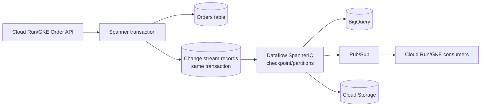
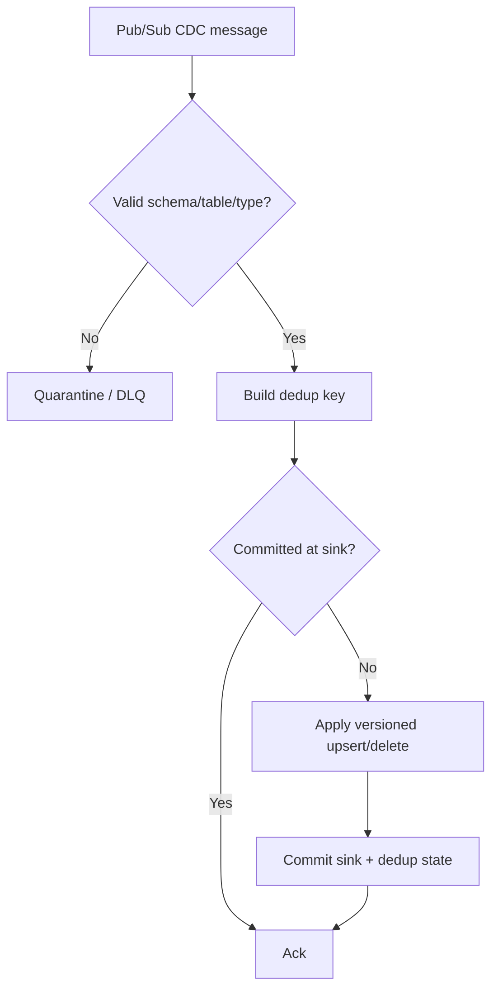

# Change Streams and Data Pipeline Integration

## 1. Problem Statement and Goals

An order system writes transactional data to **Spanner**. Analytics wants near-real-time changes in **BigQuery**; notifications want events via **Pub/Sub**; compliance/audit wants change history archived in **Cloud Storage**. If the application succeeds in writing to Spanner but fails to publish an event on its own, the two systems fall out of sync.

**Spanner change streams** are a **change data capture (CDC)** feature that tracks `INSERT`, `UPDATE`, and `DELETE` mutations on configured tables/columns. Spanner writes **data change records inside the same transaction** as the data mutation. After commit, readers consume those records to build pipelines to Dataflow, BigQuery, Pub/Sub, Cloud Storage, or external systems. This provides CDC integration without requiring the application to perform separate DB writes and event publishes.

This lesson belongs to the **Spanner** chapter of **CLOUD_PROVIDERS_GCP**, connecting concepts from Projects/IAM, VPC, Compute Engine, GKE, Cloud Run, storage/databases, release automation, reliability monitoring, and cost.

**Goals:** after this lesson, you will be able to:

1. Explain change stream capture scope, retention, value capture types, and limitations.
2. Interpret **data records, heartbeat records, and child partition records**.
3. Create and verify a change stream on a **GoogleSQL-dialect Spanner database**.
4. Use a **Dataflow Flex Template** to stream changes to Pub/Sub; compare BigQuery, Cloud Storage, Kafka, and Datastream.
5. Design **idempotent** consumers, checkpointing, schema evolution handling, and replay when a pipeline stops.
6. Configure IAM, monitoring, latency alerts, and cost estimates.

> **Safety:** Project, instance, database, and Pub/Sub topic names in this lesson are illustrative. `CREATE`, `INSERT`, `UPDATE`, and Dataflow deployment commands can modify data and incur charges; run only in an authorized lab project. Never use rows containing real PII or payment data in exercises.

## 2. How Does CDC Work in Spanner?



**Two distinct consistency boundaries:**

- **Spanner commit → change stream record:** written atomically with the data transaction; once a transaction modifying tracked columns commits, the corresponding change record is persisted.
- **Change stream → downstream:** processed **asynchronously**. Dataflow/consumers can lag, retry, redeliver records, or fall behind retention. Never assume a Spanner commit means BigQuery/Pub/Sub has updated instantaneously.

### What Does a Change Stream Capture?

| Captured | Not Captured as Regular Data Changes |
| --- | --- |
| Inserts, updates, deletes from **DML/mutations** | `CREATE TABLE`, `ALTER TABLE`, `DROP TABLE` schema changes |
| Cascading deletes on eligible tables | Changes to indexes, views, or system tables |
| TTL deletes (**captured by default**) | Generated columns, unless part of the primary key |
| Tracked columns and primary keys | Tables/columns outside scope or excluded by filters |

**Critical pitfall:** a `DROP TABLE` removes data as an end result, yet the change stream **does not emit each deleted row as a stream of `DELETE` events**. CDC is neither a complete schema audit system nor a backup/PITR substitute. Use change governance/audit logs to track DDL, and backup/PITR to recover data.

## 3. Scope and Selecting a Stream

A change stream is a **schema object** inside a Spanner database, similar to a table or index, and can track:

- **The entire database:** `FOR ALL`.
- **One or more tables:** e.g., `FOR Orders, Payments`.
- **Specific columns of a table:** e.g., `FOR Orders (Status, AmountCents)`; primary keys are always included to identify rows.

| Scope | Best Fit | Risks / Trade-offs |
| --- | --- | --- |
| `FOR ALL` | Whole-database CDC for migrations/warehousing | Captures a lot of data, including sensitive tables or app metadata writes |
| `FOR Orders` | All changes to orders | Picks up newly added columns per scope rules, which can shift downstream schemas |
| `FOR Orders (Status, AmountCents)` | Syncing only needed state/amounts | Consumers lack full rows if untracked columns are omitted |

Do not create a broad stream for every purpose when business logic only needs two columns. Sensitive fields such as emails, phone numbers, addresses, or payment metadata must be reviewed under **least privilege and data residency** before flowing into Pub/Sub or BigQuery.

Per current quotas, Spanner enforces limits such as **10 change streams per database**, up to **3 streams tracking a single non-key column**, and **20 concurrent readers per partition**; re-check [Spanner quotas](https://cloud.google.com/spanner/quotas) since limits can evolve. Avoid creating a separate stream per developer when one pipeline can fan out to multiple destinations.

## 4. Value Capture: Which Old/New Columns Are Included?

`value_capture_type` governs which column values are recorded for row changes:

| Type | On `UPDATE`, What Does the Record Contain? | When to Use |
| --- | --- | --- |
| `OLD_AND_NEW_VALUES` (**default**) | Old and new values of **modified** tracked columns | Delta auditing and before/after diffs |
| `NEW_VALUES` | New values of **modified non-key columns** | Consumers only needing updated deltas |
| `NEW_ROW` | New values of **all tracked columns** in the row | Syncing row-state snapshots into BigQuery |
| `NEW_ROW_AND_OLD_VALUES` | Full new state of all tracked columns plus old values of changed columns | Needing full new state alongside old deltas |

Row example:

```text
OrderId = "O-1", Status = "NEW", AmountCents = 12000
UPDATE Orders SET Status = "PAID" WHERE OrderId = "O-1"
```

- `OLD_AND_NEW_VALUES`: typically includes `Status: NEW → PAID`; **does not automatically include the unchanged `AmountCents`**.
- `NEW_VALUES`: includes `Status: PAID`.
- `NEW_ROW`: includes new values of both `Status` and `AmountCents` **if both columns are tracked**.
- `NEW_ROW_AND_OLD_VALUES`: includes full new state plus the old `Status`.

**When a full-row image is needed**, `NEW_ROW` is usually more efficient than receiving deltas and reading back from Spanner at the commit timestamp. Historical *stale reads* are also bounded by `version_retention_period` (typically **1 hour** default, configurable up to **7 days**), **distinct from** change stream retention of up to 30 days.

## 5. Data Change, Heartbeat, and Child Partition Records

Spanner change streams do not merely emit a plain JSON array of row changes:

| Record Type | Key Fields | What Must the Consumer Do? |
| --- | --- | --- |
| **Data change** | `commit_timestamp`, `server_transaction_id`, `record_sequence`, `table_name`, `mod_type`, primary keys, old/new values | Transform into events/upserts/deletes, deduplicate, and write to sink |
| **Heartbeat** | Progress timestamp when a partition has no changes | Advance progress/watermark; do not emit business events |
| **Child partitions** | `start_timestamp`, `token`, `parent_partition_tokens` | Schedule child partitions on split/merge; checkpoint accurately |

**Simplified illustrative example**, not the raw full Spanner API JSON:

```json
{
  "record_type": "data_change",
  "commit_timestamp": "2026-11-19T03:15:02.123456Z",
  "server_transaction_id": "transaction-illustrative",
  "record_sequence": "00000001",
  "table_name": "Orders",
  "mod_type": "UPDATE",
  "keys": {"OrderId": "O-1"},
  "new_values": {"Status": "PAID", "AmountCents": 12000}
}
```

**Each record carries transaction metadata, yet one record is not automatically one standalone business event.** A single transaction can produce multiple modifications across multiple tables/partitions. If processing an atomic unit like a transfer between two accounts, inspect `server_transaction_id`, `record_sequence`, and transaction record/partition counts to assemble it properly.

Partitions can split or merge. Never rely on arrival order in Pub/Sub or BigQuery as **database-wide total ordering**. Ordering must be derived from **transaction, key, and commit timestamp**, respecting parent/child partition dependencies.

## 6. Retention, Configuration Changes, and Replay

**Spanner change streams retain data change records for 1 to 30 days; default is 7 days.** This limit is configurable per stream. **Reducing retention immediately and permanently makes records older than the new window unreadable.**

| Decision | Impact |
| --- | --- |
| Increase `retention_period` from 7d to 14d | Larger buffer for outages; increases storage |
| Decrease to 1d | Prevents backfilling records older than 1 day |
| `exclude_ttl_deletes = true` | Suppresses TTL-based deletes; downstream must handle lifecycle itself |
| `exclude_insert/update/delete = true` | Filters out the corresponding modification type |
| `allow_txn_exclusion = true` | Allows transactions to opt out of emitting change stream records |
| `ALTER CHANGE STREAM ... DROP FOR ALL` | Pauses tracking while keeping existing records within retention |
| `DROP CHANGE STREAM` | Deletes the stream and all stored change stream records |

**These filters govern capture behavior**, not a guarantee that historical business queries remain intact after changes. When changing `value_capture_type`, Spanner does not backfill old values for records created prior to the change.

**Replay** is only possible within:

```text
max(stream creation time, current time - retention)
              ≤ startTimestamp ≤ current time
```

This is a **logical approximation**; verify exact watermarks, record timestamps, read permissions, and partition history. A pipeline stopped for **8 days** on a **7-day** retention stream permanently loses CDC data from the start of the outage. Never try setting an older `startTimestamp` hoping expired records return: run a **full snapshot + catch-up** via a verified procedure.

## 7. Reading Directly with the Change Stream TVF

When creating a stream named `OrdersChangeStream`, Spanner creates a **table-valued function (TVF)** to read records. In the **GoogleSQL dialect**:

```sql
-- ILLUSTRATIVE: invoke via the Spanner ExecuteStreamingSql API,
-- not as a regular OLTP table SELECT.
SELECT ChangeRecord
FROM READ_OrdersChangeStream(
  start_timestamp => "2026-11-19T03:00:00Z",
  end_timestamp => NULL,
  partition_token => NULL,
  heartbeat_milliseconds => 10000
);
```

**Technical requirements:** querying a change stream TVF must use `ExecuteStreamingSql` with a **single-use strong read-only transaction**, never a read-write transaction. `start_timestamp` must fall within retention and not precede stream creation. `end_timestamp=NULL` indicates continuous streaming; for a bounded window, pass an end timestamp.

**Low-level reading flow:**

1. Call the TVF with `partition_token=NULL` to discover initial partitions.
2. Read each partition; process **data records** and **heartbeats**.
3. Upon receiving a `child_partitions_record`, record checkpoints and new tokens.
4. Use the exact `start_timestamp` supplied by the child record and respect **parent/child dependencies**.
5. Persist sink writes and checkpoints durably; on failure, re-read and **deduplicate**.

In **PostgreSQL-dialect Spanner**, TVF syntax differs:

```sql
-- ILLUSTRATIVE PostgreSQL dialect; run only via the streaming Spanner API.
SELECT *
FROM "spanner"."read_json_OrdersChangeStream"(
  '2026-11-19T03:00:00Z', NULL, NULL, 10000, NULL
);
```

Do not confuse the **Spanner PostgreSQL interface** with a native PostgreSQL server or PostgreSQL logical replication slots; change stream syntax and behavior are Spanner APIs. Building a partition coordinator and checkpointing yourself is complex, so prefer **Dataflow SpannerIO**, Datastream, or the Kafka connector where suitable.

## 8. Choosing an Integration Path: Dataflow, Datastream, Kafka, or API?

| Destination / Need | Tool to Evaluate | What to Verify |
| --- | --- | --- |
| **BigQuery** continuous analytics sync | Dataflow template *Spanner change streams to BigQuery* | Target schema, row ordering, upsert semantics, watermarks/DLQ |
| **Pub/Sub** event-driven fan-out | Dataflow template *Spanner change streams to Pub/Sub* | Topic, event schema, duplicate delivery, consumers |
| **Cloud Storage** archival | Dataflow template *Spanner change streams to Cloud Storage* | AVRO/TEXT format, windowing, lifecycle, and retention |
| **BigQuery/BigLake/Cloud Storage** via managed CDC | **Datastream** with Spanner source | Compatibility, source setup, topology/latency |
| **Kafka ecosystem** | Debezium-based Spanner Kafka connector | Kafka offsets, mapping, sink semantics, operations |
| Apps needing raw Spanner records/custom schedules | Direct **Spanner API** | Partition orchestration, retries, checkpointing |

Do not confuse a Dataflow streaming template with a full database batch export. CDC **only captures from when the stream has data**; loading full history into a warehouse requires a **bootstrap snapshot** or initial import followed by catch-up from a chosen CDC timestamp. Combining snapshot and stream carelessly can cause **gaps or duplicates**.

## 9. Lab A — Creating a GoogleSQL Change Stream Tracking Orders

The lab uses an **existing** instance/database and operates strictly in a sandbox:

```text
Project:              acme-spanner-lab
Spanner instance:     spanner-lab
Database (GoogleSQL): orders-lab-db
Source table:         Orders
Change stream:        OrdersChangeStream
Pipeline region:      asia-southeast1
```

**Preflight:** Spanner API is enabled, database uses **GoogleSQL dialect**, and the account has `spanner.databases.updateDdl` plus DML permissions on the **lab database**. Stream DDL can raise storage/CPU usage and impact writes. Never run `FOR ALL` in production just to experiment.

### 9.1. Inspecting Instance and Schema

```bash
# READ-ONLY
gcloud spanner instances describe spanner-lab \
  --project=acme-spanner-lab

gcloud spanner databases describe orders-lab-db \
  --instance=spanner-lab \
  --project=acme-spanner-lab

gcloud spanner databases ddl describe orders-lab-db \
  --instance=spanner-lab \
  --project=acme-spanner-lab
```

If `Orders` already exists, **do not create or overwrite it**; pick another lab table name and adjust the stream DDL accordingly.

### 9.2. Creating the Sample Table

```sql
CREATE TABLE Orders (
  OrderId STRING(36) NOT NULL,
  Status STRING(20) NOT NULL,
  AmountCents INT64 NOT NULL
) PRIMARY KEY (OrderId);
```

Using `gcloud spanner databases ddl update`:

```bash
# SCHEMA CHANGE on LAB database
gcloud spanner databases ddl update orders-lab-db \
  --instance=spanner-lab \
  --project=acme-spanner-lab \
  --ddl='CREATE TABLE Orders (OrderId STRING(36) NOT NULL, Status STRING(20) NOT NULL, AmountCents INT64 NOT NULL) PRIMARY KEY (OrderId)'
```

### 9.3. Creating a Stream Tracking Two Business Columns

```sql
-- GoogleSQL-dialect DDL
CREATE CHANGE STREAM OrdersChangeStream
FOR Orders (Status, AmountCents)
OPTIONS (
  retention_period = '7d',
  value_capture_type = 'NEW_ROW',
  exclude_ttl_deletes = true
);
```

```bash
# CHANGE: new schema object with write/retention cost
gcloud spanner databases ddl update orders-lab-db \
  --instance=spanner-lab \
  --project=acme-spanner-lab \
  --ddl="CREATE CHANGE STREAM OrdersChangeStream FOR Orders (Status, AmountCents) OPTIONS (retention_period = '7d', value_capture_type = 'NEW_ROW', exclude_ttl_deletes = true)"

# READ-ONLY: inspect DDL and stream scope/retention
gcloud spanner databases ddl describe orders-lab-db \
  --instance=spanner-lab \
  --project=acme-spanner-lab
```

**Expected outcome:** the stream appears in the schema once the DDL operation finishes, but **does not automatically replay** updates that occurred before the stream was created.

### 9.4. Writing Data and Observing Changes

```bash
# CHANGE: DML only on Orders in the lab
gcloud spanner databases execute-sql orders-lab-db \
  --instance=spanner-lab --project=acme-spanner-lab \
  --sql="INSERT INTO Orders (OrderId, Status, AmountCents) VALUES ('O-LAB-1', 'NEW', 12000)"

gcloud spanner databases execute-sql orders-lab-db \
  --instance=spanner-lab --project=acme-spanner-lab \
  --sql="UPDATE Orders SET Status = 'PAID' WHERE OrderId = 'O-LAB-1'"

# READ-ONLY: confirm source data
gcloud spanner databases execute-sql orders-lab-db \
  --instance=spanner-lab --project=acme-spanner-lab \
  --sql="SELECT * FROM Orders WHERE OrderId = 'O-LAB-1'"
```

You will generate at least two changes from the `INSERT` and `UPDATE` transactions. Because the stream uses `NEW_ROW`, the `UPDATE` change record includes the tracked columns' new state; **do not confuse querying the source table with reading the change stream**. To observe actual CDC records, use the pipeline in Lab B or the TVF via the streaming API.

## 10. Lab B — Dataflow Change Streams → Pub/Sub

Google provides the **Spanner change streams to Pub/Sub** Flex Template. It uses **Apache Beam SpannerIO**, manages partitions/checkpoints via a Spanner metadata table, and publishes data change records to a topic. This is a **continuous streaming job**; leaving it running after the session will keep accruing charges.

### 10.1. Creating Topic, Subscription, and Metadata Database

Assuming `spanner-lab`, `orders-lab-db`, and `OrdersChangeStream` exist from Lab A; create a dedicated Pub/Sub topic and subscription:

```bash
# CHANGE: create resources only in the LAB project
gcloud pubsub topics create orders-cdc-lab \
  --project=acme-spanner-lab

gcloud pubsub subscriptions create orders-cdc-lab-sub \
  --project=acme-spanner-lab \
  --topic=orders-cdc-lab

# Metadata database: connector automatically creates partition/checkpoint tables
gcloud spanner databases create cdc-meta-lab-db \
  --project=acme-spanner-lab \
  --instance=spanner-lab
```

**Separating the metadata database from the business database** is recommended by Spanner: Dataflow needs **stream read** permissions on `orders-lab-db` and **read/write/DDL creation** permissions on `cdc-meta-lab-db`. If metadata sits inside a business database with a `FOR ALL` stream, connector writes can be captured by that very stream, inflating load and cost.

**Minimum IAM to check before running:** the Dataflow worker service account needs change stream read access (`spanner.databases.select`; plus DB role privileges if using fine-grained access control), Spanner session permissions, metadata DB DDL/read/write access, `pubsub.topics.publish` on the target topic, Dataflow worker permissions, and staging/temp storage access per job settings. The deployer needs permission to create Dataflow jobs and `iam.serviceAccounts.actAs` if specifying a custom worker SA.

### 10.2. Launching the Flex Template

```bash
# CHANGE: launches a continuously billed streaming job.
# Run only when IAM, quotas, worker networking, and Pub/Sub topic are ready.
gcloud dataflow flex-template run spanner-cdc-lab-20261119 \
  --project=acme-spanner-lab \
  --region=asia-southeast1 \
  --template-file-gcs-location=gs://dataflow-templates/latest/flex/Spanner_Change_Streams_to_PubSub \
  --parameters="spannerInstanceId=spanner-lab,spannerDatabase=orders-lab-db,spannerMetadataInstanceId=spanner-lab,spannerMetadataDatabase=cdc-meta-lab-db,spannerChangeStreamName=OrdersChangeStream,pubsubTopic=projects/acme-spanner-lab/topics/orders-cdc-lab"
```

**Version note:** `latest` is convenient for quick demos; production should **pin a tested dated template version** to avoid breaking changes in newer templates. Custom worker service accounts, worker subnets, private networking, and temp/staging locations may require extra flags per org policy.

**The Dataflow template's default start time is when the pipeline starts running.** Therefore, the two transactions from Lab A **will likely not appear** if they occurred before pipeline startup. To start earlier, specify `startTimestamp` within retention and **after stream creation**; never choose a historical timestamp outside the stream's lifetime. The steps below write **a new change after the job is `RUNNING`** to avoid confusion.

### 10.3. Writing a New UPDATE, Then Pulling CDC

```bash
# READ-ONLY: wait for the Dataflow job to run before writing again
gcloud dataflow jobs list \
  --project=acme-spanner-lab \
  --region=asia-southeast1

# CHANGE in LAB database after Dataflow is ready
gcloud spanner databases execute-sql orders-lab-db \
  --instance=spanner-lab --project=acme-spanner-lab \
  --sql="UPDATE Orders SET AmountCents = 12500 WHERE OrderId = 'O-LAB-1'"

# MODIFIES ACK state: --auto-ack is ONLY for the LAB subscription
gcloud pubsub subscriptions pull orders-cdc-lab-sub \
  --project=acme-spanner-lab \
  --limit=10 \
  --auto-ack
```

**Expected outcome:** after Dataflow and Pub/Sub latency, the subscription receives a message containing the data change record for `Orders`, `O-LAB-1`, and the updated `AmountCents`. **The exact payload follows the Flex Template's output format** (JSON by default, or AVRO if configured), **not** the simplified JSON shown in section 5.

If the first pull returns empty, do not rush to create extra topics/jobs: inspect Dataflow logs, job state, watermarks, Spanner/Pub/Sub IAM, and stream start time. Never use `--auto-ack` when testing on a production subscription, as it acknowledges messages before consumers process them.

### 10.4. Inspecting and Properly Stopping the Job

```bash
# READ-ONLY: get the exact JOB_ID from the list
gcloud dataflow jobs list \
  --project=acme-spanner-lab \
  --region=asia-southeast1

# CHANGE: cancel only the specific LAB Dataflow streaming JOB_ID
gcloud dataflow jobs cancel JOB_ID \
  --project=acme-spanner-lab \
  --region=asia-southeast1
```

**Important:** the Spanner change streams connector **does not support Dataflow drain**; to stop the pipeline you must **cancel** it—do not pick drain, as the job can get stuck in a draining state. Canceling does not guarantee every in-flight event reached downstream; perform checkpoint/business reconciliation before doing so in production. **Do not delete the metadata DB** while a job is still using it or if you plan to update the pipeline reusing that metadata table.

## 11. Dataflow SpannerIO and the Role of the Metadata Database

When building a custom Apache Beam pipeline, `SpannerIO` is worth considering:

```java
// Illustrative Java snippet showing core Beam transform, not a standalone app.
SpannerConfig config = SpannerConfig.create()
    .withProjectId("acme-spanner-lab")
    .withInstanceId("spanner-lab")
    .withDatabaseId("orders-lab-db");

pipeline.apply(
    SpannerIO.readChangeStream()
        .withSpannerConfig(config)
        .withChangeStreamName("OrdersChangeStream")
        .withMetadataInstance("spanner-lab")
        .withMetadataDatabase("cdc-meta-lab-db")
        .withInclusiveStartAt(Timestamp.now()));
```

The Dataflow connector manages:

1. Discovering partitions and handling child partition tokens.
2. Distributing read work across multiple workers.
3. Persisting progress/partition metadata in the **Spanner metadata database**.
4. Integrating watermarks, retries, and Beam transforms to feed sinks.

When **updating** a pipeline, documentation requires **reusing the metadata table** by setting the template's `spannerMetadataTableName` or Beam's `withMetadataTable(...)`; do not create a new metadata table expecting it to resume from old checkpoints. If changing state, runner, or template versions, follow Dataflow job-update guides and test in staging.

**Connector checkpoints differ from sink transaction commits.** Dataflow can replay a step after a worker failure even after the sink wrote data. **Idempotent** sinks/consumers are still required for side effects.

## 12. BigQuery and Cloud Storage Sync: Choosing the Right Semantics

### 12.1. Spanner → BigQuery

The **Spanner change streams to BigQuery** template writes records to BigQuery with metadata columns such as:

- `_metadata_spanner_mod_type`: `INSERT`, `UPDATE`, or `DELETE`.
- `_metadata_spanner_table_name`: source table name.
- `_metadata_spanner_commit_timestamp`: commit timestamp.

**Do not treat the updated BigQuery table like an OLTP table whose rows always arrive in commit-timestamp order.** Template docs state rows may be inserted **out of original commit order**; design **version-aware deduplication/upsert logic or views** for current-state use cases. With `NEW_ROW`, the template can avoid stale reads to fetch untouched columns, cutting cost and latency.

Data flow:

```text
Spanner Orders (transactional source of truth)
  → OrdersChangeStream (NEW_ROW)
  → Dataflow template
  → BigQuery order_history (append + commit metadata)
  → View/model selecting the latest record by OrderId + commit information
```

**Schema evolution:** if adding a tracked source column, verify template type support, BigQuery target schema/dataset, metadata columns, and downstream SQL. For sources with multiple schemas, some templates have **default schema** limitations; do not assume every custom schema works automatically.

### 12.2. Spanner → Cloud Storage Archive

The **Spanner change streams to Cloud Storage** template writes **AVRO or TEXT** in windows. Ideal for archiving CDC data for audits/backfills beyond Spanner's retention window.

Archive design elements:

| Component | Decision |
| --- | --- |
| Object key | Region/source/table + date/window + unique file ID |
| Format | AVRO for typed schemas, or TEXT when pipelines/consumers require it |
| Retention | Cloud Storage lifecycle/retention policies per compliance |
| Replay | Job reading the archive and writing back to sinks with deduplication |
| Security | Bucket IAM, CMEK if required, PII masking, access logging |

Do not assume an archive is a **complete Spanner database backup** or usable for PITR. A change stream only holds data within its scope, starting from stream creation, under its configured capture semantics.

## 13. Integrating Pub/Sub Consumers: Idempotency and Contracts



**Never rely solely on Pub/Sub's `messageId` as the CDC business key.** An event republished during retries can get a **new message ID** while representing the exact same Spanner data change.

A processing key typically needs:

```text
sourceDatabase + changeStream + serverTransactionId
    + recordSequence + primaryKey / mod index
```

This is a **design pattern**, not a single pre-built ID field returned by Spanner. When a record contains multiple `mods` or fans out into multiple output messages, include **table/key/modification index** or a business version so each side effect has a unique key. `commit_timestamp` **alone is insufficient**: multiple rows/transactions can share a timestamp, and one transaction can contain multiple changes.

### Versioned Upserts to Prevent Out-of-Order Overwrites

Suppose downstream maintains a projection:

```sql
-- Illustrative sink logic with appropriate transaction/constraints
UPDATE order_projection
SET status = :incoming_status,
    last_commit_ts = :incoming_commit_ts
WHERE order_id = :order_id
  AND last_commit_ts < :incoming_commit_ts;
```

To break timestamp ties, include ordering/sequence metadata and transaction context to determine the newest version; for deletes, use **tombstones** or durable versions so stale events cannot "resurrect" deleted rows. Handle `INSERT/UPDATE/DELETE` by primary key rather than forcing every change into `INSERT`.

**Atomically recording change records in Spanner does not guarantee end-to-end exactly-once delivery:** the **Dataflow → Pub/Sub → consumer → external database** leg still experiences retries and duplicate deliveries. Keep idempotency **inside the same transaction as the sink update**, or use conditional writes/unique constraints.

### Business Event vs. CDC Event?

CDC carries `mod_type` and row values; business events like `OrderPaid` carry **domain intent** and versioned contracts. If consumers enforce rules like "send email only after payment is captured and fulfillment is accepted," a single row update `Status=PAID` **may not suffice**.

Consider an **outbox table in the same Spanner transaction** to record explicit business events, then attach a change stream to the **outbox**. Outbox + CDC eliminates the dual-write gap while still requiring deduplication and checkpointing in consumers.

## 14. IAM, Data Protection, and Networking

| Identity | Required Permissions | Principle |
| --- | --- | --- |
| Database schema deployer | `spanner.databases.updateDdl` | Do not grant project-wide admin to every app |
| Change stream reader | `spanner.databases.select`, sessions; DB role `SELECT`/`EXECUTE` if using FGAC | Read only authorized streams and tables |
| Dataflow worker SA | Dataflow worker, source Spanner read, metadata Spanner DDL/read/write, sink Pub/Sub publish / BigQuery write / GCS write | Never use the broad default Editor role |
| Pub/Sub consumer | Subscriber on specific subscription, exact sink permissions | Never grant unnecessary Pub/Sub admin |
| Ops/CI | Dataflow deploy, logs/metrics read, `iam.serviceAccounts.actAs` as needed | Separate production approvers from operators |

**Fine-grained access control (FGAC):** if a Dataflow job uses a database role, that role needs `SELECT` on the **change stream** and `EXECUTE` on the **read TVF**; pass `spannerDatabaseRole` to the template or `withDatabaseRole(...)` in Beam. The metadata DB still needs separate write permissions.

**Sensitive data:**

- Stream only required tables/columns. `FOR ALL` can inadvertently export PII columns added later.
- Lock down Pub/Sub topic/subscription IAM, BigQuery datasets, GCS buckets, retention, and CMEK.
- Never log full CDC payloads, API tokens, payment info, or personal fields in Dataflow worker logs.
- With VPC Service Controls / Private Google Access, Dataflow worker egress to Spanner, Pub/Sub, and BigQuery/GCS must be permitted; distinguish **`PERMISSION_DENIED`** from network timeouts.
- When sinks live in another region, review data residency and egress charges; align Spanner, Dataflow, and sink regions carefully.

**Spanner change streams do not mask or redact data for you**: data governance across Spanner schema scope, IAM, template transforms, and sinks remains the platform team's responsibility.

## 15. Partitioning, Ordering, and Recovery After Downtime

### 15.1. Ordering Principles

- Spanner tags data change records with `commit_timestamp`, `server_transaction_id`, and `record_sequence`.
- `record_sequence` increments within a transaction, letting you reconstruct record order inside that transaction per documented rules.
- Partitions can split or merge, producing **child partition tokens**.
- Dataflow/BigQuery/Pub/Sub sinks **do not automatically guarantee database-wide total ordering**.

If a transfer modifies accounts A and B in one transaction, downstream consumers needing both updates must process by **transaction boundary** or build reconcilable derived state, rather than treating two independent Pub/Sub messages as two separate financial transactions.

### 15.2. Prolonged Consumer Outage

Suppose `retention_period=7d` and Dataflow stops for 3 days:

1. Check **metadata checkpoints** and earliest available change records.
2. Ensure the pipeline resumes cleanly from its saved start/watermark rather than launching a new job with **`startTimestamp=now`** and skipping three days.
3. If using a pipeline update, preserve the **metadata table** per docs.
4. Monitor replay lag/throughput while catching up; never crank concurrency without checking Spanner CPU/quotas.
5. Reconcile source and sink using counts, checksums, and business-key checks.

If Dataflow was down longer than retention, expired records are gone: **no timestamp change can recover them**. Run a **bootstrap snapshot** from current Spanner or an archive (if available) and replay the retained log window cleanly. Before resyncing, decide how deletes/tombstones will be handled to prevent data drift.

### 15.3. DDL Changes

Change streams **do not emit complete schema DDL events**. When adding or dropping tracked columns:

1. Assess impact on producer/consumer schemas, BigQuery targets, and Pub/Sub parsers.
2. Execute `ALTER CHANGE STREAM` and migrations in the **right order**, with backward/forward compatibility plans.
3. If a stream **explicitly watches** a column/table, remove the reference from the stream before dropping the source object per schema dependency rules.
4. Time the rollout, maintain compatibility windows, and test rollback.

Never shorten retention or `DROP CHANGE STREAM` just to avoid updating a consumer: that can destroy CDC history needed for recovery.

## 16. Monitoring: Measure Data Freshness, Not Just Job RUNNING

A Dataflow job in `RUNNING` state can still be falling behind on a backlog or endlessly retrying one bad record. Monitor **latency from Spanner commit to business sink**, not just worker CPU.

| Metric Group | Source | What Signals Trouble? |
| --- | --- | --- |
| **Data freshness / output watermark lag** | Dataflow metrics | Watermark lagging badly; analytics staler than SLO |
| **System latency** | Dataflow metrics | Records waiting long in pipeline; downstream bottleneck |
| **Commit-to-PCollection latency** | SpannerIO custom metrics | Slow change stream reads |
| **Data change records read** | SpannerIO custom metrics | Suspicious drop to 0 while Spanner still receives writes |
| **Partitions being read** | SpannerIO custom metrics | Unexpectedly 0 when pipeline should be tracking stream |
| **Spanner CPU/storage** | Spanner Monitoring | CDC overloading source or retention bloating storage |
| **Pub/Sub unacked / oldest unacked age** | Pub/Sub Monitoring | Downstream consumer falling behind |
| **BigQuery errors / DLQ** | Dataflow logs, target tables, dead-letter | Rejected records or schema mismatches |
| **Business reconciliation** | Source vs. sink queries by key/version | Missing/duplicated events or skewed projections |

### Example Team-Defined SLOs

```text
CDC pipeline end-to-end p95 lag < 60 seconds
99.9% of Orders changes appear in analytics within 5 minutes
Zero child partitions dropped from tracking
Every DLQ record investigated before change stream retention expires
```

These are **illustrative application SLOs**, not Spanner SLAs. Alert well before **data freshness lag + incident resolution time** approaches retention. For instance, with 7-day retention, alerting at 6 days 23 hours is far too late for a safe resync.

**Dataflow watermarks** reflect progress inside the pipeline—they do not prove a BigQuery view computed accurately or a Pub/Sub consumer committed its business update. Add **end-to-end audit markers** and data reconciliation.

## 17. Performance, Limits, and Cost

Change streams add in-transaction writes, record storage, and connector CPU/read traffic. Streaming to external systems adds further resource usage:

- **Spanner:** processing units/nodes, change stream storage, write/replication overhead, and read workload.
- **Dataflow:** streaming workers, Streaming Engine, and job runtime; continuous jobs accrue charges even during low event volume.
- **Pub/Sub:** publish, delivery, message storage/retention, and egress.
- **BigQuery:** streaming/storage/queries per current pricing models.
- **Cloud Storage:** archived bytes, lifecycle operations, network, and KMS if used.
- **Cloud Logging/Monitoring:** log ingestion/retention, metrics, and alerts.

### Illustrative Sizing Calculation

```text
Update frequency:    500 row changes/second
Average CDC payload: 600 bytes/change (hypothetical)
Raw CDC rate:        500 × 600 = 300,000 bytes/second
Per day:             ~25.92 GB raw data
7-day retention:     ~181.44 GB raw data
```

This is **not the actual Spanner storage footprint or bill**: record metadata overhead, capture type, compression, primary keys, replication, multi-record transactions, metadata DB, Dataflow, and sinks all alter actual cost. Use [Spanner pricing](https://cloud.google.com/spanner/pricing), Dataflow/BigQuery/Pub/Sub pricing, and Cloud Billing exports to estimate.

**Optimization practices:**

1. Track only needed **tables/columns**; avoid `FOR ALL` unless genuinely required.
2. Pick the right capture type; `NEW_ROW` enlarges records yet can eliminate follow-up stale reads.
3. Size retention around incident detection/recovery windows rather than maxing it arbitrarily.
4. Separate the connector metadata DB; benchmark Spanner CPU and Dataflow worker sizing in staging.
5. Scale worker parallelism only when **Spanner read capacity and sink throughput** can absorb it.
6. Pin template versions and keep a pipeline configuration that is straightforward to roll back.

For multi-region Spanner, evaluate **directed reads** and Dataflow region placement to offload traffic from the leader region; trade off latency, network cost, and replica/region capacity. Never assume reading from a distant replica is automatically faster.

## 18. Troubleshooting: From Symptom to Root Cause

| Symptom | Possible Cause | Verification Step |
| --- | --- | --- |
| Cannot create stream | Missing `spanner.databases.updateDdl`, invalid DDL/scope, quota hit | DDL operation, IAM, stream limits |
| Stream exists but emits no events for a table | Table/column outside `FOR`, stream created after mutations | `ddl describe`, DML commit timestamps |
| `UPDATE` has `Status` only, missing `Amount` | `OLD_AND_NEW_VALUES`/`NEW_VALUES` records changed columns only | `value_capture_type`, column scope |
| No `DELETE` records from TTL | `exclude_ttl_deletes=true` | Stream options, TTL policy |
| Missing DDL/`DROP TABLE` in CDC | Change streams don't emit schema events as row changes | Separate DDL audit/migration logs |
| TVF returns `INVALID_ARGUMENT` | Bad start timestamp/retention/partition token or wrong streaming API mode | `ExecuteStreamingSql`, strong read-only txn |
| Dataflow fails to start | Missing Spanner metadata DB, IAM, or template/worker networking | Dataflow launcher/worker logs and permissions |
| Dataflow `RUNNING` yet Pub/Sub stays empty | Default `startTimestamp` starts at job launch, wrong topic, or no new writes | Source commit time, connector metrics, topic IAM |
| BigQuery rows out of order | Sink does not preserve global Spanner commit order | Commit timestamp metadata + per-key dedup/upsert |
| Record processed twice | Job retry, Pub/Sub redelivery, source replay | Transaction/sequence key, consumer inbox |
| Pipeline stopped > retention | Old CDC records expired and purged | Full snapshot/archive + catch-up, not simple restart |
| Updating Dataflow reads from scratch | Failed to preserve `spannerMetadataTableName` | Metadata DB/table, job update procedure |
| Dataflow job stuck draining | Connector does not support drain | Cancel per runbook; never drain |
| Spanner CPU/storage climbs | Scope too wide, many streams, high retention/reads | Benchmark, Spanner metrics, and billing |
| New schema breaks sink | Incompatible column/type/target schema | Pipeline logs/DLQ, migration review |

### CDC Incident Runbook

1. Confirm **source project/instance/database**, stream name, scope, retention, and incident start time.
2. Record **Dataflow job ID, region, metadata database/table, and sink resource**.
3. Inspect Dataflow **data freshness, watermarks, partition counts, error logs**, and sink DLQ.
4. Compare **earliest available change** against checkpoint; check for any gap beyond retention.
5. Classify root cause: **source permission/DDL**, **connector state**, **sink IAM/schema**, **capacity**, or **consumer idempotency**.
6. Apply minimal fix: grant exact IAM, scale capacity, align schema, or resume from the old checkpoint—never launch a fresh pipeline starting `now` while a backlog exists.
7. Reconcile **primary keys / commit timestamps / business records** after recovery; document results and tune alert thresholds.

**Never delete the metadata DB or drop the stream before capturing checkpoints and verifying a replay plan.** Both actions can destroy automatic recovery and CDC history.

## 19. Three Architecture Scenarios

### Scenario A — Spanner → BigQuery for Dashboards

The order service writes `Orders` in Spanner transactions. A `NEW_ROW` stream tracks analytical fields, and Dataflow pushes to BigQuery. Dashboards need the **latest state per order**, so build a view/model selecting the newest version by primary key and commit metadata; handle deletes/tombstones so deleted orders disappear properly.

**Test:** `UPDATE` the same order twice back-to-back, restart a Dataflow worker in between, and deliver events out of order to BigQuery. The business view must still show **the latest state**, independent of event arrival order.

### Scenario B — Spanner → Pub/Sub for Notifications

The notification team wants to email customers when an order becomes `PAID`. Reading every `UPDATE Status` directly from CDC risks **two emails** on retries; moreover, `PAID` might be an intermediate state not yet cleared for messaging. Place an **`OutboxEvents`** table inside the same business-confirming Spanner transaction and stream the outbox table, using a deterministic `eventId` and consumer inbox deduplication.

**Test:** redeliver the Pub/Sub message and crash the consumer after sending the email but before acking. You need email-gateway idempotency or a send-tracking outbox to avoid duplicate emails—in-memory deduplication alone is insufficient.

### Scenario C — Cloud Storage Archive for Long-Term Recovery

A pipeline writes CDC records to Cloud Storage with date/window object keys, lifecycle policies, and dedicated IAM. When Dataflow stops for more than **30 days** (exceeding stream retention), operators cannot read the entire gap from the Spanner change stream. An archive only helps **for records exported before the outage**; changes Dataflow never read will not magically appear in the archive.

**Recovery plan:** compare a current source snapshot against the sink and replay valid archive segments; design a full resync + backfill for periods missing CDC. This is why CDC **does not replace** Spanner backups, exports, and PITR.

## 20. Exercises and Verification Questions

1. **Atomicity:** A Spanner transaction updates `Orders` successfully while Dataflow is stopped. Is a change record created? **Answer:** Yes, if tracked in scope and committed; the downstream sink simply hasn't updated yet.
2. **Retention limit:** Stream retention is 7 days, and the job stopped for 9 days. Can you just set `startTimestamp` to 9 days ago to replay everything? **No**, data past retention is gone; you need a snapshot/archive/resync.
3. **Retention age:** A stream has 14-day retention; at 12:00 on Nov 19, someone requests changes from Nov 3. Is that valid? **Hint:** typically outside 14 days, even if the stream has existed longer.
4. **Value capture:** An `UPDATE` changes `Status` while `AmountCents` stays unchanged. Which capture type returns full new values for both tracked columns? **Answer:** `NEW_ROW` or `NEW_ROW_AND_OLD_VALUES`.
5. **Scope:** Does stream `FOR Orders (Status)` automatically capture customer Email? **No**; primary keys are still included to identify rows, and Email is outside scope.
6. **DDL:** Does `DROP TABLE Orders` generate `DELETE` events for each row? **No**; change streams do not treat dropping a table as row-level deletes.
7. **TVF:** Why shouldn't `READ_OrdersChangeStream(...)` be queried like a regular table inside a read-write transaction? **Hint:** requires `ExecuteStreamingSql`, single-use strong read-only mode, and partition tokens.
8. **Metadata DB:** Why should Dataflow `SpannerIO` use a separate metadata database? **Answer:** stores checkpoints/tokens, isolates write permissions, and prevents `FOR ALL` streams from capturing self-generated metadata.
9. **Start timestamp:** Lab A ran an `INSERT` at 09:00, and Dataflow launched at 09:10 without setting `startTimestamp`. Will it definitely receive the 09:00 `INSERT`? **No**, by default it starts at pipeline launch time.
10. **Sink ordering:** Two updates to one order arrive in BigQuery out of order. How do you build an accurate current-state view? **Hint:** use primary keys, commit metadata/versions, delete/tombstone semantics, and deduplication.
11. **Idempotency:** One CDC record is published twice with two different Pub/Sub message IDs. Why is deduplicating by `messageId` insufficient? Propose a key derived from source transaction/record/primary key.
12. **Cost:** At 100 changes/sec averaging 1,000 bytes/change, how many raw bytes accumulate in one day? **Answer:** 100 × 1,000 × 86,400 = 8.64 decimal GB, before overhead and compression.
13. **DLQ:** A new row contains a data type not yet supported in the BigQuery schema. Should you drop the event to prevent pipeline lag, or route it to a DLQ? **Hint:** quarantine/DLQ, fix the schema, and perform a controlled replay within retention.
14. **Integrated scenario:** Design a Spanner → Pub/Sub → Cloud Run consumer pipeline with a 2-minute SLO; specify scope, capture type, Dataflow metadata DB, idempotency key, watermark alerts, `DELETE` handling, and recovery if the pipeline stops for 4 days.

## 21. Production Deployment Checklist

- [ ] Defined **source of truth**, downstream contracts, streamed tables/columns, and PII policy.
- [ ] Selected `FOR ALL`, table, or column scope following data-minimization principles.
- [ ] Picked capture type balancing full-row vs. delta needs against storage/read impact.
- [ ] Set 1–30 day retention based on outage/replay goals; did not confuse with Spanner version retention.
- [ ] Confirmed stream tracking begins **after DDL creation**, without automatic historical backfill.
- [ ] Accounted for all 3 record types: data, heartbeat, and child partitions.
- [ ] Used `SpannerIO`/Datastream/Kafka connector appropriately rather than building a custom partition orchestrator unnecessarily.
- [ ] Provisioned a separate Dataflow metadata DB and preserved checkpoints across updates.
- [ ] Verified Pub/Sub topics/subscriptions exist before launch with proper publisher/subscriber IAM.
- [ ] Handled schema changes, row ordering, duplicates, and deletes in BigQuery sinks.
- [ ] Enforced business idempotency, transactional/unique constraints, or conditional writes at sinks.
- [ ] Pinned Dataflow template version; never attempt to drain a `SpannerIO` change streams pipeline.
- [ ] Separated FGAC/Spanner IAM, Dataflow worker SA, and Pub/Sub/BigQuery/GCS permissions.
- [ ] Verified region placement, network egress, VPC Service Controls, and encryption.
- [ ] Built dashboards for freshness/lag, connector partitions, Spanner CPU/storage, and sink errors/DLQ.
- [ ] Prepared plans for bootstrap snapshot + catch-up, schema evolution, restart/replay, and full resync.
- [ ] Benchmarked realistic workloads and budgeted retention, Dataflow, sink, and logging costs.
- [ ] Assigned owners, incident runbooks, reconciliation checks, and tested retries/splits/merges/schema changes.

## 22. Official Google Cloud Documentation

1. [Spanner change streams overview](https://cloud.google.com/spanner/docs/change-streams).
2. [Create and manage change streams](https://cloud.google.com/spanner/docs/change-streams/manage).
3. [Partitions, records, and query workflow](https://cloud.google.com/spanner/docs/change-streams/details).
4. [Build change streams connections using Dataflow](https://cloud.google.com/spanner/docs/change-streams/use-dataflow).
5. [Spanner change streams and Dataflow templates](https://cloud.google.com/spanner/docs/dataflow-templates).
6. [Spanner change streams to Pub/Sub template](https://cloud.google.com/dataflow/docs/guides/templates/provided/cloud-spanner-change-streams-to-pubsub).
7. [Spanner change streams to BigQuery template](https://cloud.google.com/dataflow/docs/guides/templates/provided/cloud-spanner-change-streams-to-bigquery).
8. [Spanner change streams to Cloud Storage template](https://cloud.google.com/dataflow/docs/guides/templates/provided/cloud-spanner-change-streams-to-cloud-storage).
9. [Spanner as a Datastream source](https://cloud.google.com/datastream/docs/sources-spanner).
10. [Spanner quotas and limits](https://cloud.google.com/spanner/quotas).
11. [Spanner DDL reference for GoogleSQL](https://cloud.google.com/spanner/docs/reference/standard-sql/data-definition-language).
12. [Spanner PostgreSQL DDL reference](https://cloud.google.com/spanner/docs/reference/postgresql/data-definition-language).
13. [Change streams fine-grained access control](https://cloud.google.com/spanner/docs/fgac-change-streams).
14. [gcloud Spanner DDL update](https://cloud.google.com/sdk/gcloud/reference/spanner/databases/ddl/update).
15. [gcloud Spanner execute SQL](https://cloud.google.com/sdk/gcloud/reference/spanner/databases/execute-sql).
16. [Dataflow Flex Templates](https://cloud.google.com/dataflow/docs/guides/templates/using-flex-templates).
17. [Spanner pricing](https://cloud.google.com/spanner/pricing).
18. [Dataflow pricing](https://cloud.google.com/dataflow/pricing).
19. [Pub/Sub pricing](https://cloud.google.com/pubsub/pricing).

**Remember:** Spanner change streams record data mutations **atomically inside the source transaction**, yet delivery to downstream systems remains **asynchronous and susceptible to duplicates and out-of-order arrival**. Choose scope, capture type, and retention thoughtfully; rely on **Dataflow `SpannerIO`/metadata checkpoints**, build **idempotent sinks**, track **data freshness**, and establish **reconciliation/resync** plans before an outage occurs.
