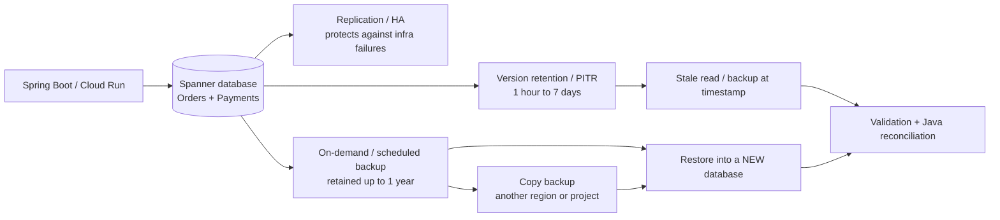
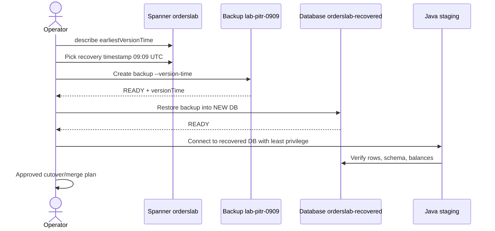
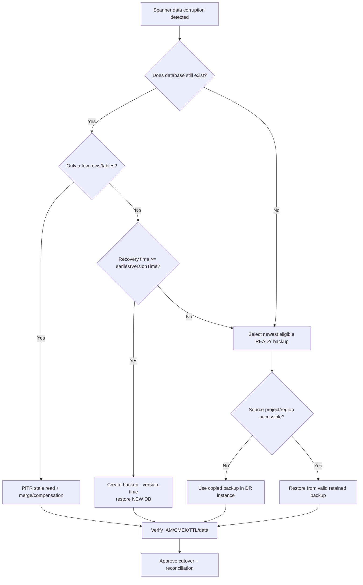

# Backups, Point-in-Time Recovery, and Spanner Data Protection

## 1. When Spanner Remains Available Yet Data Was Written Incorrectly

A **Java/Spring Boot** system on **Cloud Run or GKE** uses **Spanner** to store orders. At 09:10 UTC, a buggy application release runs an update and mistakenly flips thousands of `PAID` orders to `CANCELLED`. The database remains up, replication stays healthy, and every statement committed cleanly. **High availability does not protect against replicated logical write/delete bugs.**

In that moment, the operations team needs to know: can we read back the data at **09:09 UTC**? If we must restore the entire database, which **PITR** window or **backup** should we use? How do we avoid overwriting valid data created after the incident, verify Java permissions and connectivity, and meet business recovery time targets?

**Spanner** is a distributed relational database providing strong transactional consistency and replication per instance configuration. Data protection requires combining **version retention/PITR**, **full/incremental backups**, **backup schedules**, **cross-region/cross-project backup copies**, **IAM/CMEK**, and **restore drills**. No single mechanism solves every failure mode.

Within the **Spanner** chapter of the **CLOUD_PROVIDERS_GCP** module, this lesson helps build a recovery strategy for Java applications, balancing **RPO, RTO, access control, data durability, and cost**.

> **Safety:** do not run commands creating, deleting, or modifying databases, backups, or retention in production just to practice. Mutating steps are strictly for an **approved lab instance/database**; Spanner, backup storage, copies, and restores incur charges. **Never delete the source database or switch production Spring Boot to a recovered database without following an approval process.**

## 2. Four Distinct Layers of Protection



| Mechanism | Primary Protection | Key Limitations |
| --- | --- | --- |
| **Spanner replication/HA** | Node/zone loss or failure domains per instance configuration | Logical write bugs are replicated; not a recovery history |
| **PITR/version retention** | Reading recent data and schemas prior to an accidental write/delete | Default **1 hour**, configurable up to **7 days**; requires database/versions to still exist |
| **Backup/restore** | Consistent snapshot for long-term recovery | Backup captures a specific `version_time`; restore creates a **new database**, never overwrites |
| **Backup copy** | Protection when a copy is needed in another project/region | Must copy to an existing destination instance; adds time and cost |
| **Export/Import** | Moving data/formats for specialized workflows | Not equivalent to native backups and does not provide automatic app rollback |

**RPO (Recovery Point Objective)** is the tolerable amount of data loss, measured from the time of failure back to the **most recent recoverable data point**. **RTO (Recovery Time Objective)** is the maximum acceptable time until **the service resumes meeting criteria**. The RPO/RTO of **one database snapshot** differs from the RPO/RTO of **orders/ERP/notifications across the entire system**.

For example, a 24-hour backup schedule gives a **24-hour gap between scheduled `versionTime` points**, yet actual achievable RPO can be **larger** because scheduled backups start within a window of up to 4 hours and must reach `READY`. PITR provides granular points within the retention window, but RTO can still include **creating a backup, restoring, granting IAM, validating, switching apps, and reconciling**.

## 3. PITR: Version Retention and Earliest Version Time

Spanner retains fine-grained historical versions of **data and schema**. `version_retention_period` defaults to **1h** and can be set from **1h to 7d** on both **GoogleSQL** and **PostgreSQL dialects**. `earliest_version_time` reports the **earliest timestamp currently readable**; it advances continuously and may move forward between when you check it and when you trigger a backup.

```text
Assume at 12:00 UTC:
  retention = 3d
  earliest_version_time ≈ 12:00 UTC three days ago

  ├───────── retained history ─────────┤
  t_min                              now
          ↑             ↑
     09:09 incident  09:10 bad write

Choose 09:09 when T lies between earliest_version_time and NOW
and verify business state at that timestamp.
```

### 3.1. What PITR Does Not Guarantee

- **No backfill** when increasing retention: raising 1h to 7d **does not immediately** expose data from 7 days ago; history must accumulate going forward.
- PITR is **not an application "undo" button**. You can read past state and create a backup at an old `version_time`, but restoring a full database creates a **new database**. If only a few rows were corrupted, extract the needed values and **repair selectively**.
- `earliest_version_time` **moves continuously**. When an incident hits, record the timestamp promptly and pick a point with safety margin rather than cutting right up against the retention boundary.
- If the database was deleted, **do not count on PITR for the deleted database**; rely on an existing backup. Existing backups can persist independently after the source database is deleted.
- Timestamps must reflect **commit time**, not a skewed local laptop log timestamp. Use UTC/RFC 3339 and correlate audit/application traces.

### 3.2. Checking PITR Before Making Changes

```bash
# Read-only: use a valid lab project and database.
gcloud config set project LAB_PROJECT_ID

gcloud spanner databases describe orderslab \
  --instance=LAB_INSTANCE \
  --format="yaml(name,state,versionRetentionPeriod,earliestVersionTime)"

gcloud spanner databases ddl describe orderslab \
  --instance=LAB_INSTANCE
```

In the Google Cloud Console: open **Spanner → Instance → Database → Backup/Restore** to view retention and the earliest version time. Record `earliestVersionTime` and re-verify it **right before creating a backup from a past timestamp**.

### 3.3. Increasing Retention in the Lab Database Only

**GoogleSQL dialect** DDL:

```sql
-- TEST database ONLY; requires DDL update permissions.
ALTER DATABASE orderslab
SET OPTIONS (version_retention_period = '3d');
```

This can be applied via **Spanner Studio/DDL** or the following `gcloud` command for **database IDs without hyphens**:

```bash
gcloud spanner databases ddl update orderslab \
  --instance=LAB_INSTANCE \
  --ddl="ALTER DATABASE orderslab SET OPTIONS (version_retention_period = '3d')"
```

In the **Spanner PostgreSQL dialect**, the option syntax differs from GoogleSQL, for example:

```sql
ALTER DATABASE "orderslab"
SET "spanner.version_retention_period" = '3d';
```

Do not run both syntaxes on the same database; they belong to **two different dialects**. After updating, check `versionRetentionPeriod` and `earliestVersionTime`, and do not assume 3 days of history appears instantly. Increasing retention raises **versioned storage** costs proportionally to data churn.

## 4. Backups: Full, Incremental, Schedules, and Timestamps

A **native Spanner backup** stores a **transactionally consistent snapshot** of the database at `version_time`, including data and schema. Backups are created **in the same instance, region, and project** as the source database; when another location is needed, use **copy backup** after the backup completes.

| Field | Meaning |
| --- | --- |
| `versionTime` | Timestamp at which data/schema were consistently captured |
| `createTime` | Timestamp when Spanner started creating the backup |
| `state` | `CREATING` or `READY`; restore only from ready backups |
| `expireTime` | Backup expiration time (can be extended within limits) |
| `sizeBytes` / `exclusiveSizeBytes` | Total size and exclusive storage of the backup, useful for incremental chains/cost |

**Distinguishing timestamps:** for an **on-demand full backup**, `createTime≈versionTime` by default. You can specify an older `--version-time` if that timestamp **lies within the PITR window**. For a **scheduled backup**, `versionTime` is the scheduled time, whereas `createTime` may occur **within the next 4 hours**; never assume a 02:00 backup is ready right at 02:00.

### 4.1. Backup Types by Need

| Type | Created Via | Notes |
| --- | --- | --- |
| **On-demand full** | Console, `gcloud spanner backups create`, API/client | Captures the full database; can choose a past `versionTime` |
| **Scheduled full** | Backup schedule with `--backup-type=full-backup` | Minimum cadence **12 hours** |
| **Scheduled incremental** | Backup schedule with `--backup-type=incremental-backup` | **Enterprise/Enterprise Plus** only, minimum cadence **4 hours**; **no** on-demand incremental backups |

The first backup in an incremental chain is a **full backup**, and subsequent ones store deltas; a chain supports up to **13 incremental backups** after a full backup. An incremental backup can **depend on earlier backups** for restore, so deleting an older backup **may not immediately free storage**; Spanner retains data needed by newer backups. Restoring an incremental backup **can take longer** than an equivalent full backup.

### 4.2. Default Backups Do Not Replace Verification

Per current documentation, **new instances** enable a default policy creating a **full backup every 24 hours with 7-day retention** for **new databases created in that instance**. This can be customized or disabled when creating or editing an instance. **Enabling a default schedule on an existing instance does not retroactively apply to older databases**; a new schedule can take **up to 24 hours** before its first run.

**You must still verify directly** via `backup-schedules list` and `backups list`. Never assume a production database has a `READY` backup simply because default schedules are enabled, and avoid creating duplicate schedules before checking.

## 5. gcloud Lab: Creating Backups and Backup Schedules

Prerequisites: an existing **lab Spanner instance and `orderslab` database**, Billing enabled, Spanner API enabled, and appropriate backup permissions; never use a real production source project. All commands are learner examples, **not executed during authoring**.

### 5.1. Read-Only Inventory First

```bash
gcloud spanner instances describe LAB_INSTANCE \
  --project=LAB_PROJECT_ID

gcloud spanner databases describe orderslab \
  --instance=LAB_INSTANCE \
  --project=LAB_PROJECT_ID

gcloud spanner backup-schedules list \
  --project=LAB_PROJECT_ID \
  --instance=LAB_INSTANCE \
  --database=orderslab

gcloud spanner backups list \
  --instance=LAB_INSTANCE \
  --project=LAB_PROJECT_ID
```

If a valid backup schedule already exists, **do not create another just to see the command run**. The goal is to verify **frequency, retention, backup type, encryption, and the latest `READY` backup**.

### 5.2. Creating a 7-Day On-Demand Full Backup

```bash
# Run only on a lab database after confirming costs:
gcloud spanner backups create orderslab-snapshot-001 \
  --project=LAB_PROJECT_ID \
  --instance=LAB_INSTANCE \
  --database=orderslab \
  --retention-period=7d \
  --async

# Re-check; ONLY treat a backup as usable when state=READY:
gcloud spanner backups describe orderslab-snapshot-001 \
  --project=LAB_PROJECT_ID \
  --instance=LAB_INSTANCE
```

`--async` returns before creation finishes. Omit `--async` to have the CLI wait on the operation; never infer `READY` from "Create request issued." Backup IDs must be unique within the instance. Maximum backup expiration is roughly **one year from creation time**, not forever.

### 5.3. Creating an Illustrative Full Backup Schedule

If the lab database **does not yet have** an appropriate schedule:

```bash
# Daily at 02:00 UTC; for LAB database only.
gcloud spanner backup-schedules create orderslab-daily \
  --project=LAB_PROJECT_ID \
  --instance=LAB_INSTANCE \
  --database=orderslab \
  --cron="0 2 * * *" \
  --backup-type=full-backup \
  --retention-duration=604800s \
  --encryption-type=use-database-encryption

gcloud spanner backup-schedules describe orderslab-daily \
  --project=LAB_PROJECT_ID \
  --instance=LAB_INSTANCE \
  --database=orderslab
```

The command above inherits encryption from the database configuration. Check **Spanner edition, CMEK, and the quota of max 4 schedules per database** before creating. Because schedules can start later than expected, still take an **on-demand backup** when immediate protection is required.

### 5.4. Incremental Schedule When Supported by Edition

**Do not stack alongside a full schedule** without calculating retention, chain dependencies, and budget:

```bash
# Enterprise/Enterprise Plus and approved lab database only:
gcloud spanner backup-schedules create orderslab-4h \
  --project=LAB_PROJECT_ID \
  --instance=LAB_INSTANCE \
  --database=orderslab \
  --cron="0 */4 * * *" \
  --backup-type=incremental-backup \
  --retention-duration=604800s \
  --encryption-type=use-database-encryption
```

Incremental backups reduce backup storage for low-churn workloads, though you must track `exclusiveSizeBytes`, dependency chains, and restore times. Never promise "incremental is always cheaper/faster than full" or delete a mid-chain backup expecting instant savings.

## 6. Hands-On PITR: Inspecting Past Data Without Restoring the Database

When corruption affects **a small set of orders**, a safe first step is a **stale read at a pre-incident timestamp**. The following command reads a snapshot only without mutating state:

```bash
# Choose RECOVERY_TIME_UTC after earliestVersionTime and before the bad commit.
# Example format: 2026-11-19T09:09:00Z (while still within PITR window).
gcloud spanner databases execute-sql orderslab \
  --project=LAB_PROJECT_ID \
  --instance=LAB_INSTANCE \
  --read-timestamp=RECOVERY_TIME_UTC \
  --sql="SELECT OrderId, Status FROM Orders LIMIT 20"
```

This example uses the **GoogleSQL dialect** and assumes an `Orders` table with columns `OrderId, Status`. For the PostgreSQL dialect, adjust **SQL to match the schema** rather than copying verbatim if table/column names differ. Snapshot results must be **cross-checked against audit logs and business rules**; picking a timestamp too early risks dropping valid orders created right before the bug.

**Never run an `UPDATE` blindly from a stale read without proper design:** a row may have changed legitimately *after* `RECOVERY_TIME_UTC`. Selective recovery requires business keys, inspecting changelogs, applying **conditional mutations/transactions**, replay or compensation, and verifying idempotency.

## 7. Full-Database PITR: Backing Up at a Past Version Time and Restoring

When an error corrupts **most of the database or schema** and a complete snapshot is needed, Spanner lets you create an **on-demand full backup** with `--version-time` inside the PITR window, then **restore it into a new database**.



### 7.1. Choosing a Recovery Timestamp

Verify that:

- `RECOVERY_TIME_UTC` is **after** `earliestVersionTime` and **before** the bad commit, in RFC 3339 UTC format.
- You do not rely solely on when users noticed the bug: a bad transaction may have run well before monitoring alerted.
- Valid changes committed after the chosen timestamp **are absent from the snapshot**. You need a reconciliation plan so valid payments/orders are not lost.
- If the target point is outside the PITR window, pick the **nearest `READY` backup**, accepting a larger RPO and planning business-event replay.

### 7.2. Creating a Backup at a Historical Timestamp

```bash
# LAB DB ONLY. Replace RECOVERY_TIME_UTC with a timestamp inside PITR.
gcloud spanner databases describe orderslab \
  --instance=LAB_INSTANCE \
  --project=LAB_PROJECT_ID \
  --format="yaml(versionRetentionPeriod,earliestVersionTime)"

gcloud spanner backups create orderslab-pitr-recovery \
  --project=LAB_PROJECT_ID \
  --instance=LAB_INSTANCE \
  --database=orderslab \
  --version-time=RECOVERY_TIME_UTC \
  --retention-period=7d \
  --async

gcloud spanner backups describe orderslab-pitr-recovery \
  --project=LAB_PROJECT_ID \
  --instance=LAB_INSTANCE
```

Verify `state: READY` and the **actual** `versionTime`; never use a backup still in `CREATING`. Creation can fail if the timestamp ages past version retention while waiting. Once the backup is `READY`, that historical point **no longer depends on the source database retaining PITR** for the lifetime of the backup.

### 7.3. Restore Creates a **New** Database, Never Overwrites

```bash
# LAB ONLY, after backup state=READY:
gcloud spanner databases restore \
  --project=LAB_PROJECT_ID \
  --source-instance=LAB_INSTANCE \
  --source-backup=orderslab-pitr-recovery \
  --destination-instance=LAB_INSTANCE \
  --destination-database=orderslab-recovered \
  --async

gcloud spanner databases describe orderslab-recovered \
  --project=LAB_PROJECT_ID \
  --instance=LAB_INSTANCE
```

`orderslab-recovered` **must not already exist**; if the name collides, restore fails. When source and destination instances differ, **instance configuration** compatibility is required per restore rules and edition support. `--async` only initiates the operation; wait until the database is `READY` before granting permissions or switching app connections.

**Restoring does not automatically change the database name in Spring Boot / Cloud Run services**: the app still points to `orderslab` until an operator updates and deploys the connection config. Never "restore directly over the live database." Before cutover, **lock/open write permissions in the proper sequence**, verify balances, event outbox, and dependent services.

## 8. Copying Backups Across Instances, Regions, or Projects

Newly created backups reside **in the same instance/region/project** as the source database. For DR or to isolate risk against losing project admin access, create a **backup copy** in an **existing destination instance** in another region or project. Backup copying is **not streaming replication** and does not provide zero RPO.

### 8.1. Copying Within the Same Project

```bash
# Run only after the source backup is READY and the destination instance exists.
gcloud spanner backups copy \
  --project=LAB_PROJECT_ID \
  --source-instance=LAB_INSTANCE \
  --source-backup=orderslab-snapshot-001 \
  --destination-instance=LAB_DR_INSTANCE \
  --destination-backup=orderslab-dr-copy-001 \
  --retention-period=7d \
  --async

gcloud spanner backups describe orderslab-dr-copy-001 \
  --project=LAB_PROJECT_ID \
  --instance=LAB_DR_INSTANCE
```

### 8.2. Copying Across Projects

```bash
# When both source/destination instances exist and IAM is configured:
gcloud spanner backups copy \
  --source-backup=projects/SOURCE_PROJECT/instances/SOURCE_INSTANCE/backups/SOURCE_BACKUP \
  --destination-backup=projects/DR_PROJECT/instances/DR_INSTANCE/backups/DR_BACKUP \
  --retention-period=7d \
  --async
```

The copy has its own creation state; wait for **`READY`**. For incremental backups, Spanner may **copy all prerequisite earlier backups in the chain**; the destination needs corresponding storage and copy time. Across project/region pairs, verify **source/destination IAM, CMEK key locations, data residency, and quotas**.

Per documentation, most backup copies complete within **several hours** depending on size/region; **there is no guaranteed 5-minute RTO** just because copying is enabled. For fast application recovery, build a strategy of **periodic copies, standby instances, and cutover drills**.

## 9. Selective Recovery: Avoiding Overwriting Valid Changes

Suppose 3,000 orders were corrupted at 09:10, yet by 09:25 the system processed 200 more valid orders. Restoring the entire database to 09:09 and switching traffic would **lose those 200 orders** unless replayed or reconciled properly. For localized incidents, consider:

1. Creating a snapshot backup at a pre-bug `versionTime` or stale-reading the affected rows.
2. Exporting/comparing **keys, version/commit timestamps, and before/after values** in the authoritative system of record.
3. Identifying rows with valid post-incident modifications; **never** blindly overwrite everything.
4. Writing **migrations or compensating mutations** with transactions/idempotency; rolling out canary batches by key groups.
5. Reconciling Cloud SQL, Pub/Sub outboxes, payments, ERP, and balances; running before-and-after validation.

If you need to restore an entire **single table**, you can **restore the backup into a separate database**, export that table via Dataflow/Avro and import cleanly, or read at the past timestamp and rewrite via controlled transactions. **Importing does not automatically delete rows added after the snapshot**; restoring the table strictly to its prior state requires handling newer rows separately—which can delete valid data.

**PITR only provides a reliable Spanner history at a timestamp**; it does not replace business workflows to unsend emails or refund external payments. When recovering from snapshots, **outbox/replay consumers** need idempotency to avoid emitting duplicate events.

## 10. Java 21: Reading Spanner at a Past Timestamp

With the **Java client library `com.google.cloud:google-cloud-spanner`**, you can use `TimestampBound.ofReadTimestamp` to run a **read-only query at a fixed point in time**, without restoring the entire database when you only need to inspect data. The example below uses the **GoogleSQL dialect** and an `Orders(OrderId STRING, Status STRING)` table in a lab database.

### 10.1. Minimal Maven `pom.xml`

```xml
<?xml version="1.0" encoding="UTF-8"?>
<project xmlns="http://maven.apache.org/POM/4.0.0"
         xmlns:xsi="http://www.w3.org/2001/XMLSchema-instance"
         xsi:schemaLocation="http://maven.apache.org/POM/4.0.0 https://maven.apache.org/xsd/maven-4.0.0.xsd">
  <modelVersion>4.0.0</modelVersion>
  <groupId>dev.example</groupId>
  <artifactId>spanner-pitr-read-lab</artifactId>
  <version>1.0.0</version>
  <properties>
    <maven.compiler.release>21</maven.compiler.release>
    <project.build.sourceEncoding>UTF-8</project.build.sourceEncoding>
  </properties>
  <dependencies>
    <dependency>
      <groupId>com.google.cloud</groupId>
      <artifactId>google-cloud-spanner</artifactId>
      <version>6.124.0</version>
    </dependency>
  </dependencies>
  <build>
    <plugins>
      <plugin>
        <groupId>org.apache.maven.plugins</groupId>
        <artifactId>maven-compiler-plugin</artifactId>
        <version>3.13.0</version>
      </plugin>
    </plugins>
  </build>
</project>
```

The client version only illustrates dependency syntax; production should manage versions via the **Google Cloud Java Libraries BOM**, pin supported releases, and scan for CVEs. Run via **Application Default Credentials (ADC)** with read permission on the lab Spanner database; never store JSON service account keys in repos.

### 10.2. `SnapshotRead.java` Class

```java
package dev.example.spanner;

import com.google.cloud.Timestamp;
import com.google.cloud.spanner.DatabaseClient;
import com.google.cloud.spanner.DatabaseId;
import com.google.cloud.spanner.ResultSet;
import com.google.cloud.spanner.Spanner;
import com.google.cloud.spanner.SpannerOptions;
import com.google.cloud.spanner.Statement;
import com.google.cloud.spanner.TimestampBound;

public final class SnapshotRead {
    public static void main(String[] args) {
        if (args.length != 4) {
            throw new IllegalArgumentException(
                "Usage: PROJECT_ID INSTANCE_ID DATABASE_ID UTC_TIMESTAMP");
        }

        String project = args[0];
        String instance = args[1];
        String database = args[2];
        Timestamp timestamp = Timestamp.parseTimestampDuration(args[3]);

        try (Spanner spanner = SpannerOptions.newBuilder()
                .setProjectId(project).build().getService()) {
            DatabaseClient client = spanner.getDatabaseClient(
                DatabaseId.of(project, instance, database));

            // Read only at a timestamp verified against PITR earliestVersionTime.
            try (ResultSet rs = client
                    .singleUse(TimestampBound.ofReadTimestamp(timestamp))
                    .executeQuery(Statement.of(
                        "SELECT OrderId, Status FROM Orders LIMIT 20"))) {
                while (rs.next()) {
                    System.out.printf("%s -> %s%n",
                        rs.getString("OrderId"),
                        rs.getString("Status"));
                }
            }
        }
    }
}
```

**Important boundary:** `TimestampBound.ofReadTimestamp` creates a **read-only snapshot** reproducible at the same timestamp; it is not a read-write transaction and **cannot inspect history older than `earliestVersionTime`**. For overly old timestamps, Spanner throws an error because versions were garbage-collected. Never use stale reads to authorize live payment decisions in the present.

### 10.3. Connecting with Spring Boot / Cloud Run

In production Spring Boot, **never change `spring.cloud.gcp.spanner.database` or runtime endpoints** just to debug history. Set up a separate read-only recovery job with **Spanner Database Reader** or an equivalently scoped role, log **request ID/timestamp/keys**, and execute recovery mutations through an **approved runbook**. If deciding to cut over to a recovered database, deploy via versioned config/secrets with a clear rollback path.

## 11. Backup Completeness and What Must Be Reconfigured

A native full backup retains **data, database schema, indexes, change stream definitions, and database options** at `versionTime` per service rules. However, **that does not mean a restored database is immediately ready to serve every system**.

| After Restore | Status | Action Required |
| --- | --- | --- |
| **Rows/schema/indexes** | At `versionTime` | Verify counts, constraints, sample queries, and consistency |
| **Database options** | Preserved in backup where supported | Review `version_retention_period` and key options |
| **Database IAM policies** | **Not restored** (except policies inherited from target instance) | Grant exact workload identities; audit least privilege |
| **Change stream schema** | Definitions included in backup | Verify streams/consumers |
| **Change stream data records** | **Not included** in backup | Rebuild downstream checkpoints/snapshots/replays |
| **Row deletion policy / TTL** | **Not automatically restored** per restore overview | Re-declare TTL per compliance before opening production writes |
| **Pre-splitting points** | Not restored | Reconfigure if needed for workload/throughput |
| **Java application** | Does not switch databases automatically | Update config, IAM, health checks, release strategy |
| **External state** | Outside Spanner backups | Reconcile Pub/Sub, payment APIs, CRM, Cloud Storage |

TTL deserves special attention: **failing to restore a row deletion policy** can retain data **longer than compliance allows** if left unconfigured. Conversely, enabling the wrong TTL on a recovered database can **delete data needed for investigation**. Review policies before enabling writes.

## 12. IAM, CMEK, and Accidental Deletion Safeguards

### 12.1. Separating Backup Creators from Restorers

| Role | Purpose | Do Not Grant by Default |
| --- | --- | --- |
| `roles/spanner.backupWriter` | Create and view backups/schedules as appropriate; good for backup automation | Does not need delete/update backup permissions |
| `roles/spanner.backupAdmin` | Create, manage, update, and delete backups | Do not grant to Java runtimes only doing business reads/writes |
| `roles/spanner.restoreAdmin` | Restore databases from backups | Separate from backup creator when two-person control is needed |
| Spanner database reader/writer | SQL/data permissions for apps or recovery jobs | No reason to bundle Backup Admin / Restore Admin automatically |

Enforce **least-privilege IAM at the instance/database level** where supported. Use **Cloud Audit Logs** to record backup, copy, restore, retention, IAM, and KMS operations. **Deletion protection** helps prevent accidental database deletion, but does not replace backups and does not stop a principal with `backupAdmin` from deleting backups. Consider isolating **DR backup copies in a separate project** with independent access controls.

### 12.2. CMEK During Create, Copy, and Restore

Spanner backups are encrypted at rest. By default, backups typically inherit the **source database's encryption configuration**, though Google-managed encryption or a **customer-managed encryption key (CMEK)** can be selected where supported.

- **The KMS key version used to encrypt a backup must exist and remain usable at restore time.** If the key is destroyed/disabled or the Spanner service agent loses access, restore can fail.
- For **dual-region/multi-region/custom instance configurations**, you may need to supply **multiple regional KMS keys** covering all regions; the Console does not support every variant, so use `gcloud`/client APIs as required.
- When **copying backups** to another region/project, verify **key locations, service agent `Cloud KMS CryptoKey Encrypter/Decrypter` permissions, IAM**, and residency policies. Copies can use different encryption settings per supported options.
- Plan **key rotation and retain old key versions** long enough for backup retention. Never automatically destroy old key versions during routine rotation.

**Do not treat enabling CMEK as a substitute for access auditing**: SQL, backup, KMS, and application administration duties should remain separated, especially during ransomware or insider-mistake incidents.

## 13. Data Incident Runbook by RPO/RTO

### 13.1. 8-Step Procedure

1. **Activate incident:** record UTC timestamp, affected keys/tables, Java release, owner, and initial symptoms. Restrict write permissions of the **faulty component** without shutting down the entire app if valid transactions still need service.
2. **Preserve evidence:** capture audit logs, trace IDs, backup metadata, `earliestVersionTime`, and release details. Do not run mass deletes, replays, or bulk updates yet.
3. **Classify:** a few corrupted rows, multiple corrupted tables, deleted database, lost KMS access, or region/project outage? Establish RPO/RTO and impact on systems outside Spanner.
4. **Pick mechanism:** stale read/compensation for a few rows; **PITR on-demand backup** for whole-database within 7 days; **existing backup** for older points or deleted DBs; **copied backup** if source region/project is unavailable.
5. **Restore into a new database:** verify backup `READY`, `versionTime`, and compatible target instance/edition/CMEK; never overwrite the live database.
6. **Validation:** schemas/indexes, TTL policies, IAM, order counts/balances, Java queries, app compatibility, and downstreams like Pub/Sub/ERP.
7. **Approved cutover:** point Spring Boot/Cloud Run to the new DB via controlled rollout, monitoring p95/error rates; avoid two uncoordinated writers writing concurrently.
8. **Reconciliation and postmortem:** replay/merge valid post-snapshot changes, verify idempotency, restore backup schedules/alerts, and schedule the next drill.



### 13.2. Quick Decision Table

| Incident | First Mechanism to Consider | Common Mistake |
| --- | --- | --- |
| Bad `UPDATE` on 20 orders, detected after 10 min | Stale read before the error, reconcile, then selectively repair | Restoring the whole DB and losing newer orders |
| Migration dropped wrong table, detected after 6 hr | PITR/backup at pre-migration `versionTime`, restore separate DB | Raising retention only after the bug already happened |
| Database was deleted | Valid `READY` backup, restore to a new database | Assuming PITR of a deleted DB can still be queried |
| Lost access to source project | Backup copy in an independent DR project | Putting all backups in the same IAM failure domain |
| Lost one zone while data is intact | Spanner HA/replication per instance config | Unnecessarily restoring from backup |
| Region outage needing data in another region | Existing copied backup in DR instance / DR strategy | Waiting until the outage to start copying while promising a 5-min RTO |
| KMS key version lost decryption access | Investigate Cloud KMS/service agent and key version | Switching to a different key thinking old backups decrypt immediately |
| ERP/Pub/Sub already processed side effects | Saga/reconciliation and business dedup keys | Rolling back the DB assuming emails/ERP also rolled back |

### 13.3. Recovery Verification Before Allowing Writes

On the **restored database**:

- Check `state=READY`, `restoreInfo.backupInfo.versionTime`, and **database dialect**.
- Compare order counts, totals by currency, unique IDs, and business balances against an accepted snapshot/audit.
- Verify **DDL/schemas/indexes**, access permissions, TTL row policies, and change stream configurations.
- Run a **read-only Java smoke test** from staging using the right workload identity; check timeouts, quotas, latency, and error rates.
- Ensure post-snapshot events are **replayed or compensated** in order without duplicate writes.
- Consider keeping the source database read-only/quarantined during investigation per policy rather than deleting it immediately.

## 14. SLOs, Alerts, and Reliability Testing

**A `READY` backup is necessary, not proof that the application can recover.** Monitor at minimum:

| Signal | Suggested Alert Condition | Action |
| --- | --- | --- |
| **Backup age** | Latest `READY` backup exceeds SLA, e.g., >26 hours for a 24h schedule | Check schedule, operation errors, IAM/quotas |
| **Schedule health** | Schedule deleted/disabled or missed backup past activation window | Audit logs, backup schedule metadata |
| **PITR window** | `versionRetentionPeriod` lowered or `earliestVersionTime` newer than allowed | Check DDL/IAM, alerts, and change history |
| **Backup copy lag** | Latest DR copy lags beyond DR RPO target | Inspect copy operations, region/permissions/cost |
| **CMEK availability** | Cloud KMS key disabled or service agent IAM altered | Restore permissions and key version per runbook |
| **Restore drill** | No successful drill completed within the period | Restore to a lab database, run Java smoke test, record elapsed time |
| **Billing** | Backup bytes, backup chain storage, PITR storage, or copied backups spike | Review retention, churn, and duplicate schedules |

Set targets around **business data criticality**: instead of only measuring "backup job succeeded," target **recovering the application version and data** within the allowed time. For example:

```text
Hypothetical targets:
  Business RPO ≤ 15 minutes
  Application RTO ≤ 2 hours

PITR can provide a close-enough recovery point within retention,
but if restore + validation + cutover takes 3 hours,
RTO STILL FAILS. Meeting it requires drills and runbook optimization.
```

Use **Cloud Monitoring** for supported Spanner instance metrics/operations, **Cloud Audit Logs** for admin changes, and org-specific dashboard alerts. Verify **exact metric names and resource types in Metrics Explorer** before creating alerts; never assume a UI field like `expireTime` automatically exists as a Monitoring time series.

## 15. Cost, Retention, and Lab Cleanup

### 15.1. Costs to Account For

- **Spanner instance compute/storage:** the source database and **restored database** may coexist, increasing resource demand.
- **Backup storage:** billed by retained bytes and retention duration; full backups store the entire database at the snapshot.
- **Incremental backup chains:** low-churn deltas can be cheaper, yet Spanner retains dependent backups and may not free storage when deleting a single link.
- **PITR version retention:** extending from 1 hour to 7 days can increase **versioned storage** with write/delete/update churn.
- **Cross-location copied backups:** destination storage plus copy/data transfer charges per pricing and actual volume.
- **Exports/Imports/DR drills:** Dataflow/Cloud Storage, network, monitoring, and operator time when used.

**Hypothetical model example, not Google Cloud pricing:**

```text
Database full backup: 200 GiB.
Daily full snapshots: say 7 copies × 200 GiB = 1,400 GiB
  of nominal snapshot data before actual billing adjustments.

Suppose 10 GiB changes daily:
  an incremental chain may store smaller deltas than full backups,
  but still includes the full base, metadata, dependency retention, and copy fees.

Never multiply 1,400 GiB by a guessed regional rate directly:
verify chargeable bytes and unit prices in Spanner Pricing.
```

A system with **high write churn** can pay noticeably more when increasing PITR retention; overlapping backup schedules can also inflate bills needlessly. Use **Cloud Billing Reports/Budgets**, inspect `exclusiveSizeBytes`, and review backup chains. **Budget alerts do not automatically stop charges.**

### 15.2. Ordered Lab Cleanup and Ownership Checks

When finished, **only** clean up lab resources you created; never delete active databases or backups needed for investigation. Follow this order:

1. Stop Java tests and confirm no client is connected to `orderslab-recovered`.
2. List schedules and backups, verifying IDs, `versionTime`, retention, and owners.
3. For a **backup schedule created solely for the lab**, delete the schedule once confirming backup retention is no longer needed.
4. For a **restored database** used only for the lab, delete it after approval and exporting needed results; never delete the source database casually.
5. Let lab backups expire naturally or delete them individually **when no longer needed for recovery or chain dependencies**, using auditable permissions.
6. Inspect the instance/billing; **do not delete the instance** while backups/DBs remain or other workloads share it.

```bash
# READ-ONLY checks before any cleanup action:
gcloud spanner backup-schedules list \
  --project=LAB_PROJECT_ID \
  --instance=LAB_INSTANCE \
  --database=orderslab

gcloud spanner backups list \
  --project=LAB_PROJECT_ID \
  --instance=LAB_INSTANCE

gcloud spanner databases list \
  --project=LAB_PROJECT_ID \
  --instance=LAB_INSTANCE

# Destructive examples, INTENTIONALLY NOT executed:
# gcloud spanner backup-schedules delete orderslab-daily --instance=LAB_INSTANCE --database=orderslab
# gcloud spanner databases delete orderslab-recovered --instance=LAB_INSTANCE
# gcloud spanner backups delete orderslab-snapshot-001 --instance=LAB_INSTANCE
```

**Note:** deleting a database does not automatically delete its existing backups; **deleting an instance requires deleting all backups first** per service rules. Lab cleanup must therefore account for **backups outliving databases**, backup expiration, and incremental dependency chains.

## 16. Exercises and Self-Assessment Checklist

### Exercise A — Choosing a Backup Strategy

A Java system processes 100,000 orders/day with a 15-minute RPO target and a 90-day minimum snapshot retention requirement. Propose how to combine **7-day PITR, full/incremental schedules, retention, and copied backups**. Why isn't a 24-hour backup schedule enough for a 15-minute RPO on its own? What must be tested for RTO?

### Exercise B — Retention Boundaries

At 12:00 UTC, `earliestVersionTime=11:00 UTC`, and the database just raised retention from 1h to 7d. Can you immediately recover back to 08:00 UTC the same day? Calculate approximately when a full 7 days of history will exist if nothing else changes. Explain why PITR does not backfill.

### Exercise C — Full vs. Incremental

Compare **on-demand full**, **scheduled full**, and **scheduled incremental** across edition support, cadence, base-chain dependencies, the 13-incremental limit, and RTO. An old incremental was "deleted," yet newer backups in the chain still depend on it: why wasn't storage reclaimed immediately?

### Exercise D — Recovering Bad Writes on a Few Rows

A migration at 09:10 UTC corrupted 50 orders; afterward, 200 valid orders arrived. Design a stale read at 09:09 UTC, identify affected IDs, check post-incident modifications, and apply idempotent mutations/compensation. Why would restoring the entire database and cutting over immediately be wrong?

### Exercise E — Database Restore and IAM/CMEK

Starting from a `READY` backup, write the command sequence `gcloud spanner backups describe` → `gcloud spanner databases restore` → `databases describe` into a new database. List items that must be re-verified: **IAM, change stream records, TTL row policies, CMEK key versions, Java endpoints, and transactional data**.

### Exercise F — Java Snapshot Read

Using the Java 21 client, use `TimestampBound.ofReadTimestamp` to read `Orders` at a UTC timestamp within the PITR window, comparing `PAID` statuses before and after the bug. Which database permissions are needed? What happens if the timestamp is older than `earliestVersionTime`? Why can't snapshot reads replace live payment logic?

### Exercise G — DR and Cost

A 200 GiB database changes 10 GiB daily and has a backup copy in another project. Build a recovery drill plan assuming the source project is inaccessible; list **permissions, instance configs, KMS, copy/restore duration, Java cutover, and backup/PITR/copy storage estimates**. Explain why HA replication, copied backups, and PITR **do not share the same RPO/RTO**.

### Pre-Production Checklist

- [ ] I can distinguish HA/replication, PITR, native backups, copied backups, and export/import.
- [ ] I know PITR defaults to **1h**, maxes out at **7d**, and `earliestVersionTime` advances continuously.
- [ ] I understand increasing retention **does not recover garbage-collected history**.
- [ ] I know `versionTime` differs from `createTime` and backups must be checked for `READY`.
- [ ] I audited default schedules, cadences, editions, and schedule quotas per database.
- [ ] I understand incremental chains require a full base and cannot be created on demand.
- [ ] I maintain cross-region/project backup copies per DR policy and verified CMEK keys.
- [ ] I restore into a **new database**, never overwriting the production database.
- [ ] I verify post-restore items: IAM, TTL, change streams, app config, and business data.
- [ ] I have an incident runbook, RPO/RTO targets, Java smoke tests, rollback, and reconciliation.
- [ ] I monitor backup age, schedule health, version retention, restore drills, and Billing.

**Conclusion:** Spanner's infrastructure fault tolerance is vital, yet **it does not replace a data recovery strategy**. For Java apps on Google Cloud, use **PITR for recent logical mistakes, long-term backups for older recovery needs, and isolated copies for DR**, then verify **IAM/CMEK, business data, external systems, and cutover timing** before declaring recovery complete.

## 17. Official Google Cloud References

- [Spanner: Backups overview, full/incremental/default schedules](https://cloud.google.com/spanner/docs/backup)
- [Spanner: Create backups](https://cloud.google.com/spanner/docs/backup/create-backups)
- [Spanner: Create and manage backup schedules](https://cloud.google.com/spanner/docs/backup/create-manage-backup-schedules)
- [Spanner: Manage and copy backups](https://cloud.google.com/spanner/docs/backup/manage-backups)
- [Spanner: Point-in-time recovery overview](https://cloud.google.com/spanner/docs/pitr)
- [Spanner: Recover data using PITR](https://cloud.google.com/spanner/docs/use-pitr)
- [Spanner: Restore overview and limitations](https://cloud.google.com/spanner/docs/backup/restore-backup-overview)
- [Spanner: Restore a database from backup](https://cloud.google.com/spanner/docs/backup/restore-backups)
- [Spanner: Customer-managed encryption keys](https://cloud.google.com/spanner/docs/use-cmek)
- [Spanner: IAM and predefined backup roles](https://cloud.google.com/spanner/docs/iam)
- [Spanner: Database deletion protection and deletion](https://cloud.google.com/spanner/docs/create-manage-databases)
- [Spanner: Timestamp bounds and stale reads](https://cloud.google.com/spanner/docs/timestamp-bounds)
- [Java client: TimestampBound](https://cloud.google.com/java/docs/reference/google-cloud-spanner/latest/com.google.cloud.spanner.TimestampBound)
- [Spanner pricing](https://cloud.google.com/spanner/pricing)
- [gcloud: spanner backups create](https://cloud.google.com/sdk/gcloud/reference/spanner/backups/create)
- [gcloud: spanner backup-schedules create](https://cloud.google.com/sdk/gcloud/reference/spanner/backup-schedules/create)
- [gcloud: spanner databases restore](https://cloud.google.com/sdk/gcloud/reference/spanner/databases/restore)
