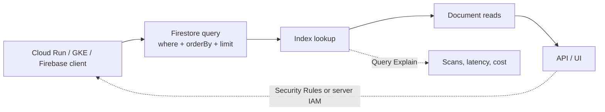

# Firestore Queries, Indexes, and Query Limits

A retail application stores `orders/{orderId}` documents in **Cloud Firestore**. One screen needs to fetch *the 20 most recent PAID orders for a tenant*, another counts total orders, and a dashboard inspects events across subcollections. With Firestore, queryability and cost depend directly on **document structure, operators, sort order, and indexes**; you cannot blindly apply SQL habits like `JOIN` or `OFFSET` to every workload.

This lesson is part of the **Firestore and Firebase** chapter of module `CLOUD_PROVIDERS_GCP`. You will write queries, build and optimize indexes, recognize query limits, protect data with Security Rules/IAM, measure latency, and control cost. The primary examples use **Firestore Standard edition, Native mode, Core operations** and the Firebase Admin SDK for server environments; differences with **Enterprise edition** are noted separately because indexing rules and billing differ.

> **Scope and safety:** Firestore Standard edition **requires indexes for queries and automatically creates single-field indexes**. Firestore Enterprise edition in Native mode **does not require indexes and does not auto-create single-field indexes**; without an index, a query can perform a full collection scan, becoming slow and consuming many read units. There is also an Enterprise MongoDB-compatible mode with a different API. Before operating, verify the **edition, mode, database ID, project, region, and permissions**. Labs prioritize the Emulator; `firebase deploy` or creating cloud indexes makes real changes and requires approval.

## 1. Learning Objectives

After this lesson, you will be able to:

1. Distinguish **document lookup**, **collection query**, **collection group query**, `where` filters, `orderBy`, and aggregations.
2. Use equality, range, `in`, `array-contains`, `OR`, and `not-in` operators and understand operator combination limits.
3. Write **cursor-based pagination** instead of offset to avoid costly skipped reads.
4. Explain **single-field**, **composite**, **collection-group** indexes, and **index exemptions**; choose appropriate field orderings.
5. Diagnose missing-index errors, author `firestore.indexes.json`, and deploy indexes in a controlled manner.
6. Identify limits such as **30 DNF disjunctions**, **10 inequality fields**, index entries/document, and index scan costs.
7. Use **Query Explain** and metrics to optimize, and distinguish Security Rules from IAM.
8. Complete a local lab with sample data and solve practical query scenarios.

## 2. Data Model and Query Scope

Multi-tenant application example:

```text
orders/
  o-1001
    tenantId: "t1"
    status: "PAID"
    totalCents: 2500
    createdAt: <Timestamp>
    tags: ["web", "priority"]
    payload: <map storing content not used for search>
    events/
      e-1
        kind: "payment"
        occurredAt: <Timestamp>
  o-1002
    tenantId: "t1"
    status: "PENDING"
    ...
  o-1003
    tenantId: "t2"
    status: "PAID"
    ...
```

| Query type | Scope | Example |
| --- | --- | --- |
| **Document lookup** | A specific document path. | `orders/o-1001`; not a multi-document filter query. |
| **Collection query** | Direct child documents in `orders`. | Orders where `tenantId == "t1"`. |
| **Subcollection query** | A single `orders/o-1001/events`. | Events for one specific order. |
| **Collection group query** | All collections with **ID `events`**, across hierarchy levels. | Events with `kind == "payment"` across many orders. |
| **Aggregation query** | Returns `count`, `sum`, `average` from data/matching indexes. | Count PAID orders without downloading every document to the client. |

Firestore is a document database and does not natively support relational JOINs like PostgreSQL. Data modeling typically applies **intentional denormalization** and optimizes for the **access patterns** you will query. If you need complex analytical joins/reporting over large volumes, consider **BigQuery** or a data sync pipeline instead of simulating SQL joins on the client.



## 3. Filter Operators: Choosing the Right Semantics

The examples below use the **JavaScript server SDK (`firebase-admin/firestore`)** and the `orders` collection. Field names must match actual value types; Firestore does not coerce string `"2500"` into number `2500` during comparisons.

| Operator | Question | Notes |
| --- | --- | --- |
| `==` | `status == "PAID"` | Equality; documents missing the field do not match. |
| `<`, `<=`, `>`, `>=` | `totalCents >= 1000` | Range/inequality; pay attention to index ordering. |
| `!=` | `status != "CANCELLED"` | Only considers documents that have the field; combination constraints apply. |
| `in` | `status in ["PAID","PENDING"]` | Equivalent to OR across equalities on one field; subject to DNF limits. |
| `not-in` | `status not-in ["CANCELLED"]` | Max 10 values; ignores missing fields and `null`; strict combination limits. |
| `array-contains` | `tags` contains `"priority"` | Matches an element in an array, not a substring of a string. |
| `array-contains-any` | `tags` contains one of several values | OR over array memberships; max 30 values/disjunctions per applicable limits. |
| `OR`, `AND` | Combine conditions. | OR may be limited when converted to DNF. |

Core API example (snippet placed inside an async function after `db` is initialized):

```javascript
const orders = db.collection("orders");

// Equality + sort + limit: usually requires a composite index in Standard.
const recentPaid = await orders
  .where("tenantId", "==", "t1")
  .where("status", "==", "PAID")
  .orderBy("createdAt", "desc")
  .limit(20)
  .get();

// Single-field range.
const expensive = await orders
  .where("totalCents", ">=", 5000)
  .orderBy("totalCents", "asc")
  .limit(20)
  .get();

// Membership and array membership.
const twoStates = await orders
  .where("status", "in", ["PAID", "PENDING"])
  .get();
const priority = await orders
  .where("tags", "array-contains", "priority")
  .get();
```

### 3.1. `!=` and `not-in` do not mean "every document not equal to X"

If a document lacks the `status` field, `where("status","!=","CANCELLED")` **does not** return it. With `not-in`, documents where `status = null` also do not match; including `null` in the comparison list can cause the query to return no results. To display "all statuses except CANCELLED" accurately, **assign a valid status when creating documents** rather than relying on field absence.

### 3.2. `orderBy` also filters by field existence

`orderBy("createdAt","desc")` **excludes documents missing `createdAt`**, even if other conditions match. An inequality filter on a field likewise requires that field to exist. If an older data migration left `createdAt` empty, pagination will silently omit those records.

**Solution:** backfill valid field values, normalize application schemas, or write a separate query for legacy data. Never assume `null` and missing are equivalent.

## 4. Composite Queries, DNF, and Limits

### 4.1. OR queries and the 30-disjunction limit (Standard)

Firestore Standard edition converts `or`, `in`, and `array-contains-any` into **disjunctive normal form (DNF)**: an OR of AND groups. The final number of OR groups **cannot exceed 30**, which is a hard limit.

Example:

```text
status IN [5 values] AND region IN [6 values]
→ 5 × 6 = 30 disjunctions: at the maximum limit.

status IN [5 values] AND region IN [10 values]
→ 5 × 10 = 50 disjunctions: INVALID.
```

A common mistake is counting only the `where` clauses visible in code, while combining multiple `in`/`OR` clauses multiplies branches. Reduce value counts, split queries cleanly and deduplicate/merge server-side when necessary, or design a suitable summary field; **splitting queries** can increase reads and cost.

### 4.2. Key limits table for Standard Core queries

| Constraint | Value / rule | Example |
| --- | --- | --- |
| Total OR branches after DNF | **30 disjunctions** | `5 × 10 = 50` ⇒ error. |
| Number of `not-in` values | **Max 10** | Cannot exclude 11 statuses. |
| `not-in` cannot combine with | `in`, `array-contains-any`, `or`, or `!=` | Redesign query/filter model. |
| Number of `not-in` or `!=` | Only **one** per query. | Cannot use two negations on two fields. |
| `array-contains` | Max **one per DNF disjunction**, not combined with `array-contains-any` in that disjunction. | Split logic when needed. |
| Range/inequality fields | **Max 10 fields**. | Do not build an unrestricted filter with dozens of sliders. |
| Filters + sort orders + parent path | **Max 100** when evaluated in DNF. | Subcollections add parent path components. |

These numbers apply to **Standard edition/Core query limitations** and must not be generalized as rules for all Enterprise Pipeline/MongoDB operations. For Enterprise, check the specific limits of the chosen **edition and query API**.

### 4.3. Multi-field inequalities: valid, but potentially expensive

Firestore Standard supports range filters across multiple fields within limits, for example:

```javascript
const q = db.collection("products")
  .where("priceCents", ">=", 2000)
  .where("rating", ">=", 4.5)
  .orderBy("priceCents", "asc")
  .orderBy("rating", "desc")
  .limit(25);
```

**Field order in the index determines how many index entries are scanned.** If `priceCents >= 2000` filters out 95% of records while `rating >= 4.5` filters out only 10%, placing the higher-selectivity price field first in the index is usually better. Sorting by the less selective field first can cause a wide index scan even if only a few documents are returned.

This is why you should measure with **Query Explain** rather than creating composite indexes in an arbitrary order. Multi-range queries can incur **index entries read** charges alongside document reads.

## 5. Indexes: Structure Determines Queryability

### 5.1. Three types to distinguish

| Index | How it is created (Standard) | Use case |
| --- | --- | --- |
| **Single-field** | Usually automatic per field (ascending, descending, array). | Filter/order on a single field. |
| **Composite** | Usually created manually via Console/Firebase CLI. | Equality combined with sort or multiple fields/ranges. |
| **Collection-group scope** | Requires an index matching scope/query shape. | Querying all subcollections sharing an ID, e.g., `events`. |

An index has a **query scope**: `COLLECTION` or `COLLECTION_GROUP`. A composite index on collection `orders` **does not automatically** support a collection group query on `events`, even if field names match.

Firestore Standard can **merge single-field indexes** for some queries, but with `array-contains` plus multiple filters/sorts, a matching **composite index** is usually more efficient. Creating an index is not instantaneous: backfilling takes time, and queries will only use it once the index is ready.

### 5.2. Field order in a composite index

For example, finding the 20 latest paid orders for tenant t1:

```javascript
db.collection("orders")
  .where("tenantId", "==", "t1")
  .where("status", "==", "PAID")
  .orderBy("createdAt", "desc")
  .limit(20);
```

A composite index `tenantId ASC, status ASC, createdAt DESC` is a suitable choice:

```text
Index ordering:
 tenantId ASC  →  status ASC  →  createdAt DESC  →  __name__ (tie-breaker)
    equality       equality        sort/scan
```

For equality filters, choosing ascending vs descending on equality fields does not change equality matching semantics, but the **sorting direction** on `createdAt` must satisfy the query. Firestore Standard normally appends `__name__` automatically to guarantee deterministic ordering when indexed field values tie. If you need specific ID ordering, design the index and cursor accordingly.

### 5.3. Exemptions: skip indexing unqueried fields

Every document write can update multiple index entries (**index fanout**), increasing write latency and index storage. You can exempt single-field indexes for:

- `payload` maps/long text used only for display, never for filtering/sorting.
- Large arrays never queried with `array-contains`.
- TTL timestamps or monotonically increasing time fields **that are never queried**; if a steadily increasing field is indexed, high-write hotspots can become a bottleneck.

**Caution:** exempting an index means queries depending on that field can fail (Standard). Inventory access patterns before adding exemptions. If a collection receives heavy writes with an indexed monotonically increasing timestamp, Firestore guidance notes a limit around **500 writes/s** for that collection in that specific scenario; **do not treat 500/s as a universal hard limit for every collection**.

### 5.4. Differences in Enterprise

| Topic | **Standard Native/Core** | **Enterprise Native/Core** |
| --- | --- | --- |
| Indexes required? | **Yes**; queries missing a matching index can fail. | **No**; queries missing an index can run via full collection scan. |
| Automatic single-field? | **Yes** under default configuration. | **No**; create indexes explicitly. |
| Impact of missing index | Query fails or requests a new index. | Query can be slow/consume many read units without reporting a missing index. |
| Reads/writes billing | Primarily document reads/writes and index-entry reads where applicable. | Based on **read/write units** determined by bytes and index work. |
| Diagnostics | Missing-index links, Query Explain/index scans. | Query Explain/Insights to detect full scans and reduce read units. |

Do not apply the "every field is indexed by default" rule to Enterprise. Conversely, do not assume in Standard that a composite query missing an index will scan the collection and run normally.

## 6. Managing Indexes with Console and Firebase CLI

### 6.1. From a missing-index error to configuration

In **Standard edition**, a query lacking a matching index typically throws an error with a **Create index** link to the Firebase Console. Safe workflow:

1. Read the **query filters, sort direction, and collection scope** in the error.
2. Cross-check against the application's query catalog; do not create indexes for buggy queries that could be simplified.
3. Create the index in staging, wait for **Ready/Enabled**, and re-run the query.
4. Commit the index definition to version control/IaC; review `datastore.indexes.create` permissions before deploying.
5. Inspect index entries, read costs, and write latency at scale.

To manage indexes as code, create `firestore.indexes.json` **in the learner's application project**:

```json
{
  "indexes": [
    {
      "collectionGroup": "orders",
      "queryScope": "COLLECTION",
      "fields": [
        {"fieldPath": "tenantId", "order": "ASCENDING"},
        {"fieldPath": "status", "order": "ASCENDING"},
        {"fieldPath": "createdAt", "order": "DESCENDING"}
      ]
    },
    {
      "collectionGroup": "events",
      "queryScope": "COLLECTION_GROUP",
      "fields": [
        {"fieldPath": "kind", "order": "ASCENDING"},
        {"fieldPath": "occurredAt", "order": "DESCENDING"}
      ]
    }
  ],
  "fieldOverrides": [
    {
      "collectionGroup": "orders",
      "fieldPath": "payload",
      "indexes": []
    }
  ]
}
```

**Explanation:** the first index serves tenant/status filtering and timestamp sorting; the second serves `collectionGroup("events")`; the `payload` exemption removes unnecessary single-field indexes. Never exempt a field still used in equality/sort or collection-group queries without assessing the impact.

In `firebase.json`:

```json
{
  "firestore": {
    "rules": "firestore.rules",
    "indexes": "firestore.indexes.json"
  },
  "emulators": {
    "firestore": {"port": 8080}
  }
}
```

CLI index management example (read first, apply real changes only after review):

```bash
PROJECT_ID="orders-dev"

# READ-ONLY list of indexes on the selected project.
firebase firestore:indexes --project "$PROJECT_ID"

# MODIFY CLOUD INDEXES: run only after reviewing the JSON,
# confirming an authorized project/staging target, and holding permissions.
firebase deploy --only firestore:indexes --project "$PROJECT_ID"
```

The deploy command is **not read-only**. Review the diff before updating index configuration, because changing `fieldOverrides` or deleting indexes can break active queries. Index creation/backfilling takes time; wait for completion and verify logs/console before shifting traffic.

### 6.2. Index resource limits (Standard)

| Limit | Published value | Meaning |
| --- | ---: | --- |
| Composite indexes / database | **200** without billing, **1,000** with billing enabled (increases can be requested). | Avoid creating indexes for every arbitrary filter combination. |
| Single-field configurations / database | **200 / 1,000** matching billing status. | Exemptions and TTL on the same field share field config counts. |
| Fields / composite index | **100** | Overly wide indexes signal poor design. |
| Index entries / document | **40,000** | Large arrays/maps and many composite indexes can explode entries. |
| Size per index entry | **7.5 KiB** | Avoid indexing large payloads. |
| Total size of index entries / document | **8 MiB** | Index fanout has its own limit separate from document size. |
| Indexed field value | **1,500 bytes**; longer values are truncated in the index. | Queries on truncated values can yield inconsistent results. |

**Note:** this table shows quota/index limits for Standard edition, not guaranteed performance levels. Verify [Usage and limits](https://firebase.google.com/docs/firestore/quotas) for your database's edition/region before production. Index limits are separate from the document size limit (~1 MiB) and API request limits.

## 7. Sorting, Cursor Pagination, and Aggregations

### 7.1. Cursors instead of offsets

When displaying "20 orders per page," fetch the first page and use the **last DocumentSnapshot as a cursor**:

```javascript
const baseQuery = db.collection("orders")
  .where("tenantId", "==", "t1")
  .orderBy("createdAt", "desc");

const firstPage = await baseQuery.limit(20).get();
const lastDoc = firstPage.docs[firstPage.docs.length - 1];

if (lastDoc) {
  const secondPage = await baseQuery
    .startAfter(lastDoc)
    .limit(20)
    .get();
  console.log(secondPage.docs.map(doc => doc.id));
}
```

`startAfter(lastDoc)` does not repeat the boundary document; `startAt(lastDoc)` includes it. Using a **DocumentSnapshot cursor** avoids ambiguity when multiple documents share the same `createdAt` thanks to deterministic document ID tie-breaking. Pagination is not a static database snapshot: records can be added/modified/deleted between page loads; if a fixed list is required, define a watermark/snapshot strategy.

With **`offset(100)`**, Firestore still traverses the skipped documents and charges read operations for them under Standard pricing. Thus **`offset` does not save reads**; cursor + `limit` is normally preferred.

### 7.2. Aggregations return compact results

Instead of downloading 10,000 documents to count them on the client, use server-side aggregation when appropriate:

```javascript
const countSnapshot = await db.collection("orders")
  .where("tenantId", "==", "t1")
  .where("status", "==", "PAID")
  .count()
  .get();

console.log("PAID order count:", countSnapshot.data().count);
```

Firestore supports **`count()`, `sum()`, `average()`** for eligible queries/SDKs. Aggregations read indexes without transferring all matching documents, but they **still incur cost and latency proportional to scanned index entries** and can time out on very large sets. For realtime counters, very high traffic, or complex reporting dashboards, consider pre-aggregated counters or BigQuery.

## 8. Local Lab: Seed, Query, Paginate, and Collection Groups

The lab uses the **Firebase Emulator Suite** to avoid writing data or incurring charges on real Cloud Firestore. Learners create their own lab folder with Node.js and a Java runtime compatible with the Firebase Emulator. Do **not create these lab files** inside the learning-content repository.

### 8.1. Setup

```bash
mkdir firestore-query-lab
cd firestore-query-lab
npm init -y
npm install firebase-admin
npm install --save-dev firebase-tools
```

Create `firebase.json` and `firestore.indexes.json` as shown in Section 6. In `firestore.rules` **specifically for this Admin SDK server lab**, set deny-by-default:

```text
rules_version = '2';
service cloud.firestore {
  match /databases/{database}/documents {
    match /{document=**} {
      allow read, write: if false;
    }
  }
}
```

The **Firebase Admin SDK** in a Node script uses server credentials and **bypasses Firestore Security Rules** even when deny rules are present; this lab focuses only on testing queries. Never copy these rules to a web/mobile app requiring client access. To test client SDKs and security rules, use a client emulator with mock Auth and a dedicated security ruleset, including tests for denied queries.

Start the Emulator:

```bash
# Terminal A: Emulator uses a dummy project, without calling cloud databases.
npx firebase emulators:start \
  --only firestore \
  --project demo-firestore-lab
```

### 8.2. Runnable Node.js script

Create `demo.mjs`:

```javascript
import { initializeApp } from "firebase-admin/app";
import { getFirestore, Timestamp } from "firebase-admin/firestore";

const projectId = "demo-firestore-lab";
const app = initializeApp({ projectId });
const db = getFirestore(app);

// Guard: only allow this script to target the Emulator.
if (!process.env.FIRESTORE_EMULATOR_HOST) {
  throw new Error("FIRESTORE_EMULATOR_HOST is not set");
}

const orders = db.collection("orders");
const records = [
  ["o-1001", "t1", "PAID", 2500, "2026-11-01T10:00:00Z", ["priority"]],
  ["o-1002", "t1", "PENDING", 1300, "2026-11-02T10:00:00Z", ["web"]],
  ["o-1003", "t1", "PAID", 5000, "2026-11-03T10:00:00Z", ["web"]],
  ["o-1004", "t2", "PAID", 8100, "2026-11-04T10:00:00Z", ["priority"]]
];

for (const [id, tenantId, status, totalCents, iso, tags] of records) {
  await orders.doc(id).set({
    tenantId, status, totalCents, tags,
    createdAt: Timestamp.fromDate(new Date(iso))
  });
}
await orders.doc("o-1001").collection("events").doc("e-1").set({
  kind: "payment",
  occurredAt: Timestamp.fromDate(new Date("2026-11-01T10:01:00Z"))
});

// Query 1: equality + sort.
const paid = orders
  .where("tenantId", "==", "t1")
  .where("status", "==", "PAID")
  .orderBy("createdAt", "desc");

const first = await paid.limit(1).get();
console.log("Page 1:", first.docs.map(d => d.id)); // o-1003

if (!first.empty) {
  const second = await paid.startAfter(first.docs[0]).limit(1).get();
  console.log("Page 2:", second.docs.map(d => d.id)); // o-1001
}

// Query 2: aggregation, counting only tenant t1 orders.
const count = await orders.where("tenantId", "==", "t1").count().get();
console.log("Total t1 orders:", count.data().count); // 3

// Query 3: read across subcollections with collection ID events.
const events = await db.collectionGroup("events")
  .where("kind", "==", "payment")
  .orderBy("occurredAt", "desc")
  .get();
console.log("Events:", events.docs.map(d => d.ref.path));
```

In Terminal B (Bash):

```bash
# Write data only to the Emulator on loopback.
export FIRESTORE_EMULATOR_HOST="127.0.0.1:8080"
node demo.mjs
```

Expected output: `Page 1: [ 'o-1003' ]`, `Page 2: [ 'o-1001' ]`, `Total t1 orders: 3`, and one event at `orders/o-1001/events/e-1`. Re-running the script **overwrites the same document IDs in the Emulator** rather than duplicating records.

**Testing limitations:** The Emulator helps validate business/query logic, but it is **not proof that all composite indexes, quotas, Query Explain outputs, and performance match production**. Use a dedicated **Standard edition** cloud staging environment—with approval before writing—to test index builds, client Security Rules, IAM, transaction contention, and billing.

### 8.3. Test a query missing `createdAt`

Add a document `orders/o-legacy` with `tenantId=t1` and `status=PAID` but **without `createdAt`**. Re-run the `paid` query above: `o-legacy` **does not appear** because of `orderBy("createdAt")`. The takeaway is to normalize schemas/backfill fields rather than adding more indexes.

## 9. Query Explain: Measure Index Scans Before Optimizing

**Query Explain** reveals which indexes are used, how many index entries are scanned, how many documents are scanned, and read operations consumed. It runs from a **Firestore server client library** using IAM; it does not require Firebase client authentication. Node Admin SDK example on a **cloud staging** environment, only after permissions are granted:

```javascript
const q = db.collection("products")
  .where("priceCents", ">=", 2000)
  .where("rating", ">=", 4.5);

// Plan only: does not execute the query against data.
const plan = await q.explain({ analyze: false });
console.log(plan.metrics.planSummary);

// Execute and collect runtime stats: BILLED like a real query.
const analyzed = await q.explain({ analyze: true });
console.log(analyzed.metrics.planSummary);
console.log(analyzed.metrics.executionStats);
```

**Plan-only still incurs a minimum charge (one read operation under Standard pricing)**, while `analyze: true` **executes** the query and bills corresponding reads/index scans. Never run `analyze` in production with broad queries just to "see what happens."

Optimization workflow:

1. Record query shape, result count, p95 latency, `indexesUsed`, and `index_entries_scanned`.
2. Identify the inequality field with the highest **selectivity** and order the composite index to minimize scanning.
3. Test in staging with representative data, comparing plan/index entries/latency/cost before and after.
4. Verify existing indexes still support active queries and that write latency/storage did not spike unexpectedly.

**Query Explain does not replace load testing**: a single query does not capture caching, contention, p99, high-write hotspots, or realtime listeners. Enterprise has a different Query Explain and cost model; check the specific guidance for that edition's Core/Pipeline queries.

## 10. Security Rules, IAM, and Multi-Tenant Queries

**Firestore Security Rules are not a data filter.** For Firebase Web/Mobile SDKs, Firestore evaluates the **potential result set of a query**; if a query could possibly return a document violating a rule, **the entire query is rejected** rather than returning the "allowed" subset.

Illustrative rule for a client carrying a `tenantId` custom claim:

```text
rules_version = '2';
service cloud.firestore {
  match /databases/{database}/documents {
    match /orders/{orderId} {
      allow get: if request.auth != null
        && resource.data.tenantId == request.auth.token.tenantId;
      allow list: if request.auth != null
        && request.query.limit <= 20
        && resource.data.tenantId == request.auth.token.tenantId;
      allow create, update, delete: if false;
    }
  }
}
```

For the client to list orders, the query must include **`where("tenantId","==",currentTenantId)`** and `limit(20)`, with the tenant ID coming from a trusted identity. **Never trust a tenant ID passed freely in a query parameter**; real applications must prevent users from picking another tenant when the backend mints tokens/claims.

**Specifically:** Firebase Admin SDK, server SDKs, and backends using IAM/ADC **bypass Security Rules**. A Cloud Run/GKE API must authenticate callers/tenants itself and explicitly apply filters. Even if a query has a valid composite index, an index **never grants permission** to read data.

Collection-group queries require appropriate rules (typically `rules_version = '2'` and recursive wildcards) for the target collection ID. Never grant `allow read: if true` across all `events` just to silence `PERMISSION_DENIED`.

## 11. Cost, Scaling, and Design Limits

| Driver | Risk | Optimization |
| --- | --- | --- |
| Reading too many documents | Read costs, network, and latency. | Selective `where`, `limit`, cursor pagination. |
| Multi-range queries | Wide index entry scans, additional charges beyond document reads where applicable. | Order index by selectivity, Query Explain. |
| Large `offset` | Returns few documents while still paying for skipped docs. | `startAfter` with a DocumentSnapshot. |
| Heavy index fanout | Higher write latency, index storage, quota pressure. | Drop unused indexes, exempt large payloads. |
| Unnecessary realtime listeners | Reconnects and document updates generate reads. | Listen only on screens needing realtime; unsubscribe promptly. |
| Indexed monotonically increasing timestamp | Hotspot in index space under high write rates. | Exempt if unqueried; distribute document IDs. |
| Aggregations on huge datasets | Index scans increase latency and cost, risk timeouts. | Precomputed counters, partitioning/BigQuery when appropriate. |
| Enterprise query missing index | Full collection scan, high read units. | Create indexes matching query shape, Query Explain/Insights. |

### 11.1. Illustrative cost sizing

An API runs a `limit(20)` query 1,000 times/day, returning 20 documents each time:

\[
20 \times 1.000 = 20.000\ \text{document results/day}
\]

In **Standard edition**, this gives a baseline to estimate **document reads** (assuming server-side reads with no other caching); actual billing also includes **index entries read** based on query shape, listener reconnects, minimum charges, and current pricing rules. **Never extrapolate exact bills** from this multiplication alone without checking the pricing table, region, free tier, and Query Explain statistics.

### 11.2. Protecting the app from unbounded queries

- Enforce `limit` on list endpoints; whitelist filterable/sortable fields.
- Prevent clients from passing dozens of arbitrary `in` values or DNF combinations exceeding quotas.
- Use `tenantId` and **server authorization** for multi-tenant queries.
- Standardize field types; store money as **integer cents** instead of floating-point when exactness is required.
- Bound array/map lengths and index counts to stay clear of 40,000 entries/document.
- Use random/distributed document IDs for write-heavy collections; avoid sequential IDs when they cause hotspots.

## 12. Quick Troubleshooting

| Symptom | Likely cause | Remediation |
| --- | --- | --- |
| `FAILED_PRECONDITION: query requires an index` | Standard missing composite/collection-group index or index still building. | Open index link, review scope/fields/direction, wait for Ready. |
| Query succeeds but omits expected data | `orderBy`/inequality drops docs missing the field; filter type mismatch. | Check schema, missing vs null, backfill. |
| `INVALID_ARGUMENT` with multiple `in` clauses | DNF exceeds 30, or invalid `not-in` combination. | Compute DNF count, reduce values/split query, stay within limits. |
| High read costs despite few results | Wide index scan, large `offset`, listeners/reconnects. | Query Explain, index ordering, cursors, appropriate caching. |
| Write latency rises after adding an index | Index fanout/large arrays, sequential indexed field. | Remove redundant indexes, add exemptions, measure index storage/hotspots. |
| `PERMISSION_DENIED` on client | Rules do not permit the **entire query** or auth is missing. | Check tenant constraint, Rules emulator tests. |
| Server SDK reads succeed while Web SDK is denied | Admin bypasses Rules; client is governed by Rules. | Separate IAM and Rules; never relax Rules unconditionally. |
| Enterprise query is very slow without errors | Indexes are optional, causing a full scan. | Query Explain/Insights, create an appropriate index. |
| `count()` on a large dataset is slow | Aggregation scans many index entries. | Consider precomputed counters/BigQuery. |

## 13. Practice Exercises with Answers

**Exercise 1 — Choosing an index.** Which composite index does `tenantId=="t1" AND status=="PAID" ORDER BY createdAt DESC` need in Standard?

*Answer:* One valid choice is **`tenantId ASC, status ASC, createdAt DESC`** with `COLLECTION` scope on `orders`; verify via the index suggestion or Query Explain.

**Exercise 2 — DNF.** Two `in` filters have 5 and 8 values. Is the query valid under Standard limits?

*Answer:* `5 × 8 = 40` disjunctions, which **exceeds 30**; split or redesign the conditions cleanly.

**Exercise 3 — Missing field.** Does a document missing `createdAt` match a query filtering `status=="PAID"` with `orderBy("createdAt")`?

*Answer:* **No.** `orderBy` only returns documents containing that field; normalize/backfill the schema.

**Exercise 4 — Not-in.** Does `where("status","not-in",["CANCELLED"])` include documents missing `status` or where `status=null`?

*Answer:* **No.** `not-in` does not capture missing/`null` values; it allows at most 10 comparison values and cannot combine arbitrarily with `in`/`or`.

**Exercise 5 — Pagination.** An API shows page 100 using `offset(1980).limit(20)`. How do you reduce reads?

*Answer:* **Cursor pagination** using `startAfter(lastDoc)` and `limit(20)`, caching/bookmarking cursors if page-jumping is needed; `offset` still bills reads for skipped documents.

**Exercise 6 — Collection group.** Why doesn't a `COLLECTION`-scope index on `orders` automatically serve `collectionGroup("events")`?

*Answer:* Different **collection ID and query scope**. You must create a `COLLECTION_GROUP` index on `events` matching its filters/sorts; clients also need Security Rules for the group.

**Exercise 7 — Entry limit.** A document has a very large indexed array exceeding 40,000 index entries. How should you handle it?

*Answer:* Split/remodel the data, bound the array, and exempt the index if the field is not queried; do not add more composite indexes over that array.

**Exercise 8 — Standard vs Enterprise.** A query lacks a composite index: Standard throws an error, while Enterprise Native runs slowly. Why?

*Answer:* **Standard requires indexes**; **Enterprise does not require or auto-create indexes**, so it can fall back to a full scan and burn read units. Create the needed index based on Query Explain.

**Exercise 9 — Rules.** A client runs a query without `where("tenantId","==",...)`, though Rules only allow reading the tenant's orders. Will Firestore filter the documents using Rules?

*Answer:* **No.** Security Rules **are not filters**; the entire query may be rejected. Clients must include matching constraints, and servers must enforce tenant auth themselves.

**Exercise 10 — Counting orders.** A dashboard only needs the count of paid orders. Should it fetch all documents and check `length`?

*Answer:* Generally no. Use a **`count()` aggregation** where suitable; for massive datasets, realtime demands, or multi-dimensional reporting, consider counters/BigQuery and weigh index scan costs.

## 14. Pre-Production Checklist

- [ ] Identified database **edition/mode**, query API, and edition-specific pricing.
- [ ] Cataloged access patterns and schema: field types, null/missing handling, tenant IDs, document IDs.
- [ ] Created composite/collection-group indexes for all key queries in Standard.
- [ ] Ordered index fields properly for equality/range/order; verified via Query Explain and staging.
- [ ] `in`/`OR` stay within 30 DNF branches; `not-in` and inequalities obey limits.
- [ ] Used cursor + `limit` instead of `offset` for long lists.
- [ ] Added sensible index exemptions for large payloads/arrays/unqueried TTL fields.
- [ ] Checked quotas for index entries/document, index entry size, index counts, and write hotspots.
- [ ] Client Security Rules tested; server SDK uses IAM and enforces tenant authorization.
- [ ] Dashboards track Query Explain metrics, p95 latency, read/write/index costs, and hot documents.
- [ ] Planned index rollouts/backfills, schema migrations, and rollback if queries break.
- [ ] Tested missing-index errors, missing fields, DNF overflows, denied Rules, and high load.

## 15. Summary

Effective Firestore querying starts from the **access pattern**: pick the right document/collection/group structure, write meaningful filters and sorts, bound results, and paginate with cursors. **Standard edition** requires indexes (automatic single-field, explicit composite/collection-group); **Enterprise edition** permits unindexed queries at the risk of full collection scans. Limits on DNF, inequalities, index fanout, and field existence mean "reasonable-looking" queries can still fail or become expensive.

Before production, **measure Query Explain and billable reads**, manage indexes as code, verify authorization (Rules/IAM), and test with realistic data and load. **Good indexes improve queryability, but they never replace Security Rules, tenant isolation, or sound data modeling.**

### Official Documentation

- [Firestore editions: Standard vs Enterprise](https://firebase.google.com/docs/firestore/compare-editions-for-native-mode)
- [Firestore — Queries and operator limits](https://firebase.google.com/docs/firestore/query-data/queries)
- [Range filters on multiple fields](https://firebase.google.com/docs/firestore/query-data/multiple-range-fields)
- [Index overview (Standard)](https://firebase.google.com/docs/firestore/query-data/index-overview)
- [Index management and missing-index errors](https://firebase.google.com/docs/firestore/query-data/indexing)
- [Firebase CLI index config reference](https://firebase.google.com/docs/reference/firestore/indexes)
- [Firestore quotas and index limits](https://firebase.google.com/docs/firestore/quotas)
- [Order, limit, and cursors](https://firebase.google.com/docs/firestore/query-data/query-cursors)
- [Aggregation queries](https://firebase.google.com/docs/firestore/query-data/aggregation-queries)
- [Query Explain](https://firebase.google.com/docs/firestore/query-explain)
- [Firestore Security Rules and queries](https://firebase.google.com/docs/firestore/security/rules-query)
- [Firestore pricing](https://firebase.google.com/docs/firestore/pricing)
- [Best practices for Firestore](https://firebase.google.com/docs/firestore/best-practices)
