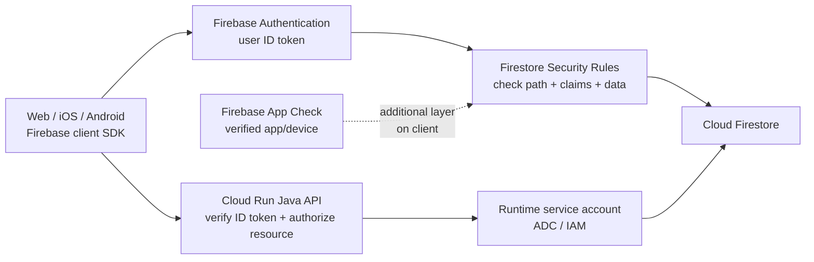

# Security Rules, IAM, and Client–Server Boundaries

An e-commerce website uses **Firebase Authentication** for sign-in, **Cloud Firestore** to read order history, and **Cloud Run Java** to confirm payments. When a user tampers with an order ID in the browser, the system must deny access to anyone else's order. However, if you only configure **Firestore Security Rules** while the Java backend uses the **Admin SDK** to read any document and return it without authorization checks, a vulnerability remains: **the server SDK does not enforce Security Rules**.

This lesson belongs to the **Firestore and Firebase** chapter of the **CLOUD_PROVIDERS_GCP** module, connecting project/IAM organization, Cloud Run, GKE, storage, and databases with defense-in-depth security, tested releases, and cost monitoring. The focus is defining the **trust boundary between client and server**, applying Security Rules to Firebase web/mobile SDKs, IAM to backends, and business authorization along every access path.

> All projects, tenants, UIDs, service accounts, data, and deploy commands in this lesson are examples. Never apply sample rules directly to production without testing all read/write paths and preparing a rollback. Never embed service account private keys, access tokens, or customer data into frontends or logs.

## Objectives

After this lesson, you will be able to:

1. Distinguish **Firebase Auth**, **Firestore Security Rules**, **Google Cloud IAM**, **App Check**, and backend authorization.
2. Write Rules v2 using `request.auth`, `resource`, `request.resource`, `get/list/create/update/delete`, and field validation.
3. Design Rules that prevent cross-**tenant/owner** reads, and understand why **Rules are not a query filter**.
4. Explain why **Java server/Admin SDKs use ADC + IAM** and are not "protected" by Firebase client Rules.
5. Verify Firebase ID tokens on Cloud Run, check tenant/owner before returning data, and manage custom claims safely.
6. Use the Firebase Emulator Suite to test **allow/deny** cases before deployment and spot overlapping-rule risks.
7. Select least-privilege IAM, control Rules read costs, and establish a runbook for `PERMISSION_DENIED`.

## 1. Four Control Layers: Do Not Use Them Interchangeably



| Component | What does it verify? | Applies to | What it **cannot** do |
| --- | --- | --- | --- |
| **Firebase Authentication** | User signed in with a valid ID token | Clients and backend token verification | Decide on its own who can view which order |
| **Firestore Security Rules** | Document path, auth claims, pre/post-write data | **Web/mobile Firebase Firestore SDK** | Block Java Admin/server SDK operations |
| **Google Cloud IAM** | Google principal/service account has Firestore permission | **Server SDK/Admin SDK, Google OAuth IAM API calls** | Check order owner or tenant ID inside individual documents |
| **Firebase App Check** | Request originates from an attested app/device | Supported Firebase client SDKs | Replace sign-in, authorization, or IAM |
| **Backend authorization** | Verified user is permitted to act on a specific resource | Cloud Run/GKE/API servers | Replace IAM when calling Firestore |

**Core boundary:**

- Web/mobile Firebase SDK calling Firestore → **Rules** are evaluated for the request (along with Firebase Auth claims if present).
- Java server SDK/Firebase Admin SDK using **Application Default Credentials (ADC)** → **IAM** is evaluated; **Rules are bypassed**.
- Client calling a Java API → Java must **verify the ID token** and **check business permissions**, then Java uses IAM to talk to Firestore.
- API requests using Google OAuth credentials along server/IAM paths are also not treated as Firebase client SDK traffic. Do not assume from HTTP alone that every call passes through Rules.

**Architectural recommendation:** let clients read low-sensitivity data locked down by Rules directly, while keeping high-impact writes—such as updating prices, confirming payments, changing roles, issuing refunds, or moving tenants—owned by the backend.

## 2. How Security Rules Work

Security Rules are an **allow-based** language; there is no `deny` rule that overrides an `allow`. If no matching `allow` evaluates to `true`, the request is denied. If **two `match` blocks overlap**, only **one `allow` returning `true`** is needed for the request to succeed.

### Minimal structure

```javascript
rules_version = '2';
service cloud.firestore {
  match /databases/{database}/documents {
    match /profiles/{uid} {
      allow get: if request.auth != null && request.auth.uid == uid;
    }
  }
}
```

- `rules_version = '2'`: Rules v2 syntax; required for certain recursive wildcard and collection group queries.
- `match /databases/{database}/documents`: binds to the Firestore database path; nested `match` blocks select documents.
- `request.auth.uid`: the service-verified Firebase Auth UID; **not** a client-submitted `uid` field.
- `get` covers **single-document** reads; `list` covers **queries or collection listings**; `read` covers both.
- `create`, `update`, and `delete` can be split instead of `write` to avoid accidentally permitting updates or deletes.

**Dangerous example to avoid:**

```javascript
// Do not use in production:
match /{document=**} {
  allow read, write: if request.auth != null;
}
```

This grants **any signed-in account** read/write access to every document, including other tenants' data. An `allow ... if false` rule elsewhere **cannot override** a broad `allow` that already returned `true`.

### Key variables and functions

| Variable / function | Meaning | Example |
| --- | --- | --- |
| `request.auth.uid` | Firebase Auth user ID | Allow reading only your own `profiles/{uid}` |
| `request.auth.token` | Verified ID token claims, including server-issued custom claims | `tenant_id` or `admin` |
| `resource.data` | **Existing** document data | `ownerUid` before an update |
| `request.resource.data` | Document state **after the proposed write** | Block changing `ownerUid` or `totalMinor` |
| `request.time` | Request timestamp per Rules | Compare against server timestamp |
| `get(path)`, `exists(path)` | Read a related document inside Rules | Verify organization membership |
| `getAfter(path)` | Inspect state after a batch/transaction before commit | Enforce cross-document invariants |

Rules are **not a place to run business workflows**: they cannot call payment APIs, mutate other documents, mint tokens, or delete data. A rule only decides whether to **allow or deny** a request.

## 3. Controlled Multi-Tenant Rules Example

Suppose data is structured as:

```text
profiles/{uid}
  displayName: string
  createdAt: timestamp

tenants/{tenantId}/orders/{orderId}
  ownerUid: string
  status: "PENDING" | "PAID" | "CANCELLED"
  totalMinor: int
```

Requirements: users can view only **their own profile**; orders can be read only if the **tenant in the verified claim** matches the path and `ownerUid` equals the UID. Clients must **not** write order status; only the Java backend (after business validation) may do so.

Save as `firestore.rules` in a **separate practice project**:

```javascript
rules_version = '2';
service cloud.firestore {
  match /databases/{database}/documents {
    function signedIn() {
      return request.auth != null;
    }
    function sameTenant(tenantId) {
      return signedIn() &&
             request.auth.token.tenant_id == tenantId;
    }

    match /profiles/{uid} {
      allow get: if signedIn() && request.auth.uid == uid;
      allow list: if false;

      allow create: if signedIn() && request.auth.uid == uid &&
        request.resource.data.keys().hasOnly(['displayName', 'createdAt']) &&
        request.resource.data.keys().hasAll(['displayName', 'createdAt']) &&
        request.resource.data.displayName is string &&
        request.resource.data.displayName.size() <= 80 &&
        request.resource.data.createdAt == request.time;

      allow update: if signedIn() && request.auth.uid == uid &&
        request.resource.data.diff(resource.data).affectedKeys()
          .hasOnly(['displayName']) &&
        request.resource.data.displayName is string &&
        request.resource.data.displayName.size() <= 80;

      allow delete: if false;
    }

    match /tenants/{tenantId}/orders/{orderId} {
      allow get: if sameTenant(tenantId) &&
                 resource.data.ownerUid == request.auth.uid;

      // List is valid only if the query limits results AND filters by owner.
      allow list: if sameTenant(tenantId) &&
                  request.query.limit <= 20 &&
                  resource.data.ownerUid == request.auth.uid;

      // Price, tenant, order owner, and status are managed by the backend.
      allow create, update, delete: if false;
    }
  }
}
```

**How to read this:**

1. There is no blanket `allow read, write: if true`; all other documents are **denied by default**.
2. `sameTenant` checks a **custom claim set by a privileged backend**, not a `tenantId` in the request body.
3. `allow get` checks the **actual owner**; tampering with an order ID in the URL will not bypass access control.
4. `allow list` requires query limit ≤ 20 **and proves every potential result document belongs to the owner**. It is not an automatic filter.
5. Profile `create` permits only approved fields; `update` cannot add `role/admin/createdAt` or modify anything beyond `displayName`. `serverTimestamp()` from the SDK is evaluated against `request.time` in Rules.

### Rules do not automatically filter query results

If Alice runs `getDocs(collection(db, "tenants/t-a/orders"))`, the query could match Bob's orders. **Firestore rejects the entire query** rather than stripping Bob's rows. To pass the rule, the query must include:

```javascript
// JavaScript Firebase Web SDK v9 modular; illustrative query only.
const q = query(
  collection(db, "tenants", "t-a", "orders"),
  where("ownerUid", "==", user.uid),
  limit(10)
);
const snap = await getDocs(q);
```

Without `where("ownerUid", "==", user.uid)` or `limit`, this policy denies the request **even if every existing document in the collection happens to belong to Alice**. Rules evaluate the **set of documents the query could return**; they do not read the collection and filter afterward.

**Note:** the rule above applies only to **direct queries on `/tenants/{id}/orders`**; it does not grant `collectionGroup("orders")` access. Collection groups require Rules v2 recursive wildcards and strict dedicated conditions, otherwise permissions can easily widen unintentionally.

## 4. Web Client: Using Firebase Auth and Rule-Compliant Queries

Example where a Firebase Web project has `firebaseConfig` configured and the user is signed in with a server-issued `tenant_id` custom claim. A public Web SDK Firebase config is **not a service account private key**; security relies on Auth, Rules, App Check, and usage restrictions—not hiding the frontend `apiKey`.

```javascript
import { initializeApp } from "firebase/app";
import { getAuth, onAuthStateChanged } from "firebase/auth";
import {
  getFirestore, collection, doc, getDoc, getDocs,
  query, where, limit, setDoc, serverTimestamp
} from "firebase/firestore";

const app = initializeApp(firebaseConfig); // Obtained from Firebase Console
const auth = getAuth(app);
const db = getFirestore(app);

onAuthStateChanged(auth, async (user) => {
  if (!user) return; // UI redirects to the sign-in screen.

  const tenantId = "tenant-a"; // UI value; Rules still verify the token claim.
  const q = query(
    collection(db, "tenants", tenantId, "orders"),
    where("ownerUid", "==", user.uid),
    limit(10)
  );

  try {
    const result = await getDocs(q);
    const orders = result.docs.map(d => ({ id: d.id, ...d.data() }));
    console.log("Number of allowed orders:", orders.length);

    // User may create their own profile with allowed fields.
    // Only run if the document does not exist; do not overwrite existing profiles.
    const profileRef = doc(db, "profiles", user.uid);
    if (!(await getDoc(profileRef)).exists()) {
      await setDoc(profileRef, {
        displayName: "Demo user",
        createdAt: serverTimestamp()
      });
    }
  } catch (err) {
    // Use a logger that strips tokens/PII; distinguish permission-denied.
    console.error("Firestore request rejected:", err.code);
  }
});
```

**Do not treat the UI `tenantId` variable as authorization**: any user can alter it in DevTools. Rules verify `tenant_id` inside the ID token. For more sensitive data, have a **Cloud Run backend** enforce authorization and return data filtered by business rules.

### Writes that must stay on the server

Prices, payment status, fulfillment status, `ownerUid`, `tenantId`, staff roles, and order outcomes are **server-owned**. Allowing users to `setDoc` these fields merely because they signed in is a flawed design. If clients can submit purchase intents, separate `checkoutRequests` (user-proposed inputs) from backend-confirmed `orders`, or invoke a validated server API.

## 5. Java Server/Admin SDK: IAM, Not Rules

A Cloud Run Java service processing payments can read or write `/tenants/{tenantId}/orders/{orderId}` **even when Security Rules say `allow write: if false`**. That is **intentional behavior** of server/admin SDKs: they use **Google credentials** (ADC), authorized by Cloud Firestore via **IAM**. Security Rules protect only the Firebase client path.

### Bootstrapping with the identity attached to Cloud Run

Example during Java application startup (`firebase-admin` and Google Auth dependencies managed via BOM/build):

```java
import com.google.auth.oauth2.GoogleCredentials;
import com.google.firebase.FirebaseApp;
import com.google.firebase.FirebaseOptions;

// Initialize once at startup. Cloud Run obtains ADC from its runtime service account.
if (FirebaseApp.getApps().isEmpty()) {
  FirebaseApp.initializeApp(FirebaseOptions.builder()
      .setCredentials(GoogleCredentials.getApplicationDefault())
      .build());
}
```

Never run `gcloud auth application-default login` in a production runtime, never distribute JSON private keys, and **never** bundle Firebase Admin credentials into web/mobile builds. Cloud Run's runtime identity needs appropriate Firestore IAM, such as `roles/datastore.user` at an approved scope. That role grants broad data access; **it does not restrict by collection or `ownerUid` by default**. IAM Conditions can scope by database if needed, but **per-document/per-tenant** authorization logic must still be enforced by the application.

### Authenticating callers and checking ownership before returning data

An API receives `Authorization: Bearer <Firebase ID token>` over HTTPS. Middleware must parse the header, reject empty tokens, and return HTTP 401 appropriately; the Java method below illustrates **only the step after extracting the token string**:

```java
import com.google.cloud.firestore.DocumentSnapshot;
import com.google.firebase.auth.FirebaseAuth;
import com.google.firebase.auth.FirebaseToken;
import com.google.firebase.cloud.FirestoreClient;

public final class OrderAuthorizationService {
  public record OrderView(String orderId, String status) {}

  public OrderView getForCaller(
      String firebaseIdToken, String tenantId, String orderId)
      throws Exception {
    // Verify signature, issuer, audience, and expiry of the Firebase Auth token.
    FirebaseToken principal = FirebaseAuth.getInstance()
        .verifyIdToken(firebaseIdToken);

    // Server-issued tenant claim; DO NOT trust a tenantId taken from the UI.
    if (!tenantId.equals(principal.getClaims().get("tenant_id"))) {
      throw new SecurityException("Access denied");
    }

    // Server SDK is authorized via IAM, so Security Rules DO NOT run.
    DocumentSnapshot order = FirestoreClient.getFirestore()
        .collection("tenants").document(tenantId)
        .collection("orders").document(orderId)
        .get().get();

    if (!order.exists()
        || !principal.getUid().equals(order.getString("ownerUid"))) {
      throw new SecurityException("Access denied");
    }
    String status = order.getString("status");
    if (status == null) {
      throw new IllegalStateException("Invalid stored order");
    }
    // Return only public fields; do not expose the raw snapshot/PII.
    return new OrderView(order.getId(), status);
  }
}
```

This snippet is **not yet a complete HTTP controller**: the HTTP layer must map invalid tokens → **401**, missing authorization → **403/404 per policy**, and transient Firestore errors → controlled **5xx**, while applying timeouts, PII-scrubbed logging, and rate limiting. If immediate detection of disabled accounts/revoked tokens is required, `verifyIdToken(token, true)` checks revocation (adding a network call/latency); weigh this against sensitivity and threat model.

**Critical bug:** a backend using the Admin SDK looks up an order by `orderId` and **returns it directly** assuming "Rules already stopped unauthorized clients." Rules **never execute** on this path. Always enforce **tenant claim + owner/resource permission** on the server before returning data or triggering side effects.

### IAM permissions for the backend

| Principal | Required action | Authorization approach |
| --- | --- | --- |
| Firebase client user | Read only their own orders via SDK | Firebase Auth + **Rules**, no project IAM |
| Cloud Run runtime SA | Access Firestore data in the backend | `roles/datastore.user` or scoped custom role/condition, never `roles/editor` |
| CI/CD rules deployer | Test and publish new Rules versions | Controlled Firebase Rules permissions, deployed from repo |
| Operations staff | View logs, audit, support users | Properly scoped read roles; no shared admin keys |
| Security auditor | Review IAM bindings and denied requests | IAM viewer/audit logs per policy |

IAM granted at the **project/database** level is not equivalent to Rules enforced per **document path**. Separate service accounts per workload, revoke unused roles, use IAM Policy Troubleshooter for server SDK 403s, and never grant Owner as a quick workaround.

## 6. Custom Claims, App Check, and Trust Boundaries

### Server-issued custom claims

Suppose each user belongs to one tenant. Only privileged administrative staff who verified the user–tenant relationship should call the Admin SDK to set the claim:

```java
// Run ONLY in a backend with Auth admin privileges after verifying membership.
FirebaseAuth.getInstance().setCustomUserClaims(
    uid, java.util.Map.of("tenant_id", "tenant-a"));
```

**Never let clients call an endpoint to assign arbitrary `tenantId` claims.** `setCustomUserClaims` overwrites the user's existing custom claims map, so preserve any required claims when updating. Claims live inside the **Firebase ID token**, have size limits, and only reach the client when the token refreshes or the user signs in again; `getIdToken(true)` forces a refresh when needed. For urgent access revocation, consider revoking sessions and checking permissions in real time in the backend/Rules as required rather than relying solely on cached claims.

**In multi-tenant SaaS**, if a user can belong to multiple tenants, a single `tenant_id` claim in the ID token is too rigid. You can use backend-written membership documents checked via `get()` in Rules or verified in the API server. Account for extra Rules document read costs and latency, and block clients from granting themselves membership.

### App Check protects the app, not individual orders

**Firebase App Check** uses attestation signals to filter out requests from untrusted clients; enforcement for Cloud Firestore can be turned on after monitoring metrics. However, App Check **does not identify users**, **does not assign roles**, and **cannot stop a valid signed-in user from reading another tenant's data if Rules are broken**.

Combine controls along the **right access path**: direct clients use Auth, Rules, and App Check; backend-calling clients hit a backend that verifies Auth, enforces business authorization, and uses IAM to access Firestore. Pair with rate limiting, monitoring, and tests. Before turning on App Check enforcement, ensure an upgrade path for older app versions and monitor rejection rates so legitimate clients are not disrupted.

## 7. Testing Rules with the Firebase Emulator Suite

Rules must have **automated tests covering denied scenarios**, not just a passing `getDoc` in the Console. The Emulator simulates Firebase Auth users/claims and document state **without touching production Firestore**.

### Setting up a local test environment

In a separate JavaScript/Node.js lab project with Firebase CLI installed:

```bash
# Run outside the lesson repository. Requires Node.js and Java for the Firestore emulator.
# First time: select Firestore during initialization.
firebase init
# Next select the Firestore emulator (or verify existing config).
firebase init emulators
npm install --save-dev firebase @firebase/rules-unit-testing

# firebase.json must point "firestore.rules" to the exact filename.
# Run tests under an isolated Firestore emulator.
firebase emulators:exec --only firestore "node rules.test.mjs" \
  --project demo-firestore-rules
```

Do not run `firebase deploy` during testing. If `firebase.json` lacks a rules file configuration and tests do not load rules explicitly, the emulator may use an **unexpectedly permissive** policy; always pass rules explicitly in test setup.

### Full tenant-isolation test suite

Save as `rules.test.mjs`:

```javascript
import { readFileSync } from "node:fs";
import {
  initializeTestEnvironment, assertSucceeds, assertFails
} from "@firebase/rules-unit-testing";
import {
  doc, collection, query, where, limit,
  getDoc, getDocs, setDoc, updateDoc, serverTimestamp
} from "firebase/firestore";

const env = await initializeTestEnvironment({
  projectId: "demo-firestore-rules",
  firestore: { rules: readFileSync("firestore.rules", "utf8") }
});

try {
  // Bypass rules ONLY IN THE EMULATOR to seed test data.
  await env.withSecurityRulesDisabled(async ctx => {
    const db = ctx.firestore();
    await setDoc(doc(db, "tenants/tenant-a/orders/o1"),
      { ownerUid: "alice", status: "PAID", totalMinor: 10000 });
    await setDoc(doc(db, "tenants/tenant-a/orders/o2"),
      { ownerUid: "bob", status: "PAID", totalMinor: 20000 });
    await setDoc(doc(db, "tenants/tenant-b/orders/o3"),
      { ownerUid: "alice", status: "PAID", totalMinor: 30000 });
  });

  const alice = env.authenticatedContext(
    "alice", { tenant_id: "tenant-a" }).firestore();
  const anonymous = env.unauthenticatedContext().firestore();

  // Matching tenant and owner: ALLOW.
  await assertSucceeds(getDoc(doc(alice,
    "tenants/tenant-a/orders/o1")));

  // Same tenant, different owner: DENY.
  await assertFails(getDoc(doc(alice,
    "tenants/tenant-a/orders/o2")));

  // Matching owner, wrong tenant claim: DENY.
  await assertFails(getDoc(doc(alice,
    "tenants/tenant-b/orders/o3")));

  // Unauthenticated: DENY.
  await assertFails(getDoc(doc(anonymous,
    "tenants/tenant-a/orders/o1")));

  // Query must filter by owner AND limit results.
  await assertSucceeds(getDocs(query(
    collection(alice, "tenants/tenant-a/orders"),
    where("ownerUid", "==", "alice"), limit(10))));
  await assertFails(getDocs(query(
    collection(alice, "tenants/tenant-a/orders"), limit(10))));

  // Frontend must never create/update orders.
  await assertFails(setDoc(doc(alice,
    "tenants/tenant-a/orders/o4"),
    { ownerUid: "alice", status: "PAID" }));

  // Allow profile creation only with permitted fields.
  await assertSucceeds(setDoc(doc(alice, "profiles/alice"), {
    displayName: "Alice", createdAt: serverTimestamp()
  }));
  await assertFails(updateDoc(doc(alice, "profiles/alice"),
    { role: "admin" }));
} finally {
  await env.cleanup();
}
```

**Expected outcome:** tests pass when every `assertSucceeds` is allowed and every `assertFails` is actually rejected. If a request expected to fail succeeds, that is a **Rules vulnerability**, not a reason to change the test to `assertSucceeds`. Run tests using **schemas and queries matching real clients**; add tests for tenant revocation, batch writes, field updates, collection groups, and claim refreshes if your app uses them.

### Controlled Rules deployment

```bash
# Run ONLY after emulator tests and review PASS.
# MODIFIES staging/production access policies.
firebase deploy --only firestore:rules --project retail-staging-01
```

`firebase.json` must point to the right `firestore.rules` file and **target database**. A Firebase CLI deploy can **overwrite Rules edited manually in the Console**; manage Rules in Git/GitOps, review diffs, roll out to staging/canary first, and keep the previous version for rollback. Rules changes take time to propagate: documented as **up to about 1 minute for new queries/listeners**, and **up to 10 minutes for active listeners**; do not treat immediate post-deploy checks as final proof.

## 8. Common Security and Operational Pitfalls

| Pitfall | Consequence | Prevention |
| --- | --- | --- |
| `allow read, write: if request.auth != null` on the whole DB | Every signed-in user gets broad access | Deny-by-default, match explicit paths |
| Overlapping matches with one overly broad allow | Restrictive rules bypassed via **OR** | Audit recursive wildcards, test denies |
| Checking ownership via a client-editable field | Users transfer ownership to themselves | Block mutations to `ownerUid/tenantId` |
| `getDocs` without `where`/`limit` | Entire query rejected | Design queries matching Rules |
| Using Admin SDK on Cloud Run with only Rules written | Backend can leak any tenant's docs | Verify Firebase token and authorize **every resource** |
| Shipping a private service account key in web/mobile | Exposes privileged server credentials | Use Firebase client SDK only; backend uses attached SA/ADC |
| Thinking App Check replaces Auth | Valid app can still belong to an unauthorized user | App Check + Auth + Rules/authorization |
| Custom claim changed but token not refreshed | Stale roles/permissions stay valid briefly | Token refresh, revocation strategy, online checks if needed |
| Overusing `get()/exists()` for membership | Raises cost, latency, or hits access-call limits | Design documents/caching and budgets |
| Editing Rules in both Console and Git/CLI | Subsequent deploys overwrite manual edits | Git as source of truth, review/rollback |
| Testing only happy paths | Misses IDOR/cross-tenant flaws | Allow/deny test matrix + Emulator |

### Rules document access calls and cost

Security Rules can call `get()`, `exists()`, and `getAfter()` to inspect related documents. Firestore caps this at **10 document access calls** per single-document request/query and **20** per multi-document read/transaction/batched write (with per-operation limits). Cached calls may not count repeatedly toward the limit, but **Rules-dependent reads can be billed** even if the request is ultimately denied. Avoid unnecessary membership/role document lookups on every request, especially inside realtime listeners.

Rules evaluation, indexing, and database billing are **distinct concerns**: client queries incur document reads, index reads, and network egress; server IAM calls also incur read/write charges. Having permission to read does not mean large queries are free. Capping `request.query.limit` is a guardrail, not a substitute for quotas, budgets, and cost monitoring.

## 9. `PERMISSION_DENIED` Troubleshooting Runbook

### If the error comes from a Firebase web/mobile SDK

1. Verify the user is signed in, check `request.auth.uid`, and ensure the **refreshed token** carries the right `tenant_id` (never log raw tokens).
2. Check document path, `ownerUid`, and field names; `get` differs from `list`.
3. For queries: inspect `where/limit`; Rules are **all-or-nothing**, never filtering results.
4. Confirm Rules are deployed to the **right project/database**, check overlapping matches, and allow for propagation.
5. Reproduce with **Emulator Rules Tests** using mock claims and production-like data; inspect Rules evaluation traces.
6. If App Check enforcement is enabled, check App Check metrics to see if requests are blocked before Rules run.

### If the error comes from the Cloud Run Java server SDK

1. Verify Cloud Run's **runtime service account** (do not confuse with user login, CI deployer, or default compute SA).
2. Check ADC and IAM permissions on the project/database, org policies, and IAM Conditions; use IAM Policy Troubleshooter if needed.
3. Verify database ID, project ID, connectivity/quotas, and Firestore service status.
4. Inspect **backend authorization separately**: is the Firebase token valid, and does the tenant/owner mapping match?
5. **Never edit Security Rules to fix a 403 from the Admin SDK**; Rules do not apply to that path.

**Never grant `roles/editor` or disable App Check/Rules project-wide just to "test a fix."** Isolate the request path, credential type, and principal first.

## 10. Scenario: A Java API Creates a Vulnerability Despite Correct Rules

A company's Rules allow only Alice to read `/tenants/a/orders/o1`. Meanwhile, a Java endpoint accepts `GET /orders/{orderId}`, queries Firestore via the Admin SDK by ID, and returns the entire document. Bob guesses Alice's ID and calls the Java endpoint using Bob's valid Firebase token. Because Java **never checks `ownerUid`**, Bob reads Alice's data even though Bob's client SDK **is blocked by Rules**.

**Root cause:** IAM allowing the Cloud Run SA to read Firestore grants access to the **server application**, not to Bob. Client Rules are never evaluated by the server SDK. This is **Broken Object Level Authorization (BOLA/IDOR)**.

**Fix:** verify the token in Java, derive tenant/UID from the verified identity, query scoped by tenant and order ID, check owner/business role, return filtered fields, test that Bob → Alice returns 403/404, and log request ID/UID safely without PII. For payment writes, use transactions/conditional updates and idempotency; Rules do not enforce server logic.

## 11. Exercises and Answers

### Exercise 1 — Which SDK uses Rules?

A browser uses the Firebase Web SDK to read Firestore; a Java Cloud Run service uses the Firestore Admin SDK to read the same document. How do their authorization mechanisms differ?

<details>
<summary>Answer</summary>

The browser is governed by **Firestore Security Rules** and Firebase Auth; the Java server SDK uses **ADC/IAM** and bypasses Rules. Java must enforce business authorization itself.
</details>

### Exercise 2 — Rules are not filters

A rule allows owners to read their own orders, yet `getDocs(collection(...orders))` is denied even though all existing orders belong to Alice. Why?

<details>
<summary>Answer</summary>

Firestore checks what the query **could** return rather than filtering individual rows. You need `where("ownerUid","==",alice.uid)` and a `limit` matching the rule.
</details>

### Exercise 3 — One overly broad allow

One `match` denies all writes, but another recursive `match /{document=**}` has `allow write: if request.auth != null`. Can a signed-in user write?

<details>
<summary>Answer</summary>

Yes. Overlapping `allow` rules combine via **OR**; `if false` cannot override another allow. Remove or tighten the broad allow and test negative cases.
</details>

### Exercise 4 — Client modifies ownerUid

An update rule only checks `request.resource.data.ownerUid == request.auth.uid`. Can the current order owner change the owner or other fields?

<details>
<summary>Answer hint</summary>

Without constraints on pre/post data and allowed fields, the user can modify other fields (such as price, role, or status) while keeping `ownerUid` equal. Use `diff(...).affectedKeys().hasOnly([...])` and block server-owned writes.
</details>

### Exercise 5 — Custom claims

The server just changed `tenant_id` from A to B, while the client still holds an older ID token. Do Rules immediately see the new tenant?

<details>
<summary>Answer</summary>

Not necessarily. New claims take effect when the **ID token is reissued/refreshed**; use `getIdToken(true)` and an appropriate revocation/online-check policy matching security requirements.
</details>

### Exercise 6 — App Check

App Check reports a request came from a legitimate app binary. Is that enough to allow reading all orders?

<details>
<summary>Answer</summary>

No. App Check attests the app/device origin; **Auth and Rules/backend authorization** must still verify the user, tenant, and owner.
</details>

### Exercise 7 — Java server 403

The server SDK on Cloud Run gets `PERMISSION_DENIED` reading Firestore. Should you change Rules from `if false` to `if true`?

<details>
<summary>Answer</summary>

No. The server uses IAM; check the attached runtime service account, ADC, IAM permissions, and database/project target rather than weakening Rules.
</details>

### Exercise 8 — What do Emulator tests need?

You tested that Alice can read Alice's order. Name at least three denied test cases required before production.

<details>
<summary>Answer hint</summary>

Bob reading Alice's order; Alice reading tenant B's order; unauthenticated get; list without an owner filter; client attempting to alter `status` or `role`. Each must use `assertFails` and run in the Emulator.
</details>

## 12. Production Checklist

- [ ] Mapped data access paths: Firebase web/mobile SDK → Rules; Java/Admin SDK → IAM + backend authorization.
- [ ] Rules are deny-by-default, matching explicit document paths with no broad wildcard allows.
- [ ] Split `get/list/create/update/delete`; validate `request.auth`, tenant, owner, and allowed fields.
- [ ] Client queries include `where/limit` matching Rules; never treat Rules as a filter.
- [ ] Clients cannot write server-owned fields (price/owner/role/payment).
- [ ] Java API verifies Firebase ID tokens and tenant/owner before reading/writing, returning filtered responses.
- [ ] Cloud Run runtime uses attached SA/ADC; no shipped private keys; least-privilege IAM.
- [ ] Custom claims are server-issued with refresh/revocation plans; App Check added as a supporting layer.
- [ ] Emulator tests cover allow/deny, cross-tenant attempts, malicious updates, and query semantics.
- [ ] Rules deployed from Git/CI with reviews, correct project/database targets, rollback, and propagation checks.
- [ ] Monitored client `permission-denied`, server IAM 403s, access calls/reads, quotas, alerts, and Billing.
- [ ] BOLA/IDOR audit/playbook in place; no tokens, secrets, or customer PII in logs.

## Official References

- [Get started with Cloud Firestore Security Rules](https://firebase.google.com/docs/firestore/security/get-started): Rules v2 mechanics and client/server SDK differences.
- [Structuring Cloud Firestore Security Rules](https://firebase.google.com/docs/firestore/security/rules-structure): `match`, operations, and database paths.
- [Writing conditions for Firestore Rules](https://firebase.google.com/docs/firestore/security/rules-conditions): `request.auth`, `resource`, `request.resource`, `getAfter`.
- [Securely query data](https://firebase.google.com/docs/firestore/security/rules-query): why Rules are not filters, `where`, and `request.query.limit`.
- [Control access to specific fields](https://firebase.google.com/docs/firestore/security/rules-fields): `keys().hasOnly` and `diff().affectedKeys()`.
- [How Security Rules work](https://firebase.google.com/docs/rules/rules-behavior): overlapping Rules evaluation and OR semantics.
- [Test Firestore Security Rules](https://firebase.google.com/docs/firestore/security/test-rules-emulator): Emulator Suite and `@firebase/rules-unit-testing`.
- [Install and configure Local Emulator Suite](https://firebase.google.com/docs/emulator-suite/install_and_configure): `firebase init emulators`, port configuration, and CI.
- [Cloud Firestore IAM](https://firebase.google.com/docs/firestore/security/iam): IAM roles and service agents.
- [Firestore server client libraries](https://firebase.google.com/docs/firestore/client/libraries): backend SDK access model.
- [Firebase Authentication custom claims](https://firebase.google.com/docs/auth/admin/custom-claims): assigning roles, token refresh, and security.
- [Verify ID tokens](https://firebase.google.com/docs/auth/admin/verify-id-tokens): backend token verification.
- [Enable App Check enforcement](https://firebase.google.com/docs/app-check/enable-enforcement): App Check configuration.
- [Cloud Firestore pricing](https://cloud.google.com/firestore/pricing): document reads/writes, Rules access calls, and storage.
