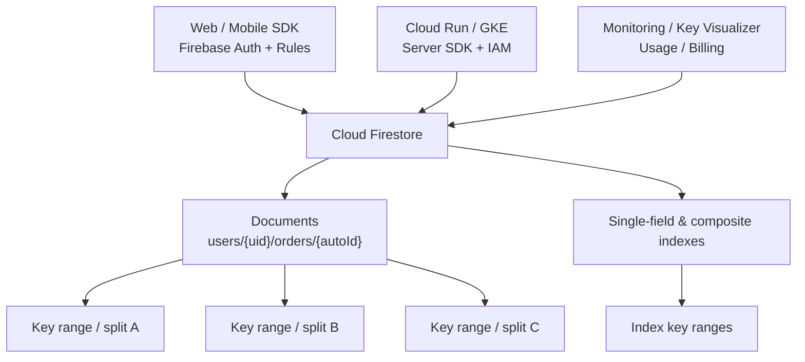
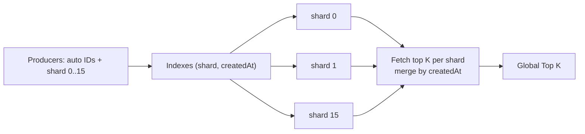

# Designing Firestore to Avoid Hotspots and Unexpected Read Costs

An e-commerce application uses **Cloud Firestore** to display orders in real time. At launch, the system responds quickly and costs stay low. Once a campaign starts, some writes fail with `DEADLINE_EXCEEDED`, the order list lags, and **document reads** on the bill grow faster than user count. The culprit may not be Firestore "running out of servers," but **sequential document IDs, write-concentrated indexes, a single frequently updated document, wasteful queries, or continuously recreated realtime listeners**.

This lesson belongs to the **Firestore and Firebase** chapter of the `CLOUD_PROVIDERS_GCP` module, bridging project/IAM/VPC foundations through Compute Engine, GKE, Cloud Run, storage, databases, release automation, and reliability/cost management. The content focuses on **Cloud Firestore Standard edition, Firebase/Native mode document modeling**, aiming to design data for **load distribution**, build queries that **read just enough**, and observe **real costs**. Firestore Enterprise and MongoDB compatibility use different metrics/billing models; consult their respective docs before applying the calculations below.

## 1. Learning Objectives

After this lesson, you will be able to:

1. Distinguish hotspots on **document keys**, **index keys**, **a single frequently updated document**, and sudden traffic ramp-ups.
2. Use **automatic document IDs** instead of timestamp/sequential IDs under concurrent writes.
3. Explain the **500 writes/s limit on indexed sequential fields** and the **500/50/5** ramp-up rule.
4. Choose among **single-field index exemptions**, **sharded timestamps**, and **distributed counters** based on query needs.
5. Design collections/subcollections and composite indexes from query patterns, avoiding unnecessary index fanout.
6. Account for cost drivers: **document reads/writes/deletes**, **index entry reads**, **storage/indexes**, **network**, realtime listeners, aggregations, and Security Rules.
7. Use **cursor pagination** instead of `offset`, bound result sets, manage listener lifecycles, and run Query Explain.
8. Distinguish **Firebase Security Rules** for web/mobile SDKs from **IAM** for server/Admin SDKs.
9. Run a **Firestore Emulator** lab to test sample data, pagination, and counters without touching a real database.
10. Build a checklist to optimize p95/p99, error rates, billable reads, and before/after cost.

**Safety scope:** all write-performing lab code targets the **Firestore Emulator on the learner's machine** by default. Never deploy rules/indexes, import data, or run load tests against production. Commands or configs that modify real Firestore resources are clearly flagged for review.

## 2. How Firestore Scales by Distributing Key Ranges

Firestore stores **documents** inside **collections**; each document holds fields and may contain subcollections. The platform automatically splits key ranges (splits) to distribute access and scale serving capacity under heavy traffic.



Auto-scaling **does not eliminate every hotspot**. If operations continually hit a narrow key range or a monotonically increasing index, Firestore cannot redistribute load effectively right away.

| Hotspot type | Example | Mitigation |
| --- | --- | --- |
| **Document key range** | IDs `order-000001`, `order-000002`… | Use randomly distributed auto-IDs |
| **Index key range** | Every new document has an indexed, monotonically increasing `createdAt` | Exempt index if unqueried; if ordering is required, use sharded timestamps |
| **Single-document contention** | Everyone updates `stats/global` once per like | Distributed counters or partition the data |
| **Too-fast traffic ramp** | Importing 50,000 writes/s into a fresh collection | Ramp traffic using **500/50/5** with well-distributed keys |
| **Hot query/large listener** | Screen continuously listens to tens of thousands of docs | Bound queries, narrow scope, reduce fan-out |

**Distinction:** rising read costs are a **read volume** problem; hotspots are a **load distribution and latency** problem. They can occur together, but they are not fixed with the same solution.

## 3. Designing Document IDs to Avoid Appending to the End of a Collection

**Avoid** using time-ordered or sequential document IDs:

```text
orders/000001
orders/000002
orders/000003

events/2026-11-19T09:00:01Z
events/2026-11-19T09:00:02Z
```

Lexicographically adjacent IDs concentrate writes onto a narrow key range. Firestore can split ranges over time, but under high load consecutive writes still collide.

**Instead**, let the SDK generate distributed IDs:

```javascript
const newOrder = db.collection("orders").doc();
await newOrder.set({
  tenantId: "demo-tenant",
  externalOrderId: "ORD-001",
  status: "paid",
  createdAt: new Date()
});
console.log("Generated document ID:", newOrder.id);
```

`externalOrderId` can hold a human-readable business code while the **document path** uses an auto-ID. If you must guarantee external ID uniqueness or look up by it, design an appropriate lookup/index/transaction and check write contention; switching document IDs to random **does not automatically eliminate** hotspots on a sequential index.

### 3.1. Per-tenant layout: root collection or subcollection?

Two viable models:

```text
orders/{autoId}
  tenantId: "tenant-a"
  createdAt: Timestamp

tenants/{tenantId}/orders/{autoId}
  createdAt: Timestamp
```

| Model | Pros | Trade-off |
| --- | --- | --- |
| Global collection + `tenantId` | Flexible cross-tenant server queries | Every query must filter by tenant; composite indexes/rules are more complex |
| Subcollection per tenant | Clear per-tenant access scope and queries | Needs a collection-group query for cross-tenant lookups; design indexes/rules accordingly |

Never store all orders as **an array inside `tenants/{id}`**: the document bloats, concurrent clients contend on writes, and every read drags the entire payload. Firestore enforces document size limits; the "one tenant = one giant document" model rarely survives real load.

## 4. Two Different "500" Numbers Commonly Confused

### 4.1. Indexed sequential field: ~500 writes/s

If a collection contains an **indexed field whose values increase or decrease sequentially across documents**—such as `createdAt` or a sequence number—Firestore guidance notes a **maximum write rate of ~500 writes/s to that collection** in that scenario. This is a hotspot on **index keys**, even when document IDs are randomized.

Example:

```javascript
// Each order has an auto-ID, yet createdAt increases continuously.
await db.collection("telemetry").doc().set({
  createdAt: new Date(),
  deviceId: "device-7",
  rawPayload: "..."
});
```

If you **do not query/filter/sort by `createdAt`**, add a **single-field index exemption** for it. If you **must** sort by time at traffic above that threshold, evaluate **sharded timestamps** or redesign the read architecture.

**Exact nuance:** not every timestamp field triggers this limit. The trigger is **indexed values ordered monotonically across incoming documents**; randomly distributed timestamps do not suffer the same bottleneck. Adding a single-field exemption does not permit keeping another composite index containing that sequential field without reconsidering the hotspot.

### 4.2. The 500/50/5 rule: ramping traffic gradually

When opening a new collection or shifting heavy traffic onto an unheated document key range:

1. Start at no more than ~**500 operations/second** on the new key space, distributed evenly across keys.
2. Increase by **at most 50% every 5 minutes** while metrics stay healthy.
3. Continue scaling only after latency, errors, retries, and contention remain within thresholds.

```text
Time           Approximate max target rate
0 minutes      500 ops/s
5 minutes      750 ops/s
10 minutes     1,125 ops/s
15 minutes     1,687 ops/s
```

**This is a ramp-up guideline**, not a hard limit saying "collections max out at 500 ops/s." Once Firestore splits key ranges and keys are well distributed, throughput can scale much higher. Conversely, **if a sequential index remains**, ramping up slowly will not remove the 500 writes/s index bottleneck.

When migrating to a new collection, **route traffic via a stable hash of user/tenant IDs**, stepping up percentages gradually. Never cut over all tenants at once expecting instant splitting.

## 5. Avoiding Contention on One Document: Distributed Counters

Firestore cannot update a single document at infinite speed. For example, `products/sku-1` having thousands of users increment `likes` per second causes contention and retries. **There is no single fixed safe writes/s number for every document**; practical limits depend on document size, index fanout, and transaction workload.

Instead of:

```javascript
await db.doc("counters/likes").update({
  count: FieldValue.increment(1)
});
```

you can split across multiple shards:

```text
counters/likes
  shards/0    count: 103
  shards/1    count: 98
  shards/2    count: 121
  ...
  shards/15   count: 110
```

Each write picks a random shard; total = sum of all shard counts. With 16 shards, writes spread across multiple documents. **Drawback:** reading the total requires reading **16 documents**, which becomes costly if called frequently. You can periodically write a **roll-up total** (with acceptable lag) so clients read a single document.

**Never** use a distributed counter for strict transactional invariants like "only 1 ticket left" without transactional/serializability design. Sharded counters fit additive metrics like likes, views, and downloads.

## 6. Index Fanout: Too Many Indexes Slow Writes and Grow Storage

Firestore auto-creates **single-field indexes** for many fields; **composite indexes** serve multi-field queries. Each write must update affected index entries, raising **write latency**, I/O, and index storage.

| Field/data | Needs an index? | Recommendation |
| --- | --- | --- |
| `tenantId` / `status` used in filters | Yes | Keep indexes matching queries |
| `createdAt` used in `orderBy` | Yes, but avoid hotspots at very high write rates | Index or use sharded timestamps per access pattern |
| Large `rawPayload` JSON/text never queried | No | Single-field exemption |
| `expiresAt` used only for TTL | Usually not queried | Exempt index; configure TTL separately |
| Large metadata-only arrays/maps | If never `array-contains`/queried | Disable unused indexing |
| Fields for rare/retired queries | No need to keep every old composite index | Review and prune via change process |

**Index entries are not billed as individual document writes** in Standard pricing, yet they consume **index storage**, add write latency, and can incur **index entry reads on queries**. Never assume "extra indexes are free because it's still 1 document write."

### 6.1. Example `firestore.indexes.json`

Illustrative example for a **telemetry collection group** where the app **never queries** `createdAt`/`rawPayload`:

```json
{
  "indexes": [],
  "fieldOverrides": [
    {
      "collectionGroup": "telemetry",
      "fieldPath": "createdAt",
      "indexes": []
    },
    {
      "collectionGroup": "telemetry",
      "fieldPath": "rawPayload",
      "indexes": []
    },
    {
      "collectionGroup": "telemetry",
      "fieldPath": "expiresAt",
      "indexes": []
    }
  ]
}
```

`indexes: []` inside a **field override** disables single-field indexes for that field in the collection group. **Never deploy this snippet wholesale to a real project** that already has other composite indexes: deploying an incomplete config can delete or alter existing indexes. Always **export, review, and merge** index configs via your project's IaC.

Configuring TTL on `expiresAt` is a **separate policy** from disabling indexing; `indexes: []` alone **does not expire documents**. When TTL is needed, enable TTL explicitly on the field override and check pricing, retention, and deletion impact.

## 7. When You Truly Need Timestamp Queries at High Write Rates

A "50 most recent events" screen needs chronological sorting, yet millions of events/day can turn an indexed `createdAt` into a hot index range. You cannot simultaneously **disable the `createdAt` index** and ask Firestore to execute `orderBy("createdAt")` with the same query pattern.

**Sharded timestamps** spread events across multiple index ranges:

```json
{
  "tenantId": "tenant-a",
  "shard": 7,
  "createdAt": "2026-11-19T09:00:00Z",
  "event": "OrderCreated"
}
```

Producers pick a distributed shard (e.g., hash/seed or random in 0..15). Each shard has an index covering `shard + createdAt`, splitting writes across index ranges. Readers **query across shards** and merge results chronologically, applying a limit per query.



Trade-offs to highlight in design reviews:

- **N extra queries/read requests** to compute the global top K; feed cost and latency rise with N.
- Must track a **cursor per shard** for accurate pagination rather than a single shared offset.
- Adds a shard field and composite indexes, increasing operational complexity.
- At ~100 writes/s with simple queries, sharding may be **overengineering**.
- For tenant-scoped queries, evaluate shards per tenant/collection scope so one hot tenant does not skew partitions.

This is a **data model change**, not just raising quotas. Base shard counts, index exemptions, and composite indexes on real load tests and the official **Sharded timestamps** guidance.

## 8. Design Queries Before Finalizing Schemas and Indexes

Firestore is an indexed document database, not an arbitrary join and full-text search engine. Start from real UI screens and APIs.

Suppose a user views their **20 newest paid orders**:

```javascript
const q = db
  .collection("users")
  .doc(userId)
  .collection("orders")
  .where("status", "==", "paid")
  .orderBy("createdAt", "desc")
  .limit(20);

const snapshot = await q.get();
```

This query requires a matching index for `status ASC + createdAt DESC` (or an existing compatible index). When Firebase/Firestore returns a composite index creation link, review the query pattern first instead of blindly creating every suggested index.

**Good practices:**

1. **Narrow scope**: inside `users/{uid}/orders` or with an explicit `tenantId` filter.
2. **Use `limit`** and pagination; avoid `get()` on entire collections.
3. Keep only fields needed by UI screens in compact documents; store blobs/large payloads in Cloud Storage.
4. Build composite indexes for real active queries rather than indexing every field combination.
5. Avoid forcing clients to download thousands of documents and sort/filter locally.
6. Use `count()` aggregations when only totals are needed instead of fetching all documents.
7. When queries use multiple range/inequality conditions, inspect **index entries scanned** via Query Explain.

**Critical limit:** Firestore Security Rules **are not a result filter**. Web/mobile queries must include constraints allowing Rules to prove authorization for the whole result set; you cannot query an entire collection and expect Rules to strip forbidden documents.

## 9. Calculating Firestore Standard Costs: Do Not Count Requests Alone

In Standard edition, the main cost buckets are:

| Billing category | Source |
| --- | --- |
| **Document reads** | `get()`, query results, listener initial snapshots/changes, skipped docs via offset, rule dependency reads |
| **Index entry reads** | Multi-range queries, aggregations, and other applicable index-billed operations |
| **Document writes** | `set`/`update`, transaction/batch writes; batches do not make writes free |
| **Deletes/TTL deletes** | `delete` and managed TTL operations per pricing |
| **Storage** | Documents, indexes, metadata overhead, PITR/backups if enabled |
| **Network** | Data egress, cross-region access depending on topology |
| **Other** | Backups/restores/clones, managed bulk operations, and integrated services |

**Never use "1 API request = 1 Firestore read" as a formula.** A single API request may run multiple queries, each returning multiple documents alongside Rules checks and index entries.

Even a query that **returns zero documents** incurs a **minimum charge of one document read** under Standard rules. Free quota applies only to eligible databases in a project; **TTL, PITR, and backups** have their own billing terms and are not automatically covered by free quotas.

### 9.1. Calculating document reads from product usage

Suppose an app has:

- **12,000 daily active users**.
- Each user opens a list page **5 times/day**.
- Each load reads **15 documents**.

```text
List document reads:
12,000 × 5 × 15 = 900,000 reads/day

Over 30 days:
900,000 × 30 = 27,000,000 reads/month
```

This estimates **result reads only**, excluding realtime updates, listener reconnects, Security Rules dependent reads, index entry reads, profile fetches, and retries. If a screen opens 5 times and re-runs the exact query even when data did not change, those reads are still billed.

To optimize: reduce refetch frequency, cache appropriately, manage listener lifecycles for realtime views, return 15 docs instead of 200, and track **reads per active user**.

### 9.2. Index entry read charges

For queries billed by index entries, Standard edition typically charges **1 read per batch of up to 1,000 index entries** read. **Queries with at most one range field** are not billed for index entry reads. Easy-to-miss details:

- `orderBy` can count as a range field **when the query already includes another range field**.
- The `__name__` field always counts as a range field, even inside an equality filter.
- Vector KNN queries use their own index-entry billing unit (100 entries per billable read per current pricing).
- `count()`/`sum()`/`avg()` aggregations bill by index entries scanned, with a minimum billable read.

For example, a query reading 2,200 index entries incurs **ceil(2,200/1,000) = 3 billable index reads**, plus any document reads. A query returning 20 docs **does not necessarily cost only 20 reads** when multiple range fields are involved.

Use **Query Explain** to verify the execution plan, `index_entries_scanned`, and `billing_details` rather than guessing from SQL-like syntax.

## 10. Cursor Pagination Instead of Offset: Fewer Reads and Faster

**Anti-pattern**:

```javascript
// Not recommended: skips 1,000 docs yet still bills skipped reads.
const q = db.collection("orders")
  .orderBy("createdAt", "desc")
  .offset(1000)
  .limit(20);
```

Under Standard billing, `offset(1000)` still bills reads for the **1,000 skipped documents**, plus the 20 returned documents (and index entry costs if applicable). Returning 20 docs can cost **1,020 document reads**, instead of 20 with a proper cursor.

**Instead**, use `startAfter(lastDocumentSnapshot)`:

```javascript
const base = db.collection("orders")
  .orderBy("createdAt", "desc")
  .limit(20);

const page1 = await base.get();
const last = page1.docs[page1.docs.length - 1];

if (last) {
  const page2 = await db.collection("orders")
    .orderBy("createdAt", "desc")
    .startAfter(last)
    .limit(20)
    .get();
  console.log("Page 2 size:", page2.size);
}
```

**Operational requirements:**

- When filtering by user/status, **keep the exact same filters/orderBy** on subsequent pages.
- A document snapshot cursor disambiguates records sharing the same `createdAt`. With value-based cursors, include a tie-breaker (document ID) to avoid skipped or duplicated rows.
- Do not re-run `get()` on page 1 on every scroll; cache page snapshots/cursors appropriately.
- Pagination does not freeze a consistent snapshot across requests: data can change between pages. For consistent exports, use dedicated batch/export tools.

## 11. Realtime Listeners: Billed by Moving Docs, Not Open Socket Time

A realtime `onSnapshot` query executes an **initial read** and then streams updates. In Standard edition, you are billed a document read whenever a document is **added**, **updated**, or **leaves the result set due to field changes**. If a document is simply **deleted**, that removal itself does not incur an extra read under the corresponding billing rule.

```javascript
import { onSnapshot, query, where, orderBy, limit } from "firebase/firestore";

const q = query(
  ordersRef,
  where("status", "==", "open"),
  orderBy("createdAt", "desc"),
  limit(20)
);

const unsubscribe = onSnapshot(q, (snapshot) => {
  // Update UI only for necessary data.
  renderOrders(snapshot.docs);
});

// When component unmounts, user leaves screen, or switches account:
unsubscribe();
```

**Never leave listeners active after leaving a screen**, never register a new listener on every render, and avoid opening overlapping listeners over the same data without measuring. Conversely, a **stable long-lived listener** is often cheaper than polling the same query every few seconds because unchanged results are not re-read.

### 11.1. Reconnects can drive up the bill

For **mobile/web SDKs**:

- With **offline persistence enabled**, if a listener stays disconnected for **more than 30 minutes**, Firestore may bill reconnection as a **fresh query**.
- With **offline persistence disabled**, every disconnect/reconnect can bill as a fresh query.
- Changes to Security Rules or dependent documents can also trigger re-evaluation reads of referenced documents.
- High-frequency updates on a rapidly changing feed can cost more than periodic polling; measure against UX needs.

Example: 10,000 clients each listening to 20 docs generate **200,000 initial document reads** (assuming no caching/special exemptions). If each client receives 8 matching doc updates during the day, that adds **80,000 more reads**. These two sources alone reach **280,000 document reads/day** before reconnect, index, or Rules reads.

**Never** confuse "keeping one listener connection open for 24 hours" with "paying for only one read in 24 hours."

## 12. Security Rules: Access Policies Can Also Generate Reads

Firestore uses **two distinct authorization mechanisms**:

| Client | Primary mechanism |
| --- | --- |
| Firebase web/mobile SDK | **Firebase Authentication + Firestore Security Rules** |
| Admin SDK, server client libraries, Cloud Run/GKE backends | **Google Cloud IAM/ADC**, **bypassing Firestore Security Rules** |

This is a critical security boundary: code running with the **Admin SDK** reads and writes via IAM without being restricted by mobile/web Rules. Restrict service accounts using least privilege and enforce tenant authorization in backend code.

### 12.1. Sample user-scoped Rules

For example, if orders live at `users/{uid}/orders/{orderId}` and **clients have read-only access**:

```javascript
rules_version = '2';
service cloud.firestore {
  match /databases/{database}/documents {
    match /users/{uid}/orders/{orderId} {
      allow get: if request.auth != null && request.auth.uid == uid;
      allow list: if request.auth != null
                  && request.auth.uid == uid
                  && request.query.limit <= 20;
      allow create, update, delete: if false;
    }
  }
}
```

Client SDKs must query **within the user's own subcollection**, capped at 20 docs. These Rules forbid client writes to orders; the backend validates transactions and writes via its own IAM role.

**Never use** `allow read, write: if true;` in production. Test both valid requests and cross-tenant unauthorized attempts with **`@firebase/rules-unit-testing`** on the emulator rather than relying on a single UI check.

### 12.2. Rules `get()`/`exists()` create extra reads

Suppose a rule reads `users/{uid}/permissions` and `teams/{teamId}` to check access. Those **dependent document reads** needed for Rules evaluation can be **billed in addition to the main query's reads**. Firestore typically bills once per dependent document per request; never assume Rules checks are "free."

Instead of looking up multiple helper documents on every record, consider:

- Using **Firebase Auth custom claims** for suitable roles, while managing propagation/revocation windows.
- Structuring authorization data cleanly to avoid uncontrolled duplication.
- Keeping Rules simple, running emulator tests, and measuring dependent reads.
- On backends, using IAM and checking tenant/user authorization in code against the verified principal rather than relying on bypassed Rules.

**Rules are not filters:** a query can be rejected outright if Rules cannot prove every potential returned document is authorized.

## 13. TTL, Retention, and Data Deletion

Firestore supports **Time-to-live (TTL)** to automatically delete documents past an expiration timestamp, but:

- TTL deletion is **not instantaneous**; expired docs can still appear in queries before background workers delete them.
- Deleting a parent document **does not delete its subcollections**.
- **TTL deletes are billed separately and excluded from the free quota**, per pricing.
- TTL fields are indexed by default in Standard unless exempted; indexing a monotonically increasing timestamp can create a hotspot.
- Enabling TTL on a populated collection group can trigger massive deletions across expired docs; inventory, back up, and get approval first.

For example, if `expiresAt` is used only for retention and **never queried**, configure:

```json
{
  "fieldOverrides": [
    {
      "collectionGroup": "telemetry",
      "fieldPath": "expiresAt",
      "ttl": true,
      "indexes": []
    }
  ]
}
```

This is a **partial snippet** of an index config; never deploy it to overwrite an existing file without merging. TTL does not replace strict compliance-deadline deletion or transactional cascades. When immediate or strict deletion is required, build an explicit deletion workflow, review backup/PITR retention, and verify subcollection cleanup.

## 14. Estimate Cost by Scenario, Not Just QPS

A cost model can break down into groups:

```text
Monthly billable document reads =
  list/get reads
+ initial listener reads
+ listener changes/reconnect reads
+ skipped offset reads
+ Security Rules dependent reads

Monthly billable index reads =
  query index entries / billing unit
+ aggregation/index-specific charges

Monthly other charges =
  document writes + deletes/TTL
+ stored documents + index storage
+ network egress + backup/PITR if used
```

**Note:** these formulas are a sizing framework, not mechanical per-event addition. Firestore applies exemptions, cache behavior, minimum query charges, and edition-specific billing rules. Always cross-check with **Query Explain and Billing/Usage metrics**.

### 14.1. API feed sizing problem

A website has 30,000 daily active users, each loading a list 6 times/day. The old version returned 100 docs; the new version returns 20:

```text
Old: 30,000 × 6 × 100 = 18,000,000 document reads/day
New: 30,000 × 6 × 20 = 3,600,000 document reads/day

Savings = 14,400,000 document reads/day
        = 80% (result reads portion)
```

**Do not claim the total bill drops by exactly 80%**: index reads, listeners, writes, backups/storage, and other requests still apply. Even so, changing **`limit(100)` to `limit(20)`** when UX allows is a high-impact, easily verifiable optimization.

### 14.2. Why counting should not fetch every document

To count 8,000 paid orders, fetching all 8,000 documents just to read `snapshot.size` is an anti-pattern. A `count()` aggregation scans indexes and typically costs far fewer reads. It **still incurs charges** based on index entries and minimum charges; do not assume every `count()` always costs exactly one read regardless of entry count.

## 15. Lab: Testing with the Firestore Emulator to Avoid Cloud Reads

This lab uses the **Firebase Local Emulator Suite** locally with Node.js, npm, a compatible Java runtime, Firebase CLI, and an isolated demo directory. No real cloud project is needed; use a project ID starting with `demo-` to avoid touching production Firebase.

**Before running:** code in this lesson is meant for the **learner's own lab folder**, without adding anything to `/java-learning`. The Emulator **does not accurately reproduce cloud latency, index enforcement, or billing**, so use it to verify logic/data shape; to measure throughput/cost, use an authorized staging environment with a budget.

### 15.1. Create the local directory and dependencies

```bash
mkdir firestore-cost-lab
cd firestore-cost-lab
npm init -y
npm install firebase-admin

# Firebase CLI installed via npm or official package.
firebase --version
```

Install Firebase CLI via `npm install -g firebase-tools` in your lab environment if missing. Do not run `firebase deploy` or `gcloud firestore databases create` in this exercise.

### 15.2. `firebase.json`

```json
{
  "emulators": {
    "firestore": {
      "host": "127.0.0.1",
      "port": 8080
    }
  },
  "firestore": {
    "rules": "firestore.rules",
    "indexes": "firestore.indexes.json"
  }
}
```

### 15.3. `firestore.rules` and `firestore.indexes.json`

Create `firestore.rules` matching the sample in Section 12.1. Create `firestore.indexes.json`:

```json
{
  "indexes": [
    {
      "collectionGroup": "orders",
      "queryScope": "COLLECTION",
      "fields": [
        {"fieldPath": "status", "order": "ASCENDING"},
        {"fieldPath": "createdAt", "order": "DESCENDING"}
      ]
    }
  ],
  "fieldOverrides": [
    {
      "collectionGroup": "orders",
      "fieldPath": "rawPayload",
      "indexes": []
    },
    {
      "collectionGroup": "orders",
      "fieldPath": "expiresAt",
      "indexes": []
    }
  ]
}
```

**Intentional design:** `createdAt` remains indexed in `orders` to support sorted listings. The lab writes only a handful of docs so it will not hit hotspots. Once a production collection must exceed 500 writes/s on this sequential field, **redesign** (e.g., sharded timestamps) instead of blindly exempting the index and breaking queries.

## 16. Node.js Lab: Auto IDs, Bounded Queries, and Cursors

Create `lab.js` inside your lab folder:

```javascript
const { initializeApp } = require("firebase-admin/app");
const { getFirestore, FieldValue } = require("firebase-admin/firestore");

const projectId = "demo-firestore-cost";
initializeApp({ projectId });
const db = getFirestore();

async function run() {
  const orders = db.collection("users").doc("demo-user")
    .collection("orders");
  const baseTime = Date.now();

  // 6 documents with distributed IDs, mock data, no PII.
  for (let i = 0; i < 6; i++) {
    await orders.doc().set({
      status: "paid",
      createdAt: new Date(baseTime - i * 60000),
      amountCents: 1000 + i * 100,
      rawPayload: "lab-only",
      expiresAt: new Date(baseTime + 86400000)
    });
  }

  const q = orders.where("status", "==", "paid")
    .orderBy("createdAt", "desc")
    .limit(2);

  const page1 = await q.get();
  console.log("Page 1 IDs:", page1.docs.map(d => d.id));

  if (!page1.empty) {
    const last = page1.docs[page1.docs.length - 1];
    const page2 = await orders.where("status", "==", "paid")
      .orderBy("createdAt", "desc")
      .startAfter(last)
      .limit(2)
      .get();
    console.log("Page 2 IDs:", page2.docs.map(d => d.id));
  }

  const countSnapshot = await orders.where("status", "==", "paid")
    .count().get();
  console.log("Paid orders:", countSnapshot.data().count);

  // Illustrates distributed writes only; see Section 18 for reading totals.
  const shard = Math.floor(Math.random() * 8);
  const shardRef = db.collection("counters").doc("paidOrders")
    .collection("shards").doc(String(shard));
  await shardRef.set({ count: FieldValue.increment(1) },
                     { merge: true });
  console.log("Counter shard updated:", shard);
}

run().catch(error => {
  console.error(error);
  process.exitCode = 1;
});
```

**Important:** this code uses the **Admin SDK**, so it **does not test Firestore Security Rules**. Use `@firebase/rules-unit-testing` with mocked auth contexts separately to verify mobile/web allow/deny behavior. Nonetheless, it clearly demonstrates auto-IDs, `limit`, `startAfter`, aggregation, and sharded counter writes.

## 17. Running the Emulator and Verifying the Lab

Use a **single command** so Firebase CLI starts the emulator, executes the script, and stops cleanly:

```bash
firebase emulators:exec \
  --only firestore \
  --project demo-firestore-cost \
  "node lab.js"
```

Expected output:

- Console prints two pages, each with **2 distinct IDs**.
- `Paid orders: 6`.
- One counter shard `0..7` is updated.
- Zero requests sent to production Firestore when connected properly to the emulator.

**Environment check:** Firebase Admin SDK targets the emulator automatically when `FIRESTORE_EMULATOR_HOST` is provided by Firebase CLI or set explicitly to `127.0.0.1:8080`, **without an `http://` prefix**. The SDK's `projectId` must match `--project demo-firestore-cost`.

If the emulator complains about missing Java, port 8080 in use, or missing Firebase CLI, fix the local environment. **Never** switch `projectId` to a real cloud project to work around errors. Even if the emulator relaxes index checks, a passing query **does not prove the composite index is ready in production**; verify in staging with approval.

### 17.1. Testing Security Rules separately

Write tests using `@firebase/rules-unit-testing` with mocked auth:

| Test | Expected |
| --- | --- |
| UID `demo-user` reads a doc in `users/demo-user/orders` | Allow |
| UID `other-user` reads the same doc | Deny |
| Unauthenticated | Deny |
| Correct UID, query `limit=100` | Deny |
| Correct UID, query `limit=20` | Allow if index/query is valid |
| Web client tries creating an order | Deny; only backend may write |

Do not use the Admin SDK for these tests: **the Admin SDK bypasses Rules**, defeating the purpose.

## 18. Reading Distributed Counters and Cost Trade-offs

Once shards exist:

```javascript
const shards = await db.collection("counters").doc("paidOrders")
  .collection("shards").get();

const total = shards.docs.reduce(
  (sum, doc) => sum + (doc.data().count || 0), 0
);
console.log("Total:", total);
```

If you create 20 shards, **every direct total read** can require **20 document reads** (once all 20 shards exist). If the UI displays the total constantly to 100,000 users, this becomes expensive.

A better solution is a **roll-up document** updated periodically or in batches so clients read 1 document with acceptable staleness. Never update the roll-up document synchronously on every shard write—doing so reintroduces a **single-document hotspot**.

This is the clearest example of the trade-off: **higher write throughput makes reads more expensive**. Always optimize around the overall **read/write ratio**, not just a single metric.

## 19. Query Explain and Observing Billable Reads in Real Environments

After passing the local lab, the next step in real projects is an **approved Firestore staging environment**, never ad-hoc tests on production.

### 19.1. Query Explain

**Query Explain** uses server client libraries to display the index plan and, in **analyze** mode, **execution stats, index entries scanned, and billing metrics**.

- **Default/plan-only:** does not run the query, yet still bills **one read operation** for the explain call per pricing.
- **Analyze:** executes the real query, incurs normal query charges, and can impact load.
- Requires IAM permissions of a server principal; do not expect Firebase Auth client tokens to run Query Explain.
- Applies to **polled queries**, not live listeners.
- Based on the output, refine filters/`orderBy`/indexes, re-benchmark, and record changes in latency and read units.

**Query example to review:** `where("age", ">=", 18).orderBy("createdAt")` has two range fields under billing rules and can incur index entry reads. Never assume "since it has `limit(20)`, it scans at most 20 index entries."

### 19.2. Dashboards and alerts

| Tool | Tracks | Investigate when |
| --- | --- | --- |
| **Firebase/Firestore Usage** | Daily reads, writes, deletes | Reads grow faster than DAU or launches |
| **Cloud Monitoring** | Document ops, request latency, active listeners/connections | Unusual p95/p99, retries, quotas, or traffic |
| **Key Visualizer** | Hot document/index key ranges | Sequential IDs/indexes or overly fast traffic ramps |
| **Query Explain** | Index plan, entries scanned, billable read metrics | Query returns few docs yet scans many entries |
| **Cloud Billing** | Document/index read SKUs, storage, network, TTL/PITR/backups | Estimates diverge from actual bills |
| **Security Rules tests/logs** | Denials, dependent reads, correctness | Unexpected denies or rising Rules read costs |

**Do not treat the Usage dashboard as an official invoice** if it differs from Billing; dashboards may aggregate with different methodologies and delays. **Key Visualizer** helps on eligible workloads with enough traffic to generate heatmaps; the emulator does not simulate those heatmaps.

### 19.3. Worthwhile alerts

- Billable document reads/day and reads/active user.
- Index entry reads or query scans spiking after an index change.
- p95/p99 read/write latency, `DEADLINE_EXCEEDED`, `ABORTED`.
- Abnormal jumps in listener counts and active connections.
- Storage/index growth, TTL delete volume, and network egress.
- Project/billing-account budget alerts with clear escalation thresholds.

**Budget alerts do not cap bills automatically.** Real protection comes from query limits, listener lifecycle hygiene, index reviews, app-level quotas/rate limits, and release owners watching metrics.

## 20. Design Case: Campaign Order Feed

A system starts seeing 2,000 writes/s and 30,000 users viewing the 20 newest orders per tenant. Old design:

```text
orders/{timestampAsId}
  tenantId, createdAt, status, rawJson, ...
UI:
  onSnapshot(collection("orders"))   // listens to entire collection
Batch import:
  2,000 writes/s immediately on launch
```

**Three flaws coexist:** sequential IDs, a sequentially indexed `createdAt` creating an index hotspot, and an unbounded listener causing massive reads and fan-out.

Recommended redesign:

1. `orders/{autoId}` or `tenants/{tenantId}/orders/{autoId}`.
2. If per-collection/index write rates exceed limits and chronological queries are required, use **sharded timestamps**; if a collection does not need time-ordered queries, exempt `createdAt`.
3. Keep large `rawJson` out of queries or in Cloud Storage; drop unused indexes.
4. UI queries by **tenant + status + createdAt**, `limit(20)` and cursor; unsubscribe cleanly when leaving the screen.
5. Ramp migration using **500/50/5**; never slam 2,000 writes/s in second one.
6. Test Firebase Security Rules by UID/tenant in the emulator; enforce tenant checks in backend Admin SDK code.
7. Monitor **Key Visualizer, write latency, billable document/index reads, p99, and Billing** before and after.
8. If users only need summary counts, use aggregations/roll-ups rather than fetching every order.

**Trade-off:** sharding timestamps complicates queries and can increase reads. At just 20 writes/s, keep the design simple instead of prematurely adding 16 shards.

## 21. Quick Troubleshooting

| Symptom | Common cause | Where to check |
| --- | --- | --- |
| New writes slow despite auto-IDs | Indexed sequentially increasing `createdAt` | Index definitions, 500 writes/s limit, Key Visualizer |
| `DEADLINE_EXCEEDED` after import | Sudden traffic spike, key/index hotspot | 500/50/5 ramp, key ranges, retry backoff |
| Counter contention | Single document receiving too many updates | Distributed counter, roll-up |
| Query returns 20 docs yet read count is high | Multiple range fields/index entries scanned or `offset` | Query Explain and Billing |
| Page 50 is expensive to load | Using `offset`, billed for skipped documents | `startAfter` cursor |
| Realtime reads surge when users reopen app | Listeners recreated, reconnects, offline persistence | Listener lifecycle, reconnect stats |
| Rules cause many reads | `get()`/`exists()` reading dependent docs | Rule evaluation, tests, and pricing |
| Web client hits `PERMISSION_DENIED` | Rules/query mismatch or wrong UID | Emulator rules unit tests, query scope |
| Admin SDK reads despite deny Rules | Admin SDK uses IAM and bypasses Rules | IAM scopes, backend tenant auth |
| Write latency rises after adding index | Index fanout/build, large indexed field | Index metrics, exemptions |
| TTL deletes haven't run yet | TTL is not instant, or policy inactive | TTL status, field type, monitoring |
| Parent doc deleted but child data remains | TTL/delete does not cascade subcollections | Explicit cleanup workflow |
| Missing index error in production | Composite index missing or still building | Console index link, config deploy, readiness |
| High cost despite few users | Excessive polling, wide listeners, Rules reads | Reads/user, query limits, snapshots |
| Feed leaks cross-tenant data | Query missing tenant filter or broken backend auth | Data model, Security Rules/IAM |
| Emulator fast but prod slow | Emulator doesn't model splits, billing, full indexes | Staging load test, Monitoring |

**Investigation order:** inspect read/write metrics and latency → separate document-key vs index-key hotspots → check query plans/indexes → listeners/reconnects → Rules/IAM → re-measure p99 and billable reads. Never open public Rules or raise quotas blindly to hide bugs.

## 22. Self-Practice Exercises

### Exercise 1 — Document IDs

A collection uses `orders/100001`, `orders/100002`…, and write volume surges. Why is this risky?

**Answer:** Sequential IDs concentrate writes into an adjacent key range. Use auto-IDs and store the external order number in a separate field.

### Exercise 2 — Are auto-IDs enough?

An app switches to auto-IDs, yet still indexes a monotonically increasing `createdAt` at 1,500 writes/s.

**Answer:** Not enough; the hotspot remains in the sequential index. If you do not query by `createdAt`, exempt it; if time queries are required, consider sharded timestamps.

### Exercise 3 — 500/50/5

A new collection starts at 500 ops/s. After 10 minutes, what is the approximate maximum target ramp rate under the rule?

**Answer:** `500 × 1.5 × 1.5 =` **1,125 ops/s**, assuming evenly distributed keys and healthy latency/errors. It does not let an indexed sequential field bypass its hard bottleneck.

### Exercise 4 — Offset and cost

A `offset(800).limit(20)` query returns 20 documents. What is the minimum number of document reads tied to offset and results?

**Answer:** Roughly **820 document reads** (800 skipped + 20 returned), before index entries or Rules. Use cursor pagination.

### Exercise 5 — Listener billing

5,000 users each initially listen to 12 docs, with no updates yet. Estimate initial reads?

**Answer:** **60,000 document reads**, assuming no cache/other exceptions. Keeping a listener open long-term does not waive the initial snapshot cost.

### Exercise 6 — Distributed counter

A counter uses 20 shards, and the UI reads the total 2,000 times/day by reading every shard.

**Answer:** Roughly **40,000 document reads/day** once all 20 shards exist. Use a periodically updated roll-up document to cut reads.

### Exercise 7 — Rule dependencies

Security Rules read 2 extra permission documents on each query. Can that cost be ignored because it's just a security check?

**Answer:** No. Dependent reads needed to evaluate `get()`/`exists()` can be billed; optimize the permission model without weakening security.

### Exercise 8 — Admin SDK and Rules

A backend using the Admin SDK reads `users/other-user/orders` even though Rules restrict access to matching UIDs.

**Answer:** The Admin SDK bypasses Rules and uses IAM. The backend must enforce tenant/user authorization itself with least-privilege IAM.

### Exercise 9 — TTL

You enable TTL to delete docs after 30 days using a monotonically increasing `expiresAt` field. What should you do?

**Answer:** Evaluate exempting the TTL field from indexing if unqueried, verify TTL setup/costs, and account for non-instant, non-cascading deletion.

### Exercise 10 — Feed math

30,000 users/day × 6 loads × 100 docs initially, optimized to 20 docs/load. How many result reads are saved?

**Answer:** Drops from **18 million** to **3.6 million reads/day**: saving **14.4 million** (80% of result reads). The total bill will not necessarily fall by exactly 80% due to indexes, Rules, listeners, and storage.

## 23. Design and Change Checklist

- [ ] Selected Firestore **Standard** fitting the data/query model; distinguished Enterprise billing if used.
- [ ] Document IDs distributed; never use timestamps/sequences as write keys under heavy load.
- [ ] Split large/hot documents; never store all dynamic tenant data in one document.
- [ ] Identified **indexed sequential fields** and associated write-rate limits.
- [ ] Migrations/backfills follow **500/50/5**, bounded retries with backoff, and evenly distributed keys.
- [ ] Disabled indexing on `rawPayload`/TTL fields when unqueried.
- [ ] If timestamp queries are needed at high load, evaluated shards + merge/cursors/cost.
- [ ] Composite indexes reflect real queries without keeping obsolete indexes.
- [ ] Queries enforce `limit`, tenant/user scoping, and cursors instead of `offset`.
- [ ] Aggregations replace fetching every document when only totals are needed.
- [ ] Realtime listeners unsubscribe properly without duplicate subscriptions or wasteful reconnects.
- [ ] Accounted for index entry reads, Security Rules dependent reads, storage/index size, TTL, and egress.
- [ ] Security Rules and IAM tested independently; server SDK enforces tenant authorization.
- [ ] Used emulator for logic/Rules and staging for indexes/cost/throughput.
- [ ] Dashboards track reads/DAU, billable reads, p95/p99, Key Visualizer, and budget alerts.
- [ ] Forecasted cost delta before/after release with a clear rollback owner.

## 24. Lab Cleanup and Scope Limits

With `firebase emulators:exec`, the Firestore Emulator starts temporarily and stops cleanly; data exists only locally unless explicit import/export/persistence flags are enabled. You can delete your **local lab directory** once nothing needed remains. **No Google Cloud databases or projects need to be deleted** because this lesson creates no real cloud resources.

Never run the following against a production project just to test exercises:

- `firebase deploy --only firestore:indexes`: modifies index definitions, triggers builds, and affects queries/writes.
- `firebase deploy --only firestore:rules`: can open or block real client permissions.
- Importing millions of documents, bulk deleting, or enabling TTL on production collections: can spike bills or destroy data.
- Changing `document ID` or schema on a live system without dual-read/dual-write, canary testing, and a rollback plan.

**If applying to production:** export current index/rules configs, measure a baseline, test changes in staging, migrate proportionally, and keep logs/monitoring long enough to verify. Never treat the emulator as proof that hotspots are solved; confirm with realistic workloads, Key Visualizer, and Billing.

## 25. Official Google Cloud and Firebase Documentation

- [Cloud Firestore best practices](https://firebase.google.com/docs/firestore/best-practices): IDs, index fanout, sequential indexed fields, 500/50/5, and cursors.
- [Understand reads and writes at scale](https://firebase.google.com/docs/firestore/understand-reads-writes-scale): splits, ramping, hotspots/latency.
- [Sharded timestamps](https://firebase.google.com/docs/firestore/solutions/shard-timestamp): time-based index sharding.
- [Distributed counters](https://firebase.google.com/docs/firestore/solutions/counters): shards and read-cost trade-offs.
- [Index overview](https://firebase.google.com/docs/firestore/query-data/index-overview): single-field and composite indexes.
- [Index definition reference](https://firebase.google.com/docs/reference/firestore/indexes): `firestore.indexes.json`, field overrides/TTL.
- [Understand Cloud Firestore billing](https://firebase.google.com/docs/firestore/pricing): document/index reads, listeners, offsets, aggregations, Rules dependencies.
- [Cloud Firestore Standard pricing](https://cloud.google.com/firestore/pricing): regional pricing, storage, TTL, and free quota.
- [Realtime queries at scale](https://firebase.google.com/docs/firestore/real-time_queries_at_scale): listener lifecycles, cost, and performance.
- [Query Explain](https://firebase.google.com/docs/firestore/query-explain): query plans, index entries/billing.
- [Key Visualizer](https://firebase.google.com/docs/firestore/key-visualizer/key-visualizer): hotspot document/index keys.
- [Security Rules are not filters](https://firebase.google.com/docs/firestore/security/rules-query): query scope and authorization.
- [Security Rules unit tests](https://firebase.google.com/docs/firestore/security/test-rules-emulator): emulator and mocked auth.
- [Firebase Local Emulator Suite](https://firebase.google.com/docs/emulator-suite/connect_firestore): configuring `FIRESTORE_EMULATOR_HOST` for the Admin SDK.
- [Firestore TTL](https://firebase.google.com/docs/firestore/ttl): expiration, indexing exemptions, and deletes.
- [Monitor Firestore usage](https://firebase.google.com/docs/firestore/monitor-usage): Usage, Cloud Monitoring, and alerts.
- [Firestore quotas](https://firebase.google.com/docs/firestore/quotas): document/index/field limits.

**Conclusion:** good Firestore design balances **write distribution** with **billable reads**. Use distributed IDs, remove unneeded indexes, shard only when workload demands it, ramp traffic via 500/50/5, use bounded cursor queries, and manage listener lifecycles. After every change, verify with **Key Visualizer, Query Explain, Usage/Billing, and SLOs**—not merely by seeing that the app "still runs."
