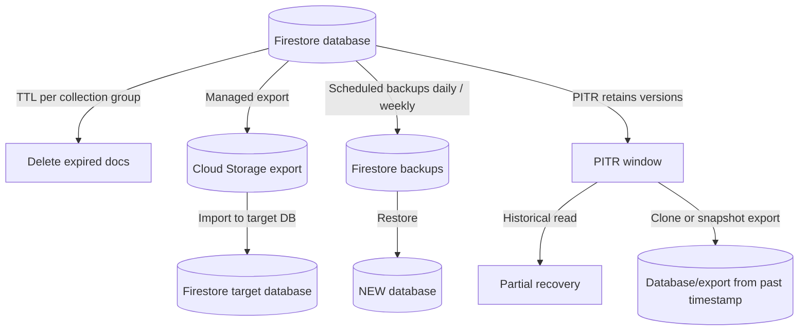
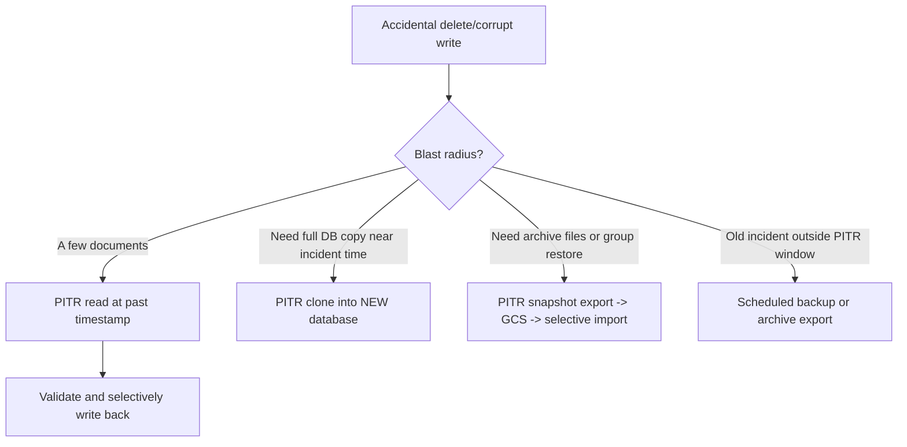

# TTL Policies, Export, Import, and Firestore Recovery

> **Chapter:** Firestore and Firebase  
> **Module:** CLOUD_PROVIDERS_GCP  
> **Module scope:** Explore Google Cloud from project organization, IAM, and VPC to Compute Engine, GKE, Cloud Run, storage services, and databases. Through deployment scenarios, learners select services, protect resources, automate releases, and monitor reliability alongside cost.

An application may store login sessions, temporary notifications, unpaid shopping carts, or event history in **Cloud Firestore**. Temporary data should expire automatically; critical data must be recoverable after accidental user deletion, a bad deployment, or buggy application writes. These are two different goals:

- A **TTL policy** automatically deletes expired documents for lifecycle/storage management.
- **Managed export/import** transfers document data through **Cloud Storage** for long-term archiving, offline inspection, or migration.
- **Scheduled backups and Point-in-time recovery (PITR)** restore data to a state prior to an incident.

This lesson focuses on **Firestore in Native mode** (especially **Standard edition**) with Google Cloud CLI tooling; meaningful differences in Enterprise edition are noted where relevant. The hands-on section prioritizes **read-only inventory** on an existing sandbox database. Commands that create TTLs, export, import, or restore are clearly marked as **optional** and restricted to dedicated owner-approved resources.

## Learning Objectives

After this lesson, you will be able to:

1. Configure TTL by **collection group + timestamp field**, understanding why deletion is asynchronous and does not cascade to subcollections.
2. Distinguish index exemptions on TTL fields, Security Rules, document permissions, and delete-trigger side effects.
3. Export/import an entire database or specific **collection groups**, reading operation states and metadata in Cloud Storage.
4. Explain import limitations: **no index definitions included**, **overwrites matching IDs**, and **does not delete out-of-scope documents**.
5. Choose among **scheduled backups, PITR read/export/clone, or managed exports** based on the scenario and RPO/RTO.
6. Build a process to verify copies, secure buckets, execute controlled restores, monitor costs, and clean up safely.

## 1. Four Distinct Mechanisms



| Mechanism | Purpose | Key limitation |
|---|---|---|
| **TTL** | Auto-delete expired temporary documents | Asynchronous deletion, typically within **24 hours**; **not** a backup |
| **Managed export/import** | Store documents in GCS or transfer data | Normal export is **not an atomic snapshot** at start time; importing into a DB can overwrite docs |
| **Scheduled backup** | Point-in-time consistent copy on a daily/weekly cadence | Backups retain data/indexes but **exclude TTL policies and Firebase Security Rules**; restore creates a new DB |
| **PITR** | Read/recover state near an error timestamp | When enabled, retains versions up to **7 days** at 1-minute granularity; must be enabled beforehand |

**Pick by question:** "when should data vanish?" → TTL; "need archive files or migration?" → export; "accidentally deleted the entire DB?" → backup; "bad deploy 20 minutes ago?" → PITR or point-in-time clone/read. Critical systems usually **combine multiple mechanisms** rather than expecting one to do everything.

## 2. TTL: Expiration-Based Deletion

A TTL policy designates **one field on a collection group** as the document expiration time. In **Firestore Standard edition**, that field must be a **Timestamp/Date and time** value; an ISO string like `"2026-12-31T00:00:00Z"` does not trigger TTL deletion. In Enterprise edition, TTL also has rules for timestamp arrays—check the edition-specific docs.

```text
sessions/u_101  { userId: "...", expireAt: Timestamp(2026-11-20T08:00:00Z) }
sessions/u_102  { userId: "...", expireAt: null }
sessions/u_103  { userId: "...", expireAt: Timestamp(2026-11-19T07:00:00Z) }

TTL policy: collection group = sessions, field = expireAt, offset = 0
  u_101: eligible for deletion after expireAt
  u_102: does not auto-expire (null is not a Timestamp)
  u_103: already eligible for deletion, yet may still appear in queries
```

### 2.1. What TTL does **not** guarantee

- **Not deleted immediately** when the clock hits `expireAt`. Expired documents can still appear in `get()`/queries until background workers delete them; deletion typically completes within **24 hours**, not a realtime SLA.
- **Not recursive**: deleting `users/u1` **does not** delete `users/u1/orders/*`. If business rules need cascade cleanup, implement it separately.
- **Not transactional**: multiple docs sharing a TTL do not necessarily vanish together or in order.
- **Does not delete docs missing the field or holding null**. Updating `expireAt` to a future time before actual deletion resets expiration to the new value.
- **Has side effects**: TTL deletion fires snapshot listeners and Firestore-triggered Cloud Run functions, which can raise invocation counts and cause retries/cross-writes.

**TTL is not an access-control boundary**: for expired login sessions, applications and backends must **check `expireAt` before allowing session use** instead of assuming the document is already gone. Design Firebase Security Rules independently; Firestore Rules **are not query filters**, and Admin SDKs/server IAM bypass client Rules.

### 2.2. Expiration offset: two ways to define the field

| Approach | Value stored in document | TTL policy |
|---|---|---|
| **Store exact expiration timestamp** | `expireAt = creation time + 7 days` | `--enable-ttl`, default offset `0` |
| **Store start timestamp + shared offset** | `createdAt = creation time` | `--expiration-offset=7d` |

Choose **one consistent approach**. If the document already stores `expireAt=createdAt+7d`, **do not** also add a `7d` offset (that retains for 14 days). Changing the offset on a populated collection group can immediately trigger bulk deletion of previously unexpired documents.

### 2.3. TTL applies to a collection group, not a single path

A collection group named `sessions` matches every collection ending with **ID `sessions`** at any depth, such as `sessions/*` and `organizations/org-1/sessions/*`. Policies do not isolate by tenant or parent path automatically. If TTL should apply to only one subset, design **distinct collection IDs or field values** before enabling it.

A collection group can have only **one TTL field**; field-level configurations have product quotas (currently documented as **1,000**); a field with both a TTL policy and a single-field index exemption counts as one field configuration. Check project quotas before rolling out widely.

## 3. TTL Fields, Indexes, and Deletion Costs

Firestore Standard edition normally creates **single-field indexes** automatically. If many documents are written continuously with increasing expiration timestamps, indexing `expireAt` can create an **index hotspot** and bottleneck write throughput.

**Recommendation:** if the app **never queries/filters/sorts** on `expireAt`, add a **single-field index exemption** for that TTL field on its collection group. Disabling an index can affect existing queries; check query/index dependencies and composite indexes first.

| Configuration | Effect |
|---|---|
| Indexed TTL field | TTL deletes work, but index storage costs and hotspot risk remain on write-heavy collections |
| TTL field with **single-field index exemption** | TTL still works; avoids unused single-field index overhead |
| TTL on a string/null field | Does not expire documents like a valid Timestamp |

**Cost:** every TTL deletion counts toward Firestore **document delete** charges, plus any triggered listener/function executions. Enabling a policy on a collection group holding millions of already-expired docs can trigger an **asynchronous deletion wave**. Establish budgets, alerts, verification for the right group/field, and rollback procedures; **disabling TTL cannot restore already-deleted docs**.

## 4. Managed Export/Import: Data, Scope, and Consistency

**Managed export** copies Firestore documents into Cloud Storage files. **Managed import** reads exported outputs and loads documents into a target database (in the same or another project if permissions and requirements are met).

### 4.1. What an export actually includes

- **Full export:** existing documents in the database in managed export format.
- **Collection-group export:** only the selected group IDs; **does not automatically include subcollections with other IDs**. Exporting group `orders` does not automatically export `orders/{id}/items` whose collection ID is `items`.
- **No index definitions, TTL policies, or Firebase Security Rules** are included in a managed document export. Manage those configs separately via version control/IaC/console.
- Normal export is **typically not an exact snapshot as of start time**: concurrent changes during execution may appear in the output. When you need minute-level consistency, use a **PITR snapshot export** after enabling PITR and choosing a valid timestamp.

### 4.2. What an import actually does

- Preserves **document IDs** from the export; if a doc with the same ID exists at the target, **import overwrites** that document.
- Docs **absent from the export** remain untouched at the target. Therefore import is **not** a "roll back the entire database to an exact past state."
- Indexes update according to the **target database's existing index definitions**; import does not recreate indexes from the export.
- Managed import **does not trigger Cloud Functions/Firestore triggers** like normal writes; **snapshot listeners** can still receive updates.
- To perform a **selective collection-group import**, the source must be an **export created with `--collection-ids`**; you cannot take a full export and selectively import a few groups using that flag.

**Never hand-edit binary/metadata export files.** Outputs include `.overall_export_metadata` files; directory prefixes and metadata filenames must match. Console imports usually select the metadata file, while `gcloud firestore import` takes the **export prefix/folder path** per the guide.

### 4.3. Example state after import

Suppose:

| ID | Old export | Current database |
|---|---|---|
| `orders/1` | `status=PENDING` | `status=PAID` |
| `orders/2` | `status=NEW` | No longer exists |
| `orders/3` | Absent | `status=CANCELLED` |

After **importing into the same collection**: `orders/1` reverts to `PENDING`, `orders/2` is recreated, and `orders/3` **still exists**. Using import as a naive "undo everything" button can cause severe business data corruption.

## 5. Scheduled Backups and Full-Database Restore

Firestore offers daily or weekly **scheduled backups**. Each backup is a **point-in-time consistent copy** containing **data and index configurations**, but **excluding TTL policies and Firebase Security Rules**. Backups stay in the **same location** as the source database.

| Attribute | Scheduled backup |
|---|---|
| Cadence | Daily / weekly; at most **one schedule of each type** per database |
| Execution time | System-chosen; weekly lets you pick the day, **not the exact hour** |
| Retention | Configurable, up to **14 weeks** |
| Recovery | **Restores into a NEW database** with an unused ID; never overwrites in place |
| Cost | Backup storage and restore billed by backup size |
| Excluded | TTL policies, Firebase Security Rules |

**Do not confuse:** deleting a source database does not necessarily delete its backups; deleting a backup prevents restoring from it. A running backup schedule does not prove your RTO is achievable until you rehearse a full restore and cutover.

### 5.1. RPO and RTO must be defined

- **RPO (Recovery Point Objective):** maximum acceptable data loss measured in time.
- **RTO (Recovery Time Objective):** maximum time from incident detection until service functionality is restored.

For example, relying solely on daily backups means changes since the last completed backup can be lost; **actual RPO depends on backup completion timing relative to the incident**, not a flat 24 hours in every case. RTO also includes restore duration, validation, re-applying Rules/TTL, and updating app configuration.

## 6. PITR: Recovering Near the Time of Error

**Point-in-time recovery** retains historical versions to recover from bad writes or accidental deletes:

- With **PITR enabled**, Firestore keeps recoverable versions up to **7 days**; you cannot immediately read 7 days back right after turning it on.
- Historical timestamps older than the **most recent 1 hour** have **1-minute granularity**, not microsecond precision. Check `earliestVersionTime` before picking a timestamp.
- When PITR is disabled, Firestore still supports limited read/clone within the **last 1 hour** under product conditions; to **export at a historical timestamp**, PITR must be enabled.
- **Historical read** can recover a handful of modified documents; **clone** creates a **new database** in the same location from a past timestamp, including data and indexes.
- **PITR export** uses `--snapshot-time` at a valid minute boundary (RFC 3339), exporting full DB or collection groups for controlled import.



**PITR is not a millisecond audit log**, nor does it replace long-term backups. PITR incurs storage charges and is excluded from the free tier. Before disabling PITR, review your DR strategy because disabling forfeits access to the PITR recovery window per product rules.

## 7. IAM, Cloud Storage, and Protecting Backups

| Actor | Permissions/scope to consider |
|---|---|
| Auditor/inventory | Read permissions for database/TTL, import-export operations, schedules/backups |
| TTL configurator | `datastore.indexes.update` on the target project |
| Export/import operator | `datastore.databases.export` / `datastore.databases.import`, e.g., Import Export Admin role |
| Firestore **service agent** | Access to the export/import **Cloud Storage bucket** |
| Backup/restore operator | `roles/datastore.backupsViewer`, `roles/datastore.backupSchedulesAdmin`, `roles/datastore.restoreAdmin` per action |
| PITR clone operator | `datastore.databases.clone`; grant only when genuinely required |

The Firestore service agent usually looks like:

```text
service-PROJECT_NUMBER@gcp-sa-firestore.iam.gserviceaccount.com
```

**Verify the actual identity** in Console → Firestore → Import/Export → "jobs run as." Some older databases still use the App Engine default service account; under VPC Service Controls, consider migrating to the service-specific Firestore service agent per docs.

**Export buckets:**

- Use a bucket in a **location close to the database**, respecting data residency, egress, and org policies; **Requester Pays** or unsupported bucket classes cannot be used for managed export/import.
- If the bucket lives in another project, the bucket owner must grant permissions to the source/target project's Firestore service agent. Docs recommend **bucket-level Storage Admin** for import/export; avoid project-wide Storage Admin when unnecessary.
- Never place exports with PII/secrets in public buckets; enforce IAM, CMEK, retention, lifecycle rules, and Audit Logs.
- **Never assume Firebase Security Rules protect GCS exports.** Buckets use **Cloud Storage IAM/ACL policies**; server SDKs/service agents follow IAM and do not depend on Firestore client Rules.

**Never export real customer data into a personal sandbox project.** Restored data requires verifying **database IAM, Firebase Rules, indexes, TTL, triggers, Secret Manager, and application wiring**—data backups alone do not restore every dependency.

## 8. Lab A — Read-Only Inventory on a Sandbox Database

> **Prerequisites:** a project with Billing enabled, an **existing Native-mode Firestore database**, read permissions for configs, and (if doing the export lab) an owner-approved dedicated Cloud Storage bucket. If unavailable, complete only the design exercises in Section 14. **Do not create databases on your own or touch production.**

### 8.1. Variables and database state

Run in Cloud Shell/Bash (never inside the learning-content repository):

```bash
PROJECT_ID="my-firestore-sandbox"
DATABASE_ID="(default)"       # Replace with named database ID if used in the lab
TTL_GROUP="sessions_lab"      # Dedicated collection group; NEVER use production collections
TTL_FIELD="expireAt"
BUCKET="my-firestore-export-lab-bucket"  # EXISTING dedicated, approved bucket

gcloud auth list --filter="status:ACTIVE"
gcloud projects describe "$PROJECT_ID" \
  --format="table(projectId,name,lifecycleState)"
gcloud firestore databases list --project="$PROJECT_ID"
gcloud firestore databases describe \
  --database="$DATABASE_ID" --project="$PROJECT_ID" \
  --format="yaml(name,locationId,type,pointInTimeRecoveryEnablement,earliestVersionTime,versionRetentionPeriod,deleteProtectionState)"
```

**Check `type=FIRESTORE_NATIVE` and `locationId` before proceeding.** Standard and Enterprise databases differ in indexing/TTL behavior. Keep `DATABASE_ID='(default)'` **quoted** in the shell when used directly so you do not accidentally target another database or misparse parentheses.

### 8.2. Inspect TTL, backups, and operations

```bash
gcloud firestore fields ttls list \
  --project="$PROJECT_ID" --database="$DATABASE_ID"

gcloud firestore backups schedules list \
  --project="$PROJECT_ID" --database="$DATABASE_ID"

gcloud firestore backups list \
  --project="$PROJECT_ID" \
  --format="table(name,database,state)"

gcloud firestore operations list \
  --project="$PROJECT_ID" --database="$DATABASE_ID"

# Read-only; requires Storage metadata permission.
gcloud storage buckets describe "gs://$BUCKET"
```

If the bucket does not exist, **never borrow a production bucket name**. Check location, owner, IAM, and cost with an admin before trying the export lab. Even if `backups list` returns nothing, data may still be recoverable via PITR; the two mechanisms have separate histories and settings.

## 9. Lab B — Designing and Testing TTL on an Isolated Collection Group

### 9.1. Writing a real Timestamp into documents

When the app creates a session, store a **Firestore Timestamp** field:

```javascript
// Illustrates Timestamp values: this snippet ONLY computes values without writing to DB.
const { Timestamp } = require("@google-cloud/firestore");

const createdAt = Timestamp.now();
const expireAt = Timestamp.fromMillis(
  Date.now() + 7 * 24 * 60 * 60 * 1000
);
// document in collection group sessions_lab:
// { userId: "user-lab-01", createdAt, expireAt }
```

When actually writing docs to the sandbox DB, target `sessions_lab` specifically and avoid overwriting existing documents. You can set expiration to tomorrow rather than the past to avoid immediate deletion. **Never test TTL by altering timestamps on real data collections.**

### 9.2. Creating a policy is a **data-deleting operation**

Proceed only if the project owner confirms `sessions_lab` is isolated, no other branch shares that collection name, docs have been inventoried, and recovery exists:

```bash
# Run ONLY on a lab-dedicated sandbox database/collection group.
gcloud firestore fields ttls update "$TTL_FIELD" \
  --project="$PROJECT_ID" \
  --database="$DATABASE_ID" \
  --collection-group="$TTL_GROUP" \
  --enable-ttl

# Check that the policy was created and its provisioning status:
gcloud firestore fields ttls list \
  --project="$PROJECT_ID" \
  --database="$DATABASE_ID" \
  --collection-group="$TTL_GROUP"
```

A TTL policy can take **10 minutes or longer** to become active. Documents already carrying past timestamps become deletion candidates once active. Do not treat "not gone after 5 minutes" as an error. For a `createdAt` field, you can specify `--expiration-offset=7d` instead of precomputing `expireAt`; **never combine both for +14 days**.

### 9.3. Observing and reverting

| Check | Expected outcome |
|---|---|
| Policy status | Policy active after provisioning |
| Document with future `expireAt` | Remains present before expiration |
| Document missing `expireAt` | Not deleted by this TTL policy |
| Expired document | May still appear in queries briefly; usually deleted within 24h |
| Subcollections of deleted doc | **Not** deleted recursively |
| Listeners/triggers | May receive delete events; watch for trigger loops |

If the policy was created purely for the lab and is no longer needed:

```bash
# ONLY disable the lab-created policy after confirming impact with the owner.
gcloud firestore fields ttls update "$TTL_FIELD" \
  --project="$PROJECT_ID" \
  --database="$DATABASE_ID" \
  --collection-group="$TTL_GROUP" \
  --disable-ttl
```

**Disabling does not restore deleted docs.** Never disable a production policy relied upon by other teams. If a policy existed beforehand, restore only the original preflight configuration.

## 10. Lab C — Managed Export from an Isolated Collection Group

### 10.1. Scope and billing

This section is **optional and billable**. Export only the non-sensitive `sessions_lab` group into an approved dedicated bucket with Requester Pays off and residency verified.

```bash
# Unique folder/prefix for this export to avoid overwriting older outputs.
EXPORT_DEST="gs://$BUCKET/firestore-lessons/$(date -u +%Y%m%dT%H%M%SZ)"
printf 'Export destination: %s\n' "$EXPORT_DEST"

# Run ONLY when exporting from the sandbox database is approved:
gcloud firestore export "$EXPORT_DEST" \
  --project="$PROJECT_ID" \
  --database="$DATABASE_ID" \
  --collection-ids="$TTL_GROUP"
```

**Do not export the entire database** if the lab only targets one collection group. Managed export bills **1 document read per exported document**, plus GCS storage and network charges if applicable. Exporting does not change data ownership or scrub sensitive fields automatically.

### 10.2. Checking the operation and exact output path

```bash
gcloud firestore operations list \
  --project="$PROJECT_ID" --database="$DATABASE_ID"

# Obtain OPERATION_NAME from the real export/operations list output.
# Never guess operation names.
# gcloud firestore operations describe "$OPERATION_NAME" \
#   --project="$PROJECT_ID"

# Inspect folders/files generated under the prefix:
gcloud storage ls --recursive "$EXPORT_DEST"
```

Consider an export usable only once the **operation is DONE/succeeded** and valid metadata plus data files exist. The actual Cloud Storage prefix may include service-generated subfolders; **record the exact `EXPORT_PATH`** and `.overall_export_metadata` file rather than guessing from an unverified timestamp.

### 10.3. Import **only into a target sandbox database**

**Never import directly into a source/production database.** Use an **existing separate target database** whose owner approved overwriting matching document IDs.

```bash
# Fill with the actual ID of a target database DIFFERENT from the source.
RESTORE_DATABASE_ID="import-lab-target"

# Fill with the ACTUAL export prefix from the completed previous step.
EXPORT_PATH="gs://BUCKET/EXACT_SUCCESSFUL_EXPORT_FOLDER/"

# Verify the target database exists in the right project before importing:
gcloud firestore databases describe \
  --project="$PROJECT_ID" --database="$RESTORE_DATABASE_ID"

# Execute ONLY after reviewing data, permissions, and ID-overwrite impact:
# gcloud firestore import "$EXPORT_PATH" \
#   --project="$PROJECT_ID" \
#   --database="$RESTORE_DATABASE_ID" \
#   --collection-ids="$TTL_GROUP"
```

**Why is the import command commented out?** Import can **overwrite data** even within a single collection group. The lab is complete at the read/design level if no dedicated target database is available. For a full export, do not pass `--collection-ids` to import just one group. After importing, verify document IDs, sample records, and target indexes/Rules/TTL before letting apps read it.

## 11. Lab D — Backups, PITR, and Recovery Scenarios

### 11.1. Creating a backup schedule (optional)

Only on a sandbox database **without an existing daily schedule**, with owner permission and approved **backup storage cost**:

```bash
# ONLY when no daily schedule exists yet and creation/retention is approved.
gcloud firestore backups schedules create \
  --project="$PROJECT_ID" \
  --database="$DATABASE_ID" \
  --recurrence=daily \
  --retention=7d

gcloud firestore backups schedules list \
  --project="$PROJECT_ID" \
  --database="$DATABASE_ID"

gcloud firestore backups list \
  --project="$PROJECT_ID" \
  --format="table(name,database,state)"
```

**There is no command to trigger an immediate scheduled backup on demand:** daily backups run at a system-chosen time. If a team wants weekly backups, use `--recurrence=weekly --day-of-week=MON --retention=14w` instead of adding multiple weekly schedules. A backup must be in ready state before testing restore.

### 11.2. Restoring a backup creates a **new database**, never replacing the source

If a real **READY/AVAILABLE** lab backup exists, the owner can test restoring:

```bash
# Get BACKUP_ID and LOCATION from 'gcloud firestore backups list/describe';
# never run placeholders in production.
LOCATION="asia-southeast1"       # REPLACE with the backup's real location
BACKUP_ID="BACKUP_ID_FROM_LIST"  # REPLACE with the real ID
NEW_DB_ID="restore-check-lab"   # Must NOT exist yet

# ONLY after new DB creation is approved and IAM/cost are checked:
# gcloud firestore databases restore \
#   --project="$PROJECT_ID" \
#   --source-backup="projects/$PROJECT_ID/locations/$LOCATION/backups/$BACKUP_ID" \
#   --destination-database="$NEW_DB_ID"
```

After restore completes, **inspect data, indexes, and access controls**. Because backups **exclude TTL policies and Firebase Security Rules**, re-apply approved versions/configs; if TTL is re-enabled immediately, docs with past `expireAt` timestamps may **get deleted again**. For forensic DR databases, keep TTL off and restrict access until you decide next steps.

### 11.3. Cloning from PITR at a valid timestamp

```bash
# Prerequisite: historical data is available per earliestVersionTime.
# Pick a whole-minute UTC timestamp inside the allowed window.
PITR_TIME="2026-11-19T03:00:00Z"  # ILLUSTRATION ONLY; replace with a real valid time
CLONE_DB_ID="pitr-investigation-lab" # Non-existent ID

# ONLY on a sandbox project with permission and quota to create a new database:
# gcloud firestore databases clone \
#   --project="$PROJECT_ID" \
#   --source-database="projects/$PROJECT_ID/databases/$DATABASE_ID" \
#   --snapshot-time="$PITR_TIME" \
#   --destination-database="$CLONE_DB_ID"
```

**Never run hardcoded sample dates against real systems**: compare `earliestVersionTime` against the current time. PITR enabled provides up to **7 days at minute resolution**; when disabled, clone may still reach up to **the past 1 hour** per current documentation. Clone also creates a **new database**; it does not automatically shift apps or traffic to the clone.

### 11.4. Exporting a snapshot from PITR

When PITR is **enabled** and you need an export at an **exact historical timestamp**:

```bash
# Only when PITR is enabled and PITR_TIME is a valid whole-minute UTC timestamp.
# gcloud firestore export "$EXPORT_DEST" \
#   --project="$PROJECT_ID" \
#   --database="$DATABASE_ID" \
#   --snapshot-time="$PITR_TIME" \
#   --collection-ids="$TTL_GROUP"
```

**Difference from normal export:** `--snapshot-time` captures a consistent historical snapshot at a supported minute boundary. Do not pass this flag if PITR is disabled, even if historical data exists from the last hour; the export will fail.

## 12. Incident Recovery Runbook

Suppose at **10:15** you discover a **10:05** deployment accidentally deleted documents in `orders`. Do not rush to import a full export into the live database.

1. **Contain:** stop the faulty writer, preserve logs, and pinpoint the last good timestamp before corruption. Do not delete backups or disable PITR.
2. **Pick the method:** a few docs → PITR historical read and write back exact keys; large dataset → PITR clone into a **new database**; error older than the PITR window → backup or archive export.
3. **Protect sources:** verify IAM, backup/PITR timestamps, export checksums/metadata, and lock access to owners; never overwrite the source.
4. **Recover into isolation:** restore/clone to a new database or import into a separate sandbox DB. Remember import **does not delete docs outside the export**.
5. **Verify:** compare document counts across target sets, IDs, key fields, subcollections, indexes, security rules, TTL configs, and data consistency; run business query checks.
6. **Plan cutover:** switch apps to the new database or **selectively replay** recovered documents into the primary DB with transactions/validation, resolving conflicts with legitimate writes made after the recovery point.
7. **Monitor:** check permissions, error rates, listeners/triggers, PITR/backup charges, and post-recovery latency; record actual RPO/RTO.
8. **Postmortem:** fix the root cause, add tests/runbooks, and schedule drills.

**Restoring data is not restoring the entire system.** Firebase Security Rules, Cloud Functions, auth, composite indexes, TTL policies, secrets, and external integrations have their own lifecycles. When restored historical data already passed its TTL, decide intentionally whether to **retain for investigation** or **re-enable TTL**.

## 13. Monitoring, Cost, and Troubleshooting

### 13.1. Costs to monitor

| Cost driver | Mechanism |
|---|---|
| **TTL** | Billed as document delete operations plus event-trigger workloads |
| **Managed export** | Typically **1 Firestore read per exported document** + GCS storage/transfer |
| **Managed import** | Typically **1 Firestore write per imported document** + target index work |
| **Scheduled backups** | Backup storage and restore operations based on backup size |
| **PITR** | Historical version storage; historical reads/exports bill read operations |
| **Cloud Storage** | Export storage, operations/lifecycle/egress, retention/CMEK if used |

**Important:** export/import charges may **not appear in the Firestore Usage tab** and **budget alerts may update only after operations finish**. Never assume zero cost from a realtime dashboard. Use Cloud Billing labels/reports with a clear budget owner; alerts do not stop spending automatically.

### 13.2. Error troubleshooting table

| Symptom | What to check | Remediation |
|---|---|---|
| TTL policy stays inactive | Operation state, permissions, provisioning | Wait at least several minutes; inspect operation details |
| Expired doc still visible | Async deletion; wrong field type/null/offset | Check Timestamp type, TTL field/group, and clock time |
| TTL deletes unexpected docs | Same collection group name elsewhere or wrong offset | Stop policy per runbook, scope impact, restore from PITR/backup |
| TTL deletes parent doc but subcollection remains | TTL does not cascade | Implement separate cleanup; never improvise recursive deletes in prod |
| Writes slow down after adding TTL field | Sequential timestamp index hotspot | Evaluate index exemption and write metrics |
| Export fails with access denied | Operator IAM or GCS service agent permissions | Verify "jobs run as", bucket IAM, VPC-SC |
| Export completes but folder empty/wrong | Operation failed or prefix/metadata mismatch | Check operations and actual GCS path |
| Import rejected | Destination DB/IAM, bucket permissions, export metadata | Verify project, database ID, format, and source |
| Import overwrites existing data | Matching IDs; default import semantics | Use a separate DB; diff/back up beforehand |
| Import did not recreate indexes/Rules | Exports contain documents only | Deploy configs separately from version control |
| Backup restore won't target existing DB | Restore requires a **new database ID** | Create a new target DB and verify/cut over |
| PITR says timestamp too old | Earlier than `earliestVersionTime` or invalid minute | Pick a valid timestamp inside the retention window |
| PITR export says PITR must be enabled | Feature is disabled | Cannot use `--snapshot-time` while disabled |
| Restored docs disappear again | TTL policy was enabled with past timestamps | Keep TTL off during investigation; verify before enabling |

**Operational observability:** use Firestore Monitoring (reads/writes/deletes, storage, latency), Cloud Audit Logs (IAM, TTL, backup/restore, export/import), operation progress, and GCS bucket access logs. Never enable unbounded logging of sensitive document payloads.

## 14. Exercises and Suggested Answers

### Exercise 1 — Is TTL a security control?

A login session expired 10 minutes ago, yet the document still exists. The team treats this as a Firestore bug and keeps allowing the session until TTL deletes it.

**Answer:** flawed design. TTL is asynchronous and typically deletes within 24 hours; backend/Rules must **reject expired sessions** using the timestamp directly rather than relying on document deletion.

### Exercise 2 — TTL data types

A document has `expireAt = "2026-11-20T08:00:00Z"` (string). A TTL policy targets `expireAt`. Will it auto-delete on schedule?

**Answer:** no. In Standard edition, the TTL field must be a **Timestamp/Date and time**, not a string. Migrate the field safely before enabling the policy.

### Exercise 3 — Parent/subcollection deletion

`users/u1` expires via TTL, yet `users/u1/orders/o1` still exists. Is that abnormal?

**Answer:** no. Firestore TTL **does not** delete subcollections automatically; define a dedicated lifecycle/cascade policy.

### Exercise 4 — Group export

A team exports `--collection-ids=orders` and expects to import `orders/{id}/items` as well. Why is it missing?

**Answer:** `items` is a **different collection group** and is not automatically exported with `orders`. Export all needed group IDs or run a full export if appropriate.

### Exercise 5 — Is import an absolute rollback?

An old export has `orders/1`, `orders/2`. The current DB also has `orders/3`. Will importing the old export delete `orders/3`?

**Answer:** no. Import overwrites matching IDs and adds missing docs, but **does not delete** docs absent from the export. Use a new database or diff records for exact-state rollbacks.

### Exercise 6 — Choosing a recovery method

An app wrote corrupt data to 12 documents 20 minutes ago; the latest backup is from yesterday. Which recovery method minimizes data loss?

**Answer:** PITR historical read and **selective** write-back if the timestamp is valid, checking for conflicts with legitimate newer writes. Yesterday's backup yields a worse RPO.

### Exercise 7 — Do backups carry Rules and TTL?

A team restores a scheduled backup to a new database: indexes are present, but Rules and TTL policies are missing. Expected or bug?

**Answer:** expected per backup design: **data and index configs** are preserved, while **TTL policies and Firebase Security Rules** must be configured separately. Secure access before cutover.

### Exercise 8 — Export snapshot differences

A normal export runs from 10:00 to 10:15. Can you guarantee every document reflects 10:00 state? How do you capture 10:00?

**Answer:** no; normal exports can include concurrent writes made during execution. With PITR enabled and a valid whole-minute timestamp, use **`--snapshot-time`** for a consistent historical snapshot.

### Exercise 9 — Relative cost calculation

Exporting 200,000 documents and re-importing 200,000 documents, excluding GCS storage/transfer. Which Firestore operation buckets are billed?

**Answer:** approximately **200,000 document reads** for the export and **200,000 document writes** for the import (per managed operations billing). Do not merge both into a single 200,000 total.

### Exercise 10 — Restoring with TTL

Restored documents carry last week's `expireAt` timestamps; the team plans to re-enable TTL immediately on the restored database to "match production." What is the risk?

**Answer:** TTL could immediately delete the very documents under investigation. Keep TTL disabled during investigation, review retention rules, and enable only once approved.

## 15. Production Checklist and Cleanup

### 15.1. Checklist

| Check | Acceptance criterion |
|---|---|
| **Data** | Temporary data groups separated from records with retention obligations |
| **TTL policy** | Right group/field, true Timestamp type, offset not double-counted |
| **TTL behavior** | Access checks do not rely on TTL; triggers and subcollections accounted for |
| **Indexes** | Evaluated single-field index exemptions for unqueried TTL timestamps |
| **Export** | Full vs collection groups chosen; GCS bucket/billing/retention aligned |
| **Import** | Accounted for ID overwrites, non-deletion of extra docs, and separate index/Rules deployment |
| **Backup** | Daily/weekly cadence, retention ≤ 14 weeks, backup status monitored, restore rehearsed |
| **PITR** | Enabled before incidents; checked `earliestVersionTime` and whole-minute boundaries |
| **RPO/RTO** | Measurable targets; backup/clone/import/cutover rehearsed |
| **Security** | Firestore IAM/Rules + GCS IAM/service agent + CMEK/VPC-SC per policy |
| **Cost** | Deletes, reads/writes, backup/PITR/GCS storage, and operations monitored |
| **Operations** | Runbooks, incident owner, audit logging, and dependency checks in place |

### 15.2. Scoped lab cleanup

**Lab A is read-only**: creates no resources and needs no Firestore cleanup. **Optional Labs B/C/D** may leave behind a TTL policy, GCS export, backup schedule, or restored database; **never delete them automatically just because the lesson ended** without owner confirmation.

1. Record all operations, backup IDs, GCS export prefixes, and **dedicated** database IDs created; check whether any retention policy requires keeping them.
2. For a lab-only TTL policy, you may run `--disable-ttl` after review; disabling **does not undo prior deletes**.
3. For a lab-only backup schedule, consider deleting the **schedule** with owner approval; deleting a schedule does not automatically delete existing backups.
4. For export buckets, delete only the **lab-specific prefix** after verifying path, retention, legal hold, and permissions. Never delete shared buckets.
5. For restored/cloned databases, verify zero active consumers remain and obtain approval to delete the **dedicated database**, never confusing it with `(default)` or the source DB.
6. Check Billing Reports after cleanup; charges can lag and budget alerts do not provide absolute spending caps.

**Never run a sample recursive delete command** here, as one wrong bucket or database value can permanently destroy data. Cleanup is an ownership-verified operational task, not a mandatory step to prove understanding of TTL/export/PITR.

## Key Takeaways

**TTL governs when a document becomes eligible for deletion, not when a client must lose access. Managed export/import moves/archives documents but does not rebuild indexes/Rules or roll back extra records at the destination. Scheduled backups provide consistent copies for restoring into a new database; PITR enables near-incident recovery via historical reads, clones, or snapshot exports.** A sound Firestore DR plan accounts for RPO, RTO, IAM, post-restore TTL, cost, and end-to-end rehearsals.

## Official References

- [Firestore — Manage data retention with TTL policies](https://cloud.google.com/firestore/native/docs/ttl)
- [Firestore — Exporting and importing data](https://cloud.google.com/firestore/native/docs/manage-data/export-import)
- [Firestore — Back up and restore data](https://cloud.google.com/firestore/native/docs/backups)
- [Firestore — Point-in-time recovery overview](https://cloud.google.com/firestore/native/docs/pitr)
- [Firestore — Work with PITR](https://cloud.google.com/firestore/native/docs/use-pitr)
- [Firestore — Plan disaster recovery](https://cloud.google.com/firestore/native/docs/disaster-recovery)
- [Firestore — Standard edition indexing best practices](https://cloud.google.com/firestore/native/docs/standard-index-overview)
- [Firestore — Security rules](https://firebase.google.com/docs/firestore/security/get-started)
- [Firestore — IAM permissions and roles](https://cloud.google.com/firestore/native/docs/security/iam)
- [Firestore — Pricing](https://cloud.google.com/firestore/pricing)
- [gcloud — Update TTL field](https://cloud.google.com/sdk/gcloud/reference/firestore/fields/ttls/update)
- [gcloud — Managed export](https://cloud.google.com/sdk/gcloud/reference/firestore/export)
- [gcloud — Managed import](https://cloud.google.com/sdk/gcloud/reference/firestore/import)
- [gcloud — Restore from backup](https://cloud.google.com/sdk/gcloud/reference/firestore/databases/restore)
- [gcloud — Clone from PITR](https://cloud.google.com/sdk/gcloud/reference/firestore/databases/clone)
