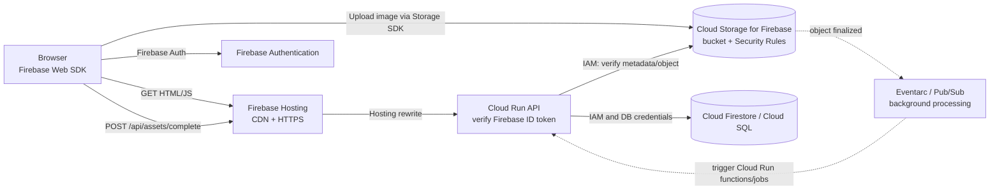
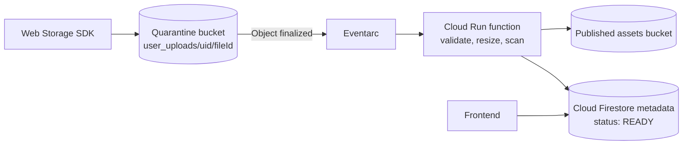

# Firebase Hosting, Cloud Storage for Firebase, and GCP Backends

## 1. Problem and Objectives

A web application managing product photos needs a fast-loading UI, direct browser uploads, secure image storage, and an API that validates metadata before writing image info to a database. One Google Cloud design is:

- **Firebase Hosting:** delivers HTML/CSS/JavaScript via CDN, HTTPS, and custom domains.
- **Cloud Storage for Firebase:** stores photos in a **Google Cloud Storage bucket**, allowing web/mobile apps to upload/download via the Firebase SDK with **Firebase Security Rules**.
- **GCP Backend:** Cloud Run/Cloud Run functions/GKE or another service executes business logic, reads metadata/objects using **IAM**, and integrates with Firestore/Cloud SQL or Pub/Sub/Eventarc when needed.

This lesson belongs to the **Firestore and Firebase** chapter in the **CLOUD_PROVIDERS_GCP** module, connecting projects, IAM, VPC, Cloud Run, GKE, storage, and databases. The goal is to **assign clear responsibility boundaries**, implement a secure web → upload → backend flow, automate releases, and manage reliability and cost.

After this lesson, you will be able to:

1. Distinguish **Firebase Hosting**, **Firebase App Hosting**, **Cloud Storage for Firebase**, and **Cloud Run**.
2. Understand how a Firebase project maps to a Google Cloud project, default buckets, Blaze/billing, and data regions.
3. Use `firebase.json` to configure static CDN serving, SPA fallbacks, and `/api/**` **rewrites** to Cloud Run.
4. Write **Storage Security Rules** checking Firebase Auth UID, file size, and MIME type without confusing Rules with Google Cloud IAM.
5. Upload from the Firebase Web SDK and call a Cloud Run API upon completion.
6. Design backend verification using **Firebase ID tokens**, App Check, service accounts, IAM, and untrusted-file handling workflows.
7. Test with the Emulator Suite/preview channels, and monitor errors, costs, and operational scenarios.

> **Practice scope:** all projects, buckets, domains, and service accounts below are hypothetical names. Deploy commands and Cloud Storage/Cloud Run can incur charges; run them only in an authorized lab project. In STEP 4, all file examples below are **instructional content only**—do not create extra files outside the assigned Markdown file.

## 2. Architecture Diagram



**Three distinct access paths:**

| Path | Identity / authorization | Target handled |
| --- | --- | --- |
| Browser → Hosting | Public static content per Hosting config | `index.html`, bundled JS/CSS, assets |
| Browser → Storage Firebase SDK | **Firebase Auth/App Check + Storage Security Rules** | Uploads/downloads into bucket under per-user paths |
| Cloud Run → Cloud Storage / database | **Google Cloud service account + IAM**, plus optional DB auth | Backend reads metadata, processes data, enforces business checks |

**Hosting is not a store for user-uploaded files.** Deployed static assets are managed via Hosting releases/CDN; runtime photos live in a **Cloud Storage bucket** with different lifecycles, permissions, and pricing. **A Hosting rewrite does not authenticate users**: the backend must validate tokens and authorization on every sensitive API.

## 3. Choosing the Right Product

| Need | Product to consider | Why |
| --- | --- | --- |
| SPA, static website, CDN-backed JS/CSS assets | **Firebase Hosting** | Simple deploys, SSL/CDN, and preview channels |
| Next.js/Angular SSR needing framework-aware builds | **Firebase App Hosting** (verify supported frameworks) | Managed framework-aware deploy/Cloud Run/Cloud CDN integration |
| Container API, HTTP image processing, microservices | **Cloud Run** | Runs containers per request and scales automatically |
| Lightweight HTTP/event handlers | **Cloud Run functions** | Source-based functions with matching triggers |
| Photos/videos/user files | **Cloud Storage for Firebase** | Direct uploads, resumable transfers, and Firebase Rules |
| User profiles/metadata with realtime sync | **Cloud Firestore** | Document DB + SDKs + dedicated Security Rules |
| Relational/SQL transactions | **Cloud SQL** | Backend accesses via driver/connector, never directly from browsers |
| Long-running/batch jobs | **Cloud Run jobs / GKE** | Background processing until completion |

**Firebase Hosting and App Hosting are two separate products.** Hosting can use rewrites to reach Cloud Run, but it does not turn an SPA into a server-side rendered app. If a website only serves pre-built HTML/JS, Hosting is usually simpler and sufficient.

## 4. Firebase Project, Google Cloud Project, and Default Bucket

**A Firebase project is built on top of a Google Cloud project.** Both consoles expose different facets of the same platform: the Firebase Console configures web apps/Auth/Rules/Hosting; the Google Cloud Console manages Billing, IAM, Cloud Run, VPC, Cloud Logging, Storage, and API quotas.

### Recent conditions to remember

- Since the post-**September 2024** Storage updates, new default buckets use the **`PROJECT_ID.firebasestorage.app`** format; legacy default buckets may use **`PROJECT_ID.appspot.com`**.
- **Cloud Storage for Firebase requires the Blaze (pay-as-you-go) plan**, even when actual traffic stays within free usage allowances. Creating/maintaining buckets or running Cloud Run backends requires appropriate project billing.
- **The default Storage bucket has its own location**, which does not automatically match your Cloud Firestore database, Hosting CDN, or Cloud Run region. Pick the region based on latency, data residency, cost, and processing services.
- One Firebase project can use **multiple Storage buckets**; apps must select the matching bucket/URL and rules. Never hardcode `appspot.com` for new projects.

Example:

```text
Google Cloud / Firebase project: acme-media-lab
Web app ID:               1:123456789:web:example (illustrative)
Hosting:                  https://acme-media-lab.web.app
Default Storage bucket:   acme-media-lab.firebasestorage.app
Cloud Run API:            media-api / asia-southeast1
Firestore database:       (default), location chosen independently
```

**Firebase web configuration (`apiKey`, `authDomain`, `projectId`, `storageBucket`, `appId`)** is public frontend configuration, **not a service-account secret**. Still, restrict API keys/quotas by product and **never embed an Admin SDK service account JSON, private key, or Cloud SQL password** into a JavaScript bundle.

## 5. Firebase Hosting: CDN, HTTPS, Rewrites, and Routing

Firebase Hosting serves files from the `public` directory (e.g., `dist` after a Vite build), provisions `*.web.app` / `*.firebaseapp.com` automatically, and supports custom domains with managed TLS. Deployments create **versions/releases**, while preview channels allow pre-production testing.

Key request-evaluation order (simplified from documentation):

1. Reserved namespaces `/__/*`.
2. Configured redirects.
3. **Exact static file match** in the deployed folder.
4. First matching rewrite for the path.
5. Custom or default 404.

### `firebase.json` for SPA + Cloud Run API

```json
{
  "hosting": {
    "public": "dist",
    "ignore": [
      "firebase.json",
      "**/.*",
      "**/node_modules/**"
    ],
    "rewrites": [
      {
        "source": "/api/**",
        "run": {
          "serviceId": "media-api",
          "region": "asia-southeast1"
        }
      },
      {
        "source": "**",
        "destination": "/index.html"
      }
    ],
    "headers": [
      {
        "source": "/index.html",
        "headers": [
          {
            "key": "Cache-Control",
            "value": "no-cache"
          }
        ]
      },
      {
        "source": "/assets/**",
        "headers": [
          {
            "key": "Cache-Control",
            "value": "public,max-age=31536000,immutable"
          }
        ]
      }
    ]
  },
  "storage": {
    "rules": "storage.rules"
  }
}
```

**Configuration notes:**

- Place `/api/**` **before** `**`; reversing them lets the SPA fallback return `index.html` for an API request that lacks a static file.
- `/api/**` forwards to Cloud Run with the **original path and query string**; the backend should define `/api/...` routes. Rewrites **do not alter** the URL displayed in the browser.
- **Static files take precedence over rewrites.** Never create `dist/api/status` or files colliding with API routes expecting Cloud Run to still receive those requests.
- `Cache-Control: immutable` fits only assets with **content hashes in filenames**. Never apply long TTLs to `index.html` or personal data.
- Depending on region/backend, Hosting-to-Cloud Run has HTTP method, timeout, and supported-region limits; check docs before choosing it for long-running workloads.

**Testing:** `GET /dashboard` should return the SPA, while `GET /api/health` must return JSON from Cloud Run. If `/api/health` returns HTML, inspect rewrite order and static file precedence first.

## 6. How Cloud Storage for Firebase Differs from Hosting and Direct GCS

Cloud Storage for Firebase uses a **real Google Cloud Storage bucket**. It is not a separate storage engine: objects still have names, metadata, generations, storage classes, locations, and GCS pricing. The difference lies in the **Firebase SDK, Authentication/App Check integration, and Storage Security Rules** for clients.

| Scenario | Access method | Primary authorization layer |
| --- | --- | --- |
| Web user uploads photos | `firebase/storage` SDK | **Firebase Security Rules** with `request.auth` |
| Web user views private files | Firebase Storage SDK governed by rules | **Firebase Security Rules** |
| Cloud Run backend inspects/processes object | Google Cloud Storage SDK / Firebase Admin SDK | **Google Cloud IAM**, not client rules |
| Batch/ETL manages objects | `gcloud storage` / Cloud Storage APIs | **Cloud IAM**, plus optional org policies/VPC-SC |
| Website loads favicon/logo | Firebase Hosting static deploy | **Hosting public CDN**, no Storage rules |

**Security Rules are not ACLs replacing IAM on every access path.** Backends using the Admin SDK or Google Cloud server clients with a service account **bypass Firebase Security Rules**. Therefore, strict Rules **will not protect** the backend path if you grant broad `roles/storage.admin` and trust raw user input.

### Download URLs and private data

`getDownloadURL()` returns a URL containing an access token for sharing files. **Never treat a tokenized download URL as an endpoint that re-checks Security Rules on every view**; anyone holding the link can access the object via the download token until that token is rotated/revoked. For private documents, prefer SDK authenticated downloads, backend-mediated access, or short-lived signed URLs per policy. Never log download URLs into observability or analytics systems for sensitive files.

## 7. Designing Object Paths and Storage Security Rules

An easy-to-control structure:

```text
user_uploads/
  <firebase-auth-uid>/
    <random-file-id>.jpg
    <random-file-id>.png
```

**Never trust arbitrary paths supplied by clients.** Clients build paths from their current UID and a random ID; Security Rules deny writes to any other UID. Keeping the original filename in non-sensitive metadata is fine, but **never** use it directly as an object key if it may contain odd characters, collisions, or PII.

**`storage.rules`:** the rules below allow users to create image files up to 5 MiB only inside their own namespace, blocking overwrites, deletes, and listings. This is a lab ruleset; production requires explicit policies for account deletion and content management.

```javascript
rules_version = '2';
service firebase.storage {
  match /b/{bucket}/o {
    match /user_uploads/{userId}/{fileId} {
      allow get: if request.auth != null
                 && request.auth.uid == userId;
      allow list: if false;
      allow create: if request.auth != null
                    && request.auth.uid == userId
                    && resource == null
                    && request.resource.size <= 5 * 1024 * 1024
                    && request.resource.contentType.matches('image/(jpeg|png|webp)');
      allow update, delete: if false;
    }
  }
}
```

**Explanation:**

- `request.auth.uid` comes from the SDK-verified Firebase Auth ID token, not a self-asserted HTTP header.
- `allow create` applies only to creating new objects; `allow update, delete: if false` blocks overwrites and deletions via client SDKs.
- `request.resource` holds **incoming metadata** such as `size` and `contentType`. **MIME types can be spoofed**: backends/virus scanners must inspect magic bytes and validate real file contents before publishing photos.
- `allow get` lets the owner fetch their file per rules; `allow list: if false` prevents listing entire folders via the Firebase SDK.
- Never put `allow read, write: if true` or `request.auth != null` on the **entire bucket** in production; being signed in does not mean a user can read someone else's files.

**Rules are additive allow conditions.** Adding a later `match /{allPaths=**}` with `allow read: if true` exposes objects even if an earlier owner-scoped match is strict. Always test the **entire ruleset**, not isolated blocks.

## 8. Additional Defense Layers

| Layer | Protects | Does NOT replace |
| --- | --- | --- |
| **Firebase Authentication** | User/UID authentication, custom claims | Verifying a file is actually a clean image |
| **Storage Security Rules** | Create/read/update/delete authorization on object paths | Server/Admin SDK Cloud IAM |
| **Firebase App Check** | App/device attestation, reducing spoofed requests | Firebase Auth and business authorization |
| **Cloud IAM** | Service account/backend access to Cloud Storage/Firestore | Rules for direct Firebase SDK calls |
| **Cloud Run backend validation** | Ownership/business state, malware/format scans, rate limits | Client-side permission checks |
| **Cloud Storage config** | Bucket location, encryption, retention, lifecycle, public access prevention | Firebase UID user authentication |

With App Check, deploy the SDK/attestation first, **monitor metrics**, and only then turn on **enforcement** for Cloud Storage to avoid locking out legitimate users. **App Check and Firebase Auth are complementary mechanisms**, not two names for the same token.

When Security Rules need group permissions, you can call `firestore.get()`/`firestore.exists()` against the **default Cloud Firestore database**, though each evaluation has lookup limits and can bill **Firestore reads**. Avoid reading numerous membership docs inside a rule. For complex permission models, prefer backend authorization over sprawling rulesets.

## 9. Lab Preparation: Frontend + Storage + Cloud Run

Assume your organization provisioned a Firebase/Google Cloud project:

```text
PROJECT_ID:       acme-media-lab
Firebase Hosting: https://acme-media-lab.web.app
Storage bucket:   acme-media-lab.firebasestorage.app
Cloud Run service: media-api
Region:           asia-southeast1
Runtime SA:       media-api-sa@acme-media-lab.iam.gserviceaccount.com
```

**Preflight in Firebase Console:**

1. Create/select the lab project and web app; copy the real **Firebase Web config**.
2. Enable the **Anonymous** Firebase Authentication provider for the lab (production uses proper providers/identities); check authorized domains.
3. Enable the **Blaze** plan and create the default Storage bucket in an appropriate region; verify the **actual bucket ID** rather than assuming the example ID already exists.
4. Enable Cloud Run API and Cloud Build/Artifact Registry APIs, and grant least-privilege deployer/SA IAM.
5. Prepare Firebase CLI, `gcloud`, Node.js, and a local frontend build tool like Vite.

**Inspect permissions before changing anything:**

```bash
# READ-ONLY in a real project
gcloud auth list
gcloud config get-value project
gcloud storage buckets describe \
  gs://acme-media-lab.firebasestorage.app \
  --project=acme-media-lab
gcloud run services list \
  --project=acme-media-lab \
  --region=asia-southeast1
```

If the project/bucket does not exist yet, a 404 from `describe` is expected; revisit setup rather than **auto-creating buckets via scripts** before Billing and data residency are approved.

## 10. Lab A — Web App Uploading Images via Firebase Storage SDK

Examples use **Vite vanilla JavaScript**; files in this section are created by the learner inside a lab directory, not inside the module repo.

### 10.1. Initialize the frontend

```bash
# RUN ON THE LEARNER'S LAB MACHINE
npm create vite@latest media-web -- --template vanilla
cd media-web
npm install
npm install firebase
```

Replace `index.html` with a minimal interface:

```html
<!doctype html>
<html lang="en">
  <head>
    <meta charset="UTF-8" />
    <meta name="viewport" content="width=device-width, initial-scale=1.0" />
    <title>Firebase Storage lab</title>
  </head>
  <body>
    <main>
      <h1>Upload images to personal storage</h1>
      <input id="photo" type="file" accept="image/jpeg,image/png,image/webp" />
      <button id="upload">Upload image</button>
      <pre id="status" aria-live="polite"></pre>
    </main>
    <script type="module" src="/src/main.js"></script>
  </body>
</html>
```

### 10.2. Configure Firebase app and upload

`src/main.js` (replace placeholders with the real **Firebase Web app config** from Firebase Console):

```javascript
import { initializeApp } from "firebase/app";
import { getAuth, signInAnonymously } from "firebase/auth";
import {
  getStorage, ref, uploadBytesResumable
} from "firebase/storage";

const app = initializeApp({
  apiKey: "FIREBASE_WEB_API_KEY",
  authDomain: "acme-media-lab.firebaseapp.com",
  projectId: "acme-media-lab",
  storageBucket: "acme-media-lab.firebasestorage.app",
  appId: "FIREBASE_WEB_APP_ID",
});
const auth = getAuth(app);
const storage = getStorage(app);

const status = document.querySelector("#status");
const button = document.querySelector("#upload");
const fileInput = document.querySelector("#photo");

let user = null;
button.disabled = true;
signInAnonymously(auth)
  .then(({ user: signedInUser }) => {
    user = signedInUser;
    button.disabled = false;
    status.textContent = "Ready. UID: " + user.uid;
  })
  .catch((error) => {
    status.textContent = "Auth failed: " + error.code;
  });

button.addEventListener("click", async () => {
  if (!user || !fileInput.files?.length) return;
  const file = fileInput.files[0];
  const types = ["image/jpeg", "image/png", "image/webp"];
  if (!types.includes(file.type) || file.size > 5 * 1024 * 1024) {
    status.textContent = "Only JPEG/PNG/WebP up to 5 MiB accepted.";
    return;
  }

  const path = `user_uploads/${user.uid}/${crypto.randomUUID()}`;
  const uploadTask = uploadBytesResumable(
    ref(storage, path),
    file,
    { contentType: file.type }
  );
  button.disabled = true;
  try {
    await new Promise((resolve, reject) => {
      uploadTask.on("state_changed",
        (snapshot) => {
          const pct = Math.round(
            snapshot.bytesTransferred / snapshot.totalBytes * 100
          );
          status.textContent = `Uploaded ${pct}%`;
        },
        reject,
        resolve
      );
    });

    const idToken = await user.getIdToken();
    const response = await fetch("/api/assets/complete", {
      method: "POST",
      headers: {
        "Content-Type": "application/json",
        "Authorization": `Bearer ${idToken}`
      },
      body: JSON.stringify({ path })
    });
    if (!response.ok) throw new Error(`Backend HTTP ${response.status}`);
    const body = await response.json();
    status.textContent = `Upload and verification complete: ${body.path}`;
  } catch (error) {
    status.textContent = "Error: " + (error.code || error.message);
  } finally {
    button.disabled = false;
  }
});
```

**Actual flow:** Firebase Authentication signs in the anonymous lab user → Storage SDK attaches the token and uploads → Storage Security Rules check UID/path/metadata → once uploaded, the client calls the Cloud Run API with the **Firebase ID token**. The frontend displays completion **only after the backend confirms**.

**Demo limitations:** `signInAnonymously` is for testing and does not represent durable customer identities; production apps should use proper providers, account linking, and lifecycle management. Frontend checks **never replace Security Rules/server validation**: any JavaScript can be modified by callers.

### 10.3. Local frontend preview

```bash
npm run dev
```

Under local Vite dev mode, `/api/**` **does not have Firebase Hosting rewrites**; calling `/api/assets/complete` hits the Vite dev server and may return 404 or HTML. To test end-to-end locally, configure a Vite dev proxy to your lab backend **or** use the Firebase Hosting emulator with supported routing. Never send user tokens to an unapproved HTTP endpoint.

**For Storage/Auth emulators**, use the Firebase Emulator Suite (Section 15) to test Rules and auth offline. Running uploads against a real project writes to a real bucket and incurs charges—**never confuse `npm run dev` with full local Firebase emulation**.

## 11. Lab B — Cloud Run API Verifying Token and Object

Build a Python Flask API on Cloud Run. The `/api/assets/complete` route requires a Firebase ID token, validates user ID/path, and reads object metadata using the **service account**.

### 11.1. Backend source

**`backend/app.py`:**

```python
import os
from flask import Flask, jsonify, request
from firebase_admin import auth, initialize_app
from google.cloud import storage
from google.api_core.exceptions import NotFound

app = Flask(__name__)
initialize_app(options={"projectId": os.environ["FIREBASE_PROJECT_ID"]})
storage_client = storage.Client()
bucket_name = os.environ["STORAGE_BUCKET"]

@app.get("/api/health")
def health():
    return jsonify({"status": "ok"}), 200

@app.post("/api/assets/complete")
def complete():
    bearer = request.headers.get("Authorization", "")
    if not bearer.startswith("Bearer "):
        return jsonify({"error": "unauthorized"}), 401
    try:
        claims = auth.verify_id_token(bearer[len("Bearer "):])
    except Exception:
        # Do not leak tokens or verification details to the client.
        return jsonify({"error": "invalid_token"}), 401

    payload = request.get_json(silent=True) or {}
    path = payload.get("path", "")
    uid = claims["uid"]
    if (not isinstance(path, str)
            or not path.startswith(f"user_uploads/{uid}/")
            or len(path.split("/")) != 3):
        return jsonify({"error": "forbidden_path"}), 403

    blob = storage_client.bucket(bucket_name).blob(path)
    try:
        blob.reload()
    except NotFound:
        return jsonify({"error": "object_not_found"}), 404

    allowed_types = {"image/jpeg", "image/png", "image/webp"}
    if (blob.content_type not in allowed_types
            or blob.size is None
            or blob.size > 5 * 1024 * 1024):
        return jsonify({"error": "invalid_object_metadata"}), 422

    response = jsonify({
        "path": path,
        "generation": blob.generation,
        "status": "metadata_verified"
    })
    response.headers["Cache-Control"] = "private, no-store"
    return response, 200
```

**`backend/requirements.txt`:**

```text
flask>=3,<4
gunicorn>=22,<25
firebase-admin>=6,<8
google-cloud-storage>=2,<4
```

**`backend/Dockerfile`:**

```dockerfile
FROM python:3.12-slim
WORKDIR /app
COPY requirements.txt .
RUN pip install --no-cache-dir -r requirements.txt
COPY app.py .
CMD ["sh", "-c", "exec gunicorn --bind 0.0.0.0:${PORT:-8080} app:app"]
```

**Example scope:** this backend checks only **metadata**; it does not confirm actual bytes form a valid image, are malware-free, or are approved for publishing. Production needs scanning in a quarantine bucket, magic-byte/decoder validation, database status tracking, duplicate-completion guards, quotas/rate limits, and business authorization. When processing a valid `path` that another process might overwrite concurrently, use **generation preconditions/conditional updates** to prevent races.

### 11.2. Least-privilege Cloud Run service account

```bash
# IAM CHANGE - LAB project only
gcloud iam service-accounts create media-api-sa \
  --project=acme-media-lab \
  --display-name="Media API runtime"

# READ-ONLY permission for object metadata and contents on the lab bucket
gcloud storage buckets add-iam-policy-binding \
  gs://acme-media-lab.firebasestorage.app \
  --member="serviceAccount:media-api-sa@acme-media-lab.iam.gserviceaccount.com" \
  --role="roles/storage.objectViewer" \
  --project=acme-media-lab
```

**`roles/storage.objectViewer`** is scoped to the lab bucket, not project-wide `roles/storage.admin`. Deployment operators need Cloud Run deploy/Cloud Build/Artifact Registry permissions and `iam.serviceAccounts.actAs` on the runtime SA; never leave Editor/Owner on service accounts.

### 11.3. Deploy the API

From the directory containing `backend`:

```bash
# MODIFIES RESOURCES: build image from source and deploy to Cloud Run
gcloud run deploy media-api \
  --project=acme-media-lab \
  --region=asia-southeast1 \
  --source=backend \
  --service-account=media-api-sa@acme-media-lab.iam.gserviceaccount.com \
  --set-env-vars="FIREBASE_PROJECT_ID=acme-media-lab,STORAGE_BUCKET=acme-media-lab.firebasestorage.app" \
  --max-instances=3 \
  --allow-unauthenticated
```

**Warning about `--allow-unauthenticated`:** Firebase Hosting → Cloud Run integration requires the service to **accept calls without an IAM identity** so Hosting can forward requests. Consequently, the direct Cloud Run URL is **also reachable** at the network/IAM layer. That is why **every sensitive endpoint must verify Firebase ID tokens in application code**; `/api/health` is a minimal public endpoint.

If an organization requires **Cloud Run to remain strictly private at the IAM/ingress layer**, do not use this public-rewrite pattern: evaluate an **external HTTPS load balancer with backend auth/IAP**, API Gateway/Apigee, or mechanisms supported by Firebase Hosting docs for that environment. **Never assume a Hosting rewrite mints a Google IAM ID token for Cloud Run.**

## 12. Lab C — Deploying Hosting and Storage Rules

From the frontend root directory (`media-web`), use the Firebase CLI and confirm the active project before deploying:

```bash
# Run by the learner, not inside the module repository
npm install -g firebase-tools
firebase login
firebase use --add

# Firebase CLI initializes Hosting and Storage; verify configs afterward.
firebase init hosting
firebase init storage

# Check/update firebase.json per Section 5 and storage.rules per Section 7.
npm run build

# MODIFIES HOSTING + STORAGE RULES in the selected project
firebase deploy --only hosting,storage
```

**Note:** `firebase init` can overwrite the `hosting` section in `firebase.json`. Always **re-check rewrite order** after init; `public` must point to the built `dist` folder. Never deploy if the CLI is pointing at a production project by mistake.

After deploying, test:

```bash
# READ-ONLY HTTP checks
curl -i "https://acme-media-lab.web.app/api/health"
curl -i "https://acme-media-lab.web.app/dashboard"

# AUTH CHECK: request without token must be rejected
curl -i -X POST \
  -H "Content-Type: application/json" \
  -d '{"path":"user_uploads/another-user/demo"}' \
  "https://acme-media-lab.web.app/api/assets/complete"
```

**Expected:** `/api/health` returns JSON `status: ok`; `/dashboard` returns SPA HTML; `POST /api/assets/complete` without a token returns **401**. When uploading an image from the frontend, Rules allow the matching UID and the API returns `metadata_verified`. If `curl /api/health` returns `index.html`, rewrites or static precedence are misconfigured.

**Deploying Storage Rules affects live clients on the bucket**, not only a frontend preview channel. Deploy rules only after testing valid reads/writes and all denied cases.

## 13. Distinguishing Firebase Auth ID Tokens, App Check Tokens, and IAM

| Token / identity | Issued by | What the backend uses it for |
| --- | --- | --- |
| **Firebase ID token** | Firebase Authentication SDK | Verify **user UID/claims** via Admin SDK; check ownership/business roles |
| **Firebase App Check token** | App Check SDK/attestation | Attest requests originate from an authentic app; curb abuse, **never replaces user auth** |
| **Google OIDC identity token** | Service account/Google IAM | Service-to-service auth to Cloud Run/IAP scoped by audience |
| **Google OAuth access token** | Google Auth/IAM | Call Google Cloud APIs (Storage, Firestore, Secret Manager, etc.) |
| **Firebase web API key** | Frontend config | Client identification/config, **not a secret**, grants no admin rights |
| **Service account credentials** | Google runtime ADC/metadata server | Backend privilege to call GCP; **never ship to browsers** |

**Auth flow in the lab:**

```text
Browser → Firebase Auth sign-in → obtain Firebase ID token
        → POST /api/assets/complete (Authorization: Bearer <Firebase ID token>)
        → Cloud Run Admin SDK verify_id_token()
        → verify UID matches path
        → Storage client uses Cloud Run runtime SA (IAM objectViewer)
        → read metadata, return result
```

Token verification must run **on the backend** for all sensitive data actions. For admin privileges, never trust `uid`, `isAdmin`, or `price` sent by the client in JSON. If using custom claims, verify signature/issuer/audience via Admin SDK, handle token refreshes, and cross-check roles/tenants against authoritative data stores where required.

**App Check on custom Cloud Run APIs** requires the client to send an App Check token and the backend to **verify** it per docs—do not turn on App Check enforcement on Cloud Storage and assume every Cloud Run request is protected automatically.

## 14. GCP Backend: Event-Driven Image Processing and Data Sync

A successful upload **does not guarantee the image is safe to publish right away**. You can add a pipeline:



**Two integration patterns:**

1. **Synchronous confirmation API** (Lab B): client uploads and calls the API; fits metadata validation, creating metadata records, and returning an acknowledgment.
2. **Asynchronous processing**: an Eventarc Cloud Storage `object finalized` event triggers a Cloud Run function to scan/thumbnail, write to an output bucket, and update Firestore `status=READY`; ideal for CPU-heavy work or dependencies needing retries.

**Partial failures to handle:** upload finishes but API times out; API writes Firestore then client retries; Eventarc delivers the same event multiple times. Use an **idempotency key** built from `bucket + objectName + generation`, Cloud Storage generation preconditions, and Firestore transactions/unique document IDs. Never assume exactly-once delivery.

### Firestore holds metadata, not object storage

Example document:

```json
{
  "ownerUid": "firebase-uid-example",
  "objectPath": "user_uploads/firebase-uid-example/uuid-file",
  "generation": "1723456789000000",
  "contentType": "image/jpeg",
  "processingStatus": "READY",
  "createdAt": "server timestamp"
}
```

This is an **illustrative schema**; `createdAt` must be populated with a real **server timestamp** in code. A Firestore document stores only metadata and object paths—**never embed raw image bytes** inside documents. If clients read Firestore directly, write **separate Firestore Security Rules**; Storage Rules **do not grant access** to Firestore metadata.

## 15. Testing: Emulator Suite, Preview Channels, and CI/CD

### 15.1. Testing Storage Rules without touching real data

The Firebase Emulator Suite supports **Authentication, Cloud Storage, Hosting, and Firestore** (depending on configured emulators). To test:

```bash
# Run inside the lab folder initialized with firebase init
firebase emulators:start --only auth,storage,hosting
```

Point frontend SDKs explicitly to the emulators in lab configs, e.g.:

```javascript
import { connectAuthEmulator } from "firebase/auth";
import { connectStorageEmulator } from "firebase/storage";

// Enable ONLY in controlled development environments.
connectAuthEmulator(auth, "http://127.0.0.1:9099");
connectStorageEmulator(storage, "127.0.0.1", 9199);
```

Emulators **do not fully replicate production**: Google IAM behavior, App Check enforcement, CDN caching, VPC, billing, and service-to-service auth differ from cloud runtimes. Enable emulators only locally and **never** ship `connectStorageEmulator` in a production bundle.

**Recommended Storage Rules test matrix:**

| Scenario | Expected |
| --- | --- |
| UID A creates `user_uploads/A/id-1`, 100 KiB JPEG | **Allow** |
| UID A creates `user_uploads/B/id-2` | **Deny** |
| Unauthenticated user creates an object | **Deny** |
| UID A uploads an image > 5 MiB | **Deny** |
| UID A uploads `application/pdf` | **Deny** |
| UID A reads UID B's object | **Deny** |
| UID A overwrites an existing file | **Deny** |
| UID A lists the entire prefix | **Deny** |
| UID A reads their own file | **Allow** |

Use `@firebase/rules-unit-testing` to automate `assertSucceeds`/`assertFails` assertions with mocked auth contexts, paired with e2e tests against staging with real SDKs.

### 15.2. Hosting previews and Cloud Run revisions

```bash
# MODIFIES preview content - does not deploy live Hosting
firebase hosting:channel:deploy media-preview --expires 7d
```

Dedicated preview URLs help QA review UI changes, yet they **do not automatically isolate** Auth, Storage buckets, Security Rules, or production backends. Default rewrite configs may still point to the **current live Cloud Run revision**. To keep Hosting previews synchronized with Cloud Run revisions, you can set `"pinTag": true` inside the `run` rewrite config so Hosting releases/previews **pin Cloud Run revisions**, subject to Cloud Run tag limits and docs. A preview is not a data sandbox if it points to the production Firebase project.

### 15.3. Safe releases

1. Code-review `firebase.json`, `storage.rules`, and backend code; never commit credentials.
2. Run unit tests for Rules, token verification, API request validation, and backend authorization.
3. Deploy the **backend to staging**, run e2e uploads and Eventarc processing, and verify error observability.
4. Build hashed assets, deploy a **Hosting preview channel**, and test rewrites and cache headers.
5. Deploy **Rules via an approved pipeline**, since Rules apply bucket-wide across **all clients**.
6. Promote compatible frontend/backend versions; monitor 401/403, 404, 5xx, upload errors, and cost.
7. If rolling back a Hosting static version, verify **Cloud Run revision and Rules compatibility**; rolling back Hosting **does not roll back** Storage Rules or database migrations.

## 16. Caching, Performance, and Large File Uploads

**Hosting** excels at caching hashed static assets, short-TTL HTML, and CDN delivery. **Cloud Storage SDK** handles resumable uploads—especially vital on flaky mobile connections; Cloud Run should not proxy byte streams for every upload unless server-side inspection before writing is strictly required.

| Path | Optimization | Risk |
| --- | --- | --- |
| HTML `index.html` | `no-cache` / revalidate | Long TTL leaves stale frontends calling newer APIs |
| Hashed JS/CSS assets | `max-age=31536000,immutable` | Safe only when filenames change with content |
| Dynamic `/api/**` | Backend returns `Cache-Control: private, no-store` for user JSON | Public CDN/browser caches can leak user data |
| Direct Storage upload | `uploadBytesResumable`, progress, size limits | Partial data or duplicate uploads on client drops/retries |
| Image processing | Eventarc + Cloud Run worker, object generation IDs | Event redelivery, malicious files, output → trigger loops |

**Firebase Hosting enforces a 60-second request timeout on dynamic rewrites to Cloud Run.** Never make browsers wait on a 10-minute video-processing API call: use background jobs, return `202 Accepted` with an operation ID, and let the frontend track status.

**Apply `Cache-Control` at the right layer:** Firebase Hosting `headers` control matched static files; Cloud Run dynamic responses should emit their own cache headers. Never rely on `firebase.json` alone to enforce `no-store` on private backend responses.

## 17. Monitoring, Logs, and Confirming Business Outcomes

Monitor **every layer**, because "upload succeeded" in the frontend does not mean the backend verified or finished processing the image:

| Layer | Signal / source | Alert when |
| --- | --- | --- |
| **Firebase Hosting** | Usage: storage, bandwidth, requests/traffic, release history | Bandwidth spikes unexpectedly or asset loads fail post-deploy |
| **Firebase Authentication** | Sign-in errors/provider status | Sudden jump in login failure rate |
| **Storage for Firebase** | Upload failures, bucket bytes, object counts, operation/egress metrics | Widespread 403/`permission-denied`, slow uploads |
| **Security Rules / App Check** | Emulator tests, App Check metrics, Rules evaluation tools | Legitimate clients rejected after rules deploy |
| **Cloud Run API** | Request count, p95 latency, HTTP 401/403/429/5xx, runtime logs | Any 5xx, latency breaching SLO, or invalid-token spikes |
| **Cloud Storage/IAM** | Cloud Audit Logs, Google Cloud Storage SDK error codes | Service account fails to read metadata/objects |
| **Firestore metadata** | Docs in `UPLOADED/PROCESSING/READY/FAILED`; owner queries | Uploaded objects stuck without timely processing |
| **Eventarc / Pub/Sub** | Deliveries/retries/dead-letter, function errors | Image pipeline backlogs or duplicate runs |
| **Cloud Billing** | Budget alerts, cost by SKU/project/labels | Costs jump after media or CDN cache changes |

### Reading backend logs

```bash
# READ-ONLY; requires Logging permissions and the right project
gcloud logging read \
  'resource.type="cloud_run_revision" AND resource.labels.service_name="media-api"' \
  --project=acme-media-lab \
  --freshness=1h \
  --limit=50 \
  --format=json
```

Applications should log **request ID, route, latency, error class, policy-masked/hashed Firebase UID, and object generation**; never log tokens, tokenized download URLs, filenames containing PII, or full payloads. Cloud Run request logs and Storage audit logs may sit under **different resource types**.

### Sample business SLO

```text
99.9% of valid uploads complete and reach READY within 2 minutes
Zero cross-user reads/writes between user A and user B
P95 /api/assets/complete < 1 second (metadata only)
100% of FAILED/quarantined objects handled or deleted per policy
```

This is a **hypothetical application SLO**, not a Firebase/Google Cloud SLA. When a backend only checks metadata like Lab B, **`metadata_verified` does not mean `READY`** for image content; run a separate scan/review pipeline before publishing.

## 18. Cost, Quotas, and Lifecycle Controls

**Cloud Storage for Firebase requires Blaze**, which **does not mean every single operation is billed**; free allowances apply per product/region/SKU. Never treat free Firebase Hosting tiers as an excuse to ignore Cloud Run/Storage costs.

| Component | Driven by | Ways to reduce waste |
| --- | --- | --- |
| **Firebase Hosting** | Storage versions, data transfer, CDN | Compression, hashed assets, proper TTLs, pruning old previews/releases per policy |
| **Cloud Storage for Firebase** | Object GiB-months, upload/download ops, egress, replication/region | Resize before upload, lifecycle cleanup of temp files, optimal location/class |
| **Cloud Run** | Requests, vCPU/RAM duration, instances/network | Fast metadata checks, `max-instances`/concurrency bounds, avoid long holds |
| **Cloud Firestore** | Reads/writes/deletes, indexes/storage, network | Avoid tight polling; store only essential metadata |
| **Firebase Auth** | Varies by provider/quota, e.g., SMS auth | Pick appropriate providers and bot protections |
| **App Check** | Attestation provider quotas/charges | Monitor metrics before enforcement |
| **Eventarc/Cloud Run functions** | Events, compute, retries/deliveries | Prevent bucket → function → bucket loops; enforce idempotency |
| **Cloud Build/Artifact Registry/Logging** | Builds, image storage, log ingestion | CI/CD caching and log sampling/redaction |

### Simple sizing estimate

Suppose **5,000 users** each upload **3 photos × 2 MiB**:

```text
5,000 × 3 × 2 MiB = 30,000 MiB ≈ 29.3 GiB of source images
15,000 object create operations (excluding retries)
If each photo is viewed 10 times: ~293 GiB of image egress
```

**This is not a final bill**: images may be compressed, thumbnails differ in size, download caching/CDN/token URLs alter traffic, operations vary by region pricing, and retention/versioning/replication multiply stored bytes. Check [Firebase pricing](https://firebase.google.com/pricing), [Cloud Storage pricing](https://cloud.google.com/storage/pricing), [Cloud Run pricing](https://cloud.google.com/run/pricing), and Billing exports.

**Data cleanup:** the demo Rules allow only **create/get**, not delete. When users want to delete photos or close accounts, provide an **authenticated backend API** or scheduled lifecycle cleanup using a dedicated service account, deleting by `generation`/precondition with audit logs. Leaving undeleted orphaned objects inflates costs and violates retention rules. If a bucket uses retention policies or legal holds, honor deletion constraints and never promise instant deletes.

## 19. Troubleshooting: Mapping Symptoms to Root Layers

| Symptom | Most likely cause | Check / remediation |
| --- | --- | --- |
| Firebase Hosting returns 404 on SPA route | Missing `** → /index.html` or wrong build folder | `firebase.json`, `dist/index.html`, and Hosting release |
| `/api/health` returns HTML instead of JSON | `**` rewrite precedes `/api/**` or static file shadows route | Rewrite order, exact static matches |
| Hosting → Cloud Run 404/502 | Wrong `serviceId`/region, Cloud Run undeployed, wrong backend route | `gcloud run services describe`, Cloud Run logs, URL path |
| Hosting → Cloud Run 504 | Backend exceeded 60-second timeout | Return 202 + background job; do not extend via client retries |
| Firebase Storage `storage/unauthorized` | Rules deny, user unauthenticated, or wrong UID/path | Auth state, Storage Rules emulator tests, right bucket |
| Firebase Storage `bucket-not-found` | Mixed up `.appspot.com`/`.firebasestorage.app` or bucket missing | Firebase Console Storage, `storageBucket` config |
| Upload `storage/quota-exceeded` | Insufficient billing/quota or plan | Blaze status, bucket quotas, project Billing |
| Uploads fail after enabling App Check enforcement | Missing SDK/App Check token or unconfigured provider | App Check metrics, domain config, test/staging |
| Cloud Run API returns 401 | Missing/expired Firebase ID token or backend verifying wrong project | Auth SDK, `projectId`, `Authorization` header (never log tokens) |
| Cloud Run returns 403 despite valid owner path | Business validation failed or Storage SA lacks IAM | Logs distinguishing app 403 from Storage 403 |
| Backend `blob.reload()` returns 404 | Wrong object path, upload incomplete, or deleted | Object generation/path, bucket ID, eventual app state |
| Dev frontend `/api` returns 404 | Vite dev server does not run Firebase Hosting rewrites | Vite proxy or Hosting emulator |
| Photo uploaded but metadata missing | API timed out after upload or Cloud Run deploy error | Idempotent client retry, object metadata, Firestore ledger |
| Duplicate thumbnails/event invocations | Eventarc redelivery or output written to same source bucket | Idempotency key, separate input/output buckets, Eventarc logs |
| Cloud Storage bill spikes unexpectedly | Leaked download tokens, huge raw photos, missing lifecycle | Bucket metrics, Billing SKUs, object sizes, hot objects |

### 6-step diagnostic runbook

1. Identify the exact **Firebase/Google Cloud project, Hosting site, Storage bucket, Cloud Run service/region**, and incident time.
2. Fetch `/index.html` and `/api/health` separately to separate static routing errors from backend errors.
3. Verify Firebase Auth user/UID, Storage Rules path, and App Check enforcement; test Rules in the emulator.
4. Inspect Cloud Run request logs, ID token verification, runtime SA, and Storage IAM; never make a bucket public to "fix" a 403.
5. Check object path/generation and Firestore metadata/business state to see whether **upload failed or post-upload processing failed**.
6. Fix at the narrowest layer, re-test valid and invalid cases, and monitor metrics/costs post-deploy.

**Never** broaden `roles/storage.admin` or switch Rules to `allow read, write: if true` just to make uploads succeed quickly—that widens a security incident.

## 20. Three Architectural Scenarios

### 20.1. User profile application

Frontend SPA deployed on Hosting; each user has an avatar under `user_uploads/{uid}/...` and a metadata document in Firestore. Direct upload via Firebase SDK with UID-scoped Rules; Cloud Run/Cloud Run function validates the image and generates an approved thumbnail.

**Decision:** once approved, avatars can be served via CDN while keeping originals private. Never treat a long-lived `getDownloadURL` as the sole access-control mechanism for private files.

### 20.2. E-commerce app with Cloud SQL backend

Hosting serves the web app; `/api/**` rewrites to an ordering Cloud Run service. Cloud Run verifies Firebase ID tokens, checks product/order ownership, and accesses **Cloud SQL** via service account/connector and DB credentials; product images live in Storage or a public assets bucket.

**Decision:** browsers **never** connect directly to Cloud SQL or hold DB passwords in Firebase config. Order-writing endpoints require backend idempotency keys, transactions, and authorization.

### 20.3. Large media uploads or long video processing

Browsers upload directly to Cloud Storage for Firebase (or via controlled backend-issued signed URLs), then Eventarc/Cloud Run jobs transcode the video. The API returns `202 Accepted` with an operation ID; the web app watches `PROCESSING/READY/FAILED` in Firestore.

**Decision:** never stream multi-minute video processing through a Firebase Hosting dynamic rewrite due to the request timeout; use background processing with checkpoints. For private media, apply retention, malware scanning, content policies, and lifecycle cleanup.

## 21. Exercises and Verification Questions

1. **Service classification:** Is Hosting a bucket for user-uploaded photos? **No**; Hosting serves static releases, while photos go into Cloud Storage for Firebase.
2. **Bucket naming:** What default bucket naming format do new projects created after September 2024 use? **Answer:** typically `PROJECT_ID.firebasestorage.app`; legacy projects may use `PROJECT_ID.appspot.com`.
3. **Billing:** Can you use Cloud Storage for Firebase without Blaze just because uploads stay under 5 MiB? **No**; Blaze is required under current product policy.
4. **Rewrites:** `firebase.json` places `** → /index.html` before `/api/** → Cloud Run`. What happens? **Answer:** API routes receive SPA HTML instead of reaching the backend.
5. **Hosting static precedence:** Both static file `dist/api/health` and rewrite `/api/**` exist. Where does `/api/health` go? **Hint:** exact static matches take precedence over rewrites.
6. **Storage Rules:** UID A uploads `user_uploads/B/a.jpg`. Is it allowed? **No**, because `request.auth.uid != userId`.
7. **MIME type spoofing:** Why does a 100 KiB file claiming `contentType=image/png` still need server validation before publishing? **Hint:** metadata can be spoofed; inspect real bytes/scan for malware.
8. **IAM:** Cloud Run uses the Google Cloud Storage SDK to read an object while Rules deny other client UIDs. Is the backend blocked by Rules? **No**; server SDKs authorize via IAM and must enforce authorization themselves.
9. **Tokens:** Compare Firebase ID tokens, App Check tokens, and Google IAM OIDC tokens. Which proves the end user's UID? **Answer:** the Firebase ID token.
10. **Public Cloud Run:** Why must `/api/assets/complete` not be left open in business logic even though the lab deploys with `--allow-unauthenticated`? **Hint:** IAM-level unauthenticated invocation lets Hosting rewrites reach Cloud Run; the backend must verify Firebase ID tokens on every protected endpoint.
11. **Preview channels:** Does a Hosting preview channel guarantee staging Storage/Auth/backends are used? **No**; Firebase config and rewrites may still point to production. Explain how to isolate projects/resources.
12. **Timeouts:** An API needs 5 minutes to process video; should you call it through a Hosting rewrite and wait synchronously? **No**; return `202` plus job/event-driven status tracking.
13. **Storage/egress math:** 10,000 users × 2 photos × 3 MiB equals how much source image data? **Answer:** 60,000 MiB ≈ 58.6 GiB, excluding thumbnails and downloads.
14. **Synthesis scenario:** Design a private document-upload web app: Hosting SPA, Auth + App Check, Storage Rules, Cloud Run auth and scanning, Firestore metadata, event processing, account-deletion lifecycle, and SLOs. Explain at least three places where partial failures can occur.

## 22. Production Deployment Checklist

- [ ] Selected the right Firebase Hosting/App Hosting/Cloud Run mix for static, SSR, and backend APIs.
- [ ] Verified Firebase/Google Cloud project, Blaze billing, and Google Cloud APIs.
- [ ] `storageBucket` uses the actual bucket ID (`.firebasestorage.app` or legacy `.appspot.com`).
- [ ] Bucket location, Cloud Run region, data residency, and egress approved.
- [ ] `firebase.json` puts `/api/**` rewrites **before** SPA fallback; static precedence tested.
- [ ] `index.html` avoids long caching; hashed assets have matching TTLs; private APIs return `no-store`.
- [ ] Storage Rules enforce UID/ownership, MIME/size, and tight create/update/delete/list limits.
- [ ] Rules tested with the Emulator Suite; no accidental public wildcard rules.
- [ ] Firebase Auth ID tokens verified on the **backend**; never trust client paths, prices, or admin flags.
- [ ] App Check enabled after monitoring metrics; custom Cloud Run endpoints verify App Check themselves if used.
- [ ] Cloud Run runtime SA holds only required Storage/Firestore/Cloud SQL IAM permissions.
- [ ] No credentials or Admin SDK keys in frontend bundles or code repositories.
- [ ] Untrusted files validated/scanned, quarantined before publishing, and processed idempotently by generation.
- [ ] Firestore metadata has dedicated Security Rules if clients read it directly.
- [ ] Auth/Storage/Hosting/backend **staging** and production cleanly separated; previews never mistaken for sandboxes.
- [ ] CI/CD deploys Hosting, Storage Rules, and Cloud Run with tests, approvals, and compatible rollbacks.
- [ ] Monitoring covers request/Storage errors, event retries, metadata business states, and budget alerts.
- [ ] Workflows in place for user/file deletion, retention/lifecycle, download token revocation, and compliance.
- [ ] Benchmarked file sizes, upload retries, concurrency, cache hit rates, network egress, and cost.

## 23. Official Documentation

1. [Firebase Hosting overview](https://firebase.google.com/docs/hosting).
2. [Configure Firebase Hosting behavior and rewrites](https://firebase.google.com/docs/hosting/full-config).
3. [Serve dynamic content with Cloud Run and Hosting](https://firebase.google.com/docs/hosting/cloud-run).
4. [Hosting preview and release channels](https://firebase.google.com/docs/hosting/manage-hosting-resources).
5. [Get started with Cloud Storage for Firebase on web](https://firebase.google.com/docs/storage/web/start).
6. [Upload files with Firebase Web SDK](https://firebase.google.com/docs/storage/web/upload-files).
7. [Download files with Firebase Web SDK](https://firebase.google.com/docs/storage/web/download-files).
8. [Cloud Storage for Firebase Security Rules](https://firebase.google.com/docs/storage/security).
9. [Cloud Storage Rules core syntax](https://firebase.google.com/docs/storage/security/core-syntax).
10. [Security Rules conditions](https://firebase.google.com/docs/storage/security/rules-conditions).
11. [Firebase Storage bucket and billing changes](https://firebase.google.com/docs/storage/faqs-storage-changes-announced-sept-2024).
12. [Firebase Auth for web](https://firebase.google.com/docs/auth/web/start).
13. [Verify Firebase ID tokens with Admin SDK](https://firebase.google.com/docs/auth/admin/verify-id-tokens).
14. [Firebase App Check](https://firebase.google.com/docs/app-check).
15. [Firebase Local Emulator Suite](https://firebase.google.com/docs/emulator-suite).
16. [Authenticate service-to-service for Cloud Run](https://cloud.google.com/run/docs/authenticating/service-to-service).
17. [Cloud Storage IAM](https://cloud.google.com/storage/docs/access-control/iam).
18. [Google Cloud Firestore Security Rules](https://firebase.google.com/docs/firestore/security/get-started).
19. [Firebase pricing](https://firebase.google.com/pricing).
20. [Cloud Run pricing](https://cloud.google.com/run/pricing).

**Remember:** **Firebase Hosting** delivers the frontend, **Cloud Storage for Firebase** stores files with client-side **Security Rules**, and **Cloud Run/GCP backends** execute business logic via service accounts and **IAM**. The critical boundary is **Firebase Auth/Rules for browsers, IAM for servers**. Successful deployments control **rewrites, token verification, App Check, file validation, replay/idempotency, caching, monitoring, and cost**—not merely seeing an upload return `200`.
