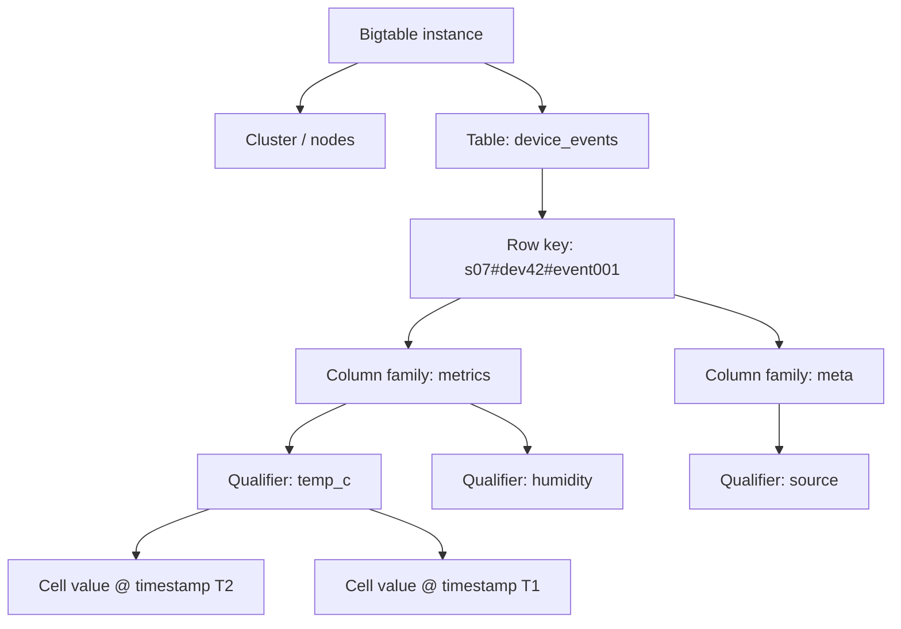
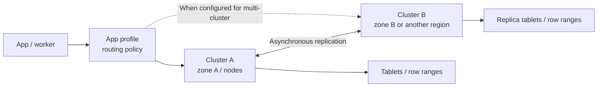

# Bigtable and the Wide-Column Model for Large-Scale Data

An IoT platform receives millions of device temperature, location, and status records every day. The application needs to retrieve **the latest data for a device** or scan **records within a time range**, with high read/write load and low latency. This is a strong fit for evaluating **Google Cloud Bigtable**: a **wide-column** NoSQL database capable of scaling with data volume and throughput.

This lesson belongs to the **Bigtable and Memorystore** chapter of the `CLOUD_PROVIDERS_GCP` module. The focus is on the Bigtable data model, query-driven row key design, avoiding hotspots, optimizing data lifecycle, IAM protection, and monitoring performance/cost. Bigtable differs from **Memorystore** (in-memory cache or datastore), **Firestore** (document database), **Cloud SQL/AlloyDB** (relational), and **BigQuery** (analytics). Choosing the right service keeps the system simpler than trying to force one database to handle every workload.

> **Operational note:** Project, instance, and table examples are hypothetical. Creating a Bigtable instance/cluster, writing data, and deleting resources **can incur charges or cause data loss**. Run only in an authorized sandbox. Shell examples are written for Bash/Cloud Shell. Product limits and pricing vary by edition/region; check the Google Cloud documentation before applying to production.

## 1. Learning Objectives

After this lesson, you will be able to:

1. Describe the hierarchy **instance → cluster → table → row → column family → qualifier → cell versions**.
2. Design a **row key** supporting point lookup/prefix/range scan, distinguishing it from arbitrary SQL queries.
3. Identify **sparse rows, wide columns, timestamp versions**, byte-encoded data, and **garbage collection (GC)** policies.
4. Explain how row ranges are distributed into tablets/nodes and how to avoid **hotspots** caused by monotonically increasing keys.
5. Practice creating tables, column families, and writing/reading data with `cbt`; write a Java Data API example.
6. Distinguish between **single-cluster routing** and **multi-cluster routing**, read-your-writes, and eventual consistency.
7. Monitor latency, throughput, CPU, storage, Key Visualizer, and total cost.
8. Decide when to use Bigtable, Firestore, BigQuery, Cloud SQL, or Memorystore.

## 2. What Is Bigtable and What Data Does It Fit?

Bigtable is a **key-value/wide-column** NoSQL storage service optimized for **large data volumes and row key/range access**. A table does not require every row to have the same set of columns; absent columns do not consume space like empty columns in a fixed relational table.

| Workload | Bigtable fits when | Additional considerations |
| --- | --- | --- |
| **IoT/time series** | Retrieving device data by time range, ingesting many records. | Row key, time bucketing, write hotspots. |
| **Clickstream/event serving** | Retrieving event history by user/session. | Retention, sensitive data, replay. |
| **AdTech/recommendation features** | High-volume point lookups and range scans. | Feature updates, feature TTL, online serving. |
| **Telemetry/log lookup** | Large data, known query keys. | If full-dataset analytical SQL is needed, BigQuery is more suitable. |
| **Order/payment transactions** | Only when access patterns are simple and key-based throughput is needed. | Relations, JOINs, multi-row transactions: Cloud SQL/AlloyDB are usually more suitable. |

Bigtable provides **GoogleSQL for Bigtable** and capabilities such as continuous materialized views depending on feature/edition, but it is **not PostgreSQL**. Do not design assuming multi-table JOINs, filtering any field with automatic secondary indexes, and multi-row ACID transactions like a relational database. Start from the expected access patterns.

## 3. The Wide-Column Data Model



In Bigtable, a **cell** is identified by **row key + column family + qualifier + timestamp**. A cell's value is **bytes**, and the application is responsible for encoding/decoding data types (UTF-8, protobuf, JSON, binary integers, etc.). Multiple versions of the same column can exist with different timestamps.

### 3.1. Example of a Row

**Row key:** `s07#dev42#20261119T081500Z`

| Column family | Qualifier | Timestamp (illustrative) | Value |
| --- | --- | --- | --- |
| `metrics` | `temp_c` | 08:15:00 | `22.8` |
| `metrics` | `humidity` | 08:15:00 | `61` |
| `meta` | `source` | 08:15:00 | `edge-gateway` |
| `metrics` | `temp_c` | 08:15:01 | `22.9` |

Not every row needs to have the `humidity` or `meta:source` column. This is a **sparse data** characteristic: the set of qualifiers can differ per row, allowing you to store attributes that emerge over time without changing a schema for each new column.

**Two history storage patterns to distinguish:**

- **Multiple rows by event time**: each measurement is a separate row, for example `s07#dev42#20261119T081500Z`. Easy to scan by time/limit batch size.
- **Multiple cell versions in one row**: multiple `metrics:temp_c` values at different timestamps. Useful in certain cases, but an overly large/hot row easily creates a bottleneck; do not default to stuffing years of measurements into a single row.

### 3.2. Column Families and Qualifiers

Column families are **created upfront** before writing data; qualifiers can appear dynamically on write. Split families by **related data groups and retention policies**:

| Family | Example qualifiers | Expected policy |
| --- | --- | --- |
| `metrics` | `temp_c`, `humidity`, `battery` | Retain by age, e.g., 30 days. |
| `meta` | `source`, `firmware` | Keep only the latest version. |

GC policies are configured **at the family level**, not arbitrarily per qualifier within the same family. Do not create a family per device or per measurement. Too many families increase overhead; Bigtable schema guidance recommends around **a maximum of 100 families/table** because performance can degrade beyond that.

### 3.3. Timestamp Is Not Necessarily Event Time

A cell's timestamp can be client-specified or assigned by the service upon write. If a device goes offline and uploads late, the write timestamp **differs** from the measurement time. For time-series data, decide:

1. **Event time** goes into the row key to support historical range scans.
2. Cell timestamp serves versioning, retention, or conflict policies when valid.
3. Real-world timestamps do not guarantee precision, timezone consistency, or arrival order.

Do not use a timestamp as a globally unique ID if multiple events share the same timestamp. Append an event ID/sequence if you need to guarantee no overwrites.

## 4. Row Key: Design Around Queries Before Choosing a Schema

**The row key is the foundational index** of Bigtable. Rows are sorted in **lexicographical byte order**, not numerically if you write unpadded strings like `"2"` and `"10"`. The most efficient access patterns are usually:

1. **Point lookup** by a full key.
2. **Prefix scan** retrieving rows sharing a prefix.
3. **Range scan** from a start key to an adjacent end key.

### 4.1. Row Key Pattern for IoT

Suppose a product requirement is "retrieve the 50 latest measurements for **a single device**." A key pattern:

```text
<device_bucket>#<device_id>#<reverse_timestamp_fixed_width>#<event_id>

s07#dev42#8230559099999#e001
s07#dev42#8230559100999#e002
s12#dev99#8230559099999#e777
```

- `device_bucket` is a **deterministic hash/shard based on device ID**, distributing devices across the keyspace; the application computes the bucket when reading.
- `device_id` keeps events for **one device** under the same prefix for convenient scanning.
- `reverse_timestamp = MAX_TIMESTAMP - event_timestamp` (fixed-width numeric format) places **the newest records first** within the same prefix.
- `event_id` handles two events with the same timestamp and aids deduplication.

**Note:** `8230559099999` is only an example illustrating the reverse timestamp format, not an exact calculated time. If the use case requires querying **all devices in a single day**, a device-prefixed schema is not automatically optimized for that requirement; consider another table/continuous materialized view or a pipeline to BigQuery.

### 4.2. Why Leading Timestamps Cause Hotspots

```text
AVOID (all devices writing near the end of the keyspace):
20261119T081500Z#dev42
20261119T081501Z#dev99
20261119T081502Z#dev12

RECOMMENDED (multiple device/hash bucket prefixes):
s07#dev42#...
s12#dev99#...
s03#dev12#...
```

If all writes pour into a monotonically increasing key range, the tablet/node holding that range easily **hotspots**, even when total cluster CPU is not high. A random/hash prefix distributes writes but comes with a trade-off: scanning all devices at a given point in time requires fanning out across multiple prefixes, so **no single row key is optimal for every query**.

### 4.3. Practical Schema Principles

| Rule | Why |
| --- | --- |
| Use short, meaningful keys that can be computed before reading. | Reduces storage and avoids full table scans. |
| Row key **must not exceed 4 KiB** (hard limit). | Ensures compliance with Bigtable limits. |
| Pad numbers/timestamps for proper byte ordering. | `0002` and `0010` sort as expected. |
| Avoid global timestamps, sequential integer IDs, or a single ultra-hot row. | Minimizes write hotspots. |
| Choose the prefix based on the most frequent access pattern. | Prefix/range reads are more efficient than deep scan + filter. |
| Avoid huge rows; keep a single row's data under about **100 MiB**. | Read/mutation/compaction are resource-intensive; the row hard limit is higher, but you should not approach it. |
| Design keys without PII/secrets that could leak into logs/metrics. | Supports least privilege and data protection. |

### 4.4. Relevant Limits (Per Current Documentation)

| Component | Recommended limit | Hard limit |
| --- | --- | --- |
| Row key | Shortest needed for lookup | **4 KiB** |
| Qualifier | Compact, avoid many empty columns | **16 KiB** |
| Single cell value | Around **10 MiB** or smaller | **100 MiB** |
| Total cell values in one row | Around **100 MiB** or smaller | **256 MiB** |
| Single mutation | As small as possible | **200 MiB** |

**Data size limits** do not equal **optimal performance levels**. A row well below the hard limit can still become a hotspot if updated thousands of times per second.

## 5. Reads, Scans, Filters, and Transactional Boundaries


### 5.1. Row Key First, Filter Second

To retrieve measurements for `dev42`, use `prefix=s07#dev42#`. If start/end times are known, encode them into a key range. Then add filters to reduce the returned columns/versions.

**Common mistake:** storing row keys that do not support the access pattern, then using regex/value filters hoping Bigtable searches as fast as an RDBMS index. A filter can reduce returned data, **but it does not turn a full table scan into a fast index lookup**.

### 5.2. Single-Row Atomicity

`RowMutation` operations updating **a single row** can be applied atomically. Bigtable supports certain read-modify-write/conditional mutations **on a single row** when the app profile/routing permits. Do not assume general multi-row/multi-table ACID transactions.

For example, updating sensor status and temperature value in the same row makes consistency easier than writing half to two different rows. For transferring funds between two accounts, use Cloud SQL/AlloyDB or design Saga/idempotency if choosing a NoSQL database for specific reasons.

### 5.3. Does GoogleSQL for Bigtable Change the Model?

GoogleSQL for Bigtable supports a subset of query syntax and **row key schema** management capabilities, providing additional options for some workloads. However, the Bigtable Data API and row-key design strategy remain the foundation for efficient access. **Do not treat it as full PostgreSQL with JOINs, foreign keys, automatic secondary indexes, or multi-row transactions**.

## 6. Cell Versions and Garbage Collection

A qualifier can hold **multiple values by timestamp**. For example, `metrics:temp_c` is written twice on the same row. When reading, the client can select **only the latest version** or matching versions via filters. This does not mean Bigtable keeps infinite history for free.

**Garbage collection (GC)** is the mechanism that removes cell versions based on policies set at the **column family** level. Common policies:

| Policy | Meaning |
| --- | --- |
| `maxversions=1` | Keep only the latest version per column; older versions become eligible for GC. |
| `maxage=30d` | Versions with timestamps older than 30 days become eligible for GC. |
| `maxage=30d or maxversions=3` | Delete a version if it is **older than 30 days or** outside the three most recent versions. |
| `maxage=30d and maxversions=3` | Delete only when **both** older than 30 days and outside the three most recent versions. |

**AND and OR have different meanings**. With `and`, a version older than 30 days is still retained if it is among the three newest versions. GC policies are applied **asynchronously**; eligible data may not be deleted immediately. Therefore:

- Do not use GC as an **instant deletion tool for legal compliance**; execute proper deletion workflows and check backups/retention.
- Before GC runs, old versions may remain in storage and affect usage.
- Review GC when changing schemas or keeping multiple versions; retaining history incurs cost.
- Set different policies for `metrics` and `meta` if their retention periods differ.

## 7. Instances, Clusters, Nodes, and Replication

Bigtable distributes **row ranges** into **tablets** so multiple nodes can process traffic concurrently. An **instance** contains tables and one or more **clusters**; each cluster resides in a zone and has compute capacity and an associated copy of the data. Adding nodes or autoscaling increases total throughput when load is well distributed, but **it will not fix an overloaded single row/hot key**.



### 7.1. App Profiles Determine Routing and Consistency

| Routing | Behavior | Trade-off |
| --- | --- | --- |
| **Single-cluster routing** | All requests via the profile are sent to a designated cluster. | Suitable for read-your-writes when **reading/writing on the same cluster**; failover to another cluster requires policy-driven coordination. |
| **Multi-cluster routing** | The service routes to the nearest/available cluster and can fail over automatically. | **Eventually consistent** replication; the same row may temporarily return stale reads across different clusters. |

**Single-row conditional/transactional operations** have specific routing requirements and are not enabled by default on multi-cluster routing. When consistent read-modify-write operations are required, check **single-cluster routing + allow single-row transactions**.

Business example: a service that writes a sensor reading and immediately reads it back to display the just-written value should use **same-cluster routing** or a verified mechanism; an analytics dashboard can tolerate eventual consistency and leverage multi-cluster routing/replication.

**Replication is not backup**: if the application accidentally deletes a row, the deletion can also be replicated. You need separate **backups, restore testing, RPO/RTO, and retention**. Do not assume multi-cluster automatically resolves logic errors or guarantees zero-data-loss on failover.

### 7.2. SSD/HDD Storage and Capacity

- **SSD** is typically suited for low-latency/varied query traffic; **HDD** may suit other access patterns but is not as fast as SSD by default for random access.
- Storage type is chosen when creating an instance/cluster within supported limits; do not change it arbitrarily after going to production.
- Compute/throughput, storage, replication, backups, and network are **separate cost categories**; adding clusters for multi-region serving increases storage and replication overhead.
- When large batch processing is needed without degrading online latency, consider **Bigtable Data Boost** where feature/edition supports it, or export data to BigQuery.

## 8. cbt Lab: Creating a Wide-Column Table, Writing, and Reading Rows

**Goal:** work with a small table `device_events_lab` in an **existing sandbox Bigtable instance**. If no instance exists yet, see section 8.1; prefer using your organization's lab instance rather than creating a new one just to run a few commands.

### 8.1. Preparing the Instance via Console

In **Google Cloud Console → Bigtable → Create instance**, when authorized:

1. Select a sandbox project with billing and **Bigtable Admin API / Data API** enabled.
2. Choose a lab-only instance ID/cluster ID, edition, and **SSD/HDD** per policy.
3. Choose a valid region/zone, node count/autoscaling, and avoid creating multiple clusters if HA is not needed.
4. Check quotas, IAM, compute costs **even when the table is empty**, and the cleanup plan.
5. Wait for the instance/cluster to reach serving state before operating on tables.

Creating an instance is a **billable infrastructure change**; this lesson does not assume creating clusters in a production project. Once an instance exists, use `cbt`:

```bash
PROJECT_ID="iot-lab"
INSTANCE_ID="iot-bigtable-lab"
TABLE_ID="device_events_lab"

# READ-ONLY: verify instances and clusters.
gcloud bigtable instances list --project="$PROJECT_ID"
gcloud bigtable clusters list \
  --project="$PROJECT_ID" --instances="$INSTANCE_ID"

# cbt must be installed with valid ADC/Google Cloud credentials.
# On environments with gcloud component manager:
# gcloud components install cbt

# READ-ONLY: list tables in the specified instance.
cbt -project="$PROJECT_ID" -instance="$INSTANCE_ID" ls
```

The `cbt` commands pass `-project=` and `-instance=` so they **do not depend on `~/.cbtrc` or another shell's context**. If a table with the same name already exists, **do not overwrite it**; choose a different table ID and verify it belongs to the sandbox.

### 8.2. Creating the Table and Column Families

```bash
# CREATES REAL RESOURCES: run only once in the lab instance.
cbt -project="$PROJECT_ID" -instance="$INSTANCE_ID" \
  createtable "$TABLE_ID"

cbt -project="$PROJECT_ID" -instance="$INSTANCE_ID" \
  createfamily "$TABLE_ID" metrics

cbt -project="$PROJECT_ID" -instance="$INSTANCE_ID" \
  createfamily "$TABLE_ID" meta

# CHANGES GC POLICY: use test data, do not modify production families.
cbt -project="$PROJECT_ID" -instance="$INSTANCE_ID" \
  setgcpolicy "$TABLE_ID" metrics maxage=30d

cbt -project="$PROJECT_ID" -instance="$INSTANCE_ID" \
  setgcpolicy "$TABLE_ID" meta maxversions=1

# READ-ONLY: inspect families and policies.
cbt -project="$PROJECT_ID" -instance="$INSTANCE_ID" ls "$TABLE_ID"
```

`metrics` uses age-based retention, while `meta` retains only the latest version. **GC is asynchronous**: setting it today does not mean old cells vanish immediately.

### 8.3. Writing Sample Data

```bash
# WRITES REAL DATA into the lab table, do not execute in production.
cbt -project="$PROJECT_ID" -instance="$INSTANCE_ID" \
  set "$TABLE_ID" "s07#dev42#20261119T081500Z" \
  metrics:temp_c=22.8 metrics:humidity=61 meta:source=edge-gateway

cbt -project="$PROJECT_ID" -instance="$INSTANCE_ID" \
  set "$TABLE_ID" "s07#dev42#20261119T081600Z" \
  metrics:temp_c=23.1 metrics:humidity=60

cbt -project="$PROJECT_ID" -instance="$INSTANCE_ID" \
  set "$TABLE_ID" "s12#dev99#20261119T081500Z" \
  metrics:temp_c=19.4 meta:source=edge-gateway
```

The values `22.8` and `61` are written by the CLI as **text/bytes**, not PostgreSQL-typed numeric columns. If arithmetic processing is required, the client must explicitly parse/encode them. Each measurement is in a separate row; avoid stuffing a multi-year series into one row.

### 8.4. Point Lookup and Prefix Scan

```bash
# READ-ONLY: read exactly one row.
cbt -project="$PROJECT_ID" -instance="$INSTANCE_ID" \
  lookup "$TABLE_ID" "s07#dev42#20261119T081500Z"

# READ-ONLY: read rows for dev42 (prefix scan).
cbt -project="$PROJECT_ID" -instance="$INSTANCE_ID" \
  read "$TABLE_ID" prefix="s07#dev42#" count=10

# READ-ONLY: read only selected columns.
cbt -project="$PROJECT_ID" -instance="$INSTANCE_ID" \
  read "$TABLE_ID" prefix="s07#dev42#" columns=metrics:temp_c count=10
```

Expected output: lookup returns the first row and its cells; the prefix scan returns **two rows** for `dev42`, excluding `dev99`. `count=10` limits the returned records and does not replace proper key/range design; a query without a prefix/range can read a very large span.

**Ordering note:** this simple lab uses **ascending** timestamps after the prefix, so returned row key order is **oldest first, newest last**. For a "50 latest measurements" screen, implement a **reverse timestamp** or another benchmarked query strategy; merely adding `count=50` to the current prefix scan fetches the first rows and **does not guarantee the newest ones**.

### 8.5. Lab Cleanup

Before deleting, verify the instance/table name and owner:

```bash
# READ-ONLY:
cbt -project="$PROJECT_ID" -instance="$INSTANCE_ID" ls

# DELETES THE ENTIRE lab table: only if TABLE_ID was created by you
# and contains no other users' data.
# cbt -project="$PROJECT_ID" -instance="$INSTANCE_ID" deletetable "$TABLE_ID"
```

Do not delete a shared **instance** and do not delete real data to test GC. After cleanup, check Bigtable compute/storage and any remaining billable backup/snapshot resources, if any.

## 9. Java Client: Writing a Row, Reading a Row, and Prefix Scan

Java applications on Compute Engine/GKE/Cloud Run should use the **Bigtable Data API client library** with **Application Default Credentials (ADC)**. Create and reuse a shared `BigtableDataClient` at application startup rather than creating a new client per HTTP request; close the client on application shutdown.

Example Maven dependency (add to a `pom.xml` already configured with Java 21; pin the version according to your project's BOM/dependency policy):

```xml
<dependency>
  <groupId>com.google.cloud</groupId>
  <artifactId>google-cloud-bigtable</artifactId>
  <version>2.85.0</version>
</dependency>
```

Place the following class at `src/main/java/example/BigtableReadWrite.java`:

```java
package example;

import com.google.cloud.bigtable.data.v2.BigtableDataClient;
import com.google.cloud.bigtable.data.v2.models.Query;
import com.google.cloud.bigtable.data.v2.models.Row;
import com.google.cloud.bigtable.data.v2.models.RowCell;
import com.google.cloud.bigtable.data.v2.models.RowMutation;
import com.google.cloud.bigtable.data.v2.models.TableId;

public class BigtableReadWrite {
    public static void main(String[] args) throws Exception {
        String project = System.getenv("BT_PROJECT");
        String instance = System.getenv("BT_INSTANCE");
        String table = System.getenv("BT_TABLE");
        if (project == null || instance == null || table == null) {
            throw new IllegalArgumentException("Missing BT_PROJECT/BT_INSTANCE/BT_TABLE");
        }

        String rowKey = "s07#dev42#20261119T081700Z";
        try (BigtableDataClient client = BigtableDataClient.create(project, instance)) {
            // Atomically write cells belonging to the same row.
            RowMutation mutation = RowMutation.create(table, rowKey)
                .setCell("metrics", "temp_c", "23.3")
                .setCell("metrics", "humidity", "59");
            client.mutateRow(mutation);

            // Point read: if not found, row = null.
            Row row = client.readRow(TableId.of(table), rowKey);
            if (row != null) {
                System.out.println("Found " + row.getKey().toStringUtf8());
                for (RowCell cell : row.getCells()) {
                    System.out.printf("%s:%s = %s%n",
                        cell.getFamily(),
                        cell.getQualifier().toStringUtf8(),
                        cell.getValue().toStringUtf8());
                }
            }

            // Prefix scan: all key-sorted rows for dev42.
            for (Row event : client.readRows(Query.create(table)
                    .prefix("s07#dev42#"))) {
                System.out.println("event=" + event.getKey().toStringUtf8());
            }
        }
    }
}
```

Test **only against the sandbox table you created** and with an authorized session:

```bash
export BT_PROJECT="iot-lab"
export BT_INSTANCE="iot-bigtable-lab"
export BT_TABLE="device_events_lab"

# Build/run command for a Maven application with exec-maven-plugin configured.
mvn -q compile exec:java -Dexec.mainClass=example.BigtableReadWrite
```

To run via Maven, `pom.xml` must include **maven-compiler-plugin** with `release=21` and **exec-maven-plugin** or an equivalent JAR execution setup. The dependency snippet above is **an addition**, not a complete `pom.xml`. The library version reflects the Java API referenced in the documentation; upgrade and scan dependencies according to your CI process.

**IAM:** read-only apps typically use `roles/bigtable.reader`, and read/write apps use `roles/bigtable.user` at the appropriate table/resource scope. Do not grant `roles/bigtable.admin` to a read-only consumer. Workload identity/attached service accounts are preferable to JSON key files; IAM controls the Bigtable API while the application itself must enforce tenant/row access if tenants share a table.

**Warning:** the Java example calls `mutateRow` on every run. Without an explicit timestamp, repeated runs can create additional cell versions until GC removes them. When idempotency is required, explicitly design **row keys/event IDs and timestamps/conditional mutations**; HTTP/SDK retries do not guarantee exactly-once business processing.

## 10. Performance, Monitoring, Optimization, and Cost

### 10.1. Reading CPU + Key Visualizer Alongside Latency

| Signal | Meaning | Appropriate action |
| --- | --- | --- |
| **Read/write latency p50, p95, p99** | Are users impacted under high load? | Compare by app profile, cluster, and use case. |
| **Cluster CPU utilization / node count** | Is total compute capacity sufficient? | Evaluate autoscaling after ruling out hotspots. |
| **Hot tablets / Key Visualizer heatmap** | Which key ranges receive concentrated traffic? | Fix row-key distribution/time bucketing. |
| **Read rows/bytes & write throughput** | Access volume and growth rate. | Benchmark with realistic data/row sizes. |
| **Disk/storage utilization & growth** | Cost and performance impact; version retention. | GC, SSD/HDD selection, capacity adjustments. |
| **Replication latency/failover** | Stale reads with multi-cluster routing; affected zones. | Review app profiles and consistency SLOs. |
| **Errors / throttling / deadline exceeded** | Capacity, IAM, network, or client config. | Logs, quotas, backoff, timeouts, and retry budgets. |

**Diagnosing hotspots:** if p99 latency is high and Key Visualizer shows a very hot row-key segment while cluster CPU is not overloaded, **adding nodes may not help**. First analyze key design, distribute load across more key ranges, or change data sharding.

### 10.2. Autoscaling and Storage Selection

Bigtable supports manual node capacity or **autoscaling** with CPU/storage targets when the configuration is supported. Autoscaling reacts over time and within quotas; it is not instantaneous. Set **min/max nodes, CPU target, and storage utilization target** based on p95 latency, projected load, and budget. When adding clusters, each cluster must also handle replication; do not count only the node total of a single cluster.

**SSD** is typically chosen for random/low-latency reads. **HDD** has lower storage cost but different performance characteristics. Do not pick HDD solely based on price/GB when the request pattern consists of low-latency point reads.

### 10.3. End-to-End Cost

| Line item | Cost drivers |
| --- | --- |
| **Compute/nodes** | Edition, node capacity, number of clusters, uptime. |
| **Data storage** | SSD/HDD, bytes stored, number of cell versions, replication. |
| **Network/replication** | Cross-zone/region traffic, client egress, and failover. |
| **Backup** | Size, type, and backup retention duration. |
| **Data Boost / batch** | Additional processing services when used. |
| **Applications and pipelines** | Cloud Run/GKE, Pub/Sub/Dataflow, Logging/Monitoring, BigQuery. |

A new instance with multiple nodes and replication can incur charges **even before storing useful data**. Calculating "Bigtable is cheap because it holds many TBs" is insufficient: compare **cost per million reads/writes meeting SLO** or per GB served, and check total billing by region.

## 11. Choosing Bigtable, Firestore, BigQuery, Cloud SQL, or Memorystore?

| Primary need | Option to evaluate | Why |
| --- | --- | --- |
| Multi-TB/PB time-series, key/prefix/range access at high QPS | **Bigtable** | Wide-column, scale-out, low key-based latency. |
| Mobile/web apps, document model, field/compound index queries, realtime listeners | **Firestore** | SDK/Firebase integration and suitable document queries. |
| SQL analytics over large history, ad hoc JOINs/aggregations | **BigQuery** | OLAP engine with distributed scan/aggregation. |
| Multi-table order transactions, foreign keys, JOINs, ACID | **Cloud SQL/AlloyDB** | Relational transactional semantics. |
| Session cache, rate-limit counters, ephemeral data needing ultra-low latency | **Memorystore** | In-memory Redis/Memcached-style use cases, not a replacement for historical datastores. |

Reasonable architecture example: **Pub/Sub → Dataflow → Bigtable** to ingest time-series; **Cloud Run/GKE** reads Bigtable by row key; **BigQuery** receives a copy of data for analytics; **Memorystore** caches hot results when there is a specific need. Do not add all five services to a small system if one or two meet the SLO.

## 12. Security and Troubleshooting

### 12.1. Permissions and Access Control

- Separate **Bigtable Admin API** (creating instances/tables/GC) and **Data API** (reading/writing cells). Administrative permissions are not needed by every workload.
- Grant **`roles/bigtable.reader`** for read-only and **`roles/bigtable.user`** for read/write at the supported table/authorized view scope; use separate service accounts for producers/consumers.
- For Cloud Run/GKE, use ADC/workload identity instead of JSON keys in source code. Review network/egress policies, IAM, encryption, and VPC Service Controls where applicable.
- Do not write user emails, tokens, or sensitive identifiers into row keys in plaintext without an approved policy; keys can appear in logs/traces.
- Bound retries, exponential backoff, and timeouts when calling Bigtable; ensure idempotency by business key.

### 12.2. Troubleshooting

| Symptom | Common cause | Investigation path |
| --- | --- | --- |
| `PERMISSION_DENIED` | SA lacks role / ADC points to wrong project. | Verify actual principal, table policy, and Bigtable API. |
| `NOT_FOUND` for table/instance | Wrong ID/project or resource not created. | `gcloud bigtable instances list`, `cbt ls`, table name. |
| Slow prefix scan | Key design does not group target data; overly broad scan. | Check row key schema, range bounds, and Key Visualizer. |
| Reads miss recently written data | Multi-cluster routing, replication lag, or wrong key/timestamp. | App profile, routing region, row lookup on the same cluster. |
| High write latency, low overall cluster CPU | Hot tablet from sequential keys or one overly hot device. | Key Visualizer, hash/time bucketing, reduce writes on hot row. |
| Rapid storage growth | Too many cell versions, GC has not run, large payloads. | `setgcpolicy` per family, metrics, and index design if any. |
| One workload impacts another | Tables share clusters/nodes; batch scans contend for resources. | App profile/workload isolation, Data Boost, or separate pipeline. |
| Reads after failover temporarily return stale data | Asynchronous replication has not caught up. | Consistency SLO, fallback behavior, replication metrics. |

## 13. Practice Exercises with Answers

**Exercise 1 — Choosing a database.** A system stores 3 years of multi-TB telemetry data and typically only reads the 100 latest records per device. Bigtable or Firestore/BigQuery?

*Answer:* **Bigtable** is a strong candidate if the row key enables retrieving data by device and time order. BigQuery suits full-history analytics; Firestore fits when document/SDK/query semantics matter more.

**Exercise 2 — Row key design.** Why can `20261119T081500Z#dev42` cause hotspots when thousands of devices send data simultaneously?

*Answer:* A leading timestamp concentrates writes into closely adjacent key ranges over time. Add a device/hash prefix and choose bucketing based on access patterns.

**Exercise 3 — Key ordering.** With `s07#dev42#20261119T081500Z` and `s07#dev42#20261119T081600Z`, does a prefix scan return the newest record first?

*Answer:* **No.** Ascending timestamps sort oldest first. You need a fixed-width reverse timestamp or another query strategy to read newest first.

**Exercise 4 — Sparse columns.** A row only has `metrics:temp_c` and does not have `metrics:humidity`. Must you alter the schema or fill nulls?

*Answer:* No. **Qualifiers are dynamic** and sparse rows do not require identical columns. You only create the `metrics` column family upfront.

**Exercise 5 — Multiple versions.** Does configuring `maxversions=1` make old data disappear immediately after a new write?

*Answer:* **No.** GC is asynchronous; old versions may persist for some time. If controlled deletion is required, use proper delete/retention workflows.

**Exercise 6 — AND/OR in GC.** Does the policy `maxage=30d and maxversions=3` delete a 40-day-old cell version if it is the second newest version?

*Answer:* **No**, because the condition of exceeding three versions is **not** satisfied. `or` would allow removing the version when only one condition is met.

**Exercise 7 — Transactions.** Transferring money from account A to B requires atomically updating two row keys. Can Bigtable `RowMutation` guarantee this?

*Answer:* No. `RowMutation` is atomic **within a single row**; this is not a multi-row transaction. Consider Cloud SQL/AlloyDB or a proven idempotent/compensating workflow.

**Exercise 8 — Consistency.** After writing to cluster A, reading from cluster B via a multi-cluster app profile sees an old value. Is this abnormal?

*Answer:* It can be normal **eventual consistency** behavior when replication has not yet caught up. For strict read-your-writes, choose single-cluster routing for reads/writes per appropriate design.

**Exercise 9 — Scale-out.** Cluster average CPU is 35% but one tablet is very hot and p99 increases. Should you scale out nodes indefinitely?

*Answer:* **No.** Check Key Visualizer/hot keys; redistribute row keys, adjust bucketing/hashing, or reduce contention before increasing capacity.

**Exercise 10 — Cost.** A team creates two clusters with multiple nodes for a test project containing a few dozen rows. Why is the bill still significant?

*Answer:* Compute nodes/replication/backups can be billed by active provisioned resources, not just row count. Use a budgeted sandbox, time limits, and proper owner cleanup.

## 14. Pre-Production Checklist

- [ ] Defined query patterns; chose Bigtable for point/prefix/range lookups rather than the "Big Data" name.
- [ ] Row key is short, deterministic, uses fixed-width timestamps, and avoids global write hotspots.
- [ ] Tested adding devices/traffic skew, a very hot device, and Key Visualizer.
- [ ] Column families organized by data group/retention; dynamic qualifiers, avoiding family explosion.
- [ ] GC policies use `maxage`/`maxversions` and AND/OR properly; GC is not used as instant deletion.
- [ ] App profiles and replication match read-your-writes/HA requirements, with a failover plan.
- [ ] Not relying on multi-row transactions; idempotency/conditional mutations are designed.
- [ ] IAM read/write/admin separated, Workload Identity/ADC and network policies configured properly.
- [ ] Client library reused, with retry budgets/backoff and safe shutdown.
- [ ] Measured p95/p99, throughput, CPU, hot tablets, storage, replication lag, and budget.
- [ ] Backups/restore tests, retention, DR runbook, and sandbox cleanup in place.
- [ ] Estimated node compute + SSD/HDD storage + replication + backups + network + pipelines.

## 15. Summary

**Wide-column Bigtable** organizes data by **byte-sorted row key**, flexible **column families/qualifiers**, and timestamped **cell versions**. Its strength is **large-scale point lookups and prefix/range scans** when row keys are designed properly; the pitfalls of poor design are **hotspots, wide table scans, unnecessary cost, and difficulty supporting ad hoc queries**.

To use Bigtable effectively, follow this order: **define access patterns → design row keys and column families → test reads/writes with `cbt`/SDK → configure GC → benchmark latency/hotspots → choose app profile/replication → monitor costs**. Bigtable does not replace every need of Firestore, BigQuery, Cloud SQL, or Memorystore: choose them based on data type, consistency requirements, and actual SLOs.

### Google Cloud Reference Documentation

- [Bigtable overview](https://cloud.google.com/bigtable/docs/overview)
- [Understand the Bigtable data model](https://cloud.google.com/bigtable/docs/storage-model)
- [Schema design best practices](https://cloud.google.com/bigtable/docs/schema-design)
- [Quotas and limits](https://cloud.google.com/bigtable/quotas)
- [cbt CLI reference](https://cloud.google.com/bigtable/docs/cbt-reference)
- [Create an instance and write data with cbt](https://cloud.google.com/bigtable/docs/create-instance-write-data-cbt-cli)
- [Configure garbage collection](https://cloud.google.com/bigtable/docs/configuring-garbage-collection)
- [Replication overview](https://cloud.google.com/bigtable/docs/replication-overview)
- [App profiles and routing](https://cloud.google.com/bigtable/docs/routing)
- [Read data with Java client](https://cloud.google.com/bigtable/docs/reading-data)
- [IAM roles for Bigtable](https://cloud.google.com/bigtable/docs/access-control)
- [Key Visualizer and hotspots](https://cloud.google.com/bigtable/docs/keyvis-overview)
- [Bigtable pricing](https://cloud.google.com/bigtable/pricing)
