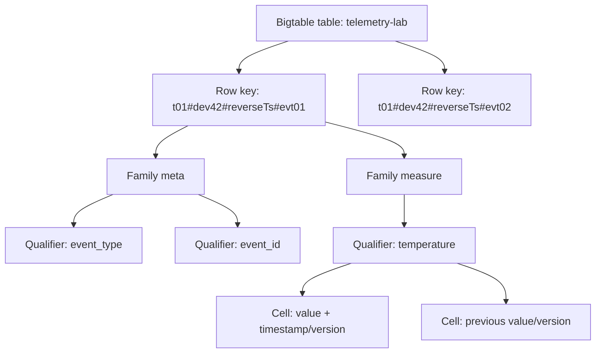
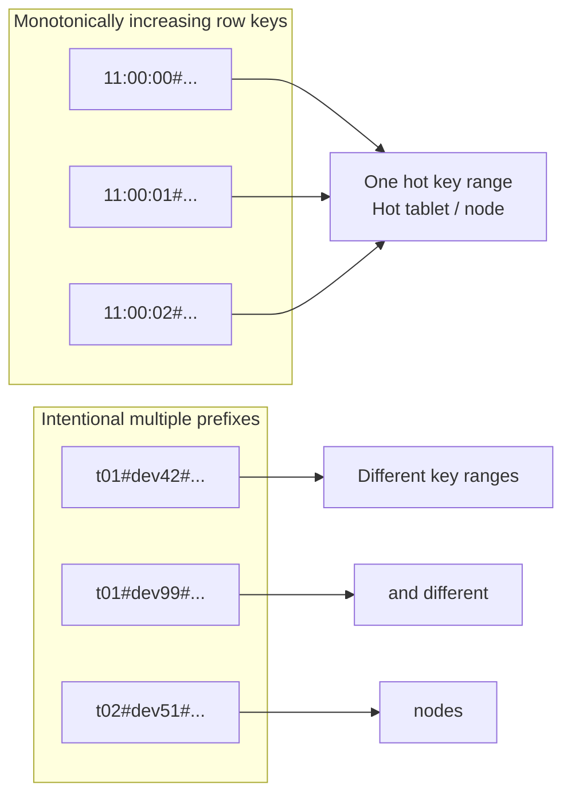
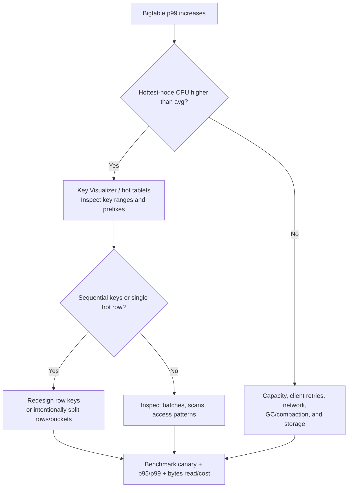

# Designing Row Keys, Column Families, and Avoiding Hotspots

## 1. The Problem: Bigtable Has Many Nodes, Yet the Java API Is Still Slow

A **Java/Spring Boot** system running on **GKE or Cloud Run** ingests millions of IoT events per hour. Each event has `tenantId`, `deviceId`, timestamp, and measurement value. The API needs to read the **20 most recent measurements for a device** and occasionally read data across a time range. Although Bigtable can scale throughput, write p99 spikes sharply when all row keys start with `20261119T...`: new records continuously concentrate in a single key region.

**Bigtable** is a **wide-column** NoSQL database that stores rows sorted by **lexicographic byte order on row keys**. It suits high read/write throughput, primary-key/prefix/range queries, and time-series data; **it does not natively support multi-row JOINs or transactions like Spanner/Cloud SQL**. Row key design determines where data resides and how it is queried; **column families** determine column groupings and **cell version retention policies**.

This lesson in the **Bigtable and Memorystore** chapter of the **CLOUD_PROVIDERS_GCP** module focuses on three decisions: **row keys**, **column families**, and **avoiding hotspots**. We will connect IAM, networking, the Java client, deployment automation, SLO monitoring, and cost. **Memorystore** is compared only in its proper caching role, without forcing Bigtable's column-family model onto Redis/Valkey.

**Objectives:** After this lesson, you will know how to design keys around access patterns; choose standard vs. reverse timestamps; weigh deterministic bucketing, range scans, and fan-out; organize families/qualifiers/GC; use Java and `cbt`; detect hotspots with **Key Visualizer**; and execute schema changes safely.

> **Lab boundary:** All examples creating/deleting tables or writing cells are strictly for an **approved test Bigtable instance**—never run them in production. Instances/nodes, storage, backups, and reads/writes can still incur charges. Do not create or delete an entire instance just to test a schema command.

## 2. Storage Model: Table → Row → Family → Qualifier → Cell



| Concept | Meaning | Design notes |
| --- | --- | --- |
| **Table** | Collection of rows sharing a purpose | No need to create a new table per day or per tenant |
| **Row key** | Unique identifier of a row, **max 4 KiB** | Sorted **lexicographically by bytes**, does not auto-parse numbers/dates |
| **Column family** | Logical group created upfront, e.g. `meta`, `measure` | **GC policies** and many settings apply at the family level; keep around **≤100 families/table** |
| **Qualifier** | Column name inside a family, created on write | Sparse table; no need to predeclare individual qualifiers |
| **Cell** | Value at (row, family, qualifier, timestamp) | Supports multiple versions; bound them with GC policies |
| **Row mutation** | Changes to cells within a single row | **Atomic at the single-row level**, not across multiple rows |

Bigtable stores raw bytes; numeric types, Protobuf/JSON, and datetimes are determined by **application code/encoding**. For a wide row, the recommended limit is **under 100 MiB**, hard limit **256 MiB**; a single cell value should be **under 10 MiB**. Do not write years of history into **one row** just because all events belong to the same device.

**Key mindset:** Define **read queries** first, then design the row key and families. Do not design Bigtable like a SQL table with indexes on every column.

## 3. Access Patterns Determine Segment Order

Suppose the application needs:

1. **R1:** fetch the 20 latest readings for `tenant=t01, device=dev42`.
2. **R2:** fetch readings for a device during `10:00–11:00 UTC`.
3. **R3:** look up an event by `eventId` to check deduplication.
4. **R4:** aggregate all devices for the day.

An initial design for **R1/R2**:

```text
<tenantId>#<deviceId>#<reverseTime19>#<eventId>

t01#dev42#9223370262784700000#evt01
t01#dev42#9223370262784701000#evt02
t01#dev99#9223370262784702000#evt03
```

The numbers here only illustrate the **19-digit** structure; actual values must be generated consistently by an algorithm, not typed manually from timestamps.

- The prefix `t01#dev42#` lets you scan rows **for the same device**, rather than the entire table.
- `reverseTime19` places **the newest** readings before older readings when scanning in ascending key order.
- `eventId` distinguishes two events with the same timestamp resolution. If **idempotent ingest** is needed, use a **deterministic row key** for the same business event rather than generating a new `UUID` on every retry.
- **R3** is inefficient if you only know `eventId` without tenant/device/time; you may need a secondary lookup table or redesigned access paths.
- **R4** must scan across many device prefixes; consider an aggregation pipeline (Dataflow/BigQuery) or a materialized view instead of regex-filtering the entire table and expecting range-scan performance.

| Query | Suitable row key | Trade-off |
| --- | --- | --- |
| By device and time | `tenant#device#reverseTs#eventId` | Fast prefix scan; an ultra-hot device can bottleneck |
| By tenant, device, and date | `tenant#device#yyyymmdd#time#eventId` | Convenient daily scan; newest-first requires reversing order |
| By known event ID | `eventId` or lookup `eventId → rowKey` | Device/time queries may no longer be optimal |
| Entire tenant/day | `tenant#date#device#time` | Date prefix can create hotspots if a tenant is very hot |

**Pick the primary access pattern** and build supplementary data models for secondary needs; each additional table/lookup adds storage, write cost, and synchronization logic. Bigtable now offers **continuous materialized views for asynchronous indexing** in supported scenarios, though that is not a general-purpose **synchronous JOIN or secondary index** for every query pattern.

## 4. Why Do Hotspots Occur?

Bigtable splits the keyspace into **tablets**, distributing and rebalancing them across nodes. Writes hitting **a narrow key range**, or repeatedly updating **a single row**, can overload the tablet/node serving that region. When a workload runs hot on a small slice of data, adding nodes may not help immediately because **traffic is not evenly distributed**.



**Patterns to avoid or evaluate carefully:**

- `2026-11-19T11:00:01Z#device`: timestamp **at the front**, concentrating new writes in the same region.
- `00000001, 00000002, ...`: sequential IDs, concentrating new rows at the tail of the keyspace.
- `tenantA#deviceHot`: **one row** receiving thousands of updates/second; the row can bloat with cell versions.
- `tenantA#...` with **very few tenants**, where one tenant receives most of the traffic: low prefix cardinality and hotspot risk.
- Blindly hashing **the entire key**: destroys contiguous row ranges needed for range queries.

**Not every tenant-prefixed key is wrong.** If each tenant has millions of device IDs and traffic is well spread, contiguous ranges can split naturally. Rely on **writes/reads per key range** metrics rather than judging a key purely by appearance.

## 5. Standard Timestamps, Reverse Timestamps, and Byte Order

### 5.1. Lexicographic Differs from Numeric Order

```text
String order: "10" < "2"  (by first character).
Numeric order: 2 < 10.

Correct key if numeric sorting is needed:
device#0000000002
device#0000000010
```

Timestamps in row keys should be **fixed-width** and in **UTC**. In Java, compute `epochMicros` and format it to 19 digits:

```java
long epochMicros = Math.multiplyExact(instant.toEpochMilli(), 1_000L);
String ordered = String.format(java.util.Locale.ROOT, "%019d", epochMicros);
String reverse = String.format(
    java.util.Locale.ROOT, "%019d", Long.MAX_VALUE - epochMicros);
```

**Convention:** this example uses **millisecond precision** converted to microseconds; do not fabricate microsecond precision if the source only measures milliseconds. If multiple events share the same timestamp, append a **stable eventId/sequence**. `Long.MAX_VALUE` is the reversal constant; all writers/readers must use the exact same unit and zero-padding.

### 5.2. When to Use Reverse Time?

With prefix `tenant#device#`, normal timestamps yield **oldest → newest**, whereas `reverseTime` yields **newest → oldest** when scanning in ascending key order:

```text
Moving forward to a newer time:  t2 > t1
reverse(t2) = MAX - t2 < MAX - t1 = reverse(t1)

Ascending prefix scan => sees t2 before t1.
```

Reverse timestamps **do not cure hotspots by themselves**: `reverseTs#tenant#device` still funnels writes toward the front of the table. Place a **high-cardinality identifier first**. For time-range queries, compute **both reversed bounds** and construct the range in proper lexicographic order; remember that a larger timestamp produces a **smaller** reverse value.

## 6. When One Device or Tenant Is Too Hot: Bucket or Not?

If `tenant#device#reverseTime#eventId` works well for reads but a single device receives **a large share of writes**, you can adopt **deterministic buckets**:

```text
<bucket2>#<tenant>#<device>#<reverseTime19>#<eventId>

01#t01#dev42#...#evt123
0a#t01#dev42#...#evt124
0f#t01#dev42#...#evt125
```

Compute the bucket from **eventId** so the same event always maps to the same row:

```java
static String bucketOf(String eventId) {
    int shard = Math.floorMod(eventId.hashCode(), 16);
    return String.format(java.util.Locale.ROOT, "%02x", shard);
}
```

**Three mandatory trade-offs:**

1. **Writes:** 16 prefixes can reduce concentration compared to one prefix, provided event IDs distribute well.
2. **Reads:** fetching `dev42` completely requires reading **up to 16 bucket prefixes**, then **merging by reverseTime/eventId** to produce the **global** newest list. Reading one bucket is insufficient.
3. **Migration:** changing from 16 to 32 buckets changes row keys. You must version the algorithm/key schema and plan backfill/dual-read.

**Warning:** hashing by `deviceId` instead of `eventId` still sends every event from the same **hot device** into **one bucket**, solving nothing. Yet hashing by `eventId` forces fan-out reads. Only shard when workload metrics and Key Visualizer prove it necessary; Google Cloud documentation **recommends against arbitrarily hashing every row key**, as it forfeits prefix/range locality and complicates diagnostics.

**No guarantee each bucket lands on a separate node:** Bigtable distributes tablets dynamically, and small datasets may not split yet. Adding buckets does not grant a linear 16× throughput quota.

## 7. Column Families, Qualifiers, and Cell Versions

A column family is a **group of columns sharing similar lifecycle and retention**, not a miniature SQL table:

```text
Table telemetry-lab
Row t01#dev42#reverseTs#evt123
  meta:event_id          = "evt123"
  meta:event_type        = "temperature"
  measure:value          = "23.8"
  measure:unit           = "C"

Stored in Bigtable:
(row key, family, qualifier, timestamp) -> bytes
```

**Practical choices:**

- `meta`: event identifiers/types; `measure`: measurement values; add `audit` **only when retention or read-group separation genuinely differs**. Splitting families **does not automatically create per-family IAM**; to restrict accessible column sets, design **authorized views/IAM** per supported features.
- **Qualifiers** are created on write without `ALTER TABLE`; keep names **short and stable**, and do not generate millions of arbitrary qualifiers in a single row.
- Bigtable is sparse: absent columns consume no storage in that row.
- Well-structured families allow reading only needed column groups; **GC policies apply at the family level**, not per individual qualifier within a family.
- If all fields are always read together and there are thousands of tiny columns, storing **protobuf** in a single cell can reduce overhead, though per-field querying/filtering becomes harder.

**Practical limits:** keep around **≤100 column families/table**, row **<100 MiB**, cell value **<10 MiB**, row key **≤4 KiB**. Tables should not hold giant rows; row mutations are **atomic within one row**, while updating two rows is not an automatic distributed transaction.

## 8. Garbage Collection (GC): TTL and Version Counts

Each cell has a **cell version timestamp**, and multiple values can exist under the same qualifier. GC manages **version counts and age** at the family level:

| Policy | Goal | Example |
| --- | --- | --- |
| `maxversions=1` | Keep only the latest version per qualifier | Current state |
| `maxage=30d` | Delete cells older than 30 days once GC runs | Event TTL |
| `maxversions=1 or maxage=30d` | Evict older versions **or** any version older than 30 days | Latest value, but not kept forever |
| `maxversions=2 and maxage=30d` | Delete only if **both** older than 30 days **and** outside the 2 newest versions | Keep at least 2 versions, even past 30 days |

> For a strict policy of "no data remaining after 30 days," **do not** use `and` because it can retain the newest version beyond 30 days. Choose `or` according to semantics and test the policy before rollout.

**Easy-to-miss details:**

- With `cbt`/Google Cloud client libraries, a family **defaults to no TTL and unlimited versions** if no GC policy is configured; unlike HBase client defaults which often keep only 1 version.
- GC runs **asynchronously during compaction**: expired data can remain readable for **up to roughly a week** and continue incurring storage charges until removed.
- If the application must only ever see unexpired data, **add filters at read time**; do not rely on "GC is configured" as a guarantee that responses contain no expired cells.
- Changing a GC policy affects **already-written data**; adjusting retention on replicated instances has extra constraints and may temporarily differ across clusters.
- The cell timestamp used for GC age is not automatically the row-key timestamp. If a client writes backdated timestamps from old events, cells may become **immediately eligible for expiration**; choose timestamps according to business retention policy.

**Retention policies cannot replace backups:** GC deletes expired data and does not ensure recovery from accidental deletion. Backup/replication must be designed separately to meet RPO/RTO.

## 9. cbt Lab: Tables, Column Families, and GC Policies

This lab uses an **existing test Bigtable instance** and does not create a new cluster. Requires Billing, `bigtable.googleapis.com` and `bigtableadmin.googleapis.com`, and appropriate permissions to manage tables and read/write data. Install **`cbt`** via the Google Cloud CLI if your environment permits:

```bash
gcloud config set project LAB_PROJECT_ID
gcloud components install cbt

# Read-only checks to confirm the actual instance/cluster and tables:
gcloud bigtable instances describe LAB_INSTANCE \
  --project=LAB_PROJECT_ID
gcloud bigtable instances tables list \
  --instance=LAB_INSTANCE --project=LAB_PROJECT_ID
```

### 9.1. Creating a Lab Table with Two Families

To avoid accidentally using a `~/.cbtrc` targeting another project, pass both flags explicitly:

```bash
# Run only after verifying the table ID does not already exist:
cbt -project=LAB_PROJECT_ID -instance=LAB_INSTANCE \
  createtable telemetry-lab

cbt -project=LAB_PROJECT_ID -instance=LAB_INSTANCE \
  createfamily telemetry-lab meta
cbt -project=LAB_PROJECT_ID -instance=LAB_INSTANCE \
  createfamily telemetry-lab measure
```

**Do not write data into a family that has not been created.** Qualifiers like `meta:event_id` are created dynamically when cells are written; there is no command to precreate "columns."

### 9.2. Setting Explicit Retention Policies

Suppose lab readings are kept for at most **30 days** with only one latest version per qualifier:

```bash
cbt -project=LAB_PROJECT_ID -instance=LAB_INSTANCE \
  setgcpolicy telemetry-lab meta "maxversions=1 or maxage=30d"

cbt -project=LAB_PROJECT_ID -instance=LAB_INSTANCE \
  setgcpolicy telemetry-lab measure "maxversions=1 or maxage=30d"

# Verify actual GC configuration:
cbt -project=LAB_PROJECT_ID -instance=LAB_INSTANCE \
  ls telemetry-lab
```

Both families share the same retention in the **lab for simplicity**. Production may split families for distinct retention periods—such as short-lived telemetry vs. longer audit data—after clarifying **compliance, backups, and permissions**. Shortening a GC policy is an operation that can **delete data** when compaction runs; never experiment on a real table.

### 9.3. Writing Sample Rows and Prefix Reads

```bash
cbt -project=LAB_PROJECT_ID -instance=LAB_INSTANCE \
  set telemetry-lab "t01#dev42#9000000000000000100#evt01" \
  meta:event_id=evt01 measure:value=23.8

cbt -project=LAB_PROJECT_ID -instance=LAB_INSTANCE \
  set telemetry-lab "t01#dev42#9000000000000000000#evt02" \
  meta:event_id=evt02 measure:value=24.1

cbt -project=LAB_PROJECT_ID -instance=LAB_INSTANCE \
  set telemetry-lab "t01#dev99#9000000000000000200#evt03" \
  meta:event_id=evt03 measure:value=19.7

cbt -project=LAB_PROJECT_ID -instance=LAB_INSTANCE \
  read telemetry-lab prefix="t01#dev42#" count=20 cells-per-column=1
```

The reverse timestamps above are **chosen manually to observe string ordering**, not computed from a real event time. Consequently, they **do not match** the Java algorithm in the next section; this lab data merely demonstrates prefix scans and byte order. In a real application, **use a single row-key encoding standard** and never mix two conventions.

**Expected observation:** the row with suffix `9000000000000000000` appears before `9000000000000000100` because the numerically smaller string sorts first; `dev99` is excluded from the `dev42` prefix. Using only a regex without bounding prefix/range can force Bigtable to scan many rows, increasing latency and cost.

## 10. Java 21: Generating Row Keys, Writing, and Prefix Reading

The Java example uses the **Google Cloud Bigtable Data API**, not the HBase compatibility API. Run against a **lab project** with ADC; the code can live inside a Spring Boot service, though the snippet below is a **standalone CLI class** to minimize complexity.

### 10.1. Maven `pom.xml`

```xml
<?xml version="1.0" encoding="UTF-8"?>
<project xmlns="http://maven.apache.org/POM/4.0.0"
         xmlns:xsi="http://www.w3.org/2001/XMLSchema-instance"
         xsi:schemaLocation="http://maven.apache.org/POM/4.0.0 https://maven.apache.org/xsd/maven-4.0.0.xsd">
  <modelVersion>4.0.0</modelVersion>
  <groupId>dev.example</groupId>
  <artifactId>bigtable-key-lab</artifactId>
  <version>1.0.0</version>
  <properties>
    <maven.compiler.release>21</maven.compiler.release>
    <project.build.sourceEncoding>UTF-8</project.build.sourceEncoding>
  </properties>
  <dependencyManagement>
    <dependencies>
      <dependency>
        <groupId>com.google.cloud</groupId>
        <artifactId>libraries-bom</artifactId>
        <version>26.90.0</version>
        <type>pom</type>
        <scope>import</scope>
      </dependency>
    </dependencies>
  </dependencyManagement>
  <dependencies>
    <dependency>
      <groupId>com.google.cloud</groupId>
      <artifactId>google-cloud-bigtable</artifactId>
    </dependency>
  </dependencies>
  <build>
    <plugins>
      <plugin>
        <groupId>org.apache.maven.plugins</groupId>
        <artifactId>maven-compiler-plugin</artifactId>
        <version>3.13.0</version>
      </plugin>
    </plugins>
  </build>
</project>
```

The Google Cloud Java Libraries BOM manages compatible versions; update to supported releases, run tests, and scan for CVEs before production. Do not pin arbitrary versions on individual transitive dependencies.

### 10.2. `TelemetryLab.java`: One Row per Event

```java
package dev.example.bigtable;

import com.google.cloud.bigtable.data.v2.BigtableDataClient;
import com.google.cloud.bigtable.data.v2.models.Query;
import com.google.cloud.bigtable.data.v2.models.Row;
import com.google.cloud.bigtable.data.v2.models.RowMutation;
import com.google.cloud.bigtable.data.v2.models.TableId;
import java.time.Instant;
import java.util.Locale;

public final class TelemetryLab {
    private TelemetryLab() {}

    // Allow only alphanumeric lab IDs plus '-' and '_':
    // '#' is reserved as the delimiter between segments.
    private static String segment(String value) {
        if (!value.matches("[A-Za-z0-9_-]{1,64}")) {
            throw new IllegalArgumentException("Invalid key segment");
        }
        return value;
    }

    static long micros(Instant timestamp) {
        // Standard tables use MILLISECOND timestamp granularity.
        // Convert from epoch milliseconds, multiplying by 1,000 to get microseconds.
        return Math.multiplyExact(timestamp.toEpochMilli(), 1_000L);
    }

    static String rowKey(
            String tenant, String device, Instant timestamp, String eventId) {
        long reverse = Long.MAX_VALUE - micros(timestamp);
        return segment(tenant) + "#" + segment(device) + "#"
            + String.format(Locale.ROOT, "%019d", reverse)
            + "#" + segment(eventId);
    }

    public static void main(String[] args) throws Exception {
        if (args.length != 3) {
            throw new IllegalArgumentException(
                "Usage: LAB_PROJECT_ID LAB_INSTANCE telemetry-lab");
        }
        String projectId = args[0];
        String instanceId = args[1];
        String tableId = args[2];
        Instant time = Instant.parse("2026-11-19T10:00:00Z");
        String key = rowKey("t01", "dev42", time, "evt-java-001");

        try (BigtableDataClient client =
                BigtableDataClient.create(projectId, instanceId)) {
            long cellTimestampMicros = micros(time);
            RowMutation mutation = RowMutation
                .create(TableId.of(tableId), key)
                .setCell("meta", "event_id",
                    cellTimestampMicros, "evt-java-001")
                .setCell("meta", "event_type",
                    cellTimestampMicros, "temperature")
                .setCell("measure", "value",
                    cellTimestampMicros, "23.8")
                .setCell("measure", "unit",
                    cellTimestampMicros, "C");
            client.mutateRow(mutation); // Single atomic row mutation.

            Query query = Query.create(TableId.of(tableId))
                .prefix("t01#dev42#")
                .limit(20);
            for (Row row : client.readRows(query)) {
                System.out.println(row.getKey().toStringUtf8());
            }
        }
    }
}
```

**Intentional design details:**

- `rowKey` combines tenant, device, **19-digit zero-padded reverse epoch microseconds**, and a stable event ID.
- `setCell` passes a microsecond timestamp that is a **multiple of 1,000** (the table's default millisecond granularity). On enterprise tables configured with different microsecond granularity, verify table settings and source data.
- A single `mutateRow` containing multiple changes is **atomic within that same row**; it is not a transaction spanning two events/rows.
- The query reads `prefix("t01#dev42#")` with `limit(20)`, **not a full table scan**. If multiple events share the same timestamp, ordering within that timestamp follows `eventId`, which does not guarantee causal ordering.
- With the **same eventId but a changing timestamp on retry**, the row key will differ: extract an immutable timestamp from the **event payload/source** and pair it with a durable event ID to prevent duplicate rows.

### 10.3. Running Locally in a Lab Project Directory

```bash
gcloud auth application-default login
mvn -q clean package

# Example running with dependency classpath via exec plugin if configured;
# or use an IDE/Maven run configuration with the main class above.
# Do not run inside the repository containing this lesson.
```

The lab uses a **fixed** timestamp to observe an idempotent row key. If run multiple times, `mutateRow` overwrites cells at the same key/timestamp (creating no extra row); you must still define business semantics when duplicate events carry **different payloads**.

### 10.4. When Bucketing a Hot Device

```java
static String bucketedKey(
        String tenant, String device, Instant timestamp, String eventId) {
    int n = Math.floorMod(eventId.hashCode(), 16);
    String bucket = String.format(Locale.ROOT, "%02x", n);
    return bucket + "#" + rowKey(tenant, device, timestamp, eventId);
}
```

This is a **variant** replacing the unbucketed row key; do not mix both into the same table unless readers support both. To fetch the 20 latest readings **for one device across all 16 buckets**, the application must **read multiple prefixes**, merge results by `reverseTime/eventId`, and then take the top 20; **do not** call `Query.prefix("t01#dev42#")` because the actual prefix is now `bucket#t01#dev42#`.

## 11. Key Visualizer and Hotspot Detection Signals

**Key Visualizer** is Bigtable's heatmap showing access distribution across **row key ranges**, helping detect hotspots, broad scans, and oversized rows. Operators should open **Bigtable → Instance → Tables → Key Visualizer** and select the table, metric, and time window of interest.

**Current prerequisites:** Key Visualizer is generally available only for tables with **at least 1 GiB of data per cluster**; data may take **several days up to a week** after table creation to appear, with **15-minute** resolution and up to **14 days** of history. Therefore, **a lab table with a few rows showing no heatmap** is normal behavior, not a broken tool.

| Signal | Initial interpretation | What to verify |
| --- | --- | --- |
| Narrow hot band near end of keyspace | Sequential timestamps/IDs or batch writing only to table tail | Row key samples, write distribution |
| Stationary always-red band | One key/range receiving excessive reads/writes | Single-row counters, hot tenant/device |
| Many scattered hot regions | Broad traffic; may need more capacity | Average CPU vs. hottest node |
| Read-heavy across a broad prefix | Overly wide scan or missing access-pattern key | Requested row count, prefix/range, p99 |
| Hot rows growing in size | Too many cell versions/qualifiers | Row size, GC retention, repeated writes |

Combine with **Cloud Monitoring**: `CPU utilization high-granularity of hottest node`, **average cluster CPU**, read/write p95/p99, rows read/written, storage utilization per node, retries, and client-side RPC latency. If **hottest node CPU is high while average CPU is low**, suspect a hotspot; **adding nodes** is only a short-term pressure relief and may not resolve a flawed schema.

**Key Visualizer does not represent SQL/JPA semantics:** Bigtable uses row-key range reads and filters; it has no Spanner/Cloud SQL query planner to automatically optimize arbitrary `WHERE` clauses. GoogleSQL for Bigtable offers **structured row key schemas (Preview)** in supported cases, which help decode segments for SQL and **do not change storage ordering or optimize every Data API `ReadRows` call**.

## 12. Strategies to Mitigate Hotspots Without Breaking Access Patterns

**Prioritize lower-risk changes first:**

1. **Reduce single-row updates**: move from `device#metric` overwritten thousands of times to **row per event/window** if the use case allows.
2. **Place a sufficiently distributed identifier before the timestamp**, e.g., `tenant#device#time` instead of `time#tenant#device`.
3. **Measure actual traffic skew**; if one tenant is hot, choose a more granular leading segment when queries permit.
4. **Add deterministic bucketing/hashing only** when an entity/range remains hot; model N-bucket reads and merge costs upfront.
5. **Apply batching/bulk writes with bounds and backoff** in the Java client; cache certain aggregate counters with TTL in the app/Redis where appropriate.
6. **Autoscale Bigtable clusters** for **reasonably well-distributed load**; consider initial **pre-splitting** during large imports, noting splits are only prioritized for roughly **24 hours** and do not fix a bad row key.
7. After changes, compare **hottest-node CPU, p95/p99, and Key Visualizer** over an equivalent traffic window, watching cost and impact on other tables in the same instance.

| Approach | Benefit | Trade-off |
| --- | --- | --- |
| Reverse timestamp | Newest-first reads within an entity prefix | Does not distribute a single hot entity |
| Device ID prefix | Groups data by device, fast range scans | An ultra-hot device can concentrate writes |
| Deterministic bucket by event ID | Spreads writes of a single hot device | Fan-out + merge on every device read |
| Pre-split before ingest | Reduces initial hotspot window during bulk load | No guarantee a key range stays on one node forever |
| Add Bigtable nodes | Increases cluster-wide capacity | Does not eliminate a single-row hotspot |
| Add Redis/Valkey cache | Offloads some read traffic, supports fast counters | Cache consistency, eviction, memory cost |

**Common mistake:** choosing `bucket=hash(deviceId)%16` and claiming it solves a hotspot caused by **one** device. That only distributes **different devices**, whereas all writes for the same device still land in one bucket. A single-row hotspot requires **splitting data across multiple rows**, not merely adding clusters.

## 13. Bigtable and Memorystore: Same Data, Different Responsibilities

This chapter covers both **Bigtable** and **Memorystore** because many Java systems use them together complementarily, not because the two services share a schema.

| Criterion | Bigtable | Memorystore for Redis/Valkey |
| --- | --- | --- |
| Primary role | **Large-scale, durable storage** for row-key/range workloads | **In-memory cache** or ephemeral data, ultra-fast access |
| Key model | **Byte-sorted** row keys; families/qualifiers/versions | Key-value + data structures/cache TTL; **no Bigtable column families** |
| Queries | Point reads, prefix/range scans, filters | Redis/Valkey key/data-structure commands |
| Retention | Per-family GC, delayed compaction | Configured expiration/eviction; different semantics from Bigtable |
| Scale/hotspots | Tablets/nodes, distributed by row-key ranges | Hot keys/CPU/slot distribution by product type and cluster mode |
| Source of truth | Usually the **system of record** for long-term telemetry | Usually a **cache**, not the sole source of truth |

Example for a Java API frequently reading latest readings: Bigtable stores the **raw events**, while Memorystore can cache `device:dev42:latest` with a short TTL and a **cache-aside/invalidation** policy. **Never store irreplaceable business data solely in a cache**; guard against stale cache entries after Bigtable writes. If strong multi-row transactions are needed, evaluate **Spanner/Cloud SQL** rather than trying to patch missing transactions with a cache.

**Shared design note:** Redis hot keys can also cause bottlenecks, yet Memorystore's shard/slot hashing is **not equivalent to Bigtable's prefix/range locality**; do not reuse the same bucketing scheme blindly in both directions without measuring.

## 14. IAM, Correctness, Cost, and Schema Rollout

### 14.1. Permissions by Role

| Identity | Appropriate role | Principle |
| --- | --- | --- |
| Spring Boot read-only consumer | `roles/bigtable.reader` on appropriate resource | Cannot create/delete tables or alter GC |
| Java ingest service | `roles/bigtable.user` when row mutations are needed | Do not grant Bigtable Admin just to write data |
| Platform operator | `roles/bigtable.admin` or narrower admin role as appropriate | Schema/GC changes go through change review |
| Auditor | Metadata/metrics/Cloud Audit Logs viewer permissions | Does not need access to read private payloads |

Use **Workload Identity Federation for GKE** or a **Cloud Run runtime service account** with **Application Default Credentials** for Java; never bake JSON service account keys into container images. Enforce network controls, IAM, and **VPC Service Controls** if organizational data boundaries are required; mask/avoid PII in row keys and logs. Row keys should not contain emails or phone numbers; **Key Visualizer and trace logs** can expose prefixes.

### 14.2. Schema Migration Changes Access Paths, Not Just Strings

Changing `tenant#device#reverseTime#id` to `bucket#tenant#device#reverseTime#id` **does not automatically migrate existing data**. A safe rollout plan:

1. Define **schema version v2**, format/encoding, and key test suites upfront.
2. Create a **v2 table** or explicitly versioned partition in an authorized project; do not mix two formats unless readers support both.
3. **Backfill by checkpointed key ranges**, verifying idempotency/event IDs; avoid full scans that overload the cluster.
4. **Dual-write** briefly **only when partial-failure handling exists**, since two-row writes are not atomic; require outbox/replay/reconciliation.
5. **Dual-read/canary**, comparing record counts, newest-event ordering, p95/p99, bytes read, and cost.
6. Shift traffic gradually, keep a rollback path, and **do not drop the old table** until data, retention, and backups are verified.

For time-series data, if retries share the same **eventId** and use the exact same rowKey/timestamp, re-mutating immutable data can be idempotent. If conflicting payloads arrive under the same eventId, resolve them at the **business layer**; Bigtable does not arbitrate business ordering for you.

### 14.3. Cost Measured by Access Pattern

Costs may include **Bigtable compute/nodes or processing capacity**, SSD/HDD storage, replication, backups, network transfer, logs/metrics, and Data Boost when used. A **multi-prefix hash bucket** design can reduce hotspots while increasing **read RPCs/bytes returned**, because Java must query N buckets to build the top 20. Slow GC compaction also leaves storage costs active past the TTL boundary.

Illustrative **hypothetical sizing example (not a pricing table)**:

```text
1,000,000 devices × 144 readings/day = 144,000,000 rows/day.
After 30 days: 4,320,000,000 rows before considering TTL/compaction.

If each row averages 100 B payload + key/metadata overhead:
raw payload alone ≈ 432 GB (decimal) after 30 days;
actual storage also depends on compression, internal indexes, and cell versions.

One latest-per-device request:
  normal key -> 1 prefix scan.
  16 buckets -> up to 16 prefix scans + merge for global top 20.
```

Do not extrapolate directly from raw payload bytes to a bill. In practice, **measure bytes/row, compression, GC lag, storage per node, cost per million readings, and p99**, then compare both approaches under identical workloads. **Budget alerts** do not automatically stop Bigtable billing.

## 15. Runbook for Latency Spikes or Hotspots

| Symptom | Likely cause to check | Priority action |
| --- | --- | --- |
| High hottest-node CPU, low average CPU | Hot tablet/row-key range | Key Visualizer, key distribution, key rewrite/bucketing |
| High cluster-wide CPU | Evenly distributed load, insufficient capacity | Autoscaling/nodes, query/ingest rate, batching |
| Write p99 climbs with sequential IDs | Tail-end key hotspot | Change prefix, prepend high-cardinality segment before timestamp |
| Heavy writes to a single row | Repeated updates/counters and many versions | Row-per-event or aggregation strategy |
| `read prefix` returns huge row counts | Prefix too broad, missing result cap | Narrow key range, `limit`, filters |
| Lookup by `eventId` alone forces full scan | Event ID sits in the suffix | Dedicated lookup table/continuous materialized view |
| Data older than 30 days still appears | Asynchronous GC, missing read filter | Verify family policy, read-time timestamp filter |
| Lab run shows no Key Visualizer data | Table under 1 GiB or newly created | Use metrics/CLI; wait for eligibility rather than generating huge dummy data |
| Storage keeps growing | Missing family TTL/excess cell versions, GC lag | `cbt ls`, retention, row size, compaction |
| Two Java versions read different data | Mismatched key schema/encoding | Check schema version, dual-read, data verification |
| Writes fail with `PERMISSION_DENIED` | Missing IAM/ADC or wrong project/instance | Actual identity, role, resource path, app profile |



During an incident, **do not drop the table**, slash GC to a tiny TTL, or blindly hash every key just to "clear the red graph." First identify **reads vs. writes**, the hot key range, query requirements, and the impact of each change; preserve the underlying data for reconciliation.

## 16. Cleanup, Exercises, and Checklist

### Lab Cleanup

Before cleaning up, confirm the **exact instance/project/table names** and ensure no Java client or data pipeline is using the table:

```bash
# Read-only verification:
gcloud bigtable instances tables describe telemetry-lab \
  --instance=LAB_INSTANCE --project=LAB_PROJECT_ID

cbt -project=LAB_PROJECT_ID -instance=LAB_INSTANCE \
  ls telemetry-lab

# Only after owner confirms this table was created for the lab with no active consumers:
# gcloud bigtable instances tables delete telemetry-lab \
#   --instance=LAB_INSTANCE --project=LAB_PROJECT_ID
```

**Deleting a table permanently drops its data**; undelete policies carry strict conditions/limits and should not be treated as a safe rollback backup. Do not delete an instance/node over a demo table, and check Billing after cleanup.

### Exercise A — Fixing a Hotspot-Prone Row Key

Given keys `20261119T100001#t01#dev42`, `20261119T100002#t01#dev99`, `20261119T100003#t02#dev51`. Explain the hotspot risk. Propose a suitable key for the **20 most recent readings per device** and another key if **daily queries across an entire tenant** are primary.

### Exercise B — Reverse Timestamps and Lexical Sorting

Given `t2 > t1`, prove `MAX-t2 < MAX-t1` and explain why `tenant#device#reverseTime` returns newest-first on ascending scans. How do `3` and `20` sort lexicographically vs. numerically? Why is zero-padding necessary?

### Exercise C — Bucketing a Hot Device

One device generates **40% of traffic** in a tenant; the team proposes `hash(deviceId)%16`. Explain why it can still run hot. Switch bucketing to **eventId**, write pseudocode to fan out reads across 16 prefixes and merge the top 20; explain the added cost and how to avoid duplicates on retry.

### Exercise D — Column Families and TTL

Design two families `meta` and `measure` requiring the **latest version** per qualifier retained for at most **30 days**. Compare `maxversions=1 or maxage=30d` against `maxversions=1 and maxage=30d`. Why might read API calls still return an old cell after 30 days?

### Exercise E — Java + cbt Lab

On an existing Bigtable **test instance**, create `telemetry-lab`, two families, and set GC; write 3 rows and run `cbt read prefix=...`. Run Java `TelemetryLab` from an IDE/test project to write an event with an immutable key, then verify the prefix scan. Report the key shape, row count, and explain why **one row mutation is not atomic with a second row**.

### Exercise F — Hotspots and Monitoring

A cluster shows **25% average CPU** but **95% hottest-node CPU**, with write latency up 4×. List the inspection sequence across Key Visualizer/metrics, locating the hot range, planning a canary schema, and comparing p99/cost. If the table is only 20 MiB and created today, why might Key Visualizer show no data yet?

### Exercise G — Choosing Bigtable vs. Memorystore

An application needs to retain 5 years of readings while displaying the latest measurement under a tight SLO. Design **Bigtable as the durable store** and **Memorystore as an optional cache**. Specify invalidation/TTL rules, stale-cache scenarios, and why Redis TTL does not replace Bigtable GC or backups.

### Pre-Production Checklist

- [ ] I listed read/write access patterns before choosing the row key.
- [ ] I understand Bigtable **sorts row keys by bytes**, not automatically as numbers or timestamps.
- [ ] I do not place timestamps/sequential IDs at the front of keys for write-heavy workloads.
- [ ] I use reverse timestamps with consistent units and a deterministic `eventId`.
- [ ] I only add hashing/bucketing after evaluating **fan-out reads and hot entities**.
- [ ] I keep row/cell sizes, qualifiers, and column family counts within reasonable bounds.
- [ ] I configure **per-family GC policies**, understanding `or`/`and` and compaction lag.
- [ ] I inspect **high-granularity CPU of the hottest node**, Key Visualizer, and p99.
- [ ] I enforce least-privilege IAM/service accounts and avoid logging PII in row keys.
- [ ] I have a migration/dual-read/rollback plan and measure storage and cost per query.
- [ ] I distinguish Bigtable durable storage from Memorystore caching.

**Conclusion:** Bigtable scales well when **row keys align with queries** and workloads **distribute across key ranges**. Column families organize data and govern retention, but they cannot cure hotspots caused by a flawed row key. For Java on Google Cloud, favor **purpose-built prefix/range reads, avoid timestamp-leading keys, monitor Key Visualizer/hottest-node CPU, and shard only when truly justified**, while keeping GC, IAM, backups, and cost integrated into operations.

## 17. Google Cloud Reference Documentation

- [Bigtable schema design best practices](https://cloud.google.com/bigtable/docs/schema-design)
- [Bigtable time series schema patterns](https://cloud.google.com/bigtable/docs/schema-design-time-series)
- [Bigtable quotas and limits](https://cloud.google.com/bigtable/quotas)
- [Create and manage Bigtable tables/families](https://cloud.google.com/bigtable/docs/managing-tables)
- [Bigtable garbage collection overview](https://cloud.google.com/bigtable/docs/garbage-collection)
- [Configure garbage collection policies](https://cloud.google.com/bigtable/docs/configuring-garbage-collection)
- [cbt CLI reference](https://cloud.google.com/bigtable/docs/cbt-reference)
- [Bigtable client libraries — Java Maven BOM](https://cloud.google.com/bigtable/docs/reference/libraries)
- [Java: Write a row](https://cloud.google.com/bigtable/docs/samples/bigtable-writes-simple)
- [Java: Read rows by prefix](https://cloud.google.com/bigtable/docs/samples/bigtable-reads-prefix)
- [Key Visualizer overview and eligibility](https://cloud.google.com/bigtable/docs/keyvis-overview)
- [Monitor Bigtable instances and hottest-node CPU](https://cloud.google.com/bigtable/docs/monitoring-instance)
- [Troubleshoot latency and hotspots](https://cloud.google.com/bigtable/docs/latency)
- [Bigtable row key schemas (Preview)](https://cloud.google.com/bigtable/docs/manage-row-key-schemas)
- [Bigtable pricing](https://cloud.google.com/bigtable/pricing)
- [Memorystore overview](https://cloud.google.com/memorystore/docs/overview)
