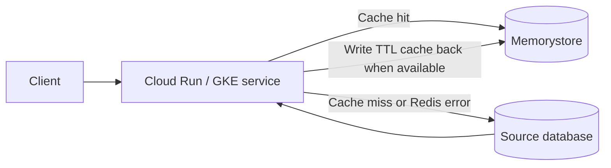
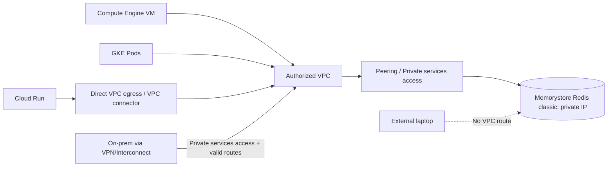
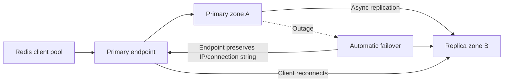

# Networking, Authentication, and Availability for Memorystore

> **Chapter:** Bigtable and Memorystore  
> **Module:** CLOUD_PROVIDERS_GCP  
> **Module scope:** Explore Google Cloud from project organization, IAM, and VPCs to Compute Engine, GKE, Cloud Run, storage services, and databases. Through deployment scenarios, learners learn how to choose services, secure resources, automate releases, and monitor reliability alongside cost.

A Cloud Run application uses Redis to hold a product cache or rate-limit counters. The application can encounter three very different failures: **no network path to Redis**, **a network path exists but fails authentication**, or **Redis is failing over and connections drop**. Correct configuration combines **VPC + data-access auth + TLS + HA + retry/fallback** rather than simply sizing up instances.

This lesson uses **Memorystore for Redis (Basic/Standard Tier, not Redis Cluster)** as the primary hands-on example, while noting critical differences with **Memorystore for Redis Cluster**, **Memorystore for Valkey**, and **Memorystore for Memcached**. Each product line uses **different networking and authentication mechanisms**. The lab prioritizes inspecting an **existing sandbox instance**—it does not instruct creating production Redis instances or triggering real failovers.

## Learning Objectives

After this lesson, you will be able to:

1. Trace the path **Cloud Run/GKE/VM → VPC → Memorystore** and select **Direct VPC egress**, Serverless VPC Access, or standard VPC networking accordingly.
2. Distinguish **`DIRECT_PEERING`**, **`PRIVATE_SERVICE_ACCESS`** (Redis classic), and **Private Service Connect** (Redis Cluster/Valkey).
3. Separate **Google Cloud IAM control plane**, **Redis AUTH**, **IAM database authentication** on supported products, and **TLS in transit**.
4. Choose **Basic vs. Standard**, and understand primary/replica roles, failover, read endpoints, dropped connections, and **asynchronous replication**.
5. Design client connection pools, timeouts, exponential backoff, cache fallbacks, and Cloud Monitoring observability.
6. Verify connectivity using `gcloud`, `redis-cli`, or Python with **read-only commands** against a sandbox instance.

## 1. Memorystore Is a Family of Products, Not a Single Redis Type

| Product | Common networking | Data-plane authentication | Availability |
|---|---|---|---|
| **Memorystore for Redis** (Basic/Standard) | Private IP via VPC peering: `DIRECT_PEERING` or `PRIVATE_SERVICE_ACCESS` | Optional Redis **AUTH string**; **IAM only manages the instance**, does not replace AUTH | Basic single node; Standard replica + automatic failover |
| **Memorystore for Redis Cluster** | Private Service Connect (PSC), service connection policy, or user-registered connections | **IAM authentication** or **basic token-based authentication** when configured | Shards, replicas, automatic failover when sufficient replicas are configured |
| **Memorystore for Valkey** | PSC and compatible VPC configuration | **IAM authentication** or product-supported auth mechanisms, combined with TLS | Cluster Mode Enabled/Disabled; HA with sufficient replicas per zone policy |
| **Memorystore for Memcached** | Private VPC | **No instance-level authentication** | Multi-node cache; app must tolerate losing cache/nodes |

**Terminology warning:** `gcloud redis instances ...` commands target Redis **classic**; `gcloud redis clusters ...` target **Redis Cluster**. Never infer one group's configuration from another group's output. For Memorystore for Valkey, use the `gcloud memorystore instances ...` command family matching your CLI version.

### 1.1. Memorystore's Role in the System



Memorystore typically fits as a **cache, session store, or high-speed data structure store**, yet **a cache is not automatically a durable system of record**. If Redis fails, you may need to fetch from Cloud SQL/Firestore/Spanner or gracefully degrade per business rules. Operations like payments, fund transfers, or ticketing require an **authoritative datastore** and dedicated transactional mechanisms.

## 2. VPC Networking for Memorystore for Redis Classic

Memorystore for Redis classic assigns a **private IP address** to the instance and connects to the customer VPC via peering. **There is no public Redis endpoint** for connecting directly from a laptop over the Internet.



### 2.1. Two Connection Modes for Redis Classic

| Criterion | `DIRECT_PEERING` | `PRIVATE_SERVICE_ACCESS` |
|---|---|---|
| Setup | Memorystore creates VPC peering automatically at instance creation | Admin prepares **private services access** and an IP range beforehand |
| Shared VPC | Unsuitable for instances placed in a **service project** using a host VPC | **Required** in that scenario |
| On-prem connectivity via VPN/Interconnect | Not a supported choice for this goal | **Suitable**, with properly configured route exchange/firewalls |
| Centralized IP range management | Limited | Better when multiple Google-managed services share allocated ranges |
| Changing mode on an existing instance | **Cannot switch in place** | Switching modes requires **creating a new instance**; the IP may change |

**New design recommendation:** **`PRIVATE_SERVICE_ACCESS`** is generally preferred per current docs, especially with Shared VPC, on-prem connectivity, or centralized IP management. Private services access requires a network admin to allocate a valid IP range and configure the `servicenetworking.googleapis.com` connection without overlapping VPC/on-prem ranges.

**VPC peering is non-transitive:** a client in VPC A cannot automatically reach Redis in VPC B just because both A and B peer with a third network. You need a supported VPC/PSC/peering architecture, routing, and IAM—do not add ad hoc routes expecting connectivity to work.

### 2.2. Checklist When Connectivity Fails

1. **Project/region:** instance is in the expected project and region, in `READY` state.
2. **Authorized network:** client's network matches the VPC authorized on the instance.
3. **Private routing:** Cloud Run has Direct VPC egress or Serverless VPC Access; VMs/GKE have routes into the VPC.
4. **IP allocation/peering:** PSA/peering exists and has not been deleted.
5. **Firewall/egress/DNS:** traffic reaches the exact private IP and **instance port**, unblocked by policy.
6. **Redis AUTH/TLS:** check only after confirming TCP reachability works.

**Cloud Shell is not inside your private VPC by default.** Running `redis-cli` from Cloud Shell or a personal machine usually times out despite Console IAM permissions. Use a **sandbox VM inside the authorized VPC**, a dev environment over approved VPN/Interconnect, or a Cloud Run app configured with VPC egress.

## 3. Cloud Run, GKE, VMs, and External Connectivity

| Caller | Path to Redis classic | Key considerations |
|---|---|---|
| **Compute Engine VM** | VM NIC in the authorized VPC, valid routes/egress | Same network does not mean Redis AUTH/TLS are configured |
| **GKE** | VPC-native/IP aliasing, valid network and egress | Pod IPs, `NetworkPolicy`, DNS/firewalls, node/service routing |
| **Cloud Run services/jobs/functions** | **Direct VPC egress** (usually recommended) or **Serverless VPC Access connector** | Match VPC/subnet/region, egress routing, and IAM |
| **Shared VPC** | Host network + Redis classic private services access | Service project and host VPC have separate configuration permissions |
| **On-premise** | VPN/Interconnect + **`PRIVATE_SERVICE_ACCESS`**, valid route exchange | Never expose Redis to the Internet; watch asymmetric routing and firewalls |

### 3.1. Cloud Run Direct VPC Egress

Direct VPC egress routes outbound Cloud Run traffic into a VPC subnet **without a managed VPC Access connector**. When Redis uses an RFC 1918 private IP, `private-ranges-only` is usually sufficient; if custom routes are used, evaluate `all-traffic` and NAT/egress for external APIs.

```bash
# REFERENCE EXAMPLE; do not run on a production Cloud Run service.
# Network/subnet must be approved by a network admin in a supported location.
# gcloud run services update APP_SERVICE \
#   --project=PROJECT_ID --region=REGION \
#   --network=AUTHORIZED_VPC \
#   --subnet=APP_SUBNET \
#   --vpc-egress=private-ranges-only
```

Do not treat this as a standalone Redis connection command: the Cloud Run service still needs the **Redis host/port + TLS/AUTH**, sufficient subnet IPs, and routing to peering/PSA. Direct VPC egress handles only the **network path**, not Redis read/write authorization.

### 3.2. Serverless VPC Access Connector

If Direct VPC egress does not fit the workload, Cloud Run can use a **Serverless VPC Access connector**. Connectors are separate resources with quotas, capacity, and costs, and must match the project, VPC, and region. Configure `--vpc-connector` and `--vpc-egress` per Cloud Run docs; avoid creating new connectors when the project already provides a shared one.

**Never use the Cloud SQL Auth Proxy for Redis.** Cloud SQL is a different database service, and its proxy does not speak the Redis protocol.

## 4. Redis Classic: IAM, AUTH, and TLS Are Three Separate Layers

```text
Google Cloud IAM
  └─ Who can view/create/modify the instance or retrieve the AUTH string?
                        │
                        ▼
Networking: authorized VPC + private IP/port
                        │
                        ▼
TLS in transit (if enabled on the instance)
  └─ Encrypts traffic + verifies Redis server CA
                        │
                        ▼
Redis AUTH (if enabled on the instance)
  └─ Client sends AUTH string over the established channel?
                        │
                        ▼
Redis commands: GET/SET/INCR/... per engine capabilities
```

**Redis classic administrative IAM is not a Redis username/password.** A principal with `roles/redis.viewer` still cannot run `GET` over the network without a VPC path and AUTH; conversely, a process with VPC access and the valid AUTH string can run Redis commands **without holding any IAM role on the instance**. Protect both the network path and the secret because Redis classic **does not offer per-connection IAM login like Redis Cluster/Valkey**.

### 4.1. Redis AUTH on Classic Instances

- `AUTH` is optional; when enabled, each instance has a unique **36-character AUTH string**.
- Clients must send `AUTH` before issuing commands; the string acts as a **shared secret**, not per-end-user permissions.
- Viewing the AUTH string requires `redis.instances.getAuthString`; the command reveals a secret, so **never run it in CI logs, tickets, or shared terminals**.
- When rotating AUTH, **existing open connections may behave differently depending on Redis version**. Plan Secret Manager/app updates, reconnects, and rollback before rotating secrets.

```bash
# Syntax reference; THIS COMMAND RETURNS A SECRET—DO NOT RUN IN A READ-ONLY LAB:
# gcloud redis instances get-auth-string REDIS_INSTANCE \
#   --project=PROJECT_ID --region=REGION
```

Store the AUTH string in **Secret Manager** via administrative workflows. In production apps, use policy-compliant secret injection/credential providers—never commit passwords to Git, Dockerfiles, Redis URLs, logs, or shared `.env` files.

### 4.2. In-Transit Encryption for Classic

Redis classic TLS uses **TLS 1.2 or higher** with CA certificates issued by the instance. **Enable TLS at instance creation** via `--transit-encryption-mode=SERVER_AUTHENTICATION`; **you cannot enable TLS in place on an existing classic instance created without TLS** via a standard update. Once TLS is enabled, Redis accepts **TLS clients only**; plaintext clients are rejected.

| Mode | How to connect |
|---|---|
| No TLS | TCP to the **instance-reported port**, typically `6379`; a private VPC path **does not** mean client traffic is TLS-encrypted |
| With TLS | TCP to the **instance-reported TLS port**, typically `6378`, using the instance CA |
| With AUTH + TLS | Use both TLS **and** the AUTH secret; TLS also protects the AUTH handshake |

**Never use `--insecure`, `ssl_cert_reqs=None`, or `verify=False` as a production fix.** If a client reports an untrusted certificate, supply the **exact instance CA** and implement CA rotation instead of disabling certificate verification.

**CA rotation:** Redis classic docs note CAs rotate over their lifecycle; applications must load the provided valid CAs and handle reconnect/backoff when server certificates rotate. TLS adds CPU/memory overhead and can lower client connection limits depending on tier, version, and capacity.

### 4.3. Do Redis ACLs Replace the Classic AUTH String?

Do not assume Redis ACLs/per-user identities exist on Redis classic just because open-source Redis 6 has `ACL` commands. Memorystore **restricts features by version and product line**. If you need per-workload identities, short-lived tokens, or IAM-based DB access policies, evaluate **Redis Cluster/Valkey IAM authentication** or an auth-enforcing proxy rather than assuming Redis classic supports it.

## 5. Redis Cluster and Valkey: Different Networking and Auth from Redis Classic

### 5.1. Private Service Connect on Redis Cluster

Redis Cluster uses **Private Service Connect service connectivity automation** via a **service connection policy** (service class `gcp-memorystore-redis`) or **user-registered PSC connections**. Many setups provision two endpoints per VPC:

1. **Discovery endpoint**: used by clients to discover cluster topology and connect.
2. **Dedicated internal endpoint**: used by cluster infrastructure, **not** where clients point `redis-cli`.

A single cluster can serve multiple VPCs under supported conditions/networking modes. Redis clients must support **cluster topology and redirects** (`MOVED`/`ASK`) rather than treating Redis as a single standalone host. Reaching shards/replicas requires network reachability to node/endpoint paths, not just the initial discovery endpoint.

### 5.2. IAM Authentication on Redis Cluster and Valkey

When IAM auth is enabled on the product/instance:

- **Redis Cluster:** grant `roles/redis.dbConnectionUser` or permission `redis.clusters.connect` to the target principal.
- **Memorystore for Valkey:** grant `roles/memorystore.dbConnectionUser` per Valkey's IAM model.
- Clients send an IAM **access token** via Redis/Valkey `AUTH` and must **refresh credentials** for new connections; default tokens typically live roughly **one hour**.
- **IAM auth does not automatically enable TLS.** Enable in-transit encryption separately so tokens never travel in plaintext.

**Compatibility:** Redis Cluster also offers **basic token-based authentication**. Instance creation flags, IAM roles, discovery endpoints/ports, and TLS CAs must match **documentation for the exact product line**; never use classic's `gcloud redis instances get-auth-string` to fetch credentials for Cluster/Valkey.

### 5.3. Memcached: Security Relies on VPC Controls

Memorystore for Memcached **has no instance-level AUTH**. Consequently, network exposure, VPC segmentation, and access to client environments are critical boundaries; never place a Memcached endpoint on an untrusted network. Memcached is a volatile cache—never use it as a durable database.

## 6. Redis Classic Availability: Basic and Standard

| Criterion | **Basic Tier** | **Standard Tier** |
|---|---|---|
| Nodes | Single primary | Primary + replica; optional read replicas depending on config |
| Cross-zone protection | No | Replication and automatic failover when eligible |
| Automatic failover | No | Yes |
| Use cases | Caches tolerating cold starts/rebuilds | Caches/sessions with higher SLOs needing intra-region HA |
| Data loss | Entire cache can be lost on node failure/restart | **Can lose acknowledged writes** due to asynchronous replication |
| Read replicas | No | Available when enabled; exposes a **read endpoint** with **replication lag** |

**Basic cannot be upgraded to Standard in place**: you must create a new Standard instance and migrate/cut over per plan. Choose Standard upfront if the app requires HA; yet **Standard is not equivalent to backups, multi-region DR, or durable transactions**.

### 6.1. How Does Standard Tier Failover Work?



Per Google Cloud documentation, failover typically **drops existing connections to the primary endpoint**; clients reconnect to the exact same address/connection string once the system promotes the new primary. Reference disruption times can be on the order of **tens of seconds**, varying by failure mode and maintenance—**not a per-request SLA**. A read replica promoted to primary also drops its existing read connections during role transition.

**Asynchronous replication** means writes acknowledged by the primary before replicating can **be lost during failover**. Therefore, never use Redis as the sole system of record for payments, inventory, or financial settlement without external durability and reconciliation.

### 6.2. Persistence, Backups, and Recoverability

- **RDB snapshots/persistence** may be available depending on tier, mode, and creation settings; verify the actual `persistenceConfig` rather than assuming every instance takes snapshots.
- **Standard + snapshots** reduces certain risks but does not turn Redis into an ACID database or authoritative store.
- Caches may require **warm-up** after failover/restart; prevent all clients from slamming the source DB at once and causing a **cache stampede**.
- Cross-region DR requires designing **the source of truth, cache rebuilds, application failover, and DNS/config routing**; cross-zone HA is not cross-region replication.

### 6.3. Resilient Client Connections After Failover

Clients should implement:

1. **Bounded connection pooling** with sensible timeouts and keepalives—never open a new TCP connection per request.
2. **Exponential backoff + jitter** and bounded retry attempts for transient network errors, resets, and timeouts.
3. **Circuit breakers** during prolonged Redis outages to protect both Redis and the source database.
4. **Bounded fallbacks** (read source DB on cache miss/error) plus **TTL jitter + request coalescing** to prevent stampedes.
5. Distinguish **idempotent** commands (`GET`, contextual `SET key value`) from non-idempotent side effects (`INCR`, `LPUSH`). **Never retry blindly** after losing the response to a mutating command that may have executed.

## 7. Lab A — Inspecting a Sandbox Redis Instance (Read-Only)

> **Prerequisites:** an existing Memorystore for Redis classic instance provisioned in a **sandbox project**, in `READY` state, plus a VM/GKE/Cloud Run environment with network reachability approved by a network admin. If unavailable, complete only the design/metrics sections. **Never create a new instance solely for this exercise** because Redis bills upon provisioning.

### 7.1. Variables and Metadata Checks

In Cloud Shell/Bash:

```bash
PROJECT_ID="my-memorystore-sandbox"
REGION="asia-southeast1"        # Match your actual instance region
REDIS_INSTANCE="redis-cache-lab" # Existing dedicated lab instance

gcloud auth list --filter="status:ACTIVE"
gcloud projects describe "$PROJECT_ID" \
  --format="table(projectId,name,lifecycleState)"
gcloud redis instances list \
  --project="$PROJECT_ID" --region="$REGION"

gcloud redis instances describe "$REDIS_INSTANCE" \
  --project="$PROJECT_ID" --region="$REGION" \
  --format="yaml(name,state,region,tier,memorySizeGb,host,port,readEndpoint,readEndpointPort,connectMode,authorizedNetwork,authEnabled,transitEncryptionMode,readReplicasMode,replicaCount,persistenceConfig)"
```

**Verify:** the instance belongs to the expected project/network, `state: READY`, `tier`, `connectMode`, `authEnabled`, `transitEncryptionMode`, and actual port. **Do not attempt `redis-cli` from Cloud Shell** without a valid private network path.

### 7.2. Safely Retrieving Host and Port

```bash
REDIS_HOST="$(gcloud redis instances describe "$REDIS_INSTANCE" \
  --project="$PROJECT_ID" --region="$REGION" \
  --format='value(host)')"
REDIS_PORT="$(gcloud redis instances describe "$REDIS_INSTANCE" \
  --project="$PROJECT_ID" --region="$REGION" \
  --format='value(port)')"
printf 'Host=%s Port=%s\n' "$REDIS_HOST" "$REDIS_PORT"
```

**The host is a private IP**, not a public service URL; read the port from instance metadata instead of hardcoding `6379`. Do not confuse `readEndpoint` with the primary endpoint if issuing writes. The metadata commands above query zero Redis keys.

### 7.3. Checking Network Reachability from a Sandbox VM in the Authorized VPC

If an approved **Compute Engine sandbox VM** exists inside the authorized VPC, run the following **on that VM** (substituting the recorded `REDIS_HOST`/`REDIS_PORT`), not inside the course repo:

```bash
# Read-only TCP reachability test; sends no Redis password.
timeout 5 bash -c "cat < /dev/null > /dev/tcp/$REDIS_HOST/$REDIS_PORT" \
  && echo "TCP reachable" \
  || echo "TCP unreachable / timeout"
```

**TCP reachable** proves only that routing and the target port accept connections—it does **not** prove Redis AUTH or TLS succeeds. TCP timeouts usually point to VPC/peering/firewall/port/egress issues, whereas **`NOAUTH`** upon running a Redis command indicates an authentication issue.

### 7.4. Testing `PING`/`INFO` with the Matching Security Mode

**Only when `redis-cli` is available on a read-authorized sandbox VM**, choose **one** branch below.

**Branch 1 — Instance without AUTH and TLS (isolated lab, restricted network):**

```bash
# Unsuitable for sensitive data.
redis-cli -h "$REDIS_HOST" -p "$REDIS_PORT" PING
redis-cli -h "$REDIS_HOST" -p "$REDIS_PORT" INFO replication
```

**Branch 2 — Instance with AUTH + TLS:**

```bash
# REDIS_CA_FILE is the PEM CA provided by the owner from the Memorystore instance.
# redis-cli --askpass prompts interactively to avoid exposing secrets on the CLI.
# Never use --insecure or --no-auth-warning as a security bypass.
REDIS_CA_FILE="/path/to/approved/server_ca.pem"
redis-cli --tls --cacert "$REDIS_CA_FILE" \
  --askpass -h "$REDIS_HOST" -p "$REDIS_PORT" PING

redis-cli --tls --cacert "$REDIS_CA_FILE" \
  --askpass -h "$REDIS_HOST" -p "$REDIS_PORT" INFO replication
```

**CA:** when TLS is enabled, download the **exact server CA certificate(s)** from Memorystore Instance details or the `serverCaCerts` field of `gcloud redis instances describe`. Store it only on **authorized client machines** with strict file permissions. If the instance enables TLS **without AUTH**, omit `--askpass`; if it enables AUTH **without TLS**, pass `--askpass` while recognizing secrets are not TLS-protected in transit. Never paste AUTH strings into chat, logs, or source code.

**Expected result:** `PING → PONG`. On Standard tier, `INFO replication` reports primary/replica role and replication status per engine/config. If you lack network access or credentials, skip the runtime test and complete the diagnostic table in Section 12.

## 8. Lab B — Python Client Example with Pool and Fallback

This is **sample code for a sandbox VM/Cloud Run service with a VPC path**; this step **does not alter Redis instance configuration**. Real apps must retrieve AUTH from Secret Manager/approved secret injection rather than storing strings in files.

### 8.1. Preparation

```bash
# Inside your own Python virtualenv:
python -m pip install "redis>=5,<7"

# Environment settings supplied securely by the operator:
# REDIS_HOST, REDIS_PORT, REDIS_USE_TLS, REDIS_CA_FILE
# REDIS_AUTH fetched from Secret Manager/injection, NEVER committed to Git.
```

### 8.2. `cache_client.py` — Read-Only `PING` and Sample `GET`

```python
import logging
import os
import random
import time

import redis

LOG = logging.getLogger(__name__)
logging.basicConfig(level=logging.INFO)

host = os.environ["REDIS_HOST"]
port = int(os.environ["REDIS_PORT"])
use_tls = os.environ.get("REDIS_USE_TLS", "false").lower() == "true"
password = os.environ.get("REDIS_AUTH") or None

if use_tls:
    ca_path = os.environ["REDIS_CA_FILE"]
else:
    ca_path = None

pool_options = {
    "host": host,
    "port": port,
    "password": password,
    "socket_connect_timeout": 2,
    "socket_timeout": 2,
    "health_check_interval": 30,
    "max_connections": 8,
    "decode_responses": True,
}
if use_tls:
    pool_options.update({
        "connection_class": redis.SSLConnection,
        "ssl_ca_certs": ca_path,
        "ssl_cert_reqs": "required",
    })

pool = redis.ConnectionPool(**pool_options)
client = redis.Redis(connection_pool=pool)


def get_cache_or_none(key: str):
    """Bound retries on idempotent GET; return None so the app can fall back."""
    for attempt in range(3):
        try:
            client.ping()
            return client.get(key)
        except (redis.exceptions.ConnectionError,
                redis.exceptions.TimeoutError) as exc:
            LOG.warning("Redis unavailable: attempt=%s type=%s",
                        attempt + 1, type(exc).__name__)
            if attempt < 2:
                time.sleep(min(2.0, 0.2 * (2 ** attempt))
                           + random.uniform(0, 0.1))
    return None


try:
    result = get_cache_or_none("lab:nonexistent:key")
    print("Cache value:", "<miss-or-unavailable>" if result is None else result)
finally:
    client.close()
    pool.disconnect()
```

**Purpose:** demonstrates network retries with a **pool capped at 8 connections**, creating/writing no Redis keys and logging no AUTH secrets. In production:

- **Distinguish cache misses from Redis outages:** this sample collapses both into `None`; real apps should emit separate metrics (hit/miss/error) and fall back to the DB/source.
- **TLS uses `redis.SSLConnection`** when constructing a `ConnectionPool` directly; avoid passing arbitrary `ssl` kwargs to non-SSL connection classes. Verify the instance TLS CA/certificate.
- **Never retry `INCR` or non-idempotent writes** when a response is lost and it is unclear whether the server applied the command.
- On Cloud Run, keep the client/pool at **application scope**, not recreated per HTTP request.

## 9. Availability and Client Behavior: Realistic Scenarios

### 9.1. When Redis Fails Over During Cache Reads

```text
T = 0s    App cache GETs return 200 quickly.
T = 10s   Primary node fails; Redis resets connections.
T = 11s   Client GET hits ConnectionError; app does not immediately 500 every user.
T = 12s   Backoff + jitter, open new connection; if still down, fall back to DB.
T = ~30s  Redis Standard typically has a new primary ready (illustrative timing).
T > 30s   Client warms cache gradually without flooding the DB.
```

This is an **illustrative timeline**, not a guaranteed SLA. Cache misses and failovers can surge load onto the source database; apply **request coalescing, TTL jitter, circuit breakers, and fallback rate limits**.

### 9.2. What About Session Data?

If user sessions live solely in Redis Standard, an acknowledged write can still be lost on failover, logging users out. If business rules forbid losing sessions, persist state externally or design around graceful re-authentication. **Never treat "Standard has a replica" as an RPO=0 guarantee.**

### 9.3. Read Replicas Can Return Stale Data

Standard Tier provides a **read endpoint** when read replicas are enabled. Because replication is asynchronous, **read-your-writes consistency** is not guaranteed if you read from a replica immediately after writing to the primary. For consistency-sensitive flows, read from the primary or explicitly tolerate eventual consistency; never send writes to the read endpoint.

## 10. Monitoring: Detecting Overload, Disconnects, and Failovers

In **Google Cloud Console → Memorystore for Redis → instance → Monitoring**, track at least:

| Metric / group | Signal |
|---|---|
| `redis.googleapis.com/clients/connected` | Current active connections; approaching `maxclients` causes rejected connections |
| `redis.googleapis.com/stats/reject_connections_count` | Connections rejected due to `maxclients` or memory limits |
| `redis.googleapis.com/stats/cpu_utilization_main_thread` | Rising main-thread CPU that can drive latency spikes |
| `redis.googleapis.com/stats/memory/usage_ratio` | Memory pressure and eviction risk |
| `redis.googleapis.com/stats/evicted_keys` | Cache entries evicted due to memory ceiling |
| `redis.googleapis.com/stats/keyspace_misses` | Rising cache misses; compare against cache hit ratio |
| Instance uptime / failover events | Disruptions due to maintenance or failovers |
| Network bytes in/out, server latency | Network load and Redis-side latency |

Simultaneously measure **client-side** telemetry: connect timeouts, TLS handshake failures, AUTH failures, `GET` p50/p95/p99, retry attempts, circuit-breaker state, pool exhaustion, and fallback DB requests. **Redis Cloud Monitoring does not replace application logs** and cannot fully explain Cloud Run VPC egress failures.

### 10.1. Baseline Alerts

1. **Connected clients** approaching limits while rejected connections rise.
2. **Memory usage** chronically high with rapidly climbing evicted keys.
3. **Cache misses** spiking simultaneously with source database CPU.
4. **Connection errors** rising, uptime resets, or Redis failover events.
5. **P95 cache latency** breaching SLO with prolonged backoff/reconnects.

Set thresholds from your instance's actual baseline and capacity rather than one universal number across tiers. Watch cost alerts too: Memorystore bills for **provisioned capacity and tier** even with zero traffic; VPC egress/connectors, logs, and client infrastructure also contribute to total cost.

## 11. Security Checklist: Who Can Access Redis?

| Layer | Security criterion |
|---|---|
| **Network** | Private IP, authorized VPC, product-matched PSA/PSC, minimal firewalls/routes |
| **Control plane IAM** | Only required operators can create/update/retrieve AUTH strings |
| **Data plane auth** | Redis classic AUTH secret; Redis Cluster/Valkey IAM/tokens per product support |
| **TLS** | TLS enabled whenever supported, valid CA/cert chain, never disable verification |
| **Secrets** | Secret Manager, rotation runbooks, never exposed in CLI args or logs |
| **Runtime identity** | Cloud Run/GKE/VMs use scoped SA/Workload Identity to read secrets or IAM tokens |
| **High availability** | Standard/replicas matched to SLA/RPO, verified persistence and failover behavior |
| **Application** | Connection pooling, timeouts, jittered retries, circuit breakers, fallbacks |
| **Cache lifecycle** | TTLs, eviction policies, memory bounds, stampede mitigation |
| **Observability** | Redis + app metrics, alerts, change auditing, incident runbooks |

**Special note for Redis classic:** anyone who can reach the private IP and knows the AUTH string can execute most Redis commands. Never treat a large multi-tenant VPC as a sufficient security boundary; separate instances or enforce network/application-layer segmentation when workload isolation is required.

## 12. Layer-by-Layer Troubleshooting

| Symptom | Category | First check |
|---|---|---|
| `gcloud redis instances describe` returns 403 | **Control-plane IAM** | Project/role `redis.instances.get`; do not assume Redis networking is broken |
| TCP timeout to private IP | **Network** | VPC/subnet/PSA/peering, firewalls, region, port, Cloud Run egress |
| Cloud Shell times out while VPC VM connects | **Network path** | Cloud Shell is outside the authorized VPC |
| Shared VPC service project fails creating Redis | **Connect mode** | Use `PRIVATE_SERVICE_ACCESS`, allocated IP range/peering |
| On-prem cannot reach Redis over `DIRECT_PEERING` | **Architecture** | PSA + VPN/Interconnect + custom routes, not just IAM |
| `NOAUTH Authentication required` | **Redis AUTH** | Client failed to send the valid AUTH string |
| `WRONGPASS invalid username-password pair` | **Redis credentials** | Redis classic AUTH secret, or product-specific token/username |
| `wrong version number`/TLS handshake failure | **TLS mismatch** | Redis instance TLS mode, TLS port, CA chain, TLS-capable client |
| CA verification failed | **Certificate trust** | Supply the exact instance CA and rotate properly; never disable SSL verification |
| IAM user has Viewer but `GET` fails | **Data-plane auth** | Control-plane IAM is not classic Redis AUTH |
| Cloud Run gets 403 fetching secret | **Secret Manager IAM** | Runtime SA needs `secretmanager.versions.access` on that secret |
| Cluster client knows one node and errors `MOVED` | **Cluster discovery** | Cluster-aware client, discovery endpoint, and PSC paths |
| Connections reset after maintenance/failover | **HA lifecycle** | Retries/backoff, reconnects, timeouts, Redis uptime |
| Recently `SET` key disappears after failover | **Async replication/durability** | Replication lag, RDB persistence, durable source of truth |
| Reading a read replica returns stale value | **Read lag** | Read from primary when read-after-write is required |
| `maxclients` or TLS connection limit | **Connection saturation** | Pool size × instances, Monitoring, reduce connection churn |
| High misses after restart | **Cold cache** | Warm-up, fallback rate limits, TTL jitter, source DB load |

### 12.1. Six-Step Runbook

```text
1. Confirm exact product: Redis classic / Redis Cluster / Valkey / Memcached
2. Verify instance READY, right project/region, and endpoint/port
3. Verify VPC/PSA/PSC, Cloud Run egress, and TCP reachability
4. Verify AUTH/IAM token and TLS CA (never log secrets)
5. On resets/timeouts: inspect failover, replicas, memory, and pools
6. Restore traffic in a controlled manner; watch cache misses, DB fallback, and cost
```

**Never remediate by** granting Project Owner, disabling TLS verification, opening public ingress, stopping a production Redis instance, or forcing a manual failover before identifying root cause.

## 13. Exercises with Answers

### Exercise 1 — Three Layers of Connection Errors

Cloud Run cannot reach Redis classic; `gcloud redis instances describe` succeeds, yet TCP times out. Should you grant `roles/redis.admin` to the runtime SA?

**Answer:** no. A successful `describe` only checks control-plane IAM; TCP timeouts point to VPC/egress/peering/port/firewall issues. Configure Direct VPC egress or a VPC connector on the right authorized network.

### Exercise 2 — Shared VPC and On-Prem

A team runs Redis classic inside a Shared VPC service project with on-prem clients arriving via Cloud VPN. Choose `DIRECT_PEERING` or `PRIVATE_SERVICE_ACCESS`?

**Answer:** `PRIVATE_SERVICE_ACCESS` with proper IP allocation/peering, route exchange, and firewalls. `DIRECT_PEERING` does not fit either requirement.

### Exercise 3 — IAM vs. Redis AUTH

An operator holds `roles/redis.viewer` and has access to a VM inside the VPC. Running `GET` returns `NOAUTH`. Why?

**Answer:** the classic instance has Redis AUTH enabled; IAM Viewer is not a data-plane password. You need the valid AUTH string provided by the owner via secret management, plus TLS if enabled.

### Exercise 4 — TLS Cannot Be Added in Place

A Redis classic instance currently runs plaintext without TLS. The team wants to switch immediately to TLS via an update flag with no migration. What is wrong?

**Answer:** Redis classic only enables TLS **at instance creation**; there is no in-place update flag to turn on TLS later. You must create a replacement instance with TLS enabled and plan data/endpoint/consumer cutover and cost.

### Exercise 5 — Failover Incident

Redis Standard just failed over. `ConnectionError` occurred for 20 seconds, then clients reconnected to the same IP and resumed; a key written moments before the outage is missing. Can this happen normally?

**Answer:** yes. Standard uses async replication, resets connections on failover, preserves the IP/connection string, and can lose acknowledged writes not yet replicated. Applications need retry/backoff, cache fallback, and a durable source of truth.

### Exercise 6 — Cache or System of Record?

A system uses Redis Standard as the **sole** place storing e-wallet balances because "it has a replica." What is the primary risk?

**Answer:** Standard HA does not guarantee RPO=0 or database durability. Use an authoritative transactional database/ledger and reserve Redis for caches, rate limits, or policy-recoverable ephemeral state.

### Exercise 7 — Redis Cluster Returning `MOVED`

A client targets Redis Cluster using a single TCP endpoint without handling `MOVED`. What should be changed?

**Answer:** use a **cluster-aware client**, the discovery endpoint, PSC reachability to nodes/shards, and product-appropriate auth/TLS. Never configure Redis Cluster like a single-endpoint Redis classic instance.

### Exercise 8 — Calculating Total Connections

Cloud Run scales up to **40 instances**, each with a pool of **20 connections**. What is the maximum connection count from this service, and what must you watch?

**Answer:** theoretically up to **800 connections** (excluding jobs/VMs/other clients). Compare against tier/version `maxclients`/TLS limits, keep pools as small as practical, and monitor `clients/connected` and `reject_connections_count`.

## 14. Cleanup and Production Checklist

### 14.1. Closing the Lab Safely

Lab A uses only `gcloud ... list/describe` and Redis **`PING`/`INFO`/`GET`** commands against an existing instance; it creates no instances, VPC connections, or SAs, and modifies no data. **No cloud resource deletion commands are needed.**

1. Close `redis-cli`, the Python client, and the connection pool opened by the lab.
2. If an operator temporarily downloaded the PEM CA onto a lab VM, delete the local file per policy; **never remove CAs from another app's trust store**.
3. Never run `FLUSHALL`, `FLUSHDB`, `CONFIG SET`, `KEYS *`, or `MONITOR` to "clean up" a shared Redis instance.
4. Never delete Redis instances, VPC peering/PSA/PSC, subnets, Cloud Run/GKE resources, or IAM bindings belonging to other workloads.
5. Record latency/connection/eviction metrics before/after testing; track billing since instances continue charging for provisioned capacity even without traffic.

### 14.2. Pre-Production Checklist

| Item | Passing criterion |
|---|---|
| **Right product** | Redis classic/Cluster/Valkey/Memcached with matching CLI and auth model |
| **Network** | Authorized VPC + PSA/peering/PSC mode, IP routes/firewalls/egress |
| **Serverless** | Direct VPC egress or VPC connector with sufficient subnet IPs/quotas/region match |
| **Data-plane security** | Redis AUTH or product-appropriate IAM auth, never confused with IAM Viewer |
| **TLS** | TLS-capable client, right port/CA chain, cert rotation runbook |
| **IAM/secrets** | Least-privilege control plane; `getAuthString`/Secret Manager tightly restricted |
| **HA** | Tier/replicas/zones, read lag, failover retries, never assuming RPO=0 |
| **Client** | Pooling, timeouts, jittered backoff, idempotent retries, circuit breakers |
| **Fallback** | System of record + cache rebuild, stampede mitigation, database protection |
| **Monitoring** | Connections, CPU, memory, evictions, misses, app errors, alerts |
| **Cost** | Capacity tier, storage/persistence, egress/connectors, and budget |
| **DR/cleanup** | Rehearsed runbook; shared resources never deleted |

## Key Takeaways

**Memorystore Redis classic uses private IPs and different network modes from Redis Cluster/Valkey.** IAM manages the instance, Redis AUTH protects Redis commands, and TLS protects data in transit—three separate layers that never substitute for one another. **Standard Tier** provides replication/failover, yet still drops connections, can lose acknowledged writes, and never replaces a durable system of record. Production connectivity requires **matching VPC routing, product-appropriate credentials/TLS, bounded pools/retries, fallbacks, and metrics**.

## Official Reference Documentation

- [Memorystore for Redis — Networking](https://cloud.google.com/memorystore/docs/redis/networking)
- [Memorystore for Redis — Supported environments](https://cloud.google.com/memorystore/docs/redis/supported-environments)
- [Memorystore for Redis — Connect from Cloud Run](https://cloud.google.com/memorystore/docs/redis/connect-redis-instance-cloud-run)
- [Cloud Run — Direct VPC egress and connectors](https://cloud.google.com/run/docs/configuring/connecting-vpc)
- [Memorystore for Redis — About Redis AUTH](https://cloud.google.com/memorystore/docs/redis/about-redis-auth)
- [Memorystore for Redis — Manage AUTH](https://cloud.google.com/memorystore/docs/redis/manage-redis-auth)
- [Memorystore for Redis — About in-transit encryption](https://cloud.google.com/memorystore/docs/redis/about-in-transit-encryption)
- [Memorystore for Redis — Manage in-transit encryption](https://cloud.google.com/memorystore/docs/redis/manage-in-transit-encryption)
- [Memorystore for Redis — Redis tiers](https://cloud.google.com/memorystore/docs/redis/redis-tiers)
- [Memorystore for Redis — High availability](https://cloud.google.com/memorystore/docs/redis/high-availability-for-memorystore-for-redis)
- [Memorystore for Redis — Best practices](https://cloud.google.com/memorystore/docs/redis/general-best-practices)
- [Memorystore for Redis — Supported monitoring metrics](https://cloud.google.com/memorystore/docs/redis/supported-monitoring-metrics)
- [Memorystore for Redis Cluster — Networking](https://cloud.google.com/memorystore/docs/cluster/networking)
- [Memorystore for Redis Cluster — IAM authentication](https://cloud.google.com/memorystore/docs/cluster/about-iam-auth)
- [Memorystore for Valkey — IAM authentication](https://cloud.google.com/memorystore/docs/valkey/about-iam-auth)
- [Memorystore for Valkey — HA and replicas](https://cloud.google.com/memorystore/docs/valkey/ha-and-replicas)
- [Memorystore for Memcached — Overview](https://cloud.google.com/memorystore/docs/memcached/memcached-overview)
