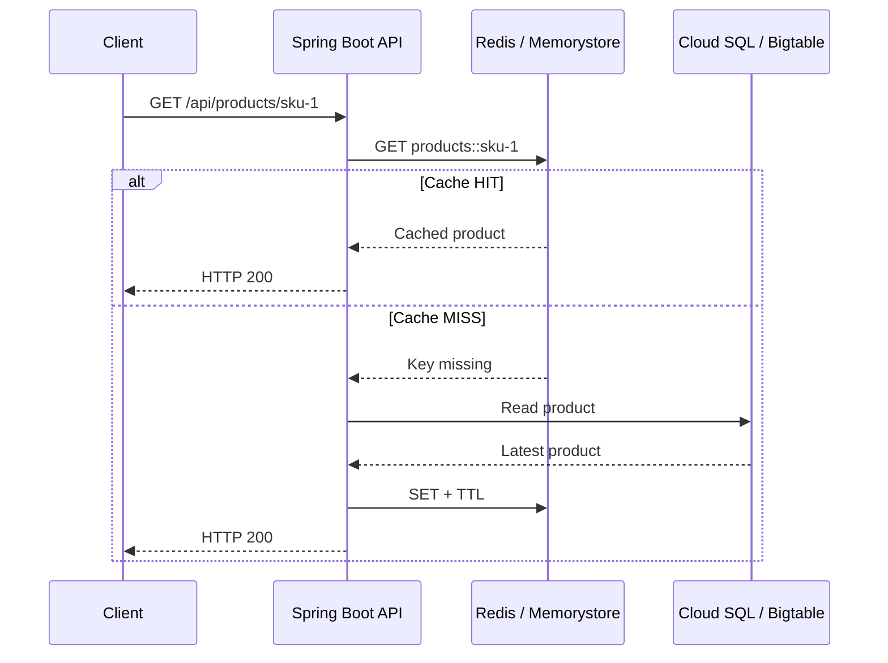
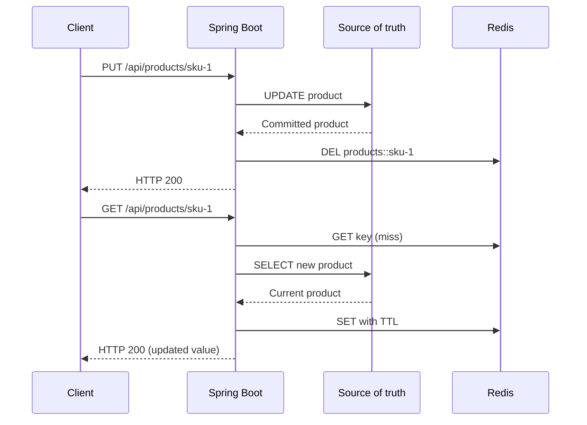
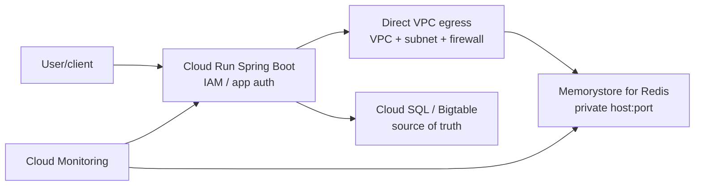

# Hands-On Caching for a Spring Boot API

A product catalog API written in **Spring Boot** reads data from Cloud SQL or Bigtable. When many users view the same product simultaneously, the app repeatedly reads rarely changing information. A **Redis cache** can lower latency and source queries, yet also introduces risks of **stale data, overload when cache entries expire, connection errors, and memory costs** if misused.

This lesson belongs to the **Bigtable and Memorystore** chapter of the `CLOUD_PROVIDERS_GCP` module, within the Google Cloud track covering projects, IAM, VPCs, Compute Engine, GKE, Cloud Run, storage, databases, and reliability/cost operations. The hands-on lab uses **Java 21 + Spring Boot 4.1.2 + Spring Cache + Redis**. First you run Redis **locally on your workstation**; the Google Cloud section covers connecting to an **existing Memorystore for Redis** instance without provisioning a billable instance.

## 1. Learning Objectives

After this lesson, you will be able to:

1. Distinguish the **source of truth** (Cloud SQL/Bigtable), **cache** (Redis/Memorystore), and local in-JVM caches.
2. Explain **cache-aside**, cache **hit/miss**, TTL, eviction, key prefixes, and invalidation.
3. Build a Spring Boot API using `@Cacheable`/`@CacheEvict` to reduce datastore reads.
4. Measure cache hits via the API and `redis-cli`; test TTL expiration and data updates.
5. Connect a service running on Cloud Run/GKE to Memorystore over VPC, accounting for AUTH and TLS.
6. Handle common issues: unreachable Redis, serialization, stale data, cache stampedes, and memory pressure.
7. Choose Redis Basic/Standard, monitor performance, and estimate costs by load.
8. Distinguish the limits of **Spring Cache** from business consistency/transaction requirements.
9. Complete exercises on TTL, hit ratio, cache keys, HA, IAM, and cache-failure recovery.

**Lab rules:** create example files only in a **separate demo directory on your own workstation**. Only Markdown documentation belongs in the repository. Never use a production database, Redis instance, or service to test `FLUSHALL`, load tests, or mutating API calls.

## 2. Cache-Aside Architecture for a Read API



**Cache-aside** means the application checks the cache first; only on a miss does it read the source and store the result. Redis is **not** the primary database holding canonical records in this design: you can wipe the entire cache and reload it from the source.

| Scenario | Returned data | What to observe |
| --- | --- | --- |
| **Cold miss** | Reads source, populates cache | First call incurs source latency |
| **Warm hit** | Served from Redis | Faster when the cache sits close to the app |
| **TTL expired** | Miss, re-reads source | Many keys expiring together can cause spikes |
| **Source write** | Updates source first, then invalidates cache | Must guard against stale data/races |
| **Evicted key** | Miss even before TTL | Memory pressure/eviction policy |
| **Redis outage** | May return errors unless fallback is configured | Needs a dedicated resilience strategy |

**Success metrics** go beyond seeing HTTP 200. Look for **lower source query rates, improved p95/p99, a healthy hit ratio, accurate post-update data, and cache cost smaller than the savings**.

## 3. What Roles Do Memorystore, Redis, and Bigtable Play?

| Component | Data / characteristics | Role in this example |
| --- | --- | --- |
| **Cloud SQL** | Relational, transactions, JOINs, business constraints | Product/pricing source of truth when ACID is needed |
| **Bigtable** | Very large-scale wide-column/key-value, fast row-key reads | Source of truth for key-based, time-series, high-throughput workloads |
| **Memorystore for Redis** | In-memory key-value, ultra-fast, TTL and eviction | **Reconstructible cache layer**, not the source of truth |
| **Caffeine/in-process map** | Single-JVM memory | Ultra-fast L1 cache, **not shared across instances** |

**Do not treat Bigtable as "Redis persistence" by default.** For large datasets with fast row-key lookups, Bigtable can often serve directly without adding a cache; measure latency and cost first. When Bigtable is the source, cache keys and invalidation should reflect **row keys, row versions, and tenant scope**.

### 3.1. Choosing the Right Memorystore Product

Google Cloud offers multiple Memorystore products: **Memorystore for Redis** (Basic/Standard), **Memorystore for Redis Cluster**, and **Memorystore for Valkey**. They differ in sharding, protocol/compatibility, HA, and connectivity. This lesson uses **non-sharded (single-primary) Memorystore for Redis** with Spring Data Redis's default Lettuce client.

- **Basic tier:** single Redis node; fits caches that can lose all entries and warm up again.
- **Standard tier:** primary plus replica with **automatic failover**; still experiences brief connection drops during failover.
- **Read replicas:** optional on Standard to scale read capacity; does not distribute writes.
- **Redis Cluster/Valkey:** switch to a cluster-aware client config only when your project actually uses those products.

**Basic and Standard tiers cannot be switched directly in place** via an upgrade button; changing tiers requires provisioning a new instance and migrating endpoints/caches. For critical APIs, evaluate Standard against SLOs rather than assuming HA means zero misses or zero disconnects.

## 4. Deciding What to Cache and for How Long

An effective cache holds **frequently read, infrequently modified, reconstructible data**, such as product details, catalogs, and non-secret configuration.

| Data type | Example TTL | Why |
| --- | --- | --- |
| Product descriptions | 30 seconds–5 minutes | Slight update delay is acceptable |
| Slowly changing catalogs | A few minutes | Cuts source queries; invalidate on publish |
| Prices/promotions | A few seconds or **do not cache if high risk** | Staleness impacts checkout |
| Balances, checkout inventory | Never use cache as final authority | Must check source/transactions on write |
| 404 responses | Optional very short negative-cache TTL | Avoids repeated misses without hiding newly created items |
| Personal data/tokens | Cache only under dedicated policies | Security, tenant isolation, retention, revocation |

**TTL is not a freshness guarantee:** after a source update, a Redis entry stays valid until TTL unless actively invalidated or updated. For money, authentication, permissions, and stock, the backend must verify the source of truth before committing business decisions.

### 4.1. Key Design and Versioning

Examples:

```text
products::sku-1
products::sku-2
tenant-a:products:v2:sku-1
tenant-b:products:v2:sku-1
```

In this lesson, Spring Cache adds a **cache name prefix** by default, e.g., `products::sku-1`. Production should include **tenant, locale, currency, and schema version** in the cache key whenever those affect output, preventing cross-tenant data leaks.

Never embed passwords, tokens, card numbers, or PII in **key names**, as they can surface in logs, diagnostics, or dumps. For very long keys, measure memory overhead and consider a namespaced deterministic hash.

## 5. Setting Up the Fully Local Lab

Requirements: **JDK 21**, **Maven 3.9+**, Docker, `curl`, and permission to create local directories. Internet access is needed to pull dependencies/container images. You may use Maven Wrapper if provided by your team; no GCP credentials are needed for this part.

Create the project in a lab directory outside the learning-materials repository:

```text
spring-redis-cache-lab/
├── pom.xml
└── src/main/
    ├── java/example/cache/
    │   ├── CacheLabApplication.java
    │   ├── CacheConfiguration.java
    │   ├── Product.java
    │   ├── ProductRepository.java
    │   ├── ProductService.java
    │   └── ProductController.java
    └── resources/
        └── application.yaml
```

To make verification easy, `ProductRepository` uses a **`ConcurrentHashMap` as a mock database plus a source-read counter**. This is strictly an in-memory mock inside **a single JVM**: never use it instead of Cloud SQL/Bigtable in production Cloud Run, since each instance holds its own copy and restarts lose data. In real deployments, replace the repository layer with a **durable, shared** datastore.

## 6. Maven Dependencies for Spring Boot 4.1.2

File `pom.xml`:

```xml
<project xmlns="http://maven.apache.org/POM/4.0.0"
         xmlns:xsi="http://www.w3.org/2001/XMLSchema-instance"
         xsi:schemaLocation="http://maven.apache.org/POM/4.0.0
           https://maven.apache.org/xsd/maven-4.0.0.xsd">
  <modelVersion>4.0.0</modelVersion>
  <groupId>example</groupId>
  <artifactId>spring-redis-cache-lab</artifactId>
  <version>0.0.1-SNAPSHOT</version>
  <parent>
    <groupId>org.springframework.boot</groupId>
    <artifactId>spring-boot-starter-parent</artifactId>
    <version>4.1.2</version>
    <relativePath/>
  </parent>
  <properties>
    <java.version>21</java.version>
  </properties>
  <dependencies>
    <dependency>
      <groupId>org.springframework.boot</groupId>
      <artifactId>spring-boot-starter-webmvc</artifactId>
    </dependency>
    <dependency>
      <groupId>org.springframework.boot</groupId>
      <artifactId>spring-boot-starter-cache</artifactId>
    </dependency>
    <dependency>
      <groupId>org.springframework.boot</groupId>
      <artifactId>spring-boot-starter-data-redis</artifactId>
    </dependency>
  </dependencies>
  <build>
    <plugins>
      <plugin>
        <groupId>org.springframework.boot</groupId>
        <artifactId>spring-boot-maven-plugin</artifactId>
      </plugin>
    </plugins>
  </build>
</project>
```

- `spring-boot-starter-webmvc`: handles HTTP requests.
- `spring-boot-starter-cache`: Spring Cache annotations.
- `spring-boot-starter-data-redis`: **Lettuce** Redis client and Spring Data Redis.
- The Spring Boot BOM manages dependency versions; **do not** manually override an incompatible Lettuce version.

This sample uses Spring Boot **4.1.2 (released 10/2026)** and Java 21. For real projects, stay on supported patch releases and run dependency/security checks per policy rather than leaving sample pins untouched forever.

## 7. `application.yaml`: Connectivity, TTL, and Namespaces

File `src/main/resources/application.yaml`:

```yaml
server:
  port: ${PORT:8080}

spring:
  data:
    redis:
      host: ${REDIS_HOST:127.0.0.1}
      port: ${REDIS_PORT:6379}
      connect-timeout: 1s
      timeout: 1s
  cache:
    type: redis
    cache-names: products
    redis:
      time-to-live: 30s
      cache-null-values: false
      use-key-prefix: true
```

**Explanation:**

- `spring.cache.type: redis`: ensures Redis is the cache provider instead of falling back silently to an in-JVM map.
- `time-to-live: 30s`: per-entry TTL—it does not mean "flush all of Redis every 30 seconds."
- `cache-null-values: false`: avoids caching `null` when a product does not exist.
- `use-key-prefix: true`: prepends the cache name to Redis keys to avoid namespace collisions.
- `REDIS_HOST`/`REDIS_PORT`: local Redis endpoint; when moving to GCP, swap the endpoint and security config.
- Short client timeouts prevent HTTP requests from hanging on Redis issues, though they **do not** configure fallback behavior by themselves.

**Security:** the local sample omits Redis AUTH/TLS. If Memorystore enables AUTH, inject the secret via **`SPRING_DATA_REDIS_PASSWORD`** from Secret Manager; if in-transit encryption is enabled, configure **`SPRING_DATA_REDIS_SSL_ENABLED=true`** with a valid CA/truststore. Never hardcode passwords in YAML, Dockerfiles, or Git, and never disable certificate validation.

## 8. Bootstrapping Spring Boot and `@EnableCaching`

File `src/main/java/example/cache/CacheLabApplication.java`:

```java
package example.cache;

import org.springframework.boot.SpringApplication;
import org.springframework.boot.autoconfigure.SpringBootApplication;

@SpringBootApplication
public class CacheLabApplication {
    public static void main(String[] args) {
        SpringApplication.run(CacheLabApplication.class, args);
    }
}
```

File `src/main/java/example/cache/CacheConfiguration.java`:

```java
package example.cache;

import org.springframework.cache.annotation.EnableCaching;
import org.springframework.context.annotation.Configuration;

@Configuration
@EnableCaching
public class CacheConfiguration {
}
```

`@EnableCaching` activates Spring Cache interceptors. **Adding the dependency alone is not enough**: forgetting this annotation causes `@Cacheable` methods to hit the repository every time. Keeping caching configuration in its own class makes it easy to disable caching in unit tests.

**Proxy mechanism:** Spring applies annotations when methods are invoked **through the Spring bean proxy**. Calling `this.getProduct(id)` from another method in the **same bean** bypasses caching; keep cached methods in a separate service bean as shown.

## 9. `Product` and Simulated Repository

File `src/main/java/example/cache/Product.java`:

```java
package example.cache;

import java.io.Serializable;

public record Product(
        String id,
        String name,
        long priceCents
) implements Serializable {
    private static final long serialVersionUID = 1L;
}
```

File `src/main/java/example/cache/ProductRepository.java`:

```java
package example.cache;

import java.util.concurrent.ConcurrentHashMap;
import java.util.concurrent.ConcurrentMap;
import java.util.concurrent.atomic.AtomicLong;
import org.springframework.stereotype.Repository;

@Repository
public class ProductRepository {
    private final ConcurrentMap<String, Product> data =
            new ConcurrentHashMap<>();
    private final AtomicLong sourceReads = new AtomicLong();

    public ProductRepository() {
        data.put("sku-1", new Product("sku-1", "Keyboard", 9900));
        data.put("sku-2", new Product("sku-2", "Mouse", 4900));
    }

    public Product findById(String id) {
        sourceReads.incrementAndGet();
        try {
            Thread.sleep(200); // Simulate 200 ms database query.
        } catch (InterruptedException e) {
            Thread.currentThread().interrupt();
            throw new IllegalStateException("Interrupted", e);
        }
        return data.get(id);
    }

    public Product update(String id, String name, long priceCents) {
        return data.computeIfPresent(id,
            (key, old) -> new Product(id, name, priceCents));
    }

    public long sourceReads() {
        return sourceReads.get();
    }
}
```

`AtomicLong` counts **how many times this app instance called the source**, not a cluster-wide metric across replicas. `Thread.sleep(200)` only simulates latency: **never put sleep in a real repository** and never draw Bigtable/Cloud SQL performance conclusions from this mock.

**Serialization:** the record implements `Serializable` because Spring's default `RedisCacheManager` can use Java/JDK serialization for values. That is a **lab-only simplification**, not recommended for long-term Redis caches exposed to untrusted bytes. Production should use JSON/Protobuf serializers, type allowlists, versioned schemas, and avoid unsafe binary deserialization.

## 10. Service: `@Cacheable` and `@CacheEvict`

File `src/main/java/example/cache/ProductService.java`:

```java
package example.cache;

import org.springframework.cache.annotation.Cacheable;
import org.springframework.cache.annotation.CacheEvict;
import org.springframework.stereotype.Service;

@Service
public class ProductService {
    private final ProductRepository repository;

    public ProductService(ProductRepository repository) {
        this.repository = repository;
    }

    @Cacheable(
        cacheNames = "products",
        key = "#p0",
        unless = "#result == null"
    )
    public Product getProduct(String id) {
        return repository.findById(id);
    }

    @CacheEvict(cacheNames = "products", key = "#p0")
    public Product updateProduct(String id, String name, long priceCents) {
        return repository.update(id, name, priceCents);
    }

    public long sourceReadCount() {
        return repository.sourceReads();
    }
}
```

- **First read** `getProduct("sku-1")`: Redis miss → runs 200 ms repository call → caches value.
- **Subsequent read** within 30 seconds: Redis hit → **skips** repository.
- **Successful update**: updates source then `@CacheEvict` deletes the matching key; next GET reads fresh data from the source.
- `#p0` references the first parameter without relying on Java compiler parameter-name metadata.
- `unless` prevents caching `null`, avoiding stale 404s if a product is created shortly afterward.

**This is not a distributed transaction.** The source write can succeed while Redis eviction fails (or a concurrent GET writes the old value back to cache). In production, define **acceptable staleness**, and use TTLs, bounded retries, transactional outboxes, versioned keys, or event-driven invalidation as needed.

`@CachePut` can write the updated value into cache on update, but only when the returned payload is **exact and already committed**. When the source is separate from Redis, write-through does not automatically make both systems atomic.

## 11. Controller: `GET`, `PUT`, and Lab Metrics

File `src/main/java/example/cache/ProductController.java`:

```java
package example.cache;

import org.springframework.http.ResponseEntity;
import org.springframework.web.bind.annotation.*;

@RestController
@RequestMapping("/api/products")
public class ProductController {
    private final ProductService service;

    public ProductController(ProductService service) {
        this.service = service;
    }

    @GetMapping("/{id}")
    public ResponseEntity<Product> get(@PathVariable String id) {
        Product product = service.getProduct(id);
        return product == null
            ? ResponseEntity.notFound().build()
            : ResponseEntity.ok(product);
    }

    public record UpdateRequest(String name, long priceCents) {}

    @PutMapping("/{id}")
    public ResponseEntity<Product> put(
            @PathVariable String id,
            @RequestBody UpdateRequest request) {
        if (request.name() == null || request.name().isBlank()
                || request.priceCents() < 0) {
            return ResponseEntity.badRequest().build();
        }
        Product result = service.updateProduct(
            id, request.name(), request.priceCents());
        return result == null
            ? ResponseEntity.notFound().build()
            : ResponseEntity.ok(result);
    }

    @GetMapping("/_lab/source-reads")
    public long sourceReads() {
        return service.sourceReadCount();
    }
}
```

**Warning:** `PUT` and `/_lab/source-reads` in this example have **no authentication** because they are strictly for local testing. Never expose this API publicly or deploy with `--allow-unauthenticated` on Cloud Run; production requires authn/authz, input validation, auditing, and a durable datastore.

### 11.1. Write and Invalidation Order

Desired update flow:



When the source is a Cloud SQL transaction, eviction must happen **after commit**, not before commit. With multiple writers, cache invalidation typically requires **events/messages or shared versions**; the simple approach is reliable only when every write path enforces the same invalidation policy.

## 12. Starting Local Redis and Spring Boot

In a local terminal, run a dedicated Redis container **bound strictly to loopback**:

```bash
docker run -d --name redis-cache-lab \
  -p 127.0.0.1:6379:6379 \
  redis:7-alpine \
  redis-server --save "" --appendonly no

docker exec redis-cache-lab redis-cli PING
# Expected: PONG
```

Inside `spring-redis-cache-lab` (where `pom.xml` lives):

```bash
java -version
mvn -version
mvn spring-boot:run
```

Once running, the local API listens on `http://127.0.0.1:8080`. The Redis container disables persistence to emphasize that **caches are reconstructible**—this setting is **unsuitable anywhere Redis acts as primary storage**.

**Never expose local Redis to the Internet.** Bind `127.0.0.1` and do not open external firewall rules. If port 6379 or 8080 is occupied, update port mappings and `REDIS_PORT` or `PORT` accordingly.

## 13. Testing Cache MISS → HIT and TTL

Open another Bash terminal:

```bash
# Before the first call:
curl -sS http://127.0.0.1:8080/api/products/_lab/source-reads
# Expected: 0 (if freshly started with no prior requests)

curl -i http://127.0.0.1:8080/api/products/sku-1
curl -sS http://127.0.0.1:8080/api/products/_lab/source-reads
# Expected: 1

curl -i http://127.0.0.1:8080/api/products/sku-1
curl -sS http://127.0.0.1:8080/api/products/_lab/source-reads
# Still 1 if called a second time before the 30-second TTL expires.
```

Every **miss** triggers `Thread.sleep(200)`, whereas a **hit** skips the repository. This provides a simple check distinguishing "fast because of cache" from "fast because the source is idle."

### 13.1. Inspecting TTL in Redis

```bash
docker exec redis-cache-lab redis-cli --scan \
  --pattern 'products::*'

docker exec redis-cache-lab redis-cli \
  TTL 'products::sku-1'
```

For a cached key, `TTL` returns remaining seconds (positive). `-2` means missing/expired; `-1` means the key exists **without a TTL**—check your configuration if 30 seconds was expected.

To test expiration:

```bash
sleep 31
curl -i http://127.0.0.1:8080/api/products/sku-1
curl -sS http://127.0.0.1:8080/api/products/_lab/source-reads
# If previously 1, now increments to 2.
```

**Never run `KEYS *` on production Redis** because it can stall latency on large keyspaces; use bounded `SCAN` to inspect an authorized namespace. Lab cached values using JDK serialization are not human-readable JSON via `redis-cli GET`—that does not mean the key is corrupted.

## 14. Testing UPDATE → EVICT → Fresh GET

Immediately after `GET` populates the cache:

```bash
curl -i -X PUT \
  -H "Content-Type: application/json" \
  -d '{"name":"Keyboard Pro","priceCents":12900}' \
  http://127.0.0.1:8080/api/products/sku-1

# The key must be evicted even before the 30-second TTL expires.
docker exec redis-cache-lab redis-cli \
  EXISTS 'products::sku-1'

curl -i http://127.0.0.1:8080/api/products/sku-1
curl -sS http://127.0.0.1:8080/api/products/_lab/source-reads
```

Expected results:

- `PUT` returns the updated product `Keyboard Pro`, `priceCents=12900`.
- `EXISTS` returns `0` right after eviction (before another `GET`).
- Post-update `GET` returns the new product and **increments the source read counter**.
- Next `GET` within the TTL hits Redis.

**Lab limitation:** `PUT` simulates an in-JVM update with no ACID database or cross-resource transaction. Production replaces the repository with Cloud SQL/Bigtable and ensures invalidation occurs **after the source commit succeeds**.

## 15. Inspecting Redis Statistics and Evaluating Cache Efficiency

```bash
docker exec redis-cache-lab redis-cli INFO stats
docker exec redis-cache-lab redis-cli INFO memory
```

Useful metrics:

| Redis metric | Meaning |
| --- | --- |
| `keyspace_hits` | Lookups finding a key |
| `keyspace_misses` | Lookups missing a key |
| `evicted_keys` | Keys evicted due to memory limits |
| `expired_keys` | Keys expired via TTL |
| `used_memory` / `maxmemory` | Actual memory used vs. cache limit |
| `connected_clients` | Active client connections |
| `instantaneous_ops_per_sec` | Recent operations per second |

Formula:

\[
\text{Hit ratio} =
\frac{\text{hits}}{\text{hits}+\text{misses}}\times100\%
\]

For example, **9,000 hits + 1,000 misses** ⇒ **90% hit ratio**. Yet global Redis stats mix lookups from other apps and test traffic; production should also track **Spring per-method cache hits/misses, source QPS, and request p95/p99** per service/version.

**Never chase hit ratio by caching stale or wrong data.** Even a 100% hit ratio fails business requirements if product prices miss critical updates.

## 16. Inventorying an Existing Memorystore Instance on Google Cloud

Run this section only if your project already has an **authorized Memorystore for Redis instance**. Creating a new instance bills continuously by memory/tier even with zero traffic.

```bash
PROJECT_ID="YOUR_AUTHORIZED_LAB_PROJECT"
REGION="YOUR_REDIS_REGION"
REDIS_INSTANCE="YOUR_EXISTING_REDIS_INSTANCE"

gcloud --version
gcloud auth list

# Read-only: list and inspect configuration.
gcloud redis instances list \
  --project="$PROJECT_ID" \
  --region="$REGION"

gcloud redis instances describe "$REDIS_INSTANCE" \
  --project="$PROJECT_ID" \
  --region="$REGION" \
  --format="yaml(name,state,tier,memorySizeGb,host,port,authorizedNetwork,connectMode,authEnabled,transitEncryptionMode,redisVersion)"
```

Verify: instance `READY`, expected region/tier, authorized VPC, private endpoint, Redis AUTH, and transit encryption modes. If you lack read IAM permissions, request a read-only role rather than granting `roles/redis.admin`.

**Never run `gcloud redis instances delete` or `redis-cli FLUSHALL` to "clean up the lab" on an existing shared instance.** Redis keys may belong to multiple services; production requires explicit namespaces, owners, and per-key cleanup workflows.

## 17. Connecting Spring Boot on Cloud Run to Memorystore

**Connectivity model:** Cloud Run uses **Direct VPC egress** (recommended by Google Cloud) or a **Serverless VPC Access connector** to reach Memorystore's **private IP** endpoint. Cloud Run cannot reach a private Memorystore IP merely by setting `REDIS_HOST` without a VPC path.



### 17.1. Network and Endpoint Preflight

```bash
HOST="$(gcloud redis instances describe "$REDIS_INSTANCE" \
  --project="$PROJECT_ID" --region="$REGION" \
  --format="value(host)")"
PORT="$(gcloud redis instances describe "$REDIS_INSTANCE" \
  --project="$PROJECT_ID" --region="$REGION" \
  --format="value(port)")"

# Prints endpoint (not an AUTH secret).
printf 'Redis endpoint: %s:%s\n' "$HOST" "$PORT"
```

For Cloud Run, the VPC/subnet used by Direct VPC egress needs **sufficient IP capacity** for scaling instances plus valid routes/firewalls, and Memorystore must be attached to the authorized VPC. Keep Cloud Run and Redis in **the same region** to avoid extra latency and cross-region egress charges; cross-region access requires checking support and cost.

### 17.2. Deploying Only with Approval and a Tested Image

**Never run against production.** The example below assumes an image containing the **lab app** already sits in Artifact Registry, the project has Cloud Run API/IAM and VPC configured, and the team approved deployment:

```bash
SERVICE="spring-redis-cache-lab"
NETWORK="YOUR_AUTHORIZED_VPC"
SUBNET="YOUR_VPC_SUBNET"
IMAGE="YOUR_REGION-docker.pkg.dev/YOUR_PROJECT/YOUR_REPO/app:VERSION"

# WRITE: creates/updates a Cloud Run service; may incur charges.
gcloud run deploy "$SERVICE" \
  --project="$PROJECT_ID" \
  --region="$REGION" \
  --image="$IMAGE" \
  --network="$NETWORK" \
  --subnet="$SUBNET" \
  --vpc-egress=private-ranges-only \
  --set-env-vars="REDIS_HOST=$HOST,REDIS_PORT=$PORT" \
  --min-instances=0 \
  --max-instances=1 \
  --no-allow-unauthenticated
```

**Architecture warning:** the PUT controller and in-memory repository are strictly for **local lab use**. If deployed to Cloud Run to verify network connectivity, use **synthetic data with restricted access**—never serve real users. In production, swap in Cloud SQL/Bigtable, add security, and test multi-instance/failover behavior. `--max-instances=1` does not make an in-memory map durable, and instances can still restart.

If Memorystore enables **AUTH**, inject the secret into runtime config via least-privilege Secret Manager access. If **TLS** is enabled, configure Spring Data Redis SSL with a valid CA/truststore; the lab's non-TLS config will fail against a TLS-enforced instance.

### 17.3. GKE or VMs

GKE/Compute Engine workloads use their corresponding VPC paths to reach Redis; GKE Workload Identity or a VM service account handles management/secret access and **does not replace Redis AUTH** on the data plane. Verify DNS, firewalls, region, and pod connection pooling. Never create a new Redis client/connection per **HTTP request**.

## 18. IAM, AUTH, TLS, and Separation of Duties

| Layer | Controls | Key reminder |
| --- | --- | --- |
| **Google Cloud IAM** | Who can view, create, or update the Memorystore instance | **Does not** grant Redis `GET`/`SET` permissions on the data plane |
| **VPC/private endpoint** | Which networks can reach Redis | Never expose Redis directly to the Internet |
| **Redis AUTH** | Clients must pass the AUTH string if enabled | Dedicated secret, never in Git; rotation can drop connections/require reconnect |
| **In-transit encryption** | TLS 1.2+ and CA trust | Clients must enable SSL with proper certificates/truststore |
| **Application authorization** | Who may call `GET`/`PUT` in the API | Separate users/tenants; never rely on Redis being private |
| **Source DB IAM/roles** | Cloud SQL/Bigtable read/write permissions | Caching must never broaden source access rights |

In **Memorystore for Redis**, Redis AUTH is optional; the **AUTH string** differs from an OAuth IAM access token. When enabled, clients must supply the password via `SPRING_DATA_REDIS_PASSWORD`/secret injection. **Never fetch or print the AUTH string** via `gcloud` into terminals or shared logs just to test connectivity; coordinate with the owner to store it in Secret Manager.

Memorystore supports TLS, and when enabled clients must connect to the **TLS port with the instance CA** per docs—merely setting `ssl.enabled=true` fails if Java does not trust the certificate. Redis Standard tier still has failover/reconnect windows; use retries with **backoff and jitter**.

## 19. Handling Cache Outages, Stampedes, and Consistency

### 19.1. Does the API Stay Up If Redis Fails?

By default, `RedisCacheManager` in the sample can **throw an exception** when Redis is unreachable; a cached `GET` could return **HTTP 500** even while the source is healthy. To "fall back to source on cache failure," production must **explicitly** design:

1. Short timeouts, connection reuse, and circuit breakers/rate limits.
2. Allowing cache **read failures** to bypass Redis and hit the source under a QPS cap.
3. Metrics/alerts on fallbacks; if all clients bypass simultaneously, the source can collapse.
4. **Never silently ignore cache eviction errors after writes** if stale data breaks business correctness; use invalidation retries, versioned keys, or fail-closed rules as needed.

**Avoid infinite retries** or extra Redis calls inside `catch` blocks while Redis is down. Separate application health endpoints from Redis availability to prevent liveness probe restart storms during transient cache blips.

### 19.2. Cache Stampedes and Hot Keys

When a very popular key's TTL expires, concurrent requests all miss and query the source together:

```text
TTL expires at t=30s:
1,000 requests in 1s -> all GET key (miss)
no single-flight/locking -> hundreds of source reads
Redis recovers, yet the source gets overloaded.
```

Mitigations:

- **TTL jitter** so keys do not expire at the exact same instant.
- **Single-flight** per instance, or distributed locking when truly needed (handling lock expiry and failures).
- **Stale-while-revalidate** for data tolerating brief staleness.
- Pre-warm critical keys ahead of campaigns.
- Rate limits and concurrency caps when the source slows down.

`@Cacheable(sync=true)` synchronizes concurrent callers within a single JVM where supported by the provider, **not across multiple Cloud Run instances**. Never treat it as a global distributed lock.

### 19.3. Updates from Multiple Services

If another service updates the source without invalidating Redis, the API can serve stale data until TTL expires. With multiple writers:

- Keep key namespaces and versions consistent.
- Emit events from a **transactional outbox** after DB commit so consumers evict affected keys.
- Use version tags/ETags to prevent overwriting caches with older versions.
- Define the consistency contract: 30s eventual freshness vs. mandatory source reads for financial operations.

**Cache eviction/invalidation is not a distributed transaction** across Redis and Cloud SQL/Bigtable.

## 20. Memory, Eviction, and TTL: Avoiding OOM Even with High Hit Ratios

Memorystore bills by **provisioned capacity**, not actual key count. Redis requires memory for payloads, metadata, allocator fragmentation, client buffers, and replica/maintenance overhead.

Rough planning example:

```text
100,000 keys × 2 KiB payload ≈ 195 MiB raw payload
+ Redis object/key overhead
+ fragmentation/connection buffers
+ memory reserved for system/replication/TLS

Measure actual footprint via INFO memory / Cloud Monitoring.
```

| `maxmemory-policy` | Behavior |
| --- | --- |
| `volatile-lru` (Memorystore for Redis default) | Evicts keys **with a TTL** via LRU |
| `allkeys-lru` | Evicts any key via LRU; suits reconstructible caches |
| `allkeys-lfu` | Prefers keeping frequently accessed keys |
| `noeviction` | Never evicts; returns errors when memory is full |

If using `volatile-lru` while most keys **lack a TTL**, the cache hits `maxmemory` with nothing eligible to evict. For fully reconstructible data, evaluate **`allkeys-lru`/`allkeys-lfu`** per workload and security policy while monitoring eviction rates.

Google Cloud recommends watching **System Memory Usage Ratio** and alerting around **80%**; maintenance/failover may require extra headroom. Under system memory overload, Redis can reject writes while still serving reads, triggering cache miss storms.

**Never use a Redis cache as the sole store for orders, money, or durable sessions** without dedicated persistence, HA, and recovery engineering.

## 21. Monitoring, SLOs, and Cost

| Signal | Meaning | Action when abnormal |
| --- | --- | --- |
| Cache hit ratio | Share of requests served from cache | Review keys/TTLs/query patterns if low |
| Source QPS | Actual reads hitting Cloud SQL/Bigtable | Measure offloading; detect miss storms |
| p50/p95/p99 API latency | User experience | Separate Redis, network, and source latency |
| Redis operations/s | Command throughput | Compare against max connections, CPU, network |
| Used memory/`maxmemory` | Cache memory utilization | Scale or adjust TTLs/eviction |
| **System memory usage ratio** | Total memory including system overhead | Alert around ~80%; plan maintenance headroom |
| Evicted/expired keys | Keys evicted by RAM vs. expired by TTL | Review working set and TTLs |
| Connected clients | Pool sizing/connection churn | Reuse connections, cap per-instance pools |
| Failovers/uptime/connection errors | Availability | Tune reconnect/backoff and warm-up plan |
| Cost by SKU | Provisioned Redis size/tier, VPC/egress, Cloud Run | Compare DB QPS savings against Redis baseline |

### 21.1. Estimating Cache Benefit

Suppose the API receives **800 GET/s** with a **90% hit ratio**, and each miss triggers **one source read**:

```text
Without cache: 800 source reads/s
With cache:    800 × (1 - 0.90) = 80 source reads/s
Avoided:       720 source reads/s
              = 90% fewer source reads in steady state
```

Still, **never assume the database bill drops by 90%**: provisioned Cloud SQL compute may stay fixed, Bigtable node billing/allocation differs, and Redis adds provisioned capacity, network, observability, and background job costs. Compare **before/after TCO and SLOs** under realistic peak traffic.

### 21.2. When Should You Skip Adding Redis?

- The source already responds in a few milliseconds at low QPS with no bottleneck.
- Data cannot tolerate staleness and invalidation complexity outweighs benefits.
- The app lacks private VPC access or compliance prohibits caching that data in Redis.
- Redis infrastructure and ops/on-call cost exceed query savings.
- **CDN/HTTP caching** already handles public resources without needing Redis.

**Caching should make the overall system simpler and cheaper**, not merely speed up one isolated benchmarked request.

## 22. Production Rollout Patterns with Bigtable or Cloud SQL

### 22.1. Cloud SQL as Source

`ProductRepository.findById` uses Spring Data JDBC/JPA or indexed SQL by product ID. Cache lookups occur **after** auth/tenant checks are enforced. On price updates, commit the transaction before invalidating; consider a transactional outbox with multiple writers.

### 22.2. Bigtable as Source

The repository uses the **Bigtable client library** to read by row key; Bigtable suits well-distributed keys and targeted range scans. Never conflate Redis keys with Bigtable row keys when tenant, locale, or schema version alters responses. When caching Bigtable rows:

- Include row key, required columns/qualifiers, and data version in the cache key or payload.
- Keep cached values small with appropriate TTLs.
- When another service updates a row, emit entity-scoped invalidation events.
- Monitor Bigtable read p95 and **row-key hotspots**, since Redis will not fix a Bigtable row-key hotspot during a miss storm.

### 22.3. Controlled Rollout Workflow

1. Measure baseline source QPS, p95/p99, reads/sec, and billing.
2. Cache **one low-risk read endpoint** with a short TTL; monitor hits and stale reads.
3. Enforce auth/tenant-aware keys and post-write invalidation.
4. Roll out via canary/small traffic percentage while protecting the source during cold starts.
5. Expand cache namespaces and capacity based on metrics, keeping a feature-flag rollback.
6. Run Redis outage/failover game days to confirm **no primary data is lost**.

## 23. Quick Troubleshooting

| Symptom | Common cause | What to check |
| --- | --- | --- |
| Every `GET` is slow | Forgot `@EnableCaching`, self-invocation, wrong cache type | `CacheConfiguration`, bean proxy, source-reads counter |
| Second call still misses | Overly short TTL, mismatched key, `null`, Redis not persisting | `TTL`, namespaces, serialization |
| Local `Connection refused` | Docker Redis not running or wrong port | `docker ps`, `redis-cli PING` |
| Cloud Run times out to Redis | Missing Direct VPC egress/subnet/firewall | Networking, authorized VPC, region |
| `NOAUTH Authentication required` | Redis AUTH enabled without secret | `SPRING_DATA_REDIS_PASSWORD`, owner config |
| TLS handshake failed | Wrong TLS/CA/truststore, hitting non-TLS port | TLS mode, Redis CA, Java truststore |
| `SerializationException` | Value not `Serializable` or schema mismatch | Serializer, bump key version, migration |
| `GET` after `PUT` still returns old price | Eviction failed, another writer, `GET` race | Post-commit invalidation, event logs, TTL |
| 500 when Redis is down | Spring Cache throws exceptions by default | Error handler/fallback/circuit breaker |
| DB read spikes on TTL expiry | Cache stampede/hot key | Jitter, single-flight, pre-warming |
| `OOM command not allowed` | Max memory/system overload, eviction policy | System memory ratio, TTLs, key sizes |
| High hit ratio yet bad p99 | Network RTT, serialization, hot key, other source | Trace Redis vs. source calls |
| Different pods show different prices | In-memory source or per-pod L1 cache | Replace mock source with shared durable DB |
| Costs keep rising | Provisioned Redis/Standard, Cloud Run networking | Billing, working set, tier/size |
| Cache hit leaks another tenant | Missing tenant in cache key or backend authz | Namespaces and security review |

**Never fix connection failures by exposing Redis publicly**, never run `FLUSHALL`/`KEYS *` on shared instances, and never enable insecure TLS modes to pass tests.

## 24. Self-Study Exercises

### Exercise 1 — Cache Hits

An API receives 500 GET/s with an 80% hit ratio; each miss triggers 1 source read. How many source reads/s remain?

**Answer:** 500 × 20% = **100 source reads/s**, roughly 400/s fewer than without caching (steady state).

### Exercise 2 — TTL or Invalidation?

A product price changes from 99,000 to 129,000 while cache TTL is 10 minutes. Is it acceptable to let clients keep seeing the old price until TTL expires?

**Answer:** Not for checkout decisions. Invalidate/update after source commit and **always verify prices during the final transaction**; TTL is only a safety net.

### Exercise 3 — `@Cacheable` Pitfall

Service A has a `@Cacheable` method `getProduct`, yet calls `this.getProduct("sku-1")` from another method in the same class.

**Answer:** Spring proxies do not intercept self-invocation; move the cached method to a separate bean or invoke through the managed proxy.

### Exercise 4 — Private Endpoint

Cloud Run has `REDIS_HOST` set to Memorystore's exact private IP, yet connections time out.

**Answer:** Configure Direct VPC egress or Serverless VPC Access, matching authorized VPC/subnet/routes/firewalls and region.

### Exercise 5 — Basic or Standard?

Losing a catalog cache for a few minutes is low impact and easily rewarmed; a production service requires high availability.

**Answer:** Basic suits sandboxes/low-risk caches; Standard adds failover and replication for higher HA, though connection drops and cold misses still occur. Choose based on SLOs and cost.

### Exercise 6 — IAM and AUTH

A runtime service account can view the Memorystore instance, yet the app fails with `NOAUTH` when connecting to Redis.

**Answer:** IAM governs the control plane, not Redis data-plane login. Supply the AUTH string via Secret Manager and client configuration without logging secrets.

### Exercise 7 — Multiple Instances

An API scales to 10 Cloud Run instances; each keeps products in a `ConcurrentHashMap` and `PUT` hits one instance.

**Answer:** State diverges across instances and vanishes on restart. Use Cloud SQL/Bigtable or a shared durable source, keeping Redis strictly as a cache.

### Exercise 8 — Cache Stampede

1,000 concurrent requests miss a popular product after 30s. Is raising TTL to 30 minutes always the right fix?

**Answer:** No; it lowers misses at the cost of higher staleness risk. Use single-flight/locking, jitter, pre-warming, or stale-while-revalidate alongside source backpressure.

### Exercise 9 — Eviction

Memorystore uses `volatile-lru`, most keys have no TTL, and memory hits max. Why can writes start failing?

**Answer:** `volatile-lru` only evicts keys with TTLs. Without eligible candidates, memory cannot be freed; set TTLs or use `allkeys-*` when all entries are reconstructible.

### Exercise 10 — Cost Sizing

500,000 keys × 1 KiB payload total nearly 500 MiB of raw data. Should you provision a Memorystore instance of exactly 500 MiB?

**Answer:** No. Account for key/object overhead, fragmentation, client/replication/TLS buffers, growth, and maintenance headroom. Check `used_memory`/system memory ratios and size tier/capacity per pricing.

## 25. Operations Checklist and Lab Cleanup

**Before enabling caching in production**

- [ ] Durable source of truth: Cloud SQL/Bigtable, never a JVM map or Redis cache.
- [ ] Identified cacheable endpoints and freshness contracts; never cache sensitive data carelessly.
- [ ] Cache keys include tenant/locale/schema version whenever outputs differ.
- [ ] Deliberate TTLs, key prefixes, and serialization; never JDK-deserialize untrusted bytes.
- [ ] Automated tests for MISS/HIT/TTL/PUT→EVICT, null/404 handling, and races.
- [ ] Fallbacks, circuit breakers, and backpressure on Redis errors, with fallback observability.
- [ ] Stampede and hot-key protections validated at peak traffic.
- [ ] Memorystore tier/size/network/TLS/AUTH/Secret Manager properly configured.
- [ ] Least-privilege IAM on source/app; no leaked keys/secrets and no exposed Redis ports.
- [ ] Dashboards for hit ratio, source QPS, p95/p99, memory, evictions, connections, and Billing.
- [ ] Rehearsed canary, rollback, incident, and failover plans.

**Local lab cleanup:**

```bash
# Stop Spring Boot in its terminal (Ctrl+C) first.
docker stop redis-cache-lab
docker rm redis-cache-lab
```

If you built images or deployed to Cloud Run **strictly for the lab**, verify service ownership, revisions, artifacts, and budget before deleting per team procedures. **Never delete** shared Memorystore instances, VPCs/subnets, Secret Manager secrets, or Cloud SQL/Bigtable sources just for lab cleanup.

**Cost reminder:** local Redis incurs no GCP charges; **Memorystore bills for provisioned capacity** plus optional Standard/replica/network, Cloud Run, logging, or source DB costs. A good cache must save enough **latency or total cost** to justify operating an additional system.

## 26. Official Documentation and Next Steps

- [Spring Boot 4.1 — Caching](https://docs.spring.io/spring-boot/reference/io/caching.html): `@Cacheable`, `@CacheEvict`, `RedisCacheManager`, and TTLs.
- [Spring Boot — Redis client configuration](https://docs.spring.io/spring-boot/reference/data/nosql.html): Lettuce, `spring.data.redis.*`, SSL.
- [Spring Boot 4.1.2 release](https://spring.io/blog/2026/10/23/spring-boot-4-1-2-available-now/): example 4.1.x version reference.
- [Spring Data Redis cache reference](https://docs.spring.io/spring-data/redis/reference/redis/redis-cache.html): TTLs, serializers, locking cache writers.
- [Memorystore for Redis overview](https://cloud.google.com/memorystore/docs/redis/redis-overview): managed Redis model.
- [Redis Basic and Standard tiers](https://cloud.google.com/memorystore/docs/redis/redis-tiers): HA and failover behavior.
- [Connect from Cloud Run](https://cloud.google.com/memorystore/docs/redis/connect-redis-instance-cloud-run): Direct VPC egress.
- [Memorystore Redis AUTH](https://cloud.google.com/memorystore/docs/redis/about-redis-auth): AUTH strings and lifecycle.
- [In-transit encryption](https://cloud.google.com/memorystore/docs/redis/about-in-transit-encryption): TLS, CAs, and connection limits.
- [Redis supported configs](https://cloud.google.com/memorystore/docs/redis/supported-redis-configurations): eviction policies.
- [Memorystore memory best practices](https://cloud.google.com/memorystore/docs/redis/memory-management-best-practices): headroom and system memory alerts.
- [Memorystore monitoring metrics](https://cloud.google.com/memorystore/docs/redis/supported-monitoring-metrics): memory, hit ratio, evictions, ops.
- [Memorystore pricing](https://cloud.google.com/memorystore/pricing): provisioned capacity, tiers, and regions.
- [Bigtable overview](https://cloud.google.com/bigtable/docs/overview): row-key workloads and durable storage.

**Conclusion:** With Spring Boot, `@Cacheable` cuts duplicate reads while `@CacheEvict` and TTLs bound how long entries live in Redis. Yet caching only works well when **keys are properly scoped, invalidation fires at the right moment, the source survives cold misses, and Memorystore has proper networking, security, and monitoring**. Exercise the full `MISS → HIT → TTL → UPDATE/EVICT` loop on local Redis first, then size Memorystore deployments from real SLOs, traffic, and total cost.
