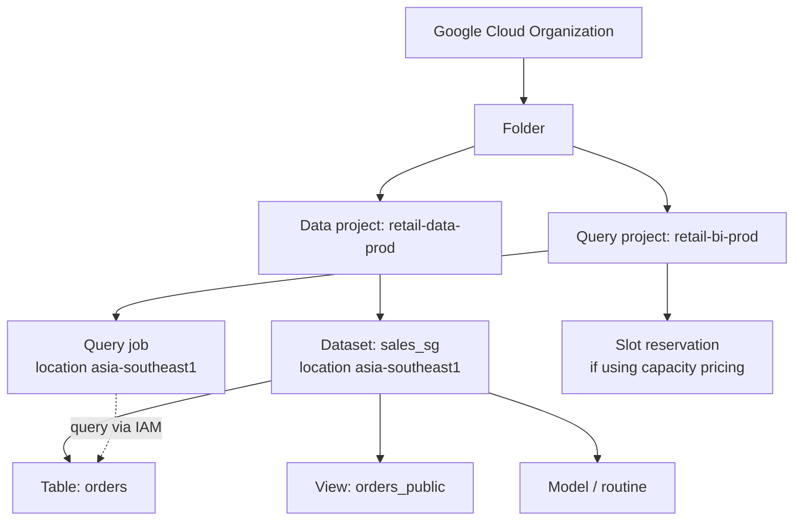

# BigQuery Projects, Datasets, Tables, and Data Locations

A Java application on Cloud Run in Singapore generates orders, the BI team runs queries from a separate project, and the compliance team requires analytical data to be stored in an approved location. If you mistakenly choose `US` as the dataset location, changing the Cloud Run region alone **does not move BigQuery data to Singapore**. To design this properly, you need to understand **which project holds the data**, **which dataset sets the location**, **which dataset a table belongs to**, and **where the job executes**.

This lesson is part of the **BigQuery** chapter of the **CLOUD_PROVIDERS_GCP** module, connecting project organization, IAM, Cloud Run/GKE, and storage/database services with deployment, data protection, reliability, and cost control. The focus is on resource structure and **regional/multi-region locations**; partitioning and clustering are introduced at a level sufficient for hands-on practice.

> Project names, dataset names, table names, and figures in this lesson are illustrative examples only. Creating or deleting data, running queries, or moving datasets can incur charges or cause data loss. Only practice in an authorized project, and never use real customer data. Cross-region features in **Preview** must have their support status verified before use.

## Objectives

After this lesson, you will be able to:

1. Distinguish between **organization/folder/project**, **dataset**, **table/view**, **job**, and **reservation**.
2. Read the identifier formats `project.dataset.table` in GoogleSQL and `project:dataset.table` in `bq`.
3. Choose a region or `US`/`EU` based on residency, locality, latency, quota, and cost, without confusing multi-region with cross-region replication.
4. Explain job location, cross-location data join restrictions, and the **global queries Preview** exception.
5. Create a regional dataset and a partitioned/clustered table, load sample data, and run queries with `bq`/SQL.
6. Inspect metadata in the Console, `bq show`, `INFORMATION_SCHEMA`, and the Java client.
7. Separate permissions between the **query/execution project** and the **data project**; check costs and plan data migrations.

## 1. BigQuery Resource Hierarchy



| Resource | Role | Location Property |
| --- | --- | --- |
| **Organization/folder** | Policy governance / IAM inheritance | Not a table's data location |
| **Project** | Billing, quotas, APIs, IAM, data resources or query jobs | **Does not have a single BigQuery region** |
| **Dataset** | Container for tables, views, models, routines; permission/retention boundary | **`location` chosen at creation** |
| **Table/view** | Physical data or logical query | Belongs to a dataset and inherits its location |
| **Job** | Query/load/copy/extract; has project, ID, and location | Must be compatible with resources/job type |
| **Reservation/slots** | Capacity-based compute capacity | Bound to a location; does not apply across all regions |

A **project can contain multiple datasets in different locations**. Each dataset belongs to one project and one primary location, except when **cross-region replication** is explicitly configured. A table typically belongs to **exactly one dataset**; you cannot place one table in Singapore and another table in Tokyo inside the same dataset.

### Identifiers and Billing Boundaries

```text
GoogleSQL:  `retail-data-prod.sales_sg.orders`
             project        dataset table

bq CLI:    retail-data-prod:sales_sg.orders
REST:      projects/retail-data-prod/datasets/sales_sg/tables/orders
```

In GoogleSQL, identifiers whose project ID contains hyphens should be wrapped in **backticks**. `retail-bi-prod` can submit jobs querying tables in `retail-data-prod` if IAM allows it, but **this does not move the table across projects or regions**.

Under the on-demand model, **storage** is typically billed to the project containing the table, while **query processing** is billed to the project running the job. Under reservations/capacity, charges follow the corresponding model/assignment/location. Teams may use a single project for small labs or separate **data projects**, **compute/query projects**, and **dev/staging/prod projects** when budget governance and security isolation are needed.

## 2. Dataset: Unit of Organization and Data Placement

When creating a dataset, you must specify:

| Property | Example | Impact |
| --- | --- | --- |
| Dataset ID | `sales_sg` | Unique within the project; cannot be renamed directly |
| Location | `asia-southeast1` | Storage location for BigQuery core customer data; **cannot be modified directly after creation** |
| Default table expiration | 7 days in lab | Default for **new tables**; expired tables are deleted |
| Time travel / retention | Per policy and limits | Recovers historical data within the window; does not replace backup/DR |
| Access policies | Data viewer/editor, authorized views | Dataset/table IAM, column/row security when needed |
| Labels/tags | `env=dev`, `team=analytics` | Organization, governance, cost report filtering |

**You cannot directly rename or change the location of an existing dataset.** To move `sales_sg` from Singapore to Tokyo, you must create a new dataset in Tokyo and **copy/migrate/recreate** the data, views, permissions, jobs, and dependencies using a supported procedure; there is no `ALTER SCHEMA SET LOCATION` command that takes immediate effect on an existing dataset.

### Common Objects Inside a Dataset

| Object | Data and Characteristics |
| --- | --- |
| **Native table** | BigQuery manages storage; supports schema, partitioning/clustering, and expiration |
| **View** | SQL definition, typically does not store full results; still has a dataset/location |
| **Materialized view** | Stores managed results with its own refresh policy and cost |
| **External/BigLake table** | Data stays in external sources; colocation/permissions and transfers must be checked |
| **Model/routine** | Other analytical resources inside the dataset, with type-specific location/permission rules |

**Partitioning** (e.g., splitting a table by date) and **clustering** (organizing data by columns) do not change the region or create cross-region copies. They only optimize data scans, query performance, and storage retention.

## 3. Region and Multi-Region Are Not the Same

BigQuery supports **regions** such as `asia-southeast1` (Singapore), `asia-northeast1` (Tokyo), `europe-west4` (Netherlands), and **multi-region identifiers** `US` and `EU`.

| Location | Meaning | Common Use Cases |
| --- | --- | --- |
| `asia-southeast1` | A single region in Singapore | Ingestion and analytics close to Cloud Run/GCS in Singapore |
| `asia-northeast1` | A single region in Tokyo | Data residency or traffic requirements in Japan |
| `US` | BigQuery chooses **a region within the US** | US residency requirements |
| `EU` | BigQuery chooses **a region within the EU** | EU residency requirements for BigQuery Core Customer Data |

**Important:** `US`/`EU` in BigQuery **does not automatically provide redundancy across multiple regions**. Per current location documentation, BigQuery stores and replicates data **across two zones within one region** inside the location; surviving an entire region outage requires **managed DR, dataset replication**, or a separately designed and tested failover architecture.

```text
Dataset A: location = US
Dataset B: location = us-central1

US may geographically contain a region in Iowa,
but in BigQuery US != us-central1 (two distinct resource locations).

Similarly, EU != europe-west4.
```

Do not choose a region based solely on where the administrator is sitting. Before creating a dataset, consider:

- **Residency/compliance** for data, logs, exports, backups, CMEK, replicas, and processing location.
- **Sources/destinations** such as Cloud Storage, Cloud Run/GKE, Dataflow/Spark, BI tools, and Cloud SQL/Spanner federation.
- **Latency/bandwidth/transfer fees**, requirements for external datasets, and region-specific product support.
- **Compute capacity**: slots/reservations by location, quotas, and budgets.
- **RTO/RPO**: a multi-region label is not a DR guarantee; plan separately for regional outages.

For Cloud Storage, colocation rules between **GCS regional/dual/multi-region buckets** and BigQuery datasets differ between **loads** and **external table queries**. For instance, a bucket in the same country may still incur data transfer charges in certain setups; review the location documentation for both services and estimate costs before designing pipelines.

## 4. Query Job Location and Cross-Region Data

A job has `projectId`, `jobId`, and `location`. For **standard queries**, the job's location must be compatible with **every source and destination dataset**. Even a single `FROM` pointing to a dataset in another region can cause an error, even if the SQL syntax is valid.

| Resource / Setting | Location | Conclusion for Standard Query |
| --- | --- | --- |
| Table A | `asia-southeast1` | Read in Singapore |
| Table B | `asia-southeast1` | JOIN with A is location-valid |
| Query job | `asia-southeast1` | Specify explicitly to avoid wrong defaults |
| Table C | `US` | Different location; cannot do a standard JOIN with A |
| Reservation | `asia-southeast1` | Only applies to jobs/assignments in the matching location |

**Setting location:** BigQuery Studio → Query settings; `bq query --location=asia-southeast1`; API job reference; Java `JobId`. In a GoogleSQL script, you can set `SET @@location = 'asia-southeast1';` as the first statement per applicable syntax. If no location is specified, BigQuery infers it from referenced resources/destination/connection, then falls back to the project default; if no default is set and none can be inferred, it may default to `US`.

### Exception: Global Queries (Preview)

Per current documentation, **global queries (Preview)** allow querying across **multiple regions** when enabled at the organization/project level and when the caller holds specific permissions. It **does not** eliminate location constraints for all projects:

1. The job execution project must enable **global query execution** in the execution region; data projects/regions must allow **global data access**.
2. The caller needs `bigquery.jobs.createGlobalQuery` in addition to normal query/data permissions.
3. Intermediate/source data may **be temporarily transferred across regions**; evaluate residency, transfer fees, permissions, and feature limitations.
4. Do not enable Preview in production merely to avoid designing colocation; prefer colocated data or governed copy/pipeline architectures.

### Inspecting Metadata in the Correct Region

Querying `INFORMATION_SCHEMA` requires the matching region qualifier, for example:

```sql
-- Run with job location asia-southeast1.
SELECT schema_name, location, creation_time
FROM `retail-dev-01.region-asia-southeast1.INFORMATION_SCHEMA.SCHEMATA`
WHERE schema_name = 'sales_sg_lab';
```

Dataset `INFORMATION_SCHEMA.TABLES` lists tables/views in the dataset; metadata views do not move data location. With newer cross-region replication features, you can also inspect replication/sync status once configured.

## 5. Lab: Create a Singapore Dataset and an Orders Table

This lab uses **Cloud Shell/Bash**, assumes the BigQuery API is enabled, project `retail-dev-01` has billing authorized, and the operator has permissions to create datasets, tables, and jobs. Replace all illustrative values before running. **Never run against a production data project**.

### 5.1 Read-Only Preflight

```bash
PROJECT_ID="retail-dev-01"
DATASET_ID="sales_sg_lab"
TABLE_ID="orders"
LOCATION="asia-southeast1"

gcloud auth list
gcloud config get-value project
gcloud services list --enabled --project="$PROJECT_ID" \
  --filter="config.name:bigquery.googleapis.com"
bq ls --project_id="$PROJECT_ID"
```

If the API is not enabled yet, someone with Service Usage permissions must enable `bigquery.googleapis.com`. The **`roles/bigquery.user`** role grants permission to create datasets in a project; creating tables and running jobs also requires scoped permissions. Never grant `roles/owner` just to bypass an error.

### 5.2 Create a Dataset with an Explicit Region

```bash
# MUTATES resources; storing or reading data may incur charges.
bq mk --dataset \
  --location="$LOCATION" \
  --description="BigQuery Singapore training dataset" \
  "$PROJECT_ID:$DATASET_ID"

# READ-ONLY: verify location and list tables.
bq show --format=prettyjson "$PROJECT_ID:$DATASET_ID"
bq ls "$PROJECT_ID:$DATASET_ID"
```

Expected output includes `"location": "asia-southeast1"`. If a dataset with the same name already exists in a different location, **do not overwrite or delete it to fix it**; use a new lab name or follow a migration procedure.

### 5.3 Create a Partitioned + Clustered Table

```bash
# MUTATES TABLE. Update the project/dataset literals in the SQL
# if you changed PROJECT_ID or DATASET_ID above.
bq query --project_id="$PROJECT_ID" --location="$LOCATION" \
  --use_legacy_sql=false \
  'CREATE TABLE IF NOT EXISTS `retail-dev-01.sales_sg_lab.orders` (
     order_id STRING NOT NULL,
     tenant_id STRING NOT NULL,
     amount_minor INT64 NOT NULL,
     status STRING,
     created_at TIMESTAMP NOT NULL
   )
   PARTITION BY TIMESTAMP_TRUNC(created_at, DAY)
   CLUSTER BY tenant_id
   OPTIONS (
     require_partition_filter = TRUE,
     description = "Lab orders partitioned by day and clustered by tenant"
   )'

bq show --format=prettyjson "$PROJECT_ID:$DATASET_ID.$TABLE_ID"
```

**Explanation:** partitioning divides data by day from `created_at`; clustering by `tenant_id` helps limit data scanned when filtering by tenant; `require_partition_filter=TRUE` enforces a partition filter on queries. None of these three settings creates a **second region**, replicates data, or alters IAM.

### 5.4 Insert Two Sample Orders and Query

```bash
# MUTATES data; fixed timestamps keep lab results reproducible.
bq query --project_id="$PROJECT_ID" --location="$LOCATION" \
  --use_legacy_sql=false \
  'INSERT INTO `retail-dev-01.sales_sg_lab.orders`
    (order_id, tenant_id, amount_minor, status, created_at)
   VALUES
    ("ord-1001", "tenant-a", 145000, "PAID",
      TIMESTAMP "2026-11-19 02:00:00+00"),
    ("ord-1002", "tenant-b", 99000, "PAID",
      TIMESTAMP "2026-11-19 03:00:00+00")'

# Dry-run: validates SQL and estimates bytes without running the read query.
bq query --project_id="$PROJECT_ID" --location="$LOCATION" \
  --use_legacy_sql=false --dry_run \
  'SELECT tenant_id, SUM(amount_minor) AS amount_minor
   FROM `retail-dev-01.sales_sg_lab.orders`
   WHERE created_at >= TIMESTAMP "2026-11-19 00:00:00+00"
     AND created_at < TIMESTAMP "2026-11-20 00:00:00+00"
     AND tenant_id = "tenant-a"
   GROUP BY tenant_id'

# EXECUTE query with a max bytes billed cap to protect the lab budget.
bq query --project_id="$PROJECT_ID" --location="$LOCATION" \
  --use_legacy_sql=false --maximum_bytes_billed=1000000000 \
  'SELECT tenant_id, COUNT(*) AS order_count,
          SUM(amount_minor) AS amount_minor
   FROM `retail-dev-01.sales_sg_lab.orders`
   WHERE created_at >= TIMESTAMP "2026-11-19 00:00:00+00"
     AND created_at < TIMESTAMP "2026-11-20 00:00:00+00"
     AND tenant_id = "tenant-a"
   GROUP BY tenant_id'
```

If run once on a newly created table, `tenant-a` should return **1 order, 145000 minor currency units**. Running `INSERT` again appends more rows; when re-running the lab, use a fresh dataset or clean up cleanly to avoid skewed results. `--dry_run` and `--maximum_bytes_billed` only help govern **query processing** charges—they do not cap storage, load, write, export, external transfer, or reservation charges.

### 5.5 Inspect Metadata with `INFORMATION_SCHEMA`

```bash
# READ-ONLY metadata in the Singapore region.
bq query --project_id="$PROJECT_ID" --location="$LOCATION" \
  --use_legacy_sql=false \
  'SELECT schema_name, location, creation_time
   FROM `retail-dev-01.region-asia-southeast1.INFORMATION_SCHEMA.SCHEMATA`
   WHERE schema_name = "sales_sg_lab"'

bq query --project_id="$PROJECT_ID" --location="$LOCATION" \
  --use_legacy_sql=false \
  'SELECT table_name, table_type, creation_time
   FROM `retail-dev-01.sales_sg_lab.INFORMATION_SCHEMA.TABLES`
   WHERE table_name = "orders"'
```

`INFORMATION_SCHEMA.SCHEMATA` (region-qualified) and `INFORMATION_SCHEMA.TABLES` return metadata only, not rows from the orders table. A dataset in `US` must be queried through **`region-us`**, not `region-asia-southeast1`. If a caller only has access to certain datasets/tables, returned metadata is also subject to IAM and visibility constraints.

### 5.6 Clean Up Only the Lab Resources

```bash
# STOP and verify IDs and ownership before deleting.
bq show --format=prettyjson "$PROJECT_ID:$DATASET_ID"
bq ls "$PROJECT_ID:$DATASET_ID"

# Only on the LAB dataset when data is no longer needed:
# bq rm --table --force "$PROJECT_ID:$DATASET_ID.$TABLE_ID"
# bq rm --dataset --force "$PROJECT_ID:$DATASET_ID"
```

The delete commands are intentionally **commented out**. Never delete a dataset containing someone else's resources, and never run `--recursive` in production to "fix" a location mistake. Verify billing and retention after cleanup.

## 6. Java SDK: Specifying Data Project and Job Location

On Cloud Run/GKE, Java uses **`com.google.cloud:google-cloud-bigquery`** (version managed by the Google Cloud Libraries BOM) with **Application Default Credentials (ADC)** from the attached service account or Workload Identity. Never store a service account JSON key in the repo or frontend variables.

The example below **only reads** the lab table created earlier and uses an execution project that can differ from the table's project:

```java
import com.google.cloud.bigquery.BigQuery;
import com.google.cloud.bigquery.BigQueryOptions;
import com.google.cloud.bigquery.FieldValueList;
import com.google.cloud.bigquery.JobId;
import com.google.cloud.bigquery.QueryJobConfiguration;
import com.google.cloud.bigquery.TableResult;

public final class QueryOrdersByLocation {
  public static void main(String[] args) throws Exception {
    String jobProject = "retail-bi-dev";     // Project billed for query/job.
    String dataProject = "retail-dev-01";   // Project containing the dataset.
    String region = "asia-southeast1";     // Dataset and job share the same location.

    BigQuery bq = BigQueryOptions.newBuilder()
        .setProjectId(jobProject)
        .build()
        .getService(); // ADC from runtime identity.

    String sql = "SELECT tenant_id, COUNT(*) AS n "
        + "FROM `" + dataProject + ".sales_sg_lab.orders` "
        + "WHERE created_at >= TIMESTAMP '2026-11-19 00:00:00+00' "
        + "AND created_at < TIMESTAMP '2026-11-20 00:00:00+00' "
        + "GROUP BY tenant_id";

    QueryJobConfiguration cfg = QueryJobConfiguration.newBuilder(sql)
        .setUseLegacySql(false)
        .setMaximumBytesBilled(1_000_000_000L)
        .build();

    // JobId with explicit location, required for non-US/EU locations.
    JobId jobId = JobId.newBuilder()
        .setProject(jobProject)
        .setLocation(region)
        .setRandomJob()
        .build();

    TableResult result = bq.query(cfg, jobId);
    for (FieldValueList row : result.iterateAll()) {
      System.out.println(row.get("tenant_id").getStringValue()
          + " = " + row.get("n").getLongValue());
    }
  }
}
```

**To run successfully:** `retail-bi-dev` must exist, the caller must have permission to create jobs in that project, and the runtime SA must have read access to `retail-dev-01.sales_sg_lab.orders`. This Java sample depends on the lab dataset/table, so it will fail if the lab was not created or has already been cleaned up. In real applications, **use query parameters** for user-supplied values—never concatenate client-controlled tenant IDs, SQL inputs, or table names directly.

## 7. IAM: Who Creates Jobs vs. Who Reads Data?

### Two Independent Permissions

Example Cloud Run SA `sa-bi@retail-bi-dev.iam.gserviceaccount.com` reading a dataset in another project:

| Grant Location | Suggested Role/Permission | Purpose |
| --- | --- | --- |
| **Query project** `retail-bi-dev` | `roles/bigquery.jobUser` | Create jobs (`bigquery.jobs.create`) |
| **Data project/dataset** `retail-dev-01.sales_sg_lab` | `roles/bigquery.dataViewer` on dataset or table | Read schema/data (`bigquery.tables.getData`) |
| **Data project/dataset** when writes are needed | `roles/bigquery.dataEditor` or minimal custom role/permissions | Create/update tables within scope |
| **Dataset creator** | `bigquery.datasets.create` (e.g., `roles/bigquery.user` on project) | Create new datasets; does not require project-wide Admin |
| **Administration** | Appropriate IAM/BigQuery permissions | Manage policies, locations, transfers, and security |

**`roles/bigquery.jobUser` alone cannot read data** in a separate dataset. Conversely, having `dataViewer` on a table **without `jobs.create` in the execution project** still prevents running standard SQL jobs. IAM at the project/folder level can be **inherited**, so granting `dataViewer` across the entire data project is often broader than necessary.

### Table-, Row-, and Column-Level Protection

- Dataset/table IAM grants broad role-based access.
- **Row-level access policies** restrict users/groups to authorized rows—never trust a client-selected `WHERE tenant_id=...` filter as an authorization boundary.
- **Column-level security/policy tags/data masking** protect PII columns.
- Authorized views/datasets, audit logs, CMEK, and org policy location restrictions where appropriate.

Do not assume creating a dataset in the EU is sufficient for regulatory compliance: query exports, external tables, logs, regional reservations, credentials, and replication policies must also be evaluated. For sensitive workflows, separate service accounts for ingestion, transformation, and read-only BI.

## 8. Changing Dataset Location: Copy, Not Attribute Mutation

Because dataset location is immutable, moving from `asia-southeast1` to `asia-northeast1` typically involves:

1. **Inventory:** list tables, partitioning, clustering, views, routines, scheduled queries, transfers, connections, IAM, row/column policies, encryption, and downstream consumers.
2. **Create the destination dataset** in the target location; evaluate data residency, org policies, transfer fees, quotas, and budgets.
3. **Transfer data** via supported dataset copy/cross-region copy (BigQuery Data Transfer Service) or an export/load/recreate pipeline; resource types not automatically copied must be handled separately.
4. **Reconcile:** verify row counts, checksums/aggregates, time windows, schema/table metadata, permission tests, and financial figures.
5. **Cut over read/write flows** in a controlled manner: update SQL references, job locations, BI dashboards, CI/IaC, scheduled jobs, and service accounts.
6. **Maintain a rollback window** for a defined period, monitor failed jobs, costs, and late-arriving data; delete the old dataset only after formal sign-off.

### Three Distinct Approaches

| Approach | Strengths | Limitations |
| --- | --- | --- |
| **Dataset copy** via BigQuery Data Transfer Service | Automatically copies many tables/partitions; supports selected location pairs | Has **resource-type limits**, beta/Pre-GA constraints, and does not cut over consumers |
| **Recreate + export/load** | Full control over mapping/schema/transformations | Requires pipeline orchestration and location/transfer-aware GCS staging |
| **Cross-region dataset replication/managed DR** | Maintains a replica for recovery/primary promotion when eligible | Not a simple `location` change on the dataset; has pricing/quota/failover rules |

**Do not assume `bq cp` on tables copies freely across all regions.** Standard copy jobs have location constraints; verify official cross-region copy/replication tooling. Avoid relying on Preview global queries as a long-term substitute for proper data migration when residency or audit constraints apply.

## 9. Observability, Cost Optimization, and Troubleshooting

| Signal | Where to Inspect | Purpose |
| --- | --- | --- |
| Dataset/table location | BigQuery Studio, `bq show`, `INFORMATION_SCHEMA.SCHEMATA` | Detect datasets created in the wrong region |
| Query job location/status | Jobs Explorer, `bq show -j`, `INFORMATION_SCHEMA.JOBS` | Location errors, quota errors, and failed jobs |
| Bytes processed/billed, slot-ms | Job statistics / Cloud Monitoring / Billing | Identify query cost drivers |
| Active/long-term storage | Dataset/table storage metadata, Billing | Track data growth and retention |
| Reservation utilization | Capacity management by region | Prevent jobs from unexpectedly falling back to on-demand |
| Cross-region copy/replication | Transfer runs, replication sync status | Monitor lag and cross-region data transfer fees |
| Unauthorized queries | Cloud Audit Logs, IAM | Distinguish `jobs.create` vs. `tables.getData` failures |

### Common Error Causes

| Symptom | Likely Cause | What to Check |
| --- | --- | --- |
| `Dataset not found in location US` | Dataset is in Singapore, job location is US | `bq show` dataset, `--location`, and job reference |
| JOIN between `US` and `us-central1` fails | Two distinct **resource locations** | Colocate/copy; Preview global queries only when enabled and authorized |
| Java query defaults to the wrong region | Missing location on `JobId` or wrong project default | `JobId.setLocation`, query project, and dataset metadata |
| 403 when creating a job | Missing `bigquery.jobs.create` in execution project | `roles/bigquery.jobUser` on the right project |
| 403 when reading a table | Missing `tables.getData` on data project/dataset | Narrow `dataViewer` scope, policy tags/row restrictions |
| Reservation exists but jobs still run on-demand | Reservation location/assignment mismatch | Reservation location, query job location, and edition |
| EU dataset reads distant GCS source | Transfer/data-access locality mismatch | Bucket location, external/load charges, and policies |
| Delete/copy leaves missing views/permissions | Not all dataset resources are copied automatically | Migration inventory, metadata diff, and cutover tests |
| High p95 latency and rising bill | Full scans, missing partition filters, wrong clustering | Dry run, bytes billed, partition pruning, query plan |

### Safe Operational Practices

1. Record `job_project`, `data_project`, `dataset_location`, SQL, and job ID accurately when reporting errors.
2. Inspect dataset metadata before changing query configuration, IAM, or GCS buckets.
3. Use `--dry_run`, `--maximum_bytes_billed`, partition filters, quotas, and Budget Alerts.
4. For multi-region data, verify authorization **to transfer data out of the location** before enabling global queries or transfers.
5. After changes, compare bytes/slot-ms, SQL outputs, p95 latency, and costs by labels/project.

## 10. Case Study: Singapore Data Project, Japan-Based BI Project

A retail team runs Cloud Run in Singapore and writes order data to `retail-data-prod.sales_sg.orders` (location `asia-southeast1`). The BI team has a separate project `retail-bi-prod` and is headquartered in Tokyo.

**Correct design:** BI jobs are created in `retail-bi-prod` with **location `asia-southeast1`**; the BI service account receives `jobUser` on the BI project and `dataViewer` on the source dataset. **Analysts being physically located in Tokyo does not require running the query job in Tokyo.** Attempting to run a standard query job in `asia-northeast1` against a Singapore table will fail due to location mismatch.

Over the long term, if BI repeatedly reads massive data volumes from Japan and residency permits, you can evaluate **a copied/governed dataset in Tokyo** or a suitable cross-region architecture. However, copying data does not automatically sync every change; you must design transfer schedules, incremental updates, data freshness SLOs, IAM, and cost controls up front.

## 11. Self-Check Exercises

### Exercise 1 — Resource Structure

In `retail-data-prod.sales_sg.orders`, which parts are the project, dataset, and table?

<details>
<summary>Answer</summary>

`retail-data-prod` is the project, `sales_sg` is the dataset, and `orders` is the table. The SQL identifier differs from `bq` CLI syntax `retail-data-prod:sales_sg.orders`.
</details>

### Exercise 2 — Choosing a Storage Location

Cloud Run is in Singapore, most ingestion and analytics are also in Singapore, and there is no US residency requirement. Which location should be evaluated first?

<details>
<summary>Suggested Answer</summary>

`asia-southeast1` is the logical first choice to evaluate for locality. You still must verify compliance, GCS buckets, data pipelines, feature support, and pricing. No single location fits every company.
</details>

### Exercise 3 — Does Multi-Region Provide Automatic DR?

A dataset has location `EU`. Is BigQuery guaranteed to replicate data across multiple regions so the application survives losing an entire region?

<details>
<summary>Answer</summary>

No. BigQuery `EU` selects one region within the EU and stores data with zonal redundancy; cross-region DR requires separate replication/managed DR and tested failover procedures.
</details>

### Exercise 4 — Job in a Different Region

The dataset is in `asia-southeast1`; the job runs in `US`. Does changing only the table identifier solve this?

<details>
<summary>Answer</summary>

No. For standard queries, you must set the job location to match the dataset (`asia-southeast1`), or use a supported cross-region architecture such as global queries Preview when enabled, authorized, and compliant with data movement rules.
</details>

### Exercise 5 — Two Projects, Two Permissions

An SA has `roles/bigquery.jobUser` in the BI project but no permissions on the source table. Can the query read the table automatically?

<details>
<summary>Answer</summary>

No. `jobUser` allows creating jobs, not reading tables in another project. You need `dataViewer` or equivalent data permissions on the source dataset/table.
</details>

### Exercise 6 — Table Partitioning and Dataset Location

Does adding `PARTITION BY created_at` split a Singapore table into Japan?

<details>
<summary>Answer</summary>

No. Time-based partitioning organizes data within the same table/dataset; the dataset's location does not change. The valid SQL syntax for a `TIMESTAMP` column is `PARTITION BY TIMESTAMP_TRUNC(created_at, DAY)`.
</details>

### Exercise 7 — Dataset Copy/Move

A DBA wants to move an existing dataset's location from Singapore to Tokyo using just `ALTER SCHEMA`. Is this accurate?

<details>
<summary>Answer</summary>

No. Location is fixed at creation; you must create a destination dataset and copy/migrate, verify schemas/views/IAM, update job references/locations, maintain rollback, and account for fees and residency.
</details>

### Exercise 8 — Query Costs

Why can `SELECT *` without a partition filter increase costs, and how does `--dry_run` help?

<details>
<summary>Answer</summary>

BigQuery may scan more bytes/partitions, increasing on-demand query processing or consuming more slots. `--dry_run` validates SQL and estimates bytes before execution; actual scan reduction also depends on partitioning, clustering, and filters.
</details>

### Exercise 9 — Global Queries Preview

Someone wants to enable global queries to JOIN US and EU data. Name at least two things that must be approved.

<details>
<summary>Suggested Answer</summary>

Permission `bigquery.jobs.createGlobalQuery` and enabling execution/data-access per project/region, **residency**, temporary cross-region data movement, transfer costs, feature limitations, and governance sign-off.
</details>

## 12. Pre-Production Checklist

- [ ] Organization/project/dataset/table diagram and roles of data vs. job projects are documented.
- [ ] Dataset IDs, labels, retention, and IAM are managed via IaC/change approval.
- [ ] Location is chosen based on data/traffic/residency/quotas/cost and **explicitly set at creation**.
- [ ] Team understands `US`/`EU` does not automatically replicate across regions for DR.
- [ ] Job locations, reservations, source/target datasets, and external sources are aligned.
- [ ] Global queries Preview is not used without explicit approval for cross-region data movement.
- [ ] IAM separates `jobUser` on the execution project from `dataViewer/editor` on datasets/tables.
- [ ] Sensitive data has row/column security, policy tags, audit logging, and tested controls.
- [ ] Query workloads enforce dry runs, maximum bytes billed, partitioning/clustering, and budgets/alerts.
- [ ] Location migrations include a resource inventory, data reconciliation, rollback plan, and monitoring.
- [ ] Jobs/slots/BigQuery storage/transfer/DR costs are tracked by project and location.
- [ ] Lab/production environments have cleanup runbooks to prevent accidental dataset deletion.

## Official References

- [BigQuery resource hierarchy](https://cloud.google.com/bigquery/docs/resource-hierarchy): organization, project, dataset/table, and quota/billing relationships.
- [Introduction to datasets](https://cloud.google.com/bigquery/docs/datasets-intro): dataset objects, location, retention, and replication.
- [Create datasets](https://cloud.google.com/bigquery/docs/datasets): creating datasets and location immutability.
- [BigQuery locations](https://cloud.google.com/bigquery/docs/locations): regions, `US/EU`, job location, colocation, and reservations.
- [Global queries — Preview](https://cloud.google.com/bigquery/docs/global-queries): cross-region querying, dedicated permissions, residency, and costs.
- [Manage datasets](https://cloud.google.com/bigquery/docs/managing-datasets): copying/recreating/migrating locations.
- [Create partitioned tables](https://cloud.google.com/bigquery/docs/creating-partitioned-tables): partitions, clusters, and filters.
- [Run BigQuery queries](https://cloud.google.com/bigquery/docs/running-queries): `bq query`, dry-run, and job settings.
- [INFORMATION_SCHEMA.SCHEMATA](https://cloud.google.com/bigquery/docs/information-schema-datasets-schemata): regional dataset metadata.
- [BigQuery IAM roles](https://cloud.google.com/bigquery/docs/access-control): `jobUser`, `dataViewer`, and resource-level IAM.
- [Java BigQuery API](https://cloud.google.com/java/docs/reference/google-cloud-bigquery/latest/com.google.cloud.bigquery.BigQuery): querying with a location-qualified `JobId`.
- [BigQuery pricing](https://cloud.google.com/bigquery/pricing) and [Cost control](https://cloud.google.com/bigquery/docs/control-costs): bytes, slots, storage, and budgets.
